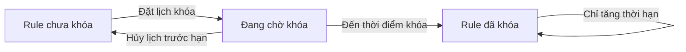

# Retention rules và bảo vệ dữ liệu bất biến

Trong chương **Object Storage và Archive Storage** của module Oracle Cloud Infrastructure (OCI), retention rule giúp bảo vệ các object đã lưu khỏi bị thay đổi hoặc xóa trong thời gian cần giữ. Đây là một thành phần của thiết kế hạ tầng OCI có phân quyền và khả năng kiểm chứng: dữ liệu có thể là chứng từ, log đã kết xuất, gói sao lưu ứng dụng hoặc bản xuất dữ liệu Oracle Database được lưu thành object.

Bài học tập trung vào retention của **OCI Object Storage**. Thời hạn giữ object cần được phối hợp với quy trình sao lưu và khôi phục của ứng dụng; cấu hình ở bucket không tự cấu hình chính sách backup của một dịch vụ cơ sở dữ liệu.

Sau bài học, bạn có thể:

- Chọn rule có thời hạn hoặc không thời hạn theo yêu cầu lưu giữ.
- Tính thời điểm một object hết được bảo vệ và giải thích tác động của việc khóa rule.
- Phân chia quyền ghi dữ liệu, quản lý retention và kiểm tra cấu hình.
- Thực hành tạo rule chưa khóa, kiểm tra hành vi và dọn tài nguyên thử nghiệm.
- Đưa retention vào thiết kế lifecycle, giám sát, khôi phục và dự toán dung lượng.

## Từ nguy cơ xóa nhầm đến WORM

Giả sử ứng dụng thanh toán xuất chứng từ mỗi ngày vào Object Storage. Một lệnh dọn dữ liệu sai có thể xóa cả chứng từ đang cần lưu. Hạn chế quyền xóa giúp giảm rủi ro, nhưng vẫn cần cơ chế bảo vệ ngay tại dịch vụ lưu trữ.

**WORM — Write Once, Read Many** mô tả yêu cầu ghi dữ liệu rồi giữ nội dung để đọc nhiều lần mà không sửa hoặc xóa trong khoảng bảo vệ. Với retention đang áp dụng, OCI chặn các thao tác cập nhật, ghi đè, xóa object và thay đổi metadata của object được bảo vệ. [Oracle: Securing Object Storage](https://docs.oracle.com/en-us/iaas/Content/Security/Reference/objectstorage_security.htm).

Ví dụ thiết kế của bài học:

```text
Ứng dụng tạo chứng từ
        |
        v
Kiểm tra nội dung và mã băm
        |
        v
Bucket chứng từ theo chính sách lưu giữ
        |
        +--> Người có quyền đọc lấy chứng từ
        |
        +--> Thay đổi/xóa bị kiểm tra bởi retention
```

Mã băm giúp đối chiếu nội dung, còn retention đặt ràng buộc lên thao tác tại storage. Vì vậy, nên xác thực chứng từ trước khi đưa vào vùng lưu giữ: nếu ứng dụng xuất sai nội dung, bất biến sẽ giữ nguyên cả nội dung sai đó.

## Phạm vi bucket và đồng hồ của từng object

Rule được cấu hình ở **bucket** và áp dụng cho các object trong bucket. Với rule có thời hạn, thời gian bảo vệ của từng object được tính từ `Last-Modified`, không phải từ ngày tạo rule. [Oracle: Object Storage Data Retention Rules](https://docs.oracle.com/en-us/iaas/Content/Object/Tasks/usingretentionrules.htm).

Với một rule có thời hạn `D`, có thể hình dung:

```text
Mốc kết thúc bảo vệ của object = Last-Modified của object + D
```

Ví dụ tự tính, dùng UTC và thời hạn 30 ngày:

| Object | Last-Modified | Mốc kết thúc theo rule |
| --- | --- | --- |
| `receipts/a.json` | 2026-01-01T00:00:00Z | 2026-01-31T00:00:00Z |
| `receipts/b.json` | 2026-01-20T00:00:00Z | 2026-02-19T00:00:00Z |

Nếu tạo rule vào ngày 25/01/2026, object A còn khoảng 6 ngày, object B còn khoảng 25 ngày. Một object đã cũ hơn thời hạn có thể không còn được rule này bảo vệ ngay khi rule được tạo.

Hệ quả thiết kế: ngày nằm trong tên `receipts/2026-01/a.json` không thay thế `Last-Modified`. Nếu yêu cầu nghiệp vụ tính từ ngày tất toán hoặc ngày đóng hồ sơ, cần có bước đối chiếu mốc nghiệp vụ với mốc lưu trữ trước khi chọn thời hạn.

Do phạm vi là cả bucket, ví dụ này tách chứng từ cần giữ lâu và dữ liệu tạm sang hai bucket. Prefix có thể giúp tổ chức tên object, nhưng không phải bộ lọc riêng của retention rule.

## Chọn kiểu lưu giữ

OCI cung cấp rule **time-bound** với thời hạn theo ngày hoặc năm và rule **indefinite** không có thời điểm hết hạn. Rule indefinite bảo vệ dữ liệu cho đến khi được xóa; nó không có thời hạn để khóa. [Oracle: Creating a Data Retention Rule](https://docs.oracle.com/en-us/iaas/Content/Object/Tasks/usingretentionrules_topic-To_create_a_retention_rule.htm).

| Nhu cầu ví dụ | Lựa chọn | Quyết định vận hành cần có |
| --- | --- | --- |
| Giữ báo cáo trong một khoảng xác định | Time-bound | Ai xác định thời hạn và kiểm tra đơn vị? |
| Lưu hồ sơ phục vụ một vụ việc chưa biết ngày kết thúc | Indefinite | Ai cho phép gỡ giữ và dựa trên hồ sơ nào? |
| Thử nghiệm trong sandbox | Time-bound chưa khóa | Khi nào xóa rule và dữ liệu thử? |

Các khoảng thời gian trong bài chỉ là số liệu minh họa. Thời hạn thực tế cần xuất phát từ phân loại dữ liệu và yêu cầu đã được tổ chức xác định.

Một bucket có thể có nhiều rule. Rule indefinite được xét trước các rule có thời hạn; việc một rule hết thời hạn không đủ kết luận object đã được phép xóa. Cần xét mọi rule còn áp dụng. [Oracle: Scope and Constraints](https://docs.oracle.com/en-us/iaas/Content/Object/Tasks/usingretentionrules.htm).

Ví dụ suy luận: hồ sơ đang có rule 30 ngày và một indefinite hold vẫn phải được giữ sau ngày thứ 30. Gỡ indefinite hold cũng không bỏ qua phần thời gian còn lại của một rule khác.

## Rule có hiệu lực và rule bị khóa là hai việc khác nhau

Ngay khi được tạo và áp dụng, rule đã bảo vệ dữ liệu theo điều kiện của nó. **Lock** bảo vệ cấu hình rule khỏi bị gỡ hoặc giảm thời hạn. OCI yêu cầu khoảng chờ tối thiểu **14 ngày** trước khi khóa có hiệu lực. Khóa là thao tác không thể đảo ngược; sau khi khóa, chỉ được tăng thời hạn, và quản trị tenancy hoặc Oracle Support cũng không thể xóa trực tiếp rule đã khóa. [Oracle: Creating a Data Retention Rule — Locking](https://docs.oracle.com/en-us/iaas/Content/Object/Tasks/usingretentionrules_topic-To_create_a_retention_rule.htm).



Trong thời gian chờ, dữ liệu đã có thể được bảo vệ dù cấu hình rule vẫn còn khả năng thay đổi. Vì vậy, đừng dùng 14 ngày chờ khóa như một khoảng được tự do ghi đè dữ liệu.

Trường `time-rule-locked` biểu diễn thời điểm khóa. Một giá trị nằm trong tương lai là lịch khóa, chưa chứng minh rule hiện đã khóa. CLI cho phép bỏ lịch bằng giá trị rỗng trước khi mốc đó trôi qua; thuộc tính này không sửa được khi rule đã khóa. [Oracle CLI: retention-rule update](https://docs.oracle.com/en-us/iaas/tools/oci-cli/latest/oci_cli_docs/cmdref/os/retention-rule/update.html).

Trong triển khai thật, nên lưu bằng chứng cấu hình và quyết định khóa ở một thay đổi riêng. Danh sách cần xác nhận gồm bucket, compartment, region, loại dữ liệu, thời hạn, khả năng phục hồi và dự toán dung lượng.

**Hết thời hạn của object không có nghĩa rule tự biến mất.** Object mới vẫn chịu thời hạn của rule hiện có. Rule đã khóa chỉ có thể được loại bỏ thông qua xóa bucket, mà bucket phải rỗng trước; đây không phải lối tắt để xóa object đang được bảo vệ. [Oracle: Troubleshooting Retention Rules](https://docs.oracle.com/en-us/iaas/Content/Object/Troubleshooting/usingretentionrules_topic-Troubleshooting_Retention_Rules.htm).

## Phân quyền theo trách nhiệm

Một thiết kế gợi ý cho compartment `Records`:

| Vai trò | Công việc | Quyền nên tách riêng |
| --- | --- | --- |
| Ứng dụng xuất chứng từ | Ghi object với tên mới | Gỡ retention, khóa rule, xóa dữ liệu |
| Nhóm quản trị lưu trữ | Quản lý bucket và cấu hình lưu giữ | Quyết định khóa dài hạn |
| Người chịu trách nhiệm lưu giữ | Xác nhận thời hạn, điều phối khóa | Quyền chạy ứng dụng hằng ngày |
| Người kiểm tra | Đọc cấu hình, xem bằng chứng | Sửa retention |

Theo tài liệu OCI, tạo hoặc quản lý retention cần `BUCKET_UPDATE` và `RETENTION_RULE_MANAGE`; thao tác khóa còn cần `RETENTION_RULE_LOCK`. Thiếu quyền khóa có thể làm thao tác khóa thất bại dù tạo rule chưa khóa vẫn được. [Oracle: Troubleshooting Retention Rules](https://docs.oracle.com/en-us/iaas/Content/Object/Troubleshooting/usingretentionrules_topic-Troubleshooting_Retention_Rules.htm).

Ví dụ policy sau chỉ phục vụ vai trò **đọc cấu hình bucket** trong compartment được chỉ định:

```text
Allow group RecordsReaders to read buckets in compartment Records
```

Tên group và compartment cần được thay theo môi trường, bao gồm cách định danh group trong identity domain nếu áp dụng. Policy này không tự cấp quyền tải nội dung object.

Các API `GetRetentionRule` và `ListRetentionRules` dùng quyền đọc bucket. Policy `manage buckets` bao hàm các quyền quản lý retention, nên cần xem kỹ phạm vi thay vì cấp rộng chỉ để xem cấu hình. [Oracle: Details for Object Storage and Archive Storage](https://docs.oracle.com/en-us/iaas/Content/Identity/Reference/objectstoragepolicyreference.htm).

Đối với ứng dụng ghi dữ liệu, tên object nên có định danh duy nhất. Khi sửa một chứng từ, ứng dụng có thể ghi chứng từ điều chỉnh dưới tên mới và liên kết tới chứng từ cũ, thay vì phụ thuộc vào ghi đè một tên cố định như `latest.json`.

## Kết hợp với các tính năng lưu trữ khác

### Versioning

Không thể thêm retention rule khi versioning đang enabled; cũng không thể bật versioning khi có retention đang hoạt động. OCI cho phép thêm retention khi versioning suspended, nhưng không cho resume versioning khi retention còn active. Suspended có thể vẫn để lại phiên bản cũ, nên việc chuyển đổi cần kiểm kê dữ liệu đã có. [Oracle: Object Storage Versioning](https://docs.oracle.com/en-us/iaas/Content/Object/Tasks/usingversioning.htm).

Để học retention, bài thực hành dùng bucket mới chưa bật versioning. Cách này tránh làm thay đổi mô hình dữ liệu của một bucket đang phục vụ ứng dụng.

### Lifecycle

Lifecycle thực hiện hành động như chuyển tier và dọn dữ liệu theo điều kiện; nó không phải cơ chế xác định dữ liệu bắt buộc phải được giữ. Hành động lifecycle diễn ra bất đồng bộ, nên thời điểm đủ điều kiện không đồng nghĩa đã xử lý xong. [Oracle: Object Lifecycle Management](https://docs.oracle.com/en-us/iaas/Content/Object/Tasks/usinglifecyclepolicies.htm).

Lifecycle có thể chuyển tier của object được retention bảo vệ, nhưng không thể xóa object còn được bảo vệ. Multipart upload chưa commit không được retention bảo vệ và có thể được dọn riêng. [Oracle: Interaction Between Retention and Other Features](https://docs.oracle.com/en-us/iaas/Content/Object/Tasks/usingretentionrules.htm).

Ví dụ thiết kế: giữ chứng từ 365 ngày, cân nhắc chuyển Archive sau 90 ngày, chỉ để lifecycle xóa sau khi mọi ràng buộc lưu giữ đã hết. Nếu xuất hiện hold không thời hạn, điều kiện xóa dự kiến ban đầu phải nhường cho hold đó.

### Replication và khả năng khôi phục

Không tạo được retention rule trên bucket đang là replication destination. Tài liệu retention cũng giới hạn việc sử dụng bucket có rule làm đích replication. [Oracle: Retention and Replication](https://docs.oracle.com/en-us/iaas/Content/Object/Tasks/usingretentionrules.htm).

Replication của Object Storage hoạt động bất đồng bộ. Những lần xóa tại nguồn sau khi cấu hình replication cũng được truyền sang đích; các object đã tồn tại trước khi tạo policy không tự được replication đưa sang. [Oracle: Object Storage Replication](https://docs.oracle.com/en-us/iaas/Content/Object/Tasks/usingreplication.htm).

Hệ quả kiến trúc: cần thử nghiệm riêng đường sao chép, dữ liệu cũ, phân quyền và đường phục hồi. Nếu thiết kế yêu cầu một bản sao bất biến ở nơi khác, phải chứng minh cơ chế đưa dữ liệu tới nơi đó đáp ứng yêu cầu; không chỉ suy ra từ việc đã có replication.

### Archive và mã hóa

Storage tier quyết định đặc tính truy xuất và chi phí. Archive cần khôi phục object trước khi đọc và có thời gian lưu tối thiểu liên quan tới tính phí. Các thuộc tính này cần được xét cùng thời hạn lưu giữ, nhưng không thay thế retention rule. [Oracle: Object Storage Storage Tiers](https://docs.oracle.com/en-us/iaas/Content/Object/Concepts/understandingstoragetiers.htm).

Một bản sao còn tồn tại cũng cần đọc được để phục hồi. Với khóa mã hóa do khách hàng quản lý, nên tách quyền quản trị khóa, bảo vệ việc xóa khóa và thử quy trình giải mã/khôi phục. Oracle khuyến nghị hạn chế chặt quyền tạo, xoay vòng và xóa khóa. [Oracle: Securing Object Storage](https://docs.oracle.com/en-us/iaas/Content/Security/Reference/objectstorage_security.htm).

## Thực hành: retention chưa khóa trên bucket riêng

Mục tiêu là quan sát bảo vệ dữ liệu và khả năng quản trị rule chưa khóa. Các lệnh dưới đây là hướng dẫn để người học chạy trong **OCI Cloud Shell hoặc Bash có OCI CLI đã cấu hình**. Không đặt lịch khóa trong bài thực hành này.

### Chuẩn bị

Tạo trước một bucket private mới trong compartment sandbox, storage tier Standard, chưa bật versioning và không là replication destination. Dùng bucket chỉ chứa dữ liệu giả của bài này. Tài khoản thực hành cần quyền tạo/quản lý retention và quyền đọc, tạo, ghi đè, xóa object thử nghiệm để tránh nhầm lỗi IAM với kết quả của retention.

Thiết lập đúng region, namespace và tên bucket:

```bash
export OCI_REGION='ap-singapore-1'
export OCI_NAMESPACE='<namespace-cua-tenancy>'
export LAB_BUCKET='<ten-bucket-sandbox-rieng>'

# Chọn region đã được tenancy sử dụng; thay các giá trị trước khi chạy.
oci os bucket get \
  --region "$OCI_REGION" \
  --namespace-name "$OCI_NAMESPACE" \
  --bucket-name "$LAB_BUCKET"
```

Đọc kết quả để xác nhận đúng bucket và trạng thái versioning. Nếu gặp lỗi, dừng ở bước chuẩn bị và giải quyết region, namespace hoặc quyền; không chuyển sang thử trên một bucket sản xuất.

### Bước 1: ghi object gốc

```bash
LAB_WORKDIR=$(mktemp -d)
LAB_OBJECT="retention-demo/$(date -u +%Y%m%dT%H%M%SZ)-$$.txt"

printf '%s\n' 'receipt-demo-v1' > "$LAB_WORKDIR/original.txt"
printf '%s\n' 'receipt-demo-v2' > "$LAB_WORKDIR/replacement.txt"

oci os object put \
  --region "$OCI_REGION" \
  --namespace-name "$OCI_NAMESPACE" \
  --bucket-name "$LAB_BUCKET" \
  --name "$LAB_OBJECT" \
  --file "$LAB_WORKDIR/original.txt" \
  --no-multipart
```

Dùng file nhỏ và `--no-multipart` để phép thử tập trung vào object hoàn chỉnh. `object put` có thể tạo object mới hoặc ghi đè object cùng tên; phần sau sẽ cố tình thử trường hợp ghi đè. [Oracle CLI: object put](https://docs.oracle.com/en-us/iaas/tools/oci-cli/latest/oci_cli_docs/cmdref/os/object/put.html).

### Bước 2: tạo rule một ngày, chưa khóa

```bash
RULE_ID=$(oci os retention-rule create \
  --region "$OCI_REGION" \
  --namespace-name "$OCI_NAMESPACE" \
  --bucket-name "$LAB_BUCKET" \
  --display-name 'lab-retain-one-day' \
  --time-amount 1 \
  --time-unit DAYS \
  --query 'data.id' \
  --raw-output)

printf 'RULE_ID=%s\n' "$RULE_ID"
```

Dừng nếu CLI báo lỗi hoặc `RULE_ID` không có giá trị hợp lệ. Lưu ID để đọc đúng rule và dọn đúng tài nguyên.

Không bỏ `--time-amount`: khi không có thời hạn, lệnh tạo có thể tạo rule giữ vô thời hạn. Rule mới thường mất khoảng 30 giây để có hiệu lực; nếu kiểm tra quá sớm, cần xem trạng thái và thử lại sau khoảng đồng bộ. [Oracle CLI: retention-rule create](https://docs.oracle.com/en-us/iaas/tools/oci-cli/latest/oci_cli_docs/cmdref/os/retention-rule/create.html).

### Bước 3: đọc lại cấu hình

```bash
oci os retention-rule get \
  --region "$OCI_REGION" \
  --namespace-name "$OCI_NAMESPACE" \
  --bucket-name "$LAB_BUCKET" \
  --retention-rule-id "$RULE_ID"
```

Kiểm tra `duration.time-amount` bằng `1`, `duration.time-unit` bằng `DAYS` và `time-rule-locked` là `null`. Lệnh `get` dùng bucket và rule ID; kết quả còn có thời điểm tạo/sửa và ETag để phục vụ đối chiếu. [Oracle: Getting a Retention Rule's Details](https://docs.oracle.com/en-us/iaas/Content/Object/Tasks/usingretentionrules_topic-Get_retention_rule.htm).

`time-rule-locked: null` trong phép thử này nghĩa là chưa có lịch khóa. Điều đó không có nghĩa object được phép xóa trong ngày bảo vệ.

### Bước 4: thử đọc, ghi đè và xóa

Trước hết tải object vào một file mới trong thư mục tạm:

```bash
oci os object get \
  --region "$OCI_REGION" \
  --namespace-name "$OCI_NAMESPACE" \
  --bucket-name "$LAB_BUCKET" \
  --name "$LAB_OBJECT" \
  --file "$LAB_WORKDIR/downloaded.txt"

cmp "$LAB_WORKDIR/original.txt" "$LAB_WORKDIR/downloaded.txt"
```

Kỳ vọng: tải được dữ liệu nếu có quyền đọc, `cmp` không phát hiện khác biệt. Sau đó thử ghi đè:

```bash
oci os object put \
  --region "$OCI_REGION" \
  --namespace-name "$OCI_NAMESPACE" \
  --bucket-name "$LAB_BUCKET" \
  --name "$LAB_OBJECT" \
  --file "$LAB_WORKDIR/replacement.txt" \
  --no-multipart \
  --force
```

Kỳ vọng: dịch vụ từ chối do object còn trong thời gian retention. `--force` chỉ bỏ bước hỏi xác nhận của CLI; nó không nâng quyền và không vượt ràng buộc của dịch vụ.

Thử xóa đúng object giả vừa tạo:

```bash
oci os object delete \
  --region "$OCI_REGION" \
  --namespace-name "$OCI_NAMESPACE" \
  --bucket-name "$LAB_BUCKET" \
  --object-name "$LAB_OBJECT" \
  --force
```

Kỳ vọng: dịch vụ tiếp tục từ chối. Cú pháp `object delete` nhắm object theo tên trong bucket; `--force` không biến một thao tác bị retention chặn thành thao tác được phép. [Oracle CLI: object delete](https://docs.oracle.com/en-us/iaas/tools/oci-cli/latest/oci_cli_docs/cmdref/os/object/delete.html).

Ghi lại thời điểm thử, mã lỗi, thông báo và request ID nếu có. Một lỗi thiếu quyền cũng làm lệnh thất bại, nên bằng chứng phải chỉ ra nguyên nhân liên quan tới retention. Nếu ghi đè hoặc xóa thành công, không tiếp tục coi bài thử đã đạt; kiểm tra lại bucket, rule và khoảng thời gian áp dụng.

### Bước 5: xóa rule chưa khóa và dọn object giả

Bước này dành riêng cho bucket sandbox của bài học. Rule chưa khóa có thể bị người có đủ quyền gỡ, qua đó minh họa vì sao cấu hình chưa khóa vẫn cần được bảo vệ bằng IAM và quy trình thay đổi.

```bash
oci os retention-rule delete \
  --region "$OCI_REGION" \
  --namespace-name "$OCI_NAMESPACE" \
  --bucket-name "$LAB_BUCKET" \
  --retention-rule-id "$RULE_ID"
```

Đọc câu hỏi xác nhận và xác nhận đúng rule thử nghiệm. API/CLI xóa rule dùng bucket và rule ID; kiểm tra lại danh sách rule sau khi thao tác hoàn tất. [Oracle: Deleting a Data Retention Rule](https://docs.oracle.com/en-us/iaas/Content/Object/Tasks/usingretentionrules_topic-To_delete_a_retention_rule.htm).

Sau khi xác nhận rule đã được gỡ và thay đổi đã áp dụng, xóa object giả:

```bash
oci os object delete \
  --region "$OCI_REGION" \
  --namespace-name "$OCI_NAMESPACE" \
  --bucket-name "$LAB_BUCKET" \
  --object-name "$LAB_OBJECT" \
  --force

oci os retention-rule list \
  --region "$OCI_REGION" \
  --namespace-name "$OCI_NAMESPACE" \
  --bucket-name "$LAB_BUCKET" \
  --all
```

Danh sách rule giúp phát hiện rule khác còn tồn tại trên bucket. Với automation, đọc hết các trang kết quả thay vì chỉ dựa vào trang đầu. [Oracle: Listing Data Retention Rules](https://docs.oracle.com/en-us/iaas/Content/Object/Tasks/usingretentionrules_topic-To_list_retention_rules.htm).

Các file tải xuống vẫn nằm ở đường dẫn trong `$LAB_WORKDIR`. Người học có thể kiểm tra rồi xóa thư mục tạm đó và xóa bucket sandbox sau khi xác nhận không còn dữ liệu. Không dùng thao tác xóa hàng loạt trên bucket dùng chung để dọn bài thực hành.

## Đặt lịch khóa trong triển khai thật

Đây là mẫu thao tác riêng cho một rule **time-bound đã được kiểm tra**, không thuộc chuỗi lệnh sandbox bên trên:

```bash
# Chỉ dùng sau khi thay đúng thông tin rule và xác nhận quyết định khóa.
# LOCK_AT_UTC phải là RFC 3339, cách hiện tại ít nhất 14 ngày.
LOCK_AT_UTC='<YYYY-MM-DDTHH:MM:SSZ>'

oci os retention-rule update \
  --region "$OCI_REGION" \
  --namespace-name "$OCI_NAMESPACE" \
  --bucket-name '<bucket-luu-giu-that>' \
  --retention-rule-id '<rule-id-da-xac-nhan>' \
  --time-rule-locked "$LOCK_AT_UTC"
```

Không tính mốc khóa từ múi giờ máy một cách ngầm định. Lưu mốc UTC trong hồ sơ thay đổi, đọc lại rule và so sánh với thời gian hiện tại. Nếu có nhiều người hoặc pipeline cùng quản lý, có thể dùng ETag với `--if-match` để hạn chế ghi đè cấu hình vừa thay đổi. [Oracle CLI: retention-rule update](https://docs.oracle.com/en-us/iaas/tools/oci-cli/latest/oci_cli_docs/cmdref/os/retention-rule/update.html).

Một quy trình triển khai gợi ý:

1. Chốt phân loại dữ liệu và các mốc nghiệp vụ cần giữ.
2. Tạo bucket riêng và rule chưa khóa; thử dữ liệu đại diện.
3. Thử quy trình ghi, đọc, khôi phục và lifecycle trong môi trường phù hợp.
4. Xem lại quyền ứng dụng, quyền thay đổi rule, khóa mã hóa và chi phí.
5. Đặt lịch khóa, phân công người theo dõi đến mốc có hiệu lực.
6. Sau mốc khóa, đọc lại cấu hình và lưu bằng chứng cho vận hành.

Nếu dùng hạ tầng dưới dạng mã, cấu hình retention cần được xem xét như tài nguyên có vòng đời riêng. Tránh thiết kế pipeline mặc định phải xóa và tạo lại bucket để triển khai mỗi phiên bản ứng dụng.

## Giám sát và bằng chứng vận hành

OCI Audit ghi nhận các lời gọi API được hỗ trợ. Đối với Object Storage, Audit hỗ trợ sự kiện liên quan tới bucket và không ghi các sự kiện thao tác object; vì vậy không thể chỉ dựa vào Audit để chứng minh mọi lần đọc/xóa từng object. [Oracle: Overview of Audit](https://docs.oracle.com/en-us/iaas/Content/Audit/Concepts/auditoverview.htm).

Một bộ bằng chứng vận hành gợi ý gồm:

| Bằng chứng | Mục đích |
| --- | --- |
| Namespace, region, compartment và tên bucket | Xác định đúng tài nguyên |
| Rule ID, thời hạn, lịch khóa và thời điểm đọc | Đối chiếu cấu hình lưu giữ |
| Sự kiện thay đổi bucket/rule có sẵn trong Audit | Xác định chủ thể và thao tác quản trị |
| Phản hồi của phép thử ghi đè/xóa | Phân biệt chặn bởi retention và chặn bởi IAM |
| Kết quả tải xuống, mã băm và diễn tập khôi phục | Kiểm tra dữ liệu có thể dùng được |
| Dung lượng theo kỳ và thay đổi tốc độ ghi | Dự báo nhu cầu lưu trữ |

Khi tự động kiểm tra, cần phân biệt các trạng thái: rule không có lịch khóa, rule đang chờ khóa, rule đã qua mốc khóa và lần đọc cấu hình bị lỗi. Một lần gọi API lỗi không được diễn giải thành “không có retention”.

## Dự toán dung lượng và xử lý sự cố

Với dữ liệu ghi đều và thời hạn cố định, có thể dùng ước lượng ban đầu:

```text
Dung lượng ổn định xấp xỉ = lượng dữ liệu mới mỗi ngày × số ngày giữ
```

Ví dụ tự tính: 20 GiB/ngày và 180 ngày giữ tạo mức nền khoảng **3.600 GiB**. Nếu tăng thành 365 ngày thì mức nền khoảng **7.300 GiB**, chưa kể hold, bản sao, dữ liệu tồn đọng và tăng trưởng. Đây là ước lượng dung lượng, không phải báo giá OCI.

Khi chuyển Archive, cần tính thêm chi phí và thời gian phục hồi, cũng như điều kiện tính phí của tier. Một rule khóa dài hạn có thể làm quyết định thời hạn ảnh hưởng ngân sách qua nhiều chu kỳ, nên dự toán phải đi cùng quyết định lưu giữ.

| Hiện tượng | Cách kiểm tra |
| --- | --- |
| Không tạo được rule | Xem quyền, bucket đích và trạng thái versioning |
| Tạo được nhưng không khóa được | Xem quyền khóa, loại rule và mốc UTC |
| Object cũ xóa được sau khi thêm rule | Tính tuổi từ Last-Modified; xem rule nào còn bảo vệ |
| Object vẫn không xóa được sau mốc dự kiến | Liệt kê tất cả rule, tìm hold và kiểm tra IAM |
| Lifecycle chưa dọn dữ liệu | Kiểm tra retention còn hiệu lực, quyền service và xử lý bất đồng bộ |
| Không đọc được bản lưu dù object còn tồn tại | Kiểm tra quyền đọc, tier, trạng thái restore và khóa mã hóa |
| Pipeline không xóa được bucket | Kiểm kê object và cấu hình retention trước khi đổi cách triển khai |

Đối với rule đã khóa sai, không lập kế hoạch dựa trên giả định sẽ gỡ được bằng tài khoản có quyền cao hơn. Cần ngừng đưa thêm dữ liệu không phù hợp vào bucket, xác định phạm vi tác động và phối hợp vận hành theo thời hạn còn hiệu lực.

## Tự kiểm tra mức độ hiểu

- **Vì sao tạo rule 30 ngày hôm nay không làm mọi object cũ được giữ thêm 30 ngày?** Vì mốc tính của từng object là Last-Modified.
- **Rule chưa khóa có bảo vệ dữ liệu không?** Có khi rule áp dụng; điểm còn thay đổi được là cấu hình rule bởi người có đủ quyền.
- **Vì sao thời gian chờ khóa và thời hạn lưu dữ liệu không thể dùng thay nhau?** Chúng kiểm soát hai việc khác nhau: khả năng sửa rule và khoảng bảo vệ object.
- **Object hết thời hạn có bị xóa ngay không?** Cần có thao tác xóa được phép hoặc một cơ chế dọn dữ liệu; vẫn phải xét các rule khác.
- **Bất biến đã đủ cho khôi phục chưa?** Cần thêm dữ liệu đúng, quyền đọc, khóa mã hóa còn dùng được và một quy trình khôi phục đã thử.

Kết quả cần đạt của bài thực hành là một bộ ghi nhận rõ ràng: đúng bucket thử nghiệm, rule một ngày chưa khóa, đọc thành công, ghi đè/xóa bị retention chặn, sau đó rule và object giả được dọn. Với hệ thống thật, quyết định khóa phải gắn với vòng đời dữ liệu, khả năng khôi phục và trách nhiệm vận hành của tổ chức.