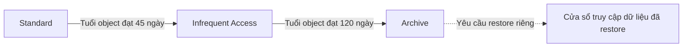

# Lifecycle policies và tự động chuyển lớp lưu trữ

Trong chương **Object Storage và Archive Storage** của module **CLOUD_PROVIDERS_ORACLE**, bài học này hướng dẫn thiết kế vòng đời dữ liệu trên Oracle Cloud Infrastructure (OCI). Trọng tâm là biến yêu cầu về thời gian truy cập, lưu giữ và chi phí thành các rule có phạm vi rõ ràng, có phân quyền và có cách theo dõi kết quả.

Sau bài học, bạn có thể:

- Chọn thời điểm chuyển dữ liệu giữa Standard, Infrequent Access và Archive theo nhu cầu sử dụng.
- Viết lifecycle policy với đúng action, target, mốc thời gian và bộ lọc tên object.
- Phân biệt quyền của người cấu hình với quyền của dịch vụ thực thi.
- Triển khai thử trên bucket lab, đọc lại cấu hình và quan sát thay đổi thực tế.
- Giải thích chi phí, giới hạn khôi phục và tương tác với versioning, retention rules.

## Bài toán: dữ liệu cần giữ lâu nhưng không cần truy cập thường xuyên

Một ứng dụng chạy trên OCI Compute xuất nhật ký xử lý đơn hàng vào Object Storage. Nhóm vận hành dùng log mới để xử lý lỗi; log cũ chỉ phục vụ đối soát. Nhóm cơ sở dữ liệu cũng xuất các tệp sao lưu vào kho lưu trữ, nhưng những tệp cần cho phục hồi gần nhất phải sẵn sàng đọc ngay.

Nếu đặt tất cả vào Standard vô thời hạn, chi phí tăng theo lượng dữ liệu tích lũy. Nếu chuyển toàn bộ sang Archive quá sớm, một yêu cầu điều tra hoặc phục hồi có thể phải chờ dữ liệu được restore.

Một thiết kế hợp lý bắt đầu bằng câu hỏi của từng tập dữ liệu:

| Câu hỏi | Ví dụ câu trả lời | Hệ quả thiết kế |
| --- | --- | --- |
| Bao lâu còn cần truy cập thường xuyên? | Log của 45 ngày gần nhất | Giữ Standard trong giai đoạn đầu |
| Khi ít dùng, có cần đọc ngay không? | Vẫn phải đọc ngay để đối soát | Cân nhắc Infrequent Access |
| Bao giờ chấp nhận chờ restore? | Từ khoảng ngày thứ 120 | Cân nhắc Archive |
| Khi nào được phép xóa? | Theo lịch lưu giữ đã được chủ dữ liệu thống nhất | Tách quyết định xóa khỏi quyết định chuyển lớp |
| Dữ liệu nào cần ngoại lệ? | Tệp thuộc một đợt điều tra | Tách bucket hoặc thiết kế bộ lọc và cơ chế bảo vệ phù hợp |

Đây là tình huống minh họa, không phải lịch áp dụng chung cho mọi workload. Với dữ liệu sao lưu Oracle Database, cần đưa yêu cầu thời gian phục hồi vào quyết định chọn lớp lưu trữ; một bản sao lưu rẻ nhưng không đáp ứng thời gian phục hồi có thể không phù hợp.

## Các lớp lưu trữ và ranh giới của lifecycle

| Lớp | Nhu cầu chính | Truy cập | Điểm cần tính vào phương án |
| --- | --- | --- | --- |
| Standard | Dữ liệu sử dụng thường xuyên | Đọc ngay | Giá lưu trữ cao hơn các lớp lạnh |
| Infrequent Access | Ít sử dụng nhưng cần đọc ngay | Đọc ngay | Phí truy xuất; thời gian lưu tối thiểu tính phí 31 ngày |
| Archive | Hiếm sử dụng, giữ dài hạn | Restore trước khi đọc | Thời gian lưu tối thiểu tính phí 90 ngày |

Bucket có lớp mặc định Standard có thể chứa object ở cả ba lớp. Chuyển lớp của object không chuyển object sang bucket khác và không đổi lớp mặc định của bucket. Xem [Storage Tiers của OCI](https://docs.oracle.com/en-us/iaas/Content/Object/Concepts/understandingstoragetiers.htm).

Archive cần quy trình restore riêng; lifecycle không có action tự restore object về Standard. Xem [tổng quan Archive Storage](https://docs.oracle.com/en-us/iaas/Content/Archive/Concepts/archivestorageoverview.htm).

Vì vậy, một policy chuyển lớp không thay thế bản sao dự phòng ở nơi khác. Khi thiết kế tính sẵn sàng, hãy xác định riêng vị trí lưu bản sao, đường truy cập, quyền truy cập và phương án phục hồi.

## Cấu trúc một lifecycle rule

Một lifecycle policy là tập hợp rule gắn với một bucket. Mỗi rule cần trả lời: tác động lên tài nguyên nào, thực hiện việc gì, vào mốc tuổi nào và có đang được bật hay không.

| Trường JSON | Ý nghĩa | Ví dụ |
| --- | --- | --- |
| `name` | Tên để vận hành và truy vết | `logs-to-archive-120d` |
| `target` | Loại tài nguyên | `objects` |
| `action` | Hành động | `ARCHIVE` |
| `timeAmount` | Giá trị tuổi | `120` |
| `timeUnit` | Đơn vị tuổi | `DAYS` |
| `isEnabled` | Trạng thái bật | `false` |
| `objectNameFilter` | Phạm vi tên object | Prefix `logs/orders/` |

Các tổ hợp action và target:

| Target | Action phù hợp |
| --- | --- |
| `objects` | `INFREQUENT_ACCESS`, `ARCHIVE`, `DELETE` |
| `previous-object-versions` | `INFREQUENT_ACCESS`, `ARCHIVE`, `DELETE` |
| `multipart-uploads` | `ABORT` |

`INFREQUENT_ACCESS` chuyển object Standard sang Infrequent Access; `ARCHIVE` chuyển object Standard hoặc Infrequent Access sang Archive. `ABORT` hủy multipart upload chưa hoàn tất và loại bỏ các part. Tên action cần giữ đúng giá trị API. Xem [mô hình ObjectLifecycleRule](https://docs.oracle.com/en-us/iaas/tools/python/latest/api/object_storage/models/oci.object_storage.models.ObjectLifecycleRule.html).

Trong bucket có versioning, `objects` tương ứng với phiên bản hiện hành; rule cho phiên bản cũ phải dùng target riêng. Khi đọc một policy, hãy kiểm tra target trước khi diễn giải tác dụng của action.

## Mốc tuổi: không cộng dồn thời gian của các rule

Đối với object thông thường, mốc tuổi được tính từ thời gian sửa đổi cuối cùng của object, không phải ngày tạo policy. Đơn vị ngày được xác định theo UTC. Xem [quy định time_amount và time_unit](https://docs.oracle.com/en-us/iaas/tools/terraform-provider-oci/latest/docs/r/objectstorage_object_lifecycle_policy.html).

Giả sử thiết kế hai rule cho cùng một prefix:

- Chuyển sang Infrequent Access khi object đạt tuổi 45 ngày.
- Chuyển sang Archive khi object đạt tuổi 120 ngày.

Mốc Archive là tuổi 120 ngày của object, không phải 120 ngày kể từ lần chuyển sang Infrequent Access. Theo lịch dự kiến, object ở Infrequent Access khoảng 75 ngày nếu hai lần chuyển được thực hiện gần các mốc thiết kế.



Sơ đồ thể hiện lịch mong muốn. Mỗi rule được đánh giá theo điều kiện của chính nó; không có thao tác gọi rule kế tiếp như trong một chuỗi công việc. Object đã đủ tuổi Archive không cần được đưa vào một giai đoạn Infrequent Access mới kéo dài 75 ngày.

Một số tình huống cần tính trước:

- **Object đã cũ khi bật policy:** policy có thể tác động đến dữ liệu hiện có đã đủ điều kiện; không chỉ dữ liệu được tải lên sau đó.
- **Ứng dụng ghi đè liên tục:** tuổi dùng để đánh giá có thể bắt đầu lại theo lần ghi đè; nên dùng tên riêng theo đợt xuất nếu muốn mỗi đợt có vòng đời độc lập.
- **Đọc object thường xuyên:** lifecycle theo tuổi không diễn giải lịch đọc thành mốc “không được truy cập trong N ngày”.
- **Múi giờ địa phương:** đừng dùng ngày hiển thị trên máy cá nhân để kết luận rule bị trễ khi chưa quy đổi UTC.

Với rule archive hoặc delete cho phiên bản cũ, số ngày được tính từ khi phiên bản đó chuyển từ hiện hành thành phiên bản cũ. Ví dụ v1 tạo từ ngày 1 nhưng bị v2 thay thế vào ngày 20: mốc bắt đầu đếm cho rule phiên bản cũ là ngày 20. Xem [hướng dẫn tạo lifecycle rule](https://docs.oracle.com/en-us/iaas/Content/Object/Tasks/usinglifecyclepolicies_topic-To_create_a_lifecycle_policy_rule.htm).

## Bộ lọc tên: khoanh vùng trước khi bật rule

Prefix là phần đầu tên object. Glob pattern cho phép mô tả nhóm tên; exclusion pattern được ưu tiên khi tên đồng thời khớp phần bao gồm và phần loại trừ. Mảng inclusion rỗng có thể mang nghĩa bao gồm toàn bộ, vì vậy không dùng mảng rỗng để biểu diễn “không chọn object nào”. Xem [ObjectNameFilter](https://docs.oracle.com/en-us/iaas/tools/python/latest/api/object_storage/models/oci.object_storage.models.ObjectNameFilter.html).

Ví dụ rule chỉ quản lý log đơn hàng và bỏ qua vùng ngoại lệ:

```json
{
  "inclusionPrefixes": ["logs/orders/"],
  "exclusionPatterns": ["logs/orders/hold/*"]
}
```

Trước khi triển khai, lập bảng dự đoán phạm vi:

| Tên object | Có thuộc phạm vi tên không? | Lý do |
| --- | --- | --- |
| `logs/orders/2026-01-01.json.gz` | Có | Bắt đầu bằng prefix đã chọn |
| `logs/orders/hold/investigation.json.gz` | Không | Khớp exclusion |
| `logs/payments/2026-01-01.json.gz` | Không | Prefix khác |
| `logs/orders-old/export.json.gz` | Không | Không có prefix `logs/orders/` |
| `backups/orders/full.bak` | Không | Thuộc vùng sao lưu khác |

Bảng này chỉ kiểm tra điều kiện tên. Một object trong phạm vi vẫn cần đủ tuổi và đáp ứng các điều kiện liên quan để bị tác động.

Nên bắt đầu với một prefix đơn giản, có dấu phân cách rõ ràng. Nếu yêu cầu rất khác nhau giữa log, sao lưu và dữ liệu cần bảo vệ, tách bucket thường giúp người vận hành đánh giá phạm vi dễ hơn.

Prefix `hold/` trong ví dụ chỉ là quy ước tên được rule hiện tại loại trừ. Nó không tự tạo cơ chế legal hold, không ngăn người khác xóa thủ công và không chống được một rule khác có phạm vi rộng hơn.

## Thiết kế lịch chuyển lớp và tính chi phí

Lịch minh họa cho `logs/orders/`:

| Tuổi object | Mục đích | Hành động thiết kế |
| --- | --- | --- |
| Chưa đủ 45 ngày | Điều tra lỗi gần đây | Giữ Standard |
| Từ 45 đến trước 120 ngày | Đối soát ít thường xuyên, vẫn cần đọc ngay | Chuyển Infrequent Access |
| Từ 120 ngày | Tra cứu lịch sử, chấp nhận restore | Chuyển Archive |
| Đến hạn kết thúc lưu giữ | Theo quyết định của chủ dữ liệu | Xem xét rule xóa riêng |

Có thể dùng mô hình dự toán sau, với đơn giá và đơn vị lấy từ bảng giá áp dụng cho region và hợp đồng thực tế:

```text
Chi phí dự kiến
  = lưu trữ theo từng lớp và thời gian ở lớp đó
  + truy xuất từ Infrequent Access
  + request và truyền dữ liệu có tính phí
  + phần thời gian lưu tối thiểu còn phải trả
  + chi phí liên quan đến restore và sử dụng dữ liệu đã restore
```

Ví dụ, cho object vào Archive ở tuổi 120 ngày rồi dự định xóa ở tuổi 150 ngày tạo khoảng lưu thực tế dự kiến chỉ 30 ngày trong Archive. Khoảng này ngắn hơn mức tối thiểu tính phí 90 ngày. Tương tự, đừng đặt lịch chuyển vào Infrequent Access rồi xóa ngay sau vài ngày mà bỏ qua mức 31 ngày. Đây là hệ quả dự toán của [cơ chế lưu tối thiểu của các tier](https://docs.oracle.com/en-us/iaas/Content/Object/Concepts/understandingstoragetiers.htm).

Cũng cần tính lượt lấy dữ liệu ra khỏi Infrequent Access để chuyển sang Archive; chuyển lớp bằng lifecycle vẫn có thể phát sinh phí truy xuất của Infrequent Access. Xem [lưu ý chi phí khi chuyển lớp](https://docs.oracle.com/en-us/iaas/Content/Object/Tasks/usinglifecyclepolicies.htm).

Không nên quyết định chỉ bằng đơn giá mỗi GiB tháng. Hãy so sánh ít nhất hai phương án:

- Giữ Standard lâu hơn rồi chuyển thẳng Archive.
- Có giai đoạn Infrequent Access trước khi chuyển Archive.

Phương án tốt hơn phụ thuộc lượng dữ liệu, tần suất đọc, khoảng lưu giữ còn lại và thời gian phục hồi cần đáp ứng. Các mốc 45 và 120 ngày ở đây phục vụ học tập, không khẳng định là phương án rẻ nhất.

## IAM: người cấu hình và dịch vụ thực thi

Có hai chủ thể cần được cấp quyền: người hoặc pipeline sửa cấu hình, và Object Storage service thực hiện thao tác. Có quyền lưu policy chưa đủ để kết luận dịch vụ có thể chuyển lớp.

Ví dụ Oracle hướng dẫn đặt service policy tại root compartment:

```text
Allow service objectstorage-ap-singapore-1 to manage object-family in compartment StorageLab
```

Thay region identifier và compartment bằng giá trị thực tế. Có thể giới hạn service policy bằng các permission như `BUCKET_INSPECT`, `BUCKET_READ`, `OBJECT_INSPECT`, `OBJECT_UPDATE_TIER`; thêm quyền xóa tương ứng khi cần rule xóa. Xem [Required IAM Policies cho lifecycle](https://docs.oracle.com/en-us/iaas/Content/Object/Tasks/usinglifecyclepolicies.htm).

Trong bài thực hành, dùng compartment dành riêng cho lab. Người chịu trách nhiệm IAM nên chọn phạm vi phù hợp với tập rule được triển khai. Tránh dùng một danh tính quản trị toàn tenancy cho cả người phát triển, pipeline và ứng dụng.

Ứng dụng chỉ ghi log không nhất thiết cần khả năng sửa vòng đời dữ liệu. Tách quyền ghi dữ liệu khỏi quyền quản trị lifecycle giúp làm rõ ai chịu trách nhiệm khi lịch lưu trữ thay đổi.

## Thực hành bằng OCI CLI trên bucket lab

Các đoạn lệnh dưới đây dùng Bash. Chúng là hướng dẫn để người học thực hiện trong môi trường lab; các tên bucket, namespace và profile phải được thay bằng giá trị của bạn.

Chuẩn bị:

- OCI CLI đã được cấu hình xác thực.
- Bucket lab có lớp mặc định Standard.
- Auto-Tiering tắt để thực hành rule chuyển Infrequent Access.
- Bucket mẫu ban đầu không bật versioning và không có retention rule; các tương tác này được trình bày ở phần sau.
- Chỉ chứa dữ liệu thử và đã có các quyền IAM cần thiết.

### Xác định đúng đích và đọc cấu hình hiện tại

```bash
export OCI_CLI_PROFILE="LAB"
export OCI_CLI_REGION="ap-singapore-1"
export OCI_NAMESPACE="<namespace-cua-ban>"
export OCI_BUCKET="orders-lifecycle-lab"

oci os bucket get --namespace-name "$OCI_NAMESPACE" --bucket-name "$OCI_BUCKET"
oci os object-lifecycle-policy get --namespace-name "$OCI_NAMESPACE" --bucket-name "$OCI_BUCKET"
```

Dùng kết quả bucket để xác nhận đúng region, compartment và tên đích. Lệnh `get` lifecycle trả cấu hình policy và tập rule. Xem [cách đọc chi tiết lifecycle policy](https://docs.oracle.com/en-us/iaas/Content/Object/Tasks/usinglifecyclepolicies_topic-To_get_a_buckets_lifecycle_policy.htm).

Nếu chưa có policy, việc đọc policy có thể trả lỗi tài nguyên không tồn tại. Phân biệt tình huống này với sai namespace, sai region hoặc thiếu quyền; không diễn giải mọi lỗi thành “bucket chưa có policy”.

### Chuẩn bị toàn bộ danh sách rule

Tạo tệp `lifecycle-rules.json` trong thư mục lab của người học với nội dung:

```json
[
  {
    "name": "orders-to-ia-45d",
    "target": "objects",
    "action": "INFREQUENT_ACCESS",
    "timeAmount": 45,
    "timeUnit": "DAYS",
    "isEnabled": false,
    "objectNameFilter": {
      "inclusionPrefixes": ["logs/orders/"],
      "exclusionPatterns": ["logs/orders/hold/*"]
    }
  },
  {
    "name": "orders-to-archive-120d",
    "target": "objects",
    "action": "ARCHIVE",
    "timeAmount": 120,
    "timeUnit": "DAYS",
    "isEnabled": false,
    "objectNameFilter": {
      "inclusionPrefixes": ["logs/orders/"],
      "exclusionPatterns": ["logs/orders/hold/*"]
    }
  }
]
```

Hai rule được tạo ở trạng thái tắt để có thể đọc lại cấu hình trước khi cho chạy. Đây không phải chế độ mô phỏng: trạng thái tắt không cung cấp danh sách object dự kiến bị tác động.

Khi dùng `--items`, nội dung tệp là mảng rule. Không thêm lớp bao `data` hoặc `items` của kết quả lệnh `get` vào tệp này. CLI hỗ trợ đọc complex input bằng cú pháp `file://...`; có thể xem mẫu với `--generate-param-json-input items`. Xem [tham chiếu lệnh put](https://docs.oracle.com/en-us/iaas/tools/oci-cli/latest/oci_cli_docs/cmdref/os/object-lifecycle-policy/put.html).

### Ghi policy và đọc lại

```bash
oci os object-lifecycle-policy put --namespace-name "$OCI_NAMESPACE" --bucket-name "$OCI_BUCKET" --items file://lifecycle-rules.json
oci os object-lifecycle-policy get --namespace-name "$OCI_NAMESPACE" --bucket-name "$OCI_BUCKET"
```

**Lệnh put thay thế toàn bộ policy hiện tại.** Khi bucket đã có rule khác cần giữ, phải đưa chúng vào cùng danh sách gửi lên. Không gửi riêng một rule mới với giả định đó là thao tác thêm. Xem [cơ chế cập nhật lifecycle policy](https://docs.oracle.com/en-us/iaas/Content/Object/Tasks/usinglifecyclepolicies_topic-To_edit_a_lifecycle_policy_rule.htm).

Đọc lại và đối chiếu tên, target, action, mốc tuổi, bộ lọc và trạng thái của từng rule. Chỉ giữ một nguồn quản lý cấu hình cho bucket để tránh Console, CLI và công cụ hạ tầng cùng ghi đè danh sách rule của nhau.

### Bật rule và quan sát dữ liệu

Sau khi xác nhận phạm vi dữ liệu lab, đổi `isEnabled` thành `true` cho rule muốn chạy trong tệp JSON, rồi gửi lại **toàn bộ** danh sách bằng lệnh `put` ở trên.

Đọc danh sách object và các trường cần quan sát:

```bash
oci os object list --namespace-name "$OCI_NAMESPACE" --bucket-name "$OCI_BUCKET" --prefix "logs/orders/" --fields "name,size,timeModified,storageTier,archivalState" --all
```

`timeModified`, `storageTier` và `archivalState` giúp đối chiếu tuổi và trạng thái dữ liệu. Dùng `--all` khi cần lấy toàn bộ các trang kết quả. Xem [tham chiếu object list](https://docs.oracle.com/en-us/iaas/tools/oci-cli/latest/oci_cli_docs/cmdref/os/object/list.html).

Kiểm tra thêm một object cụ thể:

```bash
oci os object head --namespace-name "$OCI_NAMESPACE" --bucket-name "$OCI_BUCKET" --name "logs/orders/sample.json.gz"
```

Đối chiếu `last-modified`, `storage-tier` và `archival-state` khi trường này xuất hiện. Đọc metadata không chứng minh nội dung object đang sẵn sàng tải xuống; dữ liệu Archive cần trạng thái restore phù hợp. Xem [tham chiếu object head](https://docs.oracle.com/en-us/iaas/tools/oci-cli/latest/oci_cli_docs/cmdref/os/object/head.html).

Lifecycle thực thi bất đồng bộ theo cơ chế best effort; thời điểm đủ tuổi không bảo đảm là thời điểm chuyển lớp hoàn tất. Trong lúc chưa xử lý xong, object tiếp tục được tính phí theo lớp đang ở. Xem [ghi chú thời gian thực thi](https://docs.oracle.com/en-us/iaas/Content/Object/Tasks/usinglifecyclepolicies.htm).

Nếu muốn quan sát sớm hơn, có thể dùng mốc nhỏ trên dữ liệu Standard dùng một lần, với ngân sách lab đã tính trước. Không thể tùy ý đặt lùi thời gian sửa đổi phía dịch vụ bằng cách sửa ngày trong tên tệp. Đừng giảm mốc của policy sản xuất chỉ để có kết quả thử nghiệm nhanh.

## Versioning, multipart upload và retention

### Phiên bản hiện hành và phiên bản cũ

Trong bucket bật versioning, xóa phiên bản hiện hành bằng lifecycle tạo delete marker và biến dữ liệu thành phiên bản cũ. Xóa phiên bản cũ bằng lifecycle là xóa vĩnh viễn. Mọi phiên bản còn lưu đều có thể tiếp tục phát sinh chi phí. Xem [Object Storage Versioning](https://docs.oracle.com/en-us/iaas/Content/Object/Tasks/usingversioning.htm).

Do đó, một rule `DELETE` với target `objects` chưa đủ để suy ra dung lượng bucket đã được giải phóng hết. Khi có versioning, phải kiểm kê phiên bản cũ và xác định chính sách riêng cho chúng.

Ví dụ rule để **thảo luận thiết kế**, chưa đưa vào policy lab phía trên:

```json
{
  "name": "orders-old-versions-expire-240d",
  "target": "previous-object-versions",
  "action": "DELETE",
  "timeAmount": 240,
  "timeUnit": "DAYS",
  "isEnabled": false,
  "objectNameFilter": {
    "inclusionPrefixes": ["logs/orders/"],
    "exclusionPatterns": ["logs/orders/hold/*"]
  }
}
```

Mốc 240 ngày cần được chủ dữ liệu thống nhất; nó không tự kế thừa lịch lưu của phiên bản hiện hành. Nếu phiên bản cũ cũng được chuyển Archive, phải tính khoảng thời gian thực tế của từng phiên bản trong lớp đó trước khi xóa.

### Multipart upload chưa hoàn tất

Một lượt tải nhiều phần có thể dừng trước khi commit. Có thể thiết kế rule `ABORT` cho target `multipart-uploads` để dọn các lượt tải cũ. Mốc dọn cần dài hơn thời gian tải lại hợp lệ mà ứng dụng và mạng thực tế có thể cần.

Ví dụ, nếu một tệp sao lưu lớn có thể được tiếp tục tải trong hai ngày, đừng chọn lịch dọn một ngày chỉ để giảm dung lượng nhanh. Cần phối hợp với bên vận hành ứng dụng trước khi bật rule cho toàn bucket.

### Retention rule đang bảo vệ dữ liệu

Lifecycle có thể chuyển lớp object được retention rule bảo vệ, nhưng không thể xóa object khi bảo vệ còn hiệu lực. Bucket có versioning đang enabled không thể đồng thời thêm retention rule; cần xem trạng thái cụ thể trước khi thiết kế kết hợp. Xem [tương tác của retention với lifecycle và versioning](https://docs.oracle.com/en-us/iaas/Content/Object/Tasks/usingretentionrules.htm).

Phân biệt ba ý nghĩa:

| Khái niệm | Câu hỏi nó trả lời |
| --- | --- |
| Mốc lifecycle | Khi nào một hành động đủ điều kiện được thực hiện? |
| Thời gian tối thiểu tính phí | Phải thanh toán tối thiểu bao lâu cho lớp lưu trữ? |
| Retention rule | Khi nào dữ liệu còn bị bảo vệ khỏi sửa hoặc xóa? |

Một object có thể đã đủ tuổi cho rule xóa nhưng vẫn được retention bảo vệ. Ngược lại, việc trả phí tối thiểu 90 ngày cho Archive không tự bảo vệ object khỏi xóa trước hạn.

## Lifecycle theo tuổi và Auto-Tiering theo truy cập

Lifecycle phù hợp khi biết rõ lịch dữ liệu: chẳng hạn log hết giai đoạn truy cập thường xuyên sau 45 ngày. Auto-Tiering phù hợp hơn khi hành vi truy cập thay đổi và khó dự báo.

OCI Auto-Tiering quản lý chuyển giữa Standard và Infrequent Access theo mẫu truy cập; không tự chuyển sang Archive. Không thể bật Auto-Tiering khi đang có lifecycle rule chuyển object hoặc phiên bản sang Infrequent Access. Xem [phần Auto-Tiering](https://docs.oracle.com/en-us/iaas/Content/Object/Concepts/understandingstoragetiers.htm#auto-tiering).

Với mỗi bucket, hãy chọn rõ cơ chế quản lý Standard và Infrequent Access. Nếu cần Archive theo tuổi, xác định riêng lịch Archive và ảnh hưởng đến khả năng truy cập.

Không nên hiểu “tự động” là hệ thống tự biết yêu cầu nghiệp vụ. Người thiết kế vẫn phải quyết định object nào được phép lạnh đi, thời gian phục hồi chấp nhận được và nơi giữ dữ liệu cần đọc ngay.

## Theo dõi, xử lý sai lệch và dừng policy

Tách hai loại bằng chứng:

- **Cấu hình đã lưu:** lệnh `get` phản ánh đủ rule và trạng thái mong muốn.
- **Tác động đã xảy ra:** metadata và kiểm kê object cho thấy dữ liệu thực tế ở đúng lớp, trong đúng phạm vi.

Nên lưu các thông tin vận hành cùng hồ sơ thay đổi: bucket, region, compartment, người chịu trách nhiệm, danh sách rule, ngày bật và số lượng hoặc dung lượng dự kiến của tập dữ liệu.

| Hiện tượng | Điều cần kiểm tra trước |
| --- | --- |
| Ghi policy bị từ chối | Danh tính đang dùng và quyền tại compartment đích |
| Policy đã lưu nhưng chưa đổi lớp | Quyền service, trạng thái rule, tuổi object, bộ lọc, độ trễ xử lý |
| Dữ liệu cũ hơn dự kiến vẫn ở Standard | Ứng dụng có ghi đè không; có đúng prefix và target không |
| Dung lượng không giảm sau rule xóa | Phiên bản cũ, delete marker, retention hoặc multipart còn tồn tại |
| Chi phí tăng dù chuyển lớp | Lượt truy xuất, thời gian lưu tối thiểu, restore và lượng dữ liệu thực tế |
| Ứng dụng không tải được log lịch sử | Object đã Archive và có cần restore trước không |

Các hàng trên là hướng chẩn đoán, không đủ để kết luận nguyên nhân chỉ từ một triệu chứng. Với bucket lớn, nên kiểm kê theo từng prefix và lưu thời điểm lấy mẫu để so sánh được các lần quan sát.

Khi cần dừng một rule, có thể Disable trên Console hoặc cập nhật danh sách rule với `isEnabled: false`. Xem [hướng dẫn vô hiệu hóa lifecycle rule](https://docs.oracle.com/en-us/iaas/Content/Object/Tasks/usinglifecyclepolicies_topic-To_enable_disable_or_delete_a_lifecycle_policy_rule.htm).

Dừng rule không hoàn tác các thay đổi đã xảy ra. Đối với dữ liệu đã Archive, cần quy trình restore; với dữ liệu đã bị xóa vĩnh viễn, cần bản sao còn tồn tại ở nguồn khác nếu muốn phục hồi.

Trong bài lab, nên giữ rule xóa tắt cho tới khi đã đánh giá riêng yêu cầu lưu giữ. Khi kết thúc, kiểm kê dữ liệu đã đổi lớp và khoản chi phí còn liên quan trước khi dọn bucket.

## Tự đánh giá kết quả thực hành

Một kết quả thực hành đầy đủ cần cho thấy:

- Bạn giải thích được vì sao tập log được chọn dùng các mốc 45 và 120 ngày.
- JSON có đúng action, target và phạm vi tên; kết quả đọc lại khớp với cấu hình gửi lên.
- Bạn phân biệt được cấu hình đã lưu với hành động đã hoàn tất.
- Có mẫu quan sát object thuộc phạm vi, object bị loại trừ và object chưa đủ tuổi.
- Bạn chỉ ra được tác động của versioning hoặc retention nếu bật thêm các tính năng đó.
- Dự toán có xét phí truy xuất, thời gian tối thiểu tính phí và nhu cầu restore.
- Có người chịu trách nhiệm quản lý policy và cách dừng rule khi phát hiện phạm vi không phù hợp.

Mục tiêu của lifecycle là đưa từng nhóm dữ liệu tới lớp lưu trữ phù hợp trong suốt thời gian tồn tại. Để làm được điều đó, cần kết nối lịch sử dụng thực tế với quyền IAM, cấu hình tự động hóa, bằng chứng vận hành và yêu cầu phục hồi của hệ thống.
