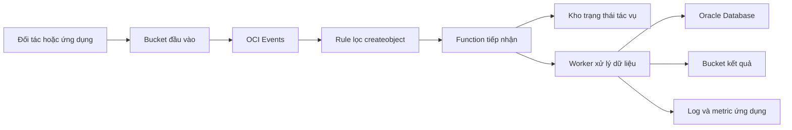

# Object events và tích hợp xử lý dữ liệu

Trong chương **Object Storage và Archive Storage** của module Oracle Cloud Infrastructure (OCI), object events giúp khởi động công việc khi dữ liệu trong bucket thay đổi. Ví dụ: khi đối tác đưa một file CSV lên bucket, hệ thống tiếp nhận file, kiểm tra cấu trúc, nhập dữ liệu vào Oracle Database và ghi kết quả xử lý mà không cần ứng dụng liên tục quét toàn bộ bucket.

Một pipeline có thể triển khai được cần phối hợp Object Storage, Events, IAM, bộ xử lý và giám sát. Bài học xây dựng luồng này từ bước bật phát sự kiện đến thiết kế xử lý trùng, phục hồi và kiểm soát chi phí. Các kiến trúc và số liệu minh họa là đề xuất thiết kế để người học áp dụng theo yêu cầu thực tế.

Sau bài học, bạn có thể:

- Phân biệt sự kiện của bucket với sự kiện của object và bật đúng cấu hình.
- Đọc thông tin định vị object trong payload và tạo bộ lọc Events chính xác.
- Chọn Notifications, Functions hoặc Streaming làm đích nhận sự kiện.
- Tách quyền quản trị rule khỏi quyền bộ xử lý đọc/ghi dữ liệu.
- Thực hành quan sát sự kiện và thiết kế pipeline xử lý lặp an toàn.

## Vai trò của Events trong luồng dữ liệu

OCI Events nhận các thông điệp mô tả thay đổi của tài nguyên. Rule gồm điều kiện lọc và action; khi sự kiện khớp, dịch vụ chuyển sự kiện tới đích đã cấu hình. Một trường hợp được Oracle nêu là chuyển đổi định dạng file khi file được đưa vào Object Storage. [Oracle: Overview of Events](https://docs.oracle.com/en-us/iaas/Content/Events/Concepts/eventsoverview.htm).

Kiến trúc minh họa:



Đường chuyển sự kiện và đường tải file là hai phần riêng. Worker nhận thông tin về object rồi dùng API Object Storage để đọc nội dung; quyền nhận thông điệp không tự cấp quyền đọc bucket.

Trong thiết kế này, function tiếp nhận có thể tự xử lý file nhỏ hoặc ghi tác vụ bền vững cho worker khác. Với file lớn, nên hạn chế thời gian tiếp nhận và để worker có tài nguyên phù hợp xử lý nội dung.

## Bật sự kiện ở đúng bucket

Object không phát sự kiện mặc định. Cần bật **Emit object events** khi tạo bucket hoặc cập nhật bucket đang có. Tùy chọn này dùng cho thay đổi trạng thái object; việc có sự kiện tạo bucket không chứng minh đã bật phát sự kiện cho object trong bucket. [Oracle: Managing Emitting Events for Object State Changes](https://docs.oracle.com/en-us/iaas/Content/Object/Tasks/managingbuckets_topic-To_enable_or_disable_emitting_events_for_object_state_changes.htm).

Các loại object event cơ bản được OCI công bố:

| Thay đổi | Event type |
| --- | --- |
| Tạo object | `com.oraclecloud.objectstorage.createobject` |
| Cập nhật object | `com.oraclecloud.objectstorage.updateobject` |
| Xóa object | `com.oraclecloud.objectstorage.deleteobject` |

Tên bucket nằm trong `data.additionalDetails.bucketName`; tên object nằm trong `data.resourceName`. Ví dụ object event của Oracle có `resourceId` rỗng, nên không nên dựa riêng vào trường đó để định vị dữ liệu. [Oracle: Services that Produce Events — Object Storage](https://docs.oracle.com/en-us/iaas/Content/Events/Reference/eventsproducers.htm).

Đối với pipeline nhập file, hãy bắt đầu bằng **createobject** và tên object duy nhất cho mỗi lần nhập. Nếu ứng dụng cho phép ghi đè, cần thử hành vi tương ứng và xác định rõ phiên bản dữ liệu mà một tác vụ phải xử lý.

Bật events là bước thiết lập cho luồng hoạt động tiếp theo. Trong thiết kế triển khai, dữ liệu đã tồn tại cần một kế hoạch nạp bù riêng; không dựa vào việc bật công tắc để coi các file cũ đã có tác vụ xử lý.

## Đọc một thông điệp object event

Ví dụ dưới đây dùng giá trị giả để minh họa cấu trúc:

```json
{
  "cloudEventsVersion": "0.1",
  "eventID": "11111111-2222-4333-8444-555555555555",
  "eventType": "com.oraclecloud.objectstorage.createobject",
  "eventTypeVersion": "2.0",
  "source": "objectstorage",
  "eventTime": "2026-11-20T01:15:00Z",
  "contentType": "application/json",
  "extensions": {
    "compartmentId": "<compartment-ocid>"
  },
  "data": {
    "compartmentId": "<compartment-ocid>",
    "resourceName": "incoming/batch-20261120-001.csv",
    "resourceId": "",
    "additionalDetails": {
      "namespace": "<namespace>",
      "bucketName": "learning-input",
      "bucketId": "<bucket-ocid>",
      "eTag": "example-etag-v1",
      "archivalState": null
    }
  }
}
```

Envelope chứa định danh và loại sự kiện; `data` là payload do dịch vụ nguồn cung cấp. Tài liệu OCI mô tả envelope CloudEvents phiên bản `0.1`, với các tên trường như `eventID`, `eventType` và `eventTime`; parser cần đọc đúng hợp đồng này thay vì tự đổi thành tên trường của phiên bản CloudEvents khác. `eventTypeVersion` là phiên bản loại sự kiện. [Oracle: Contents of an Event Message](https://docs.oracle.com/en-us/iaas/Content/Events/Reference/eventenvelopereference.htm).

Bộ tiếp nhận của ví dụ lấy:

```text
Định danh giao nhận: eventID
Loại thay đổi:       eventType
Object cần đọc:      namespace + bucketName + resourceName
Thông tin đối chiếu: eTag khi payload có cung cấp
Mốc đo độ trễ:       eventTime
```

Đây là thông điệp mô tả thay đổi, không chứa toàn bộ file CSV. Nếu object đã bị ghi đè hoặc xóa trước khi worker đọc, việc có event không đảm bảo worker còn lấy được nội dung ban đầu.

## Lọc đúng loại, bucket và tên object

Một rule chỉ quan tâm file mới trong vùng `incoming/` có thể dùng điều kiện sau:

```json
{
  "eventType": [
    "com.oraclecloud.objectstorage.createobject"
  ],
  "data": {
    "resourceName": "incoming/*",
    "additionalDetails": {
      "namespace": "<namespace>",
      "bucketName": "learning-input"
    }
  }
}
```

Điều kiện phải giữ đúng cấu trúc lồng nhau của event. Trường không nêu trong filter bị bỏ qua; ký tự `*` dùng làm wildcard trong giá trị. Rule xét sự kiện từ compartment chứa rule và các compartment con. [Oracle: Matching Events with Filters](https://docs.oracle.com/en-us/iaas/Content/Events/Concepts/filterevents.htm).

Trong ví dụ, event phải đồng thời có đúng loại, namespace, bucket và prefix. `incoming/*` chỉ lọc tên, chưa chứng minh file có nội dung CSV hợp lệ. Sau khi nhận, bộ xử lý vẫn cần kiểm tra loại dữ liệu, kích thước, cấu trúc cột và các điều kiện nghiệp vụ.

Ví dụ kiểm tra filter trước triển khai:

| Event thử | Kỳ vọng |
| --- | --- |
| Tạo `incoming/a.csv` trong đúng bucket | Khớp |
| Tạo `processed/a.json` trong đúng bucket | Không khớp |
| Tạo `incoming/a.csv` trong bucket khác | Không khớp |
| Xóa `incoming/a.csv` | Không khớp rule chỉ chọn createobject |

Console có chức năng validate rule bằng event mẫu. Việc validate cho biết dữ liệu mẫu có khớp điều kiện hay không; phép thử upload thật vẫn cần để kiểm tra đường chuyển tới đích. [Oracle: Validating an Events Rule](https://docs.oracle.com/en-us/iaas/Content/Events/Task/managingrules_topic-To_validate_a_rule.htm).

**Tránh vòng lặp tự kích hoạt:** nếu worker ghi kết quả vào nơi cũng khớp rule đầu vào, kết quả có thể lại tạo thêm công việc. Thiết kế của bài dùng bucket kết quả riêng; một lựa chọn khác là prefix output được loại khỏi đường tiếp nhận.

## Chọn đích nhận sự kiện

Events hỗ trợ action tới **Notifications**, **Streaming** và **Functions**. Tài nguyên đích phải tồn tại để chọn khi cấu hình rule; một rule có thể có nhiều action. [Oracle: Managing Rules for Events](https://docs.oracle.com/en-us/iaas/Content/Events/Task/managingrules.htm).

| Đích | Nhu cầu phù hợp | Điều cần thiết kế thêm |
| --- | --- | --- |
| Notifications topic | Quan sát thay đổi, gửi thông báo tới subscriber | Xác nhận subscription, giới hạn lượng thông báo |
| Function | Kiểm tra đầu vào, xử lý ngắn hoặc tạo tác vụ | Quyền đọc object, thời gian xử lý, trạng thái tác vụ |
| Stream | Tách nhận event khỏi nhiều consumer xử lý | Partition, commit offset, khả năng đọc lại và chống trùng |

Streaming lưu thông điệp trong thời hạn cấu hình và hỗ trợ đọc lại. Thứ tự được bảo đảm trong từng partition theo thứ tự được ghi vào stream; điều này không tự tạo thứ tự toàn cục cho mọi thay đổi ở nguồn. [Oracle: Overview of Streaming](https://docs.oracle.com/en-us/iaas/Content/Streaming/Concepts/streamingoverview.htm).

Nếu muốn dùng Queue hoặc gọi một dịch vụ xử lý khác, cần bổ sung thành phần chuyển tiếp, chẳng hạn function ghi tác vụ tới hệ thống đã chọn. Không coi mọi dịch vụ OCI là một action trực tiếp của Events.

Khi có nhiều action, hãy thiết kế từng nhánh độc lập. Việc gửi thông báo thành công không phải bằng chứng nhập dữ liệu vào database đã hoàn tất.

## Tách các lớp quyền IAM

Có ba lớp cần kiểm tra:

1. **Người hoặc pipeline cấu hình:** sửa bucket, quản lý rule và chọn tài nguyên action.
2. **Luồng chuyển sự kiện:** action phải được cấu hình đúng phạm vi và đáp ứng quyền cần thiết của tích hợp.
3. **Bộ xử lý chạy thật:** đọc bucket nguồn, ghi kết quả và cập nhật kho trạng thái hoặc database.

Policy ví dụ cho nhóm quản trị rule trong compartment sandbox:

```text
Allow group EventLabAdmins to manage cloudevents-rules in compartment DataLab
Allow group EventLabAdmins to use ons-topic in compartment DataLab
```

Đây là phần quyền cho rule và action Notifications, không phải toàn bộ quyền tạo tài nguyên lab. Nhóm còn cần quyền phù hợp để xem compartment, quản lý bucket và thiết lập topic/subscription nếu đảm nhận các việc đó. [Oracle: Events and IAM Policies](https://docs.oracle.com/en-us/iaas/Content/Events/Concepts/eventspolicy.htm).

Khi function cần gọi Object Storage, đưa function vào dynamic group và cấp quyền cho group đó. Resource principal provider của OCI SDK giúp function xác thực bằng danh tính tài nguyên trong lúc chạy. [Oracle: Accessing OCI Resources from Running Functions](https://docs.oracle.com/en-us/iaas/Content/Functions/Tasks/functionsaccessingociresources.htm).

Ví dụ matching rule cho một function cụ thể:

```text
resource.id = '<function-ocid>'
```

Ví dụ quyền đọc bucket nguồn:

```text
Allow dynamic-group ObjectProcessors to read objects in compartment DataLab where target.bucket.name = 'learning-input'
```

Tên group cần được định danh theo identity domain của môi trường nếu áp dụng. Với output và kho trạng thái, cấp thêm các quyền đúng công việc; không cấp quyền xóa dữ liệu nguồn chỉ vì bộ xử lý cần đọc file.

Ở lớp mạng, worker trên Compute hoặc Functions cần đường tới endpoint Object Storage và hệ thống đích. Với subnet private, hãy kiểm tra route, service gateway hoặc kết nối phù hợp, DNS và các quy tắc mạng. IAM đúng nhưng không có kết nối vẫn làm tác vụ thất bại.

## Thiết kế xử lý lặp an toàn

Một pipeline bất đồng bộ nên có khả năng nhận lại cùng một thông điệp. Notifications và các consumer group của Streaming có cơ chế giao nhận có thể dẫn tới xử lý lặp; ứng dụng cần quản lý tác động nghiệp vụ của việc chạy lại. [Oracle: Notifications Overview](https://docs.oracle.com/en-us/iaas/Content/Notification/Concepts/notificationoverview.htm), [Oracle: Using Consumer Groups](https://docs.oracle.com/en-us/iaas/Content/Streaming/Tasks/using_consumer_groups.htm).

**Idempotent** nghĩa là xử lý lại cùng một đầu vào không tạo thêm tác động ngoài kết quả đã xác định. Với bài nhập CSV, hai lần nhận event không được biến thành hai lần cộng số dư hoặc tạo hai bộ giao dịch giống nhau.

Thiết kế đề xuất dùng hai loại định danh:

| Định danh | Mục đích |
| --- | --- |
| `eventID` | Theo dõi cùng một event được nhận lại |
| `jobKey` theo dữ liệu | Nhận biết cùng một lô dữ liệu qua nhiều lần gửi hoặc chạy bù |

Ví dụ `jobKey` được tính từ một bộ dữ liệu có cấu trúc gồm namespace, bucket, tên object, định danh phiên bản hoặc ETag phù hợp và phiên bản bộ xử lý. Khi tính hash, dùng cách serialize rõ ràng; không nối chuỗi bằng dấu phân cách mà tên object cũng có thể chứa.

Với tên object duy nhất theo batch, có thể dùng batch ID do hệ thống cấp làm một phần khóa nghiệp vụ. ETag giúp đối chiếu trạng thái object nhưng không nên mặc định coi là hash nội dung mang ý nghĩa nghiệp vụ.

### Kho trạng thái phải xử lý được công việc dở dang

```text
PENDING --> PROCESSING --> SUCCEEDED
                |
                +--> RETRY_WAIT --> PROCESSING
                |
                +--> FAILED_FINAL
```

Đề xuất mỗi bản ghi tác vụ có `jobKey` duy nhất, trạng thái, số lần thử, thời điểm tạo, thời điểm cập nhật, lease của worker và lỗi gần nhất.

- Nếu đã `SUCCEEDED`, lần nhận lại trả kết quả đã có.
- Nếu đang `PROCESSING` với lease còn hiệu lực, worker khác không làm trùng.
- Nếu lease hết hạn, tác vụ cần có đường nhận lại hoặc phục hồi.
- Nếu lỗi dữ liệu cố định, đưa vào trạng thái cuối để người vận hành xử lý.

Không dùng quy tắc “có bản ghi là bỏ qua” cho mọi trạng thái. Worker có thể đã ghi bản ghi rồi chết trước khi tạo kết quả; bỏ qua như vậy làm dữ liệu bị treo vĩnh viễn.

### Thu hẹp khoảng hở giữa kết quả và trạng thái

Ví dụ nguy cơ:

```text
Worker đã ghi 500 giao dịch vào database
        |
        +--> Tiến trình chết trước khi đánh dấu SUCCEEDED
        |
        +--> Lần chạy lại nhận cùng lô dữ liệu
```

Nếu kết quả và trạng thái nằm trong cùng Oracle Database, có thể thiết kế transaction, khóa duy nhất và thao tác upsert phù hợp để bảo vệ ranh giới ghi dữ liệu. Nếu còn ghi object kết quả hoặc gọi hệ thống ngoài, cần chiến lược như outbox, tên output xác định trước và kiểm tra trạng thái trước khi tạo tác động tiếp.

Các lựa chọn này thuộc thiết kế ứng dụng; một rule Events không tự cung cấp transaction xuyên các dịch vụ.

## Đọc đúng object và đúng trạng thái dữ liệu

Một tình huống dễ sai là upload `incoming/daily.csv` hai lần liên tiếp. Event của lần đầu tới chậm, trong khi `GET daily.csv` đã đọc nội dung lần hai. Worker cần biết đang nhập bản dữ liệu nào.

Ba lựa chọn thiết kế:

- Dùng tên object duy nhất cho từng batch và hạn chế ghi đè.
- Khi có định danh phiên bản xác thực từ quy trình của ứng dụng, đọc đúng version đó.
- Khi sử dụng ETag từ event, đọc có điều kiện để từ chối nếu object hiện tại không còn khớp.

OCI Java SDK cung cấp `versionId` và `ifMatch` trên `GetObjectRequest`. `ifMatch` dùng điều kiện ETag trong chính request đọc, giúp tránh khoảng hở giữa kiểm tra object và tải nội dung. [Oracle Java SDK: GetObjectRequest.Builder](https://docs.oracle.com/en-us/iaas/tools/java/latest/com/oracle/bmc/objectstorage/requests/GetObjectRequest.Builder.html).

Đoạn mã dưới đây minh họa phần đọc bên trong một processor Java đã có OCI SDK, client, dữ liệu đầu vào được kiểm tra và bộ phân tích CSV. Nó không phải toàn bộ function đã triển khai:

```java
import java.io.InputStream;
import com.oracle.bmc.objectstorage.requests.GetObjectRequest;

// client đã được cấu hình authentication và region phù hợp.
// namespace, bucket, objectName và eventEtag lấy từ event đã kiểm tra.
var request = GetObjectRequest.builder()
        .namespaceName(namespace)
        .bucketName(bucket)
        .objectName(objectName)
        .ifMatch(eventEtag)
        .build();

var response = client.getObject(request);
try (InputStream body = response.getInputStream()) {
    // Hàm do ứng dụng triển khai: đọc theo luồng và áp giới hạn dữ liệu.
    processCsv(body);
}
```

Nếu thiếu ETag cần thiết cho hợp đồng xử lý, phải có quyết định rõ ràng thay vì bỏ điều kiện một cách ngầm định. Payload mẫu không cung cấp version ID, nên không tự giả định field đó luôn tồn tại. Khi object đã đổi, chuyển tác vụ sang trạng thái phù hợp hoặc dùng quy trình lấy đúng phiên bản; không âm thầm nhập bản mới dưới danh nghĩa bản cũ.

`HeadObject` có thể cung cấp thông tin như kích thước, ETag, tier và trạng thái archive để kiểm tra trước khi xử lý. Tuy nhiên, kiểm tra trước bằng HEAD không thay thế điều kiện cần thiết trên GET nếu nguồn còn có thể thay đổi. [Oracle: Getting an Object's Details](https://docs.oracle.com/en-us/iaas/Content/Object/Tasks/managingobjects_topic-To_get_object_details.htm).

## Thực hành: quan sát object event qua Notifications

Bài thực hành dùng bucket sandbox, rule riêng và topic Notifications có subscription mà bạn quản lý. Các lệnh là hướng dẫn cho **OCI Cloud Shell hoặc Bash đã cấu hình OCI CLI và jq**; chúng tạo hoặc thay đổi tài nguyên khi người học thực sự chạy.

### Chuẩn bị tài nguyên

Chuẩn bị trong cùng region:

- Một bucket private Standard chỉ chứa dữ liệu giả, ví dụ `learning-input`.
- Một topic Notifications riêng cho bài thực hành.
- Một email subscription của bạn đã được xác nhận, hoặc endpoint thử nghiệm do bạn quản lý.
- Một compartment sandbox và quyền cần thiết cho bucket, rule, topic.

Email subscription ở trạng thái pending chưa nhận thông báo cho đến khi xác nhận theo liên kết gửi tới địa chỉ đã đăng ký. [Oracle: Creating an Email Subscription](https://docs.oracle.com/en-us/iaas/Content/Notification/Tasks/create-subscription-email.htm).

Thiết lập các giá trị của môi trường:

```bash
export OCI_REGION='ap-singapore-1'
export OCI_NAMESPACE='<namespace-cua-tenancy>'
export LAB_BUCKET='<bucket-sandbox>'
export LAB_COMPARTMENT_OCID='<compartment-ocid>'
export LAB_TOPIC_OCID='<topic-ocid>'

LAB_WORKDIR=$(mktemp -d)
```

Region trong ví dụ phải được thay nếu tài nguyên của bạn ở region khác. Ghi lại trạng thái cấu hình ban đầu nếu dùng tài nguyên sandbox đã có.

### Bước 1: bật phát object events và đọc lại

```bash
oci os bucket update \
  --region "$OCI_REGION" \
  --namespace-name "$OCI_NAMESPACE" \
  --bucket-name "$LAB_BUCKET" \
  --object-events-enabled true

oci os bucket get \
  --region "$OCI_REGION" \
  --namespace-name "$OCI_NAMESPACE" \
  --bucket-name "$LAB_BUCKET"
```

Kiểm tra `object-events-enabled` trong kết quả là `true`, đồng thời xác nhận đúng compartment và bucket. CLI hỗ trợ bật/tắt bằng `--object-events-enabled`. [Oracle CLI: bucket update](https://docs.oracle.com/en-us/iaas/tools/oci-cli/latest/oci_cli_docs/cmdref/os/bucket/update.html).

### Bước 2: chuẩn bị condition và action

Dùng jq để đưa giá trị môi trường vào JSON mà không phải tự ghép dấu nháy:

```bash
jq -n \
  --arg ns "$OCI_NAMESPACE" \
  --arg bucket "$LAB_BUCKET" \
  '{eventType:["com.oraclecloud.objectstorage.createobject"],
    data:{resourceName:"incoming/*",
          additionalDetails:{namespace:$ns,bucketName:$bucket}}}' \
  > "$LAB_WORKDIR/condition.json"

jq -n --arg topic "$LAB_TOPIC_OCID" \
  '{actions:[{actionType:"ONS",isEnabled:true,topicId:$topic}]}' \
  > "$LAB_WORKDIR/actions.json"
```

`ONS` là loại action Notifications; `topicId` trỏ tới topic nhận event. Mẫu action này dựa trên cấu trúc OCI hướng dẫn cho CLI. [Oracle: Getting Started with Events — Action File](https://docs.oracle.com/en-us/iaas/Content/Events/Concepts/eventsgetstarted.htm).

Đọc lại hai file JSON trong thư mục tạm và xác nhận tài nguyên trước khi tạo rule.

### Bước 3: tạo rule và lấy ID

```bash
RULE_ID=$(oci events rule create \
  --region "$OCI_REGION" \
  --compartment-id "$LAB_COMPARTMENT_OCID" \
  --display-name 'lab-object-create-incoming' \
  --is-enabled true \
  --condition "$(cat "$LAB_WORKDIR/condition.json")" \
  --actions "file://$LAB_WORKDIR/actions.json" \
  --query 'data.id' \
  --raw-output)

printf 'RULE_ID=%s\n' "$RULE_ID"
```

Dừng nếu CLI báo lỗi hoặc không trả rule ID hợp lệ. `--condition` nhận chuỗi điều kiện, `--actions` nhận cấu trúc JSON; `--is-enabled` xác định rule có được đánh giá hay không. [Oracle CLI: events rule create](https://docs.oracle.com/en-us/iaas/tools/oci-cli/latest/oci_cli_docs/cmdref/events/rule/create.html).

Đọc lại rule:

```bash
oci events rule get \
  --region "$OCI_REGION" \
  --rule-id "$RULE_ID"
```

Kiểm tra rule được bật, condition đúng bucket/prefix và action đúng topic. Lệnh `get` định vị rule bằng OCID. [Oracle CLI: events rule get](https://docs.oracle.com/en-us/iaas/tools/oci-cli/latest/oci_cli_docs/cmdref/events/rule/get.html).

### Bước 4: upload file giả với tên duy nhất

```bash
LAB_OBJECT="incoming/batch-$(date -u +%Y%m%dT%H%M%SZ)-$$.csv"
printf 'id,amount\n1,125000\n' > "$LAB_WORKDIR/input.csv"

oci os object put \
  --region "$OCI_REGION" \
  --namespace-name "$OCI_NAMESPACE" \
  --bucket-name "$LAB_BUCKET" \
  --name "$LAB_OBJECT" \
  --file "$LAB_WORKDIR/input.csv" \
  --no-multipart
```

Chờ quan sát thông báo tại subscription đã xác nhận, đồng thời xem metrics của rule. Đối chiếu tên object, bucket, event type và event ID. Không yêu cầu thông báo đến tức thời trong cùng một phiên gọi CLI.

Có thể đọc lại file bằng đường dữ liệu riêng:

```bash
oci os object get \
  --region "$OCI_REGION" \
  --namespace-name "$OCI_NAMESPACE" \
  --bucket-name "$LAB_BUCKET" \
  --name "$LAB_OBJECT" \
  --file "$LAB_WORKDIR/downloaded.csv"
```

`object get` tải body của object vào file chỉ định. Việc tải được file kiểm tra quyền/đường dữ liệu; thông báo nhận được kiểm tra đường event. [Oracle CLI: object get](https://docs.oracle.com/en-us/iaas/tools/oci-cli/latest/oci_cli_docs/cmdref/os/object/get.html).

### Bước 5: kiểm tra đường không khớp

Upload thêm cùng nội dung dưới tên `ignored/...csv` trong chính bucket sandbox. Kỳ vọng rule lọc `incoming/*` không tạo thêm match cho object đó. Chỉ thay một yếu tố ở mỗi lần thử để dễ tìm lỗi.

Nếu cần chứng minh processor chống trùng, hãy dùng bộ thử của ứng dụng gửi lại cùng event mẫu hoặc chạy lại cùng job. Quan sát email hai lần hoặc upload hai file khác nhau chưa đủ để chứng minh cùng một job chỉ tạo một kết quả nghiệp vụ.

### Bước 6: dọn tài nguyên thử nghiệm

1. Tắt rule của bài thực hành trên Console để dừng nhận thêm công việc.
2. Xác nhận không còn tác vụ cần giữ rồi xóa các object giả đã tạo.
3. Xóa đúng rule bằng ID đã ghi, rồi xóa subscription/topic nếu chúng chỉ phục vụ bài này.
4. Khôi phục cấu hình bucket về trạng thái ban đầu nếu giữ lại bucket sandbox.
5. Kiểm tra rồi dọn thư mục tạm trong `$LAB_WORKDIR`.

Với bucket riêng của bài học mà events ban đầu tắt, có thể tắt lại bằng:

```bash
oci os bucket update \
  --region "$OCI_REGION" \
  --namespace-name "$OCI_NAMESPACE" \
  --bucket-name "$LAB_BUCKET" \
  --object-events-enabled false
```

Không tắt events trên bucket dùng chung chỉ để dọn một rule của bạn. Rule khác có thể còn phụ thuộc vào nguồn sự kiện đó.

## Mở rộng từ thông báo sang xử lý dữ liệu

Sau khi đường event đã được chứng minh, thay hoặc bổ sung action Functions trên rule thử nghiệm. Trong Console, chọn compartment, application và function đã tồn tại. [Oracle: Creating an Events Rule](https://docs.oracle.com/en-us/iaas/Content/Events/Task/create-events-rule.htm).

Luồng tiếp nhận đề xuất:

```text
Nhận event
  -> Parse envelope và kiểm tra các trường bắt buộc
  -> Xác nhận loại sự kiện, namespace và bucket thuộc phạm vi cho phép
  -> Lập jobKey từ danh tính đầu vào
  -> Tạo hoặc nhận quyền xử lý tác vụ một cách nguyên tử
  -> Đọc đúng object với giới hạn kích thước và điều kiện phù hợp
  -> Kiểm tra CSV và nhập dữ liệu theo ranh giới transaction đã thiết kế
  -> Ghi kết quả, trạng thái và thông tin đối chiếu
```

Khi tách một receiver và worker, receiver chỉ xác nhận tiếp nhận sau khi đã lưu tác vụ bền vững. Nếu receiver trả thành công trước rồi chết trước khi ghi tác vụ, đường chuyển có vẻ thành công nhưng công việc thực tế bị mất.

Lỗi cần được phân loại:

| Nhóm lỗi | Ví dụ | Hành động đề xuất |
| --- | --- | --- |
| Tạm thời | Database quá tải, endpoint tạm không truy cập được | Retry có backoff, giới hạn số lần |
| Cấu hình | Sai quyền đọc bucket, sai region | Cảnh báo vận hành và sửa cấu hình |
| Dữ liệu | Sai header CSV, giá trị không hợp lệ | Lưu lý do, cách ly job và yêu cầu sửa dữ liệu |
| Đầu vào đã thay đổi | ETag không còn khớp, object đã bị xóa | Đối soát theo chính sách phiên bản |

Không mặc định rằng Events đã cung cấp một dead-letter queue cho mọi nhánh của ứng dụng. Nếu cần lưu công việc lỗi để chạy lại, phải thiết kế kho lỗi, thời hạn giữ và người chịu trách nhiệm xử lý.

## Quan sát từ nguồn đến kết quả

Namespace metrics của Events là `oci_cloudevents`. Các metric gồm `PublishedEvents`, `MatchedEvents`, `DeliverySucceedEvents` và `DeliveryFailedEvents`, giúp quan sát phát, khớp rule và chuyển tới action. [Oracle: Events Metrics](https://docs.oracle.com/en-us/iaas/Content/Events/Reference/eventsmetrics.htm).

Để phân tích sự cố, nên ghi có cấu trúc:

```json
{
  "eventId": "example-event-id",
  "jobKey": "example-job-key",
  "bucket": "learning-input",
  "objectName": "incoming/example.csv",
  "stage": "database_import",
  "attempt": 2,
  "status": "RETRY_WAIT",
  "durationMs": 850
}
```

Đây là schema log do ứng dụng đề xuất, không phải event envelope OCI. Log nên giúp truy vết mà không chứa nội dung file, token hoặc thông tin nhạy cảm không cần thiết.

Một lần delivery thành công chỉ cho biết đã đi qua một ranh giới giao nhận. Để xác định nhập dữ liệu xong, cần trạng thái `SUCCEEDED`, số bản ghi, kiểm tra nghiệp vụ và output tương ứng.

Với nhánh Notifications, `PublishedMessagesCount`, `DeliveredMessagesCount` và `FailedMessagesCount` giúp quan sát tiếp phần phát tới subscriber. [Oracle: Notifications Metrics Reference](https://docs.oracle.com/en-us/iaas/Content/Notification/Reference/notificationmetrics-reference.htm).

Cách khoanh vùng đề xuất:

| Hiện tượng | Kiểm tra tiếp |
| --- | --- |
| Upload thành công nhưng không thấy event | Emit object events, region, bucket thực sự nhận file |
| Có event nhưng không có match | Compartment của rule, loại event, nesting, prefix và giá trị filter |
| Có match nhưng action thất bại | Action đang bật, tài nguyên đích, quyền và trạng thái dịch vụ |
| Delivery thành công nhưng chưa có dữ liệu đích | Log receiver, kho job, lease, retry và transaction của worker |
| Email chưa đến | Subscription active, topic đúng, metric của Notifications |
| Tác vụ tăng nhanh bất thường | Rule trùng phạm vi, vòng lặp output hoặc job không được chống trùng |

## Khôi phục, Archive và kiểm soát chi phí

Đối với dữ liệu quan trọng, nên có **đối soát định kỳ** giữa object đầu vào và kho trạng thái tác vụ. Công việc đối soát dùng cùng cách xác định `jobKey` với đường xử lý event để chạy bù không tạo dữ liệu trùng.

Ví dụ quy trình đối soát:

1. Liệt kê đầy đủ các trang object trong phạm vi đầu vào và kỳ dữ liệu cần kiểm tra.
2. Xác định danh tính lô, trạng thái object và job tương ứng.
3. Tạo tác vụ cho đầu vào chưa có kết quả; phân biệt job đang chạy hợp lệ và job bị treo.
4. Ghi nguồn khởi tạo là đối soát để vận hành phân biệt với event mới.

Với một lô gồm nhiều file, nên dùng manifest hoặc dấu hiệu hoàn tất do ứng dụng quy định. Một event tạo file không chứng minh toàn bộ lô nhiều file đã đủ.

Object trong Archive phải được restore trước khi đọc. Vì vậy, pipeline xử lý ngay nên có chính sách tier phù hợp; nếu đầu vào có thể đã archive, cần thêm trạng thái chờ restore thay vì retry GET liên tục. [Oracle: Object Storage Storage Tiers](https://docs.oracle.com/en-us/iaas/Content/Object/Concepts/understandingstoragetiers.htm).

Dự toán sơ bộ có thể tách thành:

```text
Lượt xử lý thực tế
  = công việc mới + retry + chạy bù + các lần trùng chưa được loại

Chi phí pipeline
  = lưu trữ + request đọc/ghi + compute xử lý
    + đích giao nhận + trạng thái tác vụ + log/metric + truyền dữ liệu phù hợp
```

Ví dụ tự tính: 10.000 file/ngày, mỗi file 5 MiB, tương ứng khoảng 48,8 GiB dữ liệu đầu vào được đọc một lượt. Nếu ứng dụng tải lại toàn bộ file ba lần cho mỗi job, lượng đọc có thể tăng gần ba lần trước khi xét các chi phí khác. Đây là phép tính dung lượng, không phải báo giá OCI.

Để giữ pipeline ổn định, giới hạn đồng thời theo năng lực database, giới hạn kích thước đầu vào, chống retry vô hạn và đặt thời hạn giữ log/kho lỗi. Luồng có ít sự kiện cũng cần một object thử định kỳ hoặc một phép đối soát để phát hiện đường xử lý đang im lặng vì cấu hình lỗi.

## Tự kiểm tra mức độ hiểu

- **Bật Emit object events đã đủ tạo pipeline chưa?** Cần thêm rule, action, quyền, tài nguyên đích và bộ xử lý.
- **Tên object nằm ở đâu trong event?** Trong `data.resourceName`; bucket ở `data.additionalDetails.bucketName`.
- **Vì sao nên dùng tên file duy nhất theo batch?** Để một tác vụ có danh tính đầu vào rõ ràng và tránh đọc nhầm nội dung đã ghi đè.
- **Vì sao có bản ghi job chưa đủ để bỏ qua lần nhận lại?** Job có thể đang dở dang hoặc worker đã chết; cần xét trạng thái và lease.
- **Vì sao cần đối soát ngoài đường event?** Để phát hiện đầu vào chưa có kết quả và khởi tạo chạy bù có kiểm soát.

Kết quả thực hành cần ghi nhận được đúng đường từ upload tới event, rule match và đích Notifications. Khi tích hợp xử lý dữ liệu, tiêu chí hoàn tất phải đi xa hơn delivery: mỗi lô có kết quả nghiệp vụ xác định, khả năng chạy lại an toàn và bằng chứng vận hành để phục hồi khi có lỗi.