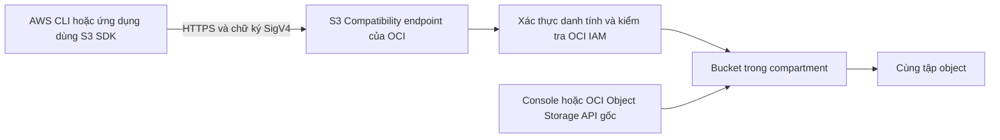

# Sử dụng S3 Compatibility API trên OCI

Trong chương **Object Storage và Archive Storage** của module **CLOUD_PROVIDERS_ORACLE**, bài học này hướng dẫn kết nối công cụ và ứng dụng dùng giao thức S3 với OCI Object Storage. Bạn sẽ cấu hình endpoint, thông tin xác thực và quyền truy cập, thực hành bằng AWS CLI, sau đó áp dụng cùng cấu hình vào ứng dụng Java.

Mục tiêu của bài học:

- Xác định đúng namespace, region, bucket và endpoint S3 của OCI.
- Phân biệt Customer Secret Key với các loại thông tin xác thực OCI khác.
- Cấp quyền cho danh tính tích hợp trong compartment phù hợp.
- Thực hiện một vòng tải lên, đọc lại và kiểm tra nội dung.
- Đánh giá phạm vi tương thích trước khi chuyển một công cụ S3 sang OCI.
- Theo dõi lỗi, quản lý khóa và kiểm soát chi phí khi vận hành.

## Khi nào cần S3 Compatibility API?

Giả sử một ứng dụng Java đã có lớp lưu trữ sử dụng AWS SDK for Java. Ứng dụng xuất báo cáo đơn hàng, lưu các tệp kết quả và tải lại khi người dùng yêu cầu. Khi đưa ứng dụng lên OCI Compute, nhóm phát triển muốn tiếp tục dùng lớp tích hợp S3 hiện có.

S3 Compatibility API cung cấp một giao diện tương thích cho OCI Object Storage. Object ghi qua giao diện này có thể được đọc bằng API Object Storage gốc và ngược lại; không cần tạo thêm một bản sao dữ liệu chỉ để chuyển cách truy cập. Xem [giới thiệu S3 Compatibility API của OCI](https://docs.oracle.com/en-us/iaas/Content/Object/Tasks/s3compatibleapi.htm).



Đây là cách tái sử dụng giao diện truy cập dữ liệu. Những trách nhiệm như chọn compartment, thiết kế IAM, quản lý vòng đời, giám sát và lập phương án phục hồi vẫn thuộc kiến trúc OCI của bạn.

Trước khi tích hợp, hãy lập danh sách thao tác ứng dụng thực sự dùng. Một ứng dụng chỉ cần upload và download khác đáng kể với hệ thống còn tạo bucket, thiết lập vòng đời, sửa ACL, phát hành URL chia sẻ và xử lý multipart upload.

## Các thành phần cần cấu hình

| Thành phần | Vai trò | Ví dụ trong bài |
| --- | --- | --- |
| Namespace | Định danh không gian Object Storage của tenancy | Giá trị lấy từ tenancy của bạn |
| Region | Nơi có bucket và tham gia cấu hình ký request | `ap-singapore-1` |
| Bucket | Kho chứa object đích | `s3-interop-lab` |
| Object key | Tên object đầy đủ trong bucket | `interop/run-001/message.txt` |
| Endpoint | Địa chỉ API tương thích của OCI | Endpoint path style có namespace |
| Access Key và Secret Key | Cặp khóa để ký request | Customer Secret Key của người dùng OCI |
| IAM policy | Quyết định thao tác được phép | Đọc, ghi trên bucket lab |

Không dùng tenancy OCID, compartment OCID hoặc tên hiển thị tenancy thay cho namespace. Namespace và tên bucket cũng không thay thế cho nhau.

### Endpoint và addressing style

Bài thực hành dùng dạng path style được tài liệu OCI công bố:

```text
Endpoint:
https://<namespace>.compat.objectstorage.<region>.oci.customer-oci.com

Địa chỉ object theo path style:
https://<namespace>.compat.objectstorage.<region>.oci.customer-oci.com/<bucket>/<object-key>
```

OCI cũng công bố dạng virtual hosted style:

```text
https://<bucket>.vhcompat.objectstorage.<region>.oci.customer-oci.com/<object-key>
```

Chọn endpoint phù hợp với region và môi trường OCI thực tế. Khi truyền endpoint vào client, dùng địa chỉ gốc; bucket và key được truyền bằng tham số riêng. Các dạng trên được mô tả trong [hướng dẫn cấu hình ứng dụng](https://docs.oracle.com/en-us/iaas/Content/Object/Tasks/s3compatibleapi.htm).

Với path style, cấu hình client giữ tên bucket trong đường dẫn. Nếu client tự chuyển sang virtual hosted style trong khi vẫn dùng endpoint có namespace dành cho path style, hostname gửi đi có thể không còn đúng thiết kế.

Trong bài này, region dùng để ký phải là region của bucket. Đừng giữ nguyên region từ cấu hình AWS cũ chỉ vì đã thay endpoint. Với công cụ cũ không cho đặt OCI region, cần đọc riêng giới hạn về home region trong tài liệu OCI trước khi lựa chọn công cụ.

## Customer Secret Key và quyền OCI IAM

### Chọn đúng loại thông tin xác thực

S3 Compatibility API sử dụng cặp **Access Key/Secret Key** của **Customer Secret Key** gắn với người dùng OCI. Người dùng có khóa vẫn phải được IAM cho phép truy cập Object Storage. Mỗi người dùng có thể có tối đa hai Customer Secret Key; các khóa này không tự hết hạn. Xem [Working with Customer Secret Keys](https://docs.oracle.com/en-us/iaas/Content/Identity/access/working-with-customer-secret-keys.htm).

Cần phân biệt:

| Loại thông tin | Mục đích trong ngữ cảnh bài |
| --- | --- |
| Customer Secret Key | Được đưa vào S3 client dưới dạng Access Key và Secret Key |
| API signing key của OCI | Được dùng theo cơ chế ký API gốc của OCI |
| Mật khẩu đăng nhập Console | Đăng nhập giao diện người dùng |
| Auth token dành cho giao thức hoặc dịch vụ khác | Không phải Secret Key của ví dụ S3 này |

Không đưa PEM private key, fingerprint hoặc mật khẩu Console vào ô Secret Access Key của AWS CLI.

Tạo Customer Secret Key trong phần thiết lập người dùng OCI. Secret chỉ được hiển thị tại thời điểm tạo; lưu vào nơi quản lý bí mật ngay khi tạo, thay vì kỳ vọng xem lại sau này. Xem [hướng dẫn thiết lập quyền truy cập S3](https://docs.oracle.com/en-us/iaas/Content/Object/Tasks/s3compatibleapi.htm).

Nên dùng danh tính riêng cho từng ứng dụng hoặc nhóm tích hợp. Điều này giúp xác định khóa nào cần thu hồi và giới hạn phạm vi ảnh hưởng khi cấu hình sai.

### Ví dụ IAM cho bucket lab

Giả sử quản trị viên đã tạo bucket `s3-interop-lab` trong compartment `StorageLab`. Người dùng tạo Customer Secret Key là thành viên nhóm `S3InteropLab` trong identity domain `Default`.

Ví dụ policy để đọc thông tin bucket và thao tác object của bucket lab:

```text
Allow group Default/S3InteropLab to read buckets in compartment StorageLab where target.bucket.name='s3-interop-lab'
Allow group Default/S3InteropLab to manage objects in compartment StorageLab where target.bucket.name='s3-interop-lab'
```

Thay identity domain, nhóm, compartment và bucket theo môi trường. Quyền `manage objects` trong ví dụ cho phép cả xóa; chỉ cấp nếu phạm vi lab hoặc ứng dụng cần. Với workload chỉ đọc, thiết kế policy chỉ đọc.

OCI hỗ trợ điều kiện `target.bucket.name`; quyền tạo object mới và quyền ghi đè object hiện có là các permission khác nhau. Do đó, một lần upload tên mới thành công chưa chứng minh ứng dụng có quyền overwrite. Xem [tham chiếu policy Object Storage](https://docs.oracle.com/en-us/iaas/Content/Identity/Reference/objectstoragepolicyreference.htm).

Không kiểm tra kết nối bằng cách cấp toàn quyền tenancy trước. Hãy bắt đầu từ đúng bucket và thao tác cần thực hiện. Cũng không dùng việc liệt kê tất cả bucket làm điều kiện bắt buộc cho một ứng dụng chỉ cần truy cập một bucket đã biết.

### Bucket mới qua S3 nằm trong compartment nào?

API S3 không mang khái niệm compartment của OCI. Bucket tạo qua API tương thích mặc định được đặt ở root compartment, trừ khi tenancy đã chỉ định compartment khác cho API đó. Thay compartment mặc định chỉ ảnh hưởng bucket tạo mới; không tự di chuyển bucket hiện có. Xem [designated compartment cho S3 và Swift](https://docs.oracle.com/en-us/iaas/Content/Object/Tasks/designatingcompartments.htm).

Vì vậy, bài thực hành tạo sẵn bucket bằng Console hoặc công cụ OCI trong compartment lab. Cách này giúp bạn biết rõ tài nguyên nằm ở đâu trước khi thử client S3.

Người có quyền phù hợp có thể đọc cấu hình mặc định bằng OCI CLI:

```bash
oci os ns get-metadata --namespace "<namespace-cua-ban>"
```

Đối chiếu `default-s3-compartment-id` trong kết quả. Đây là cấu hình ở cấp namespace; không thay đổi nó chỉ để sửa lỗi của một bài lab. Xem [cách đọc designated compartment](https://docs.oracle.com/en-us/iaas/Content/Object/Tasks/designatingcompartments_topic-To_get_your_tenancys_Amazon_S3_Compatibility_API_and_Swift_API_compartment_designations.htm).

## Thực hành với AWS CLI

Các lệnh dưới đây dùng Bash và AWS CLI v2. OCI CLI chỉ được dùng ở bước đối chiếu API gốc và phải có cấu hình xác thực OCI riêng.

Chuẩn bị:

- Bucket lab riêng tư, lớp mặc định Standard, đã tạo trong compartment lab.
- Bucket không bật versioning hoặc retention cho lượt thử xóa đơn giản này.
- Cặp Customer Secret Key của danh tính đã được cấp quyền.
- Một máy có kết nối HTTPS tới endpoint, đồng hồ hệ thống được đồng bộ.
- AWS CLI v2 và công cụ `sha256sum` nếu muốn chạy bước so sánh hash như ví dụ.

### Tạo profile riêng

```bash
aws configure --profile oci-s3-lab
```

Nhập các giá trị theo ánh xạ:

| Câu hỏi của AWS CLI | Giá trị cần nhập |
| --- | --- |
| AWS Access Key ID | Access Key của Customer Secret Key OCI |
| AWS Secret Access Key | Secret Key cùng cặp |
| Default region name | Region OCI của bucket, ví dụ `ap-singapore-1` |
| Default output format | `json` |

Không dùng Access Key của tài khoản AWS cho endpoint OCI. Profile này phải chứa đúng khóa của người dùng OCI được cấp quyền.

Cấu hình path style cho profile:

```bash
aws configure set s3.addressing_style path --profile oci-s3-lab
```

AWS CLI cho phép cấu hình addressing style theo profile; giá trị `path` đặt bucket trong đường dẫn. Xem [AWS CLI S3 Configuration](https://docs.aws.amazon.com/cli/latest/topic/s3-config.html).

Profile dùng tệp cấu hình cục bộ; đây là cách thuận tiện cho lab, không phải kho bí mật cho production. Đừng commit tệp credentials, chụp màn hình secret hoặc bật shell tracing khi nhập và sử dụng thông tin bí mật.

### Khai báo đích và dữ liệu thử

```bash
export OCI_NAMESPACE="<namespace-cua-ban>"
export OCI_REGION="ap-singapore-1"
export OCI_BUCKET="s3-interop-lab"
export OCI_S3_ENDPOINT="https://${OCI_NAMESPACE}.compat.objectstorage.${OCI_REGION}.oci.customer-oci.com"
export OCI_OBJECT_KEY="interop/run-001/message.txt"

LAB_WORKDIR="$(mktemp -d)"
printf '%s\n' 'Xin chao tu OCI S3 Compatibility API' > "$LAB_WORKDIR/source.txt"
```

Thay namespace trước khi chạy. Dùng key riêng cho mỗi lần thực hành nếu cần tránh ghi đè kết quả cũ.

Tên key ở đây chứa các dấu `/`, nhưng vẫn là tên object trong bucket. Không dùng tiền tố `s3://` trong giá trị `--key`, và không thêm bucket vào key lần nữa.

### Tải một object nhỏ lên

```bash
aws --profile oci-s3-lab --region "$OCI_REGION" --endpoint-url "$OCI_S3_ENDPOINT" s3api put-object --bucket "$OCI_BUCKET" --key "$OCI_OBJECT_KEY" --body "$LAB_WORKDIR/source.txt" --content-type "text/plain; charset=utf-8"
```

Lệnh này đặt tệp vào bucket và key đã chọn. Đọc mã thoát và kết quả trả về trước khi chuyển sang bước sau. Cú pháp `--body`, `--bucket` và `--key` được mô tả trong [tham chiếu put-object](https://docs.aws.amazon.com/cli/latest/reference/s3api/put-object.html).

Ví dụ giữ rõ `--profile`, `--region` và `--endpoint-url` trên mỗi lệnh gọi dịch vụ. Khi tự động hóa, có thể gom cấu hình vào một lớp gọi chung, nhưng vẫn cần bảo đảm mọi thao tác dùng đúng đích.

### Liệt kê và đọc metadata

```bash
aws --profile oci-s3-lab --region "$OCI_REGION" --endpoint-url "$OCI_S3_ENDPOINT" s3api list-objects-v2 --bucket "$OCI_BUCKET" --prefix "interop/run-001/"
aws --profile oci-s3-lab --region "$OCI_REGION" --endpoint-url "$OCI_S3_ENDPOINT" s3api head-object --bucket "$OCI_BUCKET" --key "$OCI_OBJECT_KEY"
```

Lệnh liệt kê giúp xác nhận key nằm trong prefix dự kiến; HEAD giúp đọc kích thước và metadata mà không tải toàn bộ nội dung. Cú pháp tham khảo tại [list-objects-v2](https://docs.aws.amazon.com/cli/latest/reference/s3api/list-objects-v2.html) và [head-object](https://docs.aws.amazon.com/cli/latest/reference/s3api/head-object.html).

Trong ứng dụng tự viết, cần xử lý phân trang khi liệt kê dữ liệu lớn. Đừng xem một trang kết quả là toàn bộ bucket.

### Tải xuống và so sánh nội dung

```bash
aws --profile oci-s3-lab --region "$OCI_REGION" --endpoint-url "$OCI_S3_ENDPOINT" s3api get-object --bucket "$OCI_BUCKET" --key "$OCI_OBJECT_KEY" "$LAB_WORKDIR/from-s3.txt"
sha256sum "$LAB_WORKDIR/source.txt" "$LAB_WORKDIR/from-s3.txt"
```

Đường dẫn cuối của `get-object` là nơi lưu dữ liệu tải xuống. Xem [tham chiếu get-object](https://docs.aws.amazon.com/cli/latest/reference/s3api/get-object.html).

Hai giá trị SHA-256 giống nhau chứng minh hai tệp đã so sánh có cùng nội dung trong lượt thử này. Không dùng việc nhìn thấy object trong danh sách để thay cho kiểm tra dữ liệu thực tế. Cũng không mặc định coi ETag là SHA-256 hoặc luôn là MD5 của toàn bộ tệp.

### Đối chiếu bằng API Object Storage gốc

Nếu OCI CLI đã được cấu hình bằng thông tin xác thực OCI thích hợp:

```bash
oci --profile LAB --region "$OCI_REGION" os object get --namespace-name "$OCI_NAMESPACE" --bucket-name "$OCI_BUCKET" --name "$OCI_OBJECT_KEY" --file "$LAB_WORKDIR/from-native.txt"
sha256sum "$LAB_WORKDIR/source.txt" "$LAB_WORKDIR/from-native.txt"
```

Kết quả khớp giúp xác nhận object tải qua S3 là cùng dữ liệu mà phía OCI đọc được. Hai profile `oci-s3-lab` của AWS CLI và `LAB` của OCI CLI thuộc hai công cụ riêng; chúng không tự dùng chung loại khóa.

Nếu chưa cấu hình OCI CLI, có thể kiểm tra object trên Console rồi thực hiện đối chiếu API gốc trong một lượt lab khác. Đừng đưa Customer Secret Key vào cấu hình API signing key của OCI CLI.

## Tích hợp vào Java với AWS SDK 2.x

Ví dụ sau dùng module Maven `software.amazon.awssdk:s3`. Chọn một phiên bản SDK 2.x cụ thể, quản lý đồng bộ các module bằng BOM hoặc cơ chế dependency của dự án và giữ lại phiên bản đã kiểm thử.

Các điểm cấu hình chính:

- `endpointOverride`: URL gốc S3 Compatibility API của OCI.
- `Region.of(...)`: region dùng cho client và ký request.
- `forcePathStyle(true)`: dùng path style nhất quán với endpoint đã chọn.
- `ProfileCredentialsProvider`: đọc cặp khóa từ profile lab, không hard-code trong mã.

AWS yêu cầu vẫn chỉ định region khi dùng endpoint override vì region tham gia ký request. Xem [cấu hình endpoint trong SDK Java 2.x](https://docs.aws.amazon.com/sdk-for-java/latest/developer-guide/endpoint-config.html). Cách buộc path style được mô tả tại [Work with Amazon S3](https://docs.aws.amazon.com/sdk-for-java/latest/developer-guide/examples-s3.html); cách dùng profile có trong [shared configuration profiles](https://docs.aws.amazon.com/sdk-for-java/latest/developer-guide/credentials-profiles.html).

```java
import java.net.URI;
import java.nio.file.Files;
import java.nio.file.Path;
import java.security.MessageDigest;
import java.util.HexFormat;

import software.amazon.awssdk.auth.credentials.ProfileCredentialsProvider;
import software.amazon.awssdk.core.sync.RequestBody;
import software.amazon.awssdk.core.sync.ResponseTransformer;
import software.amazon.awssdk.regions.Region;
import software.amazon.awssdk.services.s3.S3Client;
import software.amazon.awssdk.services.s3.model.GetObjectRequest;
import software.amazon.awssdk.services.s3.model.PutObjectRequest;

public final class OciS3RoundTrip {
    public static void main(String[] args) throws Exception {
        if (args.length != 1) {
            throw new IllegalArgumentException(
                "Usage: OciS3RoundTrip <small-input-file>");
        }

        Path source = Path.of(args[0]);
        String endpoint = requiredEnv("OCI_S3_ENDPOINT");
        String region = requiredEnv("OCI_REGION");
        String bucket = requiredEnv("OCI_BUCKET");
        String key = requiredEnv("OCI_OBJECT_KEY");

        URI endpointUri = URI.create(endpoint);
        if (!"https".equalsIgnoreCase(endpointUri.getScheme())) {
            throw new IllegalArgumentException("HTTPS endpoint required");
        }

        Path downloadDir = Files.createTempDirectory("oci-s3-roundtrip-");
        Path downloaded = downloadDir.resolve("downloaded.bin");

        try (ProfileCredentialsProvider credentials =
                 ProfileCredentialsProvider.create("oci-s3-lab");
             S3Client s3 = S3Client.builder()
                 .endpointOverride(endpointUri)
                 .region(Region.of(region))
                 .forcePathStyle(true)
                 .credentialsProvider(credentials)
                 .build()) {

            var putResponse = s3.putObject(
                PutObjectRequest.builder()
                    .bucket(bucket)
                    .key(key)
                    .contentType("application/octet-stream")
                    .build(),
                RequestBody.fromFile(source));

            s3.getObject(
                GetObjectRequest.builder()
                    .bucket(bucket)
                    .key(key)
                    .build(),
                ResponseTransformer.toFile(downloaded));

            String sourceHash = sha256(source);
            String downloadedHash = sha256(downloaded);
            if (!sourceHash.equals(downloadedHash)) {
                throw new IllegalStateException("SHA-256 mismatch");
            }

            System.out.println("Upload/download verified");
            System.out.println("Request ID: " + putResponse.responseMetadata().requestId());
            System.out.println("Downloaded file: " + downloaded);
        }
    }

    private static String requiredEnv(String name) {
        String value = System.getenv(name);
        if (value == null || value.isBlank()) {
            throw new IllegalArgumentException("Missing environment variable: " + name);
        }
        return value;
    }

    private static String sha256(Path path) throws Exception {
        byte[] digest = MessageDigest.getInstance("SHA-256")
            .digest(Files.readAllBytes(path));
        return HexFormat.of().formatHex(digest);
    }
}
```

Đoạn mã dùng Java 17 trở lên vì có `HexFormat`. Cung cấp đường dẫn tệp đầu vào nhỏ và các biến môi trường ở phần CLI khi chạy trong dự án đã có dependency.

Tệp tải xuống được tạo trong thư mục tạm mới; ví dụ không ghi đè một tệp tải xuống sẵn có. Hàm hash đọc toàn bộ tệp vào bộ nhớ, phù hợp với tệp lab nhỏ. Với tệp lớn, cần hash theo luồng và thiết kế upload/download theo kích thước dữ liệu thực tế.

Ví dụ Java upload vào cùng key được chỉ định. Đổi `OCI_OBJECT_KEY` nếu muốn một object riêng thay vì thay thế lượt thử CLI. Mã không tự xóa object sau khi kiểm tra để bạn còn có thể quan sát trên Console.

Trong dịch vụ chạy dài hạn, nên tái sử dụng client thay vì tạo client cho từng request. Đặt timeout, chính sách retry, giới hạn tải đồng thời và cách cấp bí mật theo môi trường triển khai; đo bằng workload thực tế trước khi chọn giá trị.

## Đánh giá phạm vi tương thích trước khi chuyển ứng dụng

OCI công bố hỗ trợ các nhóm API bucket, object và multipart, bao gồm các thao tác phổ biến như PutObject, GetObject, HeadObject, DeleteObject và xử lý multipart upload. SigV2 không được hỗ trợ; client phải dùng SigV4. Xem [danh sách S3 Compatibility API được hỗ trợ](https://docs.oracle.com/en-us/iaas/Content/Object/Tasks/s3compatibleapi_topic-Amazon_S3_Compatibility_API_Support.htm).

Bảng khảo sát nên lập cho ứng dụng:

| Phần ứng dụng đang dùng | Việc cần làm trước khi chuyển |
| --- | --- |
| Upload/download object | Chạy vòng đọc ghi và so sánh nội dung |
| Liệt kê theo prefix | Kiểm tra phân trang, key và ký tự đặc biệt |
| Ghi đè cùng key | Kiểm tra permission và ảnh hưởng versioning |
| Multipart upload | Kiểm tra tạo, upload part, hoàn tất và hủy |
| Cấu hình bucket hoặc vòng đời | Đối chiếu API được hỗ trợ; xác định phần quản trị cần dùng công cụ OCI |
| ACL hoặc policy theo mô hình AWS | Thiết kế quyền theo OCI IAM |
| Mã hóa và header tùy chọn | Kiểm tra đúng header và quyền khóa trên OCI |
| SDK hoặc client mới nâng cấp | Kiểm tra request, checksum và tính năng client thực sự gửi |

OCI dùng IAM để quản lý truy cập object, không áp dụng mô hình object ACL của Amazon S3 theo cách tương đương. Xem [khác biệt giữa API gốc và giao diện S3](https://docs.oracle.com/en-us/iaas/Content/Object/Tasks/s3compatibleapi.htm).

Vì thế, đừng sửa lỗi quyền bằng cách thêm `--acl public-read` vào mọi lượt upload. Hãy kiểm tra danh tính, IAM và bucket đích. Với tùy chọn nâng cao của công cụ bên thứ ba, cần xem tool gọi API nào, không chỉ nhìn thấy nhãn “S3 compatible”.

Tài liệu OCI cũng mô tả hỗ trợ `aws-chunked`, chữ ký streaming và các checksum trailer cụ thể. Khi upload lỗi sau nâng cấp SDK, đối chiếu cơ chế thực sự gửi với tài liệu; không mặc định rằng mọi streaming upload đều không được hỗ trợ. Xem [hỗ trợ aws-chunked và checksum](https://docs.oracle.com/en-us/iaas/Content/Object/Tasks/s3compatibleapi_topic-Amazon_S3_Compatibility_API_Support.htm#ContentEncodingHeaderSupportforawschunked).

## Multipart, Archive và các quyết định vận hành

### Tệp lớn và lượt tải chưa hoàn tất

Với tệp lớn, hãy thiết kế thử nghiệm riêng cho multipart. Một vòng upload tệp vài chục byte không kiểm chứng việc xử lý lỗi giữa chừng, retry một part hoặc hoàn tất upload.

Nếu client bị dừng, cần biết ai chịu trách nhiệm tìm và hủy các lượt chưa hoàn tất. Theo dõi lượng dữ liệu dở dang, giới hạn tải đồng thời và ảnh hưởng của retry đến request cũng như băng thông.

Không tăng concurrency theo khả năng CPU của client mà bỏ qua đường truyền, giới hạn ứng dụng và hành vi dịch vụ. Chạy thử với kích thước tệp gần thực tế và ghi nhận thời gian, lỗi, số lần retry.

### Đọc dữ liệu Archive

Dùng S3 client không làm thay đổi đặc tính của lớp lưu trữ. Object Archive cần restore trước khi có thể đọc; lifecycle không tự restore object về trạng thái truy cập ngay. Xem [tổng quan Archive Storage](https://docs.oracle.com/en-us/iaas/Content/Archive/Concepts/archivestorageoverview.htm).

Đối với ứng dụng tải báo cáo lịch sử, cần phân biệt:

- Không tìm thấy object hoặc sai key.
- Không có quyền đọc.
- Object tồn tại nhưng đang ở trạng thái chưa sẵn sàng đọc do Archive.
- Restore đã được yêu cầu nhưng chưa hoàn tất.

Thiết kế giao diện hoặc quy trình nghiệp vụ phản ánh trạng thái này. Đừng retry GET liên tục trong thời gian dài như cách duy nhất để chờ dữ liệu.

Với bản sao lưu Oracle Database, kiểm tra thời gian restore object như một phần của thời gian phục hồi toàn hệ thống. Cần có nơi giữ bản sao sẵn sàng đọc nếu mục tiêu phục hồi yêu cầu nhanh hơn quy trình lấy dữ liệu lạnh.

### Chi phí và tính sẵn sàng

Thay SDK không loại bỏ chi phí lưu trữ, request, truy xuất hoặc truyền dữ liệu của OCI. Cần đo khối lượng upload/download, số thao tác liệt kê và lượng retry của từng ứng dụng.

Endpoint trỏ tới một region cụ thể. Việc có giao diện S3 không tự tạo bản sao ở region khác hoặc cơ chế chuyển vùng khi sự cố. Nếu cần tính sẵn sàng cao hơn, hãy xác định riêng chiến lược sao chép, cấu hình client khi chuyển đích và kiểm tra khả năng đọc dữ liệu tại nơi phục hồi.

## Chẩn đoán lỗi theo từng lớp

Nên kiểm tra theo thứ tự: đường mạng và TLS, endpoint, nguồn khóa, chữ ký, IAM, rồi đến trạng thái object hoặc tính năng API.

| Triệu chứng | Điều cần đối chiếu |
| --- | --- |
| Không phân giải được hostname | Namespace, region, hậu tố endpoint và addressing style |
| Lỗi TLS hoặc timeout | Chứng chỉ, proxy, DNS, đường đi mạng và timeout client |
| `InvalidAccessKeyId` hoặc lỗi xác thực tương tự | Đang dùng Customer Secret Key nào; profile có đúng không; khóa còn tồn tại không |
| `SignatureDoesNotMatch` | Secret cùng cặp, region ký, endpoint, đồng hồ và request có bị proxy sửa không |
| `AccessDenied` | Nhóm của người dùng, compartment, bucket và permission của thao tác |
| Không tìm thấy bucket/object | Đúng region, namespace, tên bucket, key đầy đủ và quyền nhìn thấy tài nguyên |
| Upload tên mới được, overwrite thất bại | Quyền ghi đè và chính sách bảo vệ dữ liệu |
| Request nhỏ chạy, tệp lớn lỗi | Multipart, streaming, checksum, mạng và hành vi retry |
| Một tùy chọn trả `NotImplemented` | API hoặc header đó có thuộc phạm vi hỗ trợ của OCI không |

Các biểu hiện trên là hướng kiểm tra, không ánh xạ một lỗi thành một nguyên nhân duy nhất. Đặc biệt, lỗi quyền và lỗi tài nguyên có thể khó phân biệt nếu chỉ nhìn một mã HTTP.

Ghi lại phiên bản client, thao tác, region, thời điểm, HTTP status, error code và request ID khi dịch vụ trả về. Điều này giúp đối chiếu với hệ thống quan sát hoặc yêu cầu hỗ trợ.

Không ghi Secret Key vào log. Nếu cần xem request để chẩn đoán chữ ký, che thông tin nhạy cảm trước khi chia sẻ, bao gồm authorization, token và URL có thông tin truy cập.

Không dùng `aws sts get-caller-identity` làm phép thử danh tính OCI: đó là thao tác STS của AWS. Phép thử trong bài là thao tác Object Storage trên bucket đích với đúng endpoint OCI.

## Xoay khóa và kết thúc bài lab

Vì Customer Secret Key không tự hết hạn, cần có lịch xoay và thu hồi chủ động. Một quy trình có thể áp dụng:

1. Tạo cặp khóa mới trong giới hạn số khóa của người dùng.
2. Cập nhật nguồn bí mật và triển khai cấu hình mới cho client.
3. Chạy kiểm tra upload/download với khóa mới.
4. Xác nhận các instance hoặc job liên quan đã chuyển sang khóa mới.
5. Thu hồi khóa cũ và theo dõi lỗi xác thực.

Hai khóa cùng hoạt động có thể hỗ trợ giai đoạn chuyển tiếp. Nếu người dùng đã có đủ hai khóa, cần kiểm kê việc sử dụng trước khi chọn khóa được thu hồi. Không xóa một khóa chỉ vì không nhớ nó thuộc ứng dụng nào.

Với bucket lab không có versioning và retention như phần chuẩn bị, có thể xóa đúng object đã tạo:

```bash
aws --profile oci-s3-lab --region "$OCI_REGION" --endpoint-url "$OCI_S3_ENDPOINT" s3api delete-object --bucket "$OCI_BUCKET" --key "$OCI_OBJECT_KEY"
```

Kiểm tra lại đúng key trên Console hoặc bằng lệnh liệt kê. Nếu môi trường thực tế bật versioning, một thao tác xóa thông thường không đồng nghĩa mọi phiên bản dữ liệu đã được loại bỏ; cần xem quy trình quản lý phiên bản của bucket.

Giữ hay xóa tệp nguồn và tệp tải xuống theo nhu cầu học tập. Thu hồi khóa lab khi không còn sử dụng; không đưa bước xóa toàn bucket vào cùng script chỉ để tiện dọn một object.

## Dấu hiệu đã hoàn thành bài thực hành

Bạn cần có các bằng chứng sau:

- Nêu được namespace, region, bucket và kiểu endpoint đang dùng.
- Giải thích được nguồn Access Key/Secret Key và danh tính OCI liên quan.
- Chỉ ra IAM policy cho phép các thao tác thử nghiệm.
- Upload object, đọc metadata và download bằng S3 client thành công.
- Hash của dữ liệu tải xuống khớp với dữ liệu nguồn.
- Đối chiếu được object qua Console hoặc API gốc của OCI.
- Ghi nhận được giới hạn API cần kiểm tra cho ứng dụng thật.
- Có cách quản lý khóa, dọn dữ liệu thử và kiểm soát chi phí.

S3 Compatibility API hữu ích khi cần giữ lại công cụ hoặc mã tích hợp S3 trong kiến trúc OCI. Một cấu hình sử dụng được phải đồng thời đúng endpoint, chữ ký, danh tính, IAM và đặc tính dữ liệu; vòng kiểm tra đọc ghi là bước đầu để xác nhận các thành phần đó phối hợp đúng.
