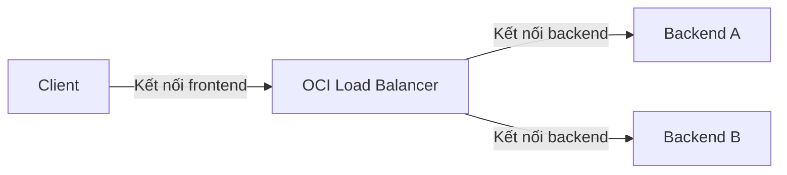
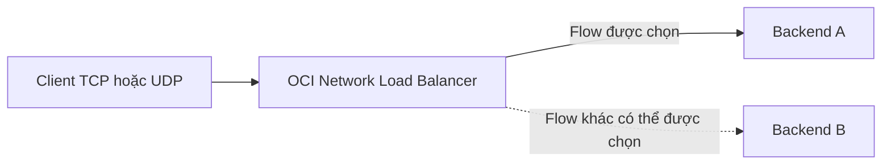
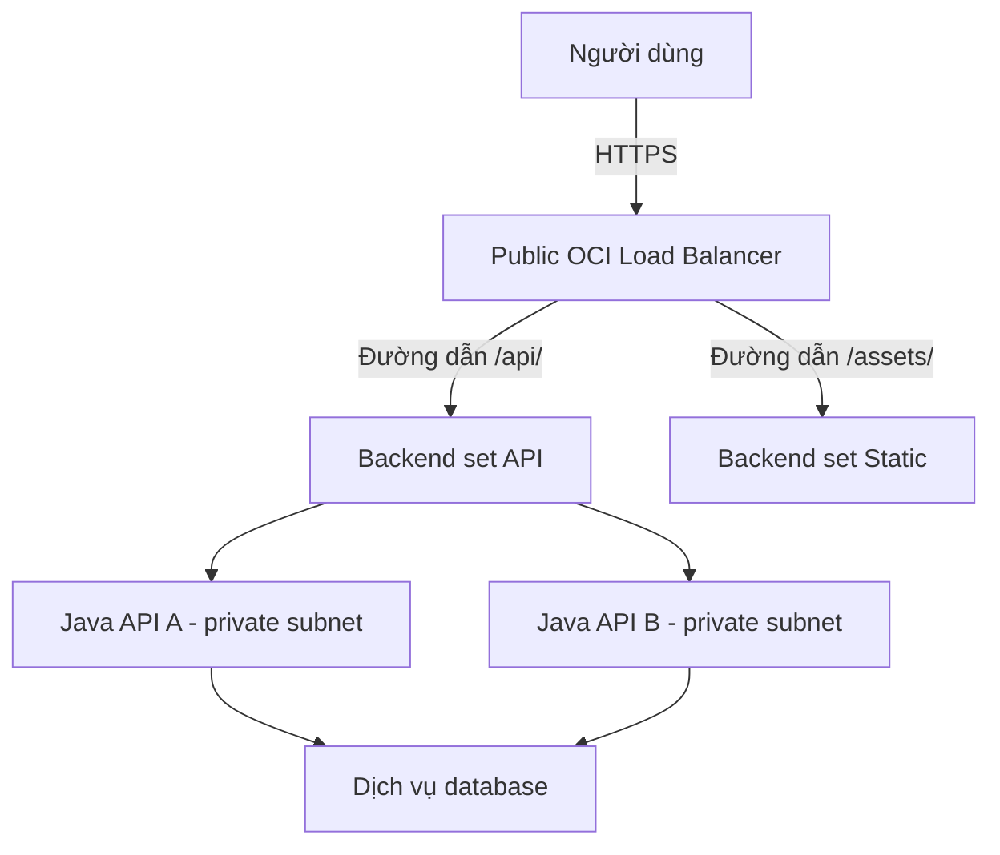

# Phân biệt Load Balancer và Network Load Balancer

Oracle Cloud Infrastructure (OCI) cung cấp hai dịch vụ cân bằng tải thường được cân nhắc khi đưa ứng dụng ra mạng: **Load Balancer (LB)** và **Network Load Balancer (NLB)**. Cả hai tạo điểm vào cho nhiều backend, nhưng cách chúng xử lý lưu lượng khác nhau. Load Balancer hoạt động như reverse proxy, có khả năng xử lý HTTP và TLS; Network Load Balancer phân phối lưu lượng theo thông tin mạng và transport, phù hợp khi cần chuyển tiếp TCP/UDP hoặc triển khai các luồng mạng chuyên dụng.

Bài học thuộc chương **Cân bằng tải ứng dụng** của module **CLOUD_PROVIDERS_ORACLE**. Trong lộ trình từ tenancy, compartment và IAM đến VCN, Compute, lưu trữ và dịch vụ cơ sở dữ liệu Oracle, lựa chọn bộ cân bằng tải cần đi cùng thiết kế phân quyền, mạng, giám sát, tự động hóa, chi phí và tính sẵn sàng.

Sau bài học, bạn có thể:

- Giải thích khác biệt giữa reverse proxy và phân phối flow.
- Chọn dịch vụ theo giao thức, HTTP routing, vị trí kết thúc TLS và yêu cầu IP nguồn.
- Phân biệt lựa chọn LB/NLB với lựa chọn public/private.
- Nhận ra những phần mà cân bằng tải không tự giải quyết: trạng thái phiên, sức khỏe nghiệp vụ, đồng bộ dữ liệu và phục hồi ứng dụng.

## Các thành phần chung

Trước khi so sánh hai dịch vụ, cần thống nhất một số thuật ngữ:

| Thành phần | Ý nghĩa |
| --- | --- |
| Frontend IP hoặc VIP | Địa chỉ mà client sử dụng làm điểm vào |
| Listener | Cấu hình tiếp nhận lưu lượng trên giao thức và cổng nhất định |
| Backend | Máy chủ hoặc endpoint nhận lưu lượng ứng dụng |
| Backend set | Nhóm backend cùng chính sách phân phối và health check |
| Health check | Cơ chế đánh giá khả năng phục vụ của backend |
| Load balancing policy | Quy tắc chọn backend |
| TLS termination | Nơi giải mã và kết thúc kết nối TLS của client |

Ví dụ, client truy cập `https://shop.example.com`, DNS trỏ về frontend IP. Listener nhận kết nối trên cổng 443 rồi chuyển lưu lượng tới một backend của ứng dụng.

Cả LB và NLB đều có listener, backend set và health check. Việc thấy những thành phần này trong Console không chứng minh hai dịch vụ có cùng khả năng xử lý giao thức. Tham khảo [khái niệm Load Balancer](https://docs.oracle.com/en-us/iaas/Content/Balance/Concepts/balanceoverview_topic-Load_Balancing_Concepts.htm) và [giới thiệu Network Load Balancer](https://docs.oracle.com/en-us/iaas/Content/NetworkLoadBalancer/introduction.htm).

## Load Balancer: reverse proxy cho ứng dụng

OCI Load Balancer hỗ trợ cân bằng tải ở lớp ứng dụng với HTTP/HTTPS và cũng hỗ trợ TCP. Vì vậy, không nên hiểu “Load Balancer chỉ dùng cho HTTP”.

Trong mô hình proxy, có thể hình dung hai chặng kết nối:



Nếu listener xử lý HTTPS và kết thúc TLS tại LB, dịch vụ có thể sử dụng thông tin HTTP đã giải mã để thực hiện các chức năng như định tuyến theo URL hoặc header. Việc chọn backend trở thành quyết định gắn với yêu cầu ứng dụng.

Một cấu hình minh họa:

| Điều kiện yêu cầu | Backend set đích |
| --- | --- |
| URL bắt đầu bằng `/api/` | `api-backends` |
| URL bắt đầu bằng `/assets/` | `static-backends` |
| Các yêu cầu còn lại | `web-backends` |

Các điều kiện này mô tả ý tưởng thiết kế, chưa phải cấu hình API để sao chép nguyên vào OCI. Routing policy thực tế cần được tạo, sắp thứ tự và gắn vào listener phù hợp. Xem [tạo routing policy](https://docs.oracle.com/en-us/iaas/Content/Balance/Tasks/create_routing-policy.htm).

LB phù hợp khi đội ứng dụng muốn quản lý hành vi HTTP tại điểm vào, tập trung chứng chỉ TLS hoặc tích hợp OCI Web Application Firewall (WAF). Khả năng đó phụ thuộc listener và các tính năng đã cấu hình; tạo một LB không tự bật mọi chức năng bảo vệ.

### Thuật toán và session

OCI LB có các chính sách phân phối như Round Robin, Least Connections và IP Hash. Đối với HTTP không dùng session persistence, quyết định có thể được thực hiện cho từng request; đối với TCP, backend được chọn cho kết nối và các gói tin tiếp theo của kết nối đó đi tới cùng endpoint.

Vì vậy, “refresh trang phải luân phiên A, B, A, B” không phải tiêu chí kiểm thử áp dụng cho mọi cấu hình. Cookie persistence, IP Hash, trọng số và loại listener đều ảnh hưởng kết quả. Xem [chính sách phân phối của LB](https://docs.oracle.com/en-us/iaas/Content/Balance/Reference/lbpolicies.htm).

## Network Load Balancer: phân phối theo flow

OCI Network Load Balancer xử lý lưu lượng dựa trên thông tin Layer 3/Layer 4. Với một dịch vụ TCP, NLB chọn backend cho flow mà không cần phân tích URL hoặc cookie của ứng dụng.



NLB thích hợp cho các tình huống như UDP, kết nối TCP kéo dài hoặc các network appliance. Thiết kế của dịch vụ hướng tới thông lượng cao và độ trễ thấp; kết quả thực tế còn phụ thuộc backend, đường mạng và workload. Xem [tổng quan Flexible Network Load Balancer](https://docs.oracle.com/en-us/iaas/Content/NetworkLoadBalancer/overview.htm).

### Flow khác HTTP request

Một TCP connection có thể mang nhiều request ứng dụng. Nếu NLB ánh xạ connection đó tới backend A, việc ứng dụng gửi request tiếp theo trên cùng connection không có nghĩa request sẽ được phân phối lại sang backend B.

Ví dụ: một client duy trì một kết nối lâu dài để gửi hàng nghìn bản tin. Dù backend set có ba máy chủ, flow đó vẫn không trở thành ba phần tải chia đều. Để đánh giá phân phối, phải quan sát nhiều flow phù hợp với chính sách hash và hành vi client.

NLB có các chính sách hash theo tuple:

| Chính sách | Trường dùng trong hash |
| --- | --- |
| 5-Tuple | Source IP, source port, destination IP, destination port, protocol |
| 3-Tuple | Source IP, destination IP, protocol |
| 2-Tuple | Source IP, destination IP |

5-Tuple giúp duy trì affinity trong flow. Hash ít trường hơn có thể giữ affinity rộng hơn giữa các flow, nhưng cũng có thể dồn tải khi nhiều client xuất hiện dưới cùng IP sau NAT. Các ràng buộc còn phụ thuộc loại listener; ví dụ L3 IP không dùng 5-Tuple. Xem [chính sách NLB và session affinity](https://docs.oracle.com/en-us/iaas/Content/NetworkLoadBalancer/introduction.htm).

## Bảng so sánh để ra quyết định

| Tiêu chí | Load Balancer | Network Load Balancer |
| --- | --- | --- |
| Cách xử lý chính | Reverse proxy | Chuyển tiếp lưu lượng mạng, không làm HTTP reverse proxy |
| Lớp xử lý | Layer 7 và TCP ở Layer 4 | Layer 3/Layer 4 |
| Lưu lượng thường gặp | HTTP, HTTPS, TCP | TCP, UDP và chế độ mạng chuyên dụng |
| Định tuyến theo URL/header HTTP | Có khi dùng cấu hình HTTP phù hợp | Không phân tích HTTP để định tuyến |
| Kết thúc TLS tại dịch vụ | Có khả năng cấu hình | Không cung cấp TLS termination |
| HTTPS đi qua | Có thể kết thúc TLS hoặc chuyển tiếp theo cấu hình | Có thể chuyển tiếp TLS qua TCP tới backend |
| Cookie persistence HTTP | Có | Không xử lý cookie ứng dụng |
| Bảo toàn IP nguồn ở packet | Backend thường thấy kết nối proxy; thông tin client HTTP qua header | Có các chế độ source preservation |
| WAF tại điểm vào OCI LB | Có khả năng tích hợp | Không có cùng tích hợp WAF Layer 7 trực tiếp |
| Public/private | Có cả hai | Có cả hai |
| Điều chỉnh băng thông | Flexible LB có cấu hình băng thông | Tự điều chỉnh, không cấu hình mức băng thông như LB |
| Mục tiêu lựa chọn | Điều khiển hành vi ứng dụng tại frontend | Phân phối flow và đáp ứng yêu cầu mạng |

Bảng này là cách diễn giải để lựa chọn kiến trúc. Các tính năng và giới hạn dịch vụ cụ thể cần đối chiếu với [bảng so sánh chính thức của Oracle](https://docs.oracle.com/en-us/iaas/Content/Balance/Reference/lb-vs-nlb.htm).

**Điểm dễ nhầm:** NLB không có listener HTTPS kết thúc TLS, nhưng vẫn có thể đưa lưu lượng HTTPS qua listener TCP đến backend tự xử lý TLS. “Không xử lý HTTP ở Layer 7” khác với “không vận chuyển được lưu lượng của một ứng dụng HTTP”.

### Không suy rộng ICMP cho mọi NLB

Khả năng ICMP có điều kiện: tài liệu OCI quy định ICMP cho private NLB với source/destination header preservation. Không nên chọn public NLB chỉ vì thấy “TCP/UDP/ICMP” trong mô tả tổng quan rồi giả định mọi chế độ đều hỗ trợ.

Việc kiểm tra kết nối cần phù hợp listener. Không lấy kết quả `ping` làm bằng chứng duy nhất rằng một frontend TCP/HTTPS hoạt động hay không. Xem [listener của NLB](https://docs.oracle.com/en-us/iaas/Content/NetworkLoadBalancer/Listeners/listener-management.htm).

## TLS: xác định nơi giải mã trước khi chọn dịch vụ

Câu hỏi quan trọng là: **thành phần nào phải kết thúc TLS của client?**

### Kết thúc TLS tại Load Balancer

```text
Client -- TLS --> LB -- HTTP --> Backend
```

Chứng chỉ frontend được quản lý tại LB. LB giải mã lưu lượng và chuyển HTTP đến backend.

Thiết kế này đơn giản hóa việc tập trung chứng chỉ, nhưng chặng LB–backend trong hình không được TLS mã hóa. Cần quyết định rõ điều đó có phù hợp với yêu cầu bảo vệ dữ liệu hay không.

### Kết thúc TLS rồi mã hóa lại tới backend

```text
Client -- TLS phiên 1 --> LB -- TLS phiên 2 --> Backend
```

Cả hai chặng đều mã hóa, nhưng đây là hai phiên TLS riêng. LB vẫn là nơi giải mã lưu lượng client, nên có thể thực hiện xử lý HTTP.

Phải cấu hình chứng chỉ và việc xác minh backend đúng với yêu cầu. Việc dùng HTTPS ở frontend không tự thiết lập TLS cho backend. Các mô hình này được mô tả trong [hướng dẫn SSL/TLS của Load Balancer](https://docs.oracle.com/en-us/iaas/Content/Balance/Tasks/managingcertificates.htm).

### Chuyển tiếp TLS tới backend

```text
Client -- TLS được chuyển tiếp qua TCP --> Backend kết thúc TLS
```

NLB phù hợp khi muốn backend trực tiếp xử lý TLS. LB với listener TCP cũng có thể được dùng để chuyển tiếp TLS theo cấu hình; do đó “TLS passthrough” chưa đủ để tự động kết luận phải chọn NLB.

Trong kiểu chuyển tiếp này, không kỳ vọng dịch vụ cân bằng tải đọc `/api/` bên trong dữ liệu TLS để chọn backend. Nếu một reverse proxy khác phía sau làm việc đó, chức năng HTTP routing nằm ở proxy đó.

Xem [khái niệm SSL termination và TCP listener](https://docs.oracle.com/en-us/iaas/Content/Balance/Concepts/balanceoverview_topic-Load_Balancing_Concepts.htm).

## IP nguồn: phân biệt header HTTP và packet mạng

### Với Load Balancer

Backend nhận kết nối qua reverse proxy nên địa chỉ mạng của peer thường là LB. Đối với HTTP, các header như `X-Forwarded-For`, `X-Real-IP` và `X-Forwarded-Proto` cung cấp ngữ cảnh của request gốc.

Ví dụ một log minh họa có thể có:

```text
network_peer=10.0.10.8
x_forwarded_for=198.51.100.24
x_forwarded_proto=https
```

Hai trường đầu không mâu thuẫn: một trường là peer của kết nối backend, trường còn lại mô tả client qua proxy.

Ứng dụng phải có quy tắc tin cậy proxy phù hợp. Không lấy tùy ý phần tử đầu tiên của `X-Forwarded-For` làm căn cứ bảo mật khi client có thể tự gửi header đó. OCI mô tả cách LB nối địa chỉ peer vào header trong [tham chiếu HTTP headers](https://docs.oracle.com/en-us/iaas/Content/Balance/Reference/httpheaders.htm).

### Với Network Load Balancer

Không nên coi “NLB luôn giữ nguyên toàn bộ packet” là thuộc tính mặc định cho mọi cấu hình. OCI có các chế độ khác nhau:

| Chế độ | Cách xử lý chính |
| --- | --- |
| Full NAT | Thay đổi địa chỉ nguồn và đích khi chuyển tới backend |
| Source preservation | Giữ IP/port nguồn; thay đổi đích để tới backend |
| Source/destination preservation | Giữ header nguồn và đích, phục vụ mô hình mạng trong suốt |

Source preservation được cấu hình ở backend set. Source/destination preservation là chế độ khác, áp dụng cho private NLB và thường gắn với network appliance, route table và mô hình chuyển tiếp chuyên dụng. Xem [các chế độ NLB](https://docs.oracle.com/en-us/iaas/Content/NetworkLoadBalancer/introduction.htm), [source preservation ở backend set](https://docs.oracle.com/en-us/iaas/Content/NetworkLoadBalancer/BackendSets/preserve-backend-set-source-id.htm) và [source/destination preservation](https://docs.oracle.com/en-us/iaas/Content/NetworkLoadBalancer/NetworkLoadBalancers/preserve-source-id.htm).

Hệ quả thiết kế:

- Nếu backend thấy IP client thật, rule mạng chỉ cho phép nguồn là subnet LB có thể không khớp lưu lượng dữ liệu.
- Health check có luồng riêng; cho phép được health check chưa chứng minh client traffic đã được cho phép.
- Với firewall hoặc appliance có trạng thái, cần kiểm tra cả chiều đi và chiều về, không chỉ frontend ingress.

Hãy xác minh địa chỉ thực tế tại backend bằng log hoặc quan sát packet trong môi trường được phép. Một tên tùy chọn trong Console chưa thay thế được việc kiểm chứng luồng mạng.

## Public/private là một trục lựa chọn độc lập

LB và NLB đều có lựa chọn public hoặc private. Vì vậy cần trả lời hai câu hỏi riêng:

1. Cần xử lý lưu lượng bằng cơ chế nào?
2. Điểm vào có được tiếp cận từ Internet hay chỉ từ mạng riêng?

| Nhu cầu | Kiểu triển khai để cân nhắc |
| --- | --- |
| Website HTTPS trên Internet, routing theo URL | Public LB |
| API nội bộ cần TLS termination và HTTP routing | Private LB |
| Dịch vụ UDP cho client Internet | Public NLB |
| Dịch vụ TCP nội bộ cần phân phối flow | Private NLB |

Private frontend không tự làm ứng dụng an toàn trước mọi truy cập. Vẫn cần route phù hợp từ các mạng được phép, NSG/security list, firewall trên hệ điều hành và xác thực ứng dụng. Public frontend cũng không buộc mọi backend phải có public IP; một thiết kế phổ biến là frontend public với backend trong private subnet.

Trong vùng có nhiều availability domain, lựa chọn regional subnet và phân bố backend cần phù hợp với mục tiêu chịu lỗi. Số subnet, địa chỉ cần sử dụng và hành vi HA của từng loại tài nguyên phải được kiểm tra theo dịch vụ. Không sao chép toàn bộ mô hình subnet của LB sang NLB chỉ vì cả hai cùng là “cân bằng tải”. Xem [các loại LB](https://docs.oracle.com/en-us/iaas/Content/Balance/Concepts/load_balancer_types.htm) và [các loại NLB](https://docs.oracle.com/en-us/iaas/Content/NetworkLoadBalancer/introduction.htm).

## Health check và tính sẵn sàng

Health check là phép đo do người thiết kế lựa chọn. Nó chỉ xác nhận được những gì phép đo thực sự kiểm tra.

| Loại phép đo | Có thể xác nhận | Chưa chứng minh |
| --- | --- | --- |
| TCP connect | Có thành phần chấp nhận TCP connection tại cổng đích | API nghiệp vụ hoạt động đúng |
| HTTP readiness | Endpoint kiểm tra trả kết quả mong đợi | Mọi luồng nghiệp vụ và dependency đều tốt |
| Thử giao dịch nghiệp vụ | Luồng được thử hoàn tất | Toàn bộ hệ thống đáp ứng mọi tình huống tải |

NLB cũng có thể dùng health check ở mức ứng dụng, ví dụ HTTP. Điều đó không biến listener NLB thành một HTTP reverse proxy. Cần tách giao thức **kiểm tra backend** khỏi giao thức và cách xử lý **lưu lượng người dùng**.

Với ứng dụng Java trên Compute, có thể thiết kế endpoint `/health/ready` trả trạng thái sẵn sàng tiếp nhận request. Không nên mặc định dùng trang chủ trả `200 OK` nếu trang đó vẫn trả thành công khi phần nghiệp vụ đã hỏng.

Một thiết kế health check cần xác định:

- Protocol, port và đường dẫn nếu có.
- Kết quả nào được coi là healthy.
- Interval, timeout và ngưỡng đánh giá.
- Dependency nào phải có để backend phục vụ được.
- Rule mạng cho luồng kiểm tra.
- Hành vi khi một backend lỗi và khi cả backend set lỗi.

Cấu hình quá nhạy có thể làm backend liên tục bị đưa ra rồi đưa lại vào vòng phục vụ. Cấu hình quá chậm kéo dài thời gian phát hiện lỗi. Các lỗi phụ thuộc cơ sở dữ liệu hoặc storage cũng có thể xuất hiện dưới dạng backend timeout. Xem [chẩn đoán health check của LB](https://docs.oracle.com/en-us/iaas/Content/Balance/Reference/troubleshooting_health.htm).

### Đừng giả định mọi tình huống đều chỉ gửi tới backend healthy

OCI NLB có tùy chọn **Fail open**: nếu được bật, dịch vụ có thể tiếp tục chuyển lưu lượng khi tất cả backend trong set đều unhealthy. Các tùy chọn failover cho luồng hiện hữu cũng cần được xét cùng nhau. Vì vậy, hãy ghi nhận cấu hình thực tế trước khi kết luận health check sai vì vẫn nhìn thấy lưu lượng tại backend. Xem [tùy chọn khi tạo NLB](https://docs.oracle.com/en-us/iaas/Content/NetworkLoadBalancer/NetworkLoadBalancers/create-network-load-balancer.htm).

Ngay cả khi dịch vụ có cơ chế chuyển flow, nó không sao chép bộ nhớ tiến trình, transaction đang mở hoặc session của ứng dụng sang máy chủ khác. Backend chết có thể làm một TCP session hoặc thao tác đang xử lý thất bại; client cần cơ chế reconnect và xử lý retry phù hợp.

### HA của bộ cân bằng tải chưa đủ cho HA ứng dụng

Một frontend có tính sẵn sàng cao vẫn không khắc phục được các tình huống:

- Chỉ có một backend thực sự phục vụ.
- Các backend cùng phụ thuộc một thành phần lỗi.
- Dữ liệu hoặc session chỉ lưu trên một máy.
- Backend ở nhiều nơi nhưng mọi đường đi cùng bị chặn bởi một cấu hình mạng.
- Ứng dụng không xử lý reconnect hoặc gửi lại request an toàn.

Ví dụ, session đăng nhập chỉ nằm trong RAM của backend A sẽ bị ảnh hưởng khi A chết. Cookie stickiness có thể giữ người dùng quay lại A khi A còn sống, nhưng không tự tạo bản sao session trên B.

Đối với cơ sở dữ liệu Oracle, không đưa các node có vai trò khác nhau vào cùng backend set rồi giả định chúng thay thế được nhau. Cân bằng tải TCP không tự phân biệt primary/standby, đồng bộ dữ liệu hoặc hoàn tất một transaction dang dở. Điểm kết nối database phải được thiết kế cùng cơ chế dịch vụ và HA của nền tảng cơ sở dữ liệu.

## Các tình huống lựa chọn

### Cổng thương mại điện tử và API Java

Yêu cầu:

- Truy cập bằng HTTPS.
- `/api/` tới nhóm API, `/assets/` tới nhóm tài nguyên tĩnh.
- Quản lý chứng chỉ tại điểm vào.
- Có khả năng áp dụng WAF cho HTTP.

**Lựa chọn phù hợp trong tình huống này: LB.** Các yêu cầu chính cần hiểu và xử lý thông tin ứng dụng.

Một mô hình minh họa:



Trong thiết kế thật, còn phải quyết định chặng LB–backend dùng HTTP hay TLS, nơi lưu session và cách giới hạn mạng tới database. Rule `/admin/` được định tuyến đúng không thay thế xác thực và phân quyền cho chức năng quản trị.

### Thu thập bản tin UDP

Yêu cầu:

- Client gửi bản tin bằng UDP.
- Không có URL, HTTP header hay cookie.
- Cần phân phối tới nhiều bộ thu.

**Lựa chọn phù hợp để cân nhắc: NLB**, vì giao thức UDP là yêu cầu bắt buộc của luồng dữ liệu.

Phần ứng dụng vẫn phải giải quyết bản tin mất, trùng hoặc đến sai thứ tự theo đặc điểm của giao thức và nghiệp vụ. Không nên lấy thành công của một phép thử TCP làm bằng chứng rằng dịch vụ UDP đã hoạt động.

### Dịch vụ TCP kéo dài, backend tự xử lý TLS

Yêu cầu:

- Kết nối lâu dài.
- Backend trực tiếp xử lý TLS.
- Cần đánh giá IP nguồn thực và số flow đồng thời.

**NLB là ứng viên phù hợp** nếu cơ chế phân phối flow và các chế độ bảo toàn địa chỉ đáp ứng yêu cầu. Vì LB cũng có TCP, bước lựa chọn cuối cùng cần dựa vào các tính năng mạng, cách quan sát và luồng kết nối thực tế.

Phép thử quan trọng gồm tạo nhiều connection độc lập, giữ connection đủ lâu và kiểm tra phản ứng khi backend lỗi. Đếm request trên một connection duy nhất không đánh giá được cách NLB phân phối nhiều flow.

### Cụm firewall hoặc network appliance

Yêu cầu:

- Appliance cần thấy thông tin IP nguồn/đích.
- Luồng được điều hướng qua thành phần kiểm tra mạng.
- Cả hai chiều của luồng cần đi qua đường xử lý phù hợp.

**Private NLB với chế độ mạng phù hợp** là ứng viên cần đánh giá. Đây là bài toán routing và appliance, đòi hỏi xem xét route table, chế độ preservation, tính đối xứng của lưu lượng và trạng thái firewall.

Không áp dụng nguyên mô hình frontend web vào trường hợp này. Xem [source/destination preservation cho network appliance](https://docs.oracle.com/en-us/iaas/Content/NetworkLoadBalancer/NetworkLoadBalancers/preserve-source-id.htm).

## Băng thông, khả năng mở rộng và chi phí

Flexible LB cho phép cấu hình băng thông tối thiểu và tối đa; NLB tự điều chỉnh theo lưu lượng mà không cần cấu hình cùng kiểu mức băng thông. Hai mô hình này tạo ra cách lập kế hoạch khác nhau. Tham khảo [tổng quan LB](https://docs.oracle.com/en-us/iaas/Content/Balance/Concepts/balanceoverview.htm) và [tổng quan NLB](https://docs.oracle.com/en-us/iaas/Content/NetworkLoadBalancer/overview.htm).

Với LB, cần hiểu nhu cầu tải cơ sở và mức tải cao nhất để lựa chọn cấu hình phù hợp. Với NLB, không cấu hình mức băng thông không có nghĩa không cần capacity planning.

Các giới hạn cần xem xét cho cả hệ thống:

| Thành phần | Câu hỏi cần trả lời |
| --- | --- |
| Frontend | Có đạt giới hạn băng thông, connection hoặc giới hạn dịch vụ không? |
| Compute backend | CPU, bộ nhớ, VNIC và connection handling có đủ không? |
| Ứng dụng Java | Thread pool, hàng đợi và GC có đáp ứng tải không? |
| Database | Connection pool và truy vấn có trở thành điểm nghẽn không? |
| Mạng và logging | Lưu lượng ra ngoài, thu thập và lưu log phát sinh gì? |

Tăng số backend không tự tăng capacity database. Cũng không nên coi throughput tối đa ghi trong mô tả dịch vụ là kết quả benchmark được bảo đảm cho ứng dụng.

Theo [bảng giá OCI](https://www.oracle.com/cloud/price-list/), Flexible Network Load Balancer được niêm yết không thu phí dịch vụ. Điều này không làm toàn bộ kiến trúc trở thành miễn phí: vẫn cần tính Compute, lưu trữ, truyền dữ liệu và các dịch vụ quan sát theo cách sử dụng. Khi triển khai, đối chiếu bảng giá và điều kiện tài khoản tại thời điểm thực hiện.

Quyết định chi phí nên tính cả công vận hành. Nếu chọn NLB rồi tự dựng thêm một cụm proxy chỉ để có các chức năng HTTP vốn cần thiết, phải đưa cụm proxy đó vào chi phí và phạm vi chịu lỗi của thiết kế.

## IAM, mạng và tự động hóa là ba phần riêng

Một người có quyền tạo tài nguyên cân bằng tải chưa chắc client của họ đã kết nối được tới listener. Ngược lại, client gửi request ứng dụng thành công không có nghĩa người đó được sửa cấu hình cân bằng tải.

| Phần việc | Cơ chế cần thiết kế |
| --- | --- |
| Tạo, sửa, xem tài nguyên cloud | IAM và phạm vi compartment |
| Cho phép packet đến listener/backend | Route, NSG/security list, firewall hệ điều hành |
| Cho phép người dùng làm nghiệp vụ | Xác thực và phân quyền trong ứng dụng |

Với LB reverse proxy, rule backend thường dựa trên đường kết nối từ LB. Với NLB source preservation, cần xây dựng rule theo địa chỉ thực sự hiện diện trong packet và cho phép riêng health check. Không sao chép rule “chỉ nhận từ subnet LB” sang mọi cấu hình NLB.

Nếu kết hợp NSG và security list, phải xét toàn bộ rule có hiệu lực thay vì chỉ nhìn một NSG. Xem [nguyên tắc security rule của OCI](https://docs.oracle.com/en-us/iaas/Content/Network/Concepts/securityrules.htm).

Khi dùng Infrastructure as Code, nên mô tả rõ loại dịch vụ, public/private, listener, backend set, health check, chứng chỉ, rule mạng và cấu hình quan sát. Đừng xem việc thay LB bằng NLB là chỉ đổi tên tài nguyên: mô hình TLS, địa chỉ nguồn và vận hành có thể thay đổi.

Bài học này không yêu cầu tạo cả hai dịch vụ trong môi trường sản xuất. Có thể thực hành với một môi trường riêng, dữ liệu giả lập và quyền giới hạn vào compartment học tập.

## Kiểm chứng lựa chọn bằng một bài thực hành nhỏ

Giả sử đã có hai backend ứng dụng trong môi trường thử nghiệm. Mỗi backend cung cấp endpoint `/api/whoami` trả mã nhận diện khác nhau:

```json
{
  "backend": "app-a",
  "service": "demo-api"
}
```

Backend còn lại trả `"backend": "app-b"`. Địa chỉ và nội dung này chỉ là dữ liệu minh họa.

Chuẩn bị hai thiết kế để so sánh nếu có đủ môi trường:

| Thiết kế | Frontend | Backend xử lý |
| --- | --- | --- |
| LB | HTTPS listener | HTTP hoặc HTTPS theo cấu hình được chọn |
| NLB | TCP listener | TLS do backend kết thúc nếu ứng dụng dùng HTTPS |

Không cấu hình NLB TCP chuyển vào một cổng HTTP plaintext rồi kỳ vọng client HTTPS hoạt động. Trong thiết kế passthrough, backend phải nhận đúng giao thức mà client đang gửi.

### Kiểm tra HTTP/TLS qua LB

Ví dụ PowerShell, với `curl.exe` đã có sẵn:

```powershell
$LbIp = 'REPLACE_WITH_LB_IP'
$HostName = 'REPLACE_WITH_REAL_HOSTNAME'
$ResolveEntry = $HostName + ':443:' + $LbIp
$Url = 'https://' + $HostName + '/api/whoami'

curl.exe --resolve $ResolveEntry --silent --show-error --include $Url
```

Thay hostname bằng tên khớp với chứng chỉ và cấu hình thực. `--resolve` cho phép chỉ định IP thử nghiệm trong khi vẫn sử dụng hostname trong URL. Không bỏ qua lỗi xác minh chứng chỉ để tuyên bố cấu hình TLS đã đúng.

Lặp lại yêu cầu với số lượng phù hợp và xem backend access log. Nếu đã bật session persistence hoặc dùng chính sách affinity, không kỳ vọng kết quả luân phiên đều qua từng request.

### Kiểm tra cổng TCP qua NLB

```powershell
$NlbAddress = 'REPLACE_WITH_NLB_ADDRESS'

Test-NetConnection -ComputerName $NlbAddress -Port 7443
```

`TcpTestSucceeded = True` chỉ xác nhận kiểm tra TCP thành công. Nó chưa xác nhận:

- TLS handshake đúng.
- Chứng chỉ khớp hostname.
- Giao thức ứng dụng hoàn tất.
- UDP trên một listener khác hoạt động.
- Hai backend đều có thể phục vụ.

Sau đó phải dùng client thật của giao thức ứng dụng. Nếu đó là HTTPS qua TCP 7443, hãy thử HTTPS với hostname và cổng tương ứng; nếu là giao thức riêng, dùng client của giao thức đó.

### Các phép thử có ý nghĩa

| Phép thử | Điều cần quan sát |
| --- | --- |
| Gửi request với hai URL khác nhau qua LB | Routing policy chọn đúng backend set |
| Gửi nhiều connection qua NLB | Phân phối theo flow và policy đã chọn |
| Quan sát IP tại backend | Khớp mô hình proxy hoặc preservation |
| Dừng một backend trong môi trường thử nghiệm | Health status, lưu lượng mới và lỗi của client |
| Backend hết sẵn sàng nhưng cổng TCP vẫn mở | Health check có phát hiện lỗi nghiệp vụ cần thiết không |
| Khôi phục backend | Thời gian và điều kiện được đưa lại vào phục vụ |
| Một connection kéo dài bị mất backend | Reconnect, retry và trạng thái ứng dụng |

Thử nghiệm dừng backend chỉ thực hiện trên tài nguyên thử nghiệm được phép. Kết quả cần được ghi cùng cấu hình listener, health check và failover, để người khác có thể hiểu vì sao hệ thống hành xử như vậy.

## Giám sát và chẩn đoán

Với LB xử lý HTTP, thường cần theo dõi kết quả request, mã lỗi, độ trễ, tình trạng backend và lỗi TLS. Với NLB, cần chú ý flow, connection, packet/byte, health status và log tại backend. Không kỳ vọng NLB tự sinh phân tích URL hoặc mã HTTP như một HTTP proxy.

Khi có lỗi, kiểm tra theo đường đi:

1. DNS có trỏ về đúng frontend không.
2. Frontend có đúng public/private và có route từ client không.
3. Listener có đúng protocol/port không.
4. Rule mạng có cho phép cả client traffic và health check không.
5. Backend có lắng nghe đúng địa chỉ, cổng và giao thức không.
6. TLS kết thúc ở đúng nơi, với chứng chỉ phù hợp không.
7. Health check có đo đúng điều kiện sẵn sàng không.
8. Ứng dụng và dependency có xử lý request thành công không.

Ví dụ, lỗi TLS từ client có thể đến từ việc gửi HTTPS vào backend HTTP qua NLB; health check healthy trong tình huống đó không chứng minh frontend TLS đã đúng.

Khi mô tả một sự cố, ghi rõ “TCP kết nối được nhưng TLS handshake thất bại” sẽ hữu ích hơn “load balancer không chạy”. Sự phân biệt này giúp tìm đúng lớp xử lý và đúng thành phần chịu trách nhiệm.

## Những nhầm lẫn thường gặp

| Nhận định | Cách hiểu chính xác hơn |
| --- | --- |
| LB là Layer 7 nên không dùng được TCP | OCI LB có hỗ trợ TCP |
| NLB không kết thúc TLS nên không dùng được HTTPS | Có thể chuyển tiếp HTTPS qua TCP tới backend |
| Dùng NLB thì luôn thấy nguyên mọi địa chỉ | Phụ thuộc chế độ preservation/NAT và đường đi |
| Health check HTTP nghĩa là NLB có HTTP routing | Health check và listener là hai chức năng riêng |
| Private NLB tương đương một LB bảo mật hơn | Private/public nói về điểm tiếp cận; bảo mật cần nhiều lớp |
| Nhiều backend thì session tự được sao chép | Trạng thái ứng dụng cần thiết kế riêng |
| Frontend HA nghĩa là request đang chạy không bao giờ lỗi | Client và ứng dụng vẫn cần xử lý lỗi, reconnect và retry |
| Bảng giá NLB miễn phí nghĩa là toàn hệ thống miễn phí | Backend, truyền dữ liệu và dịch vụ liên quan vẫn cần tính chi phí |

## Cách chốt một quyết định kiến trúc

Một quyết định lựa chọn nên ghi được trong vài câu có thể kiểm chứng. Ví dụ:

> Dùng public Load Balancer cho cổng API vì cần HTTPS termination, routing theo URL và tích hợp WAF. Backend chạy trong private subnet; chặng LB–backend dùng TLS. Nhóm ứng dụng chịu trách nhiệm session và retry, nhóm hạ tầng theo dõi health check và capacity.

Hoặc:

> Dùng private Network Load Balancer cho dịch vụ TCP vì backend phải trực tiếp xử lý TLS và cần đánh giá địa chỉ nguồn ở packet. Backend set được cấu hình preservation theo thiết kế mạng; kiểm thử gồm flow kéo dài, backend lỗi và hành vi reconnect của client.

Nếu chưa xác định được giao thức, nơi kết thúc TLS, phạm vi public/private và yêu cầu IP nguồn, chưa đủ dữ kiện để chốt dịch vụ. Khi những điều đó đã rõ, lựa chọn LB hay NLB trở thành một quyết định có lý do, có cấu hình tương ứng và có phép thử để xác nhận.