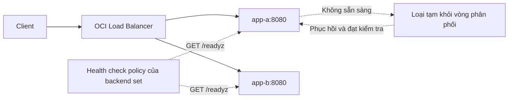

# Health checks và loại bỏ backend không sẵn sàng

## Mục tiêu và phạm vi

Trong kiến trúc ứng dụng trên Oracle Cloud Infrastructure (OCI), Load Balancer cần biết backend nào thực sự có thể phục vụ trước khi phân phối yêu cầu. Một Compute instance vẫn chạy, cổng TCP vẫn mở nhưng ứng dụng có thể đang khởi động, mất kết nối cơ sở dữ liệu hoặc không còn đủ tài nguyên xử lý.

Bài này thuộc chương **Cân bằng tải ứng dụng**, tập trung vào health check của **OCI Load Balancer**, với các lệnh `oci lb`. Người học kết hợp IAM, VCN, Compute và giám sát để cấu hình kiểm tra sức khỏe, quan sát backend bị loại tạm thời khỏi vòng phân phối và xác nhận backend được nhận lại sau phục hồi.

Tình huống xuyên suốt là hai backend `app-a` và `app-b` phục vụ HTTP tại cổng `8080`. Khi `app-a` không sẵn sàng, các yêu cầu mới cần được chuyển đến `app-b` sau khi bộ kiểm tra xác định được sự cố. Mục tiêu bao gồm kiểm soát lỗi quan sát được trong giai đoạn chuyển trạng thái và bảo đảm backend còn lại có đủ năng lực.

## 1. Health check tham gia quyết định phân phối như thế nào?

Health check là phép thử theo chu kỳ bằng kết nối hoặc yêu cầu đến backend. Policy thuộc backend set; backend không vượt qua kiểm tra bị đưa ra khỏi vòng phân phối, rồi được nhận lại khi đáp ứng kiểm tra sau phục hồi. TCP kiểm tra kết nối; HTTP kiểm tra URI cùng mã phản hồi hoặc nội dung. [Oracle: Health Check Policies for Load Balancers](https://docs.oracle.com/en-us/iaas/Content/Balance/Tasks/load_balancer_health_management.htm).



“Loại backend” ở đây là thay đổi khả năng được chọn để phục vụ, không có nghĩa xóa backend khỏi cấu hình hoặc dừng Compute instance. Health check cũng không tự sửa ứng dụng, tạo thêm máy hay di chuyển trạng thái phiên trong bộ nhớ sang máy khác.

Có một khoảng thời gian từ lúc ứng dụng bắt đầu lỗi đến lúc Load Balancer có đủ kết quả kiểm tra để thay đổi quyết định. Các yêu cầu trong khoảng này vẫn có thể gặp lỗi. Vì vậy, bài toán sẵn sàng còn cần chiến lược xử lý yêu cầu thất bại, lưu trạng thái dùng chung và năng lực dự phòng.

### TCP thành công chưa đủ cho ứng dụng HTTP

Nếu một reverse proxy vẫn nhận kết nối TCP nhưng ứng dụng phía sau trả lỗi, kiểm tra TCP có thể báo tốt. Oracle khuyến nghị chọn protocol health check phù hợp với dịch vụ; với HTTP, kiểm tra HTTP phát hiện được lỗi ở tầng phản hồi mà bắt tay TCP bỏ sót. [Oracle: Load Balancer Health Check Best Practices](https://docs.oracle.com/en-us/iaas/Content/Balance/Tasks/health_check_best_practices.htm).

Ví dụ về cách diễn giải:

| Quan sát | Điều có thể kết luận |
| --- | --- |
| TCP `8080` mở | Có thể thiết lập kết nối đến cổng |
| `GET /livez` trả `200` | Tiến trình đáp ứng điều kiện sống đã định nghĩa |
| `GET /readyz` trả `200` | Instance đáp ứng điều kiện nhận tải đã định nghĩa |
| Giao dịch mẫu thành công | Đường nghiệp vụ được thử hoạt động tại thời điểm đó |

Không phép thử nào tự đại diện cho toàn bộ ứng dụng. Chất lượng của tín hiệu phụ thuộc vào hợp đồng endpoint mà nhóm phát triển và vận hành thống nhất.

## 2. Thiết kế endpoint readiness

Đề xuất tách hai câu hỏi:

- **Liveness:** tiến trình còn hoạt động và có thể tiếp tục chạy không?
- **Readiness:** instance có nên nhận yêu cầu nghiệp vụ mới ngay bây giờ không?

Một hợp đồng đơn giản cho backend HTTP:

```http
GET /readyz

HTTP/1.1 200 OK
Content-Type: text/plain
Cache-Control: no-store

READY
```

Khi chưa sẵn sàng:

```http
GET /readyz

HTTP/1.1 503 Service Unavailable
Content-Type: text/plain
Cache-Control: no-store

NOT_READY
```

Đây là thiết kế endpoint minh họa của bài học. Chọn `200` và body `READY` giúp health policy kiểm tra tín hiệu rõ ràng, tránh phụ thuộc giao diện trang chủ hoặc trang đăng nhập.

Các nguyên tắc triển khai nên áp dụng:

1. Endpoint nhẹ, có giới hạn thời gian xử lý và không làm thay đổi dữ liệu.
2. Không redirect tới trang đăng nhập hay yêu cầu cookie tương tác.
3. Chỉ trả trạng thái tối thiểu; không công bố chuỗi kết nối hoặc thông tin bí mật.
4. Chỉ báo sẵn sàng sau khi ứng dụng hoàn tất khởi tạo cần thiết.
5. Khi nhận tín hiệu ngừng phục vụ có kiểm soát, chuyển readiness sang không sẵn sàng trước khi dừng tiến trình.
6. Nếu kiểm tra dependency, dùng timeout riêng và tránh tạo truy vấn đắt tiền mỗi lần probe.

### Kiểm tra dependency đến đâu?

Giả sử ứng dụng dùng Oracle Database cho giao dịch chính và một dịch vụ ngoài để gửi thông báo. Nếu không kết nối được database thì instance có thể không xử lý được yêu cầu chính; nếu hệ thống thông báo tạm chậm nhưng có hàng đợi, ứng dụng vẫn có thể phục vụ.

Hãy lựa chọn điều kiện readiness theo khả năng hoàn thành công việc cốt lõi. Đưa mọi dependency tùy chọn vào readiness có thể khiến tất cả backend bị loại cùng lúc vì một dịch vụ phụ. Ngược lại, luôn trả `200` từ một tệp tĩnh có thể che mất lỗi cục bộ của ứng dụng.

Với sự cố database dùng chung, loại cả hai backend không tạo ra backend khỏe thay thế. Nhóm vận hành cần kế hoạch phục hồi database hoặc cơ chế suy giảm chức năng đã thiết kế trước. Health check chỉ cung cấp tín hiệu cho quyết định định tuyến.

## 3. Các tham số health policy

Ví dụ cấu hình khởi đầu cho lab:

| Tham số | Giá trị lab | Ý nghĩa |
| --- | --- | --- |
| Protocol | `HTTP` | Kiểm tra phản hồi ứng dụng |
| Port | `8080` | Cổng backend cần kiểm tra |
| URL path | `/readyz` | Endpoint readiness |
| Return code | `200` | Mã phản hồi mong đợi |
| Response body regex | `^READY$` | Body hợp lệ theo hợp đồng lab |
| Interval | `10000` ms | Khoảng giữa các lần kiểm tra |
| Timeout | `3000` ms | Thời gian chờ một phản hồi |
| Retries | `3` | Tham số ngưỡng chuyển trạng thái |

Các mặc định được Oracle mô tả cho interval, timeout và retries lần lượt là `10000` ms, `3000` ms và `3`; retries cũng áp dụng khi phục hồi về trạng thái khỏe. Port `0` có thể dùng cổng traffic của từng backend. [Oracle: Editing a Load Balancer's Health Check Policies](https://docs.oracle.com/en-us/iaas/Content/Balance/Tasks/editinghealthcheck_topic-Editing_Health_Check_Policies.htm).

Giá trị trong bảng là điểm xuất phát cho thực hành, không phải cấu hình tối ưu cho mọi ứng dụng. Endpoint cần trả body chính xác; mẫu Java bên dưới cố ý không thêm ký tự xuống dòng vào `READY` để phù hợp regex.

### Điều chỉnh theo mục tiêu phục vụ

Interval ngắn cho nhiều cơ hội quan sát thay đổi hơn nhưng tăng số probe. Timeout quá ngắn có thể loại nhầm backend lúc hệ thống có độ trễ thoáng qua. Timeout quá dài làm phát hiện sự cố chậm hơn. Ngưỡng retries cần cân bằng giữa tốc độ phản ứng và dao động trạng thái.

Không coi phép nhân `interval × retries` là SLA chuyển tải chính xác. Thời điểm xảy ra lỗi so với chu kỳ probe, thời gian chờ từng lần kiểm tra và quá trình cập nhật cấu hình đều ảnh hưởng kết quả. Hãy đo thời gian lỗi thật sự quan sát được trong bài lab và đối chiếu mục tiêu của ứng dụng.

Một lần đổi tham số nên gắn với giả thuyết cụ thể, chẳng hạn “timeout hiện tại thấp hơn độ trễ readiness khi hệ thống chịu tải”. Việc tăng timeout chỉ để làm dashboard xanh có thể che mất nguyên nhân cần sửa.

### HTTP, TLS và cổng kiểm tra

Với backend set dùng SSL, health check HTTP có thể chạy qua HTTPS; tùy chọn force plaintext làm thay đổi cách gửi probe. TLS phía client và TLS tới backend là hai chặng cấu hình cần đối chiếu riêng. [Oracle: health check và SSL](https://docs.oracle.com/en-us/iaas/Content/Balance/Tasks/load_balancer_health_management.htm).

Lab này dùng HTTP thuần trong VCN và backend set không bật SSL để tập trung vào readiness. Với triển khai HTTPS, kiểm tra thêm chứng chỉ, trust và cổng của backend; không áp dụng nguyên cấu hình HTTP lab cho một endpoint chỉ nhận TLS.

## 4. Chuẩn bị IAM và đường mạng

Chỉ chạy thực hành trên tài nguyên lab do bạn quản lý, với hai backend chứa dữ liệu giả lập. Chuẩn bị:

- Một OCI Load Balancer và listener HTTP `80` trỏ tới backend set `bs-app`.
- Hai Compute Linux trong VCN, có JDK 17 trở lên, IP riêng ví dụ `10.0.2.10` và `10.0.2.11`.
- Hai backend `10.0.2.10:8080` và `10.0.2.11:8080`, weight bằng nhau.
- Policy phân phối Round Robin, không session persistence; các cờ drain, offline và backup đều tắt trong lab.
- Máy quản trị có OCI CLI, PowerShell và `curl.exe`.
- Kênh quản trị được phép vào Compute để chạy ứng dụng mẫu.

Địa chỉ trong bài là giá trị minh họa; thay bằng địa chỉ thực tế của môi trường.

Quyền cập nhật health checker thuộc `LOAD_BALANCER_UPDATE`, nằm trong verb `use load-balancers`. Nếu quản lý qua Console, còn cần quyền đối với tài nguyên mạng liên quan. [Oracle: Details for Load Balancing](https://docs.oracle.com/en-us/iaas/Content/Identity/Reference/lbpolicyreference.htm).

Ví dụ policy ở compartment lab, cần điều chỉnh tên nhóm và identity domain:

```text
Allow group LbLabOperators to use load-balancers in compartment TrainingApp
```

Policy này phục vụ vận hành Load Balancer đã tồn tại; nó không thay thế quyền tạo Compute, cấu hình VCN hay xem tất cả dữ liệu giám sát. Phân quyền các công việc đó theo vai trò của nhóm.

### Các đường truyền cần thông

| Đường truyền | Cổng lab | Điều cần kiểm soát |
| --- | --- | --- |
| Máy thử → listener Load Balancer | TCP `80` | Ingress cho nguồn thử đã cho phép |
| Load Balancer → backend | TCP `8080` | Egress phía LB và ingress phía backend |
| Health checker → `/readyz` backend | TCP `8080` | Luật mạng và firewall hệ điều hành |
| Máy quản trị → Compute | Kênh quản trị đã chọn | Phân quyền truy cập phục vụ lab |

Với các tài nguyên trong cùng VCN, có thể dùng NSG của Load Balancer làm nguồn cho luật ingress vào NSG backend. Đối chiếu cả security lists, route và firewall cục bộ khi probe không tới được máy. Một lần `curl localhost` thành công chỉ xác nhận đường cục bộ.

Nguồn probe thuộc hạ tầng do Load Balancer quản lý; không phải IP máy cá nhân của người học. OCI cung cấp thông tin nguồn trong chi tiết health check để hỗ trợ điều tra. [Oracle: Understanding Load Balancer Health Issues](https://docs.oracle.com/en-us/iaas/Content/Balance/Tasks/understanding_health_issues.htm).

Không mở backend HTTP ra toàn bộ Internet chỉ để sửa một lỗi health check. Hãy xác định đúng nguồn, đích, cổng và chiều lưu lượng của đường cần cho phép.

## 5. Ứng dụng mẫu có thể chuyển readiness

Đoạn Java dưới đây dùng `HttpServer` của JDK để tạo ba endpoint. Đây là mô phỏng phục vụ lab, không phải ứng dụng sản xuất hay phép thử database thật. API `HttpServer` hỗ trợ khai báo context, handler và executor cho máy chủ HTTP. [Oracle JDK 17: HttpServer](https://docs.oracle.com/en/java/javase/17/docs/api/jdk.httpserver/com/sun/net/httpserver/HttpServer.html).

Lưu thành `LbHealthDemo.java` trên **từng backend Linux**:

```java
import com.sun.net.httpserver.HttpServer;
import java.net.InetSocketAddress;
import java.nio.charset.StandardCharsets;
import java.nio.file.Files;
import java.nio.file.Path;
import java.util.concurrent.Executors;

public class LbHealthDemo {
    private static final Path NOT_READY =
        Path.of("/tmp/oci-lb-not-ready");

    public static void main(String[] args) throws Exception {
        String node = args.length > 0 ? args[0] : "unknown";
        HttpServer server =
            HttpServer.create(new InetSocketAddress(8080), 128);

        server.createContext("/", exchange -> {
            boolean ready = !Files.exists(NOT_READY);
            String path = exchange.getRequestURI().getPath();
            int status;
            String text;

            switch (path) {
                case "/livez" -> {
                    status = 200;
                    text = "ALIVE";
                }
                case "/readyz" -> {
                    status = ready ? 200 : 503;
                    text = ready ? "READY" : "NOT_READY";
                }
                case "/whoami" -> {
                    status = ready ? 200 : 503;
                    text = ready ? node : "NOT_READY:" + node;
                }
                default -> {
                    status = 404;
                    text = "NOT_FOUND";
                }
            }

            byte[] body = text.getBytes(StandardCharsets.UTF_8);
            exchange.getResponseHeaders().set(
                "Content-Type", "text/plain; charset=utf-8");
            exchange.getResponseHeaders().set("Cache-Control", "no-store");
            exchange.sendResponseHeaders(status, body.length);
            try (var output = exchange.getResponseBody()) {
                output.write(body);
            }
        });

        server.setExecutor(Executors.newFixedThreadPool(4));
        server.start();
        System.out.println("Listening on 8080: " + node);
    }
}
```

Biên dịch trên mỗi máy:

```bash
javac --add-modules jdk.httpserver LbHealthDemo.java
```

Chạy trong một phiên terminal giữ mở. Trên máy A:

```bash
java --add-modules jdk.httpserver LbHealthDemo app-a
```

Trên máy B:

```bash
java --add-modules jdk.httpserver LbHealthDemo app-b
```

Từ terminal khác trên từng máy, xác nhận:

```bash
curl -i http://127.0.0.1:8080/readyz
curl -i http://127.0.0.1:8080/whoami
```

Cả hai endpoint phải trả `200` khi tệp đánh dấu không tồn tại. Nếu lab trước để lại `/tmp/oci-lb-not-ready`, xác nhận đó là tệp của bài thực hành rồi xóa riêng tệp này trước khi lấy số liệu ban đầu.

Khi tạo tệp đánh dấu, tiến trình Java vẫn chạy và `/livez` vẫn tốt; readiness cùng endpoint mô phỏng nghiệp vụ chuyển sang `503`. Sự khác biệt này giúp quan sát tình huống “máy còn sống nhưng không nên nhận tải”.

## 6. Cấu hình health checker và kiểm tra ban đầu

### Xem và ghi nhận cấu hình hiện tại

Các lệnh PowerShell sau được chạy trên máy quản trị lab. Thay region và OCID bằng tài nguyên thực tế:

```powershell
$region = 'ap-singapore-1'
$lbId = 'ocid1.loadbalancer.oc1.REGION.REPLACE_ME'
$backendSetName = 'bs-app'
$backendA = '10.0.2.10:8080'
$backendB = '10.0.2.11:8080'
$lbBaseUrl = 'http://REPLACE_WITH_LB_ADDRESS'

& oci lb health-checker get `
    --region $region `
    --load-balancer-id $lbId `
    --backend-set-name $backendSetName `
    --output json

if ($LASTEXITCODE -ne 0) {
    throw 'Khong doc duoc health policy; dung buoc thay doi.'
}
```

OCI cung cấp lệnh `health-checker get` để đọc policy của backend set. [Oracle: Getting a Load Balancer's Health Check Policy Details](https://docs.oracle.com/en-us/iaas/Content/Balance/Tasks/get_health-checker.htm).

Giữ lại cấu hình cũ trong hồ sơ lab để có thể khôi phục. Kiểm tra đã chọn đúng backend set được listener sử dụng, tránh sửa policy của một tập backend không nhận lưu lượng thử.

### Cập nhật policy cho endpoint mẫu

```powershell
& oci lb health-checker update `
    --region $region `
    --load-balancer-id $lbId `
    --backend-set-name $backendSetName `
    --protocol HTTP `
    --port 8080 `
    --url-path '/readyz' `
    --return-code 200 `
    --response-body-regex '^READY$' `
    --interval-in-millis 10000 `
    --timeout-in-millis 3000 `
    --retries 3 `
    --is-force-plain-text false `
    --wait-for-state SUCCEEDED `
    --max-wait-seconds 300

if ($LASTEXITCODE -ne 0) {
    throw 'Chua xac nhan cap nhat health policy thanh cong.'
}
```

`health-checker update` cập nhật policy theo backend set và theo dõi bằng work request. `SUCCEEDED` ở đây xác nhận thao tác cấu hình; cần quan sát riêng kết quả kiểm tra từng backend. `is-force-plain-text false` không tự bật SSL cho backend set đang dùng HTTP thuần của lab. [Oracle CLI: lb health-checker update](https://docs.oracle.com/en-us/iaas/tools/oci-cli/latest/oci_cli_docs/cmdref/lb/health-checker/update.html).

Nếu dùng Console, mở Load Balancer → Backend sets → `bs-app` → **Update health check**, nhập các giá trị tương ứng trong bảng cấu hình. Trước khi tiếp tục, đọc lại policy để phát hiện nhầm đơn vị giây/millisecond hoặc sai path.

### Xem health của backend set và từng backend

```powershell
& oci lb backend-set-health get `
    --region $region `
    --load-balancer-id $lbId `
    --backend-set-name $backendSetName `
    --output json

& oci lb backend-health get `
    --region $region `
    --load-balancer-id $lbId `
    --backend-set-name $backendSetName `
    --backend-name $backendA `
    --output json

& oci lb backend-health get `
    --region $region `
    --load-balancer-id $lbId `
    --backend-set-name $backendSetName `
    --backend-name $backendB `
    --output json
```

`backend-name` dùng dạng `IP:port`. Đọc đầy đủ kết quả để đối chiếu trạng thái tổng quát và các kết quả kiểm tra cụ thể. [Oracle CLI: backend-set-health get](https://docs.oracle.com/en-us/iaas/tools/oci-cli/latest/oci_cli_docs/cmdref/lb/backend-set-health/get.html), [Oracle CLI: backend-health get](https://docs.oracle.com/en-us/iaas/tools/oci-cli/latest/oci_cli_docs/cmdref/lb/backend-health/get.html).

Chỉ bắt đầu gây lỗi khi cả A và B đã phục vụ tốt. Nếu một backend đã lỗi ngay từ đầu, hãy sửa trước để tránh làm mất backend khỏe cuối cùng trong thử nghiệm.

## 7. Quan sát loại backend và nhận lại sau phục hồi

### Lấy mẫu lưu lượng ban đầu

Trên máy quản trị, gửi một chuỗi yêu cầu độc lập tới listener:

```powershell
1..30 | ForEach-Object {
    $observedAt = [DateTimeOffset]::UtcNow.ToString('o')
    $sample = & curl.exe --silent --show-error `
        --http1.1 `
        --header 'Connection: close' `
        --connect-timeout 2 `
        --max-time 5 `
        --write-out ' HTTP=%{http_code}' `
        "$lbBaseUrl/whoami"

    "$observedAt $sample"
    Start-Sleep -Seconds 1
}
```

Mỗi dòng ghi thời điểm UTC, tên backend hoặc body lỗi và mã HTTP. Với hai backend cùng weight và cấu hình lab đã nêu, phải quan sát được cả `app-a` và `app-b` trong đủ số mẫu. Không yêu cầu một thứ tự A-B cố định ở từng cặp request; nhiều yếu tố phân phối và hoạt động của Load Balancer có thể ảnh hưởng thứ tự quan sát.

Nếu `curl.exe` báo lỗi kết nối hoặc trả mã `000`, ghi nhận đó là lỗi ở lần thử, không tính như một phản hồi HTTP `200`. Khi cần số liệu đầy đủ, bổ sung ghi nhận exit code và thời gian phản hồi của công cụ thử.

### Làm A không sẵn sàng

Trong terminal quản trị **trên app-a**, tạo đúng tệp đánh dấu:

```bash
touch /tmp/oci-lb-not-ready
curl -i http://127.0.0.1:8080/livez
curl -i http://127.0.0.1:8080/readyz
```

Kỳ vọng trực tiếp trên A:

- `/livez` vẫn trả `200` với `ALIVE`.
- `/readyz` trả `503` với `NOT_READY`.
- Cổng `8080` vẫn được tiến trình Java mở.

Chạy lại chuỗi yêu cầu qua listener và xem health chi tiết của A. Trong giai đoạn bộ kiểm tra chưa phản ánh sự cố, có thể vẫn nhận `503` từ A. Sau khi A bị loại khỏi vòng phân phối và trạng thái đã ổn định, các mẫu mới phải được B xử lý thành công.

Đây là bằng chứng quan trọng hơn việc chỉ nhìn tiến trình A còn chạy: hệ thống cần phát hiện đúng việc ứng dụng chưa sẵn sàng và tránh tiếp tục giao yêu cầu mới cho nó.

### Phục hồi A

Trên A, xóa riêng tệp đánh dấu của bài lab:

```bash
rm -f -- /tmp/oci-lb-not-ready
curl -i http://127.0.0.1:8080/readyz
```

Chờ đủ quá trình kiểm tra phục hồi rồi lấy mẫu lại qua listener. Kỳ vọng A được đưa trở lại vòng phân phối và cả A, B cùng phục vụ. Không cần xóa rồi tạo lại backend chỉ để hoàn tất quá trình phục hồi tự động.

Bảng ghi nhận đề xuất:

| Mốc | Bằng chứng cần giữ |
| --- | --- |
| Trước thử lỗi | A/B đều readiness `200`, lưu lượng qua cả hai |
| Gây lỗi trên A | Thời điểm tạo marker, A readiness `503` |
| Giai đoạn chuyển | Mẫu HTTP thành công/thất bại theo UTC |
| A đã bị loại | Health của A và mẫu traffic mới chỉ do B xử lý |
| Phục hồi A | Thời điểm xóa marker, readiness A trở lại `200` |
| A được nhận lại | Mẫu traffic có A trở lại, lỗi không còn tăng |

Từ các mốc này, tính khoảng lỗi người dùng quan sát được và thời gian phục hồi thực nghiệm. Giữ cấu hình, mức tải và điều kiện mạng đi kèm số đo để kết quả có thể so sánh ở lần thử sau.

### Trạng thái hiển thị có độ trễ riêng

Oracle mô tả trạng thái health được báo cáo cập nhật theo chu kỳ ba phút. Không đồng nhất chu kỳ báo cáo đó với interval probe `10` giây trong lab. [Oracle: Understanding Load Balancer Health Issues](https://docs.oracle.com/en-us/iaas/Content/Balance/Tasks/understanding_health_issues.htm).

Vì vậy, việc marker vừa đổi mà Console chưa đổi màu ngay không đủ để kết luận policy không hoạt động. Đối chiếu request mới, kết quả health chi tiết và log theo timestamp. Một trang dashboard xanh cũng chưa thay thế được bằng chứng đường listener phục vụ thành công.

## 8. Health check, drain, offline và xóa backend

Các cơ chế này phục vụ những mục đích vận hành khác nhau:

| Cơ chế | Tình huống sử dụng |
| --- | --- |
| Health check | Tự phát hiện backend không đáp ứng policy |
| Drain | Đưa backend ra khỏi phân phối mới để bảo trì có kế hoạch |
| Offline | Quản trị viên ngăn chuyển ingress traffic tới backend |
| Xóa backend | Bỏ backend khỏi cấu hình backend set |

Với drain, OCI ngừng chuyển **kết nối TCP mới và yêu cầu HTTP mới không sticky** đến backend. Phiên sticky cần được xem xét riêng; không coi drain là cam kết mọi lưu lượng sẽ dừng tức thì. Offline ngăn chuyển ingress traffic đến backend. [Oracle: Editing a Load Balancer's Backend Server](https://docs.oracle.com/en-us/iaas/Content/Balance/Tasks/update_backend_server.htm).

Đề xuất trình tự bảo trì:

1. Xác nhận backend khác đang khỏe và đủ năng lực.
2. Đọc cấu hình backend cần bảo trì, gồm drain/offline/backup/weight và session persistence liên quan.
3. Bật drain cho đúng backend, giữ các thiết lập khác theo kế hoạch.
4. Quan sát kết nối đang phục vụ và chính sách timeout của ứng dụng.
5. Khi đạt điều kiện dừng an toàn, thực hiện bảo trì theo quy trình.
6. Khởi động lại, kiểm tra readiness và đường nghiệp vụ.
7. Gỡ drain/offline theo đúng trạng thái mong muốn, rồi xác nhận backend nhận tải lại.

Không sử dụng một regex sai để cố tình loại backend trong bảo trì. Cấu hình sai dễ ảnh hưởng cả backend set và làm người trực vận hành hiểu nhầm sự cố.

Tương tự, health tốt không đảm bảo backend sẽ nhận traffic nếu vẫn đang drain/offline, listener trỏ sang backend set khác hoặc cơ chế session persistence ảnh hưởng phân phối. Khi điều tra, cần xem cả trạng thái ứng dụng và cấu hình điều khiển lưu lượng.

## 9. Chẩn đoán theo từng lớp

Nếu tất cả backend cùng báo lỗi ngay sau một thay đổi policy, ưu tiên kiểm tra thay đổi chung trước khi khởi động lại toàn bộ Compute.

| Hiện tượng | Hướng điều tra đầu tiên |
| --- | --- |
| Kết nối thất bại | Process có listen đúng địa chỉ/cổng; kiểm tra NSG, security list, route, firewall |
| Timeout | Endpoint phản hồi chậm, ứng dụng quá tải hoặc dependency bị chậm |
| Mã HTTP không đúng | Path sai, redirect, yêu cầu đăng nhập hoặc readiness thật sự chưa đạt |
| Regex không khớp | Body, khoảng trắng, ký tự xuống dòng và pattern đang cấu hình |
| Local tốt nhưng LB báo lỗi | Đường từ LB tới backend, TLS và nguồn probe |
| Health thay đổi liên tục | Độ trễ, CPU, GC, pool tài nguyên và ngưỡng kiểm tra |
| Health tốt nhưng người dùng vẫn lỗi | Listener, backend set, đường nghiệp vụ và giới hạn kết nối |
| Cả hai backend cùng readiness lỗi | Policy chung, mạng chung hoặc dependency dùng chung |

Oracle liệt kê sai port/path/status/regex và luật mạng là các nguyên nhân thường gặp; có thể thử từ một hệ thống có đường mạng tương ứng để phân biệt lỗi probe với lỗi cục bộ. [Oracle: Common Side Effects of Load Balancer Health Check Misconfigurations](https://docs.oracle.com/en-us/iaas/Content/Balance/Tasks/common_side_effects_health_misconfiguration.htm).

Chẩn đoán trên backend có thể bắt đầu bằng:

```bash
ss -lntp
curl -i --max-time 3 http://127.0.0.1:8080/readyz
```

Sau đó thử private IP từ máy quản trị trong VCN có quyền truy cập phù hợp:

```bash
curl -i --max-time 3 http://10.0.2.10:8080/readyz
```

Máy quản trị kết nối được vẫn chưa chứng minh nguồn probe được cho phép. Đối chiếu nguồn cụ thể của health checker và cấu hình mạng áp dụng cho nó.

Khi không còn backend khỏe phù hợp, Load Balancer có thể trả `502 Bad Gateway`; Oracle cũng mô tả các nguyên nhân khác của `502`. Không kết luận “backend chết” từ riêng mã lỗi này. [Oracle: Common Load Balancer Errors](https://docs.oracle.com/en-us/iaas/Content/Balance/Troubleshooting/common_load_balancer_errors.htm).

Hãy đọc access/error logs để xác định lỗi do LB tạo ra hay do backend trả về, rồi nối với log ứng dụng. Tránh đổi mã kỳ vọng sang `503` chỉ để một endpoint đang báo không sẵn sàng vượt qua kiểm tra.

## 10. Giám sát năng lực còn lại và kiểm soát chi phí

Trong OCI Monitoring, metrics của Load Balancer thuộc namespace `oci_lbaas`. Có thể theo dõi `unhealthyBackendServers`, `backendTimeouts`, lỗi HTTP và kết nối; metrics được phát theo chu kỳ `60` giây. [Oracle: Load Balancer Metrics](https://docs.oracle.com/en-us/iaas/Content/Balance/Reference/loadbalancermetrics.htm).

Đề xuất quan sát theo ba nhóm:

- **Khả năng nhận tải:** backend nào readiness tốt, backend nào bị drain/offline và số máy thực sự còn phục vụ.
- **Chất lượng phục vụ:** tỷ lệ request lỗi, độ trễ, timeout và kết quả giao dịch mẫu.
- **Năng lực và nguyên nhân:** CPU, bộ nhớ, GC, connection pool và các dependency chính.

Số backend trong cấu hình không tự phản ánh số backend thực sự đủ điều kiện nhận tải. Khi đặt alarm, xác định rõ scope backend set và cách diễn giải dữ liệu, tránh gộp nhầm những thành phần khác nhau của Load Balancer.

### Dự phòng phải đủ tải

Ví dụ giả định mỗi backend có thể đáp ứng ổn định `100 request/giây`. Hệ thống có hai backend và đang nhận `170 request/giây`:

```text
Khi cả hai hoạt động:
170 / 2 = 85 request/giây trên mỗi backend

Khi một backend bị loại:
170 / 1 = 170 request/giây trên backend còn lại
```

Theo giả định trên, backend còn lại vượt năng lực dù cơ chế loại backend lỗi hoạt động đúng. Hệ thống có thể tiếp tục timeout và đổi health liên tục. Cần bổ sung năng lực, hạn chế tải hoặc cải thiện ứng dụng theo kế hoạch đã thử nghiệm.

Đây là phép tính năng lực minh họa, không phải benchmark cho một shape OCI cụ thể. Khi chọn số lượng Compute, phải đo ứng dụng thật và cân bằng mức dự phòng với chi phí.

### Probe cũng tạo tải

Nếu dùng `N` backend, chu kỳ `I` giây và `P` luồng probe độc lập, có thể ước lượng sơ bộ:

```text
Số probe/giây xấp xỉ = N × P / I
```

`P` phải được xác định từ quan sát môi trường; công thức này không khẳng định số checker nội bộ của OCI. Nó giúp giải thích vì sao endpoint readiness không nên thực hiện truy vấn lớn hay gọi chuỗi nhiều dịch vụ ở mỗi lần kiểm tra.

Tự động hóa nên lưu health policy trong cấu hình hạ tầng có kiểm soát thay đổi, theo dõi work request và đọc lại cấu hình sau cập nhật. Quy trình triển khai chỉ tiếp tục mở rộng rollout khi backend mới đã đạt readiness và request thử qua listener thành công. Khi cần sửa policy, thử trước trên môi trường lab hoặc backend set tách biệt.

Kết thúc thực hành, bảo đảm cả A và B đã phục hồi hoặc được đưa về trạng thái lab mong muốn; khôi phục policy cũ nếu chỉ thử tạm thời. Dừng ứng dụng mẫu và dọn các tài nguyên tạo riêng cho lab theo kế hoạch để tránh để lại chi phí ngoài dự kiến.

Một cấu hình health check có giá trị khi nó phản ánh đúng khả năng phục vụ, loại được backend không sẵn sàng có kiểm chứng và cho phép phục hồi có kiểm soát. Bằng chứng cần gắn với lưu lượng thực tế, đủ năng lực dự phòng và trách nhiệm vận hành của nhóm.
