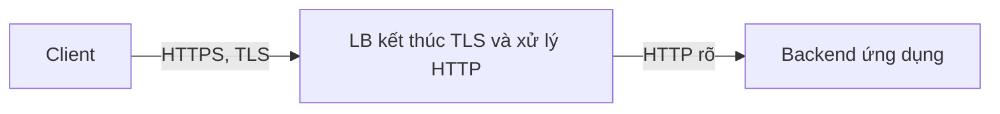
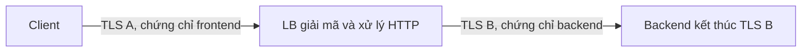
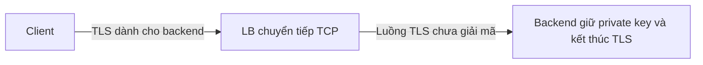

# TLS termination, TLS passthrough và mã hóa đến backend

Trong chương **Cân bằng tải ứng dụng** của module **CLOUD_PROVIDERS_ORACLE**, bài học này hướng dẫn chọn vị trí kết thúc TLS và cấu hình bảo vệ lưu lượng qua OCI Load Balancer đến các máy chủ ứng dụng. Quyết định này ảnh hưởng đến chứng chỉ, phân quyền, khả năng xử lý HTTP, health check, giám sát và phương án thay đổi cấu hình khi đang phục vụ người dùng.

Sau bài học, bạn có thể:

- Vẽ đúng luồng kết nối của termination, passthrough và tái mã hóa đến backend.
- Xác định nơi giữ private key và bên xác minh chứng chỉ ở từng chặng.
- Cấu hình listener, backend set và health check nhất quán trên OCI.
- Dùng curl và OpenSSL để kiểm tra từng chặng mà vẫn xác minh chứng chỉ.
- Giải thích giới hạn của mTLS, health check TCP và bằng chứng HTTPS ở phía client.
- Lập kế hoạch xoay chứng chỉ, theo dõi lỗi và khôi phục cấu hình.

## Bài toán: HTTPS ở phía người dùng chưa mô tả toàn bộ đường đi

Một ứng dụng Java chạy trên hai OCI Compute instance trong private subnet. Người dùng truy cập `https://app.example.com` qua load balancer. Đội vận hành cần phân phối request, thay chứng chỉ định kỳ và bảo vệ dữ liệu đơn hàng trên đường truyền.

Chỉ biết trình duyệt hiển thị HTTPS chưa đủ để trả lời:

- TLS kết thúc ở load balancer hay ở ứng dụng?
- Chặng từ load balancer tới Compute có được mã hóa không?
- Load balancer có xác minh chứng chỉ backend không?
- Khi backend đổi chứng chỉ, thành phần nào phải cập nhật trust?
- Ai có thể đọc nội dung HTTP trong kiến trúc đã chọn?

Cần vẽ đường đi cùng ranh giới TLS trước khi cấu hình tài nguyên. Private subnet kiểm soát khả năng tiếp cận mạng; nó không tự tạo mã hóa cho một kết nối HTTP.

Trong Console và API OCI, nhiều trường vẫn dùng tên **SSL**, chẳng hạn **Use SSL** và `ssl_configuration`. Trong bài, các kết nối được cấu hình bằng TLS; giữ nguyên tên trường của sản phẩm khi thao tác.

## Ba mô hình xử lý TLS

OCI mô tả ba cách là SSL termination, point-to-point SSL và SSL tunneling. Point-to-point kết thúc TLS từ client rồi tạo kết nối TLS mới đến backend; TCP listener có thể chuyển tiếp TLS đến ứng dụng. Xem [Load Balancer Concepts](https://docs.oracle.com/en-us/iaas/Content/Balance/Concepts/balanceoverview_topic-Load_Balancing_Concepts.htm).

| Mô hình | Chặng client đến LB | Chặng LB đến backend | Nơi kết thúc TLS từ client |
| --- | --- | --- | --- |
| Termination, backend HTTP | TLS | HTTP rõ | Load balancer |
| Tái mã hóa, point-to-point | TLS phiên A | TLS phiên B | Load balancer |
| Passthrough, tunneling | TLS được chuyển tiếp | Cùng phiên TLS của client tới backend | Backend |

### Termination tại load balancer, backend dùng HTTP



Load balancer xuất trình chứng chỉ frontend và sử dụng private key tương ứng. Sau khi giải mã, nó có thể xử lý nội dung HTTP rồi gửi request rõ đến backend.

Mô hình này tập trung quản lý chứng chỉ phía người dùng tại LB. Tuy nhiên, dữ liệu trên chặng backend không được TLS bảo vệ. Khi đánh giá kiến trúc, phải xét loại dữ liệu và yêu cầu mã hóa của tổ chức, cùng các kiểm soát mạng và quyền quản trị liên quan.

Ứng dụng phía sau proxy cũng cần hiểu scheme bên ngoài để tạo redirect và cookie đúng. Nếu sử dụng thông tin proxy như `X-Forwarded-Proto`, hãy cấu hình ứng dụng chỉ tin thông tin đó từ proxy được kiểm soát; không tin một header do client tùy ý gửi.

### Termination rồi mã hóa lại đến backend



Ở chặng A, LB đóng vai trò TLS server. Ở chặng B, LB đóng vai trò TLS client và backend là TLS server.

Đây là hai phiên độc lập. Phiên bản TLS, cipher, chứng chỉ và lỗi handshake của chúng có thể khác nhau. Nội dung HTTP vẫn tồn tại ở dạng đã giải mã trong quá trình LB xử lý, dù cả hai chặng mạng đều được mã hóa.

Vì vậy, khi yêu cầu “end-to-end TLS”, cần ghi rõ ý nghĩa mong muốn:

- Hai chặng đều dùng TLS nhưng LB được phép giải mã.
- Phiên TLS phải đi từ client tới ứng dụng và LB không kết thúc phiên đó.

Hai yêu cầu này dẫn đến hai kiến trúc khác nhau.

### Passthrough đến backend



Backend xuất trình chứng chỉ cho client. LB chuyển tiếp byte của kết nối mà không giải mã nội dung HTTP, nên tại điểm đó không thực hiện được các thao tác cần đọc đường dẫn, header hoặc cookie HTTP.

Trong passthrough, listener dùng TCP và không gắn cấu hình kết thúc TLS. Backend set cũng không bật lớp TLS do LB chủ động thiết lập. Lưu lượng vốn đã là TLS từ client; bật thêm backend SSL không biến nó thành “an toàn hơn”, mà tạo một mô hình khác với đường đi dự kiến.

Passthrough không có nghĩa là ứng dụng bỏ qua chứng chỉ. Client vẫn phải xác minh chứng chỉ mà backend gửi, và backend phải có cấu hình TLS phù hợp.

## Chọn OCI Load Balancer hay Network Load Balancer?

OCI Load Balancer là reverse proxy, hỗ trợ xử lý HTTP/HTTPS và TCP. OCI Network Load Balancer thiên về chuyển tiếp lưu lượng, có các khả năng bảo toàn thông tin nguồn tùy cấu hình. Không nên chọn một dịch vụ chỉ vì tên có chữ “network”. Xem [so sánh LB và NLB](https://docs.oracle.com/en-us/iaas/Content/Balance/Reference/lb-vs-nlb.htm).

NLB không cung cấp TLS termination tại chính NLB; ứng dụng backend phải xử lý mã hóa của lưu lượng đi qua. Nếu cần kết thúc TLS tại dịch vụ cân bằng tải, dùng Load Balancer. Xem [Encryption của Network Load Balancer](https://docs.oracle.com/en-us/iaas/Content/NetworkLoadBalancer/introduction.htm#Encryption).

Bài thực hành dùng **OCI Load Balancer**, kể cả ví dụ TCP passthrough. Khi chuyển sang NLB, phải xem lại nguồn lưu lượng, đường về, quy tắc mạng và health check theo dịch vụ đó; không sao chép nguyên giả định mạng của reverse proxy.

| Nhu cầu | Hướng xem xét |
| --- | --- |
| Định tuyến theo đường dẫn HTTP tại LB | Termination tại LB |
| Cần xử lý HTTP và mã hóa chặng backend | Termination và backend TLS |
| Ứng dụng phải trực tiếp kết thúc TLS của client | TCP passthrough |
| Cần các đặc tính chuyển tiếp và bảo toàn nguồn của NLB | Đánh giá NLB và thiết kế mạng tương ứng |

## Chứng chỉ, private key và trust nằm ở đâu?

| Mô hình | Chứng chỉ client nhìn thấy | Private key phía server nằm ở đâu? | Trust cần chuẩn bị |
| --- | --- | --- | --- |
| Termination, backend HTTP | Frontend của LB | LB hoặc tài nguyên chứng chỉ mà LB sử dụng | Client tin CA của frontend |
| Tái mã hóa | Frontend của LB | Frontend tại LB; backend tại máy chủ backend | Client tin frontend; LB tin CA của backend |
| Passthrough | Chứng chỉ do backend gửi | Backend | Client tin CA của backend |

Không cần đưa private key của backend cho LB chỉ để LB xác minh chứng chỉ server backend. Trust bundle phục vụ xác minh chứa chứng chỉ CA thích hợp; private key có vai trò khác.

Với frontend, hostname người dùng truy cập phải phù hợp với danh tính trong chứng chỉ, thường được biểu diễn bằng Subject Alternative Name (SAN). Một chứng chỉ hợp lệ cho `api.example.com` không tự hợp lệ cho `app.example.com`.

Ở chặng backend, cần kiểm tra cùng lúc:

- Dịch vụ đang lắng nghe TLS ở đúng IP và port.
- Chứng chỉ còn hiệu lực và server gửi đủ intermediate cần thiết.
- LB được cấu hình trust phù hợp và bật xác minh peer.
- Độ sâu xác minh phù hợp với chuỗi chứng chỉ thực tế.
- Hành vi hostname/SNI của cấu hình đang dùng đáp ứng yêu cầu của backend.

Không suy rằng chỉ chọn đúng CA là đã kiểm chứng mọi yêu cầu về danh tính. Nếu backend dùng virtual host phụ thuộc SNI, hãy kiểm tra hành vi của đường LB thật, thay vì chỉ chạy một lệnh OpenSSL có SNI từ máy quản trị.

OCI cung cấp tùy chọn **Verify peer certificate**, **Verify depth** và tài nguyên CA hoặc CA bundle cho backend set. Xem [tạo backend set có SSL](https://docs.oracle.com/en-us/iaas/Content/Balance/Tasks/managingbackendsets_topic-Creating_Backend_Sets.htm). Với chuỗi chứng chỉ tải lên, phải giữ đúng thứ tự và kiểm tra cặp khóa/chứng chỉ. Xem [quản lý chứng chỉ của LB](https://docs.oracle.com/en-us/iaas/Content/Balance/Tasks/managingcertificates.htm).

### Đừng nhầm xác minh backend với mTLS

Với TLS thông thường ở chặng backend, LB xác minh server backend. Điều này không tự yêu cầu backend xác minh một chứng chỉ client do LB xuất trình.

Tài liệu OCI nêu mTLS được hỗ trợ giữa người dùng và LB, nhưng không hỗ trợ mTLS giữa LB và backend server theo cơ chế backend SSL này. Xem [tùy chọn SSL của listener](https://docs.oracle.com/en-us/iaas/Content/Balance/Tasks/managinglisteners_topic-Creating_Listeners.htm).

Nếu ứng dụng cần trực tiếp xác thực chứng chỉ client trong phiên TLS của người dùng, passthrough là một phương án cần đánh giá. Trong mô hình này, backend thực hiện mTLS và LB không đảm nhiệm vai trò kết thúc TLS.

## Quyền IAM và kết nối mạng

Có hai lớp quyền độc lập:

- IAM cho phép người hoặc pipeline sửa listener, backend set, chứng chỉ và tài nguyên liên quan.
- Quy tắc mạng cho phép lưu lượng đi tới listener, backend và health check.

Có quyền tạo listener không đồng nghĩa backend đã nhận được kết nối. Ngược lại, mở port không cấp quyền sửa tài nguyên OCI.

Các thao tác cập nhật listener và backend set thuộc quyền quản trị Load Balancer tương ứng; khi dùng Console còn cần quyền đối với tài nguyên mạng liên quan. Xem [tham chiếu IAM cho Load Balancing](https://docs.oracle.com/en-us/iaas/Content/Identity/policyreference/lbpolicyreference.htm).

Với lab dùng OCI Load Balancer, lập bảng luồng cần mở:

| Nguồn | Đích | Port minh họa | Mục đích |
| --- | --- | --- | --- |
| Máy client được phép | Listener LB | 443 | HTTPS cho termination và tái mã hóa |
| Máy client được phép | Listener TCP lab | 9443 | Thử passthrough |
| LB | Backend riêng tư | 8080 | HTTP trong mô hình termination |
| LB | Backend riêng tư | 8443 | TLS trong mô hình tái mã hóa hoặc passthrough |
| LB | Port health check đã chọn | Theo cấu hình | Xác định backend đủ điều kiện phục vụ |
| Máy quản trị lab được phép | Backend | 8443 | Kiểm tra trực tiếp chặng TLS |

Giới hạn nguồn vào backend theo mô hình mạng thực tế; không mở 8080 hoặc 8443 từ toàn internet chỉ để khắc phục lỗi kết nối. OCI cho phép dùng NSG hoặc security list để kiểm soát truy cập LB và backend. Xem [bảo vệ mạng và Load Balancer](https://docs.oracle.com/en-us/iaas/Content/Security/Reference/networking_security.htm).

Kiểm tra thêm route, firewall hệ điều hành và địa chỉ mà ứng dụng bind. Một ứng dụng chỉ bind `127.0.0.1` sẽ không nhận được lưu lượng từ LB qua private IP dù NSG đã mở đúng.

## Health check phải khớp với luồng dữ liệu

TCP health check xác nhận khả năng thiết lập kết nối TCP; HTTP health check kiểm tra request ở URI cùng điều kiện phản hồi. Khi backend set bật SSL, HTTP health check dùng HTTPS trừ khi được ép dùng plaintext. Xem [Health Check Policies](https://docs.oracle.com/en-us/iaas/Content/Balance/Tasks/load_balancer_health_management.htm).

| Mô hình lab | Luồng nghiệp vụ đến backend | Health check phù hợp để bắt đầu |
| --- | --- | --- |
| Termination, backend HTTP | HTTP port 8080 | HTTP `/health` ở 8080 |
| Tái mã hóa | HTTPS port 8443 | HTTP health checker qua SSL ở 8443, không ép plaintext |
| TCP passthrough | TLS port 8443 | TCP ở 8443, cộng phép thử TLS từ client |

Với passthrough, backend set không chủ động bật SSL. Đừng gửi health check HTTP rõ vào port chỉ nhận TLS và kỳ vọng phản hồi HTTP hợp lệ.

Nếu chọn TCP cho dễ triển khai, cần hiểu giới hạn: port có thể mở trong khi chứng chỉ hết hạn hoặc ứng dụng không xử lý được request nghiệp vụ. Thêm phép thử HTTPS bên ngoài để bao phủ hostname, trust và nội dung phản hồi.

Health endpoint nên nhẹ, ổn định và có ý nghĩa đối với khả năng phục vụ. Tránh dùng một endpoint luôn trả 200 dù ứng dụng không thể xử lý bất kỳ chức năng nào quan trọng.

## Thực hành: quan sát ba mô hình trên một môi trường lab

Các tên và port dưới đây là ví dụ, cần thay bằng môi trường của bạn:

| Thành phần | Giá trị minh họa |
| --- | --- |
| Hostname phía client | `app.lab.example` |
| LB | Một OCI Load Balancer riêng cho lab |
| Backend | Compute trong private subnet, ví dụ `10.0.2.10` |
| Endpoint HTTP backend | `http://10.0.2.10:8080/health` |
| Endpoint TLS backend | Port 8443 |
| Listener termination | Port 443 |
| Listener passthrough | Port 9443 |

Chuẩn bị hai endpoint ứng dụng nhỏ, cùng trả về định danh backend để dễ quan sát. Endpoint 8443 phải thực sự phục vụ TLS, không chỉ mở port.

Chuẩn bị chứng chỉ theo hai vai trò:

- **Frontend:** SAN có `app.lab.example`, private key tương ứng, chain và CA mà client tin.
- **Backend:** SAN có `app.lab.example` cho lượt thử passthrough, private key đặt trên backend, chain và CA mà LB/client lab có thể tin.

Có thể dùng PKI nội bộ của lab; client phải được cung cấp CA cần thiết. Các lệnh kiểm tra dưới đây dùng `frontend-ca.pem` và `backend-ca.pem` làm tệp trust ở máy chạy lệnh. Chúng không phải private key.

Backend trong lab nên có một virtual host TLS mặc định phục vụ endpoint thử; điều này tránh phụ thuộc SNI chưa được cấu hình khi kiểm tra chặng từ LB. Nếu ứng dụng thật phụ thuộc SNI, bổ sung kiểm tra riêng.

### Cấu hình A: kết thúc TLS tại LB, backend HTTP

1. Tạo backend set `bs-http`, không bật **Use SSL**.
2. Đăng ký backend tại private IP, port 8080.
3. Cấu hình HTTP health check `/health`, port 8080, mã phản hồi mong đợi 200.
4. Tạo listener HTTP có **Use SSL** ở port 443 và gắn chứng chỉ frontend.
5. Trỏ listener tới `bs-http`; chờ backend khỏe rồi thử request.

Listener sử dụng tài nguyên chứng chỉ để kết thúc TLS; giao diện OCI cho phép chọn chứng chỉ từ Certificates service hoặc chứng chỉ do LB quản lý. Xem [tạo listener](https://docs.oracle.com/en-us/iaas/Content/Balance/Tasks/managinglisteners_topic-Creating_Listeners.htm).

Kết quả cần diễn giải: client đã dùng HTTPS, nhưng cấu hình backend vẫn là HTTP 8080. Không ghi kết quả này thành “toàn bộ đường truyền được mã hóa”.

### Cấu hình B: mã hóa thêm chặng backend

1. Kiểm tra trực tiếp endpoint TLS 8443 từ máy quản trị được phép.
2. Tạo backend set `bs-tls`, bật **Use SSL**.
3. Cấu hình CA hoặc CA bundle tin cậy cho chứng chỉ backend, bật xác minh peer và chọn verify depth phù hợp.
4. Đăng ký backend port 8443; cấu hình HTTP health check `/health` dùng SSL, không ép plaintext.
5. Sau khi backend khỏe, đổi backend set của listener 443 sang `bs-tls`.
6. Kiểm tra lại từ client và đọc log chặng backend.

Chứng chỉ mà client thấy vẫn là chứng chỉ frontend của LB. Thay đổi trust hoặc chứng chỉ backend không nhất thiết làm chứng chỉ frontend thay đổi.

Để tách lỗi, giữ `bs-http` trong lúc thực hành và ghi lại cấu hình trước khi chuyển. Nếu cần quay lại A, phải hiểu rằng thao tác đó khôi phục chặng HTTP rõ; chỉ dùng khi yêu cầu bảo vệ dữ liệu cho phép.

### Cấu hình C: TCP passthrough

1. Tạo backend set riêng `bs-passthrough`, không bật **Use SSL**.
2. Đăng ký backend TLS port 8443 và chọn TCP health check.
3. Tạo listener TCP port 9443, không gắn cấu hình TLS termination.
4. Trỏ listener tới `bs-passthrough`.
5. Dùng HTTPS tới `app.lab.example:9443`, tin CA của backend.

Client sẽ nhận chứng chỉ backend. Nếu chứng chỉ backend chỉ có tên nội bộ khác, client truy cập bằng `app.lab.example` sẽ không xác minh được hostname. Không sửa bằng cách tắt xác minh ở client; chuẩn bị đúng chứng chỉ cho danh tính mà client sử dụng.

## Kiểm tra bằng curl và OpenSSL

Các lệnh sau dùng Bash, curl và OpenSSL. Thay `203.0.113.10` bằng IP LB thật; đây là địa chỉ minh họa.

### Kiểm tra hostname, trust và HTTP ở phía client

```bash
export LAB_HOST="app.lab.example"
export LAB_LB_IP="203.0.113.10"

curl --fail --show-error --verbose --cacert frontend-ca.pem --resolve "${LAB_HOST}:443:${LAB_LB_IP}" "https://${LAB_HOST}/health"
```

`--resolve` hướng kết nối đến IP chỉ định trong khi URL vẫn dùng hostname cần kiểm tra. `--cacert` cung cấp CA tin cậy của lab. Không thêm `-k` vào phép thử nhằm xác nhận trust và hostname. Xem [tài liệu curl](https://curl.se/docs/manpage.html).

Lệnh thành công xác nhận đường client đến endpoint được thử; nó không tự chứng minh chặng backend của mô hình B đang dùng TLS.

Xem handshake và chuỗi chứng chỉ:

```bash
openssl s_client -connect "${LAB_LB_IP}:443" -servername "$LAB_HOST" -CAfile frontend-ca.pem -verify_hostname "$LAB_HOST" -verify_return_error -showcerts < /dev/null
```

Cần kiểm tra kết quả xác minh, mã thoát, chứng chỉ server và giao thức đã thương lượng. `-servername` gửi SNI; `-verify_hostname` kiểm tra danh tính; `-verify_return_error` làm lỗi xác minh trở thành lỗi handshake thay vì chỉ hiển thị cảnh báo. Xem [OpenSSL s_client](https://docs.openssl.org/3.5/man1/openssl-s_client/).

### Kiểm tra riêng backend TLS

Từ máy được phép tiếp cận private IP backend:

```bash
openssl s_client -connect "10.0.2.10:8443" -servername "$LAB_HOST" -CAfile backend-ca.pem -verify_hostname "$LAB_HOST" -verify_return_error -showcerts < /dev/null
curl --fail --show-error --cacert backend-ca.pem --resolve "${LAB_HOST}:8443:10.0.2.10" "https://${LAB_HOST}:8443/health"
```

Kết quả giúp xác nhận backend có thể phục vụ TLS với các tham số của phép thử này. Nó chưa thay thế kiểm tra từ LB, vì LB có trust, cấu hình TLS, nguồn mạng và hành vi SNI riêng.

Với nhiều backend, kiểm tra từng máy. Một máy có chứng chỉ hoặc chain khác có thể gây lỗi không liên tục khi LB phân phối request.

### Kiểm tra passthrough

```bash
curl --fail --show-error --verbose --cacert backend-ca.pem --resolve "${LAB_HOST}:9443:${LAB_LB_IP}" "https://${LAB_HOST}:9443/health"
openssl s_client -connect "${LAB_LB_IP}:9443" -servername "$LAB_HOST" -CAfile backend-ca.pem -verify_hostname "$LAB_HOST" -verify_return_error -showcerts < /dev/null
```

Đối chiếu chứng chỉ trả về với chứng chỉ backend của lab. Nếu frontend và backend dùng cùng chứng chỉ, chỉ nhìn chứng chỉ sẽ khó phân biệt; cần đọc cấu hình listener/backend set để xác định nơi kết thúc TLS.

## Minh họa cấu hình backend TLS bằng Terraform

Đoạn HCL này minh họa mô hình B. Nó giả định LB, backend, chứng chỉ frontend trong OCI Certificates và CA bundle backend đã tồn tại; các biến `var.*` phải được khai báo và cung cấp trong module Terraform của bạn.

```hcl
resource "oci_load_balancer_backend_set" "tls" {
  load_balancer_id = var.lb_id
  name             = "bs-tls"
  policy           = "ROUND_ROBIN"

  health_checker {
    protocol           = "HTTP"
    port               = 8443
    url_path           = "/health"
    return_code        = 200
    is_force_plain_text = false
  }

  ssl_configuration {
    trusted_certificate_authority_ids = [var.backend_ca_bundle_id]
    verify_peer_certificate           = true
    verify_depth                      = var.backend_verify_depth
    protocols                         = ["TLSv1.2"]
  }
}

resource "oci_load_balancer_backend" "app" {
  load_balancer_id = var.lb_id
  backendset_name  = oci_load_balancer_backend_set.tls.name
  ip_address      = var.backend_private_ip
  port            = 8443
  weight          = 1
}

resource "oci_load_balancer_listener" "https" {
  load_balancer_id          = var.lb_id
  name                      = "https-app"
  default_backend_set_name  = oci_load_balancer_backend_set.tls.name
  port                      = 443
  protocol                  = "HTTP"

  ssl_configuration {
    certificate_ids         = [var.frontend_certificate_id]
    verify_peer_certificate = false
    verify_depth            = 1
    protocols               = ["TLSv1.2"]
  }
}
```

`verify_peer_certificate = false` ở **listener** nghĩa là ví dụ không yêu cầu client xuất trình chứng chỉ để làm mTLS. Nó không tắt xác minh chứng chỉ server do trình duyệt thực hiện, và không thay thế cờ xác minh `true` ở **backend set**.

Ví dụ giới hạn cả hai phía ở TLS 1.2 để trình bày một cấu hình lab nhất quán. Khi chọn TLS 1.3 hoặc cipher suite khác, đối chiếu khả năng hỗ trợ của client, LB, backend và chứng chỉ. Các giao thức và cipher phải tương thích. Xem [SSLConfiguration](https://docs.oracle.com/en-us/iaas/tools/python/latest/api/load_balancer/models/oci.load_balancer.models.SSLConfiguration.html).

Đối chiếu schema tại [backend set resource](https://docs.oracle.com/en-us/iaas/tools/terraform-provider-oci/latest/docs/r/load_balancer_backend_set.html) và [listener resource](https://docs.oracle.com/en-us/iaas/tools/terraform-provider-oci/latest/docs/r/load_balancer_listener.html). Trước khi áp dụng vào tài nguyên có sẵn, cần quản lý import/state và xem plan để tránh tạo listener trùng port hoặc làm mất cấu hình đang dùng.

Mã HCL dùng ID tài nguyên chứng chỉ thay vì đặt private key trực tiếp trong ví dụ. Vẫn cần cấp quyền sử dụng các tài nguyên chứng chỉ tương ứng và bảo vệ trạng thái, cấu hình, log của pipeline.

## Đọc lại cấu hình và chứng minh đúng từng chặng

Có thể đọc cấu hình và health bằng OCI CLI:

```bash
export LAB_LB_OCID="<ocid-load-balancer>"
export LAB_BACKEND_SET="bs-tls"

oci lb backend-set get --load-balancer-id "$LAB_LB_OCID" --backend-set-name "$LAB_BACKEND_SET"
oci lb backend-set-health get --load-balancer-id "$LAB_LB_OCID" --backend-set-name "$LAB_BACKEND_SET"
```

Đối chiếu SSL configuration, nguồn trust, cờ xác minh peer, health checker, IP và port backend. Xem [đọc backend set](https://docs.oracle.com/en-us/iaas/Content/Balance/Tasks/get_backend_set.htm) và [đọc health của backend set](https://docs.oracle.com/en-us/iaas/Content/Balance/Tasks/get_backend-set-health.htm).

Bằng chứng nên có ba phần:

| Bằng chứng | Câu hỏi được trả lời |
| --- | --- |
| Cấu hình listener và backend set đã đọc lại | Dịch vụ được yêu cầu xử lý TLS thế nào? |
| Handshake, request và log backend | Đường kết nối thực tế có hoạt động không? |
| Phép thử lỗi trên tài nguyên lab cô lập | Khi chứng chỉ hoặc trust không phù hợp, hệ thống có từ chối không? |

Với mô hình B, có thể thử một backend lab có chứng chỉ được ký bởi CA không được backend set tin cậy. Kỳ vọng đường đó không được chấp nhận như một backend TLS hợp lệ; ghi nhận health, error log và phản hồi thay vì cố định giả định mọi lỗi đều trả cùng mã HTTP.

Chỉ thay đổi trong tài nguyên lab hoặc canary đã tách riêng. Khôi phục chứng chỉ và trust đúng sau phép thử. Không bật/tắt xác minh peer trên luồng production để tạo bằng chứng thử nghiệm.

## Giám sát và chẩn đoán lỗi

Tách lỗi frontend khỏi lỗi backend:

- **Frontend:** client không hoàn tất handshake với LB; kiểm tra hostname, chain, trust của client, protocol và yêu cầu chứng chỉ client.
- **Backend:** client có thể kết nối TLS tới LB nhưng LB không kết nối TLS được với ứng dụng; cần xem port, trust, chain và giao thức ở chặng nội bộ.
- **Ứng dụng:** hai handshake thành công nhưng request vẫn thất bại; kiểm tra HTTP, timeout và logic xử lý.

OCI có các metric về SSL handshake, kết nối, HTTP response và số backend không khỏe. Chọn đúng dimension của load balancer, listener hoặc backend set khi xem số liệu. Xem [Load Balancer Metrics](https://docs.oracle.com/en-us/iaas/Content/Balance/Reference/loadbalancermetrics.htm).

| Hiện tượng | Kiểm tra trước |
| --- | --- |
| Client báo hostname mismatch | URL, SAN, SNI và chứng chỉ listener hoặc backend trong passthrough |
| Client báo CA không tin cậy | CA phía client và intermediate server gửi |
| HTTP 502 sau khi bật backend SSL | Backend có nhận TLS đúng port không; CA, chain và protocol có phù hợp không |
| Backend unhealthy, truy cập thủ công được | Health check dùng TLS hay plaintext; URI, port, host và nguồn mạng |
| TCP health xanh nhưng HTTPS lỗi | Chứng chỉ, handshake và ứng dụng chưa được TCP health bao phủ |
| Lỗi chỉ xuất hiện một số request | Kiểm tra từng backend và phiên bản chứng chỉ của từng máy |
| Passthrough mất khả năng route theo URL tại LB | LB không giải mã HTTP trong mô hình đó |
| Lỗi khi xoay chứng chỉ | Chain mới, trust mới, cặp khóa/chứng chỉ và trạng thái triển khai |

Một mã 502 không đủ để kết luận là lỗi chứng chỉ. OCI liệt kê nhiều nguyên nhân handshake và backend; cần đối chiếu error log với cấu hình và thời điểm thay đổi. Xem [Troubleshooting SSL](https://docs.oracle.com/en-us/iaas/Content/Balance/Reference/troubleshooting_ssl.htm).

Không dùng việc bỏ xác minh chứng chỉ làm cấu hình sửa lỗi lâu dài. Hãy tìm CA, chain, hostname hoặc giao thức đang không khớp rồi khôi phục mô hình trust đã thiết kế.

## Xoay chứng chỉ, tính sẵn sàng và chi phí

Xoay frontend và backend là hai quy trình khác nhau:

1. Kiểm kê hostname, nơi gắn chứng chỉ, ngày hết hạn và chủ sở hữu.
2. Chuẩn bị chứng chỉ mới, chain và kiểm tra cặp khóa.
3. Nếu thay CA backend, đưa trust cần thiết vào LB trước khi chuyển backend sang chain mới.
4. Thay lần lượt trên các backend, chờ health ổn định và thử đường request thật.
5. Cập nhật frontend theo cơ chế tài nguyên chứng chỉ đang dùng.
6. Theo dõi lỗi TLS, HTTP và độ trễ; loại bỏ trust cũ sau khi không còn phụ thuộc.

Chứng chỉ lấy từ OCI Certificates có cơ chế LB phát hiện và sử dụng thay đổi của tài nguyên chứng chỉ liên quan. Điều đó không loại bỏ trách nhiệm kiểm tra quá trình cập nhật và khả năng phục vụ của ứng dụng. Xem [tích hợp chứng chỉ trong backend set](https://docs.oracle.com/en-us/iaas/Content/Balance/Tasks/managingbackendsets_topic-Creating_Backend_Sets.htm).

Giữ nhiều backend đủ khả năng phục vụ khi thay chứng chỉ. Có thể ngừng nhận kết nối mới trên một backend, chờ các kết nối phù hợp kết thúc rồi cập nhật và đưa máy trở lại. Với passthrough và kết nối sống lâu, cần tính cả thời gian phiên hiện tại kết thúc.

Về tài nguyên, termination chuyển một phần công việc TLS về LB; tái mã hóa vẫn yêu cầu backend xử lý TLS. Đừng ước lượng chi phí chỉ bằng số lần handshake của client: cần đo lưu lượng, kết nối mới, tái sử dụng kết nối, CPU backend và độ trễ.

Trong lab, dùng quy mô nhỏ, gắn tài nguyên vào compartment rõ ràng và dọn listener, backend set hoặc LB thử khi không còn cần. Không tăng công suất LB để giải quyết lỗi CA hoặc protocol.

Khi viết phương án khôi phục, nêu rõ cấu hình cũ, chứng chỉ còn hiệu lực và mức bảo vệ của đường dự phòng. Chuyển từ backend TLS sang HTTP làm thay đổi đặc tính bảo vệ; phải đánh giá như một thay đổi kiến trúc.

## Tự đánh giá kết quả

Một kết quả thực hành đầy đủ cần cho thấy:

- Bạn vẽ được nơi kết thúc TLS và nơi có dữ liệu HTTP rõ trong cả ba mô hình.
- Bạn chỉ ra private key, server certificate và CA trust của từng phía.
- Listener và backend set được đọc lại, đúng protocol, port và SSL configuration.
- Health check khớp với cấu hình backend; giới hạn của TCP health được ghi rõ.
- Client xác minh được hostname và trust mà không bỏ qua lỗi chứng chỉ.
- Với tái mã hóa, có bằng chứng riêng cho chặng LB đến backend.
- Với passthrough, backend trực tiếp xử lý TLS và client nhận đúng chứng chỉ của backend.
- Có kế hoạch xoay chứng chỉ, theo dõi lỗi, khôi phục và kiểm soát chi phí.

Lựa chọn TLS phù hợp bắt đầu từ yêu cầu ai được phép giải mã và danh tính nào cần được xác minh. Sau đó mới ánh xạ yêu cầu đó thành listener, backend set, chứng chỉ, trust và kiểm soát mạng trên OCI.
