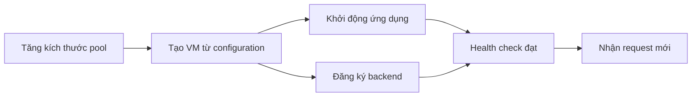
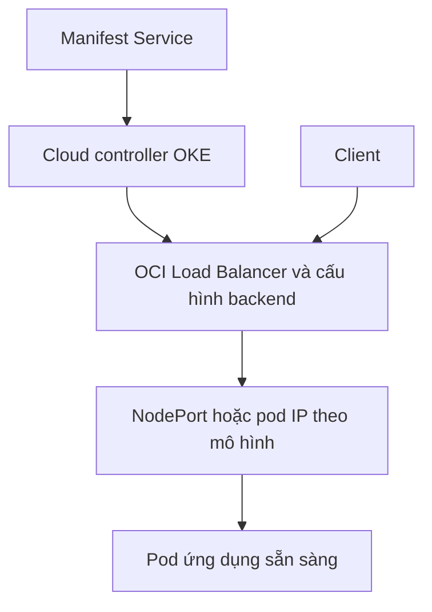

# Tích hợp cân bằng tải với instance pools và OKE

Trong chương **Cân bằng tải ứng dụng** của module Oracle Cloud Infrastructure (OCI), load balancer là điểm nhận lưu lượng ổn định trong khi các thành phần chạy ứng dụng có thể được thêm, thay thế hoặc gỡ bỏ. Bài học nối điểm nhận đó với hai mô hình triển khai: ứng dụng trên Compute instance pool và ứng dụng container trên Oracle Kubernetes Engine (OKE).

Mục tiêu không chỉ là tạo một địa chỉ truy cập được. Một tích hợp vận hành tốt cần đưa backend mới vào phục vụ khi sẵn sàng, gỡ backend đúng lúc, duy trì khả năng chịu lỗi và kiểm soát tài nguyên khi mở rộng. Các ví dụ dùng dịch vụ HTTP đơn giản; với ứng dụng Java kết nối Oracle Database, cần xét thêm thời gian khởi động, connection pool và quá trình đóng ứng dụng.

Sau bài học, bạn có thể:

- Gắn một instance pool với backend set của OCI Load Balancer.
- Giải thích quá trình tăng/giảm số instance và thời điểm backend bắt đầu nhận tải.
- Tạo một Service `LoadBalancer` nội bộ trên OKE và kiểm tra đường đi của request.
- Phân biệt readiness của pod, health check của load balancer và việc mở rộng node/pod.
- Xác định thành phần quản lý backend, ranh giới IAM và các điểm cần giám sát.

## Xác định ai quản lý backend

Một load balancer có listener nhận kết nối và backend set chứa chính sách phân phối, các backend cùng health check. Backend set cần được nối với listener để nhận lưu lượng. [Oracle: Backend Sets for Load Balancers](https://docs.oracle.com/en-us/iaas/Content/Balance/Tasks/managingbackendsets.htm).

Khi tích hợp tự động, cần xác định nguồn cấu hình mong muốn:

| Mô hình | Nơi mô tả mong muốn | Thành phần quản lý thay đổi |
| --- | --- | --- |
| Compute instance pool | Pool, instance configuration và load balancer attachment | Cơ chế instance pool và automation triển khai |
| OKE Service `LoadBalancer` | Kubernetes Service và annotation | Cloud controller của OKE |
| OKE với OCI native ingress controller | IngressClass, Ingress và Service liên quan | OCI native ingress controller |

Nguyên tắc thiết kế của bài là mỗi tập cấu hình có một bên chịu trách nhiệm. Nếu backend do controller tạo, thao tác chỉnh tay trong Console có thể không tồn tại qua lần đối soát tiếp theo. Muốn thay đổi lâu dài cần sửa đúng nguồn cấu hình mà thành phần đó quản lý.

Không gắn thủ công một tập node OKE vào cùng backend set mà một Service đang quản lý để thay cho cơ chế tích hợp của Kubernetes. Cách làm đó tạo hai nguồn điều khiển và khiến việc nâng cấp, scale hoặc thay node khó dự đoán.

## Hợp đồng ứng dụng và đường mạng

Với ứng dụng chạy trên VM, ví dụ dùng:

```text
Client -> listener :80 -> backend set -> private IP của VM :8080
                                              |
                                              +-> HTTP GET /readyz
```

Với một Service dùng node làm backend trên OKE:

```text
Client -> OCI Load Balancer -> node IP:NodePort
                                  |
                                  +-> chuyển tới pod endpoint của Service
```

Trước khi cấu hình, chốt các thông tin sau:

| Thông tin | Ví dụ hoặc câu hỏi cần trả lời |
| --- | --- |
| Listener | HTTP :80 hay HTTPS :443? |
| Backend | VM :8080, NodePort hay pod IP? |
| Sẵn sàng | Endpoint nào thể hiện ứng dụng đã nhận được request? |
| Phạm vi truy cập | Nội bộ VCN, qua VPN/FastConnect hay từ internet? |
| Kết thúc xử lý | Ứng dụng cần bao lâu để hoàn tất request đang chạy? |
| Chủ cấu hình | Pool, Service hay ingress controller? |

Đề xuất phân tách các đường mạng:

- Nguồn client được phép tới listener của load balancer.
- Load balancer được phép tới cổng ứng dụng hoặc NodePort thực tế.
- Health checker tới được đúng cổng kiểm tra sức khỏe.
- VM/pod tới được Oracle Database và các phụ thuộc cần thiết.

Kiểm tra cả NSG/security list, route và firewall trên VM nếu có. Backend mở cổng ở hệ điều hành chưa đủ nếu quy tắc VCN đang chặn; việc vào được listener cũng chưa chứng minh đường tới backend đã thông.

## Nhánh Compute: instance pool và load balancer attachment

Instance pool tạo các instance từ một instance configuration. Khi liên kết pool với load balancer hoặc network load balancer và backend set, instance được thêm vào pool sẽ được thêm vào backend set; khi khỏe theo kiểm tra, nó có thể nhận lưu lượng. [Oracle: Creating Instance Pools](https://docs.oracle.com/en-us/iaas/Content/Compute/Tasks/creatinginstancepool.htm).

Trong bài này, dùng **OCI Load Balancer** và backend set riêng cho ứng dụng. Instance configuration cần bảo đảm mỗi VM mới có cùng hợp đồng phục vụ:

- Cùng phiên bản ứng dụng hoặc quy trình bootstrap xác định được phiên bản.
- Cùng cổng backend, ví dụ `8080`.
- Cùng endpoint readiness, ví dụ `/readyz`.
- Cấu hình lấy secret và kết nối database phù hợp với danh tính VM.
- Log và metric đủ để kiểm tra lỗi khởi động.

Ví dụ quá trình đưa VM mới vào phục vụ:



Đăng ký backend và ứng dụng sẵn sàng có thể diễn ra ở những thời điểm khác nhau. Hãy để health check kiểm soát thời điểm nhận tải, thay vì giả định trạng thái Compute `RUNNING` đã đồng nghĩa ứng dụng khởi động xong.

### Chọn đúng VNIC và backend port

Attachment chỉ định load balancer, backend set, port và VNIC dùng để lấy địa chỉ private IP. Các giá trị port và VNIC selection áp dụng cho instance trong attachment đó. [Oracle: Attaching a Load Balancer to an Instance Pool](https://docs.oracle.com/en-us/iaas/Content/Compute/Tasks/updatinginstancepool_topic-To_attach_a_load_balancer_to_an_instance_pool.htm).

Nếu ứng dụng nghe ở `8080`, tham số port của attachment là `8080`, dù listener phía client dùng `80` hoặc `443`. Với VM nhiều VNIC, chọn VNIC có đường mạng phù hợp tới load balancer và thống nhất cách đặt tên trong cấu hình.

### Thực hành gắn pool đã có

Các lệnh sau là hướng dẫn chạy trong Bash/OCI Cloud Shell có OCI CLI đã cấu hình. Chuẩn bị trước tài nguyên sandbox:

1. Instance configuration chạy ứng dụng HTTP trên `8080` và `/readyz` trả mã phù hợp khi sẵn sàng.
2. Instance pool riêng có hai VM, không chứa dữ liệu chỉ tồn tại trên máy có thể bị mất khi scale-in.
3. Load balancer cùng region, backend set dành riêng cho pool và listener trỏ tới backend set đó.
4. Health check HTTP dùng `/readyz`, backend port phù hợp và đường mạng đã mở đúng phạm vi.
5. Quyền quản lý pool và quyền cần thiết trên load balancer, subnet, VNIC cùng các tài nguyên liên quan.

Thiết lập giá trị thật của sandbox:

```bash
export OCI_REGION='ap-singapore-1'
export LAB_COMPARTMENT_OCID='<compartment-ocid>'
export LAB_POOL_OCID='<instance-pool-ocid>'
export LAB_LB_OCID='<load-balancer-ocid>'
export LAB_BACKEND_SET='app-pool-backends'

oci compute-management instance-pool attach-lb \
  --region "$OCI_REGION" \
  --instance-pool-id "$LAB_POOL_OCID" \
  --load-balancer-id "$LAB_LB_OCID" \
  --backend-set-name "$LAB_BACKEND_SET" \
  --port 8080 \
  --vnic-selection PrimaryVnic
```

`PrimaryVnic` chọn VNIC chính trong ví dụ. Kiểm tra các tham số và việc attachment hoàn tất trước khi tiếp tục; lệnh này liên kết với backend set đã chuẩn bị, không thay toàn bộ quy trình tạo listener, mạng và health check. [Oracle CLI: instance-pool attach-lb](https://docs.oracle.com/en-us/iaas/tools/oci-cli/latest/oci_cli_docs/cmdref/compute-management/instance-pool/attach-lb.html).

Liệt kê instance thực tế:

```bash
oci compute-management instance-pool list-instances \
  --region "$OCI_REGION" \
  --compartment-id "$LAB_COMPARTMENT_OCID" \
  --instance-pool-id "$LAB_POOL_OCID" \
  --all
```

`--all` giúp đọc đủ các trang khi pool lớn. Đối chiếu danh sách instance với các backend được đăng ký, không chỉ nhìn kích thước mong muốn của pool. [Oracle CLI: instance-pool list-instances](https://docs.oracle.com/en-us/iaas/tools/oci-cli/latest/oci_cli_docs/cmdref/compute-management/instance-pool/list-instances.html).

Đọc sức khỏe backend set:

```bash
oci lb backend-set-health get \
  --region "$OCI_REGION" \
  --load-balancer-id "$LAB_LB_OCID" \
  --backend-set-name "$LAB_BACKEND_SET"
```

Lệnh này lấy trạng thái health của backend set đã chỉ định. Kết hợp với danh sách backend và log ứng dụng để xác định instance nào chưa sẵn sàng. [Oracle CLI: backend-set-health get](https://docs.oracle.com/en-us/iaas/tools/oci-cli/latest/oci_cli_docs/cmdref/lb/backend-set-health/get.html).

### Tăng kích thước và kiểm tra phục vụ

Trong pool sandbox ban đầu có hai VM, tăng lên ba:

```bash
oci compute-management instance-pool update \
  --region "$OCI_REGION" \
  --instance-pool-id "$LAB_POOL_OCID" \
  --size 3
```

`--size` đặt số instance mong muốn; việc cấp phát và đưa ứng dụng vào phục vụ cần thời gian riêng. [Oracle CLI: instance-pool update](https://docs.oracle.com/en-us/iaas/tools/oci-cli/latest/oci_cli_docs/cmdref/compute-management/instance-pool/update.html).

Quan sát lần lượt: VM mới được tạo, bootstrap thành công, backend xuất hiện, health đạt và request thực sự được xử lý. Có thể để ứng dụng lab trả một định danh instance để đối chiếu access log. Chỉ nhìn số VM hoặc chỉ nhìn một lần HTTP 200 chưa chứng minh mọi backend đã tham gia.

Nếu một VM mới không khỏe, ưu tiên xem log bootstrap, cổng listen, health path và kết nối phụ thuộc. Không liên tục tăng pool để bù cho lỗi image hoặc cấu hình chung.

## Autoscaling và quy trình gỡ backend

OCI autoscaling có thể thay đổi số instance trong pool theo metric hoặc lịch. Metric-based autoscaling cần metric được thu thập phù hợp; cooldown giúp hệ thống ổn định sau thay đổi. Scale-in của pool có thể kết thúc instance, nên dữ liệu và công việc đang chạy phải có cách xử lý trước đó. [Oracle: Autoscaling](https://docs.oracle.com/en-us/iaas/Content/Compute/Tasks/autoscalinginstancepools.htm).

Đề xuất trình tự gỡ một backend cho ứng dụng có request dài:

```text
Chọn instance cần gỡ
  -> Ngừng đưa request mới vào instance đó
  -> Chờ request đang xử lý trong thời hạn đã định
  -> Đóng ứng dụng, connection pool và ghi log cuối
  -> Tiếp tục quá trình kết thúc instance
```

OCI hỗ trợ pre-termination lifecycle action cho instance pool: instance có thể ở trạng thái `TerminationAwait`, automation làm công việc trước khi kết thúc rồi cho phép tiếp tục, hoặc timeout sẽ xử lý theo cấu hình. Đây là điểm có thể tích hợp drain và cleanup. [Oracle: Managing Instance Pools Lifecycle](https://docs.oracle.com/en-us/iaas/Content/Compute/Tasks/instance-pools-lifecycle.htm).

Cần kiểm thử cơ chế đã cấu hình với loại request thực tế. Việc backend được gỡ khỏi danh sách không tự chứng minh mọi kết nối HTTP keep-alive, WebSocket hoặc transaction đang chạy đã hoàn tất an toàn.

Đối với ứng dụng Java, thời hạn kết thúc nên xét cả thời gian hoàn thành request và đóng các tài nguyên. Giữ session quan trọng ngoài bộ nhớ của một VM để việc thay instance không làm mất trạng thái người dùng.

## Thay phiên bản ứng dụng trên instance pool

Cập nhật instance configuration mà pool sử dụng chỉ tác động tới các lần tạo instance sau đó; không tự chuyển đổi, reboot hoặc thay thế những instance đang có. [Oracle: Updating the Instance Configuration for an Instance Pool](https://docs.oracle.com/en-us/iaas/Content/Compute/Tasks/updatinginstancepool-updating-instance-configuration.htm).

Vì vậy, đổi template rồi thấy pool còn đủ ba VM chưa đủ để kết luận cả pool đã chạy phiên bản mới. Một kế hoạch triển khai đề xuất gồm:

1. Tạo configuration cho phiên bản mới và xác minh trong sandbox.
2. Dự trù thêm sức chứa để vừa duy trì phiên bản cũ vừa khởi động bản mới.
3. Thay dần instance hoặc triển khai pool mới với backend set riêng.
4. Chỉ chuyển/gỡ tải khi phiên bản mới đã sẵn sàng và đạt kiểm tra nghiệp vụ.
5. Giữ đường quay lại phiên bản cũ trong khoảng thời gian đã xác định.

Nếu dùng hai pool cho triển khai theo phiên bản, đặt tên rõ ràng cho backend set và xác định cách chuyển routing/listener. Không để hai automation cùng thêm/xóa tùy ý các backend của nhau.

## Nhánh OKE: Service điều khiển tài nguyên cân bằng tải

Trong Kubernetes, Service chọn pod theo label và tạo điểm truy cập ổn định. Với `type: LoadBalancer` và tích hợp cloud phù hợp, controller điều phối việc cấp phát load balancer bên ngoài cluster. [Kubernetes: Service](https://kubernetes.io/docs/concepts/services-networking/service/).

Trên OKE, có thể chỉ định rõ OCI Load Balancer bằng annotation:

```yaml
oci.oraclecloud.com/load-balancer-type: "lb"
```

Các annotation shape có thể chỉ định flexible bandwidth tối thiểu/tối đa theo Mbps. Đặt giá trị rõ ràng giúp ví dụ không phụ thuộc mặc định của phiên bản cluster. [Oracle: Provisioning OCI Load Balancers for Kubernetes Services](https://docs.oracle.com/en-us/iaas/Content/ContEng/Tasks/contengcreatingloadbalancers-subtopic.htm).

Luồng điều khiển cần được hiểu riêng với luồng request:



Không cần tạo sẵn một load balancer rồi đoán rằng controller sẽ tự nhận tài nguyên đó chỉ vì trùng tên. Cơ chế tái sử dụng tài nguyên, nếu được chọn, phải theo cấu hình tích hợp cụ thể; bài thực hành để Service tạo tài nguyên của chính nó.

### Backend có thể là node hoặc pod

Phải kiểm tra cấu hình thực tế trước khi đếm backend. Mô hình node làm backend đi qua NodePort. OKE cũng hỗ trợ pod làm backend trực tiếp cho Service trên cluster đáp ứng điều kiện, gồm Kubernetes từ `1.30`, OCI VCN-Native Pod Networking và tắt cấp NodePort bằng `allocateLoadBalancerNodePorts: false`; còn cần health check và cấu hình security rules tương ứng. [Oracle: Configuring Load Balancers — Using Pods as Backends](https://docs.oracle.com/en-us/iaas/Content/ContEng/Tasks/contengconfiguringloadbalancersnetworkloadbalancers-subtopic.htm).

Ví dụ suy luận: Service có ba pod chạy trên hai node có thể không tạo ba backend node. Tăng replica của pod có thể tăng năng lực xử lý mà số backend node vẫn giữ nguyên. Ngược lại, mô hình pod trực tiếp cần theo dõi cập nhật pod IP và sức khỏe của từng endpoint.

Bài thực hành dưới đây dùng **managed worker nodes và NodePort**, đặt `allocateLoadBalancerNodePorts: true` để làm rõ đường đi được chọn. Không dùng manifest này làm hướng dẫn chuyển một Service đang chạy sang mô hình pod trực tiếp.

## Thực hành OKE: Service nội bộ trên managed nodes

### Điều kiện chuẩn bị

Chuẩn bị một cluster OKE sandbox với `kubectl` đang trỏ đúng context và có ít nhất hai managed worker node sẵn sàng. Các node phải kéo được image dùng trong lab. Kiểm tra quyền Kubernetes để tạo namespace, Deployment và Service; quyền ở Kubernetes không thay cho các quyền OCI cần khi controller cấp phát tài nguyên.

OKE cần các policy IAM phù hợp cho hoạt động cluster và tài nguyên liên quan; nếu dùng subnet, NSG hoặc tài nguyên khác compartment, phải xác nhận phạm vi quyền tương ứng. [Oracle: Policy Configuration for Cluster Creation and Deployment](https://docs.oracle.com/en-us/iaas/Content/ContEng/Concepts/contengpolicyconfig.htm).

Ví dụ sử dụng load balancer private. Chuẩn bị:

- Subnet phù hợp cho load balancer trong VCN của môi trường lab.
- Frontend NSG đã có các quy tắc cho client thử nghiệm tới cổng `80`.
- Quy tắc cho đường từ load balancer tới worker NodePort `30080` và cổng health check thực tế.
- Một máy thử có đường mạng tới private IP, chẳng hạn VM trong VCN hoặc máy đi qua kết nối nội bộ phù hợp.

Manifest đặt chế độ quản lý security rules là `None`, nên người quản trị lab chịu trách nhiệm các quy tắc mạng. Thay hai placeholder subnet và NSG trước khi áp dụng. Annotation NSG thêm load balancer vào NSG đã có; nó không tự định nghĩa các quy tắc của NSG đó. [Oracle: Configuring Load Balancers — Network Security Groups](https://docs.oracle.com/en-us/iaas/Content/ContEng/Tasks/contengconfiguringloadbalancersnetworkloadbalancers-subtopic.htm).

### Manifest minh họa

Lưu nội dung sau thành `oke-lb-lab.yaml` ở môi trường thực hành:

```yaml
apiVersion: v1
kind: Namespace
metadata:
  name: lb-lab
---
apiVersion: apps/v1
kind: Deployment
metadata:
  name: web-demo
  namespace: lb-lab
spec:
  replicas: 3
  selector:
    matchLabels:
      app: web-demo
  strategy:
    type: RollingUpdate
    rollingUpdate:
      maxUnavailable: 0
      maxSurge: 1
  template:
    metadata:
      labels:
        app: web-demo
    spec:
      terminationGracePeriodSeconds: 30
      topologySpreadConstraints:
        - maxSkew: 1
          topologyKey: kubernetes.io/hostname
          whenUnsatisfiable: ScheduleAnyway
          labelSelector:
            matchLabels:
              app: web-demo
      containers:
        - name: web
          image: nginx:stable
          ports:
            - name: http
              containerPort: 80
          resources:
            requests:
              cpu: 100m
              memory: 64Mi
            limits:
              cpu: 500m
              memory: 128Mi
          readinessProbe:
            httpGet:
              path: /
              port: http
            periodSeconds: 5
            timeoutSeconds: 2
            failureThreshold: 3
---
apiVersion: v1
kind: Service
metadata:
  name: web-demo
  namespace: lb-lab
  annotations:
    oci.oraclecloud.com/load-balancer-type: "lb"
    service.beta.kubernetes.io/oci-load-balancer-internal: "true"
    service.beta.kubernetes.io/oci-load-balancer-subnet1: "<lb-subnet-ocid>"
    oci.oraclecloud.com/oci-network-security-groups: "<frontend-nsg-ocid>"
    oci.oraclecloud.com/security-rule-management-mode: "None"
    service.beta.kubernetes.io/oci-load-balancer-shape: "flexible"
    service.beta.kubernetes.io/oci-load-balancer-shape-flex-min: "10"
    service.beta.kubernetes.io/oci-load-balancer-shape-flex-max: "100"
spec:
  type: LoadBalancer
  externalTrafficPolicy: Cluster
  allocateLoadBalancerNodePorts: true
  selector:
    app: web-demo
  ports:
    - name: http
      port: 80
      targetPort: http
      nodePort: 30080
```

`nginx:stable` là image minh họa cho HTTP trong lab; bản triển khai ứng dụng cần quản lý phiên bản image theo quy trình của dự án. Pod port và NodePort của lab khác port backend `8080` ở nhánh VM trước đó vì đây là hai ứng dụng thực hành độc lập.

Annotation `oci-load-balancer-internal: "true"` yêu cầu private IP; `oci-load-balancer-subnet1` chọn subnet thay thế cho cấu hình subnet mặc định của cluster. [Oracle: Configuring Load Balancers — Creating Internal Load Balancers](https://docs.oracle.com/en-us/iaas/Content/ContEng/Tasks/contengconfiguringloadbalancersnetworkloadbalancers-subtopic.htm).

Ba replica và spread theo hostname thể hiện ý định phân tán pod; `ScheduleAnyway` là ưu tiên mềm. Phải đọc vị trí pod thực tế, không coi số replica là bằng chứng đã trải đều qua node hoặc availability domain.

### Áp dụng và đọc trạng thái

Các lệnh sau chạy trong môi trường lab đã cấu hình `kubectl`:

```bash
kubectl config current-context
kubectl get nodes
kubectl apply -f oke-lb-lab.yaml

kubectl -n lb-lab rollout status deployment/web-demo
kubectl -n lb-lab get pods -o wide
kubectl -n lb-lab get service web-demo -o wide
kubectl -n lb-lab describe service web-demo
kubectl -n lb-lab get endpointslices \
  -l kubernetes.io/service-name=web-demo
```

Quan sát riêng từng mức:

1. Deployment có số replica sẵn sàng mong muốn.
2. Service selector chọn đúng pod và EndpointSlice có các endpoint tương ứng.
3. Events của Service không báo lỗi cấp phát OCI.
4. Load balancer xuất hiện với đúng subnet, private IP và cấu hình backend.
5. Health của backend đạt và client nội bộ thực sự nhận được phản hồi.

Cột `EXTERNAL-IP` của `kubectl get service` có thể hiển thị địa chỉ private của load balancer. Tên cột này không tự chứng minh tài nguyên có thể truy cập từ internet.

Từ máy có đường tới VCN:

```bash
curl --connect-timeout 5 --max-time 10 \
  http://<private-lb-ip>/
```

Nếu thực hiện từ một Cloud Shell hoặc máy bên ngoài không có kết nối private phù hợp, lỗi timeout chưa đủ để kết luận pod hỏng. Kiểm tra vị trí máy thử trước khi thay đổi manifest.

### Scale pod và thử thay phiên bản

Tăng replica trong Deployment lab:

```bash
kubectl -n lb-lab scale deployment/web-demo --replicas=4
kubectl -n lb-lab get pods -o wide
kubectl -n lb-lab get endpointslices \
  -l kubernetes.io/service-name=web-demo
```

Sau khi replica mới sẵn sàng, tiếp tục kiểm tra request qua private load balancer. Với mô hình node backend, không yêu cầu số backend của OCI tăng từ ba lên bốn theo số replica pod.

Để quan sát quá trình thay pod mà giữ nguyên cấu hình image:

```bash
kubectl -n lb-lab rollout restart deployment/web-demo
kubectl -n lb-lab rollout status deployment/web-demo
```

`maxUnavailable: 0` và `maxSurge: 1` định hướng rollout giữ các pod cũ trong lúc thêm pod mới, nhưng vẫn cần đủ tài nguyên để schedule pod tăng thêm. Readiness, lỗi ứng dụng và thời gian cập nhật mạng vẫn ảnh hưởng trải nghiệm client. [Kubernetes: Deployments](https://kubernetes.io/docs/concepts/workloads/controllers/deployment/).

Sau thử nghiệm, cập nhật manifest về số replica mong muốn để lần `apply` sau không vô tình đảo thay đổi vừa thực hiện. Nếu sau này dùng HPA, xác định rõ ai điều khiển replica và tránh thao tác tay cạnh tranh với autoscaler.

## Health check, readiness và graceful shutdown

Ba khái niệm cần kiểm tra riêng:

| Cơ chế | Câu hỏi nó trả lời |
| --- | --- |
| Trạng thái VM/node | Hạ tầng chạy và tham gia hệ thống chưa? |
| Kubernetes readiness | Pod có sẵn sàng làm endpoint phục vụ không? |
| Health check OCI | Backend ở đường mạng load balancer có đáp ứng kiểm tra không? |

Readiness probe có thể làm pod bị loại khỏi tập endpoint sẵn sàng; liveness phục vụ quyết định khởi động lại container, còn startup probe dành cho thời gian khởi động. Chúng có mục tiêu khác nhau và cần cấu hình phù hợp với ứng dụng. [Kubernetes: Liveness, Readiness, and Startup Probes](https://kubernetes.io/docs/concepts/workloads/pods/probes/).

Probe `/` của Nginx trong lab chỉ kiểm tra HTTP đơn giản. Với ứng dụng Java, nên có endpoint biểu diễn khả năng nhận request theo hợp đồng nghiệp vụ. Tránh biến một probe nhẹ thành truy vấn database nặng trên mọi lần kiểm tra.

Khi pod kết thúc, cần để ứng dụng xử lý tín hiệu dừng và hoàn tất công việc trong grace period đã thiết kế. Cơ chế cập nhật endpoint và kết thúc pod có nhiều bước, nên không dựa vào một khoảng `sleep` cố định để hứa không mất request. [Kubernetes: Pod Lifecycle](https://kubernetes.io/docs/concepts/workloads/pods/pod-lifecycle/).

`externalTrafficPolicy: Cluster` cho phép đường định tuyến qua các endpoint của cluster. Nếu chọn `Local`, cần hiểu cách traffic policy ảnh hưởng node có endpoint local, sức khỏe và phân phối tải; hãy thử với topology và loại load balancer thực tế trước khi đổi. Không dùng thay đổi này chỉ để giải quyết một timeout chưa xác định nguyên nhân.

PodDisruptionBudget có thể giúp giới hạn gián đoạn tự nguyện thông qua cơ chế eviction. Nó không thay thế health check, dự phòng node hoặc chiến lược rolling update của Deployment, và không ngăn mọi lỗi hạ tầng. [Kubernetes: Specifying a Disruption Budget](https://kubernetes.io/docs/tasks/run-application/configure-pdb/).

## Khi cần Ingress cho nhiều ứng dụng

Một Service `LoadBalancer` phù hợp để công bố một điểm vào dịch vụ. Nếu muốn nhiều host/path dùng chung lớp định tuyến HTTP, cần một ingress controller triển khai các quy tắc Ingress. Chỉ tạo tài nguyên Ingress mà không có controller phù hợp chưa tạo ra đường nhận traffic. [Kubernetes: Ingress](https://kubernetes.io/docs/concepts/services-networking/ingress/).

OCI native ingress controller tạo OCI flexible load balancer theo IngressClass và cấu hình backend set theo Service/port. Với VCN-Native Pod Networking, controller dùng pod làm backend; với flannel, dùng node và yêu cầu backend Service `NodePort`. [Oracle: Setting Up the OCI Native Ingress Controller](https://docs.oracle.com/en-us/iaas/Content/ContEng/Tasks/contengsettingupnativeingresscontroller.htm).

Trình tự thiết kế đề xuất:

1. Chọn controller và xác nhận các điều kiện của cluster/CNI.
2. Thiết lập danh tính IAM cùng các quyền cần để quản lý tài nguyên OCI.
3. Tạo IngressClass và cấu hình load balancer theo cơ chế controller.
4. Tạo Service cho các ứng dụng và quy tắc host/path ở Ingress.
5. Kiểm tra DNS, certificate, backend health và request tới từng route.

Không tự thay `type: LoadBalancer` của mọi Service thành `ClusterIP` rồi giả định mọi controller đều dùng được. Loại Service phía sau Ingress phải khớp mô hình CNI và khả năng của controller đang triển khai.

TLS cũng cần xác định theo từng chặng. Với OCI native ingress controller, cấu hình HTTPS mặc định có thể gồm TLS tới backend; nếu ứng dụng chỉ nghe HTTP, phải cấu hình tương ứng. Không sao chép annotation của Service sang Ingress mà không kiểm tra phạm vi hỗ trợ. [Oracle: Configuring the OCI Native Ingress Controller](https://docs.oracle.com/en-us/iaas/Content/ContEng/Tasks/contengsettingupnativeingresscontroller-configuring.htm).

## Ba vòng mở rộng cần phối hợp

| Tài nguyên | Cơ chế thường dùng | Năng lực được thay đổi |
| --- | --- | --- |
| VM trong instance pool | OCI autoscaling hoặc thay pool size | Số máy chạy ứng dụng VM |
| Pod trong OKE | HPA hoặc số replica | Số bản sao ứng dụng |
| Managed node trong OKE | Cluster Autoscaler | Tài nguyên để schedule pod |
| OCI flexible load balancer | Cấu hình bandwidth min/max | Khả năng thông lượng của điểm nhận traffic |

Cluster Autoscaler xử lý sức chứa node pool, trong khi HPA xử lý replica pod. Khi dùng Cluster Autoscaler cho một node pool, cần để nó quản lý kích thước theo cơ chế được cấu hình, tránh nhiều công cụ cùng thêm/gỡ node cạnh tranh. [Oracle: Using the Kubernetes Cluster Autoscaler](https://docs.oracle.com/en-us/iaas/Content/ContEng/Tasks/contengusingclusterautoscaler.htm).

Ví dụ suy luận:

```text
Tăng lưu lượng
  -> HPA muốn thêm pod
  -> Thiếu tài nguyên khiến pod Pending
  -> Cần sức chứa node phù hợp
  -> Pod mới khởi động và sẵn sàng
  -> Đường Service/backend cập nhật
  -> Năng lực phục vụ thực tế tăng
```

Tăng max bandwidth của load balancer không tạo thêm node hoặc pod. Thêm pod cũng không tự giải quyết giới hạn connection pool của Oracle Database. Với mỗi lần mở rộng, cần xem toàn bộ chuỗi phụ thuộc để tìm điểm nghẽn thực sự.

## Giám sát, xử lý lỗi và chi phí

Nên theo dõi một tập bằng chứng từ ngoài vào trong:

- Tỷ lệ thành công và latency từ phía client.
- Listener, backend set và health của từng backend OCI.
- Số instance hoặc pod mong muốn, số sẵn sàng và số đang khởi động.
- Log bootstrap của VM hoặc events/log của pod và controller.
- Số kết nối, thời gian chờ database và năng lực của hệ thống phụ thuộc.

Các lỗi health có thể xuất phát từ port, protocol, path, mã trả về hoặc timeout của health check. Oracle khuyến nghị kiểm tra các cấu hình này cùng tình trạng backend khi xử lý lỗi load balancer. [Oracle: Common Load Balancer Errors](https://docs.oracle.com/en-us/iaas/Content/Balance/Troubleshooting/common_load_balancer_errors.htm).

| Hiện tượng | Hướng khoanh vùng |
| --- | --- |
| VM mới chạy nhưng backend không khỏe | Bootstrap, ứng dụng listen, VNIC, NSG/firewall, health path |
| Pool tăng nhưng không tăng khả năng phục vụ | Backend mới có nhận tải không, bottleneck ở database hay không |
| Service còn pending | Events, quyền OCI, subnet, địa chỉ khả dụng, quota và lỗi cấp phát |
| Pod Ready nhưng gọi LB timeout | Máy thử có route tới private IP không, listener và backend health |
| EndpointSlice rỗng | Selector, label pod, readiness và namespace |
| Backend là node nhưng số lượng khác pod | Đối chiếu mô hình backend đã chọn trước khi kết luận lỗi |
| Lỗi khi rollout hoặc scale-in | Graceful shutdown, hội tụ endpoint, sức chứa dự phòng, request dài |
| Cấu hình Console tự thay đổi trở lại | Xác định controller hoặc automation đang quản lý tài nguyên |

Về chi phí, dự toán cả Compute/node, pod resource requests, load balancer, bandwidth và các tài nguyên còn tồn tại sau lab. Chia sẻ một điểm vào qua Ingress có thể giảm số load balancer cần duy trì, đồng thời tăng mức phụ thuộc chung; cần chọn theo yêu cầu tách biệt và khả năng vận hành.

Ví dụ tự tính cho nhu cầu phục vụ: nếu một replica xử lý bền vững 120 request/giây trong điều kiện kiểm thử và mục tiêu là 300 request/giây, ba replica mới chỉ là ước lượng năng lực cơ bản. Khi cần chịu mất một replica, hai replica còn lại chỉ đạt khoảng 240 request/giây theo giả định đó. Phải dự trù mức dự phòng và kiểm thử với phụ thuộc thực tế, không chỉ chia tải rồi làm tròn.

### Dọn tài nguyên thực hành

Với nhánh VM, đưa pool sandbox về kích thước ban đầu chỉ sau khi đã xác nhận drain và hậu quả kết thúc instance. Kiểm kê attachment, backend, load balancer và các tài nguyên chỉ dành cho lab trước khi xóa; không thao tác trên pool đang phục vụ thật.

Với nhánh OKE, xóa Service lab và chờ controller xử lý tài nguyên OCI liên quan trước khi hoàn tất dọn namespace:

```bash
kubectl -n lb-lab delete service web-demo
```

Quan sát trạng thái Service và tài nguyên load balancer trong OCI. Nếu quá trình xóa bị kẹt, kiểm tra controller và quyền trước khi can thiệp finalizer. Sau khi xác nhận phần tài nguyên cloud đã được xử lý đúng:

```bash
kubectl delete namespace lb-lab
```

Frontend NSG và subnet được chuẩn bị trước không thuộc nội dung mà manifest tạo; kiểm kê riêng theo quyền sở hữu của sandbox. Không suy ra mọi tài nguyên OCI đã biến mất chỉ vì danh sách pod đã rỗng.

## Tự kiểm tra mức độ hiểu

- **Vì sao VM `RUNNING` chưa đủ để nhận traffic?** Ứng dụng và các phụ thuộc còn cần khởi động; health check phải phản ánh khả năng phục vụ.
- **Đổi instance configuration đã nâng cấp toàn bộ VM chưa?** Chưa; cấu hình mới dùng cho các lần tạo sau, cần quy trình thay thế instance đang có.
- **Bốn pod có luôn tương ứng bốn backend OCI không?** Không; cần xét mô hình node hoặc pod trực tiếp.
- **HPA có tự tăng node không?** HPA điều chỉnh pod; năng lực node cần cơ chế quản lý riêng như Cluster Autoscaler.
- **Nên sửa backend do Service quản lý ở đâu?** Ở nguồn cấu hình Kubernetes và các thiết lập tích hợp tương ứng để controller duy trì trạng thái mong muốn.

Kết quả cần đạt là chứng minh được một backend mới chỉ nhận tải khi sẵn sàng, đường truy cập vẫn hoạt động trong thay đổi có kiểm soát và tài nguyên được dọn đúng chủ sở hữu. Với cả instance pool lẫn OKE, health, mạng, quyền và vòng đời ứng dụng phải được thiết kế cùng với load balancer.