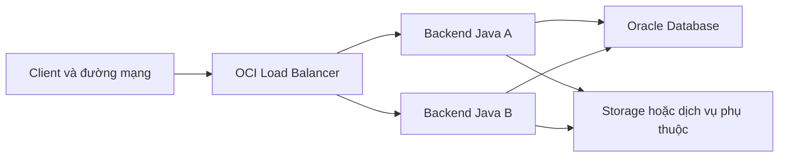

# Lựa chọn băng thông và mở rộng năng lực cân bằng tải

Chọn băng thông cho bộ cân bằng tải là quyết định về **năng lực phục vụ của cả đường đi request**. Một Load Balancer có băng thông lớn vẫn có thể phục vụ chậm khi ứng dụng Java hết thread, connection pool tới Oracle Database bị đầy hoặc backend chưa sẵn sàng sau khi mở rộng.

Bài học thuộc chương **Cân bằng tải ứng dụng** của module **CLOUD_PROVIDERS_ORACLE**. Ta kết nối kiến thức tenancy, compartment, IAM và VCN với Compute, lưu trữ và cơ sở dữ liệu Oracle để xây dựng một phương án có số liệu, có giám sát, có tự động hóa và kiểm soát được chi phí.

Sau bài học, bạn có thể:

- Ước lượng nhu cầu Mbps từ request rate và kích thước dữ liệu.
- Chọn minimum/maximum bandwidth cho OCI Flexible Load Balancer.
- Phân biệt mở rộng băng thông frontend, mở rộng backend và xử lý điểm nghẽn dependency.
- Đọc metrics đúng đơn vị, đúng phạm vi và lập kế hoạch thay đổi có kiểm chứng.
- Dự trù năng lực khi có đột biến, khi một backend lỗi và khi ứng dụng mở rộng theo lịch.

## Năng lực cân bằng tải có nhiều chiều

Một hệ thống nhận request theo đường đi minh họa:



Đối với mỗi thành phần, cần đo đúng loại năng lực:

| Chiều năng lực | Câu hỏi cần trả lời |
| --- | --- |
| Băng thông | Mỗi giây phải vận chuyển bao nhiêu bit? |
| Request rate | Mỗi giây ứng dụng xử lý bao nhiêu request? |
| Connection rate | Mỗi giây có bao nhiêu kết nối mới? |
| Concurrent connections | Có bao nhiêu kết nối đang được giữ đồng thời? |
| TLS | Có bao nhiêu handshake và kết nối mã hóa? |
| Backend capacity | Mỗi backend đáp ứng bao nhiêu tải trong giới hạn độ trễ/lỗi? |
| Dependency capacity | Database, storage và API phụ thuộc còn bao nhiêu dư địa? |

Không có một phép đổi cố định từ Mbps sang request/giây cho mọi ứng dụng. Hai API cùng chạy ở 1.000 request/giây có thể chênh lệch rất lớn về băng thông nếu một API trả vài trăm byte, API còn lại trả một tệp nhiều megabyte.

Cũng không có quan hệ “thêm một backend thì băng thông LB tăng gấp đôi”. Backend và frontend là hai tài nguyên cần lập kế hoạch riêng.

## Hiểu minimum và maximum bandwidth của Flexible LB

OCI Flexible Load Balancer sử dụng hai tham số:

| Tham số | Ý nghĩa đối với kế hoạch năng lực |
| --- | --- |
| Minimum bandwidth | Băng thông được cấp sẵn để sẵn sàng ngay cho workload |
| Maximum bandwidth | Mức trên mà LB có thể đạt trong phạm vi cấu hình |

Tài liệu OCI hiện mô tả miền cấu hình từ **10 Mbps đến 8.000 Mbps**, với minimum không lớn hơn maximum. Giới hạn sử dụng thực tế còn phụ thuộc tenancy, region, quota và loại tài khoản. Xem [tạo Flexible Load Balancer](https://docs.oracle.com/en-us/iaas/Content/Balance/Tasks/managingloadbalancer_topic-Creating_Load_Balancers.htm).

Điểm cần hiểu chính xác: maximum không phải mức băng thông luôn được bảo đảm sẵn sàng. Tham chiếu `ShapeDetails` chỉ rõ minimum là phần được cấp sẵn; maximum là mức trên có thể đạt. Xem [định nghĩa tham số shape](https://docs.oracle.com/en-us/iaas/tools/typescript/latest/modules/_loadbalancer_lib_model_shape_details_.shapedetails.html).

Ví dụ minh họa:

| Minimum | Maximum | Cách hiểu |
| --- | --- | --- |
| 100 Mbps | 100 Mbps | Cấu hình cùng mức dưới và mức trên |
| 100 Mbps | 500 Mbps | Cấp sẵn 100 Mbps, cho phép mở rộng tới mức trên 500 Mbps |
| 500 Mbps | 800 Mbps | Tăng phần năng lực cấp sẵn cho giai đoạn cần sẵn sàng cao hơn |

Những con số này là ví dụ học tập, chưa phải khuyến nghị mặc định cho một ứng dụng.

### Chọn mức dưới và mức trên theo hai câu hỏi khác nhau

- **Minimum:** cần bao nhiêu năng lực sẵn sàng ngay, kể cả khi tải tăng nhanh hơn thời gian hệ thống thích ứng?
- **Maximum:** muốn cho phép tăng tới đâu trong giới hạn kiến trúc, tài khoản và chi phí?

Với một chiến dịch có giờ bắt đầu rõ ràng, minimum quá thấp rồi kỳ vọng maximum tự giải quyết mọi đột biến là một giả định cần kiểm chứng. Nếu một mức tải phải được sẵn sàng từ đầu sự kiện, hãy lập kế hoạch cấp sẵn phù hợp và hoàn tất thay đổi trước giờ bắt đầu.

Nếu muốn một mức bandwidth cố định về cấu hình, có thể đặt minimum bằng maximum. Đừng nhầm cách này với việc ứng dụng chắc chắn đạt được mức throughput đó: backend và đường mạng vẫn có thể là điểm nghẽn.

Các dynamic shape cũ không phải điểm xuất phát được OCI khuyến nghị cho triển khai mới. Khi gặp tài nguyên cũ, đọc cấu hình hiện tại trước khi áp dụng quy trình dành cho flexible shape.

## Đơn vị và phạm vi đo

### Mbps khác MB/s

```text
1 byte = 8 bit
1 Mbps = 1.000.000 bit/giây
1 MiB = 1.048.576 byte
```

Một đường truyền 100 Mbps tương ứng lý thuyết với 12,5 MB/s trước khi xét overhead và các ràng buộc khác. Đó không phải cam kết rằng một client tải tệp sẽ luôn đạt 12,5 MB/s.

Cần ghi rõ kích thước đang dùng byte, KB hay KiB. Trong PowerShell, `1KB` là 1.024 byte; trong công thức tính Mbps, mẫu số vẫn là 1.000.000.

### Băng thông shape là tổng ingress và egress

Tham chiếu OCI định nghĩa shape theo tổng băng thông **ingress cộng egress**, áp dụng cho các kết nối tổng hợp. Không được mặc định coi “500 Mbps” là 500 Mbps độc lập cho từng chiều hoặc dành riêng cho từng client. Xem [khái niệm shape của LB](https://docs.oracle.com/en-us/iaas/Content/Balance/Concepts/balanceoverview_topic-Load_Balancing_Concepts.htm).

Trong thiết kế proxy, còn có chặng client–LB và LB–backend. Vì thế, khi đối chiếu số liệu:

1. Ghi rõ metric được lấy ở frontend, listener, backend set hay VNIC.
2. Xác định metric đo byte, bit/giây hay số lượng sự kiện trong một khoảng.
3. Không cộng tùy tiện các metric phản ánh lại cùng dữ liệu ở những điểm khác nhau.
4. Dùng metric dịch vụ và load test để hiệu chỉnh phép ước lượng từ payload.

Công thức payload ở phần tiếp theo là điểm xuất phát để lập kế hoạch, không phải định nghĩa cách OCI đo hoặc tính phí từng byte trong mọi cấu hình.

## Ước lượng nhu cầu từ workload

Với một nhóm request tương đối đồng nhất:

```text
B_payload_Mbps =
  RPS × (request_bytes + response_bytes) × 8 / 1.000.000
```

Với nhiều nhóm request:

```text
B_payload_Mbps =
  tổng theo từng nhóm [
    RPS_nhóm × (request_bytes_nhóm + response_bytes_nhóm)
  ] × 8 / 1.000.000
```

Sử dụng kích thước dữ liệu tương ứng với đường truyền thực tế. Nếu có compression, không lấy kích thước JSON chưa nén rồi mặc định đó là số byte được vận chuyển. Nếu có upload lớn hoặc response streaming, phải mô hình hóa riêng thay vì hòa vào một “request trung bình” thiếu đại diện.

### Ví dụ tính ban đầu

Giả sử API có:

- 1.000 request/giây ở giờ cao điểm.
- Mỗi request gửi 2 KiB.
- Mỗi response trả 30 KiB.
- Hệ số hiệu chỉnh ban đầu 1,25 để dự trù overhead và sai khác chưa đo.
- Mức sử dụng mục tiêu 70% của năng lực lựa chọn.

Phép tính:

```text
Payload mỗi lượt = (2 + 30) × 1.024
                 = 32.768 byte

B_payload = 1.000 × 32.768 × 8 / 1.000.000
          ≈ 262,14 Mbps

B_dự_trù = 262,14 × 1,25
         ≈ 327,68 Mbps

Capacity_mục_tiêu = 327,68 / 0,70
                  ≈ 468,11 Mbps
```

Một mức khoảng 500 Mbps có thể trở thành **ứng viên để kiểm thử**. Các hệ số 1,25 và 70% là giả định của ví dụ, không phải hệ số do OCI quy định.

Hệ số hiệu chỉnh phải được thay bằng dữ liệu quan sát khi có môi trường đại diện. Nếu số liệu dịch vụ cho thấy cùng workload dùng nhiều băng thông hơn mô hình, cần sửa mô hình và tính lại. Không coi phần dự trù 25% là bảo đảm đã bao phủ mọi overhead, cả hai chặng proxy và mọi pattern giao thức.

### Tính lại bằng PowerShell

Đoạn mã sau chỉ tính toán trên máy cục bộ, không gọi OCI:

```powershell
$RequestsPerSecond = 1000.0
$RequestBytes = 2 * 1024
$ResponseBytes = 30 * 1024
$CalibrationFactor = 1.25
$TargetUtilization = 0.70

if ($TargetUtilization -le 0 -or $TargetUtilization -gt 1) {
    throw 'TargetUtilization must be in (0, 1].'
}

$PayloadMbps = $RequestsPerSecond *
    ($RequestBytes + $ResponseBytes) * 8 / 1000000

$EstimatedMbps = $PayloadMbps * $CalibrationFactor
$CandidateCapacityMbps = $EstimatedMbps / $TargetUtilization

[PSCustomObject]@{
    PayloadMbps = [math]::Round($PayloadMbps, 2)
    EstimatedMbps = [math]::Round($EstimatedMbps, 2)
    CandidateCapacityMbps = [math]::Round($CandidateCapacityMbps, 2)
}
```

Đầu ra dự kiến của chính các giả định trên:

```text
PayloadMbps  EstimatedMbps  CandidateCapacityMbps
262.14       327.68         468.11
```

Không dùng hệ số tăng trưởng và phần dư địa nhiều lần mà không giải thích. Ví dụ, nếu tải cao điểm đầu vào đã bao gồm tăng trưởng dự kiến, cộng thêm cùng tỷ lệ tăng trưởng vào kết quả sẽ làm dự toán bị lặp.

## Bổ sung các chiều mà Mbps không phản ánh

### Request/giây và connection/giây

Client dùng keep-alive có thể gửi nhiều request trên một connection. Client liên tục reconnect có thể tạo số handshake lớn dù tổng payload nhỏ.

Cần kiểm thử cả hai kiểu nếu chúng tồn tại trong workload. Một benchmark giữ vài connection rồi gửi request liên tục không đại diện cho đợt nhiều người dùng mới cùng mở kết nối TLS.

### Số request đang xử lý

Ở trạng thái tương đối ổn định, có thể dùng quan hệ gần đúng:

```text
Request đồng thời ≈ request/giây × thời gian xử lý trung bình
```

Ví dụ, 1.000 request/giây với thời gian trung bình 0,2 giây tương ứng khoảng 200 request đang xử lý. Nếu thời gian trung bình tăng lên 1 giây, con số có thể tăng tới khoảng 1.000.

Đây là phép ước lượng concurrency của request, không phải số TCP connection. HTTP keep-alive, multiplexing, thời gian client giữ kết nối và request streaming làm hai đại lượng khác nhau.

Khi backend chậm, số công việc đang chờ có thể tăng dù băng thông chưa sát mức trên. Tăng bandwidth trong tình huống đó có thể không cải thiện độ trễ.

### Năng lực khi có lỗi

Giả sử một backend đã được đo đạt 350 request/giây trong giới hạn chất lượng dịch vụ, và ứng dụng cần phục vụ 1.000 request/giây:

```text
Không dự phòng lỗi:
  ceil(1.000 / 350) = 3 backend

Muốn chịu mất 1 backend:
  (N - 1) × 350 >= 1.000
  => N >= 4 backend
```

Đây là mô hình đơn giản với các backend cùng năng lực, tải phân phối phù hợp và dependency đủ capacity. Trên thực tế, cần thử lại khi một backend bị loại để biết backend còn lại có giữ được độ trễ và tỷ lệ lỗi hay không.

Năng lực dự phòng cho lỗi và phần dư địa cho đột biến cần được ghi rõ, tránh cộng hoặc bỏ sót chỉ vì cả hai đều được gọi chung là “headroom”.

## Đọc metrics đúng trước khi tăng cấu hình

### Với OCI Load Balancer

Namespace metrics của LB là `oci_lbaas`. Những metric thường hữu ích:

| Metric | Dùng để tìm hiểu |
| --- | --- |
| `peakBandwidth` | Mức băng thông cực đại theo giây trong khoảng quan sát |
| `bytesReceived`, `bytesSent` | Lượng dữ liệu theo phạm vi component |
| `acceptedConnections` | Số connection được tiếp nhận |
| `activeConnections` | Connection đang hoạt động ở component được chọn |
| `acceptedSSLHandshake`, `FailedSslHandshake` | Hoạt động và lỗi handshake |
| `backendTimeouts`, `unhealthyBackendServers` | Tình trạng phục vụ của backend |

`activeConnections` tại component `loadBalancer` mô tả client–LB; cùng tên metric tại backend set có phạm vi khác. Không cộng hai biểu đồ chỉ vì chúng cùng tên.

OCI công bố tần suất phát metrics LB là 60 giây. Để hiểu đúng đơn vị, dimension và component hợp lệ của từng metric, xem [tham chiếu metrics LB](https://docs.oracle.com/en-us/iaas/Content/Balance/Reference/loadbalancermetrics.htm).

### Tách lượng dữ liệu khỏi tốc độ

Nếu một giá trị thực sự biểu diễn 600.000.000 byte trong cửa sổ 60 giây:

```text
Tốc độ trung bình =
  600.000.000 × 8 / 60 / 1.000.000
  = 80 Mbps
```

Nhưng mức trung bình 80 Mbps có thể che một đợt tăng vọt ngắn. Cần đối chiếu peak, độ trễ và lỗi ở cửa sổ thời gian phù hợp.

Ngược lại, `peakBandwidth` đã biểu diễn mức cực đại theo giây trong interval. Không lấy giá trị đó chia tiếp cho 60 chỉ vì chart đang dùng interval một phút.

Không tự tạo một metric tên “bandwidth utilization” rồi giả định dịch vụ luôn cung cấp sẵn. Có thể tính một chỉ số quan sát như `peakBandwidth / maximumBandwidth` sau khi đồng nhất đơn vị, nhưng tỷ lệ đó không nói rằng phần maximum luôn được cấp sẵn.

### Cách xây biểu đồ có thể kiểm chứng

Từ trang Metrics của tài nguyên, chọn thời gian, component và statistic phù hợp; dùng chức năng mở query trong Metrics Explorer để kiểm tra bộ lọc thực tế. Giữ riêng:

- Biểu đồ bandwidth và connection của frontend.
- Biểu đồ lỗi/độ trễ, health của từng backend set.
- CPU, bộ nhớ, mạng và hàng đợi trên Compute.
- Connection pool, độ trễ truy vấn và các giới hạn database.
- Độ trễ và lỗi đo từ client.

Không dùng trung bình một ngày để kết luận đủ capacity cho một chiến dịch kéo dài mười phút. Cũng không cộng các series host hoặc component mà chưa hiểu chúng có trùng phạm vi hay phản ánh cơ chế HA hay không.

Xem [cách xem và lấy query metrics LB](https://docs.oracle.com/en-us/iaas/Content/Balance/Reference/loadbalancermetrics_topic-Using_the_Console.htm).

## Chọn hành động theo điểm nghẽn

| Quan sát cùng thời điểm | Giả thuyết cần kiểm tra | Hành động có cơ sở để cân nhắc |
| --- | --- | --- |
| Bandwidth sát mức cấu hình, backend còn dư, tải client chưa được phục vụ đủ | Frontend có thể thiếu băng thông | Kiểm tra phép đo rồi thử tăng capacity LB |
| Bandwidth thấp, backend CPU cao và hàng đợi tăng | Backend thiếu năng lực xử lý | Tối ưu ứng dụng hoặc tăng backend |
| Bandwidth thấp, database chậm và connection pool chờ | Dependency là điểm nghẽn | Xử lý database/pool/query trước |
| Payload nhỏ nhưng reconnect và handshake tăng mạnh | Connection/TLS tạo áp lực | Kiểm tra tái sử dụng kết nối và thử tải connection |
| Một backend nhận phần lớn tải | Affinity, session hoặc phân phối không phù hợp | Kiểm tra policy và hành vi client |
| Backend mới đã tạo nhưng chưa nhận tải | Chưa đăng ký, chưa ready hoặc rule mạng sai | Kiểm tra lifecycle và health check |
| Packet bị drop theo security rule | Đường mạng bị chặn | Sửa rule đúng luồng, không tăng bandwidth để chữa lỗi mạng |

Đây là các giả thuyết chẩn đoán, không phải kết luận tự động. Một hiện tượng có thể có nhiều nguyên nhân; hãy thay một nhóm yếu tố có kiểm soát và so sánh trước/sau.

Cần thống nhất mục tiêu ở cấp ứng dụng, ví dụ “đạt tải cao điểm với độ trễ và tỷ lệ lỗi trong giới hạn đã chọn”. Một biểu đồ bandwidth tăng sau thay đổi chưa chứng minh người dùng được phục vụ tốt hơn.

## Mở rộng theo ba hướng

### Tăng năng lực của LB

Điều chỉnh minimum/maximum khi có bằng chứng frontend cần thêm năng lực hoặc có nhu cầu cấp sẵn cao hơn.

Phân biệt:

- **Co giãn theo lưu lượng trong khoảng cấu hình:** hành vi của flexible service.
- **Đổi shape hoặc đổi min/max bằng thao tác quản trị:** một thay đổi cấu hình riêng.

Không xây quy trình gọi UpdateLoadBalancerShape mỗi vài giây chỉ vì chart có biến động. Việc sửa cấu hình cần xét thời gian thao tác, session, quan sát và chi phí.

### Tăng số backend

Thêm backend giúp chia tải xử lý nếu ứng dụng và dependency cho phép.

Một backend mới cần đi qua các bước:

```text
Có capacity Compute
  -> tạo instance
  -> khởi động hệ điều hành và ứng dụng
  -> nạp cấu hình, khởi tạo pool/cache
  -> đăng ký vào backend set
  -> health check đạt
  -> thực sự phục vụ được request
```

Các bước có thể chồng lấn tùy cơ chế triển khai, nhưng không được coi chúng hoàn tất ngay khi API tạo instance trả thành công.

OCI hỗ trợ gắn LB hoặc NLB với instance pool để tự đăng ký instance được thêm vào pool vào backend set; lưu lượng được chuyển tới khi instance đạt healthy. Xem [instance pool và tích hợp backend](https://docs.oracle.com/en-us/iaas/Content/Compute/Tasks/creatinginstancepool.htm).

Thiết kế health check phải phù hợp thời điểm ứng dụng sẵn sàng. Với Java, việc cổng TCP đã mở không nhất thiết nghĩa cache đã nạp hoặc các dependency bắt buộc đã kết nối được.

### Thay đổi cách phân phối và giảm tải đi qua

Khi một LB hoặc một nhóm backend không còn phù hợp, có thể xem xét:

- Chuyển tệp lớn hoặc nội dung tĩnh sang đường phân phối phù hợp, chẳng hạn Object Storage/CDN khi yêu cầu truy cập cho phép.
- Giảm response không cần thiết, phân trang, cache hoặc compression sau khi đo tác động.
- Tách frontend theo dịch vụ hoặc nhóm workload có đặc điểm khác nhau.
- Dùng nhiều LB với cơ chế phân phối phía trước, nếu kiến trúc cần và có thiết kế vận hành tương ứng.

Nhiều LB không tự cộng thành một điểm vào có capacity tuyến tính. Cần xử lý DNS hoặc lớp phân phối, health, cache DNS, chứng chỉ, WAF, quan sát và hành vi client. Nếu một client vẫn chỉ tới một frontend, tổng capacity trên giấy của các frontend khác không giải quyết được giới hạn mà client đó gặp.

Không chuyển HTTP workload sang NLB chỉ vì muốn bỏ cấu hình min/max. Nếu ứng dụng cần HTTP routing, TLS termination hoặc tính năng ứng dụng tại LB, phải giữ hoặc thay thế rõ những chức năng đó.

## Phối hợp autoscaling backend và năng lực frontend

OCI Compute có metric-based autoscaling và schedule-based autoscaling cho instance pool. Các cơ chế này quản lý số lượng hoặc lifecycle instance; chúng không phải cùng một cấu hình với min/max bandwidth của LB. Xem [autoscaling cho instance pool](https://docs.oracle.com/en-us/iaas/Content/Compute/Tasks/autoscalinginstancepools.htm).

Một phương án phản ứng theo metric cần trả lời:

1. Metric nào thực sự đại diện cho tải backend?
2. Bao lâu sau khi vượt ngưỡng thì quyết định được thực hiện?
3. Bao lâu để backend mới thật sự ready?
4. Hệ thống chịu tải tăng trong thời gian chờ bằng cách nào?
5. Quota và capacity Compute có đủ cho số instance tối đa không?
6. Database có chịu được thêm connection pool từ các instance mới không?

Ví dụ, tăng từ bốn lên tám backend, mỗi backend có pool tối đa 50 connection, có thể làm tổng mức yêu cầu lý thuyết tới database tăng từ 200 lên 400 connection. Cần tính giới hạn tổng thay vì chỉ kiểm tra cấu hình từng instance.

### Mở rộng trước một sự kiện biết trước

Giả sử đã đo được:

- Tải nền của một ứng dụng ở khoảng 30–45 Mbps theo metric được chọn.
- Mô hình và load test cao điểm cho thấy khoảng 330 Mbps.
- Muốn một mức capacity ứng viên xấp xỉ 500 Mbps sau khi dự trù.

Một phương án để thử có thể là:

| Giai đoạn | Minimum LB | Maximum LB | Backend |
| --- | --- | --- | --- |
| Ngày thường | 100 Mbps | 800 Mbps | Số instance đủ tải nền và dự phòng lỗi |
| Trước sự kiện | 500 Mbps | 800 Mbps | Tăng sớm theo kết quả benchmark |
| Sau sự kiện | Hạ sau khi quan sát ổn định | Xem lại mức trên | Scale-in có drain và kiểm tra |

Các con số này hoàn toàn giả định. Phải xác nhận quyền sử dụng, limit/quota, capacity và kết quả thử của tài nguyên thật trước khi chọn.

Thay đổi minimum từ 100 lên 500 là thao tác quản trị cần lên kế hoạch, không nên thực hiện đúng lúc người dùng bắt đầu đổ vào. Nếu max 800 vượt limit khả dụng của tenancy, kế hoạch phải giải quyết limit trước; không đợi đến lúc cần scale mới phát hiện.

### Scale-in cần tính tới request đang chạy

Trước khi loại backend, cần có quy trình ngừng giao việc mới, chờ/drain công việc đang chạy theo thiết kế và hoàn tất shutdown.

Scale-in quá nhanh có thể làm mất session, ngắt upload hoặc khiến client retry, tạo thêm tải trở lại. Với instance pool, OCI có cơ chế pre-termination lifecycle action để thực hiện công việc trước khi instance bị kết thúc; cần cấu hình và kiểm thử nếu dùng. Xem [quản lý lifecycle instance pool](https://docs.oracle.com/en-us/iaas/Content/Compute/Tasks/instance-pools-lifecycle.htm).

Không coi session persistence là cơ chế sao chép trạng thái. Khi backend bị loại, session chỉ nằm trong bộ nhớ backend đó vẫn cần phương án ở cấp ứng dụng.

## Nếu sử dụng Network Load Balancer

NLB không có cùng mô hình cấu hình min/max bandwidth như Flexible LB; dịch vụ tự điều chỉnh theo lưu lượng. Điều này thay đổi việc lập kế hoạch frontend, nhưng không xóa các giới hạn về flow, backend, mạng hoặc tài khoản. Xem [tổng quan NLB](https://docs.oracle.com/en-us/iaas/Content/NetworkLoadBalancer/overview.htm).

Các chiều cần theo dõi gồm:

- Số flow và connection mới.
- Số packet và byte được xử lý.
- Phân phối tải giữa backend.
- Tình trạng health và packet bị drop.
- Tài nguyên mạng và khả năng xử lý connection trên backend.

Namespace NLB là `oci_nlb`. Ví dụ metric có `ProcessedBytes`, `ProcessedPackets`, `NewConnectionsTCP`, `NewConnectionsUDP`, `HealthyBackendsPerNlb` và các metric drop do security rule. `ProcessedBytes` bao gồm TCP/IP headers theo định nghĩa dịch vụ. Xem [metrics NLB](https://docs.oracle.com/en-us/iaas/Content/NetworkLoadBalancer/Metrics/metrics.htm).

Không lấy công thức hoặc tên metric của LB áp nguyên sang NLB. Chẳng hạn, không suy ra số connection đang hoạt động chỉ từ số connection mới trong một phút. Các kết nối có thể tồn tại nhiều phút hoặc nhiều giờ.

Cũng cần tạo nhiều flow đại diện khi thử tải NLB. Một connection đơn lẻ không kiểm chứng được toàn bộ khả năng phân phối tới nhiều backend.

## Chi phí: chọn minimum và maximum có chủ đích

Theo hướng dẫn tạo LB của OCI, chi phí gồm phần instance cơ sở và phần băng thông; việc tính sử dụng được mô tả theo phút. Nếu sử dụng không vượt minimum, phần băng thông được tính theo minimum; khi sử dụng cao hơn minimum, áp dụng lượng sử dụng thực tế theo cơ chế dịch vụ. Xem [cơ chế tính phí flexible bandwidth](https://docs.oracle.com/en-us/iaas/Content/Balance/Tasks/managingloadbalancer_topic-Creating_Load_Balancers.htm).

Có thể mô hình hóa sơ bộ:

```text
Chi phí LB ≈
  phần cơ sở theo thời gian
  + tổng phần băng thông được tính cho từng khoảng thời gian
```

Với mục đích dự toán, một ý tưởng đơn giản là theo dõi mức lớn hơn giữa minimum và mức sử dụng được tính ở mỗi khoảng. Tuy nhiên, không dùng trực tiếp giá trị cực đại tự lấy từ chart thay cho dữ liệu metering để khẳng định hóa đơn chính xác.

Cần phân biệt:

| Đại lượng | Ý nghĩa |
| --- | --- |
| Minimum bandwidth | Năng lực cấp sẵn và tác động tới phần chi phí tối thiểu |
| Maximum bandwidth | Phạm vi trên được cấu hình, chưa phải toàn bộ chi phí chắc chắn phải trả |
| Lưu lượng truyền dữ liệu | Một thành phần chi phí mạng khác theo chính sách áp dụng |
| Chi phí backend | Compute, boot/block volume và tài nguyên liên quan |
| Chi phí quan sát | Thu thập, lưu trữ và truy vấn log/metric theo dịch vụ dùng |

Một minimum rất cao để dùng cả tháng có thể tốn kém nếu chỉ cần trong một sự kiện ngắn. Ngược lại, minimum quá thấp có thể không đáp ứng yêu cầu sẵn sàng ngay.

Đối chiếu đơn vị và giá áp dụng tại thời điểm triển khai trong [bảng giá OCI](https://www.oracle.com/cloud/price-list/). Trong dự toán này không sử dụng một đơn giá cố định vì loại tài khoản và điều kiện thương mại có thể khác nhau.

Đặt maximum cũng không thay thế ngân sách cho toàn ứng dụng. Request retry, thêm backend, truyền dữ liệu và logging vẫn có thể làm tổng chi phí tăng dù LB không đổi cấu hình.

## Kiểm tra limit, quota và capacity trước khi thay đổi

Ba yếu tố dễ bị gộp nhầm:

| Yếu tố | Cần xác minh |
| --- | --- |
| Khả năng của dịch vụ | Miền tham số, số backend/listener và các ràng buộc kỹ thuật |
| Limit/quota của tài khoản | Tenancy/compartment hiện được phép dùng bao nhiêu |
| Capacity khả dụng | Tài nguyên cần cấp mới có thể được cung cấp tại nơi đã chọn không |

Miền tham số tới 8.000 Mbps không có nghĩa mọi tenancy tự động có đủ quyền sử dụng đến mức đó. Kiểm tra Limits, Quotas and Usage của tài khoản và [limits theo dịch vụ](https://docs.oracle.com/en-us/iaas/Content/General/service-limits/default.htm).

Đối với backend, một autoscaling policy đã tồn tại không chứng minh sẽ cấp được đủ instance ở thời điểm cần. OCI có thể báo thiếu capacity cho instance pool; cần có kế hoạch vị trí, shape hoặc phương án thay thế phù hợp. Xem [quản lý instance pool](https://docs.oracle.com/en-us/iaas/Content/Compute/Concepts/instance-pools.htm).

IAM cũng phải cho phép đúng danh tính xem metrics và thực hiện thay đổi trong phạm vi được giao. Không cấp quyền quản trị tenancy rộng chỉ để pipeline thay đổi bandwidth của một ứng dụng.

## Quy trình đổi bandwidth có thể kiểm chứng

**Lưu ý vận hành cụ thể:** tài liệu OCI về đổi bandwidth shape ghi rằng thay đổi kích thước yêu cầu reset các session hiện hữu. Vì vậy, không mô tả thao tác này như một thay đổi luôn không gián đoạn. Xem [đổi bandwidth shape của LB](https://docs.oracle.com/en-us/iaas/Content/Balance/Tasks/managingloadbalancer_topic-Changing_the_Load_Balancer_Bandwidth.htm).

Một quy trình phù hợp gồm:

1. Xác nhận LB OCID, region, compartment và ứng dụng chịu tác động.
2. Đọc lại shape, minimum/maximum và trạng thái hiện tại.
3. Ghi số liệu trước thay đổi: bandwidth, connection, độ trễ, lỗi và health.
4. Xác nhận limit/quota cùng quyền IAM.
5. Chuẩn bị phương án cho client reconnect/retry và thời điểm thay đổi.
6. Thực hiện một thay đổi đã xác định rõ.
7. Theo dõi work request tới kết quả hoàn tất.
8. Đọc lại cấu hình để xác minh min/max thực tế.
9. Kiểm tra client, session, health và số liệu sau thay đổi.
10. Chỉ tiếp tục tăng tải khi kết quả phù hợp; nếu có vấn đề, thực hiện phương án khôi phục đã chuẩn bị.

Khôi phục cấu hình cũ cũng là một thay đổi cần quan sát. Không hứa rằng rollback không có ảnh hưởng tới session.

### Ví dụ OCI CLI

Các lệnh dưới đây dành cho **Bash**, minh họa thao tác trên tài nguyên đã được phép thay đổi. Phải thay OCID/region và lựa chọn số liệu thực tế trước khi dùng.

Đọc cấu hình:

```bash
LB_OCID='REPLACE_WITH_LOAD_BALANCER_OCID'
REGION='ap-singapore-1'

oci lb load-balancer get --region "$REGION" --load-balancer-id "$LB_OCID"
```

Ví dụ thay flexible shape thành minimum 500, maximum 800 Mbps:

```bash
oci lb load-balancer update-load-balancer-shape --region "$REGION" --load-balancer-id "$LB_OCID" --shape-name flexible --shape-details '{"minimumBandwidthInMbps":500,"maximumBandwidthInMbps":800}' --wait-for-state SUCCEEDED
```

Đọc lại sau khi work request hoàn tất:

```bash
oci lb load-balancer get --region "$REGION" --load-balancer-id "$LB_OCID"
```

Lệnh cập nhật là operation bất đồng bộ có work request. CLI hỗ trợ `--wait-for-state`; cần phân biệt yêu cầu đã được chấp nhận với việc operation đã thành công. Nếu CLI timeout, kiểm tra trạng thái work request trước khi quyết định gửi lại thay đổi.

Tham khảo [CLI update-load-balancer-shape](https://docs.oracle.com/en-us/iaas/tools/oci-cli/latest/oci_cli_docs/cmdref/lb/load-balancer/update-load-balancer-shape.html) và [CLI đọc cấu hình LB](https://docs.oracle.com/en-us/iaas/tools/oci-cli/latest/oci_cli_docs/cmdref/lb/load-balancer/get.html).

Đây là ví dụ nội dung bài học; tính toán capacity không yêu cầu chạy thao tác thay đổi cloud khi chưa có môi trường thực hành phù hợp.

## Thiết kế load test đại diện

Mục tiêu của load test là tìm giới hạn ứng dụng trong điều kiện đã xác định, đồng thời hiệu chỉnh mô hình bandwidth. Chọn môi trường thử nghiệm và workload có quyền thực hiện, với dữ liệu giả lập phù hợp.

| Pha thử | Cần biết |
| --- | --- |
| Baseline | Tải bình thường, mức sử dụng nền và overhead ban đầu |
| Ramp-up | Hệ thống thay đổi ra sao khi tăng tải từng mức |
| Spike | Tải tăng nhanh có vượt năng lực sẵn sàng không |
| Sustained load | Có rò rỉ tài nguyên, tích hàng đợi hoặc suy giảm theo thời gian không |
| Connection-heavy | Client mới/reconnect/TLS tạo ảnh hưởng gì |
| Mất một backend | Các backend còn lại có giữ chất lượng dịch vụ không |
| Scale-out và scale-in | Thời gian ready, drain và phản ứng của client |
| Giảm tải | Hệ thống có ổn định trở lại và chi phí có giảm như dự kiến không |

Dữ liệu kiểm thử nên phản ánh:

- Tỷ lệ các endpoint và kích thước payload.
- Tỷ lệ read/write, upload/download.
- Compression, TLS và hành vi keep-alive.
- Session hoặc affinity.
- Các truy vấn database và dependency thực sự được gọi.
- Số client và mức phân tán connection/flow.

Đừng coi tải mà công cụ phát ra là tải ứng dụng đã phục vụ thành công. Ghi riêng số yêu cầu dự kiến gửi, số thực sự gửi, số hoàn tất thành công, lỗi và độ trễ.

Cũng kiểm tra máy phát tải: CPU, mạng, số connection và vị trí của nó có thể trở thành điểm nghẽn. Một client không tạo đủ tải sẽ làm kết quả trông như LB chưa đạt capacity mà không chỉ ra nguyên nhân.

### Ghi lại kết quả để quyết định

| Mục ghi nhận | Ví dụ loại dữ liệu |
| --- | --- |
| Cấu hình | Shape, min/max, backend count và shape Compute |
| Workload | RPS, payload, connection pattern, thời lượng |
| Chất lượng dịch vụ | p50/p95/p99 latency, tỷ lệ lỗi theo định nghĩa |
| Frontend | Peak bandwidth, connection, handshake |
| Backend | Health, CPU, bộ nhớ, queue, pool |
| Dependency | Độ trễ và mức dùng database/storage |
| Sự kiện | Đổi shape, backend ready, scale-in, lỗi |
| Kết luận | Đạt/chưa đạt và điều cần thay đổi tiếp |

Không tính p99 toàn hệ thống bằng cách lấy trung bình p99 của các backend. Cần dữ liệu hoặc phép tổng hợp phù hợp với phạm vi muốn đánh giá.

Nếu tăng bandwidth nhưng latency và throughput thành công không cải thiện, quay lại kiểm tra giả thuyết. Không tiếp tục tăng cấu hình chỉ vì đó là biến dễ điều chỉnh nhất.

## Cảnh báo và vận hành liên tục

Một bộ cảnh báo hữu ích cần kết hợp mức dùng capacity với chất lượng phục vụ:

- Băng thông tiến gần mức trên trong khoảng thời gian có ý nghĩa.
- Độ trễ hoặc tỷ lệ lỗi vượt mục tiêu.
- Backend unhealthy hoặc timeout tăng.
- Connection/handshake có hành vi khác nền.
- Backend hoặc database tiến gần giới hạn đã đo.
- Autoscaling hoặc work request không hoàn tất như dự kiến.

Ngưỡng phải lấy từ benchmark và mục tiêu ứng dụng. Không mặc định “CPU 80%” hoặc “bandwidth 70%” là ngưỡng đúng cho mọi dịch vụ. Phải ghi rõ statistic, cửa sổ thời gian và hành động cần thực hiện khi cảnh báo xuất hiện.

Đối với tải có lịch, lập kế hoạch cả tăng trước và giảm sau. Đối với tải bất thường, cần biết hệ thống có bao nhiêu thời gian để phản ứng trước khi chất lượng phục vụ giảm.

Mỗi lần đổi endpoint, payload, cơ chế nén, TLS hoặc connection pattern đều có thể làm mô hình capacity cũ không còn phù hợp. Theo dõi xu hướng và đo lại khi workload thay đổi đáng kể.

## Một quyết định sizing hoàn chỉnh cần ghi được gì?

Một quyết định có thể kiểm chứng nên bao gồm:

1. Workload nền và cao điểm, cùng giả định tăng trưởng.
2. Nhu cầu bandwidth, connection và backend đã đo hoặc ước lượng.
3. Minimum/maximum được chọn, lý do và limit/quota đã xác nhận.
4. Năng lực khi mất backend hoặc khi dependency suy giảm.
5. Kế hoạch autoscaling hoặc tăng trước sự kiện.
6. Metrics, mục tiêu độ trễ/lỗi và phép thử chấp nhận.
7. Chi phí dự kiến và cách thực hiện thay đổi/khôi phục.

Chọn băng thông chỉ là một phần của sizing. Khi mô hình tải, capacity frontend, capacity backend và khả năng của dependency được kiểm tra cùng nhau, bộ cân bằng tải mới hỗ trợ được mục tiêu về hiệu năng, tính sẵn sàng và chi phí của ứng dụng.
