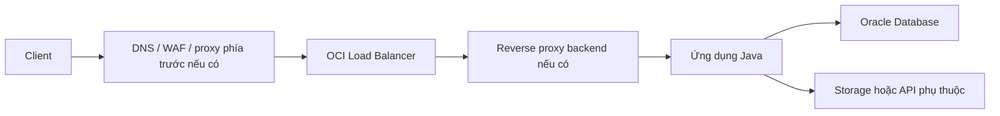

# Phân tích lỗi 502, 503, timeout và kết nối backend

Khi người dùng nhận lỗi 502 hoặc 503 qua một địa chỉ cân bằng tải, chưa thể kết luận bộ cân bằng tải bị hỏng. Mã lỗi có thể do OCI Load Balancer tạo ra, do reverse proxy ở backend trả về hoặc do chính ứng dụng chủ động từ chối request. Với timeout, client thậm chí có thể đóng kết nối trước khi nhận được bất kỳ HTTP response nào.

Bài học thuộc chương **Cân bằng tải ứng dụng** của module **CLOUD_PROVIDERS_ORACLE**. Ta kết nối kiến thức tenancy, compartment, IAM, VCN và Compute với ứng dụng, Oracle Database và storage để chẩn đoán theo bằng chứng, khôi phục có kiểm soát và tránh thay đổi làm tăng tải hoặc chi phí mà không xử lý đúng nguyên nhân.

Sau bài học, bạn có thể:

- Phân biệt ý nghĩa 502, 503, 504 và timeout phía client.
- Xác định thành phần phát sinh lỗi bằng access log, error log và log ứng dụng.
- Kiểm tra từng chặng DNS, TCP, TLS, HTTP, health check và dependency.
- Phân biệt connection timeout, idle timeout, keep-alive và deadline xử lý.
- Chọn cách khắc phục, retry và xác minh phù hợp với nguyên nhân.

## Vẽ đường đi request trước khi đọc mã lỗi

Một ứng dụng có thể có nhiều lớp trung gian:



Nếu backend của OCI LB là một reverse proxy khác, từ “backend” trong log LB chỉ thành phần proxy đó, chưa chắc là tiến trình Java cuối cùng.

Trước khi thử sửa, ghi lại:

| Thông tin | Mục đích |
| --- | --- |
| Hostname, protocol và port | Xác định đúng điểm vào |
| Region, compartment và LB OCID | Tránh điều tra nhầm tài nguyên |
| Listener, routing rule và backend set | Xác định request có thể được chuyển đi đâu |
| IP:port của từng backend | Kiểm tra đúng endpoint |
| Thời điểm và múi giờ | Ghép log giữa nhiều hệ thống |
| Method, path và request/trace ID | Theo một request qua các lớp |
| Thay đổi gần nhất | Tạo giả thuyết về cấu hình, triển khai hoặc tải |

Tách lỗi **data plane** khỏi lỗi **control plane**. Một HTTP 503 khi client gọi API nghiệp vụ qua hostname của ứng dụng khác với 503 khi công cụ quản trị gọi OCI API để sửa LB. Hai yêu cầu có endpoint, log và cách điều tra khác nhau.

## Hiểu các loại lỗi nhưng không suy nguyên nhân từ mã đơn lẻ

| Kết quả quan sát | Ý nghĩa ban đầu | Chưa đủ để kết luận |
| --- | --- | --- |
| 502 Bad Gateway | Một gateway/proxy không nhận được response upstream hợp lệ | Backend chắc chắn đã tắt |
| 503 Service Unavailable | Thành phần trả response hiện chưa phục vụ được, thường do quá tải hoặc bảo trì | Chắc chắn không còn backend healthy |
| 504 Gateway Timeout | Gateway/proxy không nhận response upstream kịp thời | Chỉ cần tăng timeout |
| Client báo timeout | Một bộ đếm thời gian phía client hoặc thư viện đã hết | LB đã trả 504 |
| Connection refused/reset | Kết nối bị từ chối hoặc bị đóng/reset | Chỉ có một nguyên nhân mạng cụ thể |
| TLS handshake failure | Không hoàn tất được thương lượng/xác minh TLS | TCP không kết nối được |

Ý nghĩa chuẩn của các mã HTTP được mô tả trong [RFC 9110: 502, 503 và 504](https://www.rfc-editor.org/rfc/rfc9110.html#section-15.6.3).

Riêng OCI LB, tình huống không có backend đủ điều kiện phục vụ có thể xuất hiện dưới dạng **502**. Không áp dụng máy móc cách ghi nhớ “không có backend thì phải là 503” từ một sản phẩm khác. Xem [các lỗi LB thường gặp của OCI](https://docs.oracle.com/en-us/iaas/Content/Balance/Troubleshooting/common_load_balancer_errors.htm).

Một response 503 cũng có thể do ứng dụng Java hoặc proxy backend tạo ra khi bảo trì, từ chối nhận thêm việc hoặc không phục vụ được dependency. Nhiệm vụ đầu tiên là tìm **ai đã trả mã đó**.

## Thu thập một mẫu lỗi có thể tái hiện

Chọn một request đọc an toàn và đại diện cho vấn đề. Ghi riêng:

- Có nhận HTTP status hay không.
- IP mà client thực sự kết nối.
- Thời gian kết nối TCP, TLS, nhận byte đầu và toàn bộ request.
- Header response có liên quan tới request ID hoặc retry.
- Tần suất và phạm vi: mọi request, một URL, một backend hay chỉ giờ cao điểm.

Nếu vấn đề xảy ra ở POST có tác dụng phụ, không gửi lặp tùy tiện chỉ để lấy nhiều mẫu. Cần dùng dữ liệu thử hoặc cơ chế đối soát/idempotency của ứng dụng.

### Ví dụ từ Windows bằng PowerShell

Giả định `curl.exe` đã có sẵn, hostname là môi trường bạn được phép kiểm tra:

```powershell
$Url = 'https://REPLACE_WITH_REAL_HOSTNAME/api/health'
$Format = 'http_code=%{http_code} remote_ip=%{remote_ip} connect=%{time_connect} tls=%{time_appconnect} ttfb=%{time_starttransfer} total=%{time_total}\n'

curl.exe --silent --show-error --include --connect-timeout 3 --max-time 15 --write-out $Format $Url
Write-Output "curl_exit=$LASTEXITCODE"
```

Các thời gian được curl báo theo giây. Chúng là các mốc tích lũy từ đầu lượt truyền, không phải những đoạn thời gian độc lập để cộng lại.

Trong lệnh trên không dùng `--fail`: curl có thể kết thúc với exit code 0 dù HTTP response là 502 hoặc 503. Phải đọc cả `http_code`. Nếu chưa nhận được HTTP response, `http_code` có thể là `000`; đó không phải một mã HTTP do server trả.

`--max-time 15` là giới hạn tổng của lượt thử này. Nếu ứng dụng cần hơn 15 giây, chính phép thử có thể chủ động ngắt trước khi có kết quả. Điều đó là một quan sát về deadline client, chưa chứng minh gateway đã timeout.

Xem [tài liệu chính thức của curl](https://curl.se/docs/manpage.html) để hiểu `--connect-timeout`, `--max-time` và các biến `--write-out`.

### Thử trực tiếp frontend IP mà vẫn giữ hostname

Khi cần tách một giả thuyết DNS khỏi frontend cụ thể:

```powershell
$HostName = 'REPLACE_WITH_REAL_HOSTNAME'
$LbIp = 'REPLACE_WITH_LB_IP'
$ResolveEntry = $HostName + ':443:' + $LbIp
$Url = 'https://' + $HostName + '/api/health'

curl.exe --silent --show-error --include --connect-timeout 3 --max-time 15 --resolve $ResolveEntry $Url
```

Hostname trong URL vẫn cần khớp chứng chỉ và cấu hình ứng dụng. Cách này không tự đi qua những proxy/WAF khác mà DNS thường trỏ tới; phải ghi rõ đường đi đã thay đổi.

Không dùng `https://<IP>` rồi coi lỗi hostname của chứng chỉ là bằng chứng TLS frontend hỏng. Cũng không coi việc bỏ qua kiểm tra chứng chỉ là cách sửa cấu hình.

## Dùng access log để xác định nguồn lỗi

OCI LB có access log và error log qua OCI Logging. Logging là tính năng tùy chọn; cần xác nhận đã bật và có quyền xem đúng log. Việc bật log sau sự cố không tái tạo những request trước đó. Xem [logging cho Load Balancer](https://docs.oracle.com/en-us/iaas/Content/Balance/Tasks/managingloadbalancer_topic-Logging.htm).

Các field hữu ích trong access log:

| Field | Dùng để tìm hiểu |
| --- | --- |
| `lbStatusCode` | Mã response từ LB về phía client |
| `backendStatusCode` | Mã response nhận từ backend |
| `backendAddr` | Backend IP:port đã xử lý request |
| `listenerName` | Listener nhận request |
| `request` | Method/path/protocol của request |
| `backendConnectTime` | Thời gian thiết lập kết nối backend |
| `backendProcessingTime` | Khoảng nhận response backend theo định nghĩa log |
| `requestProcessingTime` | Thời gian xử lý toàn lượt ở LB |

Tài liệu định nghĩa các trường thời gian của access log theo giây. Đối chiếu schema thực tế của bản ghi thay vì giả định mọi field đều nằm ở một vị trí JSON giống ví dụ trên mạng. Xem [tham chiếu log LB](https://docs.oracle.com/en-us/iaas/Content/Logging/Reference/details_for_load_balancer_logs.htm).

### Đọc cặp mã LB/backend

| Quan sát minh họa | Hướng điều tra |
| --- | --- |
| LB 502, backend không có mã | Có thể chưa nhận được HTTP response; kiểm tra eligibility, TCP, TLS và error log |
| LB 502, backend 502 | Backend đã trả 502; theo log của backend/proxy đó tới upstream tiếp theo |
| LB 503, backend 503 | Backend có bằng chứng đã tạo 503; kiểm tra bảo trì, quá tải hoặc dependency |
| LB 504, backend không có mã | Kiểm tra connection/idle timeout và việc backend không trả kịp |
| Backend 504 | Backend có thể là proxy đang chờ upstream khác |
| Không tìm thấy access record | Kiểm tra thời gian, filter, logging, độ trễ log và đường request trước khi kết luận |

Các cặp mã chỉ dẫn hướng, chưa phải quy luật bao phủ mọi cấu hình. Một trường rỗng nghĩa là không có giá trị để đọc trong bản ghi đó; không được tự thay nó bằng một mã giả định.

### Ví dụ bản ghi rút gọn

```json
{
  "lbStatusCode": "502",
  "backendStatusCode": "",
  "backendAddr": "10.0.20.12:8443",
  "listenerName": "https-orders",
  "request": "GET /api/orders/health HTTP/1.1"
}
```

Đây là các field được trích và sắp lại để minh họa, không phải toàn bộ JSON envelope của OCI Logging.

Một giả thuyết hợp lý là LB chưa nhận được HTTP status hợp lệ từ backend đó. Cần error log để phân biệt lỗi TLS, kết nối bị reset hoặc trường hợp không có backend phục vụ. Không được chỉ nhìn cổng 8443 rồi mặc định tiến trình chắc chắn đang chạy HTTPS.

## Dùng error log để chọn phép thử tiếp theo

Các nhóm thông tin thường giúp phân loại:

| Thông tin trong error log | Phép kiểm tra tiếp theo |
| --- | --- |
| Không có backend khả dụng | Danh sách backend, health, drain/offline và giới hạn connection |
| Connect timeout | Route, security rule, firewall, listener backend và đường về |
| Connection refused | IP/port, tiến trình lắng nghe và khả năng có thành phần chủ động từ chối |
| Connection reset hoặc đóng đột ngột | Ứng dụng/proxy đóng kết nối, restart, keep-alive hoặc protocol mismatch |
| SSL handshake/certificate | Cấu hình TLS backend, CA, certificate chain và hostname theo yêu cầu |
| Health response mismatch | Path, method, code, body/regex và virtual host |
| Backend không trả kịp | Queue, thread, pool, database và API/storage phụ thuộc |

OCI ghi nhận các tình huống “không có backend khả dụng” không chỉ khi danh sách trống hoặc health check thất bại, mà còn có thể khi backend đã chạm giới hạn kết nối. Một backend healthy chưa chắc còn capacity nhận request mới. Xem [các lỗi kết nối và backend của OCI LB](https://docs.oracle.com/en-us/iaas/Content/Balance/Troubleshooting/common_load_balancer_errors.htm).

Đừng mở rộng search tới mọi log của tenancy ngay từ đầu. Lọc theo tài nguyên, cửa sổ thời gian và backend liên quan để dễ ghép sự kiện.

## Kiểm tra cấu hình và health bằng thao tác đọc

Trong Console hoặc CLI, đọc lại:

- Listener thực sự nhận request và backend set được chọn.
- Backend IP, port, weight, drain/offline nếu có.
- Health check protocol, port, path, expected code/body.
- TLS ở listener và TLS ở backend set.
- Session persistence và fallback.
- Giới hạn connection và timeout liên quan.

Ví dụ Bash, không thay đổi tài nguyên:

```bash
LB_OCID='REPLACE_WITH_LOAD_BALANCER_OCID'
BACKEND_SET='REPLACE_WITH_BACKEND_SET_NAME'
REGION='ap-singapore-1'

oci lb load-balancer get --region "$REGION" --load-balancer-id "$LB_OCID"
oci lb backend-set get --region "$REGION" --load-balancer-id "$LB_OCID" --backend-set-name "$BACKEND_SET"
oci lb backend-set-health get --region "$REGION" --load-balancer-id "$LB_OCID" --backend-set-name "$BACKEND_SET"
```

Các lệnh yêu cầu OCI CLI đã xác thực và có quyền đọc tài nguyên. Xem [đọc backend set](https://docs.oracle.com/en-us/iaas/tools/oci-cli/latest/oci_cli_docs/cmdref/lb/backend-set/get.html) và [đọc health của backend set](https://docs.oracle.com/en-us/iaas/tools/oci-cli/latest/oci_cli_docs/cmdref/lb/backend-set-health/get.html).

Trạng thái hiện tại không thay thế dữ liệu tại thời điểm lỗi. Một backend healthy lúc 15:10 không chứng minh nó healthy trong sự cố lúc 15:00; cần ghép lịch sử health, log và deployment.

## Kiểm tra kết nối backend theo từng lớp

Điểm kiểm tra phải được chọn có chủ đích. Laptop bên ngoài VCN không kết nối được private backend là điều có thể đúng với thiết kế.

Ưu tiên một host chẩn đoán có route và phạm vi mạng phù hợp. Nhưng ngay cả host cùng subnet cũng không hoàn toàn tương đương đường đi từ LB: NSG, source IP, routing và firewall vẫn cần đối chiếu.

### Tiến trình có thực sự lắng nghe không?

Ví dụ trên backend Linux:

```bash
ss -lntp '( sport = :8080 )'
curl --silent --show-error --include --connect-timeout 2 --max-time 5 http://127.0.0.1:8080/health/ready
```

Kiểm tra:

- Có đúng process và port không.
- Process chỉ bind `127.0.0.1` hay lắng nghe trên địa chỉ mà LB truy cập.
- Endpoint local có trả kết quả đúng không.
- Có proxy/container mapping làm port bên ngoài khác port ứng dụng không.

Local request thành công chứng minh một phần ứng dụng hoạt động từ chính máy đó; nó chưa chứng minh LB kết nối được qua VCN.

### Host trong VCN có kết nối TCP được không?

Ví dụ Linux:

```bash
nc -vz -w 3 10.0.20.12 8080
```

Hoặc từ Windows có đường tới backend:

```powershell
Test-NetConnection -ComputerName 10.0.20.12 -Port 8080
```

Kết nối TCP thành công chưa xác nhận HTTP/TLS hoặc nghiệp vụ. Ping thất bại cũng chưa đủ chứng minh TCP bị chặn, vì ICMP và TCP có rule riêng.

| Kết quả | Cách diễn giải thận trọng |
| --- | --- |
| Connection refused | Có thể chưa có process lắng nghe hoặc có thành phần chủ động reject |
| Timeout | Có thể bị drop, sai route, thiếu đường về hoặc đích không phản hồi |
| TCP thành công, HTTP lỗi | Chuyển sang kiểm tra protocol, request và ứng dụng |
| Local thành công, remote thất bại | Kiểm tra bind address, firewall và đường mạng |

Tham khảo [kiểm tra TCP/HTTP backend của OCI](https://docs.oracle.com/en-us/iaas/Content/Balance/Reference/troubleshooting_backend.htm).

### Đối chiếu route, NSG, security list và firewall

Lập bảng luồng cần được cho phép:

| Luồng | Điểm cần xác minh |
| --- | --- |
| Client → frontend listener | Đúng public/private, protocol, port và nguồn được phép |
| LB → backend ứng dụng | Đúng đích, port và rule ở cả hai phía |
| Health checker → backend | Đúng protocol/port kiểm tra, không nhầm với data traffic |
| Backend → dependency | Database, storage hoặc API có thể tiếp cận và phản hồi |
| Luồng phản hồi | Route, security rule và xử lý state phù hợp |

NSG/security list của OCI và firewall hệ điều hành là các lớp khác nhau. Một lớp cho phép không chứng minh lớp còn lại cũng cho phép.

Nếu dùng stateless rule, cần xem xét rõ cả chiều đi và chiều về. Nếu kết hợp NSG với security list, phải xét toàn bộ rule có hiệu lực. Xem [security rules của OCI](https://docs.oracle.com/en-us/iaas/Content/Network/Concepts/securityrules.htm).

Không cần mở mọi port hoặc đưa backend ra Internet để kiểm tra một cổng ứng dụng. Sửa đúng phạm vi luồng đã xác định rồi thử lại.

Khi cần quan sát packet trên backend, một lệnh minh họa giới hạn số packet:

```bash
sudo tcpdump -nn -i any -c 50 'host 10.0.10.8 and tcp port 8080'
```

Thay địa chỉ bằng peer thực tế và thực hiện trên host được phép chẩn đoán. Lệnh không yêu cầu in payload bằng `-A` hoặc `-X`.

Các dấu hiệu cần phân biệt:

- Thấy SYN tới nhưng không thấy SYN-ACK trả: kiểm tra local listener, firewall và khả năng phản hồi.
- Không thấy packet phù hợp tại backend: kiểm tra nguồn quan sát, filter và các chặng trước đó.
- Bắt tay xong rồi có RST: xem thành phần nào gửi RST và log tương ứng.
- Request tới, backend im lặng lâu: xem queue, process và dependency.
- Backend trả response nhưng client vẫn lỗi: tiếp tục kiểm tra đường về và các proxy ở phía trước.

Một capture trên một máy chỉ phản ánh vị trí đó; không dùng nó để khẳng định toàn bộ đường mạng đã tốt.

## Kiểm tra HTTP đúng với request thực tế

Khi backend dùng HTTP, thử từ host có đường mạng phù hợp:

```bash
curl --silent --show-error --include --connect-timeout 3 --max-time 10 -H 'Host: orders.internal.example' http://10.0.20.12:8080/health/ready
```

Hostname và IP trong lệnh là ví dụ. Thay bằng cấu hình của ứng dụng.

Cần so sánh:

| Thành phần request | Vì sao có thể gây khác biệt |
| --- | --- |
| Method | HEAD và GET có thể được xử lý khác nhau |
| Host | Backend có thể chọn virtual host khác |
| Path | Health check có thể tới đường dẫn không tồn tại |
| Header | Middleware hoặc proxy có thể yêu cầu/đổi header |
| Authentication | Endpoint có thể bị chuyển hướng tới login |
| Protocol | HTTP plaintext và HTTPS không thể hoán đổi tùy ý |

Không dùng `curl -I` rồi coi kết quả HEAD là kết quả chắc chắn của GET health check. Cũng không dùng một endpoint đơn giản để kết luận endpoint nghiệp vụ nặng đã hoạt động.

Một HTTP 401/403 của phép thử chứng minh đã có thành phần HTTP phản hồi, nhưng không nhất thiết chứng minh ứng dụng nghiệp vụ phía sau đã nhận và xử lý request đó.

## Kiểm tra TLS giữa LB và backend

TLS frontend và TLS backend là hai chặng riêng nếu LB kết thúc TLS của client rồi tạo kết nối mới tới backend.

```text
Client -- TLS frontend --> LB -- TLS backend --> Ứng dụng/proxy
```

Chứng chỉ frontend hợp lệ không chứng minh backend certificate chain hoặc cấu hình TLS backend đã đúng.

Các nhóm cần kiểm tra:

- Backend port có thực sự nhận TLS hay đang là HTTP plaintext.
- TLS version/cipher có tương thích.
- Chứng chỉ còn hiệu lực và chuỗi CA có đầy đủ.
- Trust store/CA cấu hình ở LB có khớp.
- Hostname/SNI và cơ chế xác minh có phù hợp với cấu hình.
- Nếu có mTLS, bên gọi có cung cấp client certificate cần thiết không.

OCI mô tả backend handshake và lỗi certificate như những nguyên nhân có thể dẫn tới 502. Xem [chẩn đoán SSL/TLS của LB](https://docs.oracle.com/en-us/iaas/Content/Balance/Reference/troubleshooting_ssl.htm).

### Dùng curl với hostname và CA đúng

Ví dụ Bash:

```bash
curl --silent --show-error --include --connect-timeout 3 --max-time 10 --resolve 'orders.internal.example:8443:10.0.20.12' --cacert /path/to/internal-ca.pem https://orders.internal.example:8443/health/ready
```

Lệnh này kiểm tra backend cụ thể trong khi giữ hostname cho TLS và HTTP. Đường dẫn CA là placeholder cần thay.

Kết quả thành công với CA trên host chẩn đoán chưa chứng minh LB đang có cùng CA, cùng SNI hoặc cùng chính sách xác minh. Phải đối chiếu cấu hình hai bên.

### Dùng OpenSSL khi cần xem handshake

```bash
openssl s_client -connect 10.0.20.12:8443 -servername orders.internal.example -verify_hostname orders.internal.example -CAfile /path/to/internal-ca.pem -verify_return_error -showcerts < /dev/null
```

Đọc kết quả thương lượng, certificate chain và kết quả verify. Các tùy chọn `-verify_hostname` và `-verify_return_error` giúp phép thử không chỉ đơn thuần hiển thị chứng chỉ rồi bỏ qua lỗi xác minh.

Xem [tài liệu openssl s_client](https://docs.openssl.org/3.5/man1/openssl-s_client/).

SNI trong phép thử chọn tên mà host chẩn đoán gửi. Đừng coi nó là bằng chứng LB thực sự gửi cùng tên; cần xác minh hành vi của cấu hình đang sử dụng.

Không tắt xác minh chứng chỉ như một cách sửa lâu dài cho lỗi chain hoặc hostname. Sửa đúng certificate, trust hoặc cấu hình đích đã được xác định.

## Health check: healthy chưa đủ, unhealthy cần giải thích

Health check và request người dùng có thể khác protocol, port, path, Host, authentication hoặc phạm vi dependency được kiểm tra.

| Quan sát | Khả năng cần xét |
| --- | --- |
| TCP health healthy, HTTP nghiệp vụ lỗi | Cổng mở nhưng ứng dụng/proxy chưa phục vụ đúng |
| Health trả 301/302 | Đang redirect, có thể khác expected code |
| Health trả 401/403 | Bị lớp xác thực/phân quyền hoặc rule truy cập tác động |
| Health trả 404 | Sai path hoặc virtual host |
| Code đúng nhưng health vẫn fail | Body/regex, timeout hoặc điều kiện khác không khớp |
| Health đổi trạng thái liên tục | App chậm, restart, tải cao hoặc threshold chưa phù hợp |
| Healthy nhưng không nhận request mới | Capacity, drain/offline, routing hoặc persistence cần kiểm tra |

Không sửa expected code thành bất kỳ mã nào đang trả chỉ để biểu đồ chuyển xanh. Ví dụ, chấp nhận 503 làm healthy sẽ che mất thông tin ứng dụng chưa sẵn sàng.

Endpoint readiness nên trả trạng thái có ý nghĩa với khả năng nhận request. Có thể thiết kế endpoint riêng, không lộ thông tin nội bộ và được giới hạn truy cập theo kiến trúc, thay vì yêu cầu health checker đăng nhập như một người dùng.

Nếu tất cả backend unhealthy, kiểm tra cả lỗi chung: cùng một bản deploy, cùng CA hết hạn, cùng rule mạng bị sửa hoặc cùng dependency lỗi. Không chỉ khởi động lại từng instance khi nguyên nhân nằm ở thành phần dùng chung.

Xem [chẩn đoán health check LB](https://docs.oracle.com/en-us/iaas/Content/Balance/Reference/troubleshooting_health.htm).

## Điều tra 503 theo thành phần phát sinh

Khi `backendStatusCode` cho thấy backend đã trả 503, tiếp tục theo đúng request tại backend:

1. Đây là reverse proxy hay ứng dụng cuối cùng?
2. Có deployment, maintenance mode hoặc readiness thay đổi không?
3. Có cơ chế từ chối khi queue/thread/connection pool đầy không?
4. Dependency có lỗi hoặc circuit breaker đang mở không?
5. Chỉ một instance trả 503 hay cả nhóm?
6. Tỷ lệ lỗi có tăng cùng RPS, connection hoặc latency không?

Ví dụ, ứng dụng có thể từ chối nhận thêm công việc khi pool đã đầy. Tăng bandwidth LB không trực tiếp tăng số worker hay database connection hợp lệ.

Nếu 503 xuất hiện ở phía client nhưng không có bản ghi LB tương ứng, kiểm tra những lớp trước LB: reverse proxy, WAF hoặc gateway có thể đã kết thúc request. Sự vắng mặt của log chỉ là một dấu hiệu cần xác minh thêm điều kiện thu thập, thời gian và filter.

Nếu response có `Retry-After`, đó là chỉ dẫn có thể giúp client chọn thời điểm thử lại. Nó không bảo đảm lần kế tiếp thành công. Ý nghĩa 503 và header này được mô tả trong [RFC 9110](https://www.rfc-editor.org/rfc/rfc9110.html#section-15.6.4).

Đừng gán một cấu hình của OCI API control plane cho lỗi 503 nghiệp vụ. Ví dụ, retry một lệnh quản trị gặp service error khác với việc gửi lại một lệnh tạo đơn hàng mà ứng dụng có thể đã xử lý.

## Phân tích timeout bằng ngân sách thời gian

“Timeout” cần luôn đi kèm hai thông tin: **ai đếm thời gian** và **đếm khoảng nào**.

| Loại timeout | Khoảng thời gian cần hiểu |
| --- | --- |
| Client connect timeout | Thời gian thiết lập kết nối theo định nghĩa client |
| Client total deadline | Tổng thời gian client chấp nhận cho request |
| LB/backend connection timeout | Thời gian thiết lập kết nối tới backend |
| Listener idle timeout | Khoảng không có I/O phù hợp trong pha xử lý |
| Backend keep-alive idle | Thời gian giữ kết nối nhàn rỗi để tái sử dụng |
| Application deadline | Ngân sách xử lý của một request nghiệp vụ |
| Database/API timeout | Giới hạn của một thao tác dependency |
| Health check timeout | Giới hạn cho phép kiểm tra sức khỏe |

Một client timeout không phải một HTTP response. Ví dụ, client dừng chờ sau 5 giây, ứng dụng hoàn tất sau 8 giây: client đã thấy lỗi nhưng xử lý phía server có thể đã thành công.

Điều này đặc biệt quan trọng với thao tác ghi. Trước khi retry, cần biết kết quả trước đó có thể đã commit hay chưa.

### Idle timeout khác total deadline

OCI mô tả listener idle timeout theo khoảng giữa các thao tác nhận/gửi liên tiếp trong pha HTTP request-response. Nó không phải một đồng hồ giới hạn tổng thời gian xử lý cho mọi kiểu request.

Với HTTP/WebSocket, gửi dữ liệu không tự đặt lại bộ đếm cho chiều nhận và ngược lại. Vì vậy, “ứng dụng vẫn gửi heartbeat” chưa đủ để kết luận mọi bộ đếm đều được reset.

Tài liệu hiện nêu default listener timeout là 60 giây cho HTTP và 300 giây cho TCP; hãy đọc lại giá trị listener thực tế trước khi dùng giả thuyết “lỗi đúng sau 60 giây”. Xem [timeout và connection reuse của OCI LB](https://docs.oracle.com/en-us/iaas/Content/Balance/Reference/connectionreuse.htm).

### Keep-alive có thể tạo lỗi ngắt quãng

LB tái sử dụng kết nối backend. Nếu server backend đóng idle connection trước kỳ vọng tái sử dụng của LB, một số request có thể gặp lỗi đóng/reset.

Tài liệu OCI nêu LB đóng backend connection idle sau hơn 300 giây và khuyến nghị backend không đóng idle sớm hơn 310 giây để tránh khả năng 502 liên quan. Đây là hướng dẫn cho cơ chế keep-alive được tài liệu mô tả, không phải chỉ thị đổi mọi timeout của ứng dụng thành 310 giây. Xem [keep-alive settings](https://docs.oracle.com/en-us/iaas/Content/Balance/Reference/connectionreuse.htm).

Tách keep-alive khỏi application deadline, health check timeout và timeout database. Chúng giải quyết những khoảng chờ khác nhau.

### Ví dụ ngân sách cho API đồng bộ

Giả sử nghiệp vụ chọn các mục tiêu sau:

| Lớp | Giá trị minh họa |
| --- | --- |
| Database call | Tối đa 2 giây mỗi thao tác, có giới hạn số lần gọi |
| Application deadline | 8 giây cho toàn request |
| Client total deadline | 12 giây |
| LB idle timeout | 10 giây trong thiết kế response không streaming |

Đây là giả định của bài học, không phải bộ giá trị mặc định nên áp dụng.

Ứng dụng phải tính cả thời gian chờ pool, thực thi, các dependency nối tiếp, retry và gửi response. Năm truy vấn, mỗi truy vấn “tối đa 2 giây”, đã có thể vượt deadline 8 giây ngay cả trước khi tính phần khác.

LB idle 10 giây và client total 12 giây là hai loại bộ đếm khác nhau; không tạo một quy tắc chung chỉ bằng cách sắp các con số từ nhỏ tới lớn. Với streaming hoặc upload, phải thiết kế và thử riêng.

### Khi nào nên tăng timeout?

Có cơ sở để cân nhắc khi:

- Công việc hợp lệ thực sự cần lâu hơn giới hạn đang đặt.
- Backend có capacity và không chỉ đang tích hàng đợi.
- Client và các proxy trung gian có ngân sách tương ứng.
- Đã đánh giá connection/resource bị giữ lâu hơn.
- Có phép thử xác nhận cả độ trễ và tỷ lệ thành công.

Nếu phần lớn thời gian nằm ở query chậm hoặc chờ pool, tăng timeout có thể chỉ kéo dài hàng đợi và khiến lỗi xuất hiện muộn hơn. Với công việc dài như xuất báo cáo lớn, cân nhắc thiết kế job bất đồng bộ thay vì giữ mọi HTTP request mở rất lâu.

OCI mô tả 504 có thể xảy ra khi không thiết lập được backend connection kịp hoặc backend không phản hồi trước idle timeout; cũng cần kiểm tra mạng và ứng dụng. Xem [chẩn đoán backend timeout](https://docs.oracle.com/en-us/iaas/Content/Balance/Reference/troubleshooting_backend.htm).

## Kết nối được nhưng ứng dụng vẫn chậm: nhìn vào Java và dependency

Thu thập dữ liệu cùng cửa sổ lỗi:

- CPU, bộ nhớ, GC pause và thời điểm restart.
- Thread xử lý request: đang chạy, bị block hay chờ.
- Queue và giới hạn concurrency.
- Connection pool: active, idle, pending và thời gian chờ.
- Database query latency, lock/wait và lỗi kết nối.
- Độ trễ storage, DNS của dependency hoặc API bên ngoài.
- Timeout/cancellation có thực sự được truyền xuống dependency không.

CPU thấp không loại trừ backend bị nghẽn: nhiều thread có thể đang chờ database hoặc I/O. Backend healthy theo TCP cũng không phản ánh hàng đợi nghiệp vụ.

Tăng số backend có thể làm tổng số connection tới database tăng. Nếu database là điểm nghẽn, autoscaling ứng dụng thiếu kiểm soát có thể làm tình hình xấu đi.

Một giả thuyết nên có dạng cụ thể:

> Trong khoảng lỗi, backend vẫn nhận request nhưng chờ database pool. Pool pending tăng đồng thời với backend processing time; số lượng lỗi giảm khi giảm áp lực lên dependency.

Câu này dễ kiểm chứng hơn “backend yếu” hoặc “mạng chậm”.

## Lỗi ngắt quãng cần phân nhóm

Khi 90% request thành công và 10% thất bại, đừng chỉ xem health tổng của LB.

| Nhóm so sánh | Điều có thể phát hiện |
| --- | --- |
| Theo `backendAddr` | Một backend sai cấu hình hoặc phiên bản |
| Theo listener/backend set | Một luồng TLS/routing riêng bị lỗi |
| Theo path/method | Endpoint nặng, auth hoặc protocol riêng |
| Theo thời gian sau idle | Khả năng liên quan connection reuse |
| Theo deploy/restart | Warm-up, drain hoặc readiness |
| Theo tải/connection | Giới hạn queue, maxConnections hoặc dependency |
| Theo client/affinity | Persistence giữ client vào backend lỗi |

Không kết luận tỷ lệ lỗi phải bằng chính xác tỷ lệ trọng số backend. Keep-alive, affinity, retry và tải không đồng đều có thể làm số liệu khác trực giác chia đều.

Giữ một mẫu request thành công và một mẫu thất bại cùng điều kiện càng giống nhau càng tốt. So sánh backend, đường đi và mốc thời gian trước khi thay hàng loạt cấu hình.

## Nếu phía trước ứng dụng là Network Load Balancer

NLB không xử lý HTTP như một reverse proxy Layer 7. Nếu client đi qua NLB rồi nhận 502/503, hãy tìm thành phần HTTP phía sau hoặc một proxy khác trên đường đi; đừng mặc định NLB đã tạo mã đó.

Các kiểm tra TCP, TLS, ứng dụng và dependency vẫn có ích, nhưng phần mạng cần xét:

- Chế độ NAT/source preservation thực tế.
- IP nguồn mà backend nhìn thấy.
- Rule cho client traffic và health check riêng.
- Flow idle timeout và hành vi reconnect.
- Đường về phù hợp, nhất là mô hình appliance.

Với source preservation, rule backend chỉ cho phép nguồn là subnet NLB có thể không khớp packet mang IP client. Xem [source preservation của NLB](https://docs.oracle.com/en-us/iaas/Content/NetworkLoadBalancer/BackendSets/preserve-backend-set-source-id.htm).

Không dùng tên metric hoặc cấu trúc access log HTTP của LB để giả định NLB có cùng dữ liệu. OCI mô tả hoạt động mạng NLB có thể được quan sát qua VCN flow logs; cần chọn dữ liệu phù hợp với dịch vụ. Xem [giới thiệu NLB](https://docs.oracle.com/en-us/iaas/Content/NetworkLoadBalancer/introduction.htm).

## Ba chuỗi điều tra minh họa

Các tình huống sau là ví dụ giả lập về cách suy luận, không phải dữ liệu sự cố thật.

### 502 sau khi thay chứng chỉ backend

**Quan sát:** lỗi bắt đầu sau deploy, health TCP vẫn healthy, access log có LB 502 nhưng không có backend HTTP status.

**Bằng chứng tiếp theo:** error log cho thấy handshake phía backend thất bại; thử TLS trực tiếp cho thấy certificate chain mới không khớp CA đang cấu hình ở LB.

**Hành động:** sửa chain/trust theo thiết kế, kiểm tra từng backend và xác nhận cấu hình TLS đồng nhất.

**Xác minh:** request qua LB thành công với xác minh chứng chỉ, lỗi handshake không còn tăng và mọi backend đều được thử.

TCP health không phát hiện lỗi này vì nó chỉ xác nhận khả năng thiết lập TCP.

### 503 chỉ xuất hiện khi tải tăng

**Quan sát:** LB và backend đều ghi 503; backend access log có request tương ứng.

**Bằng chứng tiếp theo:** ứng dụng chủ động từ chối vì hàng đợi đầy; phần lớn worker đang chờ database pool, trong khi bandwidth LB còn dư.

**Hành động:** giảm tác động trước mắt theo cơ chế kiểm soát tải của ứng dụng, xử lý query/pool hoặc dependency đúng nguyên nhân. Chỉ tăng backend sau khi kiểm tra database có chịu được tổng connection hay không.

**Xác minh:** đo request hoàn tất thành công, latency, queue và pool dưới mức tải đại diện. Không chỉ kiểm tra HTTP status của một request nhẹ.

### Client timeout nhưng không có 504 tương ứng

**Quan sát:** client báo hết thời gian sau 5 giây; backend log hoàn tất sau khoảng 8 giây.

**Bằng chứng tiếp theo:** client total deadline là 5 giây; server vẫn tiếp tục xử lý khi client đóng kết nối.

**Hành động:** xác định ngân sách nghiệp vụ hợp lệ, truyền cancellation nếu phù hợp và thiết kế đối soát cho thao tác ghi. Nếu công việc hợp lệ cần lâu hơn, cân nhắc deadline hoặc mô hình bất đồng bộ.

**Xác minh:** client nhận được kết quả trong ngân sách mới hoặc nhận trạng thái job; thao tác ghi không bị nhân đôi do retry.

Kết luận ở đây không phải “LB timeout 5 giây”, mà là client dừng chờ trước khi server hoàn tất.

## Khôi phục và xác minh có kiểm soát

Một thay đổi sửa lỗi cần gắn với giả thuyết đã có bằng chứng:

1. Ghi lại phạm vi lỗi và số liệu trước thay đổi.
2. Chọn thay đổi nhỏ nhất có thể kiểm chứng.
3. Nếu tách một backend lỗi khỏi phục vụ, xác nhận backend còn lại đủ capacity và xử lý session phù hợp.
4. Sửa đúng protocol, certificate, rule mạng, health check hoặc ứng dụng.
5. Đọc lại cấu hình đã áp dụng và trạng thái operation nếu có.
6. Thử qua đường người dùng thực tế, không chỉ local backend.
7. Quan sát tỷ lệ lỗi/độ trễ dưới tải phù hợp và trong khoảng đủ phát hiện lỗi ngắt quãng.
8. Khôi phục cấu hình trước đó nếu thay đổi không đạt mục tiêu và phương án rollback vẫn phù hợp.

Không restart toàn bộ backend cùng lúc để thử một giả thuyết chỉ liên quan một instance. Cũng không bỏ qua health check hoặc mở mạng rộng để che một lỗi chưa hiểu rõ.

### Retry phải phù hợp với kết quả chưa biết

Retry có giới hạn, backoff và jitter giúp tránh đồng loạt dồn request trở lại khi hệ thống đang quá tải. Nếu có `Retry-After`, xét chỉ dẫn đó cùng deadline và giới hạn retry của client.

Với request có tác dụng phụ, timeout không chứng minh lần trước chưa được thực hiện. Cần idempotency key, truy vấn trạng thái hoặc cơ chế đối soát do ứng dụng cung cấp trước khi gửi lại. Nếu nhiều lớp cùng retry, phải kiểm soát tổng số lần thử thay vì chỉ nhìn từng lớp riêng.

Một lần retry thành công không thay thế việc xử lý nguyên nhân khiến request đầu tiên thất bại.

## Ghi kết luận sự cố bằng bằng chứng

Một báo cáo ngắn nên trả lời được:

| Mục | Nội dung cần có |
| --- | --- |
| Phạm vi | Endpoint, client, listener/backend set và thời gian |
| Biểu hiện | 502/503/504 hay timeout/reset/TLS, tần suất và ảnh hưởng |
| Nguồn lỗi | Thành phần phát sinh response hoặc kết thúc kết nối |
| Bằng chứng | Cặp mã, backendAddr, timing, error log và log ứng dụng |
| Nguyên nhân | Cấu hình hoặc điều kiện gây lỗi đã xác định |
| Khắc phục | Thay đổi cụ thể và lý do |
| Xác minh | Kết quả qua frontend, health, tải và session |
| Phòng ngừa | Cảnh báo, kiểm thử deploy, quản lý certificate hoặc capacity |

Khi chuyển hồ sơ cho đội ứng dụng, mạng hoặc hỗ trợ OCI, dùng request ID, tài nguyên, thời điểm và mẫu log đã lọc để họ có thể tiếp tục cùng chuỗi điều tra.

Chẩn đoán hiệu quả đi từ **request lỗi → thành phần phát sinh → chặng kết nối → bằng chứng → thay đổi → xác minh**. Mã 502, 503 hoặc chữ “timeout” là điểm bắt đầu của quá trình đó, chưa phải nguyên nhân gốc.
