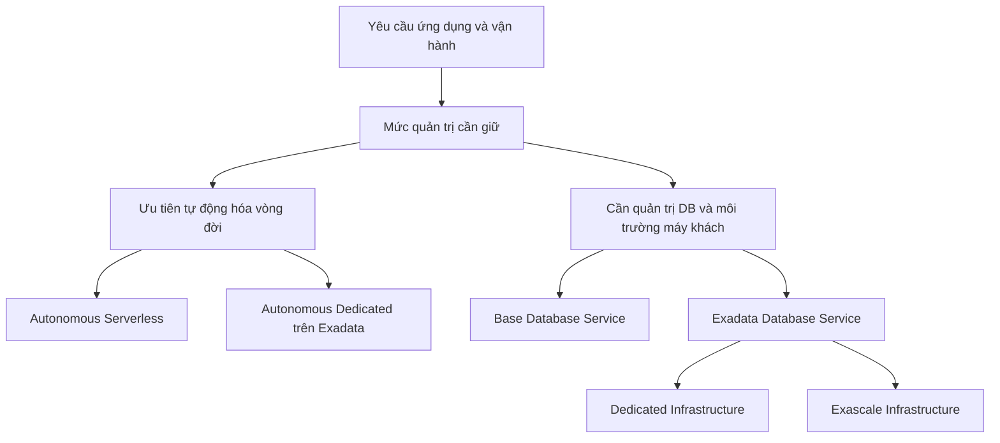

# Lựa chọn Base Database, Autonomous Database và Exadata

## Mục tiêu và bối cảnh

Trong chương **Oracle Database trên OCI**, lựa chọn dịch vụ cơ sở dữ liệu quyết định nhiều hơn số CPU hoặc dung lượng lưu trữ. Nó xác định ai chịu trách nhiệm vá lỗi, mức truy cập quản trị, cách kết nối từ VCN, phương án phục hồi và những thành phần tạo ra chi phí lâu dài.

Bài học đặt ba hướng lựa chọn trong phạm vi Oracle Cloud Infrastructure (OCI): **Base Database Service**, **Autonomous Database** và **Exadata Database Service**. Người học sẽ xây dựng hồ sơ yêu cầu, sàng lọc phương án, kiểm chứng bằng thử nghiệm và ghi lại quyết định có thể vận hành cùng IAM, mạng, Compute, giám sát và tự động hóa.

Tài liệu Oracle hiện dùng tên **Autonomous AI Database** cho dòng Autonomous Database. Bài này dùng “Autonomous” khi nói về mô hình dịch vụ đó; việc lựa chọn vẫn bắt đầu từ yêu cầu dữ liệu và vận hành của ứng dụng. Danh mục dịch vụ Oracle Database trên OCI có thể được tra cứu tại [Oracle: Database Services](https://docs.oracle.com/en-us/iaas/Content/Database/home.htm).

Các thông tin về tên dịch vụ và biến thể trong bài được đối chiếu ngày **20/11/2026**. Khi lập phương án triển khai mới, cần kiểm tra lại region, phiên bản, edition, shape và điều kiện thương mại mà tenancy thực tế có thể sử dụng.

## 1. Phân biệt mô hình vận hành và hạ tầng

Ba tên trong đề bài không nằm hoàn toàn trên cùng một trục so sánh:

- **Base Database Service:** cung cấp DB system trên VM để vận hành Oracle Database với quyền kiểm soát quản trị tương đối lớn.
- **Autonomous Database:** tập trung vào tự động hóa vòng đời cơ sở dữ liệu và giảm công việc quản trị nền tảng.
- **Exadata Database Service:** cung cấp Oracle Database trên hạ tầng Exadata với các biến thể triển khai khác nhau.

Autonomous có thể chạy trên Exadata. Vì vậy, “Autonomous hay Exadata” cần được làm rõ thành “mức tự động hóa nào, trên mô hình hạ tầng nào”. Autonomous Serverless và Autonomous Dedicated là hai lựa chọn hạ tầng của dịch vụ Autonomous. [Oracle: Autonomous Database FAQs](https://www.oracle.com/database/technologies/datawarehouse-bigdata/adb-faqs.html).



Sơ đồ là cách tổ chức câu hỏi lựa chọn, không phải quy tắc loại trừ cứng. Một workload phải được đánh giá thêm về tính tương thích, khả năng phục hồi, tài nguyên và chi phí trước khi chốt dịch vụ.

### Một ví dụ dễ gây nhầm

Đội phát triển nói: “Cần database riêng, vậy phải mua Exadata riêng”.

Từ “riêng” có thể mang nhiều nghĩa: schema riêng, database riêng, tài nguyên tính toán riêng, VM cluster riêng hoặc phần cứng riêng. Trước khi chọn dịch vụ, hãy ghi rõ lớp cần cách ly và bằng chứng kiểm soát mà tổ chức yêu cầu. Mỗi cách hiểu dẫn tới một phương án và mức chi phí khác nhau.

Tương tự, “cần toàn quyền” phải được diễn giải thành các thao tác cụ thể: thay initialization parameter nào, truy cập hệ điều hành để làm gì, cài phần mềm nào, hay chỉ cần tạo user và quản lý schema. Một yêu cầu không rõ dễ làm đội dự án chọn mô hình phức tạp hơn mức cần thiết.

## 2. Base Database Service: giữ quyền kiểm soát vận hành

Base Database Service cung cấp DB system trên VM và công cụ quản lý qua Console, API, CLI cùng các công cụ database. Khách hàng vẫn cần thực hiện cập nhật hệ điều hành và database theo hướng dẫn dịch vụ. [Oracle: About Oracle Base Database Service](https://docs.oracle.com/en/cloud/paas/base-database/guide/about.html).

Đây là ứng viên cần khảo sát khi ứng dụng hiện hữu phụ thuộc quy trình DBA, cấu hình hoặc thành phần quản trị mà đội dự án muốn tiếp tục kiểm soát. Ví dụ, một hệ thống nghiệp vụ có bộ script bảo trì đã được chuẩn hóa, nhân sự trực vận hành và lịch cập nhật phối hợp với nhiều ứng dụng.

Việc dùng Base Database không có nghĩa đội dự án phải tự dựng mọi thành phần như khi cài Oracle Database trên một Compute VM thông thường. Hãy tận dụng automation do dịch vụ hỗ trợ, đồng thời phân công rõ ai chuẩn bị thay đổi, ai thực thi và ai xác nhận ứng dụng hoạt động sau thay đổi.

### Những câu hỏi cần trả lời

| Câu hỏi | Vì sao ảnh hưởng lựa chọn |
| --- | --- |
| Ứng dụng được chứng nhận với database version/edition nào? | Tránh chọn cấu hình mà nhà cung cấp ứng dụng không hỗ trợ |
| Có yêu cầu quản trị guest OS hoặc cài agent không? | Xác định nhu cầu kiểm soát ngoài schema |
| Đội DBA có chịu trách nhiệm vá và phục hồi không? | Kiểm tra năng lực vận hành thực tế |
| Quy trình backup/restore được kiểm chứng thế nào? | Đưa yêu cầu phục hồi vào thiết kế ban đầu |
| Có cần cấu hình HA bổ sung không? | Không suy ra HA chỉ từ tên dịch vụ |

### Lưu ý cho phương án tạo mới năm 2026

Oracle thông báo retirement đối với `VM.Standard.x86`, edition `Enterprise Edition - Extreme Performance` và các SKU tính theo OCPU của Base Database, có hiệu lực từ **31/07/2026**. Triển khai hiện hữu tiếp tục chạy, nhưng tạo mới và gia hạn chịu ảnh hưởng; tài liệu hướng tới `VM.BaseDB.x86` dùng ECPU hoặc ExaDB-XS tùy workload. [Oracle: thông báo trong hướng dẫn Base Database](https://docs.oracle.com/en/cloud/paas/base-database/guide/about.html).

Tài liệu cũng mô tả DB system single-node và multi-node RAC. Tuy nhiên, không nên lấy bảng shape/edition từ một bài hướng dẫn cũ làm căn cứ xác nhận khả năng tạo RAC mới. Với yêu cầu RAC, cần kiểm tra tổ hợp dịch vụ, edition và SKU đang được cung cấp tại thời điểm thiết kế.

Tách hai công việc: **kiểm kê hệ thống đang chạy** và **chọn cấu hình được phép tạo mới**. Một lựa chọn đang tồn tại trong tenancy chưa chắc còn là phương án có thể nhân rộng cho dự án mới.

## 3. Autonomous Database: ưu tiên tự động hóa vòng đời

Autonomous tự động hóa các công việc như provisioning, backup, patching và quản lý tài nguyên của database. Với Serverless, người dùng không phải dựng hay quản lý hạ tầng máy chủ bên dưới. [Oracle: What is Oracle Autonomous AI Database?](https://docs.oracle.com/en-us/iaas/autonomous-database-serverless/doc/autonomous-intro-adb.html).

Hướng này đáng đưa vào danh sách thử nghiệm khi đội ứng dụng muốn tập trung vào schema, SQL, dữ liệu và phát triển tính năng, đồng thời chấp nhận các giới hạn quản trị của dịch vụ.

### Serverless và Dedicated

| Biến thể Autonomous | Cách sử dụng phù hợp để khảo sát |
| --- | --- |
| Serverless | Bắt đầu ở mức database, giảm việc hoạch định hạ tầng riêng |
| Dedicated Exadata Infrastructure | Cần cách ly hạ tầng và điều khiển chính sách vận hành ở phạm vi lớn hơn |

Serverless dùng tài nguyên hạ tầng Exadata do Oracle quản lý theo mô hình chia sẻ. Dedicated cung cấp hạ tầng riêng cho tenant và thêm khả năng kiểm soát chính sách, lịch bảo trì và tổ chức workload. Dedicated vẫn là mô hình Autonomous. [Oracle: khác biệt Autonomous Serverless và Dedicated](https://www.oracle.com/database/technologies/datawarehouse-bigdata/adb-faqs.html).

“Serverless” không có nghĩa không có máy chủ, không có giới hạn hay không có hóa đơn. Người thiết kế vẫn phải xác định mức tài nguyên, lưu trữ, chính sách scale và cách theo dõi tiêu thụ phù hợp với workload.

### Tự động hóa không loại bỏ trách nhiệm ứng dụng

Trong mô hình trách nhiệm Autonomous, Oracle thực hiện các tác vụ nền tảng được dịch vụ quản lý; khách hàng vẫn chịu trách nhiệm về bảo mật ứng dụng, quyền truy cập dữ liệu và hiệu năng truy vấn của ứng dụng. [Oracle: Autonomous Database Responsibility Model](https://docs.oracle.com/en/cloud/paas/autonomous-database/shared-responsibility-model.html).

Những việc đội dự án vẫn phải làm gồm:

- Thiết kế schema, index và giao dịch phù hợp.
- Quản lý tài khoản ứng dụng, secret và quyền tối thiểu.
- Thiết kế pool kết nối, timeout và xử lý kết nối bị gián đoạn.
- Theo dõi thời gian đáp ứng nghiệp vụ và truy vấn chậm.
- Xác định nhu cầu phục hồi, lưu giữ dữ liệu và kiểm tra khôi phục.
- Đánh giá ảnh hưởng của thay đổi ứng dụng sau mỗi đợt phát hành.

Một câu SQL kém hiệu quả hoặc giao dịch giữ khóa quá lâu không tự trở thành thiết kế tốt chỉ vì dịch vụ có nhiều automation.

### Tương thích phải được kiểm chứng

Autonomous hỗ trợ phần lớn SQL/PLSQL thông dụng nhưng có giới hạn với một số câu lệnh và thao tác quản trị; chẳng hạn `ALTER SYSTEM` chỉ được sử dụng trong các trường hợp được tài liệu cho phép. [Oracle: SQL Commands on Autonomous Database](https://docs.oracle.com/en-us/iaas/autonomous-database-serverless/doc/autonomous-sql-commands.html).

Vì vậy, đừng dùng câu “cùng Oracle Database nên chuyển nguyên trạng được” làm bằng chứng tương thích. Hãy kiểm kê các script có quyền cao, truy cập file hệ điều hành, integration, database link và tác vụ theo lịch, rồi thử những luồng quan trọng trên biến thể đích.

Dedicated không tự giải quyết mọi giới hạn quản trị của Autonomous. Nếu yêu cầu cốt lõi là can thiệp sâu guest OS hoặc giữ nguyên quy trình DBA không được Autonomous hỗ trợ, cần xem xét mô hình dịch vụ khác hoặc sửa thiết kế ứng dụng.

## 4. Exadata Database Service: chọn cả biến thể hạ tầng

Exadata là nền tảng được thiết kế cho Oracle Database. Khi đánh giá Exadata Database Service, cần ghi rõ mô hình triển khai thay vì dùng một tên “Exadata” cho mọi cấu hình.

### Dedicated Infrastructure

Ở mô hình Exadata Database Service on Dedicated Infrastructure, Oracle quản lý hạ tầng vật lý và các lớp nền tảng; khách hàng chịu trách nhiệm bảo trì guest VM OS, Grid Infrastructure và phần mềm database, với sự hỗ trợ của cloud automation. [Oracle: Exadata Dedicated roles and responsibilities](https://docs.oracle.com/en/engineered-systems/exadata-cloud-service/ecscm/exa-service-desc.html).

Đây là ứng viên khảo sát cho danh mục database cần quyền quản trị, consolidation và năng lực Exadata, đồng thời có tổ chức vận hành đủ sức quản lý các lớp còn thuộc trách nhiệm khách hàng.

Nếu cần cách ly phần cứng, hãy kiểm tra đúng lớp tài nguyên dedicated trong thiết kế. Nếu chỉ cần tách database hoặc tách nhóm vận hành, không nên mặc định phần cứng dedicated là điều kiện bắt buộc.

### Exascale Infrastructure — ExaDB-XS

ExaDB-XS cung cấp trải nghiệm VM cluster trên hạ tầng Exadata được Oracle quản lý theo mô hình chia sẻ đa tenant. Người dùng có thể bắt đầu với cấu hình VM/storage nhỏ hơn rồi mở rộng; mô hình này khác với việc dành riêng toàn bộ hạ tầng Dedicated. [Oracle: Exadata Database Service on Exascale Infrastructure](https://docs.oracle.com/en/engineered-systems/exadata-database-exascale/index.html).

Exascale vì vậy là phương án cần đưa vào so sánh khi muốn dùng Exadata nhưng chưa có căn cứ dành riêng một hạ tầng lớn. Nó không tự chuyển workload sang mô hình Autonomous; đội dự án vẫn cần xác định đầy đủ trách nhiệm quản trị theo dịch vụ.

Hãy kiểm tra phiên bản database, edition, dung lượng, khả năng mở rộng và tính năng HA trên đúng biến thể. Không sao chép toàn bộ sơ đồ tài nguyên của Exadata Dedicated sang Exascale.

### Cloud@Customer

Danh mục Oracle còn có Exadata Database Service on Cloud@Customer và Autonomous trên Exadata Cloud@Customer. Các dịch vụ này đưa hạ tầng vào trung tâm dữ liệu khách hàng với mô hình dịch vụ cloud tương ứng. [Oracle: danh mục Database Services](https://docs.oracle.com/en-us/iaas/Content/Database/home.htm), [Oracle: Autonomous infrastructure options](https://www.oracle.com/database/technologies/datawarehouse-bigdata/adb-faqs.html).

Nếu yêu cầu là đặt phần cứng tại cơ sở của tổ chức, hãy mở nhánh khảo sát Cloud@Customer cùng yêu cầu mặt bằng, kết nối và vận hành. Điều đó khác với việc đặt database trong một private subnet của OCI public region.

## 5. Ma trận sàng lọc theo yêu cầu

Bảng dưới đây đề xuất câu hỏi ưu tiên cho từng hướng khảo sát. Nó không phải bảng xếp hạng hiệu năng hoặc giá thành:

| Hướng khảo sát | Câu hỏi cần chứng minh trước |
| --- | --- |
| Base Database Service | Có giữ được yêu cầu tương thích và quyền quản trị trên cấu hình tạo mới đang hỗ trợ không? |
| Autonomous Serverless | Ứng dụng có tương thích và đội dự án có chấp nhận mô hình quản trị dịch vụ không? |
| Autonomous Dedicated | Ngoài automation, có căn cứ cần cách ly hạ tầng và chính sách vận hành riêng không? |
| Exadata Dedicated | Workload và nhu cầu consolidation có chứng minh được giá trị của hạ tầng dành riêng không? |
| Exadata Exascale | Mô hình tài nguyên chia sẻ và các giới hạn của biến thể có đáp ứng được yêu cầu không? |

Nên sàng lọc theo thứ tự:

1. **Điều kiện bắt buộc:** vị trí dữ liệu, chứng nhận ứng dụng, tính năng cần thiết và yêu cầu truy cập.
2. **Mục tiêu dịch vụ:** độ trễ, lưu lượng, tăng trưởng, RPO và RTO.
3. **Mô hình vận hành:** trách nhiệm DBA, bảo trì, trực sự cố và tự động hóa.
4. **Bằng chứng kiểm thử:** tương thích, tải, phục hồi và kết nối.
5. **Tổng chi phí:** toàn bộ phương án có cùng mức bảo vệ và phục vụ.

Một phương án không đạt điều kiện bắt buộc phải được loại hoặc có kế hoạch thay đổi yêu cầu được chấp thuận. Không dùng điểm chi phí thấp để bù cho tính năng mà ứng dụng không thể thiếu.

Nếu nhiều phương án cùng đạt các điều kiện bắt buộc, có thể chấm điểm tiêu chí mềm như công sức vận hành, khả năng mở rộng và mức độ chuẩn hóa. Trọng số cần phản ánh ưu tiên của tổ chức, không phải ưu tiên của người trình bày sản phẩm.

## 6. Thiết kế IAM, mạng và kết nối ngay khi lựa chọn

Dịch vụ database phù hợp vẫn có thể triển khai thất bại nếu đội dự án chưa xác định đường kết nối từ ứng dụng và cách cấp quyền cho các vai trò.

Nên phân biệt ba lớp:

| Lớp kiểm soát | Câu hỏi phải trả lời |
| --- | --- |
| OCI IAM | Ai được tạo, thay đổi, xem hoặc xóa tài nguyên cloud trong compartment? |
| Mạng | Máy hoặc dịch vụ nào có đường tới database endpoint? |
| Database | Tài khoản ứng dụng được đăng nhập và thao tác trên đối tượng nào? |

Quyền quản lý tài nguyên OCI không tự thay thế quyền dữ liệu bên trong database. Ngược lại, tài khoản được đọc một schema không mặc nhiên có quyền thay đổi hạ tầng cloud.

Đề xuất phân vai gồm nhóm quản lý hạ tầng, nhóm DBA hoặc quản trị dữ liệu và nhóm vận hành ứng dụng. Dùng compartment, policy và tài khoản database để thể hiện ranh giới đó; hạn chế dùng một tài khoản quản trị chung cho mọi tác vụ.

### Đường kết nối cần được vẽ cụ thể

```text
Ứng dụng trên Compute hoặc nền tảng chạy ứng dụng
    → DNS và tuyến mạng được phép
    → Database endpoint
    → Kết nối được mã hóa và xác thực
    → Database service / schema của ứng dụng
```

Với Autonomous, có thể cấu hình private endpoint trong VCN. Các lựa chọn về NSG, DNS và TLS/mTLS phải khớp với cách ứng dụng kết nối; cần đọc đúng connection string được dịch vụ cung cấp. [Oracle: Configure Network Access with Private Endpoints](https://docs.oracle.com/en-us/iaas/autonomous-database-serverless/doc/private-endpoints-autonomous.html).

Không mặc định mọi cấu hình private endpoint đều không thể có đường public: dịch vụ có các tùy chọn mạng riêng cần được rà soát tại lúc triển khai. Hồ sơ kiến trúc nên ghi rõ **chỉ private** hay có thêm public access được kiểm soát, cùng các nguồn được phép.

Với Base Database hoặc Exadata, xác nhận subnet, NSG, DNS, tên service và địa chỉ kết nối do cấu hình thực tế cung cấp. Đối với RAC hoặc cơ chế failover, không tự thay connection string được khuyến nghị bằng một IP của một node chỉ để thử kết nối nhanh.

Các kiểm tra trước khi chốt phương án:

- Ứng dụng trong VCN nào, database trong mạng nào?
- On-premises có cần truy cập không và qua kết nối nào?
- DNS có phân giải được từ đúng nơi ứng dụng chạy?
- Driver và phương thức xác thực có được môi trường ứng dụng hỗ trợ?
- Secret, chứng chỉ hoặc wallet sẽ được lưu và luân chuyển ra sao?
- Pool kết nối có phục hồi đúng sau bảo trì hoặc chuyển vai database?

Một lần đăng nhập thành công bằng công cụ quản trị chỉ chứng minh một đường kết nối. Cần thử từ môi trường chạy ứng dụng với chính tài khoản và driver dự định dùng.

## 7. Chọn HA/DR theo RPO và RTO

Hai mục tiêu cần được ghi thành yêu cầu:

- **RPO — Recovery Point Objective:** giới hạn mất dữ liệu chấp nhận được, thường diễn đạt theo khoảng thời gian dữ liệu.
- **RTO — Recovery Time Objective:** khoảng thời gian mục tiêu để khôi phục khả năng phục vụ sau gián đoạn.

Ví dụ “RPO không quá 5 phút, RTO không quá 30 phút” là yêu cầu giả định của một ứng dụng. Nó chưa khẳng định bất kỳ cấu hình dịch vụ nào tự đáp ứng được hai con số đó.

### Phân biệt các lớp bảo vệ

| Lớp bảo vệ | Mục tiêu cần đánh giá |
| --- | --- |
| Khả năng chịu lỗi cục bộ | Tiếp tục phục vụ khi một thành phần bị lỗi |
| Standby / chuyển vai | Khôi phục vai trò phục vụ khi primary không còn dùng được |
| Backup và khôi phục theo thời điểm | Tìm lại dữ liệu trước thao tác sai hoặc sự cố |
| Phương án khác region | Giảm phụ thuộc vào một vùng triển khai |
| Ứng dụng phục hồi kết nối | Đưa người dùng trở lại luồng nghiệp vụ |

RAC, standby và backup giải quyết các phạm vi khác nhau. Dù có nhiều instance phục vụ một database, vẫn cần phương án cho sự cố dữ liệu và sự cố vượt phạm vi cụm. Bản sao cập nhật liên tục cũng không thay thế mọi nhu cầu tìm lại dữ liệu trước một thay đổi sai.

Base Database hỗ trợ cấu hình Data Guard theo điều kiện dịch vụ: primary và standby duy trì dữ liệu bằng cơ chế truyền và apply redo. Việc chọn edition và topology phải đáp ứng yêu cầu được tài liệu quy định. [Oracle: About Oracle Data Guard on Base Database](https://docs.oracle.com/en/cloud/paas/base-database/guide/dg-about.html).

Autonomous Serverless cung cấp các lựa chọn phục hồi, gồm Autonomous Data Guard với standby local hoặc cross-region theo cấu hình. Cần lựa chọn phương án phù hợp RPO/RTO thay vì suy ra mọi instance có cùng mức bảo vệ. [Oracle: About Standby Databases](https://docs.oracle.com/en-us/iaas/autonomous-database-serverless/doc/autonomous-data-guard-about.html).

Với Exadata, hãy đưa phạm vi lỗi của hạ tầng, VM cluster và database vào thiết kế HA/DR cụ thể. Tên Exadata không tự xác nhận đã có một standby khác region hoặc đã thử khôi phục dữ liệu.

### Bằng chứng phục hồi cần bao gồm ứng dụng

Một cuộc diễn tập nên đo ít nhất:

1. Thời điểm bắt đầu gián đoạn hoặc phát lệnh chuyển vai.
2. Thời điểm database đích sẵn sàng kết nối.
3. Thời điểm ứng dụng phục hồi giao dịch thành công.
4. Các giao dịch đã commit được đối soát ở đích.
5. Những yêu cầu đang chạy dở, cần thử lại hoặc cần xử lý thủ công.
6. Tổng thời gian và chi phí tài nguyên bổ sung.

Nếu database phục hồi sau vài phút nhưng ứng dụng tiếp tục dùng kết nối hỏng trong thời gian dài, hệ thống chưa đạt RTO người dùng yêu cầu. Đội database và đội ứng dụng cần cùng xác nhận tiêu chí thành công.

## 8. So sánh tổng chi phí của cùng một mức dịch vụ

Một phương án chỉ có primary không thể được so sánh công bằng với phương án có standby, bản sao khác region và lịch thử phục hồi nếu chỉ nhìn dòng giá CPU.

Khung dự toán đề xuất:

```text
Tổng chi phí của phương án
    = compute / tài nguyên database
    + hạ tầng riêng hoặc tài nguyên nền tương ứng
    + lưu trữ dữ liệu và vùng phục hồi
    + backup và lưu giữ
    + standby / bản sao ở nơi khác
    + mạng và các dịch vụ bổ trợ
    + công sức vận hành, diễn tập và xử lý thay đổi
```

Danh mục SKU thực tế khác nhau giữa dịch vụ. Oracle công bố các dòng tính phí cho Base Database, Autonomous, Exadata Dedicated và Exascale; cần lập bảng theo đúng biến thể, metric và mô hình license. [Oracle: Base Database Pricing](https://www.oracle.com/database/base-database-service/pricing/), [Oracle: Autonomous Database Pricing](https://www.oracle.com/autonomous-database/pricing/), [Oracle: Cloud Price List](https://www.oracle.com/cloud/price-list/).

Bài này không ấn định một đơn giá hoặc bảng xếp hạng “rẻ nhất”. Dự toán phải ghi region, tiền tệ, ngày tra cứu, hợp đồng và giả định workload đi kèm.

### ECPU, OCPU và tài nguyên không phải benchmark

Khi gặp các tài liệu dùng ECPU hoặc OCPU, hãy xác nhận metric đúng của SKU đang chọn. Không lấy cùng một con số CPU giữa hai mô hình làm bằng chứng rằng hiệu năng, giới hạn kết nối hoặc chi phí sẽ tương đương.

Ví dụ tính số lượng tài nguyên tiêu thụ, với số liệu hoàn toàn giả định:

```text
Trong một ngày:
8 đơn vị compute × 6 giờ = 48 đơn vị-giờ
2 đơn vị compute × 18 giờ = 36 đơn vị-giờ
Tổng = 84 đơn vị-giờ
```

Phép tính chưa bao gồm storage, backup, standby hoặc hạ tầng nền. Khi mô hình có khả năng scale, dự toán nên có kịch bản tải nền, tải đỉnh và khoảng thời gian scale tăng kéo dài do một truy vấn hoặc một lỗi ứng dụng.

### License included và BYOL

Nếu dịch vụ có lựa chọn license included và Bring Your Own License (BYOL), hãy xác minh quyền sử dụng, edition, options, metric quy đổi và hợp đồng support với bộ phận quản lý license. Một tên tùy chọn xuất hiện trên Console không chứng minh tổ chức đã có quyền BYOL tương ứng.

Với Base Database, Oracle nêu yêu cầu support đối với license mang lên dịch vụ. Với ExaDB-XS, tài liệu mô tả cả mô hình license included và sử dụng license hiện có theo điều kiện của dịch vụ. [Oracle: Base Database support requirements](https://docs.oracle.com/en/cloud/paas/base-database/guide/about.html), [Oracle: ExaDB-XS licensing considerations](https://docs.oracle.com/en-us/iaas/exadb-xs/doc/overview-exadb-xs-service.html).

### Chi phí của thử nghiệm ngắn

Không suy ra “chỉ tạo vài phút” đồng nghĩa chỉ trả vài phút cho mọi thành phần. Ví dụ, tài liệu ExaDB-XS nêu thời gian tính phí hạ tầng tối thiểu **48 giờ** cho mỗi VM được provision. [Oracle: ExaDB-XS metering and billing](https://docs.oracle.com/en/engineered-systems/exadata-database-exascale/exdxs/overview-exadb-xs-service.html).

Vì vậy, bắt đầu bằng hồ sơ yêu cầu và dự toán. Chỉ tạo tài nguyên cho PoC khi đã xác định phạm vi, ngân sách, người phụ trách và lịch kết thúc. Sau thử nghiệm, đối soát cả tài nguyên còn tồn tại lẫn các thành phần vẫn được tính phí theo mô hình đã chọn.

## 9. Áp dụng vào ba tình huống lựa chọn

Các tình huống dưới đây là giả định để minh họa lập luận, không phải kết quả benchmark hoặc khuyến nghị cho một hệ thống chưa được khảo sát.

### Ứng dụng mới, đội nhỏ, không cần guest OS

Một nhóm xây ứng dụng giao dịch với SQL/PLSQL thông dụng, không cần cài agent trên máy database và muốn giảm công việc vá nền tảng.

**Ứng viên thử trước:** Autonomous Serverless, với điều kiện kiểm chứng tương thích và chất lượng phục vụ.

Bằng chứng cần có gồm đường kết nối từ ứng dụng, quyền schema, latency ở mức đồng thời dự kiến, khả năng nhập/xuất dữ liệu và phương án phục hồi. Nếu các integration cần thao tác không được dịch vụ hỗ trợ, nhóm phải so sánh chi phí sửa ứng dụng với lựa chọn dịch vụ khác.

Không chọn Autonomous chỉ vì “không có DBA”. Vẫn cần một người hoặc một nhóm chịu trách nhiệm dữ liệu, SQL, phân quyền và kiểm tra phục hồi.

### Hệ thống hiện hữu phụ thuộc quy trình DBA

Một ứng dụng cũ có script bảo trì, quy trình quản trị guest OS và yêu cầu chứng nhận phiên bản cụ thể từ nhà cung cấp.

**Ứng viên khảo sát:** Base Database trên cấu hình hiện được hỗ trợ; bổ sung Exadata nếu yêu cầu tính năng, RAC, năng lực hoặc consolidation dẫn tới hướng đó.

Autonomous chỉ tiếp tục nằm trong danh sách nếu đội dự án có bằng chứng các phụ thuộc có thể chuyển đổi hoặc thay thế. Kết quả “import schema thành công” chưa đủ để chứng minh các tác vụ vận hành hàng đêm hoạt động đúng.

Hồ sơ cần ghi những thao tác quản trị thật sự bắt buộc, tránh giữ một yêu cầu “toàn quyền” chỉ vì đó là cách hệ thống cũ từng được xây dựng.

### Danh mục nhiều database và yêu cầu cách ly

Một tổ chức muốn gom nhiều database, có đội DBA, yêu cầu vận hành được chuẩn hóa và cần kiểm soát mức cách ly giữa các nhóm workload.

**Ứng viên khảo sát:** Exadata Dedicated hoặc Exascale tùy yêu cầu cách ly hạ tầng, khả năng cung cấp tài nguyên và số liệu tải. Nếu tổ chức muốn mô hình Autonomous cùng hạ tầng riêng, khảo sát Autonomous Dedicated.

Cần đo mức cạnh tranh tài nguyên khi nhiều database cùng chạy, khả năng phục hồi, ảnh hưởng bảo trì và cách phân bổ chi phí cho từng nhóm. Tổng dung lượng lớn là một dữ kiện; nó chưa tự chứng minh Dedicated là lựa chọn duy nhất.

## 10. Thực hành kiểm kê và lập hồ sơ lựa chọn

### Thu thập thông tin mà chưa tạo tài nguyên mới

Nếu đã có quyền đọc trong tenancy lab, có thể dùng PowerShell và OCI CLI để kiểm kê hai nhóm tài nguyên:

```powershell
$region = 'ap-singapore-1'
$compartmentId = 'ocid1.compartment.oc1..REPLACE_ME'

& oci db system list `
    --region $region `
    --compartment-id $compartmentId `
    --all `
    --output json

& oci db autonomous-database list `
    --region $region `
    --compartment-id $compartmentId `
    --all `
    --output json
```

Đây là các lệnh list, không tạo database. Tham số và phạm vi kết quả được mô tả trong [Oracle CLI: db system list](https://docs.oracle.com/en-us/iaas/tools/oci-cli/latest/oci_cli_docs/cmdref/db/system/list.html) và [Oracle CLI: autonomous-database list](https://docs.oracle.com/en-us/iaas/tools/oci-cli/latest/oci_cli_docs/cmdref/db/autonomous-database/list.html).

Hai lệnh này không phải công cụ kiểm kê đầy đủ mọi hạ tầng Exadata. Với Exadata, xem thêm loại tài nguyên Infrastructure, VM Cluster hoặc Exascale Storage Vault tương ứng trong Console. Không kết luận “dịch vụ không được hỗ trợ” chỉ vì một truy vấn ở một compartment/region trả danh sách rỗng.

Ghi nhận loại dịch vụ, region, cấu hình, mô hình license và các tài nguyên liên quan. Không đưa secret, password hoặc wallet vào hồ sơ lựa chọn chung.

### Lập bảng yêu cầu trước PoC

| Nhóm | Thông tin cần thu thập |
| --- | --- |
| Nghiệp vụ | Giao dịch quan trọng, giờ cao điểm, khoảng gián đoạn chấp nhận được |
| Dữ liệu | Dung lượng, tăng trưởng, thời gian lưu và mức nhạy cảm |
| Tương thích | Version, edition, options, SQL/PLSQL và integration |
| Quản trị | Guest OS, script, agent, quyền cao và quy trình cập nhật |
| Chất lượng phục vụ | Throughput, p95/p99 latency, mức đồng thời và tỷ lệ lỗi |
| Phục hồi | RPO, RTO, phạm vi sự cố và yêu cầu khác region |
| Mạng và bảo mật | VCN, nguồn kết nối, DNS, TLS, IAM và quyền dữ liệu |
| Vận hành và chi phí | Nhân sự, công cụ, ngân sách, license và dự toán tăng trưởng |

Phân loại mỗi dòng thành **bắt buộc**, **ưu tiên** hoặc **chưa biết**. Mục “chưa biết” cần có người phụ trách và kế hoạch tìm bằng chứng; không tự chuyển thành giả định thuận lợi.

### Thử tương thích trên schema đã di chuyển

Sau khi import dữ liệu mẫu vào môi trường được phép thử, có thể kiểm tra đối tượng của chính schema:

```sql
SELECT object_type, status, COUNT(*) AS object_count
FROM user_objects
GROUP BY object_type, status
ORDER BY object_type, status;

SELECT name, type, line, position, text
FROM user_errors
ORDER BY name, sequence;
```

Các truy vấn hỗ trợ phát hiện đối tượng invalid và lỗi biên dịch trong schema; không chứng minh toàn bộ ứng dụng tương thích. Tiếp tục chạy transaction, batch, lịch xử lý và integration quan trọng bằng tài khoản ứng dụng thật của môi trường thử.

Đừng cấp quyền quản trị rộng chỉ để làm biến mất một lỗi quyền. Xác định yêu cầu của thao tác và cách cấp quyền được dịch vụ đích hỗ trợ.

### Đo PoC bằng cùng một hồ sơ workload

Chuẩn hóa dữ liệu, phân bố truy vấn, mức đồng thời và tiêu chí thành công. Phân biệt giai đoạn làm nóng cache với giai đoạn đo ổn định, đồng thời ghi cấu hình tài nguyên thực tế và các sự kiện scale.

Bộ bằng chứng tối thiểu nên gồm:

1. Các luồng nghiệp vụ quan trọng chạy đúng và đối soát dữ liệu.
2. Throughput, latency và lỗi ở tải nền lẫn tải đỉnh.
3. Pool kết nối phục hồi sau một sự kiện bảo trì hoặc gián đoạn được phép thử.
4. Khả năng restore/chuyển vai được đo theo RPO/RTO đề ra.
5. Công việc vận hành còn thuộc đội dự án có người nhận trách nhiệm.
6. Dự toán được cập nhật từ tiêu thụ thực tế và các tài nguyên bảo vệ bổ sung.

Một ứng viên chỉ nhanh hơn ở một câu SELECT nhỏ chưa đủ để thắng một phương án khác. Mục tiêu là chọn cấu hình đáp ứng toàn bộ hồ sơ yêu cầu với chi phí và khả năng vận hành chấp nhận được.

## 11. Ghi lại quyết định và điều kiện xem xét lại

Có thể dùng mẫu Architecture Decision Record sau trong hồ sơ thiết kế. Nội dung là ví dụ cho ứng dụng mới ở tình huống trên:

```text
Quyết định: Đưa Autonomous Serverless vào PoC đầu tiên

Bối cảnh:
- Ứng dụng mới, không yêu cầu guest OS.
- Đội vận hành muốn giảm công việc vá nền tảng.
- Yêu cầu mạng: kết nối private từ môi trường ứng dụng.

Điều kiện để chấp nhận triển khai:
- Các luồng SQL/PLSQL và integration bắt buộc đạt kiểm thử.
- Tải và phục hồi đạt mục tiêu đã thống nhất.
- Phương án quyền dữ liệu và kết nối được xác nhận.
- Dự toán gồm backup/DR và kịch bản scale.

Phương án dự phòng:
- Khảo sát Base Database nếu phát hiện yêu cầu quản trị bắt buộc
  không thể đáp ứng hoặc thay thế trên Autonomous.
- Khảo sát Exadata nếu yêu cầu tính năng, cách ly hoặc năng lực
  được chứng minh bằng hồ sơ workload.

Điều kiện xem xét lại:
- Thay đổi yêu cầu chứng nhận ứng dụng.
- Xuất hiện phụ thuộc guest OS hoặc tính năng không hỗ trợ.
- Tăng trưởng làm thay đổi hiệu năng, HA/DR hoặc ngân sách.
- Thay đổi dịch vụ/SKU ở region triển khai.
```

Tên dịch vụ mới chỉ là một phần của quyết định. Hồ sơ đầy đủ phải nêu biến thể, mô hình quản trị, cấu hình mạng, cách bảo vệ dữ liệu, người chịu trách nhiệm và bằng chứng kiểm thử.

Khi giải thích lựa chọn, hãy nối từng đặc điểm với một yêu cầu cụ thể: cần quyền nào, đã đo được điều gì, đội nào vận hành và chi phí nào đã tính. Cách lập luận đó giúp lựa chọn Base Database, Autonomous hoặc Exadata trở thành quyết định kiến trúc có thể triển khai và kiểm chứng.
