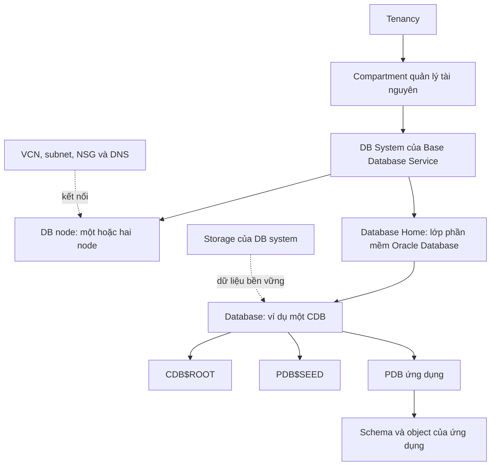
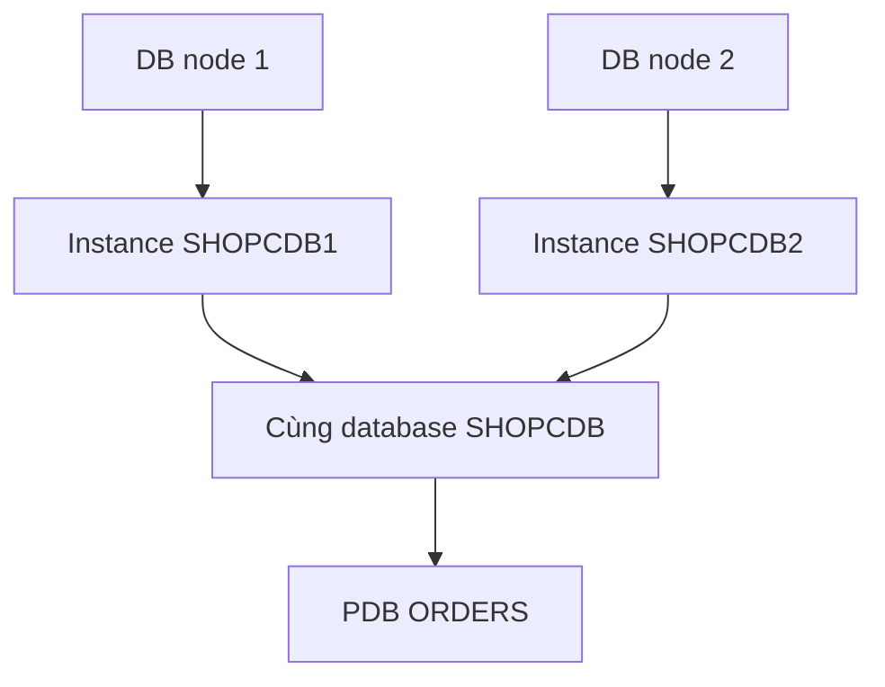

# Kiến trúc DB System, database home và database

Trong chương **Oracle Database trên OCI**, ba tên tài nguyên thường xuất hiện cùng nhau là **DB System**, **Database Home** và **Database**. Hiểu đúng quan hệ giữa chúng giúp chọn đúng nơi cấu hình tài nguyên, xác định phạm vi cập nhật phần mềm và tìm đúng database mà ứng dụng cần kết nối.

Bài học dùng **Oracle Base Database Service trên máy ảo** làm mô hình chính. Những tài nguyên này nằm trong bối cảnh hạ tầng OCI có tenancy, compartment, IAM, VCN và lưu trữ. Khi chuyển sang Exadata, cần đọc mô hình tài nguyên của dịch vụ tương ứng; không áp nguyên sơ đồ Base Database cho mọi sản phẩm mang tên Oracle Database.

Sau bài học, bạn có thể:

- Giải thích trách nhiệm của DB System, Database Home và Database.
- Phân biệt DB node, database instance, CDB, PDB, schema và service kết nối.
- Theo dõi quan hệ giữa tài nguyên qua OCI Console hoặc CLI.
- Đối chiếu metadata OCI với trạng thái thực tế qua các truy vấn SQL chỉ đọc.
- Nhận diện tác động của thay đổi hạ tầng, cập nhật phần mềm, sao lưu và quyền truy cập.

## Sơ đồ tài nguyên của Base Database Service

Base Database Service có DB system một node và DB system RAC hai node. Theo mô hình được Oracle mô tả, một DB system có **một Database Home**, trong đó có **một database**; database có thể chứa nhiều PDB tùy phiên bản, edition và điều kiện áp dụng. [Oracle: About DB Systems](https://docs.oracle.com/en/cloud/paas/base-database/guide/dbs-about.html).

Sơ đồ sau thể hiện các lớp cần kiểm kê, không phải cây thư mục của hệ điều hành:



Ví dụ kiến trúc cho ứng dụng đơn hàng:

```text
Compartment:       DataDev
DB System:         shop-dev-db-system
Database Home:     lớp phần mềm của SHOPCDB
Database/CDB:      SHOPCDB
PDB ứng dụng:      ORDERS
Schema ứng dụng:   APP_ORDERS
Application service: orders_app.<db-domain>
```

Các tên trên là giá trị minh họa. Không suy ra tên PDB, service hoặc đường dẫn cài đặt chỉ từ display name của DB System.

## DB System: phạm vi hạ tầng chạy cơ sở dữ liệu

DB System là tài nguyên OCI bao quanh môi trường vận hành database trong Base Database Service. Khi kiểm tra lớp này, bạn quan tâm tới vị trí triển khai, node, tài nguyên tính toán, lưu trữ và kết nối mạng.

| Nhóm thông tin | Câu hỏi cần trả lời |
| --- | --- |
| Định danh | DB System OCID nào, thuộc compartment và region nào? |
| Compute | Shape và lượng tài nguyên được cấp là gì? |
| Node | Hệ thống có một node hay cấu hình RAC hai node? |
| Network | Gắn subnet nào, dùng NSG nào, DNS được phân giải ra sao? |
| Storage | Dung lượng đã cấp và nhu cầu tăng trưởng là bao nhiêu? |
| Vận hành | Trạng thái hiện tại, lịch sử thao tác và cập nhật hạ tầng thế nào? |

DB System không chỉ là tên khác của một bảng dữ liệu hoặc một schema. Ví dụ, tăng sức chứa tính toán là quyết định ở lớp hạ tầng; việc thêm một bảng `ORDERS` lại là thao tác bên trong database.

Khi tạo DB system, OCI cấp môi trường hỗ trợ Oracle Database và tạo database theo cấu hình cung cấp. Các tùy chọn mặc định của quy trình tạo có thể bao gồm tạo CDB và một Database Home mới. [Oracle: Overview of Creating a DB System](https://docs.oracle.com/en/cloud/paas/base-database/guide/dbs-create.html).

Hệ quả thực hành: một thao tác tạo trên Console có thể tạo nhiều thành phần liên quan. Việc chúng được tạo trong cùng một quy trình không làm mất ranh giới định danh và trách nhiệm của từng lớp.

### DB node là nơi chạy tiến trình

DB node biểu diễn node của hệ thống cơ sở dữ liệu. Nó là nơi có hệ điều hành, địa chỉ mạng và các tiến trình Oracle cần thiết. OCI cung cấp API/CLI riêng để liệt kê node theo DB System; với dịch vụ khác, tham số định vị có thể là VM cluster. [Oracle CLI: db node list](https://docs.oracle.com/en-us/iaas/tools/oci-cli/latest/oci_cli_docs/cmdref/db/node/list.html).

Không xem DB node như một Compute instance tùy ý rồi thay đổi hình dạng, volume hoặc mạng bằng quy trình dành cho VM ứng dụng. Các thay đổi của hệ thống database cần theo thao tác mà dịch vụ hỗ trợ để giữ nhất quán với automation quản lý.

## Database Home: lớp phần mềm Oracle Database

Database Home là nơi cài đặt phần mềm Oracle Database. Ở lớp OCI, DB Home là tài nguyên có định danh và metadata riêng; ở lớp hệ điều hành, Oracle home liên quan tới thư mục cài đặt phần mềm. [Oracle CLI: db db-home list](https://docs.oracle.com/en-us/iaas/tools/oci-cli/latest/oci_cli_docs/cmdref/db/db-home/list.html).

Các thông tin thường cần đối chiếu ở lớp này gồm:

- DB Home OCID và DB System liên quan.
- Phiên bản Oracle Database cùng mức cập nhật phần mềm.
- Trạng thái vận hành của DB Home.
- Vị trí cài đặt được hệ thống ghi nhận, nếu công cụ đang dùng cung cấp.

Ví dụ đường dẫn mang tính minh họa:

```text
/u01/app/oracle/product/<release>/dbhome_1
```

Đường dẫn đó không phải OCID. Cùng một chuỗi đường dẫn trên hai máy khác nhau cũng không đủ để xác nhận đó là cùng một tài nguyên cloud.

Cần phân biệt thêm:

| Tên | Ý nghĩa khi quản trị |
| --- | --- |
| DB Home OCID | Định danh tài nguyên Database Home trong OCI |
| Oracle home / `ORACLE_HOME` | Vị trí phần mềm hoặc môi trường phần mềm được chọn trên host |
| Database version | Phiên bản phần mềm cần đối chiếu với database đang chạy |
| Grid Infrastructure home | Lớp phần mềm hạ tầng Oracle có vòng cập nhật riêng khi được sử dụng |

Database Home không chứa khái niệm “toàn bộ dữ liệu nghiệp vụ” chỉ vì tên có chữ database. Sao chép thư mục phần mềm không phải là bản sao lưu đầy đủ của cơ sở dữ liệu.

Đối với automation, nên lấy thông tin home từ tài nguyên hoặc công cụ quản trị phù hợp. Không hard-code đường dẫn một home trong mọi script triển khai rồi giả định đường dẫn đó luôn đúng sau cập nhật hoặc thay môi trường.

## Database: tài nguyên cơ sở dữ liệu và dữ liệu bền vững

Trong OCI, Database là tài nguyên bạn dùng để xem thông tin cơ sở dữ liệu, DB Home liên quan và các cấu hình vận hành. Trong kiến trúc Oracle, database còn chỉ tập cấu trúc dữ liệu bền vững, gồm data files, control files và online redo logs. Các nhóm file có vai trò khác nhau trong lưu dữ liệu và phục hồi. [Oracle: Physical Storage Structures](https://docs.oracle.com/en/database/oracle/oracle-database/19/cncpt/physical-storage-structures.html).

| Thành phần | Vai trò khái quát |
| --- | --- |
| Data files | Lưu dữ liệu của database |
| Control files | Mô tả cấu trúc và thông tin trạng thái cần cho vận hành/phục hồi |
| Online redo logs | Ghi thay đổi phục vụ các cơ chế phục hồi |

Ví dụ suy luận: ứng dụng có thể báo lỗi vì một PDB chưa mở dù phần mềm trong DB Home vẫn tồn tại. Ngược lại, phần mềm database có vấn đề không đồng nghĩa mọi file dữ liệu đã biến mất. Khi xử lý sự cố, phải xác định lớp đang hỏng trước khi chọn cách khôi phục.

Không xác định nơi nằm của data file bằng cách ghép tên database vào đường dẫn `ORACLE_HOME`. Cách tổ chức lưu trữ phụ thuộc cấu hình dịch vụ và cơ chế quản lý storage; dữ liệu có thể được quản lý qua ASM hoặc lựa chọn lưu trữ được hỗ trợ khác.

## Database instance: phần đang chạy trong bộ nhớ

Một **database instance** gồm các cấu trúc bộ nhớ và tiến trình Oracle dùng để truy cập database. Single-instance có một instance gắn với database; RAC có nhiều instance truy cập cùng một database. Một instance gắn với một database tại một thời điểm. [Oracle: Oracle Database Instance](https://docs.oracle.com/en/database/oracle/oracle-database/19/cncpt/oracle-database-instance.html).

Sơ đồ runtime minh họa cho RAC:



Sơ đồ này không nói mỗi node có một bản database độc lập. Trong RAC, phải phân biệt việc có nhiều instance với việc có nhiều bản sao database phục vụ khôi phục thảm họa.

Ba câu hỏi khác nhau:

```text
Có bao nhiêu node?       -> kiểm kê hạ tầng
Có bao nhiêu instance?   -> kiểm kê runtime Oracle
Có bao nhiêu database?   -> kiểm kê tài nguyên/dữ liệu database
```

Ví dụ, một hệ thống hai node không tự suy ra có hai CDB hoặc hai bản sao dữ liệu nghiệp vụ độc lập. Việc truy vấn runtime còn phụ thuộc node và instance nào đang hoạt động tại thời điểm kiểm tra.

Đây là lý do câu “instance đã dừng” cần thêm ngữ cảnh. Nó có thể chỉ database instance, trong khi “node bị dừng” nói tới phạm vi hạ tầng rộng hơn.

## CDB, PDB và schema nằm ở đâu?

Trong kiến trúc multitenant, CDB có một root tên `CDB$ROOT`, seed `PDB$SEED` và các PDB ứng dụng. PDB là tập schema, object và cấu trúc liên quan được trình bày cho ứng dụng như một database riêng về mặt logic. [Oracle: Overview of the Multitenant Architecture](https://docs.oracle.com/en/database/oracle/oracle-database/19/multi/overview-of-the-multitenant-architecture.html).

Ví dụ logic:

```text
CDB SHOPCDB
├── CDB$ROOT
├── PDB$SEED
├── PDB ORDERS
│   ├── Schema APP_ORDERS
│   │   ├── Table ORDERS
│   │   └── Table ORDER_ITEMS
│   └── Schema REPORT_READER
└── PDB INVENTORY
    └── Schema APP_STOCK
```

Đây là sơ đồ khái niệm, không khẳng định mọi edition hoặc cấu hình đều cho phép số PDB như ví dụ. Số lượng và tính năng phải được đối chiếu với phiên bản, edition và điều kiện của môi trường.

`PDB$SEED` là mẫu do Oracle cung cấp để tạo PDB. Dữ liệu ứng dụng được tổ chức trong PDB thích hợp thay vì đặt vào root chỉ vì tài khoản quản trị có thể kết nối tới đó. [Oracle: Creating and Configuring a CDB](https://docs.oracle.com/en/database/oracle/oracle-database/19/multi/creating-and-configuring-a-cdb.html).

Một schema là không gian các object thuộc về một user trong database/container tương ứng. Tạo schema ứng dụng không tạo thêm VM, DB System hoặc Database Home. Tương tự, thêm PDB không tự cấp một máy chủ riêng cho PDB đó.

Vì các PDB trong ví dụ dùng chung nền tảng, chúng có thể cùng chịu tác động khi tài nguyên hệ thống bị thiếu hoặc có thao tác ở phạm vi CDB. Khi đánh giá cách ly môi trường, cần xét cả ranh giới dữ liệu và ranh giới hạ tầng.

## Các định danh dễ bị nhầm

| Định danh | Phạm vi | Dùng để làm gì? |
| --- | --- | --- |
| DB System OCID | OCI | Gọi API thao tác DB System |
| DB Home OCID | OCI | Xem đúng lớp phần mềm database |
| Database OCID | OCI | Định vị tài nguyên Database |
| DB node OCID | OCI | Định vị node của hệ thống |
| `DB_NAME` | Oracle Database | Tên database trong cấu hình Oracle |
| `DB_UNIQUE_NAME` | Oracle Database | Tên duy nhất dùng trong ngữ cảnh quản trị liên quan |
| `DBID` | Oracle Database | Định danh database nội bộ Oracle |
| Instance name / SID | Runtime Oracle | Định danh instance trong ngữ cảnh tương ứng |
| PDB name | CDB | Định danh PDB/container |
| Database service name | Oracle Net | Chọn dịch vụ mà client kết nối tới |
| Schema/user name | Bên trong container | Chủ object và danh tính database |

Một giá trị số `DBID` không thể thay cho `--database-id` của OCI CLI, vì tham số đó cần OCID. Một service name cũng không phải đường dẫn Database Home.

Trong hồ sơ vận hành nên ghi rõ loại của từng ID. Ví dụ “database ID” không kèm ngữ cảnh rất dễ làm người đọc hiểu nhầm giữa ID của Oracle engine và OCID của cloud.

## Service kết nối đưa ứng dụng tới PDB

Database service xác định ngữ cảnh client kết nối và có thể hỗ trợ các mục tiêu vận hành như phân loại workload. Dịch vụ quản trị mặc định của CDB không phải lựa chọn thay thế cho application service; Oracle hướng dẫn application service ở cấp PDB cho mô hình multitenant. [Oracle: Overview of Connecting to a DB System](https://docs.oracle.com/en/cloud/paas/base-database/guide/connect.html).

Luồng kết nối minh họa:

```text
Ứng dụng Java
  -> hostname hoặc SCAN và cổng listener
  -> application service orders_app.<db-domain>
  -> PDB ORDERS
  -> user APP_ORDERS
  -> bảng của ứng dụng
```

JDBC URL minh họa theo service name:

```text
jdbc:oracle:thin:@//<db-host-or-scan>:1521/<application-service-name>
```

Trong mẫu này, phần sau dấu `/` là service name, không phải OCID hoặc tên Database Home. Cần dùng connect descriptor thực tế và cấu hình bảo mật của môi trường; mật khẩu được quản lý riêng khỏi URL. [Oracle JDBC: Data Sources and URLs](https://docs.oracle.com/en/database/oracle/oracle-database/19/jjdbc/data-sources-and-URLs.html).

Ví dụ lỗi thiết kế: một ứng dụng mở được kết nối nhưng rơi vào `CDB$ROOT`, sau đó không nhìn thấy bảng trong `ORDERS`. Cách xử lý đầu tiên là kiểm tra service và container đang kết nối, thay vì tạo lại bảng tại root.

Với RAC, sử dụng thông tin kết nối được cung cấp cho mô hình phù hợp và xác nhận DNS từ nơi chạy client. Không tự thay hostname bằng một địa chỉ node chỉ để kết nối tạm rồi coi đó là cấu hình sẵn sàng cao của ứng dụng.

## Phân quyền theo ba lớp truy cập

Có ba lớp quyền cần được kiểm tra độc lập:

| Lớp | Tài nguyên hoặc hoạt động |
| --- | --- |
| OCI IAM | List/get tài nguyên, thay cấu hình cloud và gọi thao tác dịch vụ |
| Host | SSH, user hệ điều hành và quyền chạy công cụ trên DB node |
| Database | Xác thực user, quyền SQL, role và quyền truy cập object |

Ví dụ policy phục vụ kiểm kê các tài nguyên chính trong compartment lab:

```text
Allow group DbInventoryReaders to inspect db-systems in compartment DataLab
Allow group DbInventoryReaders to inspect db-nodes in compartment DataLab
Allow group DbInventoryReaders to inspect db-homes in compartment DataLab
Allow group DbInventoryReaders to inspect databases in compartment DataLab
```

Các resource type và API list/get được Oracle mô tả trong policy reference. Đây là phần quyền kiểm kê, không phải toàn bộ quyền cho mọi hoạt động trong bài; thao tác xem PDB cần quyền tương ứng được quản trị viên cấp thêm. [Oracle: Policy Details for Base Database Service](https://docs.oracle.com/en/cloud/paas/base-database/guide/policy-details.html).

Điều chỉnh cách định danh group theo identity domain của môi trường nếu áp dụng. Các policy trên không tự cấp khóa SSH hoặc tài khoản SQL để đọc bảng nghiệp vụ.

Đối với ứng dụng, nên dùng user database có quyền theo nghiệp vụ. Việc một người được xem metadata trên Console không có nghĩa ứng dụng của người đó cần tài khoản `SYS` để kết nối.

## Thực hành: lần theo DB System tới Database

Bài thực hành sử dụng **DB System Base Database Service đã có trong sandbox** và các thao tác chỉ đọc. Không cần tạo DB System mới chỉ để học cách phân biệt tài nguyên.

### Chuẩn bị

Cần có OCI CLI đã cấu hình trong Bash hoặc OCI Cloud Shell, quyền list/get phù hợp và OCID của DB System lab. Phần SQL phía sau yêu cầu thêm kết nối database cùng quyền được cấp riêng.

```bash
export OCI_REGION='ap-singapore-1'
export LAB_COMPARTMENT_OCID='<compartment-ocid>'
export LAB_DB_SYSTEM_OCID='<db-system-ocid>'
```

Thay region theo nơi tài nguyên thực sự tồn tại. Mọi lệnh dưới đây là hướng dẫn cho người học chạy; các placeholder không phải giá trị có thể dùng trực tiếp.

### Bước 1: đọc lớp DB System

```bash
oci db system get \
  --region "$OCI_REGION" \
  --db-system-id "$LAB_DB_SYSTEM_OCID"
```

Ghi nhận OCID, compartment, display name, shape, node count, subnet và lifecycle state theo dữ liệu trả về. Lệnh `get` định vị một DB System bằng OCID. [Oracle CLI: db system get](https://docs.oracle.com/en-us/iaas/tools/oci-cli/latest/oci_cli_docs/cmdref/db/system/get.html).

Nếu tài nguyên ở compartment khác với giả định ban đầu, xác định lại phạm vi và quyền trước khi dùng kết quả để tìm tài nguyên con. Không chọn tài nguyên khác chỉ vì nó có tên giống nhau.

### Bước 2: liệt kê node

```bash
oci db node list \
  --region "$OCI_REGION" \
  --compartment-id "$LAB_COMPARTMENT_OCID" \
  --db-system-id "$LAB_DB_SYSTEM_OCID" \
  --all
```

Đối chiếu số node, định danh và trạng thái từng node với cấu hình mong muốn. `--all` đọc đầy đủ các trang ở lệnh hỗ trợ tùy chọn này.

Kết quả này kiểm tra lớp hạ tầng; nó chưa thay thế truy vấn xem có bao nhiêu database instance đang hoạt động.

### Bước 3: tìm và đọc Database Home

```bash
oci db db-home list \
  --region "$OCI_REGION" \
  --compartment-id "$LAB_COMPARTMENT_OCID" \
  --db-system-id "$LAB_DB_SYSTEM_OCID" \
  --all
```

Chọn đúng home của DB System theo kết quả, sau đó dùng ID của home đó:

```bash
export LAB_DB_HOME_OCID='<db-home-ocid-tu-ket-qua>'

oci db db-home get \
  --region "$OCI_REGION" \
  --db-home-id "$LAB_DB_HOME_OCID"
```

Đọc phiên bản phần mềm và quan hệ tới DB System. API/CLI `get` dùng DB Home OCID, không dùng đường dẫn Oracle home. [Oracle CLI: db db-home get](https://docs.oracle.com/en-us/iaas/tools/oci-cli/latest/oci_cli_docs/cmdref/db/db-home/get.html).

Không lấy ngẫu nhiên phần tử đầu tiên của một danh sách compartment rồi xem đó là home cần tìm. Automation nên kiểm tra ID quan hệ và xử lý trường hợp không có kết quả hoặc kết quả không đúng kỳ vọng.

### Bước 4: tìm Database và đối chiếu DB Home

```bash
oci db database list \
  --region "$OCI_REGION" \
  --compartment-id "$LAB_COMPARTMENT_OCID" \
  --db-system-id "$LAB_DB_SYSTEM_OCID"
```

Lệnh liệt kê database theo DB System và compartment. Không tự áp các cờ lọc của lệnh `db-home list` cho lệnh khác; kiểm tra tham số mà CLI thực tế hỗ trợ. [Oracle CLI: db database list](https://docs.oracle.com/en-us/iaas/tools/oci-cli/latest/oci_cli_docs/cmdref/db/database/list.html).

Lấy Database OCID từ kết quả:

```bash
export LAB_DATABASE_OCID='<database-ocid-tu-ket-qua>'

oci db database get \
  --region "$OCI_REGION" \
  --database-id "$LAB_DATABASE_OCID"
```

Đối chiếu `db-home-id` với home ở bước trước, sau đó ghi nhận tên database, unique name và lifecycle state. `--database-id` cần OCID của Database. [Oracle CLI: db database get](https://docs.oracle.com/en-us/iaas/tools/oci-cli/latest/oci_cli_docs/cmdref/db/database/get.html).

Nếu sao chép kết quả vào hồ sơ lab, chỉ giữ các trường cần thiết cho kiểm kê. Connection strings và metadata môi trường nên được chia sẻ trong đúng phạm vi làm việc.

### Bước 5: xem các PDB được dịch vụ quản lý

```bash
oci db pluggable-database list \
  --region "$OCI_REGION" \
  --database-id "$LAB_DATABASE_OCID" \
  --all
```

Lệnh hỗ trợ định vị theo database hoặc compartment; bài dùng Database OCID để thu hẹp phạm vi. [Oracle CLI: db pluggable-database list](https://docs.oracle.com/en-us/iaas/tools/oci-cli/latest/oci_cli_docs/cmdref/db/pluggable-database/list.html).

Phân biệt danh sách tài nguyên PDB mà dịch vụ quản lý với danh sách container của engine Oracle. `PDB$SEED` là thành phần hệ thống; không đặt kỳ vọng mọi dòng trong truy vấn SQL về container đều tương ứng một tài nguyên ứng dụng trong danh sách OCI.

### Kết quả kiểm kê cần thu được

| Lớp | Bằng chứng |
| --- | --- |
| DB System | OCID, region, compartment, cấu hình node |
| Node | Danh sách node thuộc hệ thống |
| DB Home | OCID, DB System liên quan, phiên bản |
| Database | OCID, DB Home liên quan, DB name/unique name |
| PDB | PDB ứng dụng thuộc database nào |
| Kết nối | Application service nào đưa tới PDB cần dùng |

Không cần sửa cấu hình để hoàn thành bài kiểm kê. Khi thiếu quyền, ghi rõ lớp chưa xác minh thay vì suy ra toàn bộ hệ thống từ một màn hình duy nhất.

## Đối chiếu bằng SQL chỉ đọc

Phần này dành cho phiên làm việc database đã được cấp quyền phù hợp. Các truy vấn dynamic performance views cần quyền xem catalog tương ứng; không dùng tài khoản ứng dụng hạn chế rồi tự tăng quyền chỉ để chạy bài học.

### Nhận diện ngữ cảnh phiên kết nối

Truy vấn sau giúp biết phiên đang ở container và user nào:

```sql
SELECT
    SYS_CONTEXT('USERENV', 'CON_NAME') AS container_name,
    SYS_CONTEXT('USERENV', 'SESSION_USER') AS session_user_name,
    SYS_CONTEXT('USERENV', 'SERVICE_NAME') AS connected_service
FROM dual;
```

`CON_NAME` trả tên container hiện tại trong CDB. Những giá trị này giúp kiểm tra client có vào đúng PDB và service theo thiết kế hay không. [Oracle SQL Reference: SYS_CONTEXT](https://docs.oracle.com/en/database/oracle/oracle-database/19/sqlrf/SYS_CONTEXT.html).

Ví dụ mong muốn của ứng dụng đơn hàng: container là `ORDERS`, user là tài khoản ứng dụng được cấp và service đúng cấu hình kết nối. Đây là kết quả cần đối chiếu thực tế, không phải output cố định của mọi hệ thống.

### Xem database và vai trò hiện tại

Trong phiên quản trị có quyền phù hợp:

```sql
SELECT
    name,
    db_unique_name,
    dbid,
    cdb,
    open_mode,
    database_role
FROM v$database;
```

`V$DATABASE` cung cấp thông tin về database, bao gồm định danh và trạng thái liên quan. Cột `CDB` cho biết database có phải CDB hay không. [Oracle Database Reference: V$DATABASE](https://docs.oracle.com/en/database/oracle/oracle-database/19/refrn/V-DATABASE.html).

Đối chiếu tên và unique name với metadata OCI. Không so sánh `DBID` dạng số với OCID rồi coi khác nhau là lỗi. Open mode cũng cần xét vai trò database: một môi trường standby hoặc phục vụ đọc có thể có trạng thái hợp lệ khác hệ thống primary ghi dữ liệu.

### Xem instance đang hoạt động

```sql
SELECT
    instance_name,
    host_name,
    status,
    version
FROM v$instance;
```

`V$INSTANCE` mô tả instance của phiên đang quan sát, gồm instance name, hostname và trạng thái. [Oracle Database Reference: V$INSTANCE](https://docs.oracle.com/en/database/oracle/oracle-database/19/refrn/V-INSTANCE.html).

Nếu cần quan sát nhiều instance trong RAC và được cấp quyền:

```sql
SELECT
    inst_id,
    instance_name,
    host_name,
    status
FROM gv$instance
ORDER BY inst_id;
```

Các view `GV$` thu thập thông tin từ các instance đủ điều kiện và có thêm `INST_ID` để nhận biết nguồn dữ liệu. [Oracle RAC: Monitoring Performance](https://docs.oracle.com/en/database/oracle/oracle-database/19/racad/monitoring-performance.html).

Số dòng trong một lần đọc runtime phải được hiểu tại thời điểm kiểm tra; node đang bảo trì hoặc instance chưa chạy có thể làm kết quả khác cấu hình mong muốn.

### Xem PDB và open mode

Trong ngữ cảnh quản trị phù hợp tại root:

```sql
SELECT
    con_id,
    name,
    open_mode,
    restricted
FROM v$pdbs
ORDER BY con_id;
```

`V$PDBS` cung cấp tên, open mode và trạng thái restricted của PDB. Các open mode có thể gồm `MOUNTED`, `READ WRITE`, `READ ONLY` và `MIGRATE`. [Oracle Database Reference: V$PDBS](https://docs.oracle.com/en/database/oracle/oracle-database/19/refrn/V-PDBS.html).

Không tự mở hoặc đóng PDB trong bài kiểm kê này. Nếu trạng thái khác mong muốn, ghi nhận container, instance quan sát và thời điểm để người phụ trách xác định nguyên nhân.

## Ranh giới thay đổi và phạm vi ảnh hưởng

| Yêu cầu | Lớp cần kiểm tra trước | Ví dụ tác động cần đánh giá |
| --- | --- | --- |
| Thiếu CPU hoặc bộ nhớ | DB System và workload runtime | Sức chứa ứng dụng, thời gian thao tác, chi phí |
| Cập nhật OS hoặc Grid Infrastructure | Node/DB System theo quy trình dịch vụ | Khả năng sẵn sàng trong bảo trì |
| Cập nhật phần mềm Oracle Database | Database Home và database liên quan | Tương thích, thời gian dừng và kiểm tra sau cập nhật |
| Thêm PDB ứng dụng | Database/CDB | Tài nguyên chia sẻ và giới hạn môi trường |
| Thêm bảng hoặc user ứng dụng | PDB/schema phù hợp | Quyền, naming và thay đổi dữ liệu |
| Đổi URL ứng dụng | DNS, listener, service và PDB | Điểm tới, xác thực và khả năng kết nối |

Oracle cung cấp các quy trình cập nhật DB System và Database Home riêng, đồng thời khuyến nghị sao lưu và thử cập nhật trên môi trường kiểm thử trước khi áp dụng. [Oracle: Update a DB System](https://docs.oracle.com/en/cloud/paas/base-database/guide/dbs-update.html).

Cập nhật database còn cần kiểm tra các điều kiện của DB System và đường tới các endpoint dịch vụ cần thiết. Oracle không khuyến nghị sửa tùy ý file trong Database Home. [Oracle: Update a Database](https://docs.oracle.com/en/cloud/paas/base-database/guide/db-update.html).

Hệ quả thiết kế: thay phiên bản binary và kiểm tra database đã hoàn tất các bước cập nhật là những phần phải được điều phối. Không chỉ đổi một biến `ORACLE_HOME` rồi coi toàn bộ hệ thống đã nâng cấp thành công.

Trạng thái OCI `AVAILABLE` cũng không thay thế kiểm tra nghiệp vụ: một user ứng dụng vẫn có thể thiếu quyền, một service chưa đúng hoặc một truy vấn bị chậm do tài nguyên dùng chung.

## Sao lưu và khả năng phục hồi theo kiến trúc

Vì Database Home là lớp phần mềm, phục hồi dữ liệu cần dựa vào chiến lược backup/recovery phù hợp của database. Base Database Service có các quy trình phục hồi tới trạng thái gần nhất, timestamp hoặc SCN theo điều kiện được hỗ trợ. [Oracle: Back Up and Recovery in Base Database Service](https://docs.oracle.com/en/cloud/paas/base-database/guide/br-about.html).

Một hồ sơ phục hồi nên xác định:

- Database cần bảo vệ và các PDB/workload liên quan.
- Phạm vi dữ liệu, cấu hình và thông tin kết nối cần khôi phục.
- Khóa mã hóa và quyền cần để sử dụng dữ liệu sau phục hồi.
- Hạ tầng đích, network và service cho ứng dụng kết nối lại.
- RPO, RTO và bằng chứng diễn tập phù hợp với yêu cầu hệ thống.

RAC chủ yếu giúp xử lý một nhóm tình huống sẵn sàng cao tại lớp runtime/cluster; nó không phải lý do bỏ qua backup. Ví dụ, một thao tác xóa nhầm bảng là thay đổi logic trên database chung, nên có hai instance vẫn không làm bảng tự trở lại trạng thái trước đó.

Trong quy trình phục hồi, tạo được VM hoặc cài lại đúng home mới chỉ hoàn thành một phần. Cần xác minh database mở đúng vai trò, PDB ở trạng thái mong muốn và ứng dụng truy cập đúng dữ liệu.

## Áp dụng kiến thức khi chuyển sang Exadata

Exadata Database Service trên Dedicated Infrastructure dùng mô hình có Exadata infrastructure và VM cluster; có thể tạo thêm Database Homes và databases trong phạm vi được hỗ trợ. Vì vậy, giới hạn một DB Home/một database của mô hình Base trong bài không phải quy tắc chung của mọi dịch vụ Oracle. [Oracle: Creating an Exadata Cloud Infrastructure Instance](https://docs.oracle.com/en-us/iaas/exadatacloud/doc/ecs-create-instance.html).

Sơ đồ khái quát để nhận diện sự khác biệt:

```text
Exadata infrastructure
  -> Cloud VM cluster
     -> Database Home A
        -> Database phù hợp với home A
     -> Database Home B
        -> Database phù hợp với home B
```

Khi quản lý Exadata, cần định vị home theo VM cluster và database theo home thực tế. Mức độ chia sẻ phần mềm cùng phạm vi cập nhật phải được đánh giá theo mô hình của dịch vụ, không suy ra chỉ từ display name.

Tài liệu quản trị Exadata Database Home cũng có các thao tác và điều kiện riêng, chẳng hạn không xóa một home còn chứa database. [Oracle: Managing Oracle Database Homes on Exadata](https://docs.oracle.com/en-us/iaas/exadatacloud/doc/ecs-manage-dbhomes.html).

Đối với Autonomous Database, tiếp tục dùng tài nguyên và quy trình quản lý của dịch vụ đó. Bài học này không yêu cầu người dùng Autonomous quản lý OS hay Oracle home theo cách của Base Database Service.

## Khoanh vùng sự cố bằng đúng lớp

| Hiện tượng | Kiểm tra đầu tiên | Kết luận cần tránh |
| --- | --- | --- |
| Không thấy DB System trong Console | Region, compartment, OCID và IAM | Tài nguyên chắc chắn đã bị xóa |
| DB System có trạng thái tốt nhưng ứng dụng timeout | DNS, route, NSG, listener và service | Dữ liệu đã mất |
| Kết nối được nhưng không thấy bảng | PDB, user, schema và quyền object | Cần tạo lại bảng ở root |
| Cập nhật phần mềm thất bại | Đúng lớp cập nhật, điều kiện và lịch sử thao tác | Thay đường dẫn home thủ công sẽ sửa được |
| Hai node nhưng chỉ quan sát một instance | Ngữ cảnh view, runtime và thời điểm bảo trì | Hệ thống có hai database riêng |
| PDB ứng dụng chưa phục vụ | Open mode, service và trạng thái trên instance liên quan | Toàn bộ DB System phải tạo lại |
| Thiếu storage cho workload | Dung lượng data và các vùng lưu trữ liên quan | Xóa file bất kỳ dưới Oracle home |

Khi gửi bằng chứng cho người phụ trách, ưu tiên OCID, region, thời điểm và lớp bị ảnh hưởng. Tách lỗi API OCI, lỗi SSH và mã lỗi Oracle SQL để việc phân công xử lý rõ ràng.

## Quyết định kiến trúc và chi phí từ mô hình tài nguyên

Việc nhiều workload chia sẻ PDB hoặc CDB cần xét cả tài nguyên, bảo trì và phạm vi ảnh hưởng. Chẳng hạn, tách hai ứng dụng thành hai PDB không tự tách CPU, bộ nhớ, hạ tầng và cửa sổ cập nhật thành hai môi trường độc lập.

Ví dụ thiết kế tự đặt cho hai ứng dụng:

| Yêu cầu | Câu hỏi kiến trúc |
| --- | --- |
| Đơn hàng cần bảo trì khác hệ báo cáo | Chia sẻ CDB có đáp ứng lịch bảo trì không? |
| Báo cáo có đợt truy vấn nặng | Có cơ chế kiểm soát tài nguyên và kiểm thử ảnh hưởng tới đơn hàng không? |
| Dev phải độc lập với production | Ranh giới hạ tầng và quyền đã đủ tách biệt chưa? |
| Muốn giảm chi phí | Có thể chia sẻ ở lớp nào mà vẫn đáp ứng khả năng sẵn sàng và phục hồi? |

DB Home không phải một đơn vị CPU riêng để ước lượng năng lực. Dự toán cần đi từ tài nguyên DB System, storage, backup, network và các dịch vụ vận hành đã chọn, sau đó kiểm chứng bằng workload thực tế.

Một bản kiểm kê tốt cho phép trả lời ba câu hỏi trước mỗi thay đổi: **đang tác động tài nguyên nào, database/workload nào phụ thuộc vào nó, và có bằng chứng gì để khôi phục nếu cần**.

## Tự kiểm tra mức độ hiểu

- **DB System và database có cùng ý nghĩa không?** DB System là phạm vi môi trường vận hành trong dịch vụ; Database là lớp cơ sở dữ liệu với định danh và cấu hình riêng.
- **Database Home có phải nơi chứa toàn bộ dữ liệu ứng dụng không?** Nó là lớp cài đặt phần mềm; backup database cần chiến lược riêng.
- **Hai node RAC có nghĩa hai database độc lập không?** Nhiều instance có thể cùng truy cập một database.
- **Thêm schema có tạo thêm DB System không?** Không; schema là lớp object bên trong container thích hợp.
- **Biết Database OCID đã kết nối SQL được chưa?** Còn cần đường mạng, service và danh tính database phù hợp.
- **Ứng dụng cần kiểm tra gì sau khi kết nối?** Container, service, user và quyền truy cập dữ liệu theo thiết kế.

Kết quả của bài thực hành là một sơ đồ và bảng kiểm kê có thể đối chiếu: DB System nào cung cấp hạ tầng, DB Home nào cung cấp phần mềm, Database nào chứa các PDB và service nào đưa ứng dụng tới đúng ngữ cảnh dữ liệu.