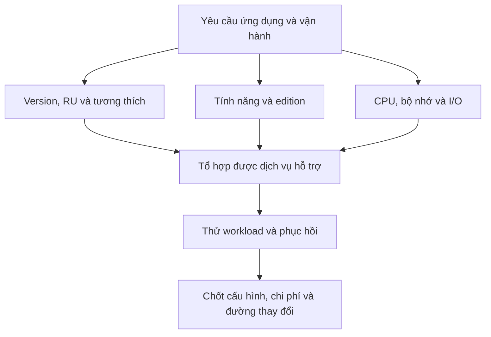

# Lựa chọn database version, edition và compute shape

Trong chương **Oracle Database trên OCI** của module **CLOUD_PROVIDERS_ORACLE**, bài học này hướng dẫn chọn bộ cấu hình cơ sở dữ liệu phù hợp với ứng dụng, tính năng, hiệu năng, khả năng phục hồi và chi phí. Trọng tâm thực hành là **Oracle Base Database Service**, nơi người triển khai chọn database version, software edition và DB system shape.

Ba lựa chọn này liên quan với nhau. Một phiên bản phù hợp với ứng dụng có thể không khả dụng trên shape đã chọn; một edition có thể không đáp ứng tính năng cần dùng; một cấu hình đủ CPU có thể thiếu bộ nhớ hoặc băng thông I/O.

Sau bài học, bạn có thể:

- Phân biệt version, Release Update (RU), edition, license model và shape.
- Kiểm tra tính tương thích giữa database, ứng dụng Java, JDBC và JDK.
- Chọn edition từ tính năng và phạm vi sử dụng thực tế.
- Đọc catalog shape/version của dịch vụ trong region dự kiến.
- Ước lượng compute từ CPU, bộ nhớ, I/O và mức tăng trưởng.
- Ghi lại một quyết định có bằng chứng, phương án kiểm thử và đường thay đổi sau này.

## Xác định phạm vi dịch vụ trước khi chọn cấu hình

Oracle có nhiều mô hình triển khai database. Không lấy một bảng shape của OCI Compute rồi áp dụng nguyên cho mọi dịch vụ cơ sở dữ liệu.

| Phạm vi | Điều cần xác định trước |
| --- | --- |
| Base Database Service | Các tổ hợp DB system, edition, version, compute và storage được hỗ trợ |
| Exadata Database Service | Mô hình hạ tầng, cluster và tài nguyên database tương ứng |
| Autonomous Database | Mô hình quản lý và cấp phát tài nguyên của Autonomous |
| Tự cài trên OCI Compute | Trách nhiệm cài đặt, cập nhật, vận hành và giấy phép của tổ chức |

Trong bài này, tên shape phải đến từ catalog **Database Service**. Một tên VM tồn tại trong catalog Compute không tự chứng minh nó là shape được Base Database hỗ trợ.

Ví dụ xuyên suốt là ứng dụng Java xử lý đơn hàng. Ứng dụng có dữ liệu giao dịch, một số báo cáo theo giờ và lịch sao lưu định kỳ. Nhóm triển khai cần chọn cấu hình ban đầu và vẫn có khả năng điều chỉnh khi lượng đơn tăng.

## Bắt đầu từ yêu cầu, không bắt đầu từ dropdown

Trước khi mở màn hình tạo DB system, thu thập tối thiểu:

| Nhóm | Thông tin cần có |
| --- | --- |
| Tương thích | Phiên bản database được ứng dụng hoặc nhà cung cấp chứng nhận; JDK, JDBC, ORM |
| Chức năng | Tính năng database bắt buộc, kiểu dữ liệu, tùy chọn, công cụ quản trị |
| Tải | Giao dịch mỗi giây, truy vấn quan trọng, số phiên hoạt động, batch |
| Dữ liệu | Dung lượng hiện tại, tốc độ tăng, redo, temp, dung lượng phục hồi |
| Hiệu năng | Độ trễ p95/p99, thời gian batch, khoảng cao điểm |
| Sẵn sàng | Thời gian dừng chấp nhận được, mục tiêu RTO/RPO |
| Vận hành | Cửa sổ cập nhật, backup/restore, kỹ năng DBA, quyền truy cập |
| Chi phí | Ngân sách, mô hình license, compute, storage, backup và môi trường phụ |

Một yêu cầu như “khoảng 300 người dùng” chưa đủ để chọn CPU. Người dùng đăng nhập nhưng chờ nhập liệu tạo tải khác với 300 phiên đồng thời thực thi truy vấn nặng.

Nên mô tả tải bằng nghiệp vụ và kết quả đo: số đơn mỗi phút, số truy vấn trên một đơn, thời gian báo cáo, số phiên thực sự hoạt động và độ trễ cần đáp ứng.



## Chọn version: tên phiên bản chưa đủ

### Phân biệt các lớp phiên bản

| Lớp thông tin | Ý nghĩa | Việc cần ghi nhận |
| --- | --- | --- |
| Dòng phát hành | Ví dụ Oracle Database 19c hoặc Oracle AI Database 26ai | Phạm vi tính năng và chứng nhận ứng dụng |
| Release Update | Mức cập nhật của dòng phát hành | Chuỗi version cụ thể của image được chọn |
| Database Home | Bộ phần mềm phục vụ database | Home/image và lịch cập nhật |
| Grid Infrastructure, hệ điều hành | Thành phần nền của DB system tùy cấu hình | Điều kiện cho tạo mới, nâng cấp hoặc đổi shape |
| Tham số tương thích | Chẳng hạn `COMPATIBLE` | Trạng thái đã được DBA xác nhận, không chỉ tên trên Console |

Không ghi hồ sơ chỉ bằng “19c”. Hai môi trường cùng dòng 19c nhưng khác RU, one-off patch hoặc cấu hình có thể cho hành vi khác nhau.

Tài liệu Base Database liệt kê 19c, 21c và 26ai; danh sách khả dụng thực tế còn phụ thuộc cấu hình. Luôn đối chiếu version và shape ở môi trường đích thay vì coi mọi phiên bản trong tài liệu đều tạo được trên mọi shape. Xem [tổng quan Base Database Service](https://docs.oracle.com/en/cloud/paas/base-database/guide/about.html).

### Chọn theo chứng nhận và đường vận hành

Với ứng dụng có sẵn, bắt đầu từ ma trận chứng nhận của ứng dụng và các thành phần liên quan. Nếu ứng dụng chỉ được chứng nhận trên một dòng cụ thể, cần giải quyết chứng nhận trước khi chọn dòng mới vì có thêm tính năng.

Với ứng dụng mới, đánh giá dòng được hỗ trợ phù hợp với tuổi thọ dự án, tính năng cần dùng và khả năng cập nhật của đội vận hành. “Số phiên bản lớn hơn” không tự chứng minh workload nhanh hơn hoặc migration ít rủi ro hơn.

Mỗi ứng viên version cần trả lời:

- Có sẵn trong Base Database, region và shape dự kiến không?
- Là bản dùng cho production hay bản preview?
- Còn trong phạm vi hỗ trợ nào theo chính sách Oracle hiện hành?
- Ứng dụng và driver đã được kiểm thử trên RU dự kiến chưa?
- Có lịch áp dụng các bản cập nhật tiếp theo không?
- Khi nâng cấp, cần điều kiện gì về OS, GI, backup và thời gian dừng?

OCI hỗ trợ chọn RU theo chính sách dịch vụ, với bản được phê duyệt mới nhất là lựa chọn mặc định và các giới hạn cho RU cũ. Không tự chọn một RU tối thiểu trong bảng tương thích rồi coi đó là mức cập nhật nên triển khai hôm nay. Xem [Available Database Versions](https://docs.oracle.com/en/cloud/paas/base-database/guide/dbs-about.html).

### Tương thích với ứng dụng Java

Kiểm tra ít nhất bốn phiên bản riêng:

```text
JDK đang chạy ứng dụng
    + phiên bản Oracle JDBC driver
    + phiên bản database và RU
    + phiên bản framework/ORM/connection pool
```

Oracle công bố ma trận tương thích JDBC, database và JDK. Không cần ép số major của JDBC phải trùng tên dòng database; phải chọn tổ hợp được hỗ trợ. JDBC Thin không yêu cầu cài Oracle client native như JDBC OCI driver. Xem [JDBC version compatibility](https://docs.oracle.com/en/database/oracle/oracle-database/26/jjdbc/JDBC-getting-started.html).

Trong hồ sơ kiểm thử, ghi chính xác artifact và version của driver. Chỉ ghi `ojdbc11` chưa đủ vì đó không phải toàn bộ số phiên bản của thư viện.

Kiểm tra không dừng ở việc mở được connection. Cần thử transaction, rollback, kiểu ngày giờ, Unicode, batch, stored procedure, timeout và truy vấn quan trọng. Khi đổi version database, có thể cần đối chiếu execution plan và độ trễ ngay cả khi SQL vẫn chạy được.

## Chọn edition: từ tính năng và phạm vi sử dụng

Edition không phải nút điều chỉnh tốc độ CPU. Nó xác định bộ tính năng và quyền sử dụng phần mềm theo dịch vụ, cùng các giới hạn liên quan.

| Lựa chọn | Cách đánh giá |
| --- | --- |
| Standard Edition | Đối chiếu nhu cầu với phạm vi Standard Edition 2 của gói dịch vụ |
| Enterprise Edition | Kiểm tra các tính năng Enterprise cần dùng và tùy chọn liên quan |
| Enterprise Edition High Performance | Đối chiếu tính năng/options/packs được bao gồm trong gói |
| Enterprise Edition Extreme Performance | Xem trạng thái cung cấp hiện hành và kế hoạch của workload đang dùng |
| Enterprise Edition Developer | Chỉ đánh giá cho phạm vi phát triển được phép và các giới hạn riêng |

Tài liệu licensing phân biệt BaseDB SE, BaseDB EE, BaseDB EE-HP và BaseDB EE-EP, cùng phạm vi options và management packs tương ứng. Có mặt trong bản cài đặt không đồng nghĩa một tính năng được quyền sử dụng trong mọi edition. Xem [Licensing Information của Oracle Database](https://docs.oracle.com/en/database/oracle/oracle-database/26/dblic/Licensing-Information.html).

Lập bảng tính năng trước khi chọn:

| Tính năng hoặc yêu cầu | Có thật sự cần? | Bằng chứng cần đối chiếu |
| --- | --- | --- |
| Chạy workload SQL/PLSQL hiện tại | Có | Tính tương thích và giới hạn của edition |
| Partitioning | Theo thiết kế dữ liệu | Availability và quyền sử dụng của gói dịch vụ |
| Nén hoặc công cụ chẩn đoán nâng cao | Theo yêu cầu | Options/packs và mô hình license áp dụng |
| HA hoặc standby | Theo RTO/RPO | Hỗ trợ của dịch vụ, edition, shape, topology |
| Tính năng mới của một dòng version | Theo ứng dụng | Version tối thiểu và availability theo edition |

Đừng chọn EE-HP chỉ vì tên có “High Performance”, rồi kỳ vọng cùng workload và cùng tài nguyên sẽ tự nhanh hơn. Cần nêu tính năng cụ thể tạo ra giá trị, sau đó đo hiệu quả nếu dùng tính năng đó.

Tương tự, một ứng dụng cần một tính năng Enterprise không nhất thiết cần mọi gói cao hơn. Chọn từ tập tính năng bắt buộc và phạm vi cung cấp hiện hành.

### Đọc thông báo thay đổi SKU cùng bảng edition

Tài liệu Base Database có thông báo nghỉ các SKU `VM.Standard.x86`, EE-EP và SKU tính theo OCPU, hiệu lực từ **31/07/2026**; triển khai hiện có tiếp tục chạy, nhưng tạo mới và gia hạn hợp đồng bị ảnh hưởng. Tài liệu hướng tới `VM.BaseDB.x86` dùng ECPU hoặc Exadata Exascale cho workload phù hợp. Xem [thông báo trong tổng quan dịch vụ](https://docs.oracle.com/en/cloud/paas/base-database/guide/about.html).

Vì vậy, một bảng mô tả EE-EP hay shape OCPU còn xuất hiện trong tài liệu không đủ để kết luận có thể tạo mới theo cùng điều kiện. Phân biệt:

- Một DB system hiện có đang chạy.
- Một cấu hình xuất hiện trong tài liệu hoặc công cụ.
- Một cấu hình được phép cấp phát mới cho môi trường và hợp đồng của bạn.

Khi cần RAC hoặc một tính năng từng gắn với gói đã thay đổi, đánh giá lại cả lựa chọn dịch vụ. Không mặc định giữ Base Database rồi chọn edition không còn khả dụng cho lượt tạo mới.

### Developer edition không phải môi trường production giá thấp

Base Database Service for Developers có license phần mềm cho mục đích phát triển, nhưng hạ tầng vẫn tính phí. Nó chỉ hỗ trợ A1 trong phạm vi được công bố, có giới hạn trên PDB và không cung cấp RAC/Data Guard cho cấu hình này. Xem [hướng dẫn Base Database for Developers](https://docs.oracle.com/en/learn/base-db-for-developers/).

Có thể dùng nó để học SQL, thử tích hợp hoặc phát triển trong giới hạn. Không dùng kết quả benchmark của một PDB Developer bị giới hạn để suy trực tiếp dung lượng cho production, và không coi đây là cấu hình có thể chuyển sang production bằng một lần đổi nhãn.

## License model là một lựa chọn khác với edition

| Lựa chọn | Ý nghĩa cần kiểm tra |
| --- | --- |
| License Included | Chi phí dịch vụ bao gồm phần license Oracle Database theo gói được chọn |
| BYOL | Dùng quyền license hiện có của tổ chức theo điều kiện áp dụng |

Hai khái niệm này không thay thế việc chọn edition. Một cấu hình vẫn cần biết rõ version, edition, license model và đơn vị compute.

OCI mô tả License Included và BYOL tại bước tạo DB system. Xem [License type trong hướng dẫn tạo DB system](https://docs.oracle.com/en/cloud/paas/base-database/guide/dbs-create-new.html).

Đối với BYOL, cần có hồ sơ quyền sử dụng, phạm vi tính năng và cách tính cho dịch vụ tương ứng. Đừng chọn BYOL chỉ vì ô ước tính giá hiển thị thấp hơn, rồi mới kiểm kê license sau khi triển khai.

Đối với công cụ giám sát, cũng cần kiểm tra tính năng hoặc pack mà công cụ sử dụng. Một báo cáo kỹ thuật tạo được không tự chứng minh nó thuộc quyền sử dụng hiện có.

## Chọn compute shape: CPU, bộ nhớ và kiến trúc

### Đọc đúng đơn vị

Các family có thể dùng OCPU hoặc ECPU. Đừng so trực tiếp “8 OCPU” với “8 ECPU”, hoặc với số vCPU của một dịch vụ khác, rồi suy ra chúng tương đương về hiệu năng hay giá.

Một dòng quyết định compute nên có dạng:

```text
Dịch vụ + shape/family + compute model + số đơn vị
+ bộ nhớ được cấp + số node + storage management
```

Tài liệu DB system mô tả `VM.BaseDB.x86` theo ECPU, đồng thời còn có các family OCPU và Ampere A1 với ràng buộc khác nhau. Tổ hợp version, storage và topology phải được kiểm tra theo đúng family. Xem [About DB Systems](https://docs.oracle.com/en/cloud/paas/base-database/guide/dbs-about.html).

### Bộ nhớ của DB shape không giống mọi VM flexible

Không mặc định có thể tăng RAM độc lập với CPU theo bất kỳ tỷ lệ nào. Trong Base Database, nhiều family cấp bộ nhớ tỷ lệ theo compute count.

Ví dụ, tài liệu tạo DB system mô tả Base DB x86 cấp 8 GB cho mỗi 4 ECPU; các family AMD E4/E5 cấp 16 GB cho mỗi OCPU trong phạm vi hỗ trợ được công bố. Đây là đặc tính của family dịch vụ, không phải quy tắc chung để quy đổi OCPU sang ECPU. Xem [Configure ECPU/OCPU](https://docs.oracle.com/en/cloud/paas/base-database/guide/dbs-create-new.html).

Hệ quả: workload thiếu bộ nhớ có thể phải tăng compute để nhận thêm bộ nhớ. Chi phí thay đổi theo cả gói tài nguyên, không chỉ theo phần CPU mà truy vấn đang dùng.

Ngân sách bộ nhớ cần xét:

```text
Bộ nhớ cần dự kiến
  = SGA
  + PGA tại mức đồng thời cần phục vụ
  + hệ điều hành và agent
  + phần dự phòng vận hành
```

Không đặt toàn bộ RAM được cấp vào SGA. PGA có thể tăng theo số session và thao tác sort/hash; workload báo cáo đồng thời có đặc tính khác OLTP đơn giản.

### X86 và Arm cần xem cả đường dữ liệu và công cụ

Một ứng dụng Java dùng JDBC Thin kết nối qua mạng không đòi hỏi máy ứng dụng và máy database cùng kiến trúc CPU. Tuy nhiên, agent, thư viện native, công cụ sao lưu và các bước migration trên host vẫn cần được kiểm tra.

Đặc biệt, DB system A1 có các giới hạn về thay đổi sang Intel/AMD và restore backup giữa các kiến trúc. Không giả định có thể chọn A1 hôm nay rồi dùng cùng quy trình đổi shape để chuyển sang x86 sau này. Xem [Ampere A1 restrictions](https://docs.oracle.com/en/cloud/paas/base-database/guide/dbs-about.html).

Lựa chọn kiến trúc nên đi kèm một thử nghiệm di chuyển dữ liệu hoặc phục hồi theo đúng đường được hỗ trợ, thay vì chỉ so sánh chi phí compute.

## Sizing từ số đo workload

### CPU: lấy cao điểm và mục tiêu độ trễ

Đánh giá đồng thời CPU sử dụng, mức tải đồng thời, throughput và p95/p99. CPU trung bình ngày thấp có thể che khoảng cuối giờ khi batch và giao dịch cùng chạy.

Có thể dùng một phép tính khởi đầu cho **cùng family và cùng đơn vị compute**:

```text
Compute dự kiến
  ≈ compute đang đo
    × mức sử dụng CPU ở cao điểm
    ÷ mức sử dụng CPU mục tiêu
    × hệ số tăng trưởng
```

Ví dụ minh họa:

```text
Đang đo: 8 đơn vị, CPU cao điểm 75%
Mục tiêu: 60%, tăng trưởng dự kiến 25%

Compute ước lượng = 8 × 0,75 / 0,60 × 1,25 = 12,5 đơn vị
```

Chọn mức hợp lệ tiếp theo trong catalog rồi kiểm thử lại. Đây là mô hình ước lượng tuyến tính để lập ứng viên; nó không đảm bảo hiệu năng tăng tuyến tính, không dùng để chuyển số đo giữa OCPU/ECPU hoặc các kiến trúc khác nhau.

Nếu truy vấn chờ lock, tăng CPU có thể không giải quyết nguyên nhân. Cần phân biệt tài nguyên bị thiếu với thiết kế truy vấn, chỉ mục, transaction hoặc mức đồng thời không phù hợp.

### I/O và dung lượng: không chỉ nhìn CPU

Kiểm tra IOPS, throughput, độ trễ đọc/ghi, redo, temp, batch và backup. Dữ liệu 500 GB không có nghĩa nhu cầu I/O giống mọi database 500 GB khác.

Hiệu năng có thể bị giới hạn bởi storage, mạng hoặc tài nguyên của shape. Thông số IOPS lý thuyết trên màn hình không phải cam kết throughput của truy vấn ứng dụng. Phải đo với kiểu truy cập và kích thước dữ liệu gần thực tế.

Một bảng so sánh thử nghiệm nên gồm:

| Chỉ số | Cấu hình A | Cấu hình B | Điều kiện đo |
| --- | --- | --- | --- |
| Giao dịch/giây | Giá trị đo | Giá trị đo | Cùng kịch bản và dữ liệu |
| p95/p99 | Giá trị đo | Giá trị đo | Cùng số phiên hoạt động |
| CPU cao điểm | Giá trị đo | Giá trị đo | Cùng khoảng tải |
| Bộ nhớ và temp | Giá trị đo | Giá trị đo | Có batch đồng thời |
| I/O latency và throughput | Giá trị đo | Giá trị đo | Cùng cấu hình storage |
| Chi phí dự kiến | Giá trị tính | Giá trị tính | Cùng thời gian chạy và phạm vi |

Giữ nguyên các yếu tố còn lại khi so một thay đổi. Nếu vừa đổi version, shape, storage và schema, kết quả khó cho biết yếu tố nào tạo khác biệt.

### Dự phòng cho vận hành và phục hồi

Số đo cần có cả giai đoạn cập nhật, backup và thao tác vận hành quan trọng. Nếu có standby hoặc nhiều node, tính cả tải khi một thành phần không phục vụ.

Backup không tự thay thế standby, và nhiều CPU không tự tạo HA. Đối chiếu RTO/RPO với topology được hỗ trợ trước khi chốt một cấu hình single-node chỉ vì chi phí thấp.

Các shape x86 generation-agnostic trong tài liệu có ràng buộc single-node/LVM. Vì thế không thể lấy một shape như vậy rồi tùy ý thêm node RAC. Xem [Generation-Agnostic X86 Shape](https://docs.oracle.com/en/cloud/paas/base-database/guide/dbs-about.html).

## Thực hành đọc catalog bằng OCI CLI

Bài thực hành này tạo đầu ra là một bảng lựa chọn cấu hình từ catalog. Các lệnh dưới đây chỉ đọc thông tin, không cấp phát DB system.

Chuẩn bị OCI CLI đã xác thực, quyền đọc thích hợp trong compartment và tên Availability Domain lấy từ tenancy của bạn. Dùng Bash:

```bash
export LAB_COMPARTMENT_OCID="<ocid-compartment>"
export LAB_REGION="ap-singapore-1"
export LAB_AD="<ten-availability-domain-trong-tenancy>"

oci --profile LAB --region "$LAB_REGION" db system-shape list --compartment-id "$LAB_COMPARTMENT_OCID" --availability-domain "$LAB_AD" --all
```

Lệnh trả danh sách shape cho DB system; lọc AD giúp khảo sát đúng môi trường đích. Xem [system-shape list](https://docs.oracle.com/en-us/iaas/tools/oci-cli/latest/oci_cli_docs/cmdref/db/system-shape/list.html).

Giữ nguyên tên shape trả về, không tự chuyển tên từ Compute. Tiếp theo, chọn một ứng viên trong kết quả:

```bash
export LAB_DB_SHAPE="<shape-lay-tu-ket-qua>"

oci --profile LAB --region "$LAB_REGION" db version list --compartment-id "$LAB_COMPARTMENT_OCID" --db-system-shape "$LAB_DB_SHAPE" --all
```

Có thể bổ sung `--storage-management ASM` hoặc `LVM` theo cấu hình khảo sát. Khi đánh giá một DB system hiện có, `--db-system-id` cho phép lọc version theo DB system đó. Xem [version list](https://docs.oracle.com/en-us/iaas/tools/oci-cli/latest/oci_cli_docs/cmdref/db/version/list.html).

Không truyền đồng thời các giá trị không nhất quán chỉ để nhận được nhiều kết quả. Danh sách version có trả về chưa thay thế kiểm tra edition, license, RU và điều kiện cấp phát trên Console.

Có thể đọc thêm thông số hiệu năng compute mà API công bố:

```bash
oci --profile LAB --region "$LAB_REGION" db system list-db-system-compute-performances --compartment-id "$LAB_COMPARTMENT_OCID" --db-system-shape "$LAB_DB_SHAPE" --all
```

Đây là thông số dự kiến theo cấu hình, không phải kết quả benchmark từ database của bạn. Xem [list-db-system-compute-performances](https://docs.oracle.com/en-us/iaas/tools/oci-cli/latest/oci_cli_docs/cmdref/db/system/list-db-system-compute-performances.html).

Với từng ứng viên, điền:

| Mục | Giá trị cần ghi |
| --- | --- |
| Thời điểm khảo sát | Ngày giờ và nguồn dữ liệu |
| Region/AD/compartment | Môi trường cụ thể |
| Shape và compute model | Tên chính xác, OCPU hay ECPU |
| Version/RU | Chuỗi thực tế được dịch vụ cho chọn |
| Edition/license | Lựa chọn khả dụng và căn cứ |
| Memory/node/storage | Thông số cùng giới hạn |
| Backup/HA | Phương án phù hợp và điều kiện |
| Tình trạng | Có thể tạo mới, thiếu quyền, thiếu quota hoặc cần kiểm tra thêm |

Nếu không thấy cấu hình mong muốn, kiểm tra region, AD, quyền, bộ lọc, tình trạng cung cấp và thông báo dịch vụ. Đừng tự kết luận là có thể dùng tên shape của region khác.

Catalog còn khác với tài nguyên sẵn sàng cấp phát: quota, service limit và capacity thực tế vẫn có thể ảnh hưởng lượt tạo. Ghi rõ điểm chưa xác nhận trong hồ sơ lựa chọn.

## Đối chiếu một database đã tồn tại

Dùng tài khoản được phép đọc các view cần thiết trong đúng container. Không cấp quyền quản trị toàn bộ database cho tài khoản ứng dụng chỉ để chạy các câu kiểm tra.

Đọc banner phiên bản:

```sql
SELECT banner_full
FROM v$version;
```

`BANNER_FULL` thể hiện tên và số phiên bản của database. Xem [V$VERSION](https://docs.oracle.com/en/database/oracle/oracle-database/19/refrn/V-VERSION.html).

Đọc lịch sử SQL patch:

```sql
SELECT patch_id,
       patch_type,
       action,
       status,
       action_time,
       description
FROM dba_registry_sqlpatch
ORDER BY action_time DESC;
```

View ghi lại các lần áp dụng hoặc rollback SQL patch, bao gồm trạng thái của từng lần. Không chỉ lấy dòng mới nhất rồi coi mọi patch trước đó đều thành công. Xem [DBA_REGISTRY_SQLPATCH](https://docs.oracle.com/en/database/oracle/oracle-database/19/refrn/DBA_REGISTRY_SQLPATCH.html).

Đối chiếu kết quả SQL với DB Home, update history và cấu hình DB system trên OCI. Banner Enterprise Edition không tự phân biệt đầy đủ gói thương mại EE, EE-HP, license model hoặc compute SKU của tài nguyên.

Tương tự, một cờ tính năng trong database không phải bằng chứng duy nhất cho quyền sử dụng. Hồ sơ dịch vụ và quyền license phải được kiểm tra riêng.

## Ví dụ ra quyết định cho ba tình huống

Các phương án dưới đây minh họa cách lập luận, không phải cấu hình cố định cho mọi hệ thống.

### Ứng dụng Java hiện có đã được chứng nhận trên 19c

Bắt đầu từ dòng 19c và RU được ứng dụng chấp thuận, sau đó tìm shape tạo mới phù hợp trong dịch vụ. Kiểm tra driver/JDK, SQL và các phụ thuộc trước khi thay đổi dòng database.

Nếu không cần tính năng gói cao hơn, chỉ chọn edition sau khi đã đối chiếu danh sách tính năng bắt buộc. Đo CPU, PGA, I/O và cao điểm batch để chọn compute ban đầu.

Đường nâng cấp cần được ghi từ đầu: phiên bản đích, điều kiện nền, bản sao thử và tiêu chí quay về hoặc phục hồi.

### Ứng dụng mới cần tính năng của dòng mới

Chọn ứng viên version đáp ứng tính năng, rồi xác nhận feature đó thuộc edition/gói dự kiến. Thử driver, kiểu dữ liệu và truy vấn dùng tính năng mới trên đúng môi trường.

Không suy rằng chọn 26ai đồng nghĩa được sử dụng mọi options, mọi tính năng AI hoặc mọi cấu hình HA. Version, edition và topology vẫn là các lựa chọn riêng phải giao nhau hợp lệ.

### Môi trường học tập hoặc phát triển nhỏ

Có thể xem xét Developer edition nếu đáp ứng mục đích sử dụng và giới hạn. Ghi rõ giới hạn PDB, chi phí hạ tầng và khả năng khác biệt với production.

Nếu cần thử tính sẵn sàng hoặc benchmark gần production, phải dùng cấu hình có khả năng mô phỏng yêu cầu đó. Một lab nhỏ thích hợp để học SQL chưa chắc thích hợp để xác nhận kế hoạch phục hồi hệ thống thật.

## Khả năng thay đổi sau khi triển khai

Phân biệt ba loại thay đổi:

| Thay đổi | Cần đánh giá |
| --- | --- |
| Cập nhật RU hoặc nâng version | Tương thích, precheck, OS/GI, downtime và phục hồi |
| Thay compute count hoặc shape | Đường thay đổi được hỗ trợ, gián đoạn, bộ nhớ, mạng và giá |
| Thay edition | Khả năng dịch vụ hỗ trợ, migration dữ liệu và tác động tính năng |

Không mặc định edition là một dropdown có thể đổi tùy ý sau khi tạo. Chẳng hạn hướng dẫn tạo từ backup nêu edition không đổi về sau; nếu cần lựa chọn khác, phải thiết kế đường triển khai và di chuyển phù hợp. Xem [tạo DB system từ backup](https://docs.oracle.com/en/cloud/paas/base-database/guide/dbs-create-from-backup.html).

Đổi shape cũng có các điều kiện theo family và phiên bản nền. Xem trước đường được hỗ trợ tại [Change the Shape of a DB System](https://docs.oracle.com/en/cloud/paas/base-database/guide/dbs-shape.html).

Nâng cấp database có thể đòi hỏi cập nhật OS hoặc Grid Infrastructure, có downtime và cần precheck. Oracle khuyến nghị backup và thử phiên bản mới trên hệ thống test trước khi nâng. Xem [Upgrade a Database](https://docs.oracle.com/en/cloud/paas/base-database/guide/db-upgrade.html).

Một phương án khôi phục phải nêu được bản sao nào dùng được, phục hồi về đâu, dữ liệu phát sinh sau thời điểm chuyển đổi được xử lý thế nào và thời gian dự kiến. Không viết “hạ version nếu lỗi” mà chưa xác minh đường quay lại.

## Tính tổng chi phí cho phương án

Dùng cùng khoảng thời gian và cùng mức dịch vụ khi so sánh:

```text
Chi phí phương án
  = compute theo edition, compute model và license model
  + storage dữ liệu, vùng phục hồi và hiệu năng storage
  + backup/recovery và lưu giữ
  + standby hoặc thành phần HA
  + môi trường test/phục hồi cần thiết
  + giám sát, truyền dữ liệu và các hạng mục có tính phí liên quan
```

Lấy đơn giá và phạm vi tính phí hiện hành của region/hợp đồng, ghi thời điểm dự toán. Không so giá một đơn vị OCPU của gói này với một đơn vị ECPU của gói khác mà bỏ qua tài nguyên, edition và benchmark.

Một cấu hình compute nhỏ có thể kéo dài batch, vượt mục tiêu độ trễ hoặc buộc vận hành thường xuyên can thiệp. Một cấu hình lớn nhưng chờ lock cũng có thể lãng phí. Quyết định tốt cần cả giá lẫn kết quả workload.

Với môi trường lab, xác định lịch sử dụng, chủ sở hữu và tài nguyên còn tồn tại khi không chạy thử. Kiểm tra chi phí storage/backup còn lại theo cơ chế dịch vụ; không suy rằng dừng compute đồng nghĩa mọi khoản phí dừng theo.

## Hồ sơ lựa chọn có thể kiểm tra được

Một hồ sơ ngắn nên trả lời đủ:

- Dịch vụ, region và mục đích môi trường.
- Version/RU và căn cứ tương thích.
- Edition, tính năng cần dùng và license model.
- Shape, kiến trúc, OCPU/ECPU, compute count, RAM và số node.
- Storage management, dung lượng, hiệu năng và dự phòng tăng trưởng.
- Backup, RTO/RPO và topology phục hồi.
- Workload, số đo và tiêu chí chấp nhận.
- Chi phí, nguồn đơn giá và thời điểm tính.
- Đường cập nhật, thay shape hoặc migration sau này.
- Các điểm còn phải xác nhận trước khi cấp phát.

Bài thực hành hoàn thành khi bạn có ít nhất hai ứng viên hợp lệ, giải thích được lý do loại hoặc chọn từng ứng viên và biết phép thử nào sẽ xác nhận lựa chọn. Một tên version, edition và shape đứng cạnh nhau chỉ trở thành cấu hình phù hợp khi đồng thời đáp ứng khả năng dịch vụ, ứng dụng và yêu cầu vận hành.
