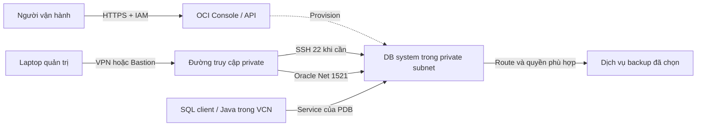

# Provision Base Database Service và kết nối ban đầu

## Mục tiêu bài học

Trong chương **Oracle Database trên OCI** của module **CLOUD_PROVIDERS_ORACLE**, bài này đưa người học từ một kế hoạch triển khai đến lần kết nối Oracle Database đầu tiên. IAM quyết định ai được tạo hạ tầng; VCN quyết định đường đến database; tài khoản và service trong Oracle Database quyết định phiên SQL được mở ở đâu và làm được gì.

Sau bài học, người học có thể:

- Chuẩn bị compartment, quyền IAM, mạng, SSH key và cấu hình database trước khi provision.
- Tạo một Base Database DB system một node, nhận diện CDB, PDB và service kết nối.
- Kiểm tra quản trị cục bộ và kết nối qua mạng bằng SQL*Plus, SQL Developer hoặc JDBC.
- Tạo tài khoản lab trong đúng PDB, kiểm tra đọc/ghi và phân loại lỗi ban đầu.
- Ghi nhận backup, giám sát, chi phí và giới hạn tính sẵn sàng của cấu hình vừa tạo.

Bài dùng một lab có private subnet và dữ liệu mẫu. Các tên, địa chỉ IP và kết quả bên dưới là ví dụ; thay bằng giá trị thực của môi trường được phép sử dụng. Đây là hướng dẫn thực hành, không phải bằng chứng một DB system đã được triển khai.

## 1. Hiểu đối tượng sẽ provision

Base Database Service cung cấp Oracle Database trên DB system dùng máy ảo. Có cấu hình một node và cấu hình RAC nhiều node. Bài chọn **một node** để tập trung vào provisioning và kết nối, thay vì cấu hình cluster. Shape và edition đang được cung cấp cần kiểm tra theo region và tenancy; không dùng danh sách shape trong ảnh chụp cũ làm mặc định. [Oracle: About DB Systems](https://docs.oracle.com/en/cloud/paas/base-database/guide/dbs-about.html).

| Thành phần | Ý nghĩa khi thực hành |
| --- | --- |
| DB system | Tài nguyên OCI có node, mạng, compute và cấu hình lưu trữ |
| DB node | Máy chạy phần mềm database; truy cập hệ điều hành qua SSH khi được phép |
| Database home | Môi trường cài đặt phần mềm Oracle Database và bản cập nhật tương ứng |
| CDB | Container database chứa phần quản trị chung và các PDB |
| PDB | Pluggable database đích cho schema của lab |
| Database service | Tên dịch vụ mà client yêu cầu khi mở phiên kết nối |
| Database user/schema | Danh tính và không gian đối tượng bên trong database |

Tên hiển thị DB system trên Console không phải service name. Tương tự, `DB_NAME`, `DB_UNIQUE_NAME`, `ORACLE_SID` và tên PDB không thể thay thế tùy ý cho nhau.

```text
DB system display name : basedb-lab-01
Database name          : LABDB
Database unique name   : lấy giá trị thực sau provisioning
PDB                    : APPPDB
Application user       : APP_LAB
Service kết nối        : lấy từ Console hoặc kiểm tra trên database
```

Không suy service name chỉ từ `LABDB` hoặc tên máy. Service có thể bao gồm domain và phải được database/listener nhận diện.

## 2. Ba lớp quyền độc lập

| Lớp | Danh tính điển hình | Quyền cần kiểm tra |
| --- | --- | --- |
| OCI control plane | Người vận hành thuộc IAM group | Tạo DB system, sử dụng subnet, xem work request |
| Hệ điều hành | `opc`, chuyển sang `oracle` khi có quyền | SSH vào node và chạy công cụ quản trị |
| Oracle Database | `SYS`, tài khoản quản trị PDB, `APP_LAB` | Đăng nhập và thao tác SQL trong container phù hợp |

Có quyền quản lý DB system trên Console không tự động tạo một SQL user để chạy JDBC. SSH thành công cũng chưa chứng minh listener hoạt động. Tài khoản ứng dụng kết nối được PDB không cần có quyền tạo hoặc xóa DB system trong OCI.

Bài dùng xác thực SQL bằng username/password cho tài khoản lab. Tích hợp IAM authentication vào database là một cấu hình riêng, không được ngầm thiết lập chỉ vì người tạo DB system đã đăng nhập OCI.

### Phân quyền cho người provision

Giả sử `DbLab` và `NetLab` là hai compartment trực tiếp dưới root, mạng đã được nhóm network chuẩn bị. Mẫu policy cho nhóm vận hành lab:

```text
Allow group 'Default'/'DBLabOperators' to manage database-family in compartment DbLab
Allow group 'Default'/'DBLabOperators' to use virtual-network-family in compartment NetLab
```

Thay domain, group và compartment bằng định danh thực. Đặt policy tại vị trí có thể bao phủ các compartment được tham chiếu. Đây là quyền quản trị cho lab; `manage database-family` rộng hơn quyền của một ứng dụng chỉ truy vấn dữ liệu. Mẫu cấp quyền database theo compartment được mô tả trong [Oracle: Common Policies](https://docs.oracle.com/en-us/iaas/Content/Identity/Concepts/commonpolicies.htm).

`LaunchDBSystem` còn phụ thuộc quyền trên DB home, database, VNIC và subnet. Backup, customer-managed key hoặc defined tag có thể cần quyền bổ sung. Nếu không thấy VCN dùng chung, kiểm tra quyền tại compartment mạng thay vì cấp quyền quản trị toàn tenancy. [Oracle: Policy Details for Base Database Service](https://docs.oracle.com/en/cloud/paas/base-database/guide/policy-details.html).

## 3. Thiết kế mạng và đường quản trị

Kế hoạch lab đề xuất:

| Thành phần | Giá trị ví dụ |
| --- | --- |
| VCN | `10.40.0.0/16` |
| Subnet client/application | `10.40.10.0/24` |
| Private subnet database | `10.40.20.0/24` |
| DB private IP sau provision | Ví dụ `10.40.20.15`; lấy IP thực từ Console |
| Listener | TCP `1521` nếu giữ cấu hình mặc định |
| Quản trị từ laptop | VPN hoặc OCI Bastion theo thiết kế mạng |
| SQL client trong VCN | Máy có route, DNS và rule đến DB subnet |

Địa chỉ trên là thiết kế minh họa. Kiểm tra xung đột với VCN khác và mạng on-premises trước khi chọn CIDR.



Các mũi tên biểu diễn những luồng có mục đích khác nhau. Console tạo tài nguyên thành công không chứng minh laptop có đường đến private IP của database.

### Mạng phải sẵn sàng trước provisioning

DB system cần VCN, subnet, route, security rule và khả năng truy cập Oracle Services Network phù hợp. Với private subnet, kiểm tra service gateway cùng route tới các Oracle service cần thiết. [Oracle: VCN and Subnets](https://docs.oracle.com/en/cloud/paas/base-database/guide/vcn-subnets.html).

Lập bảng luồng ứng dụng/quản trị trước khi thêm rule:

| Nguồn thực tế | Đích | Cổng đích | Mục đích |
| --- | --- | --- | --- |
| NSG của ứng dụng, nếu thiết kế dùng NSG | NSG của DB system | TCP 1521 | Phiên SQL từ ứng dụng |
| IP private endpoint của Bastion | DB private IP | TCP 1521 | Port forwarding tới listener |
| Nguồn quản trị được phép | DB private IP | TCP 22 | SSH vào hệ điều hành |

Đây là bảng luồng của lab, **không phải toàn bộ rule nền tảng của dịch vụ**. Giữ các rule phục vụ hoạt động DB system, ICMP và egress theo tài liệu Oracle; kiểm tra cả rule của client và host firewall khi có áp dụng. [Oracle: Security Rules for the DB System](https://docs.oracle.com/en/cloud/paas/base-database/guide/security-rules.html).

NSG giới hạn không vô hiệu hóa một rule cho phép rộng hơn trong security list của subnet. Cần xem toàn bộ rule đang áp dụng trước khi kết luận chỉ một nguồn được kết nối.

### DNS là một phần của kết nối

Nếu dùng private hostname, máy client phải phân giải được tên đó. Laptop ngoài VCN thường cần DNS forwarding phù hợp khi đi qua VPN. SQL client chạy trong VCN nên kiểm tra resolver trước khi sửa connect string. [Oracle: DNS for the DB System](https://docs.oracle.com/en/cloud/paas/base-database/guide/dns.html).

Không thêm Internet Gateway rồi kỳ vọng DB node chỉ có private IP trở nên truy cập trực tiếp được từ Internet. Public IP, route và security rule là các cấu hình riêng; lab này giữ database trên mạng private.

## 4. Chuẩn bị khóa, credential và cấu hình

### SSH key

Chuẩn bị cặp SSH key theo định dạng dịch vụ hỗ trợ. Nếu tạo key mới bằng OpenSSH trên Windows, ví dụ:

```powershell
ssh-keygen -t rsa -b 3072 -f "$env:USERPROFILE\.ssh\oci_basedb_lab"
```

Lệnh được người học chạy trên máy của mình; chọn một tên mới để không ghi đè key đang dùng. Đặt passphrase khi phù hợp với quy trình quản lý khóa.

- File `.pub` là public key cung cấp cho bước provisioning.
- File không có `.pub` là private key, giữ trên máy quản trị hoặc nơi lưu khóa được bảo vệ.
- Key của Bastion session có thể là cặp khác với key cho tài khoản `opc` của DB node.

Không upload private key vào trường yêu cầu public key. Oracle mô tả SSH public key và mạng là các đầu vào của provisioning. [Oracle: Overview of Creating a DB System](https://docs.oracle.com/en/cloud/paas/base-database/guide/dbs-create.html).

### Tách mục đích của từng bí mật

| Bí mật | Dùng cho |
| --- | --- |
| Credential OCI | Console/API theo cơ chế IAM đã chọn |
| SSH private key | Xác thực SSH |
| Mật khẩu quản trị database | Tác vụ DBA được phép |
| Mật khẩu `APP_LAB` | Phiên SQL của schema lab |
| Credential/key phục vụ TDE | Bảo vệ dữ liệu lưu trữ theo cấu hình encryption |

Mật khẩu TDE wallet không phải file wallet TLS để phát cho mọi SQL client. Thay mật khẩu quản trị cần xét các credential khác theo quy trình dịch vụ, không suy rằng mọi mật khẩu đã đổi đồng thời. [Oracle: Manage Administrator and TDE Wallet Passwords](https://docs.oracle.com/en/cloud/paas/base-database/guide/passwords.html).

### Phiếu cấu hình trước khi bấm Create

Ghi lại lựa chọn dự kiến; không ghi giá trị mật khẩu hoặc nội dung private key:

| Quyết định | Lựa chọn của lab và lý do |
| --- | --- |
| Region và availability domain | Nơi còn quota/capacity và gần client thực hành |
| Node count | Một node để học provisioning và kết nối |
| Shape và CPU | Shape còn được cung cấp, đủ nhỏ cho tải lab |
| Edition, database image/RU | Phiên bản tương thích ứng dụng và được dịch vụ hỗ trợ |
| Storage | Dung lượng, mức hiệu năng và kiểu quản lý phù hợp shape |
| Mạng | VCN/subnet đã chuẩn bị, không cấp public IP cho database |
| License | License Included nếu phù hợp; BYOL khi đã xác nhận điều kiện sử dụng |
| Encryption key | Oracle-managed hoặc customer-managed theo thiết kế |
| Backup | Đích, retention, đường mạng và thời điểm backup đầu tiên |
| Tag quản lý | Ví dụ `environment=lab`, `owner=db-learning` |

Phân biệt **ASM/Grid Infrastructure** và **LVM** khi chọn storage management. Công cụ quản lý service phụ thuộc lựa chọn này. Kiểm tra danh sách hỗ trợ và ước tính của cấu hình hiện có; không sao chép CPU hoặc storage mặc định từ lab cũ.

Nếu thấy edition dành cho developer, vẫn kiểm tra giới hạn workload và chi phí hạ tầng. Một lựa chọn không tính phí license database không đồng nghĩa toàn bộ DB system miễn phí. [Oracle: Configure Base Database Service for Developers](https://docs.oracle.com/en/learn/base-db-for-developers/index.html).

## 5. Provision qua OCI Console

Tên nhóm menu có thể hiển thị **Oracle Database** hoặc **Oracle AI Database** tùy giao diện. Tìm **Oracle Base Database Service**, mở **DB Systems**, chọn đúng region/compartment rồi chọn **Create DB system**.

Điền cấu hình theo phiếu đã chuẩn bị:

1. **Thông tin hệ thống:** đặt `basedb-lab-01`, compartment `DbLab` và availability domain đã chọn.
2. **Compute và storage:** kiểm tra shape, CPU, một node, kiểu quản lý lưu trữ và dung lượng.
3. **Truy cập và mạng:** cung cấp public key; chọn VCN, private client subnet và NSG của database.
4. **Database:** nhập `LABDB`, PDB `APPPDB`, chọn image/RU phù hợp. Đối chiếu tên được biểu mẫu chấp nhận.
5. **Quản trị:** nhập mật khẩu mạnh đáp ứng validator hiện hành; chọn cấu hình encryption theo thiết kế.
6. **Vận hành:** chọn backup, diagnostics, tag và tùy chọn phù hợp lab.
7. **Rà soát rồi tạo:** đối chiếu compartment, mạng, edition, storage và ước tính chi phí; gửi yêu cầu tạo một lần.

Các trường và tổ hợp hỗ trợ thay đổi theo shape/edition. Dùng biểu mẫu thực tế cùng [Oracle: Create a DB System](https://docs.oracle.com/en/cloud/paas/base-database/guide/dbs-create-new.html) để kiểm tra chi tiết.

### Backup trong kế hoạch provision

Chọn đích backup mà Console cho phép trong tenancy, region và phiên bản hiện tại. Recovery Service và Object Storage không phải lúc nào cũng là hai lựa chọn đồng thời. Kiểm tra protection policy/retention và kết quả backup đầu tiên; trạng thái bật automatic backup chưa chứng minh đã có bản backup dùng được. [Oracle: Back Up a Database Using the Console](https://docs.oracle.com/en/cloud/paas/base-database/guide/br-backup.html).

Với lab giữ qua nhiều buổi, nên có phương án bảo vệ dữ liệu. Với lab ngắn và dữ liệu có thể tái tạo, quyết định về backup cần đi cùng kế hoạch kết thúc lab và ghi nhận rủi ro mất dữ liệu. Không dùng thiết lập tiết kiệm của lab làm mặc định cho production.

### Theo dõi provisioning

Tạo DB system là bất đồng bộ. Theo dõi trạng thái trên trang chi tiết; nếu thất bại, đọc work request/error trước khi gửi thêm yêu cầu có thể tạo tài nguyên trùng. Oracle có các trạng thái như provisioning, available và failed để theo dõi vòng đời. [Oracle: Check the Status of a DB System](https://docs.oracle.com/en/cloud/paas/base-database/guide/dbs-status.html).

Khi tài nguyên sẵn sàng, ghi nhận:

```text
Region, compartment
DB system OCID và node OCID
Database OCID, DB_NAME, DB_UNIQUE_NAME
PDB name và PDB OCID nếu có
Private IP, hostname, listener port
Service name của PDB và đường truy cập đã chọn
Backup configuration và trạng thái gần nhất
```

Không đặt thời gian provision cố định làm tiêu chí thành công. Tiếp theo cần kiểm tra DB/PDB, mạng và phiên SQL vào đúng container.

## 6. Lấy đúng endpoint và service name

Trong chi tiết database, xem **Connections** để lấy connect string của dịch vụ quản trị database. Để lấy chuỗi PDB, vào **Pluggable Databases**, chọn `APPPDB`, rồi mở **PDB connection** theo giao diện hiện hành. Chuỗi này phục vụ kết nối quản trị PDB; Oracle khuyến nghị ứng dụng dùng application service riêng. [Oracle: Get Connection Strings for a Pluggable Database](https://docs.oracle.com/en/cloud/paas/base-database/guide/pdb-strings.html).

Easy Connect cho bài có cấu trúc:

```text
//<DB_HOST>:<LISTENER_PORT>/<PDB_SERVICE_NAME>
```

Ví dụ minh họa:

```text
//10.40.20.15:1521/<PDB_SERVICE_NAME_THUC_TE>
```

Thay placeholder bằng **toàn bộ** service name lấy được, kể cả phần domain nếu có. Thay IP nếu DB node nhận địa chỉ khác.

| Giá trị | Không nhầm với |
| --- | --- |
| Host/IP | Tên hiển thị DB system |
| Listener port | Local port do người học chọn cho SSH tunnel |
| Service name | SID hoặc chỉ tên PDB chưa kiểm chứng |
| Username | IAM username trên OCI |
| Role của client | Quyền IAM của người provision |

Connect string ở cấp CDB không dành cho ứng dụng dùng PDB. Với RAC, SCAN, redirect và failover cần thiết kế riêng; ví dụ một IP trong bài dành cho lab một node. [Oracle: Overview of Connecting to a DB System](https://docs.oracle.com/en/cloud/paas/base-database/guide/connect.html).

## 7. Kiểm tra quản trị cục bộ trên DB node

Bước này dành cho người có quyền DBA/SSH trong lab. Có thể bỏ qua nếu DBA khác đã xác minh DB/PDB và cung cấp tài khoản ứng dụng; không cần cấp SSH cho mọi lập trình viên.

Từ máy đã có đường đến DB private IP:

```powershell
ssh -i "$env:USERPROFILE\.ssh\oci_basedb_lab" opc@10.40.20.15
```

Sau khi vào DB node, các lệnh dưới chạy trong **Linux shell trên node**, không chạy trong PowerShell của laptop:

```bash
sudo su - oracle
. oraenv
```

Nhập `ORACLE_SID` thực của instance cần quản trị khi `oraenv` hỏi. DBA có thể đối chiếu cấu hình instance và `/etc/oratab`; không mặc định SID bằng DB system display name hoặc DB unique name.

```bash
sqlplus / as sysdba
```

Đây là kết nối cục bộ theo quyền hệ điều hành, có thể bỏ qua network listener. Nó kiểm tra database nhưng **không kiểm chứng kết nối từ ứng dụng qua TCP**. [Oracle: Connect Using SSH and the Bequeath Protocol](https://docs.oracle.com/en/cloud/paas/base-database/connect-bequeath/index.html).

Trong SQL*Plus:

```sql
show con_name
select name, open_mode, database_role from v$database;
show pdbs

select name, network_name, pdb
from v$services
order by pdb, name;
```

Kiểm tra CDB đúng tên, đúng vai trò primary của lab và PDB `APPPDB` ở trạng thái phù hợp cho ghi dữ liệu. `V$SERVICES` giúp đối chiếu service với PDB và network name, thay vì đoán hậu tố domain. [Oracle: V$SERVICES](https://docs.oracle.com/en/database/oracle/oracle-database/12.2/refrn/V-SERVICES.html).

Nếu PDB chưa mở hoặc service chưa hoạt động, xác định nguyên nhân và dùng thao tác quản lý phù hợp cấu hình dịch vụ. Không sửa đồng thời nhiều file mạng hoặc restart toàn DB system chỉ để thử vận may.

## 8. Tạo user lab trong đúng PDB

Tiếp tục bằng phiên DBA được phép, chuyển vào PDB và kiểm tra container trước khi tạo user:

```sql
alter session set container = APPPDB;
show con_name

select tablespace_name, contents, status
from dba_tablespaces
where tablespace_name in ('USERS', 'TEMP');
```

Chỉ dùng ví dụ tiếp theo khi `USERS` và `TEMP` tồn tại và phù hợp. Nếu dùng tablespace khác, DBA thay các tên tương ứng; không cấp quota vào `SYSTEM` để chữa lỗi thiếu tablespace.

Trong SQL*Plus, nhập mật khẩu bằng prompt ẩn. Ví dụ giả định `APP_LAB` chưa tồn tại:

```sql
set echo off
set verify off
accept app_password char prompt 'Mat khau moi cho APP_LAB: ' hide

create user APP_LAB identified by "&app_password"
  default tablespace USERS
  temporary tablespace TEMP
  quota 10M on USERS;

undefine app_password

grant create session, create table to APP_LAB;
```

Chọn mật khẩu ngẫu nhiên đáp ứng policy database. Với ví dụ dùng substitution này, dùng chữ, số và các ký tự `_`, `#`, `-`; tránh dấu nháy và ký tự thay thế gây thay đổi câu SQL. Không ghi giá trị đã nhập trong biên bản lab.

`ACCEPT ... HIDE` cùng `SET VERIFY OFF` giúp tránh hiện mật khẩu qua prompt và nội dung thay thế. Không truyền mật khẩu trên command line hoặc bật ghi phiên chứa bí mật. [Oracle: Database Security Guide](https://docs.oracle.com/en/database/oracle/oracle-database/26/dbseg/database-security-guide.pdf).

`CREATE SESSION` cho phép đăng nhập; `CREATE TABLE` cùng quota hỗ trợ bảng thử. Đây là schema sở hữu bảng cho lab, chưa phải thiết kế runtime user cho hệ thống nhiều schema. Không cần cấp `DBA` hoặc `UNLIMITED TABLESPACE` để kiểm tra kết nối. [Oracle: CREATE USER](https://docs.oracle.com/en/database/oracle/oracle-database/19/sqlrf/CREATE-USER.html).

Nếu gặp lỗi liên quan common user khi tạo `APP_LAB`, kiểm tra `show con_name`. Không thêm tiền tố `C##` để lách việc đang ở nhầm root; mục tiêu là local user trong `APPPDB`.

## 9. Kết nối từ SQL client

### Kiểm tra đường TCP trước

Trên máy Windows có đường đến VCN:

```powershell
Test-NetConnection -ComputerName 10.40.20.15 -Port 1521
```

Nếu dùng hostname, kiểm tra DNS trên chính máy client bằng `Resolve-DnsName <DB_HOST>` trước. `TcpTestSucceeded=True` chỉ chứng minh có thể mở TCP đến cổng, chưa chứng minh service name, tài khoản hoặc quyền SQL đúng.

Nếu dùng Bastion, thử trực tiếp private IP từ laptop có thể thất bại đúng theo thiết kế; lúc đó kiểm tra local port của tunnel ở mục 10.

### SQL*Plus qua Oracle Net

Thay host và service, để SQL*Plus hỏi mật khẩu:

```text
sqlplus -L APP_LAB@//10.40.20.15:1521/<PDB_SERVICE_NAME_THUC_TE>
```

Kết nối Oracle Net cần đường mạng, listener và service hoạt động; kết nối tới PDB còn cần PDB mở. [Oracle: Connect to a Database by Using SQLNet](https://docs.oracle.com/en/cloud/paas/base-database/guide/connect-sqlnet.html).

Sau khi kết nối:

```sql
select
  sys_context('USERENV', 'SESSION_USER') as session_user,
  sys_context('USERENV', 'CON_NAME') as container_name,
  sys_context('USERENV', 'SERVICE_NAME') as service_name
from dual;
```

Kỳ vọng `SESSION_USER` là `APP_LAB`, container là `APPPDB` và service đúng đích. Nếu container không đúng, dừng thao tác ghi và sửa connect string trước.

### SQL Developer

Tạo connection với các trường:

| Trường | Giá trị |
| --- | --- |
| Connection type | Basic cho ví dụ Easy Connect này |
| Username | `APP_LAB` |
| Password | Mật khẩu riêng của user lab |
| Role | Default |
| Hostname | Host/IP truy cập được từ nơi chạy SQL Developer |
| Port | Listener port; hoặc local port nếu qua tunnel |
| Service name | Service thực của `APPPDB` |

Chọn **Service name**, không chọn SID rồi nhập tên PDB. Test connection và chạy truy vấn nhận diện phiên. Nếu cần phiên DBA, dùng connection riêng với quyền phù hợp; không cấu hình JDBC ứng dụng bằng `SYS AS SYSDBA`.

## 10. Dùng OCI Bastion cho database có private IP

Nếu laptop chưa nối VPN vào VCN, có thể dùng **SSH port forwarding session** của OCI Bastion:

1. Chuẩn bị Bastion trong VCN, giới hạn client CIDR allowlist theo địa chỉ nguồn quản trị thực tế.
2. Tạo port forwarding session tới DB private IP, port `1521`, với public key cho session.
3. Cho phép Bastion private endpoint đến cổng đích qua security rule phù hợp.
4. Khi session sẵn sàng, sao chép SSH command từ Console; thay private-key path và local port, chẳng hạn `11521`.

Port forwarding không yêu cầu Oracle Cloud Agent hay SSH server trên tài nguyên đích để chuyển lưu lượng đến listener. [Oracle: Creating a Port Forwarding Session](https://docs.oracle.com/en-us/iaas/Content/Bastion/Tasks/create-session-port-forwarding.htm).

Mẫu sau giải thích các thành phần; ưu tiên command do session thực tế cung cấp:

```text
ssh -i <SESSION_PRIVATE_KEY> -N -L 127.0.0.1:11521:<DB_PRIVATE_IP>:1521 -p 22 <SESSION_OCID>@<BASTION_HOST>
```

Giữ tiến trình SSH chạy. Ở terminal khác hoặc SQL Developer, dùng `127.0.0.1`, port `11521` và **giữ nguyên service name của PDB**:

```text
sqlplus -L APP_LAB@//127.0.0.1:11521/<PDB_SERVICE_NAME_THUC_TE>
```

Local port `11521` không phải cổng cần mở trên DB node. Database vẫn nhận kết nối ở `1521`. Session có thời hạn; đóng tunnel hoặc session hết hạn sẽ làm kết nối phụ thuộc nó bị gián đoạn. [Oracle: Connecting to a Port Forwarding Session](https://docs.oracle.com/en-us/iaas/Content/Bastion/Tasks/connect-port-forwarding.htm).

Tunnel phục vụ lab/quản trị tạm thời. Ứng dụng lâu dài cần đường private ổn định và connection pool phù hợp; một terminal trên laptop không phải hạ tầng mạng của ứng dụng.

## 11. Kiểm tra đọc/ghi và kết nối lại

Trong phiên `APP_LAB` đã xác nhận đúng PDB, tạo bảng thử:

```sql
create table connection_probe (
  id number primary key,
  message varchar2(100) not null,
  created_at timestamp default systimestamp not null
);

insert into connection_probe (id, message)
values (1, 'OCI Base Database connection OK');

commit;

select id, message, created_at from connection_probe;
```

Kết quả cần có một dòng với `id=1`. Thoát, mở lại connection bằng cùng user/service và truy vấn lại. Lần đọc sau reconnect giúp phát hiện chưa commit hoặc kiểm tra nhầm phiên/đích.

| Bằng chứng | Xác nhận được |
| --- | --- |
| Console báo tài nguyên sẵn sàng | Bước tạo tài nguyên hoàn tất theo control plane |
| SSH vào node được | Đường SSH và credential hệ điều hành hoạt động |
| TCP tới listener được | Có đường đến cổng đang kiểm tra |
| `SYS_CONTEXT` đúng | Đăng nhập vào đúng user/container/service |
| Tạo bảng và đọc lại sau reconnect | Quyền lab, quota và commit đáp ứng thao tác thử |

Không diễn giải một dòng dữ liệu thành bằng chứng backup, failover hoặc hiệu năng production. Các nội dung đó cần bài kiểm tra riêng với tiêu chí đo cụ thể.

## 12. Thử kết nối Java bằng JDBC Thin

Kiểm tra JDBC từ **chính nơi ứng dụng sẽ chạy**. SQL Developer trên laptop thành công chưa chứng minh JVM trong subnet khác có route, DNS và rule tương đương.

Cấu trúc URL theo service name:

```text
jdbc:oracle:thin:@//<DB_HOST>:<PORT>/<PDB_SERVICE_NAME>
```

Nếu JVM trên laptop qua tunnel, dùng `127.0.0.1:11521`; nếu trong VCN, dùng endpoint private thích hợp. JDBC Thin dùng driver và URL, không cần chuyển API key OCI thành database password. [Oracle: Data Sources and URLs](https://docs.oracle.com/en/database/oracle/oracle-database/19/jjdbc/data-sources-and-URLs.html).

Chuẩn bị JDK và Oracle JDBC driver tương thích với môi trường. Ví dụ chỉ dùng API `java.sql`; driver Oracle phải có trong classpath khi chạy. Lưu mã trong môi trường thực hành của người học dưới tên `DbPing.java`:

```java
import java.io.Console;
import java.sql.Connection;
import java.sql.DriverManager;
import java.sql.ResultSet;
import java.sql.Statement;
import java.util.Arrays;

public class DbPing {
    public static void main(String[] args) throws Exception {
        String url = System.getenv("JDBC_URL");
        if (url == null || url.isBlank()) {
            throw new IllegalArgumentException("Can cau hinh JDBC_URL");
        }

        Console console = System.console();
        if (console == null) {
            throw new IllegalStateException("Chay chuong trinh tu terminal");
        }

        char[] password = console.readPassword("Mat khau APP_LAB: ");
        if (password == null) {
            throw new IllegalStateException("Chua nhap mat khau");
        }

        String sql = "select "
                + "sys_context('USERENV','SESSION_USER'), "
                + "sys_context('USERENV','CON_NAME'), "
                + "sys_context('USERENV','SERVICE_NAME') from dual";

        try (Connection connection = DriverManager.getConnection(
                    url, "APP_LAB", new String(password));
             Statement statement = connection.createStatement()) {
            statement.setQueryTimeout(10);
            try (ResultSet result = statement.executeQuery(sql)) {
                if (result.next()) {
                    System.out.printf("user=%s container=%s service=%s%n",
                            result.getString(1), result.getString(2),
                            result.getString(3));
                }
            }
        } finally {
            Arrays.fill(password, '\0');
        }
    }
}
```

Ví dụ chạy trên Windows, sau khi thay service và đường dẫn driver:

```powershell
$env:JDBC_URL = 'jdbc:oracle:thin:@//127.0.0.1:11521/<PDB_SERVICE_NAME_THUC_TE>'
javac DbPing.java
java -cp ".;C:\tools\oracle\ojdbc11.jar" DbPing
```

Dùng JAR/version tương thích thực tế; tên JAR ở đây không phải yêu cầu chung cho mọi JDK. Nếu dự án dùng Maven/Gradle, khai báo dependency với phiên bản đã chọn thay vì trộn nhiều JAR Oracle khác phiên bản.

Đầu ra cần nhận diện `APP_LAB`, `APPPDB` và đúng service. `setQueryTimeout(10)` giới hạn truy vấn theo khả năng driver, không thay thế connect timeout hoặc network timeout. Chương trình là phép kiểm tra kết nối, chưa có connection pool, retry hoặc quản lý secret cho production.

## 13. Encryption và application service

### TDE, native encryption và TLS

TDE bảo vệ dữ liệu lưu trữ; cấu hình truyền dữ liệu là lớp khác. Base Database có thiết lập Oracle Net encryption/integrity trong cấu hình dịch vụ. Nếu thương lượng mã hóa lỗi, kiểm tra client, driver và cấu hình thực tế trước khi thay đổi chính sách server. [Oracle: Security Guide for Base Database Service](https://docs.oracle.com/en/cloud/paas/base-database/guide/security-guide.html).

Chuỗi dùng `TCP` không đủ để kết luận nội dung phiên SQL không được mã hóa: Oracle Native Network Encryption có thể được thương lượng trên luồng đó. Nếu yêu cầu `TCPS`, cần listener, certificate/trust và client tương ứng. Đổi chữ trong URL hoặc tải wallet bất kỳ không tạo cấu hình TLS hoàn chỉnh.

Không phát TDE wallet của server cho lập trình viên để chữa lỗi JDBC. Giữ cấu hình theo cơ chế mã hóa đã chọn, kiểm tra phiên thực tế theo quy trình database.

### Từ service PDB đến application service

Chuỗi quản trị PDB phục vụ kiểm tra ban đầu trong bài. Trước khi vận hành ứng dụng, DBA nên tạo application service phù hợp workload, role và yêu cầu khả dụng.

Với DB system dùng Grid Infrastructure, có thể dùng `srvctl` theo tài liệu phiên bản đang chạy. Với LVM hoặc cấu hình không có GI, dùng cơ chế service mà cấu hình đó hỗ trợ; không giả định mọi node có cùng stack.

Sau khi application service đã được tạo và khởi động, thay connect string, kiểm tra lại `SERVICE_NAME`/`CON_NAME` và hành vi sau restart. Đổi tên service không tự tạo khả năng failover cho DB system một node.

## 14. Chẩn đoán lỗi theo lớp

Xác định lỗi phát sinh tại OCI API, SSH, client TCP hay Oracle Database. Không tăng quyền hoặc mở toàn bộ cổng trước khi biết lớp nào bị lỗi.

| Triệu chứng | Kiểm tra trước | Hướng xử lý |
| --- | --- | --- |
| Console báo không được phép | Group, policy, compartment và quyền dùng mạng | Bổ sung đúng quyền thiếu cho thao tác |
| Provisioning failed | Work request, capacity/quota, mạng và đầu vào | Sửa nguyên nhân rồi mới thử lại |
| SSH `Permission denied (publickey)` | User `opc`, key DB node hoặc key Bastion session | Phân biệt key từng chặng; không dùng database password cho SSH |
| Hostname không phân giải | DNS từ chính máy client | Sửa resolver/forwarding hoặc dùng IP đã xác minh cho lab một node |
| TCP timeout | Route, rule, host firewall, tunnel | Kiểm tra đúng đường lưu lượng và cổng |
| `ORA-12541` | Host/port thực và listener | Xác nhận client tới đúng listener đang chạy |
| `ORA-12514` | Service name đầy đủ, PDB/service và đăng ký listener | Đối chiếu service trên server; sửa connect string |
| `ORA-12154` | Alias, connect identifier và naming của client | Kiểm tra cú pháp và phân giải tên |
| `ORA-01017` | User/password và PDB đích | Kiểm tra credential đúng container; tránh thử lặp đến khóa account |
| `ORA-28000` | Trạng thái account và policy khóa | DBA xác minh nguyên nhân trước khi unlock |
| `ORA-01045` | Quyền đăng nhập của local user | Kiểm tra `CREATE SESSION` trong đúng PDB |
| `ORA-01950` khi ghi/tạo dữ liệu | Tablespace và quota của schema | Cấp quota giới hạn tại tablespace phù hợp |
| JDBC `No suitable driver` | Runtime classpath và URL | Sửa dependency/classpath trước khi đổi IAM |

`ORA-12514` nghĩa là listener chưa nhận diện service được yêu cầu; lỗi này khác sai mật khẩu. [Oracle: ORA-12500 to ORA-12699](https://docs.oracle.com/en/database/oracle/oracle-database/19/errmg/ORA-12500.html).

Khi kiểm tra DB node, DBA dùng công cụ listener thuộc đúng Oracle/Grid home, chẳng hạn `lsnrctl services` trong môi trường đã xác định. Đối chiếu log và thời điểm; không sửa `listener.ora` rồi restart khi chưa rõ cấu hình được OCI quản lý.

Với lỗi hạ tầng mạng, đối chiếu route và security configuration theo [Oracle: Troubleshoot Network Connectivity Failures](https://docs.oracle.com/en/cloud/paas/base-database/guide/troubleshoot-network.html).

## 15. Vận hành và kết thúc lab

### Bằng chứng cần giữ

Lập biên bản không chứa bí mật:

| Mục | Thông tin ghi nhận |
| --- | --- |
| Hạ tầng | Region, compartment, DB system/database OCID |
| Cấu hình | Shape/CPU, edition/image, storage, kiểu quản lý lưu trữ |
| Đường truy cập | Trong VCN, VPN hoặc Bastion; nguồn mạng thực tế |
| Đích SQL | Host, port, service, PDB và user lab |
| Kết quả | Thời điểm, nhận diện phiên và đọc lại dữ liệu |
| Backup | Cấu hình, thời điểm và trạng thái gần nhất |
| Chi phí | Chủ sở hữu lab, thời hạn sử dụng, tài nguyên còn giữ |

Oracle cung cấp metrics và công cụ giám sát Base Database. Chọn tín hiệu về tài nguyên, dung lượng, kết nối và lỗi phù hợp; xác nhận metric có dữ liệu trước khi thiết lập alarm. [Oracle: Monitor Base Database Service](https://docs.oracle.com/en/cloud/paas/base-database/guide/monitor.html).

Một node đáp ứng lab nhưng chưa cung cấp khả năng tiếp tục phục vụ khi node đó ngừng hoạt động. Backup phục vụ khôi phục dữ liệu; HA/DR cần mục tiêu RPO/RTO, cấu hình và kiểm thử riêng.

### Dọn tài nguyên

Nếu giữ DB system cho buổi sau, có thể xóa bảng thử bằng chính schema lab khi không còn cần dữ liệu:

```sql
drop table connection_probe purge;
```

Lệnh xóa bảng và dữ liệu thử; chỉ chạy trong `APP_LAB` của đúng lab. Khi kết thúc hoàn toàn, kiểm kê DB system, backup, session Bastion và mạng/compute dành riêng cho lab trước khi xóa theo kế hoạch.

**Stop không đồng nghĩa ngừng mọi khoản phí.** Dừng node tác động đến phí CPU theo loại tài nguyên, trong khi một số phí infrastructure/storage tiếp tục. Đối chiếu shape và tài nguyên còn giữ; không coi trạng thái stopped là chi phí bằng không. [Oracle: Stop a DB System](https://docs.oracle.com/en/cloud/paas/base-database/stop-dbs/index.html).

Không xóa VCN, subnet, policy hoặc backup dùng chung. Việc giữ backup sau termination cần quyết định theo nhu cầu khôi phục và retention thực tế.

## 16. Tiêu chí hoàn thành bài thực hành

- DB system một node nằm trong đúng compartment và private subnet dự kiến.
- Xác định được CDB, PDB, endpoint và service name thực tế.
- SQL client qua đường mạng đã chọn đăng nhập bằng `APP_LAB` vào `APPPDB`.
- Bảng thử được tạo, commit và đọc lại sau reconnect.
- JVM ở vị trí được kiểm thử trả về đúng user/container/service nếu thực hiện phần JDBC.
- Backup, giới hạn khả dụng, chủ sở hữu chi phí và kế hoạch dọn lab đã được ghi nhận.

Kết quả cần đạt là đường kết nối có thể giải thích và tái hiện: đúng danh tính, đúng mạng, đúng service, đúng PDB và quyền phù hợp thao tác. Từ đây, người học có thể tiếp tục các bài về application service, connection pool, backup/restore và tính sẵn sàng của Oracle Database trên OCI.
