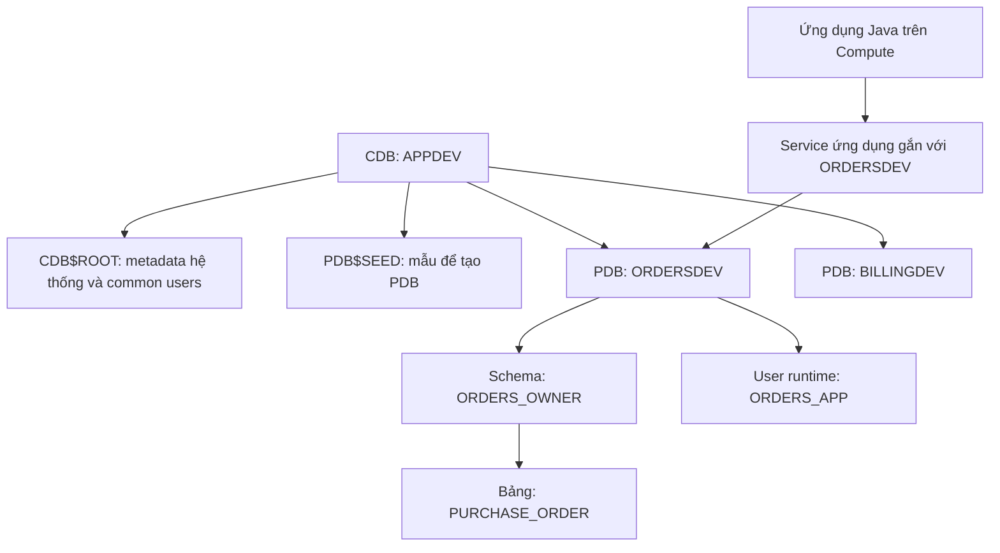
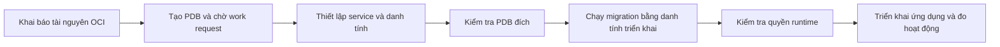

# CDB, PDB và tổ chức cơ sở dữ liệu ứng dụng

Trong chương **Oracle Database trên OCI** của module `CLOUD_PROVIDERS_ORACLE`, bài học này giải thích cách tổ chức dữ liệu ứng dụng bằng CDB, PDB, schema và database service. Quyết định đặt dữ liệu ở đâu phải đi cùng phân quyền, kết nối qua VCN, quản lý vòng đời, giám sát và khả năng khôi phục.

Ví dụ xuyên suốt là một dịch vụ Java quản lý đơn hàng chạy trên OCI Compute, kết nối qua mạng riêng đến Oracle Base Database Service. Mục tiêu là xác định đúng nơi tạo bảng, tài khoản nào được thay đổi cấu trúc, tài khoản nào chỉ được xử lý dữ liệu và những ứng dụng nào sẽ cùng chịu ảnh hưởng khi hạ tầng database có sự cố.

Phần SQL minh họa dùng các khái niệm và cú pháp của Oracle Database 19c. Khi áp dụng cho phiên bản khác hoặc dịch vụ như Autonomous Database, cần dùng quyền quản trị, công cụ và mô hình kết nối mà dịch vụ đó cung cấp; không mặc định có quyền quản trị CDB root.

## 1. Kết quả cần đạt

Sau bài học, người học có thể:

- Vẽ quan hệ giữa tài nguyên OCI, CDB, PDB, schema và tài khoản ứng dụng.
- Giải thích vai trò của `CDB$ROOT`, `PDB$SEED` và PDB chứa dữ liệu nghiệp vụ.
- Phân biệt database instance, PDB, service name và schema.
- Chọn cách tổ chức dữ liệu theo ứng dụng, môi trường và khách hàng.
- Kết nối đúng PDB, tạo local user và phân quyền cho ứng dụng theo nhu cầu.
- Nhận diện giới hạn của việc cô lập bằng PDB đối với tài nguyên, bảo trì, backup và tính sẵn sàng.

## 2. Đặt CDB và PDB vào đúng lớp kiến trúc

### 2.1. Các tên gọi gần nhau nhưng giải quyết những việc khác nhau

| Khái niệm | Vai trò trong ví dụ | Câu hỏi cần trả lời |
| --- | --- | --- |
| OCI tenancy | Phạm vi tài khoản cloud của tổ chức | Ai sở hữu và quản trị tài nguyên cloud? |
| Compartment | Nhóm tài nguyên phục vụ quản lý và IAM | Nhóm nào được thao tác trên tài nguyên nào? |
| VCN, subnet, NSG | Đường mạng và quy tắc truy cập | Compute nào có thể tiếp cận endpoint database? |
| DB system | Tài nguyên hạ tầng của Base Database Service | Database chạy trên cấu hình hạ tầng nào? |
| CDB | Oracle database được tổ chức theo kiến trúc multitenant | Các container nào cùng thuộc một database? |
| PDB | Phạm vi chứa schema và dữ liệu cho một nhóm nhu cầu | Dữ liệu ứng dụng được đặt trong container nào? |
| Schema | Tập đối tượng do một database user sở hữu | Ai sở hữu bảng, view, index và procedure? |
| Database service | Điểm truy cập logic mà client yêu cầu | Kết nối được đưa tới PDB và workload nào? |

Ở phía OCI, người học quan sát tài nguyên và quyền thao tác qua Console/API. Ở phía SQL, người học làm việc với container, user và object privileges. Không suy ra quyền `SELECT` một bảng chỉ từ việc một người được xem DB system trong Console. Tài liệu phân quyền tài nguyên cloud liệt kê riêng các resource type và thao tác được IAM kiểm soát: [Policy Details for Base Database Service](https://docs.oracle.com/en/cloud/paas/base-database/guide/policy-details.html).

### 2.2. Hai nghĩa của từ tenant

**OCI tenancy** là khái niệm quản lý tài khoản cloud. **Tenant của ứng dụng SaaS** là khách hàng hoặc tổ chức sử dụng phần mềm. Một khách hàng SaaS có thể được tổ chức bằng một PDB riêng, một schema riêng hoặc các dòng có `tenant_id` trong bảng dùng chung.

Đây là lựa chọn thiết kế ứng dụng. Không có quy tắc bắt buộc một khách hàng SaaS phải tương ứng một OCI tenancy hay một PDB. Trong ví dụ của bài, tổ chức có một OCI tenancy nhưng có thể phục vụ nhiều khách hàng trên cùng một hệ thống đơn hàng.

## 3. CDB gồm những thành phần nào?

### 3.1. Root, seed và PDB nghiệp vụ

Kiến trúc multitenant cho phép một CDB chứa các PDB. Một PDB là tập hợp schema, đối tượng và cấu trúc liên quan, được ứng dụng nhìn nhận như một database riêng qua kết nối Oracle Net. Khi tạo CDB, Oracle tạo root và seed. [Introduction to the Multitenant Architecture](https://docs.oracle.com/en/database/oracle/oracle-database/19/multi/introduction-to-the-multitenant-architecture.html).



Ba thành phần cần nhận diện:

- **`CDB$ROOT`** lưu metadata do Oracle cung cấp và các common user thuộc phạm vi CDB. Bảng nghiệp vụ thông thường được đặt trong PDB người dùng.
- **`PDB$SEED`** là PDB mẫu do Oracle cung cấp để tạo PDB mới. Không dùng seed làm nơi lưu dữ liệu đơn hàng.
- **PDB người dùng**, như `ORDERSDEV`, chứa các schema của ứng dụng. Một CDB có thể chứa nhiều PDB người dùng, tùy giới hạn và quyền sử dụng của môi trường.

CDB là toàn bộ database theo kiến trúc này; `CDB$ROOT` chỉ là một container bên trong nó. Không đồng nhất CDB với root. [Overview of Configuring and Managing a Multitenant Environment](https://docs.oracle.com/en/database/oracle/oracle-database/19/multi/overview-of-managing-a-multitenant-environment.html).

### 3.2. PDB không có một instance riêng cho mỗi PDB

Database instance là các cấu trúc bộ nhớ và tiến trình phục vụ database. Với cấu hình single-instance, các PDB của CDB dùng chung instance. Với Oracle RAC, nhiều instance có thể cùng phục vụ một database; số PDB không quyết định số instance. Các PDB có thể cạnh tranh tài nguyên bộ nhớ và I/O. [Overview of the Multitenant Architecture](https://docs.oracle.com/en/database/oracle/oracle-database/19/multi/overview-of-the-multitenant-architecture.html).

Hệ quả thiết kế: tạo thêm `BILLINGDEV` trong CDB hiện tại không có nghĩa đã tạo thêm một VM, một hệ điều hành hay một tập CPU độc lập. Cần xem tải tổng và khả năng quản lý tài nguyên trước khi gộp thêm workload.

### 3.3. Dữ liệu riêng và hạ tầng dùng chung

PDB có các datafile riêng cho dữ liệu của nó, bao gồm các tablespace hệ thống trong PDB. Các cấu trúc như control file và online redo log được quản lý ở cấp CDB. Undo có chế độ local hoặc shared, nên không nên học quy tắc rằng mọi PDB luôn có mọi thành phần lưu trữ hoàn toàn độc lập. [Overview of the Multitenant Architecture](https://docs.oracle.com/en/database/oracle/oracle-database/19/multi/overview-of-the-multitenant-architecture.html).

Tablespace là cách tổ chức lưu trữ logic; datafile là cấu trúc lưu trên storage. Schema gom các đối tượng theo chủ sở hữu, không phải một thư mục datafile. Một schema có thể có đối tượng nằm trong nhiều tablespace, và một tablespace có thể chứa đối tượng của nhiều schema. [Physical Storage Structures](https://docs.oracle.com/en/database/oracle/oracle-database/19/cncpt/physical-storage-structures.html).

## 4. Schema, user và quyền trong một PDB

### 4.1. Chủ sở hữu dữ liệu và tài khoản chạy ứng dụng

Ví dụ trong PDB `ORDERSDEV`:

```text
ORDERSDEV
  ORDERS_OWNER
    PURCHASE_ORDER
    ORDER_ITEM
    ORDER_HISTORY
  ORDERS_APP
    Quyền kết nối và quyền thao tác được cấp trên một số bảng
  ORDERS_READONLY
    Quyền đọc các đối tượng được phép
```

Một database user có schema mang tên tương ứng. Vì thế `ORDERS_APP` cũng có schema của mình, nhưng có thể không sở hữu bảng nào. Ứng dụng dùng `ORDERS_APP` vẫn có thể truy cập `ORDERS_OWNER.PURCHASE_ORDER` khi được cấp quyền phù hợp.

Cách phân chia đề xuất cho ví dụ:

| Danh tính | Công việc | Quyền cần thiết trong ví dụ |
| --- | --- | --- |
| DBA quản trị PDB | Tạo user, cấp quyền, quản lý vận hành | Quyền quản trị được giao trong PDB |
| `ORDERS_OWNER` | Triển khai thay đổi schema | Tạo bảng và sở hữu các object của ứng dụng |
| `ORDERS_APP` | Xử lý request nghiệp vụ | Kết nối, đọc, thêm và cập nhật dữ liệu cần dùng |
| Tài khoản báo cáo | Đọc dữ liệu đã được cho phép | Quyền trên view/bảng phục vụ báo cáo |

Tách danh tính giúp việc review quyền có câu hỏi cụ thể: một request web có cần tạo user hoặc thay đổi cấu trúc bảng hay không? Với ví dụ này, câu trả lời là không; các thao tác đó thuộc quy trình triển khai hoặc quản trị.

### 4.2. Local user và common user

**Local user** thuộc một PDB. Hai PDB có thể cùng có local user tên `ORDERS_APP`, nhưng đó là hai danh tính độc lập. **CDB common user** có cùng danh tính trong root và các PDB thuộc CDB; phạm vi quyền còn phụ thuộc cách cấp quyền. Không hiểu common user là user mặc nhiên có toàn quyền ở mọi PDB. [Administering User Accounts and Security](https://docs.oracle.com/en/database/oracle/oracle-database/19/admqs/administering-user-accounts-and-security.html).

Trong cấu hình mặc định, tên CDB common user do người dùng tạo thường có tiền tố `C##`. Tài khoản nghiệp vụ trong bài là local user và được tạo khi session đang ở `ORDERSDEV`. Nếu tạo user nghiệp vụ tại root rồi gặp lỗi về tên common user, việc thêm `C##` chỉ để vượt lỗi sẽ làm lệch mô hình quyền đã chọn. [CREATE USER](https://docs.oracle.com/en/database/oracle/oracle-database/19/sqlrf/CREATE-USER.html).

### 4.3. OCI IAM và quyền SQL là các quyết định liên quan nhưng riêng biệt

Để dịch vụ Java truy cập dữ liệu thành công, cần giải quyết đủ ba lớp:

1. Đường mạng cho phép client tiếp cận endpoint và listener.
2. Database chấp nhận danh tính dùng để đăng nhập.
3. Danh tính đó có quyền thao tác trên object cần dùng.

Base Database Service có cơ chế tích hợp OCI IAM cho truy cập database, nhưng cần cấu hình hỗ trợ và ánh xạ danh tính/quyền ở database. Quyền quản lý tài nguyên cloud không tự biến thành quyền đọc mọi bảng. Lab của bài sử dụng local database user để tập trung vào container và object privileges. [Use IAM Authentication with Base Database Service](https://docs.oracle.com/en/cloud/paas/base-database/guide/iam.html).

## 5. Service name đưa ứng dụng đến đúng PDB

### 5.1. Host, instance, PDB và service name

Một cấu hình kết nối cần làm rõ:

```text
Host hoặc endpoint: đường đến listener
Port/protocol: cách tiếp cận listener
Service name: dịch vụ database mà client yêu cầu
Username: danh tính đăng nhập trong phạm vi đích
Schema: nơi tìm các object nghiệp vụ
```

Service có thuộc tính liên kết với PDB. Khi client kết nối đến service đó, PDB trở thành current container của session. Một PDB có thể có nhiều service cho các workload khác nhau. Oracle khuyến nghị dùng service do quản trị viên cấu hình cho ứng dụng thay vì default PDB service. [Administering PDBs — Managing Services](https://docs.oracle.com/en/database/oracle/oracle-database/19/multi/administering-pdbs-with-sql-plus.html).

Ví dụ minh họa, giả định DBA đã cấu hình và khởi động application service `ordersdev_app.example.com` gắn với `ORDERSDEV`:

```text
jdbc:oracle:thin:@//dbhost.example.com:1521/ordersdev_app.example.com
```

Đây là dạng URL JDBC Thin dùng service name. Tên PDB, SID và service name không phải các giá trị có thể thay thế tùy ý. Chuỗi kết nối thật phải lấy từ cấu hình database/service đang dùng. Ví dụ TCP này dành cho mạng lab; endpoint yêu cầu TCPS, TLS hoặc wallet cần descriptor và cấu hình client tương ứng.

Console của Base Database Service có thể cung cấp chuỗi kết nối cho administrative service của PDB. Khi cấu hình ứng dụng, dùng chuỗi của application service đã được DBA chuẩn bị. [Get Connection Strings for a Pluggable Database](https://docs.oracle.com/en/cloud/paas/base-database/guide/pdb-strings.html).

### 5.2. Kiểm tra session thay vì đoán từ tên cấu hình

Truy vấn sau dùng được với tài khoản ứng dụng để quan sát session:

```sql
SELECT
    SYS_CONTEXT('USERENV', 'CON_NAME')       AS container_name,
    SYS_CONTEXT('USERENV', 'SERVICE_NAME')   AS service_name,
    SYS_CONTEXT('USERENV', 'SESSION_USER')   AS session_user,
    SYS_CONTEXT('USERENV', 'CURRENT_SCHEMA') AS current_schema
FROM dual;
```

Với ví dụ đúng, `container_name` phải là `ORDERSDEV`; khi đăng nhập bằng tài khoản runtime, `session_user` là `ORDERS_APP`. `current_schema` ban đầu thường trùng tài khoản đăng nhập. Các thuộc tính này mô tả container, service và danh tính của session đang chạy truy vấn. [SYS_CONTEXT](https://docs.oracle.com/en/database/oracle/oracle-database/19/sqlrf/SYS_CONTEXT.html).

Một thay đổi `CURRENT_SCHEMA` chỉ điều chỉnh schema mặc định khi phân giải tên object. Nó không chuyển sang PDB khác, không đăng nhập thành owner và không tự cấp thêm quyền. Ví dụ, đổi current schema sang `ORDERS_OWNER` có thể giúp bỏ tiền tố tên bảng, nhưng tài khoản vẫn cần quyền trên bảng. Trong lab, dùng tên đầy đủ `ORDERS_OWNER.PURCHASE_ORDER` để dễ quan sát chủ sở hữu.

Với connection pool, chuẩn bị cấu hình datasource theo PDB/service và quyền đã chọn. Nếu thay đổi trạng thái session, phải bảo đảm pool thiết lập lại trạng thái trước khi cấp connection cho request tiếp theo; nếu không, request có thể nhận trạng thái còn sót lại từ lần sử dụng trước.

## 6. Chọn đơn vị tổ chức dữ liệu ứng dụng

### 6.1. Các phương án để cân nhắc

Bảng sau là khung ra quyết định cho thiết kế, không phải thứ tự bắt buộc phải nâng cấp:

| Phương án | Phù hợp để cân nhắc khi | Đánh đổi cần giải quyết |
| --- | --- | --- |
| Nhiều chức năng trong một schema | Cùng ứng dụng, cùng chủ sở hữu và cùng vòng đời | Quyền và thay đổi cấu trúc gắn chặt với nhau |
| Nhiều schema trong một PDB | Cần phân chia chủ sở hữu object nhưng còn nhiều giao dịch chung | Grant chéo schema, phụ thuộc và quy trình triển khai |
| Một PDB cho mỗi ứng dụng/nhóm ứng dụng | Muốn tách user, schema và quản lý vòng đời ở cấp PDB | Tài nguyên và phạm vi sự cố CDB vẫn dùng chung |
| Một PDB cho mỗi khách hàng | Cần thao tác dữ liệu và khôi phục theo khách hàng | Số lượng PDB, migration hàng loạt và vận hành tăng |
| CDB/hạ tầng riêng cho nhóm workload | Cần ranh giới bảo trì, quyền quản trị hoặc năng lực riêng rõ hơn | Tăng tài nguyên và khối lượng quản trị |

Ngay cả khi dùng CDB khác, cần kiểm tra chúng có còn chia sẻ host, storage, Oracle home hay quy trình bảo trì hay không. Muốn tăng mức độc lập phải chỉ ra thành phần dùng chung nào đã được tách.

### 6.2. Môi trường phát triển và production

Ví dụ tổ chức cho bài lab:

```text
Compartment phục vụ phát triển
  DB system phát triển
    CDB APPDEV
      PDB ORDERSDEV
      PDB BILLINGDEV

Compartment phục vụ production
  DB system phục vụ production
    CDB APPPROD
      PDB ORDERSPROD
```

Mô hình này giúp nhóm phát triển diễn tập thay đổi trước khi áp dụng production. Nó là một phương án thiết kế, không phải cấu trúc được OCI tạo mặc định. Việc có tên `DEV` và `PROD` ở hai PDB trong cùng CDB chưa tách được tác động của restart, cạn storage hoặc bảo trì chung.

### 6.3. Chia khách hàng bằng PDB, schema hay dòng dữ liệu

Với hệ thống SaaS, hãy bắt đầu từ thao tác khó nhất cần làm cho một khách hàng:

- Nếu khách hàng yêu cầu xuất hoặc khôi phục dữ liệu riêng, xác định có thể thao tác ở mức PDB hay phải lọc các object/dòng liên quan.
- Nếu chia schema theo khách hàng, chuẩn bị cách áp dụng cùng một migration cho tất cả schema và theo dõi phiên bản từng schema.
- Nếu dùng bảng chung có `tenant_id`, thiết kế ràng buộc, truy vấn, cache, báo cáo và kiểm tra truy cập để không lẫn dữ liệu giữa các khách hàng.
- Nếu chia PDB theo khách hàng, chuẩn bị inventory, quyền, service, connection pool và chiến lược rollout cho số lượng PDB dự kiến.

Cô lập bằng tên không thay thế kiểm thử quyền. Cần chứng minh tài khoản của khách hàng A không đọc được dữ liệu của khách hàng B qua cả truy vấn thông thường lẫn các đường tích hợp.

### 6.4. Application container là một khái niệm chuyên biệt

Trong Oracle Multitenant, **application container** có application root và các application PDB, hỗ trợ quản lý application common objects. Một PDB chứa dữ liệu cho ứng dụng Java thông thường không tự trở thành application container. Lab dùng PDB thông thường; chỉ cân nhắc application container khi có nhu cầu chia sẻ/quản lý đối tượng theo mô hình đó. [Administering Application Containers](https://docs.oracle.com/en/database/oracle/oracle-database/19/multi/administering-application-containers-with-sql-plus.html).

## 7. Thực hành: tổ chức dữ liệu đơn hàng trong một PDB

### 7.1. Điều kiện và kết quả mong đợi

Chuẩn bị một môi trường lab Oracle Base Database Service có CDB hoạt động, tài khoản OCI được phép quản lý tài nguyên lab, và kết nối mạng riêng từ máy thực hành hoặc Compute đến database. SQL*Plus hoặc công cụ SQL tương đương cần sử dụng được kết nối mà DBA cung cấp.

Kết quả mong đợi:

```text
PDB ORDERSDEV ở trạng thái cho phép ghi
Application service gắn với ORDERSDEV đã hoạt động
ORDERS_OWNER sở hữu bảng PURCHASE_ORDER
ORDERS_APP chỉ có quyền runtime cần cho lab
Session của hai tài khoản đều vào đúng ORDERSDEV
```

Phần tạo user cần DBA có quyền tạo user, tạo role và cấp các quyền nêu bên dưới trong PDB. Không giả định mọi PDB admin do dịch vụ cung cấp đều có cùng tập quyền. Nếu thiếu quyền, DBA thực hiện bước tương ứng theo phân quyền của môi trường.

Các lệnh tạo user/bảng là thao tác một lần trên tên chưa tồn tại. Lab không cung cấp script xóa user hay xóa PDB tự động; nếu tên đã tồn tại, kiểm tra chủ sở hữu và dữ liệu trước khi chọn tên lab khác.

### 7.2. Tạo hoặc chọn PDB bằng công cụ OCI

Trong Base Database Service, mở đúng DB system, chọn database/CDB, vào danh sách **Pluggable Databases** và tạo PDB tên `ORDERSDEV` nếu môi trường lab chưa có. Điền thông tin quản trị và TDE wallet theo cấu hình yêu cầu; theo dõi work request đến khi thao tác hoàn tất. Tài liệu Console mô tả các trường và lựa chọn backup ngay khi tạo: [Create a Pluggable Database](https://docs.oracle.com/en/cloud/paas/base-database/guide/pdb-create.html).

Nếu đã có một PDB lab được giao, dùng PDB đó và thay nhất quán tên trong các ví dụ. Nhờ DBA cấu hình application service gắn đúng PDB; tên service dùng trong URL minh họa không được tạo tự động chỉ bằng cách chép URL.

Với dịch vụ được quản lý, ưu tiên Console/API và công cụ được hỗ trợ cho thao tác vòng đời. PDB tạo trực tiếp bằng SQL có thể chưa xuất hiện ngay trong OCI control plane; trạng thái SQL và trạng thái Console cần được đối chiếu. [About Pluggable Databases](https://docs.oracle.com/en/cloud/paas/base-database/guide/pdb-about.html).

### 7.3. Quan sát CDB và danh sách PDB bằng tài khoản quản trị

Bước này dành cho DBA có quyền đọc các view tương ứng. Chạy từ root của CDB lab:

```sql
SELECT name, cdb
FROM v$database;

SELECT con_id, name, open_mode, restricted
FROM v$pdbs
ORDER BY con_id;
```

Trong CDB, truy vấn đầu trả về `CDB = YES`. Truy vấn sau giúp quan sát tên PDB, trạng thái mở và chế độ restricted của instance hiện tại. `PDB$SEED` thường xuất hiện ở chế độ `READ ONLY`; PDB lab cần phục vụ ghi dữ liệu phải ở trạng thái phù hợp. Trên RAC, cần quan sát các instance mà service có thể chạy, thay vì chỉ một instance. [V$PDBS](https://docs.oracle.com/en/database/oracle/oracle-database/19/refrn/V-PDBS.html).

Tài khoản ứng dụng không cần quyền đọc rộng toàn bộ catalog để hoàn thành các thao tác dữ liệu trong bài.

### 7.4. Kết nối DBA vào PDB và chặn thao tác nhầm container

Mở kết nối quản trị tới PDB lab bằng connect descriptor đã được cung cấp. Trước các lệnh tạo object, kiểm tra current container như mục 5.2. Với SQL*Plus chạy script, có thể dùng đoạn bảo vệ sau:

```sql
WHENEVER SQLERROR EXIT SQL.SQLCODE ROLLBACK

BEGIN
    IF SYS_CONTEXT('USERENV', 'CON_NAME') <> 'ORDERSDEV' THEN
        RAISE_APPLICATION_ERROR(-20001, 'Can ket noi vao PDB ORDERSDEV');
    END IF;
END;
/
```

Đoạn kiểm tra dùng tên chính xác của PDB lab và làm script dừng khi vào nhầm container. Với công cụ chạy từng statement, cần bảo đảm công cụ thực sự dừng sau lỗi trước khi thực thi các lệnh tiếp theo.

Không coi `ROLLBACK` là cơ chế hoàn tác trọn vẹn cho script DDL. Các bước tạo user, tạo bảng và cấp quyền phải được theo dõi theo từng kết quả; chúng không tạo thành một giao dịch ứng dụng duy nhất có thể rollback toàn bộ.

### 7.5. Tạo owner, runtime user và role

Giả định trong `ORDERSDEV` đã có tablespace `USERS` và temporary tablespace `TEMP`. DBA xác minh trước khi dùng; nếu môi trường dùng tablespace khác, thay cả tên default tablespace lẫn tên trong quota.

Hai giá trị `<MAT_KHAU_OWNER>` và `<MAT_KHAU_APP>` là chỗ thay thế, không phải mật khẩu dùng sẵn. Cung cấp mật khẩu riêng đáp ứng chính sách database bằng cơ chế quản lý bí mật của môi trường; không lưu script đã điền mật khẩu vào kho mã nguồn.

Chạy bằng tài khoản DBA trong PDB:

```sql
CREATE USER orders_owner
    IDENTIFIED BY "<MAT_KHAU_OWNER>"
    DEFAULT TABLESPACE users
    TEMPORARY TABLESPACE temp
    QUOTA 100M ON users;

GRANT CREATE SESSION, CREATE TABLE TO orders_owner;

CREATE USER orders_app
    IDENTIFIED BY "<MAT_KHAU_APP>";

GRANT CREATE SESSION TO orders_app;

CREATE ROLE orders_runtime_role;
GRANT orders_runtime_role TO orders_app;
```

`CREATE SESSION` cho phép đăng nhập. Quota `100M` giới hạn không gian mà owner được sử dụng trong tablespace `USERS`, không phải giới hạn RAM hoặc CPU của PDB. Runtime user chưa được cấp quyền tạo bảng và chưa có quyền trên bảng nghiệp vụ. Việc cấp quota và các quyền này là những quyết định riêng. [Creating User Accounts](https://docs.oracle.com/en/database/oracle/oracle-database/19/dbseg/creating-user-accounts.html).

Các tài khoản được tạo trong PDB hiện tại là local user. Không thêm `CONTAINER=ALL` vào các lệnh của lab.

### 7.6. Dùng owner để tạo object và cấp quyền dữ liệu

Mở một kết nối mới bằng `ORDERS_OWNER` đến cùng application service; client sẽ hỏi mật khẩu:

```bash
sqlplus orders_owner@//dbhost.example.com:1521/ordersdev_app.example.com
```

Thực hiện lại truy vấn kiểm tra container và đoạn bảo vệ ở mục 7.4, rồi tạo bảng:

```sql
CREATE TABLE purchase_order (
    order_id     NUMBER(19)     NOT NULL,
    status       VARCHAR2(20)   NOT NULL,
    total_amount NUMBER(12,2)   NOT NULL,
    created_at   TIMESTAMP DEFAULT SYSTIMESTAMP NOT NULL,
    CONSTRAINT pk_purchase_order PRIMARY KEY (order_id),
    CONSTRAINT ck_order_status
        CHECK (status IN ('NEW', 'PAID', 'CANCELLED')),
    CONSTRAINT ck_order_amount CHECK (total_amount >= 0)
);

GRANT SELECT, INSERT, UPDATE
    ON purchase_order
    TO orders_runtime_role;
```

Owner cấp quyền trên object mà mình sở hữu cho role đã được DBA tạo. Trong phạm vi lab, ứng dụng xử lý hủy đơn bằng trạng thái `CANCELLED` nên role không cần quyền `DELETE`. Tập quyền phải đi theo hành vi thực tế, không theo một role rộng được sao chép từ hệ thống khác.

Khi triển khai thêm bảng mới, cần có bước cấp quyền tương ứng trong migration. Grant trên bảng hiện tại không tự áp dụng cho mọi bảng được tạo trong tương lai. Nếu dùng PL/SQL với mô hình quyền của definer, cần đánh giá direct grants phù hợp thay vì mặc định quyền qua role luôn đủ cho việc biên dịch/thực thi mã lưu trữ.

### 7.7. Dùng runtime user để kiểm chứng hành vi

Mở một kết nối mới bằng tài khoản runtime:

```bash
sqlplus orders_app@//dbhost.example.com:1521/ordersdev_app.example.com
```

Sau khi xác nhận session thuộc `ORDERSDEV`, chạy:

```sql
INSERT INTO orders_owner.purchase_order (
    order_id, status, total_amount
) VALUES (
    1001, 'NEW', 125000
);

COMMIT;

SELECT order_id, status, total_amount
FROM orders_owner.purchase_order
WHERE order_id = 1001;

UPDATE orders_owner.purchase_order
SET status = 'PAID'
WHERE order_id = 1001;

COMMIT;
```

Kết quả mong đợi là đọc được đơn `1001` và cập nhật được trạng thái. Bảng thuộc `ORDERS_OWNER`, mặc dù session đang đăng nhập bằng `ORDERS_APP`.

Để kiểm chứng quyền bị giới hạn, ở cuối buổi lab chạy riêng lệnh sau bằng `ORDERS_APP`:

```sql
CREATE TABLE runtime_ddl_probe (id NUMBER);
```

Với đúng tập quyền vừa cấp và không có quyền khác được bổ sung, lệnh phải bị từ chối vì runtime user không có quyền tạo bảng. Nếu lệnh thành công, kiểm tra các system privilege/role đã tồn tại; không coi đó là kết quả đạt của lab. Không cần cố đọc catalog quản trị bằng runtime user để chứng minh giới hạn này.

Nếu chạy lại phần thêm dữ liệu, `order_id = 1001` đã tồn tại có thể gây lỗi khóa chính. Chọn một ID thử nghiệm mới hoặc kiểm tra dữ liệu đang có trước khi lặp thao tác.

### 7.8. Cấu hình ứng dụng Java

Ví dụ cấu hình datasource lấy từ môi trường triển khai:

```properties
spring.datasource.url=${ORDERS_DB_URL}
spring.datasource.username=${ORDERS_DB_USER}
spring.datasource.password=${ORDERS_DB_PASSWORD}
```

Trong đó URL dùng application service, user là `ORDERS_APP`, và mật khẩu được đưa vào bằng cơ chế quản lý bí mật. Migration dùng danh tính triển khai riêng. Ứng dụng cần có JDBC driver tương thích và đường mạng tới database; các dòng properties không tự tạo user, service hay PDB.

Khi kiểm tra kết nối ở giai đoạn triển khai, chạy truy vấn mục 5.2 và đối chiếu PDB/service mong đợi. Không dùng một kiểm tra chỉ mở được socket làm bằng chứng rằng ứng dụng đã vào đúng PDB và có quyền đọc bảng.

Với hệ thống vận hành chặt hơn, owner có thể được thiết kế thành schema-only account kết hợp quy trình triển khai được kiểm soát. Oracle hỗ trợ `NO AUTHENTICATION` cho loại tài khoản đó; nó không đăng nhập trực tiếp bằng mật khẩu như owner trong lab. [Schema-Only Accounts](https://docs.oracle.com/en/database/oracle/oracle-database/19/dbseg/schema-only-accounts.html).

## 8. Trạng thái PDB và ảnh hưởng tới kết nối

Các trạng thái thường gặp khi quan sát PDB:

| Trạng thái | Ý nghĩa đối với ứng dụng thông thường |
| --- | --- |
| `MOUNTED` | PDB chưa mở để ứng dụng truy vấn dữ liệu thông thường |
| `READ ONLY` | Có thể phục vụ đọc trong điều kiện được phép; DML ghi dữ liệu không phù hợp |
| `READ WRITE` | Có thể đọc/ghi nếu session và quyền đáp ứng |
| Restricted | Quyền đăng nhập còn bị giới hạn bởi chế độ restricted |

Trạng thái mở, quyền kết nối và trạng thái service cần được kiểm tra cùng nhau. Một tên PDB hiện diện trong danh sách không có nghĩa ứng dụng đã có thể sử dụng. Ý nghĩa các cột trạng thái được mô tả tại [V$PDBS](https://docs.oracle.com/en/database/oracle/oracle-database/19/refrn/V-PDBS.html).

DBA có thể cần bảo toàn trạng thái mở sau khi CDB khởi động lại. Với CDB single-instance, ví dụ sau dành cho DBA tại root, khi PDB đã ở trạng thái mở mong muốn:

```sql
ALTER PLUGGABLE DATABASE ORDERSDEV SAVE STATE;
```

Lệnh lưu trạng thái mở để dùng khi CDB khởi động lại; nó không lưu một bản backup dữ liệu. Với RAC hoặc service chịu quản lý bởi cluster, kiểm tra trạng thái theo instance và cơ chế quản lý service của hệ thống. [Administering PDBs — Preserving Open Mode](https://docs.oracle.com/en/database/oracle/oracle-database/19/multi/administering-pdbs-with-sql-plus.html).

Không thực hiện restart CDB chỉ để thử câu lệnh trên trong một môi trường đang chia sẻ với ứng dụng khác. Bài thực hành yêu cầu quan sát và cấu hình có chủ đích trong phạm vi lab được giao.

## 9. Clone, backup và khôi phục là các thao tác khác nhau

### 9.1. Chọn thao tác theo mục tiêu

| Mục tiêu | Cách tiếp cận cần xem xét | Điều phải xác minh |
| --- | --- | --- |
| Tạo nơi thử nghiệm từ dữ liệu hiện có | Clone PDB | Dữ liệu nhạy cảm, dung lượng, kết nối sau clone |
| Chuyển dữ liệu sang CDB khác | Relocate hoặc phương án migration được hỗ trợ | Tương thích phiên bản, cấu hình đích, dịch vụ kết nối |
| Khôi phục sau thao tác sai | Quy trình restore/recovery | Điểm khôi phục, bản backup và redo cần thiết |
| Bảo vệ trước mất CDB/hạ tầng | Backup và phương án HA/DR | Phạm vi sự cố, RPO, RTO và đường chuyển đổi |

Trong Base Database Service, các loại clone/relocate/restore có điều kiện riêng theo công cụ và cấu hình. Việc có thao tác PDB trong Console không có nghĩa mọi thao tác đều dùng cùng điều kiện mạng hoặc phiên bản. [About Pluggable Databases](https://docs.oracle.com/en/cloud/paas/base-database/guide/pdb-about.html).

### 9.2. Phân biệt đơn vị backup và đơn vị restore

Theo tài liệu Base Database Service, backup được thực hiện ở cấp CDB và bao gồm các PDB; không suy ra mỗi PDB có một lịch backup độc lập chỉ vì có trang chi tiết riêng. Một bản clone đang chạy trong cùng CDB cũng không thay thế bản backup dùng để phục hồi khi mất CDB. [About Pluggable Databases — Backup](https://docs.oracle.com/en/cloud/paas/base-database/guide/pdb-about.html).

Dịch vụ có quy trình restore PDB, gồm phục hồi tại chỗ và phương án phục hồi sang CDB mới theo điều kiện hỗ trợ. Vì vậy, backup ở cấp CDB không đồng nghĩa mọi yêu cầu khôi phục đều bắt buộc ghi đè toàn bộ CDB nguồn. Cần chọn quy trình theo mục tiêu và xác minh tác động tới dữ liệu liên quan. [Restore a Pluggable Database](https://docs.oracle.com/en/cloud/paas/base-database/guide/pdb-restore.html).

Ví dụ suy luận nghiệp vụ: nếu đơn hàng nằm trong PDB A nhưng bút toán thanh toán nằm trong PDB B, đưa riêng A về thời điểm trước giao dịch có thể làm hai hệ thống không còn thống nhất. Kế hoạch khôi phục phải có bước đối soát hoặc xử lý bù; việc database mở lại thành công chưa đủ chứng minh toàn bộ nghiệp vụ đã khôi phục đúng.

### 9.3. Phạm vi sự cố còn dùng chung

Một PDB riêng hỗ trợ phân chia quản trị dữ liệu, nhưng không tự tạo dự phòng cho CDB hoặc storage bên dưới. Khi chọn cấu hình, ghi cụ thể:

- Thành phần nào ngừng hoạt động thì tất cả PDB cùng bị ảnh hưởng?
- Ứng dụng có thể chấp nhận gián đoạn bảo trì chung bao lâu?
- Kết nối và pool sẽ phục hồi thế nào sau khi endpoint/service chuyển sang nơi phục vụ mới?
- Cần mất tối đa bao nhiêu dữ liệu và bao lâu để dịch vụ hoạt động lại?

Các câu trả lời quyết định có cần kiến trúc RAC, Data Guard hoặc phương án DR phù hợp với dịch vụ và edition hay không. Không dùng số lượng PDB làm thước đo tính sẵn sàng.

## 10. Tài nguyên dùng chung và kiểm soát chi phí

### 10.1. Chống một workload lấn át workload khác

Oracle Database Resource Manager hỗ trợ phân bổ mức ưu tiên và giới hạn tài nguyên cho PDB thông qua CDB resource plan; có thể tiếp tục quản lý workload bên trong PDB. Shares là trọng số phân bổ trong cơ chế quản lý tài nguyên, không phải CPU vật lý được mua riêng cho từng PDB. [Using Oracle Resource Manager for PDBs](https://docs.oracle.com/en/database/oracle/oracle-database/19/multi/using-oracle-resource-manager-for-pdbs-with-sql-plus.html).

Ví dụ thiết kế: CDB có xử lý đơn hàng trực tuyến và báo cáo cuối ngày. Nếu báo cáo tăng tải khiến latency đơn hàng vượt mục tiêu, trước khi tăng cấu hình toàn hệ thống cần đo SQL, I/O, session và mức cạnh tranh. Có thể cần giới hạn parallelism của báo cáo, điều chỉnh lịch chạy hoặc dùng resource plan phù hợp. Trọng số tài nguyên không sửa được một truy vấn sai hay một đường I/O đã đạt trần.

Quota tablespace cho `ORDERS_OWNER` chỉ kiểm soát phần không gian được phép dùng trong tablespace đó. Muốn kiểm soát tài nguyên toàn PDB, cần công cụ và cấu hình tương ứng; không dùng quota `100M` trong lab để suy ra hạn mức dung lượng tổng của PDB hoặc toàn bộ DB system.

### 10.2. Gom database có thể giảm phần dùng chung, nhưng tăng nghĩa vụ vận hành

Cân nhắc chi phí theo mô hình:

```text
Chi phí cần theo dõi
  = compute và storage của hạ tầng database
  + backup, retention và bản sao phục vụ khôi phục
  + năng lực dự phòng cho HA/DR
  + công cụ và quyền sử dụng theo offering
  + công sức vận hành nhiều PDB/schema/service
```

Đây là khung lập kế hoạch, không phải công thức tính hóa đơn OCI. Thêm PDB có thể không tạo thêm một DB system, nhưng dữ liệu, redo, backup, kết nối và tải vẫn tăng. Dừng một PDB cũng không đồng nghĩa đã dừng tính phí tài nguyên hạ tầng còn được cấp phát.

Số PDB và khả năng sử dụng tính năng phụ thuộc phiên bản, edition, offering và điều khoản áp dụng. Đối chiếu mục Consolidation cùng các tính năng liên quan trong tài liệu đúng phiên bản và cấu hình dịch vụ; không lấy giới hạn kỹ thuật làm bằng chứng quyền sử dụng. [Oracle Database Licensing Information](https://docs.oracle.com/en/database/oracle/oracle-database/19/dblic/Licensing-Information.html).

## 11. Giám sát và tự động hóa theo đúng cấp

### 11.1. Theo dõi từ trải nghiệm ứng dụng xuống database

Một bộ quan sát đề xuất cho hệ thống đơn hàng:

| Cấp quan sát | Dữ liệu cần quan tâm | Quyết định hỗ trợ |
| --- | --- | --- |
| Ứng dụng Java | p95/p99 latency, lỗi SQL, pool active/pending | Có nghẽn chờ connection hoặc lỗi quyền/kết nối không? |
| Service/PDB | Trạng thái service, session, hoạt động SQL, waits | Workload nào đang gặp vấn đề? |
| CDB/instance | CPU, memory pressure, redo, tải tổng | Có cạnh tranh giữa các PDB không? |
| Storage/backup | Dung lượng, tăng trưởng, kết quả backup/restore | Có nguy cơ hết chỗ hoặc không đạt mục tiêu khôi phục không? |

Metrics của OCI có phạm vi theo loại tài nguyên và chiều dữ liệu được cung cấp. Không mặc định mọi biểu đồ DB system đều phân tách theo PDB, hoặc CPU tổng thấp có nghĩa PDB không bị nghẽn. Kiểm tra danh sách metric và dimensions trước khi xây alarm. [Available Metrics for Base Database Service Resources](https://docs.oracle.com/en/cloud/paas/base-database/guide/available-metrics.html).

Mỗi kết nối và sự kiện vận hành nên gắn được với ứng dụng, môi trường, PDB và service. Hạn chế ghi dữ liệu nhạy cảm hoặc mật khẩu vào log kết nối. Với số lượng PDB lớn, việc thiếu inventory thường làm điều tra khó hơn chính lệnh SQL cần chạy.

### 11.2. Tách tự động hóa hạ tầng và triển khai schema

Một luồng triển khai đề xuất:



IaC quản lý tài nguyên nào thì cần có một nơi sở hữu trạng thái của tài nguyên đó. Migration quản lý phiên bản schema. Khi API trả về đã nhận yêu cầu, tiếp tục chờ kết quả operation và kiểm tra kết nối trước khi chạy SQL. Work request là cơ chế theo dõi thao tác PDB được dịch vụ cung cấp. [About Pluggable Databases](https://docs.oracle.com/en/cloud/paas/base-database/guide/pdb-about.html).

Với mỗi PDB, nên duy trì tối thiểu tên/định danh cloud khi có, CDB và môi trường chứa nó, owner ứng dụng, service, phiên bản schema và cách khôi phục. Khi thay tên hoặc di chuyển PDB, cập nhật cả cấu hình ứng dụng, pool, tài liệu vận hành và đường truy cập mà job nền đang dùng.

## 12. Chẩn đoán các nhầm lẫn thường gặp

| Hiện tượng | Khả năng cần kiểm tra | Bước xử lý đầu tiên |
| --- | --- | --- |
| Tạo user gặp `ORA-65096` | Đang ở root hoặc tên không phù hợp loại user | Đọc `CON_NAME`, xác nhận cần local hay common user |
| Đăng nhập thất bại dù tài khoản tồn tại | Sai mật khẩu, sai PDB/service hoặc trạng thái account | Đối chiếu descriptor và nơi tài khoản được tạo |
| Listener báo `ORA-12514` | Service yêu cầu chưa được listener biết đến | Kiểm tra service name, đăng ký service và trạng thái PDB |
| Truy vấn gặp `ORA-00942` | Sai schema/object hoặc thiếu quyền nhìn thấy object | Dùng tên owner đầy đủ, đối chiếu object grants |
| Tạo bảng hoặc thêm dữ liệu gặp lỗi quota | Owner không đủ quota hoặc storage liên quan có vấn đề | DBA kiểm tra quota, tablespace và dung lượng thực tế |
| CDB hoạt động nhưng ứng dụng không ghi được | PDB read-only, service chưa sẵn sàng hoặc thiếu DML grant | Kiểm tra trạng thái đích và quyền runtime |
| Đổi `CURRENT_SCHEMA` vẫn không truy cập được | Thay phân giải tên chưa thay quyền | Kiểm tra danh tính session và object grants |
| Sau restart, một ứng dụng không kết nối lại | PDB/service/pool chưa trở về trạng thái phục vụ | DBA đối chiếu open state và cấu hình service |

Bảng chỉ là hướng điều tra, không xác định nguyên nhân duy nhất từ mã lỗi. Thu thập đầy đủ thông báo, session context và thời điểm thay đổi trước khi chỉnh quyền hoặc hạ tầng. Với lỗi tạo user, cú pháp và điều kiện của common/local user được mô tả trong [CREATE USER](https://docs.oracle.com/en/database/oracle/oracle-database/19/sqlrf/CREATE-USER.html).

## 13. Tiêu chí hoàn thành bài thực hành

Người học hoàn thành khi có thể đưa ra các bằng chứng sau:

1. Sơ đồ thể hiện OCI resource, CDB, root, seed, PDB, owner và runtime user của môi trường lab.
2. Kết quả session context chứng minh cả owner lẫn runtime user kết nối đúng PDB và service mong muốn.
3. Bảng `PURCHASE_ORDER` thuộc `ORDERS_OWNER`; `ORDERS_APP` xử lý được dữ liệu theo tập quyền đã chọn.
4. Một thao tác ngoài quyền runtime bị từ chối, kèm giải thích quyền nào thiếu và vì sao không cần cấp quyền đó.
5. Phương án đặt thêm ứng dụng hoặc khách hàng mới, nêu rõ thành phần còn dùng chung và tác động đến tài nguyên.
6. Mô tả nơi lưu backup, cách khôi phục theo mục tiêu và cách kiểm tra tính nhất quán với hệ thống liên quan.

Bằng chứng cần tập trung vào hành vi và phạm vi tác động: ứng dụng vào đúng container, tài khoản có đúng quyền, tài nguyên được theo dõi và dữ liệu có đường khôi phục đã xác định.
