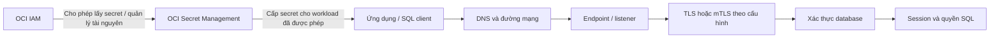
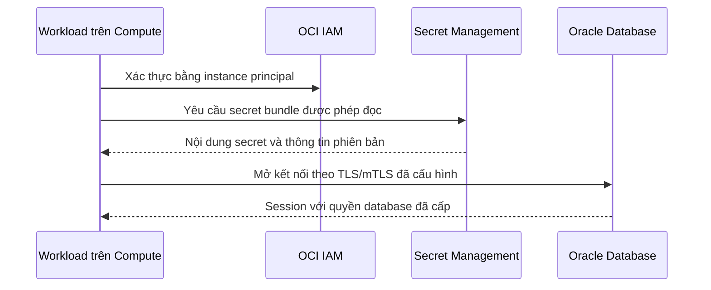

# Kết nối SQL, JDBC, wallet và quản lý thông tin xác thực

Một ứng dụng truy cập được OCI Console chưa chắc đăng nhập được Oracle Database. Một máy chủ mở được cổng database cũng chưa chắc vượt qua xác minh chứng chỉ. Ngược lại, username và password đúng vẫn không giúp ứng dụng kết nối nếu DNS, route hoặc service name sai.

Trong chương **Oracle Database trên OCI** của module **CLOUD_PROVIDERS_ORACLE**, bài này trình bày đường đi từ thông tin kết nối đến một session SQL hoạt động. Nội dung kết hợp kết nối mạng trong VCN, TLS/mTLS, JDBC cho Java, Oracle Wallet và quản lý secret bằng IAM để người học có thể triển khai, giám sát và thay đổi thông tin xác thực có kiểm soát.

Các ví dụ wallet trong bài chủ yếu dành cho **Autonomous Database Serverless**. Với Base Database Service, Exadata Database Service hoặc Autonomous trên Dedicated Exadata Infrastructure, phải dùng cấu hình và tài liệu của đúng dịch vụ; không áp dụng nguyên mẫu cổng, chế độ TLS hay cách tải wallet của Serverless cho mọi database trên OCI.

Sau bài học, người học có thể:

- Đọc host, port, service name, TNS alias và JDBC URL.
- Phân biệt quyền quản trị OCI với quyền đăng nhập và chạy SQL trong database.
- Chọn TLS hoặc mTLS theo cấu hình thực tế và chuẩn bị đúng client credentials.
- Kết nối bằng công cụ SQL và Java mà không ghi password trực tiếp vào mã nguồn.
- Lập quy trình đổi password, wallet và connection pool, kèm bằng chứng kiểm tra kết nối mới.
- Khoanh vùng lỗi theo lớp và thu thập log không chứa secret.

## 1. Một kết nối thành công cần những gì?

SQL là ngôn ngữ làm việc với dữ liệu. SQL*Plus, SQLcl và SQL Developer là những công cụ client. JDBC là giao diện để ứng dụng Java làm việc với database thông qua driver. Các công cụ này có thể dùng những cơ chế phân giải tên, thư viện và nơi lưu cấu hình khác nhau.

Một kết nối SQL thường đi qua bốn lớp:

| Lớp | Câu hỏi cần trả lời | Ví dụ |
| --- | --- | --- |
| Khả năng truy cập mạng | Client có đến đúng endpoint không? | DNS, route, NSG, ACL |
| Bảo vệ đường truyền | Hai bên thiết lập kênh theo yêu cầu chưa? | TLS, mTLS, xác minh certificate |
| Xác thực database | Session đại diện cho danh tính nào? | Database user/password, IAM database token khi đã cấu hình |
| Phân quyền SQL | Danh tính đó được làm gì? | Đăng nhập, đọc bảng, gọi package |



Sơ đồ mô tả luồng khái niệm; không khẳng định mọi Oracle Database listener đều mặc định dùng TLS. Với hệ thống do đội ngũ vận hành quản lý, cơ chế mã hóa phải được cấu hình và xác minh riêng.

### Quyền IAM và quyền SQL là hai phạm vi

Một người có thể có quyền xem thông tin Autonomous Database trong Console nhưng chưa có database user để đăng nhập. Một service account có quyền đọc bảng cũng không vì vậy có quyền tải wallet hay đọc secret trong OCI.

Cần xác định rõ:

- **Người vận hành OCI:** được tạo tài nguyên, thay đổi network hoặc cung cấp cấu hình kết nối.
- **Người quản trị database:** tạo user, cấp quyền và quản lý chính sách đăng nhập.
- **Ứng dụng:** chỉ lấy thông tin cần thiết và sử dụng quyền SQL đã cấp.

Khi tích hợp IAM authentication, database còn phải được bật tính năng tương ứng và có ánh xạ danh tính/schema phù hợp. Token hợp lệ không thay thế bước ánh xạ. [Oracle: IAM authentication và authorization cho database](https://docs.oracle.com/en/database/oracle/oracle-database/26/dbseg/authenticating-and-authorizing-iam-users-oracle-dbaas-databases.html).

## 2. Thu thập hồ sơ kết nối trước khi cấu hình client

Lập một hồ sơ không chứa password để hai bên ứng dụng và database cùng đối chiếu:

| Thông tin | Ý nghĩa |
| --- | --- |
| Dịch vụ database và môi trường | Autonomous Serverless, Base Database hoặc dịch vụ khác; dev/test/prod |
| Region và network access | Endpoint public hay private; client chạy từ đâu |
| Host hoặc SCAN | Tên client cần phân giải và kết nối |
| Port và protocol | Lấy từ connection string; phân biệt TCP với TCPS |
| Service name | Service database/PDB mà ứng dụng cần dùng |
| TNS alias nếu có | Tên cục bộ ánh xạ đến connect descriptor |
| Phương thức xác thực | Database user/password hoặc cơ chế được hỗ trợ khác |
| Wallet/trust material | Có cần hay không, nguồn cấp và đường dẫn triển khai |
| Runtime/client | JDK, JDBC driver, SQL client và phiên bản |
| Chủ sở hữu vận hành | Ai đổi secret, ai cập nhật wallet, ai xử lý sự cố |

**Service name không phải tên user.** Nó cũng không mặc định bằng SID, tên VM hoặc tên hiển thị tài nguyên trong Console. Trong môi trường multitenant, ứng dụng thường cần service của PDB thích hợp. Đăng nhập nhầm container có thể dẫn đến lỗi user hoặc không tìm thấy đối tượng dù password đúng.

Với Base Database, Oracle hướng dẫn sử dụng kết nối trong VCN, phân giải hostname/SCAN đúng và bảo đảm PDB hoặc application service đang hoạt động. [Oracle Base Database: kết nối bằng SQLNet](https://docs.oracle.com/en/cloud/paas/base-database/guide/connect-sqlnet.html).

### Connection string là dữ liệu cấu hình cần được quản lý

Không đưa password vào JDBC URL. Host, service và alias thường không phải password, nhưng vẫn nên hạn chế công khai thông tin hạ tầng. Hồ sơ phát hành cần ghi phiên bản cấu hình, nguồn connection string và môi trường áp dụng để tránh dùng nhầm database production.

Đối với Autonomous, lấy connection string từ trang **Database connection** hoặc cấu hình client credentials do người có thẩm quyền cung cấp. Tránh tự ghép service name từ tên hiển thị.

## 3. Chọn đường mạng trước, chọn TLS/mTLS theo cấu hình

Public/private endpoint mô tả **khả năng truy cập mạng**. TLS/mTLS mô tả **cách bảo vệ và xác minh đường truyền**. Hai lựa chọn này cần được xem xét cùng nhau nhưng không đồng nghĩa.

### 3.1. Kết nối đến private endpoint

Client phải có đường đến mạng private: chẳng hạn ứng dụng trong VCN thích hợp hoặc máy ngoài OCI đi qua kết nối mạng được tổ chức triển khai. Cần kiểm tra cả DNS, route, NSG/security list và các kiểm soát bổ sung đang áp dụng.

Private endpoint không tự cấp quyền SQL và không loại bỏ yêu cầu xác minh TLS. Một laptop truy cập được Console qua Internet không vì vậy truy cập được private endpoint. [Oracle: network access với private endpoints](https://docs.oracle.com/en-us/iaas/autonomous-database-serverless/doc/private-endpoints-autonomous.html).

### 3.2. Kết nối đến public endpoint

Đối chiếu ACL của database và địa chỉ nguồn mà dịch vụ thực sự nhìn thấy. Client đi qua NAT có thể dùng địa chỉ public khác với địa chỉ riêng trên máy.

Chỉ cho phép những nguồn cần thiết. Đối với lab, chọn nguồn thử nghiệm cụ thể và ghi nhận rule đã thêm để dọn sau khi hoàn thành. Không mở rộng phạm vi truy cập như một phép thử thay cho việc xác định lỗi route, DNS hoặc xác thực. [Oracle: ACL và network access của Autonomous](https://docs.oracle.com/en/cloud/paas/autonomous-database/serverless/adbsb/autonomous-network-access.html).

### 3.3. TLS và mTLS trong Autonomous Serverless

| Chế độ | Điều client cần chứng minh | Vật liệu phía client |
| --- | --- | --- |
| TLS với xác thực server | Server có certificate hợp lệ, đúng danh tính cần kết nối | Trust anchors phù hợp với client |
| mTLS | Có thêm xác thực client bằng certificate | Wallet hoặc keystore chứa vật liệu client phù hợp |

Trong luồng username/password của bài, mTLS bảo vệ thêm lớp kết nối; ứng dụng vẫn cung cấp database user và password.

JDBC Thin có thể kết nối Autonomous Serverless bằng TLS **không tải wallet** khi cấu hình dịch vụ cho phép và JDK/driver đáp ứng yêu cầu. Kênh TLS vẫn cần xác minh certificate server. [Oracle: JDBC Thin không dùng wallet](https://docs.oracle.com/en-us/iaas/autonomous-database-serverless/doc/connect-jdbc-thin-tls.html).

Dùng nguyên connection string của đúng chế độ. Với Serverless, mTLS thường dùng cổng 1522; TLS có thể dùng 1521 hoặc 1522 theo cấu hình được công bố. Vì vậy, số cổng không đủ để kết luận kết nối có mã hóa hay không. [Oracle: giới thiệu các kiểu kết nối Autonomous](https://docs.oracle.com/en-us/iaas/autonomous-database-serverless/doc/connect-introduction.html).

### 3.4. Base Database và Exadata cần hồ sơ riêng

Không mặc định một JDBC URL dùng TCP đã có TLS chỉ vì nó chạy trong VCN. Xác nhận với đội database cơ chế mã hóa đường truyền đang dùng, cấu hình listener, chứng chỉ nếu dùng TCPS và điều kiện hỗ trợ của client.

Với RAC, sử dụng service và địa chỉ kết nối được thiết kế cho cluster. Việc thay SCAN bằng địa chỉ một node có thể làm mất một phần khả năng cân bằng tải hoặc chuyển tiếp kết nối mà thiết kế ban đầu cung cấp.

## 4. Hiểu TNS alias, connect descriptor và JDBC URL

### 4.1. TNS alias là tên cấu hình phía client

Một mục trong `tnsnames.ora` có thể có dạng:

```text
learningdb_low =
  (DESCRIPTION =
    (ADDRESS =
      (PROTOCOL = TCPS)
      (HOST = adb.example.oraclecloud.com)
      (PORT = 1522)
    )
    (CONNECT_DATA =
      (SERVICE_NAME = example_learningdb_low.adb.oraclecloud.com)
    )
    (SECURITY =
      (SSL_SERVER_DN_MATCH = YES)
    )
  )
```

Đây là **descriptor minh họa**, không phải endpoint để chạy thật. Khi thực hành, thay bằng mục được cung cấp cho database của bạn.

- `learningdb_low` là alias client tra trong tệp cấu hình.
- `HOST` là hostname cần được DNS phân giải.
- `SERVICE_NAME` định tuyến đến service database.
- `TCPS` biểu thị Oracle Net dùng TLS.
- `SSL_SERVER_DN_MATCH` bật đối chiếu danh tính server theo cơ chế của client.

TNS alias không cần là một bản ghi DNS. Lệnh phân giải tên phải kiểm tra `HOST`, không phải mặc định kiểm tra tên alias.

### 4.2. JDBC Thin dùng alias hoặc descriptor

Ví dụ dùng alias với JDBC driver hỗ trợ `TNS_ADMIN` trong URL:

```text
jdbc:oracle:thin:@learningdb_low?TNS_ADMIN=/opt/app/secrets/adb-wallet
```

Một lựa chọn khác là giữ URL ngắn và đặt đường dẫn bằng connection property:

```text
URL: jdbc:oracle:thin:@learningdb_low
Property: oracle.net.tns_admin=/opt/app/secrets/adb-wallet
```

Oracle hỗ trợ truyền vị trí cấu hình qua URL, system property hoặc connection property; cách dùng phụ thuộc phiên bản driver. Với client hiện đại, `TNS_ADMIN` giúp driver tìm alias và cấu hình wallet đi kèm. [Oracle: JDBC Thin với wallet](https://docs.oracle.com/en/cloud/paas/autonomous-database/serverless/adbsb/connect-jdbc-thin-wallet.html).

Ví dụ cấu trúc URL dùng descriptor trực tiếp:

```text
jdbc:oracle:thin:@(DESCRIPTION=(ADDRESS=(PROTOCOL=TCPS)(HOST=adb.example.oraclecloud.com)(PORT=1521))(CONNECT_DATA=(SERVICE_NAME=example_learningdb_low.adb.oraclecloud.com))(SECURITY=(SSL_SERVER_DN_MATCH=YES)))
```

Đây vẫn là ví dụ cú pháp. Với TLS không wallet, sao chép descriptor TLS thật từ dịch vụ thay vì sửa mỗi port của descriptor mTLS.

### 4.3. Service có thể ảnh hưởng cách xử lý workload

Các service Autonomous như `TP`, `LOW`, `MEDIUM`, `HIGH` có đặc tính ưu tiên, song song và concurrency khác nhau. Tên `HIGH` không có nghĩa là mọi API sẽ nhanh hơn. Chọn service theo workload và những lựa chọn thực sự có trong database. [Oracle: Database Service Names](https://docs.oracle.com/en/cloud/paas/autonomous-database/serverless/adbsb/predefined-database-services-names.html).

## 5. Oracle Wallet chứa gì và cần bảo vệ thế nào?

Oracle Wallet là một dạng kho vật liệu bảo mật. Cần biết wallet đang dùng cho mục đích nào: client certificate, trust material, password store hay mã hóa dữ liệu phía database.

Với gói client credentials của Autonomous, những tệp thường cần nhận diện gồm:

| Tệp | Vai trò ngắn gọn |
| --- | --- |
| `cwallet.sso` | Wallet tự mở |
| `ewallet.p12` | Wallet PKCS#12 |
| `keystore.jks` | Java keystore |
| `truststore.jks` | Java truststore |
| `tnsnames.ora` | Alias và descriptor |
| `sqlnet.ora` | Cấu hình SQL*Net client |
| `ojdbc.properties` | Cấu hình JDBC |
| `README` | Thông tin, gồm hạn wallet |

Mật khẩu đặt khi tải wallet bảo vệ các thành phần tương ứng trong gói. Oracle khuyến nghị cấp instance wallet cho nhu cầu ứng dụng thay vì regional wallet khi có thể. [Oracle: tải database connection information](https://docs.oracle.com/en-us/iaas/autonomous-database-serverless/doc/connect-download-wallet.html).

### 5.1. Phân biệt ba loại thông tin xác thực

| Thông tin | Chức năng trong ví dụ của bài |
| --- | --- |
| Database password | Xác thực user đăng nhập session SQL |
| Wallet password | Bảo vệ/mở vật liệu wallet hoặc keystore theo loại client |
| Client private key và certificate | Tham gia xác thực mTLS |

Wallet password không phải password của `APP_RUNTIME`. Thay password user không thay certificate mTLS; thay certificate cũng không tự cập nhật password user.

Auto-login wallet cần được xem là secret có giá trị sử dụng. Không dựa vào việc “gói tải xuống có password” để cho phép mọi tiến trình đọc bản đã giải nén.

### 5.2. Triển khai wallet vào ứng dụng

Một cách tổ chức cho ứng dụng Linux:

```text
/opt/app/
  service.jar
  config/
  secrets/
    adb-wallet/
      cwallet.sso
      ewallet.p12
      tnsnames.ora
      sqlnet.ora
      ojdbc.properties
      ...
```

Ứng dụng chỉ cần đọc vật liệu của nó. Đặt chủ sở hữu và quyền truy cập phù hợp với tài khoản thực thi; với Linux, có thể dùng thư mục giới hạn truy cập và tệp chỉ đọc cho chủ sở hữu. Với container, mount secret vào đường dẫn riêng thay vì đóng gói vào image. Với Windows, dùng ACL theo tài khoản chạy dịch vụ.

Không commit gói ZIP hoặc tệp đã giải nén vào Git, không lưu vào log build, không dùng chung thư mục đồng bộ công khai. Cấu hình `.gitignore` chỉ giúp tránh thêm tệp mới; nó không xóa secret đã có trong lịch sử.

### 5.3. Wallet kết nối không phải TDE keystore

TDE bảo vệ dữ liệu được lưu ở phía database. Client wallet phục vụ kết nối là một phạm vi khác. Không sao chép keystore TDE của database sang application server để chữa lỗi kết nối.

### 5.4. Secure External Password Store là cấu hình riêng

Oracle có **Secure External Password Store (SEPS)** để client lấy username/password từ wallet đã cấu hình. Trong luồng này, cú pháp như `CONNECT /@alias` có thể được sử dụng khi các điều kiện đã đáp ứng.

Không suy rằng mọi wallet tải từ Autonomous tự chứa password của user ứng dụng. SEPS cần được thiết lập đúng cho client và connection string tương ứng. [Oracle: Secure External Password Store](https://docs.oracle.com/en/database/oracle/oracle-database/26/dbseg/managing-secure-external-password-store-password-credentials.html).

## 6. Thử kết nối bằng SQL client trước

Phép thử đầu tiên nên đơn giản: cùng đường mạng với ứng dụng, cùng service, cùng user và cùng chế độ bảo vệ. Kết quả thành công trên laptop không thay thế phép thử từ subnet hoặc runtime của ứng dụng.

### 6.1. SQL*Plus với alias và wallet

Chuẩn bị Oracle Client/Instant Client cùng SQL*Plus phù hợp, giải nén wallet vào thư mục được bảo vệ và cấu hình client theo tài liệu của phiên bản đang dùng.

Ví dụ đặt `TNS_ADMIN` trên Linux:

```bash
export TNS_ADMIN=/opt/app/secrets/adb-wallet
sqlplus /nolog
```

Ví dụ tương đương trong PowerShell:

```powershell
$env:TNS_ADMIN = 'C:/app/secrets/adb-wallet'
sqlplus /nolog
```

Với SQL*Plus sử dụng wallet, kiểm tra `sqlnet.ora` đã trỏ tới đúng thư mục wallet. Nếu tệp tải về chứa đường dẫn mẫu không phù hợp, điều chỉnh theo Oracle Client đang dùng. Ví dụ cấu hình đường dẫn Linux:

```text
WALLET_LOCATION =
  (SOURCE =
    (METHOD = FILE)
    (METHOD_DATA =
      (DIRECTORY = /opt/app/secrets/adb-wallet)
    )
  )

SSL_SERVER_DN_MATCH = YES
```

Đây là đoạn minh họa vị trí wallet, không thay thế mọi cấu hình client được dịch vụ cung cấp. JDBC Thin và SQL*Plus không nhất thiết đọc hoặc ưu tiên các tệp giống nhau.

Trong SQL*Plus:

```sql
CONNECT APP_RUNTIME@learningdb_low
```

Nhập database password tại prompt. Không đặt password trong câu lệnh shell, ví dụ dạng `user/password@...`, vì giá trị có thể xuất hiện trong lịch sử hoặc thông tin tiến trình.

### 6.2. Xác minh session bằng truy vấn chỉ đọc

```sql
SELECT
    SYS_CONTEXT('USERENV', 'SESSION_USER') AS session_user,
    SYS_CONTEXT('USERENV', 'CURRENT_SCHEMA') AS current_schema,
    SYS_CONTEXT('USERENV', 'SERVICE_NAME') AS service_name
FROM dual;

SELECT SYSTIMESTAMP AS server_time
FROM dual;
```

Các truy vấn này giúp xác định user, schema hiện tại và service của session. Chúng chưa chứng minh tài khoản có đủ quyền nghiệp vụ hoặc ứng dụng sẽ chịu được tải production.

Nếu cần kiểm tra bảng nghiệp vụ, dùng đối tượng đã được cấp quyền và dữ liệu thử được cho phép. Không kiểm tra bằng DDL hoặc ghi dữ liệu thật chỉ để xác nhận kết nối.

### 6.3. SQL Developer

Đối với kết nối Autonomous bằng wallet, dùng kiểu kết nối wallet mà phiên bản SQL Developer hỗ trợ và chọn đúng gói client credentials, service cùng database user. Đối với TLS không wallet, Oracle hướng dẫn dùng Custom JDBC URL lấy từ connection string TLS. [Oracle: SQL Developer không dùng wallet](https://docs.oracle.com/en-us/iaas/autonomous-database-serverless/doc/connect-sqldev-tls.html).

Chỉ lưu password trong công cụ khi phù hợp với chính sách của máy sử dụng. Máy cá nhân, máy chia sẻ và máy build có mức kiểm soát khác nhau.

## 7. Cấp quyền database cho tài khoản ứng dụng

Dùng tài khoản riêng cho runtime thay vì dùng `ADMIN`, `SYSTEM` hoặc `SYS` để chạy ứng dụng hằng ngày. Tách người sở hữu schema, người chạy migration và user runtime khi thiết kế yêu cầu.

Ví dụ dưới đây giả định DBA đã tạo `APP_RUNTIME` trong đúng database/PDB và `APP_OWNER.ORDERS` đã tồn tại:

```sql
GRANT CREATE SESSION TO app_runtime;

GRANT SELECT, INSERT, UPDATE
ON app_owner.orders
TO app_runtime;
```

Đây là ví dụ cấp quyền, do người có quyền phù hợp thực hiện. Tập quyền thực tế phải bám vào thao tác của ứng dụng; không cấp `DBA` để bỏ qua lỗi thiếu quyền.

Nếu đổi `CURRENT_SCHEMA`, tên đối tượng không ghi schema có thể được phân giải theo schema mới, nhưng thao tác đó không cấp thêm quyền truy cập. Với stored procedures, roles và quyền trực tiếp, cần xem mô hình thực thi của chương trình database cụ thể.

Tài khoản chỉ đọc, tài khoản ghi dữ liệu và tài khoản migration nên có mục đích rõ ràng. Điều này giúp log và kế hoạch thu hồi quyền phản ánh đúng trách nhiệm của từng thành phần.

## 8. Kết nối bằng JDBC Thin trong Java

JDBC Thin chạy trong JVM và không yêu cầu cài Oracle Client native cho luồng JDBC Thin thông thường. Tuy vậy, cấu hình bảo mật và các thư viện hỗ trợ wallet vẫn phải phù hợp với driver được chọn.

Chọn một tổ hợp JDK, JDBC driver và database nằm trong ma trận hỗ trợ. Tên `ojdbc11` biểu thị dòng artifact dành cho Java tương ứng; không có nghĩa chỉ dùng được với Oracle Database 11g. [Oracle: JDBC downloads và lựa chọn driver](https://www.oracle.com/database/technologies/appdev/jdbc-downloads.html).

### 8.1. Chuẩn bị dependency

Ví dụ dependency Maven dưới đây dùng phiên bản được tài liệu Oracle công bố; dự án cần khóa phiên bản đã được đội ngũ kiểm chứng:

```xml
<dependency>
    <groupId>com.oracle.database.jdbc</groupId>
    <artifactId>ojdbc11</artifactId>
    <version>23.26.4.0.0</version>
</dependency>
```

Nguồn phiên bản minh họa: [Oracle: cấu hình Java applications](https://docs.oracle.com/en/database/oracle/oracle-database/26/ddscg/configure-java-applications.html).

Đối với Oracle Wallet, chuẩn bị thêm những companion JAR mà tài liệu của bản driver yêu cầu, thường gồm `oraclepki.jar`, `osdt_core.jar`, `osdt_cert.jar`. Dùng bộ thư viện tương thích; không ghép tùy ý driver mới với companion JAR cũ lấy từ một ứng dụng khác.

Nếu dùng Java keystore/truststore thay cho Oracle Wallet, phải cấu hình đúng đường dẫn, mật khẩu và loại kho theo hướng dẫn tương ứng. Không bật đồng thời nhiều cấu hình wallet/JKS mâu thuẫn để thử vận may.

### 8.2. Chương trình kiểm tra kết nối

Ví dụ dưới đây dành cho JDK hiện đại đã được xác nhận tương thích với driver. Nó lấy URL và username từ môi trường; password được cấp qua `DB_PASSWORD` hoặc nhập tại console nếu biến chưa có. Các kết quả in ra không chứa URL, password hay nội dung wallet.

Lưu mã này thành `DbConnectivityCheck.java` trong môi trường thực hành của bạn:

```java
import java.io.Console;
import java.sql.Connection;
import java.sql.DriverManager;
import java.sql.PreparedStatement;
import java.sql.ResultSet;
import java.sql.SQLException;
import java.util.Arrays;
import java.util.Properties;

public final class DbConnectivityCheck {

    private static String requiredEnv(String name) {
        String value = System.getenv(name);
        if (value == null || value.isEmpty()) {
            throw new IllegalStateException("Missing environment variable: " + name);
        }
        return value;
    }

    private static String databasePassword() {
        String injected = System.getenv("DB_PASSWORD");
        if (injected != null && !injected.isEmpty()) {
            return injected;
        }

        Console console = System.console();
        if (console == null) {
            throw new IllegalStateException(
                "No console: supply DB_PASSWORD through the runtime secret mechanism"
            );
        }

        char[] entered = console.readPassword("Database password: ");
        if (entered == null || entered.length == 0) {
            throw new IllegalStateException("Database password was not supplied");
        }

        try {
            return new String(entered);
        } finally {
            Arrays.fill(entered, (char) 0);
        }
    }

    private static void checkConnection() throws SQLException {
        String url = requiredEnv("DB_JDBC_URL");

        Properties properties = new Properties();
        properties.setProperty("user", requiredEnv("DB_USERNAME"));
        properties.setProperty("password", databasePassword());
        properties.setProperty("oracle.net.ssl_server_dn_match", "true");
        properties.setProperty("oracle.net.CONNECT_TIMEOUT", "10000");
        properties.setProperty("oracle.jdbc.ReadTimeout", "30000");

        String tnsAdmin = System.getenv("DB_TNS_ADMIN");
        if (tnsAdmin != null && !tnsAdmin.isBlank()) {
            properties.setProperty("oracle.net.tns_admin", tnsAdmin);
        }

        String sql =
            "SELECT SYS_CONTEXT('USERENV', 'SESSION_USER'), " +
            "SYS_CONTEXT('USERENV', 'SERVICE_NAME') FROM dual";

        try (Connection connection = DriverManager.getConnection(url, properties);
             PreparedStatement statement = connection.prepareStatement(sql)) {

            statement.setQueryTimeout(10);

            try (ResultSet result = statement.executeQuery()) {
                if (!result.next()) {
                    throw new IllegalStateException("Session query returned no rows");
                }

                System.out.printf(
                    "Connected: user=%s, service=%s%n",
                    result.getString(1),
                    result.getString(2)
                );
            }
        }
    }

    public static void main(String[] args) {
        try {
            checkConnection();
        } catch (SQLException exception) {
            System.err.printf(
                "Database check failed: SQLState=%s, vendorCode=%d%n",
                exception.getSQLState(),
                exception.getErrorCode()
            );
            System.exit(1);
        } catch (IllegalStateException exception) {
            System.err.println(exception.getMessage());
            System.exit(2);
        }
    }
}
```

`try-with-resources` đóng result set, statement và connection. Trong chương trình này, connection được mở trực tiếp nên việc đóng kết thúc kết nối. Khi dùng pool, đóng connection thường trả kết nối logic về pool; kết nối vật lý có thể được giữ lại.

Việc xóa mảng ký tự chỉ giảm thời gian tồn tại của một bản sao password. JDBC và `Properties` vẫn dùng chuỗi; không xem đoạn mã là bảo đảm xóa sạch secret khỏi bộ nhớ JVM.

### 8.3. Chạy với wallet

Các lệnh dưới giả định thư mục `lib` đã chứa driver và các JAR cần cho chế độ kết nối; wallet đã được chuẩn bị như phần trước.

Trên Linux:

```bash
export DB_JDBC_URL='jdbc:oracle:thin:@learningdb_low'
export DB_USERNAME='APP_RUNTIME'
export DB_TNS_ADMIN='/opt/app/secrets/adb-wallet'

javac -d out DbConnectivityCheck.java
java -cp 'out:lib/*' DbConnectivityCheck
```

Trên PowerShell:

```powershell
$env:DB_JDBC_URL = 'jdbc:oracle:thin:@learningdb_low'
$env:DB_USERNAME = 'APP_RUNTIME'
$env:DB_TNS_ADMIN = 'C:/app/secrets/adb-wallet'

javac -d out DbConnectivityCheck.java
java -cp 'out;lib/*' DbConnectivityCheck
```

Khi chưa có `DB_PASSWORD`, chạy từ terminal có console để nhập password ẩn. Trong IDE hoặc runner không cung cấp console, cấp password qua cơ chế secret của môi trường chạy.

`DB_TNS_ADMIN` là tên biến do chương trình mẫu quy ước rồi ánh xạ sang property Oracle. Không giả định mọi ứng dụng JDBC khác tự hiểu biến này.

### 8.4. Chạy với TLS không wallet

Cấp `DB_JDBC_URL` bằng `jdbc:oracle:thin:@` nối với **descriptor TLS thật** đã sao chép từ Autonomous. Đối với ví dụ dùng descriptor đầy đủ, bỏ `DB_TNS_ADMIN` nếu không có nhu cầu đọc cấu hình TNS.

Kiểm tra cả system properties và cấu hình khởi động để tránh còn tham chiếu wallet/JKS của lần chạy trước. Nếu server certificate không được trust, sửa trust configuration của runtime dựa trên chuỗi chứng chỉ hợp lệ; không tắt kiểm tra danh tính để phép thử vượt qua.

Thành công mong đợi là chương trình in đúng user và service rồi kết thúc với mã 0. Kết quả này là phép thử kết nối, chưa phải kiểm thử đầy đủ ứng dụng.

## 9. Timeout và connection pool

Không mở một kết nối vật lý mới cho từng request của một API bận rộn. Xác thực, TLS handshake và tạo session đều có chi phí. Dùng pool phù hợp như Oracle UCP hoặc pool được framework hỗ trợ, với phiên bản và cách cấu hình đã kiểm chứng.

### 9.1. Các timeout có mục đích khác nhau

| Timeout | Phạm vi cần hiểu |
| --- | --- |
| Chờ lấy connection từ pool | Request chờ một connection khả dụng |
| Socket connect | Thiết lập kết nối socket |
| Session negotiation | Thiết lập phiên Oracle Net |
| Query timeout | Giới hạn thực thi statement theo cơ chế driver |
| Socket read timeout | Chờ dữ liệu đọc từ socket |
| Deadline nghiệp vụ | Giới hạn tổng thể của request/job |

Trong ví dụ Java, `oracle.net.CONNECT_TIMEOUT` dùng giá trị 10.000 mili giây và `oracle.jdbc.ReadTimeout` dùng 30.000 mili giây. `Statement.setQueryTimeout(10)` nhận đơn vị giây. Đây là giá trị lab, cần điều chỉnh cho workload. [Oracle JDBC: connection properties](https://docs.oracle.com/en/database/oracle/oracle-database/26/jajdb/oracle/jdbc/OracleConnection.html), [Oracle JDBC: troubleshooting và read timeout](https://docs.oracle.com/en/database/oracle/oracle-database/26/jjdbc/JDBC-troubleshooting.html).

Không suy rằng toàn bộ thao tác kết nối chắc chắn kết thúc sau 10 giây: descriptor có nhiều địa chỉ, retry và các giai đoạn thiết lập khác có thể làm tổng thời gian dài hơn. Tương tự, `CONNECT_TIMEOUT` trong descriptor TNS có quy tắc đơn vị riêng; không sao chép con số giữa các nơi mà bỏ qua đơn vị. [Oracle Net: timeout trong tnsnames.ora](https://docs.oracle.com/en/database/oracle/oracle-database/26/netrf/local-naming-parameters-in-tns-ora-file.html).

### 9.2. Giới hạn pool theo khả năng của cả hệ thống

Ví dụ thiết kế giả lập:

```text
6 application instances × tối đa 12 connections = 72 connections

Cần dự phòng thêm cho:
- Job nền và batch
- Migration và công cụ vận hành
- Các replica ứng dụng trong lúc rolling deployment
- Các ứng dụng khác dùng cùng database
```

Pool lớn hơn không tự tăng throughput. Nếu database đang giới hạn CPU, I/O hoặc concurrency, tăng pool có thể làm hàng đợi và độ trễ lớn hơn.

Theo dõi số connection active/idle, thời gian mượn, số lần mở kết nối vật lý và lỗi xác thực. Tránh health check tạo session mới ở tần suất quá cao trên từng replica.

### 9.3. Đừng retry mọi lỗi như nhau

Lỗi password hoặc alias sai cần sửa cấu hình. Lỗi network tạm thời có thể cần retry với giới hạn, khoảng chờ và jitter. Với giao dịch ghi, mất kết nối sau lúc gửi `COMMIT` có thể khiến client chưa biết kết quả cuối cùng.

Không tự lặp lại mọi thao tác ghi chỉ vì nhận exception. Thiết kế khóa nghiệp vụ, tính idempotent hoặc cơ chế xác nhận kết quả phù hợp. Pool hoạt động trở lại không tự chứng minh giao dịch vừa lỗi chưa được database thực hiện.

## 10. Quản lý secret bằng OCI IAM và Secret Management

### 10.1. Phân loại cấu hình và secret

| Giá trị | Cách quản lý gợi ý |
| --- | --- |
| JDBC URL, service, region | Cấu hình theo môi trường, có kiểm soát thay đổi |
| Database password | Secret có phiên bản và người chịu trách nhiệm |
| Wallet/private key | Vật liệu nhạy cảm, phân phối có kiểm soát |
| Wallet/keystore password | Secret riêng khi client cần |
| OCID của secret | Tham chiếu cấu hình; quyền đọc nằm ở IAM |
| IAM token | Thông tin xác thực có vòng đời cần quản lý |

Biến môi trường hữu ích để minh họa cách tách secret khỏi source code, nhưng không phải một kho bí mật hoàn chỉnh. Người hoặc tiến trình có quyền quản trị runtime có thể đọc được. Tránh dump toàn bộ environment hoặc object cấu hình khi debug.

### 10.2. Luồng lấy password từ OCI Secret Management

Ứng dụng trên OCI Compute có thể dùng instance principal để gọi API, thay cho đặt API signing key dài hạn trong mã nguồn. Cần cấu hình dynamic group và policy đúng cho tài nguyên. [Oracle: gọi dịch vụ từ instance](https://docs.oracle.com/en-us/iaas/Content/Identity/Tasks/callingservicesfrominstances.htm).

Một luồng thiết kế:



Sơ đồ rút gọn cơ chế SDK và IAM. Việc đọc được secret chỉ cấp cho ứng dụng vật liệu để thực hiện bước xác thực database; database vẫn kiểm tra credential và quyền của user.

Ví dụ policy giới hạn một dynamic group đọc đúng một secret:

```text
Allow dynamic-group app-runtime-dg to read secret-bundles in compartment app-secrets where target.secret.id = '<database-password-secret-ocid>'
```

Thay tên dynamic group, compartment và OCID theo môi trường. Không cấp quyền quản lý toàn bộ vault chỉ để ứng dụng đọc password. Kiểm tra danh tính nào thực sự nằm trong dynamic group; thêm một VM ngoài ý muốn có thể làm rộng quyền truy cập secret. [Oracle: quyền của Vault và Secret Management](https://docs.oracle.com/en-us/iaas/Content/Identity/Reference/keypolicyreference.htm).

### 10.3. Lấy nội dung đúng API và đúng phiên bản

Dùng Secrets endpoint với `GetSecretBundle` hoặc API phù hợp để lấy nội dung; metadata secret không phải giá trị password. Nội dung kiểu Base64 cần được giải mã trước khi đưa vào JDBC. [Oracle: lấy nội dung secret](https://docs.oracle.com/en-us/iaas/Content/secret-management/Tasks/get-secrets-contents.htm).

Luồng giả mã:

```text
identity = tạo provider cho workload
bundle = lấy secret bundle theo OCID và phiên bản/stage đã chọn
password = giải mã nội dung theo encoding của bundle
pool = tạo hoặc cập nhật nguồn connection bằng password
ghi log: phiên bản secret đã nạp, kết quả và thời điểm
không ghi log: nội dung bundle hoặc password
```

Base64 là mã hóa biểu diễn, không phải mã hóa bảo mật. Chuỗi Base64 của password cũng cần được bảo vệ.

Không gọi API lấy secret cho mọi câu SQL. Thiết kế bộ nhớ đệm, chu kỳ làm mới, hành vi khi endpoint secret lỗi và cách cập nhật pool. Việc lưu một giá trị mới vào secret store **không tự đổi password của user trong database** nếu chưa có cơ chế rotation tích hợp được cấu hình cho đích đó.

Nếu toàn bộ wallet được lưu như một secret hoặc artifact bảo mật, kiểm tra giới hạn kích thước, cách phân phối, quyền đọc và cách giải nén của phương án. Không mặc định một gói wallet bất kỳ phù hợp mọi giới hạn của kho secret.

### 10.4. IAM database authentication là lựa chọn khác

Một số dịch vụ và phiên bản cho phép ứng dụng dùng IAM database token theo cơ chế được hỗ trợ. Lúc đó cần bật tích hợp database, cấu hình mapping, policy và client tương ứng, cùng cách gia hạn token.

Instance principal dùng để đọc password từ Secret Management và instance principal dùng trong luồng IAM database token là hai thiết kế khác nhau. Không thể thay password trong đoạn mã bằng một IAM token bất kỳ rồi cho rằng driver sẽ tự xử lý đúng. [Oracle: IAM authentication với Autonomous Dedicated](https://docs.oracle.com/en/cloud/paas/autonomous-database/dedicated/adbaa/use-identity-and-access-management-iam-authentication-with.html).

Chọn thiết kế dựa trên dịch vụ đang triển khai và khả năng vận hành token. Bài thực hành ở đây dùng database user/password để việc kiểm tra được rõ ràng và có thể đối chiếu bằng SQL client.

## 11. Đổi password, wallet và thông tin kết nối

Mỗi loại thay đổi có đối tượng và phạm vi ảnh hưởng riêng:

| Thay đổi | Cần cập nhật hoặc kiểm tra |
| --- | --- |
| Database password | User database, secret version, nguồn connection mới |
| Wallet/client certificate | Tài liệu rotation, tệp phân phối, tiến trình dùng wallet |
| Trust configuration | CA/certificate chain, client và quy tắc xác minh |
| Endpoint/service | DNS, route, descriptor và cấu hình từng ứng dụng |
| IAM mapping/policy | Quyền lấy secret hoặc quyền trong luồng database token |

### 11.1. Quy trình đổi database password

Một kế hoạch thực tế nên có:

1. Liệt kê các client, job và pool đang sử dụng user đó.
2. Chọn phương án chuyển đổi và lịch thay đổi trên môi trường thử.
3. Chuẩn bị giá trị secret mới cùng cơ chế cập nhật database.
4. Thực hiện thay đổi theo thứ tự đã kiểm chứng; nếu không hỗ trợ giai đoạn chồng lấn thì phải tính thời gian gián đoạn.
5. Cập nhật secret đang được ứng dụng sử dụng.
6. Làm mới nguồn credential và tạo **kết nối vật lý mới**.
7. Thử truy vấn, nghiệp vụ và các job chạy theo lịch.
8. Thu hồi trạng thái cũ khi đã hoàn tất.

Một session đã xác thực có thể vẫn hoạt động sau khi password đổi, tùy cơ chế và chính sách đang áp dụng. Vì vậy, “API vẫn trả 200” ngay sau rotation chưa đủ chứng minh ứng dụng đã nạp password mới. Cần quan sát việc mở connection mới từ mọi nhóm client quan trọng.

Nếu dùng khả năng password rollover của database, kiểm tra hỗ trợ, profile và khoảng chuyển tiếp của đúng bản triển khai. Không giả định mọi loại user hoặc dịch vụ có cùng hành vi.

### 11.2. Quy trình đổi wallet

Tải lại wallet và rotate client certification key là hai hành động cần phân biệt. Rotation có thể vô hiệu hóa vật liệu cũ theo phạm vi lựa chọn.

Autonomous Serverless có cơ chế immediate rotation và rotation có grace period khi được hỗ trợ. Phạm vi instance/regional có ảnh hưởng khác nhau; session đã mở bằng wallet cũ có thể tiếp tục tồn tại. [Oracle: Rotate Wallets](https://docs.oracle.com/en-us/iaas/autonomous-database-serverless/doc/wallet-rotate.html).

Quy trình triển khai phía ứng dụng:

1. Kiểm tra loại wallet, database, phạm vi và cơ chế rotation cho môi trường đó.
2. Chuẩn bị thư mục phiên bản mới; tránh thay từng tệp trong thư mục đang được đọc.
3. Cấp quyền đọc cho đúng tài khoản runtime.
4. Đưa cấu hình mới vào một replica hoặc nhóm canary.
5. Tạo connection vật lý mới và xác minh session, nghiệp vụ cùng metric.
6. Triển khai dần cho các replica và job còn lại; drain pool theo khả năng của thư viện.
7. Kết thúc thời gian chuyển tiếp theo kế hoạch, thu hồi bản cũ và bản sao không cần thiết.

Không giả định driver đang chạy tự tải lại mọi tệp chỉ vì volume mount thay đổi. Khi chưa có cơ chế reload đã xác minh, dùng cách khởi tạo lại pool hoặc tiến trình phù hợp.

Nếu xử lý wallet bị lộ, kế hoạch phải đánh giá cả session đang tồn tại và những credential khác có thể bị ảnh hưởng. Không dùng lại credential đã bị xâm phạm làm phương án rollback.

### 11.3. Tính sẵn sàng phụ thuộc cả client

Giữ cấu hình theo môi trường và có chủ sở hữu cho từng client. Một job chạy mỗi tháng có thể là thành phần cuối cùng còn dùng wallet cũ.

Sau restore, chuyển endpoint hoặc thay đổi cấu hình mạng, lấy lại thông tin kết nối cần thiết và kiểm tra từ runtime đích. Cơ chế HA của database cần đi cùng driver, service và pool được cấu hình đúng; không thể chỉ thay hostname rồi bảo đảm mọi giao dịch đang chạy tiếp tục thành công.

## 12. Khoanh vùng lỗi theo lớp

Đọc lỗi đầu tiên cùng nguyên nhân lồng bên trong; một thông báo JDBC tổng quát có thể bao quanh lỗi DNS, TLS hoặc Oracle Net.

| Dấu hiệu | Hướng kiểm tra ban đầu |
| --- | --- |
| Không phân giải được host | DNS của runtime, tên host trong descriptor, private DNS |
| Connect timeout | Route, endpoint, port, NSG/security list, ACL, nguồn NAT |
| `ORA-12154` | Alias, vị trí cấu hình, cú pháp `tnsnames.ora` |
| `ORA-12514` | Service name, đăng ký service, trạng thái PDB/service |
| `ORA-28759` | Đường dẫn và quyền đọc tệp wallet, cấu hình client |
| `ORA-29024` hoặc lỗi certificate validation | Chuỗi chứng chỉ, hạn, thời gian hệ thống, trust configuration |
| TLS handshake failure | Chế độ TLS/mTLS, client certificate, phiên bản giao thức và client |
| `ORA-01017` | Credential, user, database/PDB đích và phương thức đăng nhập |
| `ORA-28000`, `ORA-28001` | Tài khoản bị khóa hoặc password hết hạn |
| `ORA-01031`, `ORA-00942` | Quyền, schema, đối tượng và tên đối tượng |
| `No suitable driver` | JAR trên runtime classpath và cú pháp JDBC URL |
| Lỗi nạp lớp PKI | Bộ companion JAR và tương thích phiên bản |
| Chạy được trên máy cá nhân, lỗi trong container | Secret mount, user/permission, DNS, truststore, environment |
| Chạy được trước rotation, mở kết nối mới lỗi | Credential được cache, pool cũ, wallet/cấu hình chưa được cập nhật |

Bảng là hướng điều tra, không phải ánh xạ nguyên nhân duy nhất. Ví dụ `ORA-00942` có thể xuất hiện khi đối tượng tồn tại nhưng user không có quyền thấy/truy cập nó.

### 12.1. Kiểm tra network không đồng nghĩa kiểm tra SQL

Ví dụ PowerShell:

```powershell
Resolve-DnsName '<host-cua-database>'
Test-NetConnection -ComputerName '<host-cua-database>' -Port 1522
```

Thay host và port theo connection string thật. TCP thành công chỉ xác nhận một phần đường kết nối; chưa xác nhận TLS, database user hay quyền SQL.

Trình tự kiểm tra hữu ích:

1. Xác nhận runtime đang dùng cấu hình của môi trường nào.
2. Phân giải host từ chính runtime đó.
3. Kiểm tra đường mạng và endpoint.
4. Kiểm tra chế độ TLS/mTLS và vật liệu bảo mật.
5. Xác nhận service và credential.
6. Chạy truy vấn session rồi kiểm tra quyền nghiệp vụ.

Tránh thử lặp password ngẫu nhiên vì có thể kích hoạt cơ chế khóa tài khoản. Khi nghi ngờ credential sai, phối hợp người quản trị và đối chiếu phiên bản secret.

### 12.2. Thu thập bằng chứng đủ dùng

Có thể ghi:

- Thời điểm, môi trường, phiên bản ứng dụng và driver.
- Alias hoặc tên cấu hình đã được che thông tin khi cần.
- SQLState, vendor error code và giai đoạn thất bại.
- Phiên bản secret/wallet đã triển khai, không gồm nội dung bí mật.
- Thời gian lấy connection, timeout và số lần retry.

Bật trace sâu theo phạm vi và thời gian cần thiết, lưu ở nơi có kiểm soát. Trước khi chia sẻ, rà soát dữ liệu nhạy cảm trong trace; không đưa raw connection properties hoặc toàn bộ environment vào ticket.

## 13. Giám sát và kiểm soát chi phí

Theo dõi đồng thời ứng dụng, pool và database để hiểu việc “kết nối chậm” xuất phát từ đâu.

| Nhóm tín hiệu | Giá trị vận hành |
| --- | --- |
| Lỗi kết nối theo lớp | Tách network, TLS, authentication và SQL authorization |
| Thời gian tạo session mới | Nhận biết chậm ở kết nối hoặc xác thực |
| Active/idle/waiting trong pool | Nhận biết cạn pool hoặc giữ connection quá lâu |
| Session và workload database | Đối chiếu tải thật với giới hạn tài nguyên |
| Hạn và phiên bản wallet | Chuẩn bị thay đổi trước khi hết hạn |
| Truy cập secret | Phát hiện nguồn truy cập hoặc quyền bất thường |
| Tỷ lệ lỗi sau rollout | So sánh nhóm dùng cấu hình cũ và mới |

Một lỗi credential lan rộng có thể tạo connection storm: nhiều replica cùng mở lại kết nối, cùng đọc secret và cùng retry. Đặt giới hạn tốc độ, backoff và cảnh báo đủ sớm.

Chi phí cần xem xét gồm tài nguyên database, instance chạy client, lưu trữ và thời gian giữ log, luồng network và các dịch vụ bảo mật đã dùng. Không coi tất cả là chi phí JDBC driver, cũng không mặc định một phép thử nhỏ hoàn toàn miễn phí.

Trong lab, ghi nhận tài nguyên đã tạo, giới hạn thời gian thử tải và dọn tài nguyên không còn cần. Không xóa wallet hoặc secret mà một ứng dụng khác vẫn dùng.

## 14. Bài thực hành từ cấu hình đến bàn giao

**Bối cảnh:** Một dịch vụ Java chạy trên OCI Compute cần truy cập Autonomous Database Serverless bằng user riêng. Người vận hành chọn network access phù hợp và cung cấp client credentials theo chính sách môi trường.

### 14.1. Chuẩn bị

- Có database lab, thông tin service và user runtime do người quản trị cấp.
- Có đường mạng từ máy thực hành đến endpoint.
- Có JDK, JDBC driver và SQL client tương thích.
- Đã xác định chọn TLS không wallet hay mTLS; nếu mTLS thì có wallet được cấp hợp lệ.
- Có phương án cấp password không đi qua source code.
- Có người chịu trách nhiệm với ACL/NSG, quyền database và secret.

Không cần tạo database mới nếu đã có môi trường được phép dùng. Việc chọn shape, dung lượng hoặc chế độ tính phí nằm trong kế hoạch hạ tầng của lab.

### 14.2. Thực hiện

1. Lập hồ sơ host, port, service, protocol, runtime và chủ sở hữu cấu hình.
2. Kiểm tra DNS và đường mạng từ máy chạy ứng dụng.
3. Chuẩn bị wallet/TLS configuration theo chế độ đã chọn.
4. Kết nối bằng SQL client và chạy truy vấn session chỉ đọc.
5. Biên dịch, chạy `DbConnectivityCheck` với cùng service và user.
6. Xác minh user, service và mã kết thúc; kiểm tra thao tác nghiệp vụ đã được phép.
7. Tích hợp vào pool của ứng dụng với giới hạn và timeout rõ ràng.
8. Nếu dùng Secret Management, cấp policy giới hạn, lấy đúng secret version và xác minh cách refresh.
9. Thực hành thay đổi credential trên lab theo kế hoạch; tạo kết nối mới để chứng minh thành công.
10. Ghi nhận kết quả, xử lý cấu hình tạm và dọn tài nguyên thuộc phạm vi thực hành.

Có thể thử một lỗi alias không tồn tại trong bản cấu hình lab riêng để quan sát lỗi phân giải tên. Không thay password production, rotate regional wallet hoặc thay network access của hệ thống dùng chung để mô phỏng sự cố.

### 14.3. Bằng chứng hoàn thành

| Yêu cầu | Bằng chứng phù hợp |
| --- | --- |
| Đúng endpoint và database service | Hồ sơ cấu hình cùng kết quả truy vấn service |
| Đúng user | `SESSION_USER` khớp user đã cấp |
| Đúng chế độ bảo vệ | Descriptor và cấu hình TLS/mTLS của client/dịch vụ |
| Secret được bảo vệ | Source và log không chứa password/wallet |
| Quyền SQL phù hợp | Thao tác được phép thành công, quyền không cần thiết không được cấp |
| Pool vận hành được | Có giới hạn, timeout và metric |
| Rotation được kiểm chứng | Kết nối vật lý mới thành công với cấu hình mới |
| Bàn giao đầy đủ | Có chủ sở hữu, lịch làm mới và cách xử lý lỗi |

Truy vấn session chứng minh một phần kết quả. Bằng chứng về TLS cần dựa thêm vào cấu hình và cơ chế quan sát được hỗ trợ của môi trường; không suy từ việc câu SQL đã chạy hoặc từ số port.

## 15. Nguyên tắc áp dụng khi đưa vào ứng dụng thật

Kết nối Oracle Database trên OCI cần một chuỗi cấu hình nhất quán: endpoint đúng, đường mạng đúng, cơ chế bảo vệ đúng, danh tính database đúng và quyền SQL vừa đủ.

Tách cấu hình kết nối khỏi secret, chọn wallet theo đúng mục đích và giữ sự khác biệt giữa IAM, mTLS cùng database authentication. Với Java, khóa tổ hợp runtime/driver đã kiểm chứng, quan sát pool và luôn thử kết nối mới sau khi thay thông tin xác thực.

Khả năng vận hành được thể hiện ở việc biết ai cấp credential, ứng dụng nạp phiên bản nào, cách thay thế ra sao và bằng chứng nào xác nhận hệ thống đã chuyển đổi thành công.
