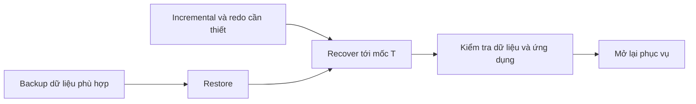

# Backup, point-in-time recovery và chính sách lưu giữ

Một ứng dụng Java quản lý đơn hàng có thể vẫn kết nối được Oracle Database sau khi một câu lệnh sai xóa dữ liệu. Nếu chỉ kiểm tra database ở trạng thái Available, đội vận hành có thể bỏ qua sự cố cho tới khi người dùng đối soát. Ngược lại, có backup mới nhất cũng chưa đủ để biết có thể quay về thời điểm nào và mất bao lâu để ứng dụng hoạt động đúng.

Bài học thuộc chủ đề **Oracle Database trên OCI**, tập trung vào cách thiết kế backup, lựa chọn mốc khôi phục và quản lý retention. Nội dung gắn việc khôi phục database với compartment, IAM, kết nối VCN, giám sát và chi phí. Oracle Base Database Service được dùng làm luồng thực hành chính; các khác biệt quan trọng của Recovery Service, Exadata và Autonomous Database được nêu riêng.

Sau bài học, người học cần có khả năng:

- Chuyển yêu cầu nghiệp vụ thành RPO, RTO, cửa sổ PITR và thời hạn lưu giữ dài hạn.
- Giải thích vai trò của bản sao dữ liệu, incremental backup và redo trong khôi phục.
- Cấu hình chính sách theo đúng dịch vụ và kiểm tra khả năng phục hồi thực tế.
- Thực hiện một cuộc diễn tập PITR có bằng chứng dữ liệu trước và sau mốc đích.
- Đánh giá tác động tới ứng dụng, hệ thống tích hợp, phân quyền và chi phí.

Các giới hạn số ngày và hành vi dịch vụ trong bài được đối chiếu với tài liệu Oracle ngày **20/11/2026**. Khi triển khai, cần kiểm tra đúng loại dịch vụ, phiên bản, compute model và các tùy chọn thực sự được cung cấp trong tenancy.

## 1. Bốn yêu cầu phải tách riêng

| Yêu cầu | Câu hỏi cần trả lời | Ví dụ giả định |
| --- | --- | --- |
| RPO — Recovery Point Objective | Chấp nhận mất tối đa bao nhiêu dữ liệu tính theo thời gian? | Tối đa 5 phút giao dịch mới nhất khi mất database |
| RTO — Recovery Time Objective | Dịch vụ được phép gián đoạn bao lâu? | Khôi phục luồng đặt hàng trong 60 phút |
| Cửa sổ PITR | Cần quay về những thời điểm nào trong quá khứ gần? | Có thể chọn một mốc hợp lệ trong 35 ngày gần nhất |
| Lưu giữ dài hạn | Cần giữ những bản sao lịch sử nào, tới khi nào? | Một bản cuối tháng được giữ trong 7 năm theo yêu cầu nội bộ |

RPO và thời hạn retention giải quyết hai vấn đề khác nhau. Giữ backup 35 ngày không có nghĩa là chỉ mất tối đa 35 ngày dữ liệu; cũng không chứng minh rằng phần dữ liệu mới nhất đã được bảo vệ trong vòng 5 phút.

RTO phải được đo tới khi chức năng nghiệp vụ hoạt động trở lại. Một cách phân rã hữu ích khi diễn tập là:

```text
Thời gian gián đoạn =
    phát hiện và khoanh vùng
  + quyết định phương án, chọn mốc đích
  + chuẩn bị tài nguyên và quyền truy cập
  + khôi phục dữ liệu, áp dụng thay đổi
  + kiểm tra nghiệp vụ
  + chuyển kết nối và mở lại xử lý
```

Đây là mô hình lập kế hoạch, không phải công thức cam kết của OCI. Một database được restore trong 25 phút vẫn có thể làm ứng dụng ngừng hai giờ nếu chưa có wallet, endpoint, thông tin xác thực hoặc quy trình đối soát.

Với lỗi logic, đội vận hành có thể **chủ động** chọn mốc cũ hơn để loại bỏ giao dịch sai. Khoảng giao dịch hợp lệ bị loại theo quyết định này phải được thống kê riêng; không nên đồng nhất nó với độ trễ bảo vệ dữ liệu mới nhất.

## 2. Backup, restore và recovery làm những việc gì?

### 2.1. Bản sao dữ liệu và chuỗi thay đổi

Một chiến lược khôi phục vật lý thường cần phối hợp:

- **Backup dữ liệu**: cung cấp dữ liệu nền để dựng lại các datafile.
- **Incremental backup**: cung cấp các block thay đổi so với nền phù hợp.
- **Redo cần thiết**: đưa trạng thái được phục hồi tiến tới mốc yêu cầu.
- **Metadata và vật liệu mã hóa**: giúp nhận diện database, đọc backup và hoàn tất phục hồi.

Trong RMAN, restore lấy các file cần thiết từ backup; recovery áp dụng thay đổi từ redo và incremental backup để đưa dữ liệu tới trạng thái mong muốn. DBPITR phục hồi tới một mốc quá khứ và bỏ qua các thay đổi sau mốc đó. [Oracle: RMAN Quick Start](https://docs.oracle.com/en/database/oracle/oracle-database/19/bradv/getting-started-rman.html), [Oracle: Database Point-in-Time Recovery](https://docs.oracle.com/en/database/oracle/oracle-database/19/bradv/rman-performing-flashback-dbpitr.html).



Có một file backup mang tên hôm nay không chứng minh phục hồi được tới mọi thời điểm hôm nay. Cần kiểm tra nền backup, tính liên tục của dữ liệu khôi phục, mốc sớm nhất và mốc mới nhất thực sự sẵn có.

### 2.2. Không nhầm lịch backup dữ liệu với RPO

Với automatic backup tới **Object Storage của Base Database Service**, Oracle mô tả level 0 hằng tuần, level 1 hằng ngày và backup archived redo log định kỳ, với tần suất tối thiểu mỗi 60 phút. Backup log không có OCID riêng như các backup level 0/1. Do đó, đếm các dòng backup trên Console không đủ để suy ra RPO. [Oracle: Automatic Incremental and Archived Redo Log Backups](https://docs.oracle.com/en/cloud/paas/base-database/guide/br-about.html).

Level 0 làm nền cho chuỗi incremental. Full backup và level 0 đều chứa dữ liệu nền đầy đủ, nhưng không nên tự thay thế một loại cho loại kia trong cấu hình chuỗi incremental mà không kiểm tra ngữ nghĩa RMAN.

Recovery Service có tùy chọn **real-time data protection**, truyền liên tục redo và hướng tới RPO gần 0; đây là tùy chọn tính thêm phí, có điều kiện hỗ trợ về phiên bản. Bật tùy chọn không thay thế việc theo dõi độ trễ bảo vệ thực tế. [Oracle: Enable Real-time Data Protection](https://docs.oracle.com/en/cloud/paas/recovery-service/dbrsu/enable-real-time-protection.html), [Oracle: Real-time Data Protection in Base Database Service](https://docs.oracle.com/en/cloud/paas/base-database/guide/br-about.html).

Nếu yêu cầu giả định là RPO 5 phút, lịch backup dữ liệu mỗi ngày tự nó chưa chứng minh đáp ứng. Cần xem cơ chế vận chuyển redo, số liệu quan sát được và kết quả diễn tập khi mất nguồn dữ liệu.

### 2.3. Các cơ chế bổ sung có phạm vi khác nhau

- Một standby giúp xử lý một số tình huống mất khả dụng, nhưng thiết kế vẫn phải xét việc lỗi logic đã xuất hiện trên những bản sao nào.
- Một export logic hữu ích khi cần chuyển schema hoặc lấy lại dữ liệu chọn lọc; nó không tự cung cấp chuỗi khôi phục vật lý của toàn database.
- Flashback có thể phù hợp cho một số lỗi logic khi điều kiện hỗ trợ và cửa sổ dữ liệu còn đủ. Cửa sổ Flashback phụ thuộc các log cần thiết và không đồng nhất với retention của backup. [Oracle: Flashback Database and Restore Points](https://docs.oracle.com/en/database/oracle/oracle-database/19/bradv/using-flasback-database-restore-points.html).

Chọn cơ chế theo phạm vi hỏng và yêu cầu nhất quán. Nếu chỉ một nhóm bản ghi cần sửa, trước hết cần đánh giá phạm vi; quay toàn database về quá khứ có thể loại bỏ nhiều giao dịch đúng.

## 3. Chọn chính sách theo đúng dịch vụ OCI

### 3.1. Base Database Service với Recovery Service

Recovery Service quản lý tài nguyên **protected database** và gắn mỗi protected database với một protection policy. Các policy Oracle định nghĩa gồm:

| Policy | Thời gian lưu giữ |
| --- | ---: |
| Bronze | 14 ngày |
| Silver | 35 ngày |
| Gold | 65 ngày |
| Platinum | 95 ngày |
| Custom | Từ 14 đến 95 ngày |

Policy có sẵn không sửa được; custom policy dùng khi cần thời hạn khác trong khoảng hỗ trợ. [Oracle: About Protection Policies](https://docs.oracle.com/en-us/iaas/recovery-service/doc/overview-protection-policy.html).

Cửa sổ cấu hình là mục tiêu giữ khả năng phục hồi, cần đối chiếu với dữ liệu thực tế. Chọn 35 ngày ngay hôm nay không tạo ra lịch sử backup của 35 ngày trước. Sau khi tăng retention cũng không thể lấy lại những bản đã bị xóa trước đó.

### 3.2. Base Database Service với Object Storage

Các lựa chọn retention automatic backup tới Object Storage là **7, 15, 30, 45 hoặc 60 ngày**. Đích backup khả dụng còn phụ thuộc tenancy, region, phiên bản, giới hạn và năng lực dịch vụ; trong một số trường hợp Console chỉ cung cấp Recovery Service. Không giả định mọi tenancy đều chọn được cả hai. [Oracle: Configure Automatic Backups](https://docs.oracle.com/en/cloud/paas/base-database/guide/br-backup.html).

Phân biệt automatic backup được OCI quản lý với quy trình tự dùng RMAN và bucket riêng. Không áp chính sách lifecycle của một bucket tự quản lên luồng backup được dịch vụ quản lý như thể chúng có cùng cơ chế điều phối.

### 3.3. Exadata Database Service

Với Exadata, phải xác định đúng loại hạ tầng và luồng managed backup đang sử dụng. Ví dụ, tài liệu **Exadata Database Service on Exascale Infrastructure** mô tả backup được quản lý tới Recovery Service hoặc Object Storage. Không lấy một runbook dành cho Base Database rồi giả định mọi thao tác trên VM cluster, CDB hoặc PDB đều tương đương. [Oracle: Backup and Recovery on Exascale Infrastructure](https://docs.oracle.com/en-us/iaas/exadb-xs/doc/ecs-managing-db-backup-and-recovery.html).

Khi dùng Recovery Service, đọc protection policy của chính protected database đó. Khi dùng cơ chế khác, đọc chính sách tương ứng của dịch vụ thay vì suy từ tên Oracle Database.

### 3.4. Autonomous Database Serverless

Theo tài liệu Autonomous Database Serverless hiện hành:

- Compute model OCPU có automatic backup retention 60 ngày.
- Compute model ECPU mặc định 60 ngày và cho phép chọn từ 1 đến 60 ngày.

Các con số này áp dụng cho đối tượng và tính năng được tài liệu mô tả, không phải mọi biến thể Autonomous hay mọi gói thực hành. [Oracle: Automatic Backups on Autonomous Database](https://docs.oracle.com/en-us/iaas/autonomous-database-serverless/doc/backup-intro.html).

Autonomous tự quản lý backup ở tầng dịch vụ. Người dùng lựa chọn các tùy chọn được cung cấp, theo dõi và diễn tập phục hồi; không thiết lập cron RMAN trên host như với một database tự quản.

## 4. Thiết lập backup để có thể phục hồi được

### 4.1. Lập hồ sơ khôi phục cho từng database

Trước khi cấu hình, ghi các thông tin sau vào hồ sơ vận hành:

| Nhóm | Thông tin cần biết |
| --- | --- |
| Nhận diện | Tenancy, region, compartment, database OCID, DB system hoặc VM cluster |
| Phạm vi | Toàn CDB, một PDB hay dữ liệu chọn lọc; các ứng dụng phụ thuộc |
| Mục tiêu | RPO, RTO, cửa sổ PITR, lịch backup dài hạn |
| Cấu hình | Đích backup, policy, khóa retention, trạng thái backup ban đầu |
| Phụ thuộc | VCN, route, NSG, DNS, Vault/key hoặc wallet, thông tin xác thực |
| Vận hành | Nhóm nhận cảnh báo, người quyết định mốc đích, nơi lưu runbook |

Database OCID và protected database OCID là hai tài nguyên khác nhau. Sử dụng đúng định danh khi truy vấn cấu hình hoặc lọc metric.

### 4.2. IAM, mạng và mã hóa là một phần của đường khôi phục

Thiết kế quyền theo nhiệm vụ: nhóm quan sát backup, nhóm thực hiện phục hồi và nhóm quản lý chính sách lưu giữ có thể có phạm vi quyền khác nhau. Quyền phải bao phủ đúng compartment của nguồn, đích khôi phục và các tài nguyên phụ thuộc.

Nếu diễn tập tạo database mới, cần kiểm tra sẵn quota, quyền tạo tài nguyên và khả năng dùng mạng đích. Một tài khoản chỉ xem được backup chưa chắc tạo được DB system.

Base Database cần truy cập đích backup khi phục hồi. Oracle khuyến nghị service gateway cho đường tới Object Storage và mô tả đường mạng riêng cho Recovery Service trong VCN của database. Hai đường này cần được kiểm tra theo cấu hình tương ứng. [Oracle: Recovery Prerequisites](https://docs.oracle.com/en/cloud/paas/base-database/guide/br-recover.html).

Với dữ liệu mã hóa, hồ sơ phải chỉ rõ cơ chế khóa và cách khôi phục quyền truy cập. Xem vòng đời key, wallet, secret và tài khoản dịch vụ cùng vòng đời backup. Không coi trạng thái “backup còn tồn tại” là bằng chứng đầy đủ rằng đích phục hồi đọc được dữ liệu.

### 4.3. Luồng cấu hình trong Console

Trên database thử nghiệm thuộc Base Database Service:

1. Xác nhận region, compartment và database cần bảo vệ.
2. Mở cấu hình automatic backups từ trang chi tiết database.
3. Chọn đích đang được cung cấp; đặt retention hoặc protection policy tương ứng.
4. Chọn lịch và tùy chọn backup ban đầu phù hợp.
5. Kiểm tra thiết lập giữ backup sau khi terminate database.
6. Lưu và theo dõi tới khi backup ban đầu hoàn tất.

Đổi đích backup có thể kích hoạt full backup ngay; trì hoãn backup đầu tiên để lại khoảng thời gian chưa đủ cơ sở phục hồi. [Oracle: Back Up a Database Using the Console](https://docs.oracle.com/en/cloud/paas/base-database/guide/br-backup.html).

Với Recovery Service, không chạy song song các script operational backup tự quản tới đích khác khi chưa có phương án được hỗ trợ. Oracle yêu cầu vô hiệu hóa các script/quy trình đó trước khi bật automatic backups tới Recovery Service. [Oracle: Backing Up to Recovery Service](https://docs.oracle.com/en-us/iaas/recovery-service/doc/about-automatic-backup-recovery-service.html).

### 4.4. Kiểm kê bằng CLI

Ví dụ dưới đây dành cho **Bash**, giả định OCI CLI đã có thông tin xác thực và quyền đọc đúng compartment. Các lệnh minh họa chỉ đọc metadata:

```bash
DATABASE_OCID='THAY_BANG_DATABASE_OCID'
OCI_REGION='THAY_BANG_REGION_IDENTIFIER'

oci db database get \
  --database-id "$DATABASE_OCID" \
  --region "$OCI_REGION" \
  --output json

oci db backup list \
  --database-id "$DATABASE_OCID" \
  --region "$OCI_REGION" \
  --all \
  --output json
```

Tham chiếu cú pháp: [Oracle CLI: database get](https://docs.oracle.com/en-us/iaas/tools/oci-cli/latest/oci_cli_docs/cmdref/db/database/get.html), [Oracle CLI: backup list](https://docs.oracle.com/en-us/iaas/tools/oci-cli/latest/oci_cli_docs/cmdref/db/backup/list.html).

Đối chiếu cấu hình backup, trạng thái và thời điểm các bản ghi. Danh sách backup không tự thể hiện toàn bộ redo hoặc chứng minh mọi mốc PITR đều dùng được. Với Recovery Service, mở thêm protected database để kiểm tra policy và tình trạng bảo vệ.

## 5. Chọn đúng thời điểm PITR

### 5.1. Mốc đích phải dựa trên giao dịch đã commit

Giả sử lỗi xóa nhầm đơn hàng được commit lúc:

```text
Thời điểm lỗi:       2026-11-20T14:32:00+07:00
Mốc dự kiến an toàn: 2026-11-20T14:31:30+07:00
Cùng mốc theo UTC:   2026-11-20T07:31:30Z
```

Mốc an toàn phải được kiểm tra bằng log, dấu vết giao dịch hoặc bằng chứng dữ liệu. Chọn “trước 30 giây” trong ví dụ chỉ là giả định, không phải quy tắc chung. Nếu lỗi đã bắt đầu trước đó, mốc này vẫn có thể chứa dữ liệu sai.

Khi gửi yêu cầu phục hồi, ghi rõ timezone và độ chính xác của timestamp. Không tự thêm ký tự `Z` vào giờ Việt Nam: `Z` biểu thị UTC.

Có thể kiểm tra các nguồn thời gian trong SQL:

```sql
SELECT SYSTIMESTAMP,
       CURRENT_TIMESTAMP,
       DBTIMEZONE,
       SESSIONTIMEZONE
FROM dual;
```

`DBTIMEZONE` không phải bằng chứng rằng mọi timestamp do ứng dụng ghi đều ở timezone đó. Cần xem kiểu dữ liệu cột, session timezone và cách ứng dụng chuyển đổi thời gian.

### 5.2. Timestamp và SCN

SCN là định danh thứ tự thay đổi của Oracle Database, không phải Unix timestamp. Nếu đã có SCN thích hợp từ quy trình vận hành và dữ liệu giao dịch, nó có thể giúp xác định mốc phục hồi chính xác hơn việc ước lượng từ đồng hồ.

Không lấy SCN hiện tại sau khi phát hiện lỗi rồi coi đó là mốc trước lỗi. Việc chuyển đổi giữa thời gian và SCN cũng phải được xác minh trong ngữ cảnh database và khả năng cung cấp metadata.

Base Database hỗ trợ các lựa chọn phục hồi về latest, timestamp hoặc SCN hợp lệ. Tùy chọn “latest” hướng tới trạng thái mới nhất có thể phục hồi; khi lỗi logic đã được lưu, lựa chọn này có thể giữ nguyên lỗi. [Oracle: Restore Options](https://docs.oracle.com/en/cloud/paas/base-database/guide/br-recover.html).

### 5.3. Xác nhận phạm vi trước khi gửi yêu cầu

Phục hồi toàn CDB có phạm vi ảnh hưởng khác phục hồi một PDB. Base Database có các luồng in-place và out-of-place cho PDB, với điều kiện riêng. Không suy rằng tất cả nút restore đều có cùng tùy chọn SCN hoặc cùng mức gián đoạn. [Oracle: Restore a Pluggable Database](https://docs.oracle.com/en/cloud/paas/base-database/restore-pdb/).

Đối với sự cố nhiều dịch vụ, chọn mốc cho một database còn phải xét trạng thái các database khác, hàng đợi, object và giao dịch bên ngoài. PITR của một database không tạo một giao dịch khôi phục nguyên tử cho toàn hệ thống.

## 6. Runbook phục hồi theo từng quyết định

### Bước 1 — Khoanh vùng và ngăn thay đổi làm sự cố lan rộng

Xác định lỗi do hạ tầng, hỏng dữ liệu hay thao tác nghiệp vụ. Quyết định có cần tạm dừng ghi, consumer hoặc batch để tránh phát sinh thêm trạng thái khó đối soát.

Lưu bằng chứng về thời điểm phát hiện, dữ liệu bị ảnh hưởng và các giao dịch quan trọng. Nếu có thể, bảo toàn trạng thái hiện tại phục vụ đối soát theo quy trình đã thiết kế.

### Bước 2 — Chọn phạm vi, mốc và phương án đích

Ghi rõ:

- Database hoặc PDB nào được phục hồi.
- Mốc đích theo UTC, nguồn bằng chứng và lý do lựa chọn.
- Mốc đó có nằm trong phạm vi phục hồi thực tế hay không.
- Dùng phục hồi tại chỗ hay tạo môi trường khác nếu luồng dịch vụ hỗ trợ.
- Những giao dịch hợp lệ sau mốc đích cần được xử lý lại hoặc đối soát.

Phục hồi tại chỗ có thể đưa môi trường hiện tại lùi về quá khứ. Phục hồi sang đích khác thuận tiện cho kiểm chứng và trích xuất dữ liệu, nhưng cần thêm tài nguyên, chi phí và bước chuyển kết nối.

### Bước 3 — Kiểm tra điều kiện thực thi

Xác nhận backup và dữ liệu khôi phục phù hợp, quyền truy cập, mạng, key/wallet, phiên bản đích, dung lượng và quota. Kiểm tra những thao tác khác đang chạy để tránh xung đột.

Với sự cố mất region, cần một thiết kế phục hồi có tài nguyên và dữ liệu dùng được ở region đích. Việc có backup trong region nguồn tự nó chưa chứng minh phục hồi được khi toàn region không truy cập được.

### Bước 4 — Gửi yêu cầu bằng luồng dịch vụ tương ứng

Với Base Database, sử dụng trang database và luồng Restore được dịch vụ cung cấp, chọn loại phục hồi và mốc đã thống nhất. Ghi lại mã yêu cầu, trạng thái và thời điểm bắt đầu.

Với Autonomous, thao tác Restore cho phép chọn timestamp hoặc backup. Database ở trạng thái không khả dụng trong quá trình phục hồi; sau khi hoàn tất cần kết nối và xác minh dữ liệu. [Oracle: Restore and Recover Autonomous Database](https://docs.oracle.com/en-us/iaas/autonomous-database-serverless/doc/backup-recover.html).

### Bước 5 — Kiểm tra kỹ thuật và nghiệp vụ

Một bảng kiểm chứng có thể gồm:

| Tầng | Bằng chứng cần thu |
| --- | --- |
| Database | Trạng thái mở, kết nối đúng service/PDB, dữ liệu dấu mốc đúng |
| Schema | Phiên bản migration tương thích với ứng dụng đang chạy |
| Nghiệp vụ | Đơn hàng, số dư, tồn kho và quan hệ liên quan đúng |
| Tích hợp | Outbox, consumer, batch và trạng thái thanh toán đã được đối soát |
| Bảo mật | Quyền, tài khoản, secret, wallet và cơ chế mã hóa phù hợp |
| Vận hành | Backup và giám sát trên môi trường được dùng tiếp đã hoạt động |

Nếu database mới được tạo từ backup, phải kiểm tra lại cấu hình backup của database đích. Không mặc định nó đã có chính sách giống nguồn.

### Bước 6 — Mở lại dịch vụ và tiếp tục bảo vệ

Chuyển kết nối theo kế hoạch, kiểm tra connection pool Java và chỉ mở lại consumer hoặc scheduler sau khi xử lý khả năng lặp giao dịch. Theo dõi lỗi, độ trễ và dữ liệu mới.

Ghi tổng thời gian tới khi nghiệp vụ hoạt động đúng, khoảng dữ liệu thiếu, chi phí phát sinh và phần runbook cần sửa. Nếu chưa thực hiện bước kiểm chứng ứng dụng, chưa đủ bằng chứng kết luận đạt RTO.

## 7. Diễn tập PITR với bảng dấu mốc

Dùng một **database thực hành riêng**, schema thử nghiệm và luồng backup đã hoạt động. Với bài diễn tập tại chỗ, mọi dữ liệu trong phạm vi phục hồi đều có thể quay về mốc đích, nên phạm vi thực hành phải được xác định ngay từ đầu.

### 7.1. Tạo dữ liệu nền

Chạy trước khi lấy backup nền cho cuộc diễn tập:

```sql
CREATE TABLE recovery_probe (
    probe_id   NUMBER PRIMARY KEY,
    marker     VARCHAR2(40) NOT NULL,
    created_at TIMESTAMP WITH TIME ZONE DEFAULT SYSTIMESTAMP NOT NULL
);

INSERT INTO recovery_probe (probe_id, marker)
VALUES (1, 'BASELINE');

COMMIT;
```

Đợi một backup nền phù hợp hoàn tất và xác nhận đường bảo vệ dữ liệu đang hoạt động. Lưu thời điểm cùng định danh tài nguyên.

### 7.2. Tạo bản ghi trước mốc đích

```sql
INSERT INTO recovery_probe (probe_id, marker)
VALUES (2, 'BEFORE_TARGET');

COMMIT;

SELECT TO_CHAR(
           SYSTIMESTAMP AT TIME ZONE 'UTC',
           'YYYY-MM-DD"T"HH24:MI:SS.FF3"Z"'
       ) AS target_utc
FROM dual;
```

Lưu giá trị trả về làm mốc **T**, được lấy sau khi bản ghi 2 đã commit. Ghi T ra biên bản diễn tập bên ngoài database sắp được phục hồi.

### 7.3. Tạo thay đổi sau T và mô phỏng lỗi

Chỉ chạy sau khi đồng hồ đã vượt rõ ràng mốc T; giữ khoảng cách đủ để tránh nhầm độ chính xác timestamp của giao diện:

```sql
INSERT INTO recovery_probe (probe_id, marker)
VALUES (3, 'AFTER_TARGET');

COMMIT;

-- Mô phỏng xóa nhầm trong bảng của bài thực hành.
DELETE FROM recovery_probe
WHERE probe_id = 2;

COMMIT;

SELECT probe_id, marker
FROM recovery_probe
ORDER BY probe_id;
```

Trước khi phục hồi, kết quả mong đợi có bản ghi 1 và 3; bản ghi 2 đã bị xóa. Xác nhận cơ chế backup/redo đã bảo vệ tới ít nhất T và T là mốc hợp lệ mà dịch vụ chấp nhận.

### 7.4. Phục hồi và kiểm tra

Thực hiện PITR tới **T** bằng runbook tương ứng. Sau khi hoàn tất, kết nối đúng database/PDB được phục hồi rồi chạy:

```sql
SELECT probe_id, marker
FROM recovery_probe
ORDER BY probe_id;
```

| probe_id | marker mong đợi sau PITR tới T |
| ---: | --- |
| 1 | BASELINE |
| 2 | BEFORE_TARGET |

Bản ghi 2 phải xuất hiện lại; bản ghi 3 chưa tồn tại tại T nên không được có trong kết quả. Hai kiểm chứng này giúp phát hiện việc phục hồi tới mốc quá mới hoặc quá cũ.

Nếu kết quả khác dự kiến, kiểm tra lại commit, timezone, độ chính xác timestamp, phạm vi phục hồi và endpoint vừa kết nối. Không chỉ dựa vào thông báo thao tác thành công.

Biên bản diễn tập cần có T, nguồn/đích, bằng chứng dữ liệu, thời gian từng bước, tổng thời gian nghiệp vụ gián đoạn và trạng thái bảo vệ sau phục hồi. Các lệnh trong bài là hướng dẫn thực hành; chúng không phải bằng chứng đã diễn tập thành công trên một tài nguyên OCI cụ thể.

## 8. Retention vận hành, dài hạn và khóa lưu giữ

### 8.1. Cửa sổ PITR không phải danh sách bản lưu theo tháng

Một backup cuối tháng giữ bảy năm đáp ứng nhu cầu truy cập một trạng thái lịch sử, nhưng không tự cho phép quay về mọi giây trong bảy năm.

Với Recovery Service, LTR backup độc lập với automatic backup, có thời hạn **90–3650 ngày** và được dùng để tạo database mới trong thời hạn còn hiệu lực. LTR không dùng cùng luồng in-place PITR như automatic backup. [Oracle: Long-Term Retention Backups](https://docs.oracle.com/en-us/iaas/recovery-service/doc/longtermbackup-LTR-recoveryservice.html), [Oracle: LTR in Base Database Service](https://docs.oracle.com/en/cloud/paas/base-database/guide/br-about.html).

Autonomous Database hỗ trợ long-term backup từ **3 tháng đến 10 năm**, có thể tạo một lần hoặc theo lịch. Luồng sử dụng là clone sang database mới; không dùng long-term backup để restore lại chính database nguồn. [Oracle: Create Long-Term Backups](https://docs.oracle.com/en-us/iaas/autonomous-database-serverless/doc/backup-long-term.html), [Oracle: Long-Term Backup Recovery Scope](https://docs.oracle.com/en-us/iaas/autonomous-database-serverless/doc/backup-intro.html).

Không chuyển đổi “3 tháng” thành một số ngày cố định rồi áp dụng đồng nhất cho mọi API. Sử dụng đơn vị và giới hạn của đúng dịch vụ.

### 8.2. Thiết kế chính sách theo nhu cầu phát hiện lỗi

Ví dụ giả định cho hệ thống đơn hàng:

| Nhu cầu nội bộ | Thiết kế minh họa | Bằng chứng cần có |
| --- | --- | --- |
| Phát hiện lỗi nghiệp vụ trong vài tuần | Cửa sổ PITR 35 ngày | Mốc đích hợp lệ và cuộc diễn tập gần đây |
| Giảm mất giao dịch mới | Cơ chế bảo vệ đáp ứng RPO 5 phút | Độ trễ thực tế, cảnh báo và diễn tập |
| Giữ dữ liệu đối soát cuối tháng | LTR theo tháng, giữ 7 năm | Lịch tạo, hạn hết và thử tạo database từ LTR |
| Ngăn thay đổi retention trái quy trình | Phân quyền và khóa phù hợp | Cấu hình khóa, audit và kiểm tra đường phục hồi |

Các con số là giả định thiết kế, không phải yêu cầu pháp lý. Tổ chức phải tự xác định yêu cầu lưu giữ áp dụng cho dữ liệu của mình.

Khi rút ngắn retention, cần kiểm tra lịch sử nào sẽ mất. Khi tăng retention, cần theo dõi thời gian tích lũy dữ liệu tới cửa sổ mới; việc thay policy không khôi phục lịch sử đã hết hạn.

### 8.3. Khóa retention khác với đặt số ngày

Với protection policy của Recovery Service, retention lock có thời gian chờ tối thiểu **14 ngày** trước khi có hiệu lực. Khi đã có hiệu lực, thời hạn được khóa và chỉ có thể tăng trong giới hạn hỗ trợ; backup được bảo vệ khỏi sửa/xóa trong thời gian retention. [Oracle: Retention Lock](https://docs.oracle.com/en-us/iaas/recovery-service/doc/protection-policy-locking.html).

Cơ chế này không nên bị đồng nhất với tùy chọn backup retention lock của Autonomous: tài liệu Autonomous nêu rằng khi khóa đã bật, người dùng không thể tự tắt hoặc đổi thời hạn automatic backup qua luồng thông thường. [Oracle: Autonomous Backup Retention Lock](https://docs.oracle.com/en-us/iaas/autonomous-database-serverless/doc/backup-intro.html).

Trước khi bật khóa, cần chốt thời hạn và trách nhiệm thanh toán, vì thay đổi thiết kế sau đó có thể bị hạn chế. Khóa retention cũng không kiểm tra giúp việc ứng dụng có đọc được dữ liệu đã phục hồi hay không.

### 8.4. Kiểm tra chính sách sau khi terminate

Với LTR của Recovery Service, Oracle mô tả lựa chọn xóa sau 72 giờ hoặc giữ theo policy khi terminate database. Vì vậy, không suy rằng mọi backup dài hạn đều tự sống tới hạn ban đầu sau mọi thao tác xóa database. [Oracle: LTR Retention after Termination](https://docs.oracle.com/en-us/iaas/recovery-service/doc/longtermbackup-LTR-recoveryservice.html).

Cần ghi rõ tùy chọn thực tế vào hồ sơ trước khi giải thể môi trường. Đồng thời kiểm tra tương tác giữa trạng thái khóa, thao tác được phép và vòng đời nguồn theo đúng dịch vụ.

## 9. Giám sát khả năng phục hồi

### 9.1. Theo dõi độ mới của bảo vệ và tình trạng backup

Recovery Service cung cấp namespace `oci_recovery_service`, trong đó:

| Metric | Ý nghĩa chính |
| --- | --- |
| `DataLossExposure` | Thời gian dữ liệu có nguy cơ mất, đơn vị giây |
| `ProtectedDatabaseHealth` | 0: Protected; 1: Warning; 2: Alert |
| `SpaceUsedForRecoveryWindow` | Dung lượng phục vụ cửa sổ khôi phục, đơn vị GB |
| `ProtectedDatabaseSize` | Dung lượng database được bảo vệ, đơn vị GB |

Dimension `resourceId` là OCID của **protected database**; `dBUniqueName` định danh database trong Recovery Service. [Oracle: Recovery Service Metrics](https://docs.oracle.com/en-us/iaas/recovery-service/doc/available-recovery-service-metrics.html).

Thiết kế cảnh báo gắn với mục tiêu, chẳng hạn độ mất dữ liệu tiềm tàng vượt RPO 300 giây trong một khoảng đánh giá phù hợp. Đây là ngưỡng minh họa của hệ thống giả định, không phải ngưỡng mặc định hay SLA của Oracle.

Phải kiểm tra tần suất phát dữ liệu và interval trước khi đặt alarm. Giá trị trung bình trong khoảng dài có thể che một lần vượt ngưỡng ngắn; thiếu mẫu cũng không đồng nghĩa với không có sự cố.

### 9.2. Cảnh báo cần có hành động

| Tín hiệu | Hành động đầu tiên |
| --- | --- |
| Backup thất bại hoặc liên tiếp không hoàn tất | Kiểm tra trạng thái database, log lỗi và tác vụ xung đột |
| Độ trễ bảo vệ tăng | Kiểm tra đường mạng, cơ chế chuyển redo và trạng thái protected database |
| Không có dữ liệu giám sát | Kiểm tra tài nguyên, phạm vi truy vấn và đường quan sát |
| Dung lượng tăng khác thường | Đối chiếu dữ liệu thay đổi, retention và các bản LTR mới |
| Có thay đổi policy | Đối chiếu người thực hiện, yêu cầu thay đổi và lịch sử bị ảnh hưởng |
| Lần diễn tập đã quá hạn nội bộ | Lập lại cuộc thử với dữ liệu và quy mô đại diện |

Một cảnh báo hữu ích cần chỉ ra tài nguyên, thời điểm, người nhận và runbook xử lý. Theo dõi việc gửi thông báo thành công và người trực có đủ quyền kiểm tra, thay vì chỉ kiểm tra rằng alarm đã được tạo.

## 10. Phục hồi database và tính nhất quán ứng dụng Java

### 10.1. Giao dịch bên ngoài không tự quay ngược

Giả sử lúc 14:35 hệ thống đã thu tiền thành công ở cổng thanh toán, nhưng database được quay về 14:31. Database có thể không còn ghi nhận thanh toán đó, trong khi bên cung cấp vẫn giữ giao dịch thu tiền.

Nếu consumer xử lý lại thông điệp mà không có idempotency, có thể phát sinh thu tiền lặp hoặc ghi nhận tồn kho sai. Runbook phải xác định nguồn đối soát và cách xử lý từng loại side effect.

Với outbox, trạng thái “đã gửi” cũng có thể quay lùi theo database. Cần xem lại thông điệp đã phát ra ngoài, consumer đã nhận và cơ chế chống xử lý lặp. PITR không tự đảo ngược một email, một khoản thanh toán hay một thông điệp đã được hệ thống khác xử lý.

### 10.2. Phiên bản ứng dụng và schema phải khớp

Database sau PITR có thể ở trạng thái trước một migration, trong khi ứng dụng Java vẫn chạy phiên bản mới. Trước khi mở phục vụ, so sánh schema, dữ liệu migration và phiên bản ứng dụng phù hợp.

Đặc biệt cần kiểm tra thứ tự khởi động nếu công cụ migration tự chạy khi ứng dụng lên. Việc tự áp migration ngay khi đang kiểm chứng có thể làm mất trạng thái cần quan sát.

Khi chuyển sang database mới, xác nhận JDBC service name, DNS, secret, wallet và cấu hình TLS cần thiết. Kiểm tra lại connection pool để loại bỏ kết nối cũ theo quy trình của ứng dụng, rồi chạy một luồng nghiệp vụ có đọc và ghi dữ liệu thử kiểm soát được.

### 10.3. Dữ liệu bên ngoài database cần cơ chế riêng

Ví dụ, một đơn hàng tham chiếu hóa đơn PDF trên Object Storage. Quay database về quá khứ không bảo đảm object có phiên bản khớp với tham chiếu đó.

Với Autonomous, Oracle nêu rõ file ngoài Object Store của external table không nằm trong backup database; người dùng chịu trách nhiệm bảo vệ và phục hồi các file này. [Oracle: Autonomous Restore Notes](https://docs.oracle.com/en-us/iaas/autonomous-database-serverless/doc/backup-recover.html).

Lập danh sách tất cả phụ thuộc quan trọng, gắn phiên bản hoặc định danh có thể đối soát và thử phục hồi cùng nhau. Mục tiêu là trạng thái nghiệp vụ nhất quán, không chỉ một database có thể kết nối.

## 11. Kiểm soát chi phí và tính sẵn sàng

Chi phí cần được đánh giá cho cả trạng thái thường ngày và lúc diễn tập:

- Dung lượng backup theo dữ liệu và tốc độ thay đổi.
- Thời gian giữ operational backup và số bản LTR còn hiệu lực.
- Các tùy chọn bảo vệ có tính phí thêm.
- Compute, storage và giấy phép theo mô hình áp dụng cho database phục hồi.
- Thời gian môi trường phục hồi tồn tại, lưu lượng mạng và cơ chế liên region nếu có.

Không tính dung lượng đơn giản bằng “kích thước database nhân số ngày retention”. Cơ chế incremental, nén, chia sẻ dữ liệu và cách đo phí làm kết quả khác nhau theo dịch vụ. Dùng số liệu thực tế để dự báo, rồi đối chiếu hóa đơn hoặc báo cáo chi phí của đúng mô hình.

Một cách giảm chi phí có cơ sở là giữ cửa sổ PITR phù hợp với thời gian phát hiện lỗi, đồng thời dùng LTR cho các mốc lịch sử cần giữ lâu. Cần bảo đảm việc giảm chi phí không xóa mất chính cửa sổ mà bộ phận nghiệp vụ cần.

RTO thấp có thể đòi hỏi tài nguyên đích sẵn sàng và luồng chuyển ứng dụng nhanh hơn. Vì vậy, so sánh các phương án trên cùng ba trục: thời gian phục hồi đã đo, mức mất dữ liệu và tổng chi phí vận hành.

Sau cuộc diễn tập, thu hồi tài nguyên tạm theo hồ sơ đã xác nhận và giữ bằng chứng cần thiết. Việc dọn môi trường phải tách khỏi quyết định giữ backup nguồn; kiểm tra các tùy chọn xóa để tránh ảnh hưởng các bản lưu cần tiếp tục bảo vệ.

## 12. Những ngộ nhận thường gặp

| Ngộ nhận | Cách đánh giá đúng |
| --- | --- |
| Có backup thành công là đã đạt RTO | Đo cả chuẩn bị, restore/recover, xác minh và mở ứng dụng |
| Giữ 35 ngày là RPO 35 ngày | RPO xét độ mới của dữ liệu được bảo vệ; retention xét lịch sử cần giữ |
| Backup dữ liệu mỗi ngày luôn mất tối đa 24 giờ | Còn phụ thuộc redo, cơ chế truyền và dữ liệu thực tế có thể phục hồi |
| LTR bảy năm cho phép PITR tới mọi giây trong bảy năm | Kiểm tra mốc backup và phạm vi restore/clone của dịch vụ |
| Latest luôn là lựa chọn tốt nhất | Lỗi logic có thể đã nằm trong trạng thái mới nhất |
| Tăng retention lấy lại được lịch sử đã xóa | Chỉ có thể giữ những dữ liệu còn tồn tại và được tạo tiếp |
| Data Guard hoặc Flashback thay thế mọi nhu cầu backup | Kiểm tra loại sự cố, phạm vi dữ liệu và điều kiện cơ chế |
| Database Available nghĩa là nghiệp vụ đã phục hồi | Xác minh schema, dữ liệu, tích hợp và endpoint |
| Backup còn thì xóa key hoặc nguồn không ảnh hưởng | Kiểm tra mã hóa, quyền truy cập và chính sách vòng đời |
| Có backup trong một region là đủ cho mất toàn region | Kiểm chứng kiến trúc và dữ liệu dùng được ở region đích |

## 13. Bài tập vận dụng

Cho một hệ thống Java xử lý đơn hàng trên OCI với yêu cầu giả định: RPO 5 phút, RTO 60 phút, phát hiện lỗi dữ liệu có thể chậm tới 30 ngày và cần giữ bản cuối tháng trong 7 năm.

Thực hiện các phần sau:

1. Chọn dịch vụ database và mô tả cơ chế backup hỗ trợ từng yêu cầu.
2. Lập hồ sơ nhận diện tài nguyên, quyền IAM, đường mạng và cơ chế mã hóa.
3. Giải thích vì sao lịch backup dữ liệu đã chọn có hoặc chưa có đủ bằng chứng đạt RPO.
4. Thực hiện diễn tập bảng dấu mốc, ghi T theo UTC và kiểm tra cả hai phía của mốc.
5. Đo thời gian tới khi một luồng nghiệp vụ thử nghiệm hoạt động đúng.
6. Mô tả cách đối soát nếu thanh toán đã xảy ra sau T nhưng bị mất dấu trong database.
7. Thiết kế cảnh báo về độ mới của bảo vệ, backup thất bại và thiếu dữ liệu giám sát.
8. Kiểm tra retention, khóa nếu áp dụng và vòng đời backup sau khi terminate nguồn.
9. Ước lượng các thành phần chi phí và ghi cách quản lý tài nguyên diễn tập.

Đầu ra cần có quyết định chính sách, bằng chứng phục hồi dữ liệu và số đo vận hành. Với yêu cầu chưa kiểm chứng được, ghi rõ còn thiếu phép thử hoặc điều kiện nào để có thể kết luận đáp ứng.
