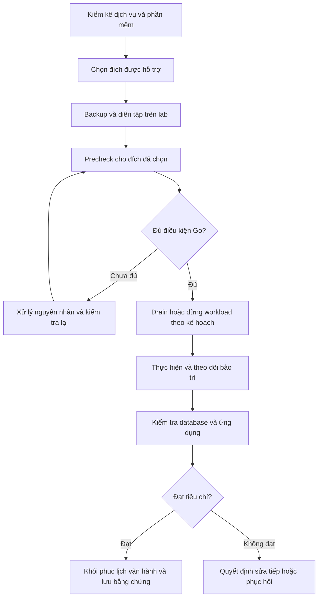

# Patching và nâng cấp Oracle Database trên OCI

## 1. Mục tiêu và tình huống vận hành

Trong chương **Oracle Database trên OCI** của module **CLOUD_PROVIDERS_ORACLE**, bài học này hướng dẫn lập kế hoạch cập nhật và nâng cấp cơ sở dữ liệu trong mối liên hệ với tenancy, compartment, IAM, VCN, giám sát, tự động hóa, chi phí và tính sẵn sàng. Mục tiêu là đưa hệ thống đến trạng thái phần mềm mong muốn, có bằng chứng kiểm tra và có đường phục hồi phù hợp.

Giả sử một ứng dụng Java quản lý đơn hàng sử dụng Oracle Database trên OCI. Nhóm vận hành cần vá lỗi bảo mật, trong khi nhóm phát triển dự kiến chuyển sang một release mới. Cả hai đều thay đổi phần mềm, nhưng có phạm vi kiểm thử, tác động đến dữ liệu và điều kiện quay lui khác nhau. Cần phân biệt ngay từ khi lập kế hoạch.

Sau bài này, bạn có thể:

- Phân biệt Release Update, bản vá riêng lẻ, nâng cấp major release và bảo trì OS/Grid Infrastructure.
- Xác định phần Oracle quản lý và phần khách hàng phải chủ động trên từng dịch vụ.
- Chuẩn bị precheck, backup, diễn tập phục hồi và kiểm thử ứng dụng.
- Đánh giá rolling maintenance, RAC và Data Guard theo đúng giới hạn hỗ trợ.
- Thực hiện một quy trình cập nhật lab có theo dõi và kiểm tra sau thay đổi.
- Thiết kế tự động hóa tránh khởi chạy trùng và quản lý chi phí tài nguyên tạm thời.

Các lệnh trong bài là ví dụ để người học thực hành trong môi trường được phép quản trị. Bài không yêu cầu chạy lệnh bảo trì trên máy chứa tài liệu. Các tên tài nguyên, khoảng thời gian và ngưỡng hiệu năng minh họa là giả định học tập.

## 2. Phân biệt patching, upgrade và các lớp phần mềm

### 2.1. Một từ “cập nhật” có thể chỉ nhiều việc

| Thay đổi | Bản chất | Phạm vi cần xét |
| --- | --- | --- |
| Release Update, viết tắt RU | Gói sửa lỗi định kỳ trong một release Oracle Database | Binary, phần SQL của bản vá, khả năng tương thích và hồi quy |
| Interim/one-off patch | Sửa một vấn đề cụ thể | Xung đột với patch hiện có, patch thay thế hoặc bản hợp nhất |
| Nâng cấp major release | Chuyển sang release cơ sở dữ liệu mới hơn | Đường nâng cấp, dictionary, tính năng và hành vi ứng dụng |
| Cập nhật/nâng cấp OS | Thay đổi hệ điều hành của node hoặc VM | Reboot, agent, package và tùy biến OS |
| Cập nhật/nâng cấp Grid Infrastructure, viết tắt GI | Thay đổi lớp Clusterware/ASM ở cấu hình có sử dụng | Tương thích với database và hoạt động của cluster/storage |
| Infrastructure maintenance | Bảo trì lớp hạ tầng của dịch vụ | Máy chủ, storage và các thành phần Oracle quản lý |

RU gồm các sửa lỗi bảo mật và lỗi chức năng; one-off phục vụ một vấn đề riêng. Cần kiểm kê one-off trước khi chọn RU vì có thể phát sinh xung đột hoặc cần patch thay thế. [Oracle Database Patch Maintenance](https://docs.oracle.com/en/database/oracle/oracle-database/19/dbptc/index.html).

Ví dụ ký hiệu `19.x` sang `19.y`, với `y > x`, biểu diễn việc thay RU trong dòng 19c; đây không phải cú pháp version để nhập vào API. RU có tính tích lũy, nhưng khả năng cập nhật trực tiếp vẫn phải thỏa điều kiện của dịch vụ và image đích. [Oracle: About Oracle Database Release Numbers](https://docs.oracle.com/en/database/oracle/oracle-database/19/upgrd/oracle-database-release-numbers.html).

### 2.2. Database Home khác một database

Database Home chứa bộ phần mềm Oracle Database. Database sử dụng bộ phần mềm đó để mở và xử lý dữ liệu. Một thao tác ở Home cần được đánh giá cùng danh sách database sử dụng Home và cách automation của dịch vụ thực hiện thay đổi.

Vì vậy, hồ sơ bảo trì nên tách rõ:

```text
Tài nguyên hạ tầng/DB system/VM cluster
  -> Node và lớp OS
  -> GI, nếu cấu hình có sử dụng
  -> Database Home và mức phần mềm
  -> Database/CDB
  -> PDB và service ứng dụng
  -> JDBC connection pool, batch job và tích hợp bên ngoài
```

Đây là mô hình kiểm kê, không phải cây tài nguyên giống hệt trên mọi dịch vụ. Thay đổi OS không chứng minh Database Home đã được vá; database mở thành công không chứng minh ứng dụng Java đã xử lý giao dịch đúng.

## 3. Trách nhiệm bảo trì theo dịch vụ

| Dịch vụ | Cách tiếp cận vận hành |
| --- | --- |
| Base Database Service | Khách hàng chủ động lên lịch, chọn thao tác OS/GI/database được hỗ trợ và theo dõi kết quả |
| Exadata Database Service on Dedicated Infrastructure | Tách lịch hạ tầng Oracle quản lý khỏi việc bảo trì guest VM, GI và Database Home của khách hàng |
| Autonomous Database Serverless | Oracle tự động vá theo cơ chế dịch vụ; khách hàng quản lý kiểm thử ứng dụng và tùy chọn maintenance được hỗ trợ |
| Autonomous Database trên Dedicated Exadata Infrastructure | Oracle thực hiện maintenance; khách hàng điều phối các tùy chọn lịch và phương thức tại các cấp tài nguyên được hỗ trợ |

Trên Exadata, Oracle bảo trì các thành phần hạ tầng thuộc phạm vi Oracle quản lý; lịch này không thay thế kế hoạch của nhóm database. [Oracle: Configure Oracle-Managed Infrastructure Maintenance](https://docs.oracle.com/en-us/iaas/exadatacloud/doc/exa-conf-oracle-man-infra.html).

Guest OS, GI và database software trên Exadata có các quy trình cập nhật riêng. Oracle khuyến nghị patch database bằng cách chuyển sang Database Home có mức vá đích. [Oracle: Patch and Update an Exadata Cloud Infrastructure System](https://docs.oracle.com/en-us/iaas/exadatacloud/doc/ecs-patch-update.html).

Trong Autonomous Dedicated, maintenance có thể liên quan đến infrastructure, Autonomous VM Cluster và Autonomous Container Database. Rolling và non-rolling có tác động khác nhau; một số hoạt động như cập nhật time-zone file có thể cần downtime. [Oracle: Service Maintenance of Autonomous AI Database on Dedicated Exadata Infrastructure](https://docs.oracle.com/en/cloud/paas/autonomous-database/dedicated/adbaa/service-maintenance-of-autonomous-ai-database-on-dedicated.html).

Hệ quả thực hành là phải ghi đúng loại dịch vụ ngay đầu runbook. Không sao chép nguyên lệnh `dbcli`, `dbaascli`, `OPatch` hoặc hướng dẫn SSH từ dịch vụ khác sang Autonomous.

## 4. Lập hồ sơ thay đổi trước khi chọn bản vá

### 4.1. Định danh và phạm vi tác động

Với tình huống ứng dụng đơn hàng, nhóm có thể lập hồ sơ sau:

| Mục | Nội dung cần ghi |
| --- | --- |
| Đích triển khai | Tenancy, region, compartment và OCID tài nguyên |
| Dịch vụ và topology | Base/Exadata/Autonomous; single instance, RAC, standby nếu có |
| Trạng thái hiện tại | OS, GI nếu có, Database Home, release/RU, one-off |
| Đích thay đổi | Image/version/patch identifier lấy từ danh sách hỗ trợ |
| Đơn vị bị ảnh hưởng | CDB, PDB, service, ứng dụng, báo cáo và batch job |
| Bảo vệ dữ liệu | Backup, điểm khôi phục và điều kiện truy cập khóa mã hóa |
| Cửa sổ bảo trì | Giờ bắt đầu, múi giờ, thời hạn quyết định phục hồi |
| Người chịu trách nhiệm | Người thao tác, người kiểm tra ứng dụng và người quyết định xử lý lỗi |

Ghi đồng thời giờ UTC và giờ Việt Nam khi điều phối nhiều nhóm. Chẳng hạn `18:00 UTC` tương ứng `01:00` ngày hôm sau tại Việt Nam. Nhầm ngày khi đổi múi giờ có thể làm một kế hoạch đúng chạy sai thời điểm.

### 4.2. IAM, OS account và quyền trong database là ba lớp khác nhau

IAM điều khiển quyền gọi API đối với tài nguyên OCI. Quyền SSH vào node và quyền xem catalog trong database không tự xuất hiện chỉ vì người dùng mở được trang tài nguyên trên Console.

Hãy đối chiếu thao tác dự định với permission và resource-type tương ứng. Quyền chỉ xem thông tin không đồng nghĩa với quyền cập nhật. Cấp quyền trong compartment phù hợp và kiểm tra danh tính automation đang dùng trước khi chạy. [Oracle: Policy Details for Base Database Service](https://docs.oracle.com/en/cloud/paas/base-database/guide/policy-details.html).

Trong hồ sơ lab, ghi tên profile hoặc loại principal; không chép private key, mật khẩu SYS, token hay nội dung wallet vào log. Người kiểm tra nghiệp vụ nên dùng tài khoản ứng dụng để phản ánh đúng đường truy cập thực tế.

## 5. Precheck và các điều kiện Go/No-Go

Precheck kiểm tra điều kiện kỹ thuật cho một thao tác với đích cụ thể. Nó không chứng minh toàn bộ chức năng nghiệp vụ tương thích và cũng không thay thế diễn tập phục hồi.

### 5.1. Các nhóm điều kiện cần đối chiếu

| Nhóm kiểm tra | Bằng chứng mong đợi | Ví dụ quyết định dừng |
| --- | --- | --- |
| Đường cập nhật/nâng cấp | Release nguồn, đích và topology được hỗ trợ | Đích không xuất hiện hoặc thiếu điều kiện nền tảng |
| Tài nguyên | Node/cluster ổn định, dung lượng đủ theo quy trình | Node không hoạt động hoặc thiếu filesystem space |
| Mạng | DNS, route và endpoint dịch vụ cần thiết truy cập được | Tải patch/image thất bại do kết nối |
| Phần mềm | Inventory và one-off đã đối chiếu | Có conflict chưa được giải quyết |
| Bảo vệ dữ liệu | Backup hoàn tất, đã chứng minh cách phục hồi | Chỉ có lịch backup mà chưa có bản thành công |
| Ứng dụng | Có kết quả rehearsal và kịch bản kiểm tra | Driver hoặc giao dịch quan trọng thất bại |
| Điều phối | Có thời gian kiểm tra và phục hồi | Cửa sổ chỉ đủ thời gian cài đặt dự kiến |

Đối với cập nhật Base Database DB system, Oracle nêu các điều kiện như node hoạt động, Clusterware chạy ở cấu hình sử dụng nó và đủ dung lượng `/u01`. Cập nhật OS của single-node DB system có downtime. [Oracle: Update a DB System](https://docs.oracle.com/en/cloud/paas/base-database/guide/dbs-update.html).

Đối với cập nhật database, cần kiểm tra đường đến Identity và Object Storage. Trong private subnet, cấu hình service gateway chỉ cho Object Storage có thể chưa đủ cho quy trình này; phải kiểm tra đúng các endpoint yêu cầu. [Oracle: Update a Database](https://docs.oracle.com/en/cloud/paas/base-database/guide/db-update.html).

Không giải quyết lỗi kết nối bằng cách tùy tiện mở toàn bộ ingress. Hướng kiểm tra là xác định request đi đâu, dùng route nào, được NSG/security list cho phép hay chưa và DNS có trả đúng đích không.

### 5.2. Chạy sớm và chạy lại khi điều kiện đổi

Chạy precheck trong giai đoạn chuẩn bị để có thời gian xử lý lỗi. Nếu sau đó thay image, patch inventory, topology hoặc cấu hình liên quan, cần đánh giá lại tính còn hiệu lực của kết quả. Lưu target identifier, thời điểm và job ID cùng báo cáo.



Sơ đồ là quy trình vận hành đề xuất, không phải mô tả mọi bước nội bộ của automation OCI.

## 6. Backup, RPO, RTO và diễn tập phục hồi

Một bản backup báo thành công là đầu vào cho phục hồi; cần chứng minh thêm rằng nhóm có thể dùng nó để mở database và kết nối ứng dụng.

- **RPO**: mức mất dữ liệu tối đa chấp nhận được, thường biểu diễn bằng thời gian.
- **RTO**: thời gian tối đa chấp nhận được để khôi phục dịch vụ.
- **Rollback bản vá**: gỡ hoặc đảo thay đổi phần mềm theo quy trình hỗ trợ.
- **Flashback/restore/recovery**: đưa dữ liệu về trạng thái phù hợp bằng cơ chế phục hồi tương ứng.

Những khái niệm này không thay thế nhau. Quay về Database Home cũ không tự chứng minh dictionary và dữ liệu phù hợp với binary cũ.

### 6.1. Diễn tập với database phục hồi riêng

Trên Base Database Service có quy trình tạo DB system từ backup. Việc phục hồi phải xét cả phiên bản, cấu hình mạng và thông tin mã hóa cần thiết. [Oracle: Create a DB System from a Backup](https://docs.oracle.com/en/cloud/paas/base-database/guide/dbs-create-from-backup.html).

Một lần diễn tập cho ứng dụng đơn hàng nên thu được:

1. Thời gian tạo tài nguyên phục hồi và thời gian phục hồi dữ liệu thực tế.
2. Xác nhận database/PDB mở đúng chế độ và service truy cập được.
3. Xác nhận quyền truy cập khóa hoặc wallet cần thiết hoạt động.
4. Kết quả truy vấn đơn hàng và giao dịch kiểm thử qua ứng dụng.
5. Danh sách bước chuyển cấu hình kết nối và đối soát dữ liệu.

Giả sử rehearsal đo được 12 phút tạo tài nguyên, 28 phút phục hồi và 15 phút kiểm tra/chuyển kết nối. Kế hoạch phải dành ít nhất khoảng thời gian tương ứng cùng dự phòng, thay vì chỉ tính 28 phút. Đây là số giả định, không phải cam kết của OCI.

```text
Thời gian phục hồi dịch vụ dự kiến
  = phát hiện và quyết định
  + chuẩn bị đích phục hồi
  + khôi phục dữ liệu
  + kiểm tra
  + chuyển kết nối và đối soát
```

### 6.2. Điểm khôi phục và backup có giới hạn riêng

Guaranteed Restore Point phục vụ một số đường phục hồi nhưng cần đáp ứng điều kiện Flashback và dung lượng liên quan. Không mặc định rằng có restore point thì có thể quay lui mọi thay đổi phiên bản, mọi thời điểm và mọi dịch vụ.

Đặc biệt, tăng `COMPATIBLE` là quyết định ảnh hưởng đến khả năng quay về release cũ. Với 19c, Oracle cảnh báo việc tăng tham số này có thể loại bỏ khả năng downgrade và flashback về restore point trước đó. [Oracle: Database Compatibility, 19c](https://docs.oracle.com/en/database/oracle/oracle-database/19/upgrd/what-is-oracle-database-compatibility.html).

Trong runbook cần ghi chính xác: bản backup nào dùng để phục hồi, mốc dữ liệu nào chấp nhận được, bằng chứng diễn tập ở đâu và ai quyết định ngừng ghi dữ liệu khi phải quay lui.

## 7. Chọn chiến lược triển khai và mức gián đoạn

### 7.1. In-place và out-of-place

| Chiến lược | Cách hiểu | Đánh đổi cần đánh giá |
| --- | --- | --- |
| In-place | Thay đổi phần mềm trong Home hiện có | Ít Home tạm hơn, nhưng Home đang sử dụng bị thay đổi trực tiếp |
| Out-of-place | Chuẩn bị Home đích rồi chuyển database theo quy trình hỗ trợ | Dễ tách phần mềm nguồn/đích, cần thêm dung lượng và quản lý Home |
| Tạo đích mới rồi chuyển ứng dụng | Chuẩn bị database/hệ thống đích riêng | Cần kế hoạch đồng bộ dữ liệu, chuyển kết nối và tránh hai nơi cùng ghi |

Giữ Home cũ là một phần chuẩn bị hữu ích, nhưng không đủ để khẳng định có thể đảo ngược mọi thay đổi. Điều kiện rollback còn liên quan đến phần SQL của patch, upgrade dictionary và những thao tác đã thực hiện sau đó.

### 7.2. Rolling không phải cam kết mọi request đều thành công

Rolling thực hiện bảo trì theo từng phần của hệ thống. Cần kiểm tra patch có hỗ trợ phương thức đó không, node còn lại có đủ năng lực không và ứng dụng có chuyển kết nối đúng không.

Ví dụ: một hệ thống hai node chịu tải ổn khi cả hai hoạt động vẫn có thể quá tải khi một node tạm ngừng. Trước cửa sổ bảo trì, nhóm nên thử tải trên năng lực còn lại và đo connection acquisition time, số timeout cùng độ trễ giao dịch.

Oracle có các hướng dẫn quản lý planned maintenance thông qua service trong RAC. Phải phối hợp service placement và client; chỉ nhìn thấy nhiều instance chưa đủ để suy ra hành vi của ứng dụng. [Oracle: Managing Planned Maintenance](https://docs.oracle.com/en/database/oracle/oracle-database/26/racad/ensuring-application-continuity/managing-planned-maintenance.html).

### 7.3. Data Guard: phân biệt patch với nâng cấp release

Standby-First Patch Apply cho physical standby chỉ áp dụng với patch được chứng nhận, thể hiện trong README. Major release upgrade không tự thuộc cơ chế đó. [Oracle: Patching Oracle Database with Standby First Patching](https://docs.oracle.com/en/database/oracle/oracle-database/21/sbydb/data-guard-concepts-and-administration.pdf).

Một kế hoạch có Data Guard phải ghi cả primary, standby, trạng thái đồng bộ, thứ tự thao tác và cách kiểm tra sau mỗi bước. Đối chiếu quy trình của đúng dịch vụ thay vì suy ra “có standby thì không cần downtime”.

Tách ba câu hỏi:

- Patch có cho phép hai bên tạm chạy khác mức phần mềm không?
- Automation OCI của dịch vụ đang dùng yêu cầu thứ tự nào?
- Nếu chuyển vai trò, ứng dụng có kết nối đúng service và xử lý giao dịch đang chạy không?

Thứ tự nâng cấp cụ thể của Base Database và Exadata phải lấy từ hướng dẫn tương ứng; không chuyển một quy tắc thứ tự từ dịch vụ này sang dịch vụ kia. Với cấu hình không có đường tự động hóa phù hợp, cần lập phương án riêng được hỗ trợ.

## 8. Kiểm thử ứng dụng Java trong cửa sổ bảo trì

Một kết nối JDBC được tạo thành công chỉ là kiểm tra kết nối. Nghiệm thu cần đi qua các thao tác mà người dùng thực sự thực hiện.

| Kịch bản | Điều cần quan sát |
| --- | --- |
| Tạo connection mới | DNS/service, xác thực, TLS nếu dùng, thời gian lấy connection |
| Connection đang nằm trong pool | Phát hiện connection không còn hợp lệ và tái tạo phù hợp |
| Giao dịch đang thực thi | Kết quả commit, rollback và trạng thái chưa xác định ở client |
| SQL/PLSQL quan trọng | Kết quả đúng, lỗi mới và chênh lệch thời gian chạy |
| Batch dài | Khả năng tạm dừng, chạy tiếp hoặc chạy lại an toàn |
| Tích hợp ngoài database | Trạng thái gửi thông điệp/thanh toán so với giao dịch trong database |

Oracle khuyến nghị drain request và sử dụng các cơ chế như FAN-aware pool cùng Application Continuity khi cấu hình phù hợp. UCP và Application Continuity cần được kiểm tra theo driver, service và hành vi request; dùng UCP không tự chứng minh replay đã hoạt động. [Oracle: Application Continuity for Planned Maintenance](https://docs.oracle.com/en/database/oracle/oracle-database/26/racad/ensuring-application-continuity/administering-application-continuity-operation-and-usage.html).

Với Spring/Hibernate hoặc pool khác, kiểm tra ma trận tương thích driver/JDK/database và hành vi reconnect thực tế của stack đang triển khai. Không thêm retry vô hạn để che lỗi bảo trì.

### Ví dụ giao dịch có nguy cơ bị lặp

Ứng dụng gửi yêu cầu tạo đơn hàng. Database commit xong nhưng kết nối đứt trước khi client nhận kết quả. Nếu client gửi lại như một đơn hàng mới, có thể tạo bản ghi trùng.

Đề xuất thiết kế cho tình huống này:

```text
Nhận request với requestId ổn định
  -> Tạo hoặc tra kết quả theo requestId
  -> Bảo đảm ràng buộc duy nhất ở database
  -> Nếu mất kết nối, tra trạng thái bằng connection mới
  -> Chỉ retry theo quy tắc nghiệp vụ đã định
```

Đây là ví dụ suy luận thiết kế ứng dụng. Ràng buộc duy nhất và xử lý idempotency cần bao phủ cả tác dụng bên ngoài như thanh toán; một câu `SELECT 1 FROM dual` không kiểm tra được những điều đó.

## 9. Thực hành cập nhật RU trên Base Database Service

### 9.1. Phạm vi lab và chuẩn bị

Dùng một Base Database DB system lab riêng, có dữ liệu giả và có ngân sách. Để bài thực hành dễ quan sát, có thể chọn single-node nếu cấu hình được hỗ trợ và chấp nhận downtime. Các bài toán RAC/Data Guard cần thêm topology và tiêu chí riêng.

Chuẩn bị trước khi thao tác:

1. Xác nhận region, compartment, DB system và database OCID.
2. Ghi release/RU hiện tại cùng danh sách PDB/service dùng kiểm thử.
3. Tạo backup theo quy trình của dịch vụ và ghi kết quả hoàn tất.
4. Chọn RU/image đích từ thông tin tài nguyên đang có.
5. Đo baseline ứng dụng và xác nhận cửa sổ bảo trì.

### 9.2. Lấy thông tin bằng OCI CLI

Ví dụ Bash, dùng profile đã cấu hình và OCID của database lab:

```bash
REGION="ap-singapore-1"
PROFILE="LAB"
DATABASE_OCID="<database-ocid-cua-lab>"

oci db database get \
  --region "$REGION" \
  --profile "$PROFILE" \
  --database-id "$DATABASE_OCID"
```

Lệnh trả thông tin của database, không áp dụng bản vá. Kiểm tra OCID và DB Home liên quan từ kết quả. Thay các giá trị minh họa trước khi chạy. [OCI CLI: db database get](https://docs.oracle.com/en-us/iaas/tools/oci-cli/latest/oci_cli_docs/cmdref/db/database/get.html).

```bash
oci db patch list by-database \
  --region "$REGION" \
  --profile "$PROFILE" \
  --database-id "$DATABASE_OCID" \
  --all
```

`--all` lấy đủ các trang. Không thấy patch mong đợi là lý do kiểm tra support/eligibility và tham số, không phải lý do tự nhập một patch ID lấy từ hệ thống khác. [OCI CLI: db patch list by-database](https://docs.oracle.com/en-us/iaas/tools/oci-cli/latest/oci_cli_docs/cmdref/db/patch/list/by-database.html).

### 9.3. Chạy precheck và áp dụng qua Console

Tại DB system và database lab đã xác nhận, xem đúng mục cập nhật cho OS, GI hoặc database. Với database, chọn mục **Updates**, xem chi tiết RU/image đích, chạy **Precheck**, đọc kết quả rồi mới chọn **Apply update** khi đủ điều kiện. Theo dõi **Update History** của tài nguyên liên quan. [Oracle: Update a Database](https://docs.oracle.com/en/cloud/paas/base-database/guide/db-update.html).

Runbook của lab nên bổ sung các mốc do người học ghi nhận:

```text
T0: xác nhận backup và baseline
T1: precheck hoàn tất, target identifier đã đối chiếu
T2: drain/dừng workload theo kế hoạch
T3: bắt đầu cập nhật, lưu job/request identifier
T4: automation kết thúc
T5: database và ứng dụng vượt qua kiểm tra
T6: mở lại workload và theo dõi
```

Không gửi lại thao tác Apply chỉ vì trang Console tải chậm. Xác minh tiến trình hiện có trước khi quyết định hành động tiếp. Khi bài lab yêu cầu nhiều lớp cập nhật, thực hiện theo dependency và thứ tự do dịch vụ quy định, không khởi chạy tất cả đồng thời.

## 10. Kiểm tra sau cập nhật: đối chiếu nhiều lớp bằng chứng

### 10.1. Phần mềm đang chạy

Trên database lab 19c hoặc release có các cột tương ứng, dùng tài khoản được cấp quyền xem catalog:

```sql
SELECT instance_name, version_full, status
FROM v$instance;
```

`VERSION_FULL` cho biết version của instance đang truy vấn. Với RAC, cần kiểm tra các instance liên quan, không lấy một kết nối duy nhất để kết luận mọi node đã đồng nhất. [Oracle Reference: V$INSTANCE](https://docs.oracle.com/en/database/oracle/oracle-database/19/refrn/V-INSTANCE.html).

### 10.2. Phần SQL của patch

```sql
SELECT patch_id,
       action,
       status,
       action_time,
       description
FROM dba_registry_sqlpatch
ORDER BY action_time DESC;
```

View này ghi các lần apply/rollback SQL patch và được `datapatch` cập nhật. Mỗi dòng là một lần thực hiện; cần đối chiếu patch đích với hành động mới nhất liên quan, thay vì đếm dòng hoặc yêu cầu mọi lịch sử đều là `APPLY`. [Oracle Reference: DBA_REGISTRY_SQLPATCH](https://docs.oracle.com/en/database/oracle/oracle-database/19/refrn/DBA_REGISTRY_SQLPATCH.html).

Ở môi trường multitenant, kiểm tra phạm vi CDB/PDB theo quy trình của release và dịch vụ. Một kết quả tại root không tự chứng minh tất cả PDB đã hoàn tất phần SQL. Nếu automation báo lỗi ở giai đoạn SQL patch, đọc log và hướng xử lý được hỗ trợ trước khi tự chạy lại công cụ thủ công.

### 10.3. Trạng thái PDB và đường kết nối ứng dụng

Với database CDB, truy vấn từ CDB root bằng tài khoản phù hợp:

```sql
SELECT name, open_mode, restricted
FROM v$pdbs
ORDER BY name;
```

`V$PDBS` phản ánh các PDB gắn với instance hiện tại. Đối chiếu chế độ mở với vai trò và mục đích từng PDB; PDB seed hoặc standby có thể có chế độ khác PDB ứng dụng ghi dữ liệu. [Oracle Reference: V$PDBS](https://docs.oracle.com/en/database/oracle/oracle-database/19/refrn/V-PDBS.html).

Sau đó dùng service và tài khoản của ứng dụng để kiểm tra đọc, ghi và commit. Kết nối thành công bằng tài khoản quản trị trên node không đại diện cho kết nối JDBC từ subnet ứng dụng.

### 10.4. Nghiệm thu bằng hành vi và baseline

Ví dụ tiêu chí do nhóm lab tự đặt:

| Lớp | Bằng chứng |
| --- | --- |
| OCI automation | Operation kết thúc thành công, đúng tài nguyên và đúng đích |
| Database | Version, SQL patch, PDB và service phù hợp |
| Nghiệp vụ | Tạo đơn, đọc đơn và cập nhật trạng thái đúng |
| Hiệu năng | So sánh latency, timeout, throughput với baseline cùng kiểu tải |
| Bảo vệ dữ liệu | Backup schedule và trạng thái standby, nếu có, được kiểm tra lại |

Chẳng hạn p95 tạo đơn tăng từ 120 ms lên 170 ms cần được đánh giá theo mục tiêu của ứng dụng, tính tương đương của tải và thời gian ổn định sau restart. Hai số này chỉ minh họa cách đặt câu hỏi, không phải ngưỡng đạt chung cho Oracle Database.

## 11. Nâng cấp major release cần một kế hoạch riêng

### 11.1. Xác minh đường nâng cấp của tài nguyên thực tế

Trên Base Database, đường nâng cấp phụ thuộc release nguồn/đích, OS và GI. Quy trình yêu cầu các điều kiện như ARCHIVELOG và Flashback; upgrade có downtime. Không được chạy đồng thời với automatic backup; phải lập lịch backup trước và kiểm tra bật lại sau. Với Data Guard association, hướng dẫn Base Database yêu cầu standby trước primary. [Oracle: Upgrade a Database on Base Database Service](https://docs.oracle.com/en/cloud/paas/base-database/guide/db-upgrade.html).

Từ các ràng buộc đó, runbook nâng cấp cho lab cần cụ thể hóa:

1. Chọn đường nguồn → đích được hỗ trợ cho đúng cấu hình.
2. Chuẩn bị môi trường rehearsal tương đương và dữ liệu thử phù hợp.
3. Chạy precheck, xử lý từng blocker và lưu bằng chứng.
4. Ghi kế hoạch dừng ghi dữ liệu, điểm phục hồi và hạn chót quyết định.
5. Điều phối backup để không chồng thao tác với upgrade.
6. Áp dụng quy trình upgrade của dịch vụ, theo dõi đến trạng thái cuối.
7. Kiểm tra database, ứng dụng, bảo vệ dữ liệu và workload nền.
8. Chỉ dọn tài nguyên cũ sau khi kết thúc giai đoạn giữ lại cần thiết.

Đây là khung vận hành đề xuất. Không dùng danh sách này để bỏ qua các bước bắt buộc của một đường nâng cấp cụ thể.

### 11.2. Tương thích ứng dụng và COMPATIBLE

Trong rehearsal, kiểm thử driver/JDK, SQL/PLSQL, kiểu dữ liệu và time zone, tích hợp batch, authentication cùng những thành phần database ứng dụng đang dùng. Việc database mở được ở release mới chưa đủ để nghiệm thu.

Có thể đọc tham số bằng quyền phù hợp:

```sql
SELECT name, value
FROM v$parameter
WHERE name = 'compatible';
```

Phân biệt version của binary với mức `COMPATIBLE`. Oracle khuyến nghị kiểm thử trước khi tăng compatibility; quy tắc và giá trị phụ thuộc release. Với Oracle AI Database, một số tính năng trong RU cũng có yêu cầu compatibility riêng, nên không dùng quy tắc tuyệt đối rằng RU không bao giờ liên quan tham số này. [Oracle: Database Compatibility, 26ai](https://docs.oracle.com/en/database/oracle/oracle-database/26/upgrd/what-is-oracle-database-compatibility.html).

Runbook phải xác định bước nào làm thay đổi compatibility, kể cả do automation hoặc cách di chuyển PDB, và khả năng phục hồi còn lại sau bước đó. Không thêm lệnh tăng tham số chỉ để số version “trông đồng nhất”.

### 11.3. Rollback thất bại, downgrade và restore

Các đường quay lui có điều kiện khác nhau:

| Cơ chế | Câu hỏi phải trả lời trước |
| --- | --- |
| Rollback một lần upgrade bị lỗi | Dịch vụ, edition, lifecycle state và topology có hỗ trợ không? |
| Downgrade database | Cặp release, trạng thái compatibility và tính năng đang dùng có cho phép không? |
| Flashback về điểm trước thay đổi | Restore point và các điều kiện phục hồi còn hiệu lực không? |
| Restore/recover sang tài nguyên phù hợp | Backup, redo, khóa mã hóa và thời gian phục hồi có đáp ứng không? |

Base Database có đường rollback cho một số upgrade thất bại; nó không phải nút quay lui phổ quát sau mọi nâng cấp thành công. Cần xác minh điều kiện ngay trong tài liệu của đường nâng cấp. [Oracle: Upgrade a Database on Base Database Service](https://docs.oracle.com/en/cloud/paas/base-database/guide/db-upgrade.html).

Downgrade chỉ được hỗ trợ trong những trường hợp xác định; thay đổi `COMPATIBLE` có thể làm mất lựa chọn đó. Không đơn giản khởi động dữ liệu đã nâng cấp bằng Home cũ. [Oracle: Downgrading Oracle Database to an Earlier Release](https://docs.oracle.com/en/database/oracle/oracle-database/19/upgrd/downgrading-oracle-db-after-upgrade.html).

Nếu ứng dụng đã nhận thêm đơn hàng sau khi nâng cấp, phục hồi về mốc trước nâng cấp sẽ đặt ra bài toán giữ lại hoặc đối soát các đơn mới. Phương án dữ liệu phải được quyết định cùng nghiệp vụ, thay vì chỉ tính thao tác kỹ thuật quay về phần mềm cũ.

## 12. Autonomous: quản lý lịch và kiểm thử thay cho vá host

Trên Autonomous Serverless, Oracle tự động patch theo maintenance window. Console cung cấp patch level và lịch maintenance; lựa chọn Early/Regular phụ thuộc điều kiện hỗ trợ như compute model, region và cấu hình Data Guard. Khách hàng vẫn phải kiểm thử workload và theo dõi tác động đến kết nối. [Oracle: Manage Patch Levels and Maintenance Window](https://docs.oracle.com/en/cloud/paas/autonomous-database/serverless/adbsb/maintenance-windows-patching.html).

Một runbook ứng dụng cho Autonomous có thể gồm: ghi lịch UTC, thông báo nội bộ theo quy trình của nhóm, tạm dừng batch dài khi cần, theo dõi pool và kiểm tra nghiệp vụ sau maintenance. Không áp dụng lệnh patch host của Base Database vào dịch vụ này.

Nâng cấp release phải xét riêng. Ví dụ đường Scheduled Upgrade từ 19c lên 26ai có giai đoạn ảnh hưởng truy cập ghi; restore từ backup trước upgrade không tự hạ database version. Console/API không cung cấp thao tác downgrade thông thường cho đường này. Phải đọc điều kiện hỗ trợ hiện hành và thử workload trước khi lên lịch. [Oracle: Scheduled Upgrade to Oracle AI Database 26ai](https://docs.oracle.com/en/cloud/paas/autonomous-database/serverless/adbsb/upgrade-to-oracle-database-23ai-with-scheduled-upgrade.html).

Không suy luận rằng một bảo trì RU ít tác động thì mọi nâng cấp release, thay đổi lịch hoặc thay đổi hạ tầng cũng có cùng mức gián đoạn.

## 13. Chẩn đoán và quyết định khi có lỗi

| Hiện tượng | Hướng kiểm tra ban đầu |
| --- | --- |
| Precheck không đạt | Báo cáo cụ thể, đúng đích đã chọn, điều kiện nguồn và prerequisite |
| Không tải được patch/image | Endpoint, DNS, route, service gateway và egress |
| Operation báo lỗi ở host | Dung lượng filesystem, node/cluster và service agent |
| Binary đúng nhưng SQL patch chưa đạt | Log giai đoạn SQL patch và phạm vi container |
| Database Available nhưng ứng dụng lỗi | PDB, service, pool, quyền, driver và giao dịch thực tế |
| Standby không theo kịp | Trạng thái transport/apply và bước đang thực hiện trong runbook |
| Tác vụ vượt thời gian dự kiến | Tiến độ thực tế, log, hạn chót phục hồi và hỗ trợ cần thiết |

Với Base Database, có thể đọc job trên node bằng tài khoản được phép, theo hướng dẫn dịch vụ:

```bash
sudo /opt/oracle/dcs/bin/dbcli list-jobs
sudo /opt/oracle/dcs/bin/dbcli describe-job -i '<job-id>' -j
```

Job ID lấy từ danh sách thực tế. Đây là `dbcli` trên DB system, khác với OCI CLI `oci` trên máy quản trị. Nếu RAC, cần thu thập bằng chứng từ các node liên quan. [Oracle: Troubleshoot Update Failures](https://docs.oracle.com/en/cloud/paas/base-database/guide/troubleshoot-update.html).

Lưu thời điểm, resource OCID, target version, job/request ID và lỗi gốc. Không giết tiến trình hoặc lặp lại Apply chỉ vì chưa thấy tiến độ trên giao diện. Trước khi thử lại, xác minh tác vụ trước đã kết thúc và trạng thái tài nguyên cho phép hành động tiếp theo.

Khi đạt mốc quyết định trong runbook, người phụ trách cần chọn sửa tiếp, phục hồi hoặc phối hợp Oracle Support dựa trên bằng chứng. Mục tiêu là khôi phục dịch vụ và bảo toàn dữ liệu theo phương án đã chuẩn bị.

## 14. Tự động hóa, giám sát và chi phí

### 14.1. Tự động hóa có trạng thái

Với fleet nhiều database, nên triển khai theo nhóm nhỏ, kiểm tra kết quả rồi mới mở rộng. Ví dụ dưới đây là pseudocode thiết kế, không phải API có thể chạy trực tiếp:

```text
for each resource in approvedScope:
    acquireChangeLock(resource)
    inspectActualState(resource)
    if alreadyAtTargetAndVerified:
        recordNoChange()
    else if anotherOperationIsActive:
        recordPendingAndStopForThisResource()
    else:
        assertPrecheckAndRecoveryEvidence()
        operation = startSupportedMaintenance(resource, target)
        observeUntilTerminalState(operation)
        verifyDatabaseAndApplication()
        recordEvidenceOrEscalate()
    releaseChangeLockWhenOwnershipIsResolved()
```

Đây là khuyến nghị thiết kế để tránh hai pipeline cùng thay đổi một tài nguyên. Lock của pipeline không thay thế điều kiện và cơ chế điều phối nội bộ của OCI. Timeout phía client cũng không chứng minh operation phía dịch vụ đã dừng.

Không mặc định `terraform apply` là công cụ patch mọi lớp phần mềm. Chỉ tự động hóa bằng thao tác được dịch vụ/provider hỗ trợ, có theo dõi trạng thái và xử lý thất bại.

### 14.2. Theo dõi cả database và ứng dụng

Dashboard bảo trì đề xuất nên có trạng thái operation, sức khỏe database, CPU/I/O, session, lỗi và độ trễ ứng dụng. Nếu có standby, thêm tình trạng đồng bộ và trạng thái protection liên quan. Ghi baseline và khoảng thời gian bảo trì để đối chiếu.

Có thể đánh dấu maintenance trong hệ thống quan sát, nhưng vẫn cần nhận biết sự cố vượt phạm vi dự kiến. Việc hoàn tất API request chỉ là một mốc; kết luận hoàn tất thay đổi phải gồm kết quả kiểm tra dịch vụ.

### 14.3. Chi phí phát sinh từ tài nguyên giữ thêm

Hồ sơ chi phí của đợt bảo trì nên liệt kê database rehearsal/clone, compute và storage tạm, Home/image, backup/redo giữ thêm cùng thời gian chạy song song. Gán owner và thời hạn xem xét dọn tài nguyên; giữ bằng chứng cần thiết theo quy trình của nhóm.

Với Autonomous, một số tùy chọn lập lịch và tài nguyên đi kèm có cơ chế tính phí riêng. Kiểm tra điều kiện của compute model và lựa chọn sử dụng tại thời điểm lập kế hoạch. [Oracle: Autonomous AI Database Serverless Features Billing](https://docs.oracle.com/en/cloud/paas/autonomous-database/serverless/adbsb/autonomous-features-billing.html).

Không xóa Home, backup hoặc tài nguyên phục hồi chỉ để giảm chi phí khi chúng còn nằm trong phương án quay lui. Sau thời hạn giữ lại, dọn đúng tài nguyên lab đã định danh và lưu kết quả.

## 15. Bài thực hành mở rộng và tiêu chí hoàn thành

### 15.1. Hồ sơ cần nộp

Đối với lab Base Database, người học chuẩn bị một hồ sơ gồm:

1. Sơ đồ dịch vụ, phạm vi IAM và danh sách OCID liên quan.
2. Bảng phần mềm trước/sau, gồm release/RU và patch/image đích.
3. Kết quả precheck và cách xử lý từng điều kiện không đạt.
4. Bằng chứng backup cùng mô tả một lần diễn tập phục hồi.
5. Mốc thời gian operation, thời gian gián đoạn đo được và job/request ID.
6. Kết quả SQL kiểm tra cùng giao dịch qua ứng dụng Java.
7. So sánh hiệu năng và tình trạng backup/standby sau thay đổi.
8. Danh sách tài nguyên giữ lại, cần dọn và chi phí cần theo dõi.

Nếu môi trường không có target đủ điều kiện, ghi rõ điều kiện còn thiếu và hoàn thành phần quan sát/lập kế hoạch. Không tạo bằng chứng giả rằng đã patch hoặc upgrade thành công.

### 15.2. Tình huống tự đánh giá

Giả sử patch hoàn tất nhưng giao dịch tạo đơn bị timeout, còn truy vấn quản trị vẫn thành công. Hãy xác định service ứng dụng, PDB, connection pool, lỗi JDBC và trạng thái commit trước khi quyết định retry hay phục hồi.

Giả sử rehearsal khôi phục mất 70 phút nhưng cửa sổ bảo trì chỉ còn 20 phút khi phát hiện lỗi. Hãy chỉ ra vì sao kế hoạch thiếu thời gian ra quyết định, và điều chỉnh thời điểm dừng để vẫn còn khả năng đáp ứng RTO.

Giả sử muốn áp dụng cùng runbook nâng cấp cho Base Database và Exadata có Data Guard. Hãy chỉ ra những bước phải đối chiếu lại: thứ tự hai bên, Home đích, giới hạn automation, gián đoạn ứng dụng và cách xác minh đồng bộ sau cùng.

### 15.3. Tiêu chí đạt

Bạn hoàn thành bài khi giải thích và chứng minh được:

- Đang thay đổi lớp nào, trên dịch vụ nào và ai chịu trách nhiệm.
- Đích thay đổi được hỗ trợ cho tài nguyên thực tế.
- Precheck đạt và phương án phục hồi có bằng chứng khả thi.
- Phương thức rolling/Data Guard được áp dụng đúng điều kiện, cùng kiểm thử client.
- Binary, phần SQL của patch, PDB/service và nghiệp vụ đều đã được đối chiếu.
- RPO/RTO, compatibility và dữ liệu phát sinh sau thay đổi đã được đưa vào quyết định quay lui.
- Lịch backup, quan sát hệ thống và tài nguyên tạm được xử lý sau bảo trì.

Patching và nâng cấp Oracle Database trên OCI là một quy trình thay đổi có kiểm soát: xác định đúng phạm vi, chuẩn bị khả năng phục hồi, thực hiện bằng cơ chế được hỗ trợ và nghiệm thu bằng hành vi của hệ thống sử dụng database.
