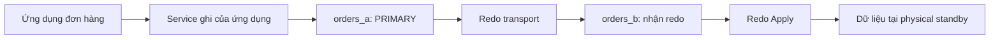

# Data Guard cho Base Database và chuyển đổi vai trò

Trong chương **Oracle Database trên OCI** của module **CLOUD_PROVIDERS_ORACLE**, bài này hướng dẫn xây dựng và vận hành một cấu hình Oracle Data Guard cho **Oracle Base Database Service**. Trọng tâm là bảo vệ dữ liệu bằng standby database, chuyển đổi vai trò khi bảo trì hoặc sự cố, rồi xác nhận ứng dụng hoạt động trên primary mới.

Ví dụ xuyên suốt là hệ thống đơn hàng có hai DB system: `orders_a` hiện giữ vai trò primary và `orders_b` giữ vai trò physical standby. Nhóm vận hành cần bảo trì vị trí A, thử switchover sang B và chuẩn bị quy trình failover nếu A thực sự mất khả năng phục vụ. Tên A và B chỉ vị trí cố định; vai trò primary/standby có thể thay đổi.

Sau bài học, người học có thể:

- Giải thích redo transport, redo apply, transport lag và apply lag.
- Chọn vị trí standby và protection mode theo mục tiêu RPO/RTO.
- Chuẩn bị quyền IAM, kết nối VCN và thông tin định danh trước thao tác.
- Phân biệt switchover, failover, reinstate và việc chuyển trở lại vị trí ban đầu.
- Thực hiện một lab switchover có bằng chứng về vai trò, dữ liệu và kết nối ứng dụng.
- Thiết kế giám sát, tự động hóa có kiểm soát và kế hoạch chi phí cho hai vị trí.

Các lệnh SQL minh họa sử dụng các view của Oracle Database 19c; cần đối chiếu với phiên bản đang triển khai. Hướng dẫn Console dùng tài nguyên **Data Guard Group** theo tài liệu Base Database hiện hành. Cấu hình cũ có thể còn dùng **Data Guard Association**. Bài này không thực hiện bất kỳ thao tác nào lên tenancy thật.

## 1. Data Guard bảo vệ điều gì?

Data Guard duy trì standby bằng cách gửi **redo** từ primary và áp dụng redo tại standby. Redo mô tả thay đổi của database, khác với việc định kỳ sao chép các file dữ liệu đang mở. Physical standby tái tạo dữ liệu ở cấp vật lý qua Redo Apply. [Nguồn: Introduction to Oracle Data Guard](https://docs.oracle.com/en/database/oracle/oracle-database/19/sbydb/introduction-to-oracle-data-guard-concepts.html).

Luồng đơn giản:



Trong vận hành cần tách ba câu hỏi:

1. **Primary còn tiếp nhận giao dịch không?**
2. **Redo đã tới standby đến đâu?**
3. **Standby đã áp dụng redo tới đâu và đã sẵn sàng phục vụ chưa?**

Một DB system hiển thị trạng thái tài nguyên bình thường chưa trả lời đủ cả ba câu hỏi. Tương tự, ứng dụng kết nối được cổng listener chưa chứng minh service ghi đã trỏ vào database đúng vai trò.

Data Guard, RAC và backup giải quyết các phạm vi khác nhau. RAC giúp nhiều instance cùng phục vụ một database; Data Guard cung cấp bản database ở một DB system khác để chuyển vai trò. Backup giữ khả năng phục hồi theo thời điểm và chính sách lưu giữ. Các công nghệ có thể bổ sung cho nhau. [Nguồn: Data Guard và các công nghệ bổ sung](https://docs.oracle.com/en/database/oracle/oracle-database/19/sbydb/introduction-to-oracle-data-guard-concepts.html).

Ví dụ vận hành: nếu một câu lệnh hợp lệ xóa nhầm đơn hàng rồi commit, thay đổi đó có thể được chuyển sang standby. Vì vậy, kế hoạch bảo vệ đơn hàng vẫn cần backup, phục hồi theo thời điểm và quy trình xử lý lỗi nghiệp vụ. Không chọn failover chỉ để hy vọng thao tác xóa nhầm chưa kịp lan truyền.

## 2. Ba thao tác chuyển đổi và kết quả mong đợi

| Thao tác | Khi sử dụng | Trạng thái đích của cặp A/B | Điều cần chứng minh |
|---|---|---|---|
| Switchover | Bảo trì hoặc diễn tập có kế hoạch, hai phía đủ điều kiện | A thành standby, B thành primary | Đổi vai trò hoàn tất, dữ liệu được giữ, redo chạy theo chiều mới |
| Failover | Primary hỏng hoặc không thể khôi phục phục vụ kịp yêu cầu | B thành primary; A cần được xử lý sau sự cố | Chỉ primary mới được nhận ghi, mức mất dữ liệu đã được đánh giá |
| Reinstate | Đưa primary cũ trở lại cấu hình sau failover, khi đủ điều kiện | A trở lại làm standby của B | A đồng bộ với B và cấu hình có lại khả năng dự phòng |

Switchover hoàn tất đúng quy trình đảm bảo không mất dữ liệu database. Điều đó không có nghĩa ứng dụng không bị ngắt kết nối: thời gian chuyển service, thiết lập lại connection pool và xử lý giao dịch còn đang chạy vẫn cần được đo. [Nguồn: Perform Database Switchover](https://docs.oracle.com/en/cloud/paas/base-database/guide/dg-switchover.html).

Failover trong Maximum Performance có thể mất dữ liệu. Console có thể hiển thị primary cũ thành **Disabled standby** sau khi standby được nâng lên primary. Reinstate đưa thành viên đó trở lại làm standby sau khi nguyên nhân lỗi được xử lý. [Nguồn: Perform Database Failover](https://docs.oracle.com/en/cloud/paas/base-database/guide/dg-failover.html), [Reinstate a Database](https://docs.oracle.com/en/cloud/paas/base-database/guide/dg-reinstate.html).

**Chuyển trở lại A** là một quyết định riêng. Sau failover và reinstate, B vẫn có thể là primary. Nếu cần A làm primary trở lại, chờ A đồng bộ, kiểm tra đủ điều kiện và tổ chức một switchover mới.

Không sử dụng tên máy, tên DB system hoặc vị trí “chính ban đầu” để suy ra vai trò hiện tại.

## 3. Đặt RPO và RTO trước khi chọn cấu hình

**RPO — Recovery Point Objective** là mức mất dữ liệu tối đa được nghiệp vụ chấp nhận, thường biểu diễn bằng khoảng thời gian. **RTO — Recovery Time Objective** là thời gian mục tiêu để khôi phục dịch vụ.

Trong bài toán đơn hàng, có thể đặt mục tiêu minh họa:

| Tình huống | Mục tiêu nghiệp vụ giả định |
|---|---|
| Bảo trì có kế hoạch | Không mất đơn hàng đã commit; khôi phục luồng ghi trong cửa sổ bảo trì |
| Mất vị trí A | RPO không quá 60 giây; RTO không quá 15 phút |
| Sau khôi phục | Có lại một standby hoạt động, có kế hoạch kiểm chứng dữ liệu |

Các con số trên là giả định của bài tập, không phải SLA hay cam kết của OCI.

Để đo RTO từ góc nhìn người dùng, có thể chia thời gian:

```text
Thời gian khôi phục dịch vụ =
  phát hiện sự cố
+ xác minh và quyết định
+ chuyển vai trò database
+ khôi phục đường kết nối và service
+ kiểm thử giao dịch
+ mở lại lưu lượng
```

Một thao tác failover database hoàn thành trong hai phút chưa chứng minh ứng dụng đạt RTO hai phút. DNS, route, secret, connection pool, service của PDB và tác vụ nền ở vị trí mới đều có thể kéo dài thời gian ngừng phục vụ.

Cũng không đổi trực tiếp “transport lag 30 giây” thành “mất đúng 30 giây đơn hàng”. Muốn đánh giá mất dữ liệu cần biết số đo còn mới không, redo nào thực sự có trên đích và những giao dịch nào đã được hệ thống xác nhận. Phần giám sát bên dưới giải thích cách đọc độ trễ.

## 4. Chuẩn bị topology, quyền và mạng

### 4.1. Phạm vi hỗ trợ của Base Database

Trước khi tạo standby, đối chiếu edition, phiên bản, shape, mô hình license và khả năng của region với tài liệu dịch vụ hiện hành. Một tính năng có trong Oracle Database nói chung chưa chắc được cloud automation của Base Database cung cấp theo cùng cách.

Các ràng buộc cần kiểm tra:

- Standard Edition không hỗ trợ Data Guard; Active Data Guard trên Base Database yêu cầu Enterprise Edition Extreme Performance và license phù hợp.
- Mỗi thành viên có `DB_UNIQUE_NAME` riêng.
- Cùng region: primary và standby dùng cùng VCN; khác region: cần peering VCN và cùng realm.
- Oracle khuyến nghị khác availability domain; nếu cùng availability domain, chọn khác fault domain khi phù hợp.

[Nguồn: About Oracle Data Guard — yêu cầu và bố trí DB system](https://docs.oracle.com/en/cloud/paas/base-database/guide/dg-about.html).

Một standby cùng region là lựa chọn phù hợp để bắt đầu lab. Với mục tiêu chịu sự cố toàn region, phải đánh giá standby ở region khác và khả năng đưa ứng dụng sang đó. Chỉ di chuyển database sang region B chưa tạo ra một dịch vụ hoạt động nếu các thành phần còn lại vẫn phụ thuộc hoàn toàn vào region A.

Active Data Guard bổ sung các khả năng như truy vấn trên standby trong khi apply. Việc dùng standby cho reporting phải tuân theo edition/license đã chọn; không mặc định mọi physical standby đều có thể vừa mở đọc vừa apply. [Nguồn: Edit Oracle Data Guard](https://docs.oracle.com/en/cloud/paas/base-database/guide/dg-edit.html).

### 4.2. Phân biệt các lớp quyền

| Lớp | Ai hoặc thành phần nào sử dụng? | Mục đích trong bài |
|---|---|---|
| OCI IAM | Người vận hành, principal của automation | Đọc tài nguyên, tạo standby, gọi thao tác Data Guard |
| Quyền quản trị database | DBA kết nối vào database | Đọc view chẩn đoán, kiểm tra cấu hình và vai trò |
| Quyền hệ điều hành | Người quản trị host được phép truy cập | Chẩn đoán công cụ và log trên DB system |
| Tài khoản ứng dụng | Backend hoặc tài khoản lab trong PDB | Kiểm thử đọc/ghi dữ liệu nghiệp vụ |
| Quyền mạng | Luồng kết nối giữa các thành phần | Cho phép client và các DB system liên lạc |

OCI IAM policy kiểm soát API tài nguyên Base Database; nó không tự biến tài khoản ứng dụng thành DBA. Tài nguyên `database-family` bao gồm nhiều loại tài nguyên, nên cấp `manage database-family` rộng hơn nhu cầu chỉ quan sát. [Nguồn: Policy Details for Base Database Service](https://docs.oracle.com/en/cloud/paas/base-database/guide/policy-details.html).

Đề xuất tổ chức lab: nhóm quan sát được đọc tài nguyên trong compartment lab; nhóm vận hành được cấp quyền cần cho các thao tác đã giao. Tài khoản kiểm thử chỉ được sử dụng schema riêng. Secret quản trị được nhập qua cơ chế bảo mật của môi trường, không đưa vào Markdown, mã nguồn hoặc bản ghi màn hình.

### 4.3. Chuẩn bị đường kết nối hai chiều

Thiết kế đường mạng cho cả lúc A làm primary lẫn lúc B làm primary. Với cấu hình theo hướng dẫn Oracle, mở luồng TCP phù hợp giữa subnet của hai DB system; TCP 1521 là yêu cầu tối thiểu được nêu, với rule stateful. [Nguồn: cấu hình mạng Data Guard](https://docs.oracle.com/en/cloud/paas/base-database/guide/dg-about.html).

Cần kiểm tra route, DNS, security list/NSG và các cơ chế kiểm soát đang áp dụng. Nếu chỉ xác nhận chiều A → B, sau switchover luồng B → A có thể chưa hoạt động.

Đường client ứng dụng là một kiểm tra riêng: từ máy chạy ứng dụng phải tới được endpoint và service tại vị trí B. Không mở cổng database ra toàn Internet để giải quyết nhanh lỗi định tuyến của lab.

Với cấu hình dùng OCI Vault hoặc cross-region, đối chiếu thêm các giới hạn và mục **Known Issues** trước thay đổi thực tế. [Nguồn: About Oracle Data Guard — Vault và Known Issues](https://docs.oracle.com/en/cloud/paas/base-database/guide/dg-about.html).

## 5. Protection mode và redo transport

Protection mode biểu đạt chính sách bảo vệ dữ liệu; transport type mô tả cách gửi và xác nhận redo. Cần đọc cả cấu hình lẫn trạng thái đồng bộ thực tế.

| Lựa chọn | Ý nghĩa cần nhớ | Hệ quả khi thiết kế |
|---|---|---|
| Maximum Performance, thường gắn với ASYNC | Commit tại primary không chờ xác nhận redo từ standby | Giảm sự phụ thuộc của commit vào độ trễ mạng; có nguy cơ mất redo chưa tới standby |
| Maximum Availability với SYNC | Khi standby đồng bộ và còn đáp ứng, commit phối hợp với xác nhận redo từ standby | Có thể ảnh hưởng latency; trạng thái mất đồng bộ cần được giám sát |
| Maximum Protection | Có trong khái niệm Oracle Database nói chung | Không suy ra đó là lựa chọn được Console Base Database cung cấp |

Maximum Availability ưu tiên tiếp tục phục vụ primary khi không còn standby đồng bộ đáp ứng; vì vậy không được diễn giải tên mode thành cam kết RPO bằng 0 trong mọi chuỗi sự cố. Với SYNC, `AFFIRM` và `NOAFFIRM` còn khác ở việc xác nhận ghi bền vững vào standby redo log. [Nguồn: Oracle Data Guard Protection Modes](https://docs.oracle.com/en/database/oracle/oracle-database/19/sbydb/oracle-data-guard-protection-modes.html).

Console Base Database hiện cho chỉnh giữa Maximum Performance và Maximum Availability. Luồng tạo standby hiện hành hiển thị mặc định Maximum Performance/Async và cho chỉnh sau khi provision; đừng xây runbook giả định mọi giá trị đều chọn được ngay trong bước tạo. [Nguồn: Enable Oracle Data Guard](https://docs.oracle.com/en/cloud/paas/base-database/guide/dg-enable.html), [Edit Oracle Data Guard](https://docs.oracle.com/en/cloud/paas/base-database/guide/dg-edit.html).

Ví dụ cân nhắc của nhóm đơn hàng:

- Với hai vị trí gần nhau, đo ảnh hưởng của SYNC lên commit latency trước khi chọn.
- Với khoảng cách cross-region, đo RTT và throughput; nếu chọn ASYNC, ghi rõ mức rủi ro dữ liệu được chấp nhận.
- Sau khi sửa mode, xác nhận giá trị thực tế và redo đang vận chuyển/apply; lưu thay đổi vào hồ sơ vận hành.

Không đổi protection mode để làm biến mất cảnh báo rồi coi đó là xử lý xong nguyên nhân sự cố.

## 6. Tạo standby và ghi nhận trạng thái ban đầu

### 6.1. Chọn đúng mô hình tài nguyên

Data Guard Group hỗ trợ nhiều standby qua cloud automation; Association là mô hình cũ. Chọn resource type phù hợp với automation hiện có. [Nguồn: Enable Oracle Data Guard — resource type](https://docs.oracle.com/en/cloud/paas/base-database/guide/dg-enable.html).

Bài lab chỉ cần một standby. Số lượng nhỏ giúp người học theo dõi rõ việc đảo vai trò, đường redo và trạng thái của từng thành viên. Không tạo thêm nhiều DB system chỉ để kiểm tra giao diện.

### 6.2. Các bước trên Console

1. Chọn region và compartment của database A; mở **DB Systems** và DB system tương ứng.
2. Mở database A. Tìm phần **Data Guard Associations** hoặc mục quản lý Data Guard đang hiển thị, rồi chọn **Add standby**.
3. Với cấu hình mới của bài lab, chọn **Data Guard Group**.
4. Điền cấu hình peer DB system, vị trí, mạng, shape, thông tin Data Guard và thông tin quản trị theo môi trường được giao.
5. Kiểm tra lại đích, license và chi phí dự kiến; tạo standby.
6. Theo dõi tiến trình; sau khi hoàn tất, ghi nhận A là primary và B là standby trong Group.

Đây là quy trình rút gọn từ luồng tạo của Oracle. Tên nhãn có thể thay đổi theo giao diện và mô hình tài nguyên. [Nguồn: Configure Multiple Standby Databases Using Data Guard](https://docs.oracle.com/en/learn/basedb-configure-multiple-standby/index.html).

Không coi “đã gửi yêu cầu tạo” là “đã có standby sẵn sàng”. Nếu tạo thất bại, lưu thông tin lỗi và tài nguyên đã được cấp phát để xử lý; tránh tạo lặp nhiều peer DB system trong khi nguyên nhân đầu tiên còn chưa rõ.

### 6.3. Hồ sơ tối thiểu của cặp database

Dùng bảng sau cho từng lần diễn tập:

| Trường | Ví dụ minh họa hoặc nội dung cần điền |
|---|---|
| Compartment, region, vị trí | Giá trị thật của môi trường lab |
| DB system OCID và database OCID | Ghi riêng cho A và B |
| Resource model | Group hoặc Association |
| DB_UNIQUE_NAME | `orders_a`, `orders_b`; thay bằng tên thật |
| Vai trò trước thay đổi | A: primary; B: standby |
| Edition, phiên bản, shape | Giá trị đã triển khai |
| Protection mode, transport type | Giá trị đang có hiệu lực |
| Service của PDB ứng dụng | Tên service thật; không nhầm với SID |
| Mục tiêu RPO/RTO | Giá trị đã thống nhất cho lab |
| Thời điểm quan sát | Kèm múi giờ, ưu tiên UTC |
| Nguồn bằng chứng | Console, SQL, broker, phép thử ứng dụng |

Nếu một cấu hình được tạo thủ công ngoài automation, cần xác định rõ cách quản lý và khả năng nhận diện của cloud automation trước khi tiếp tục. Không tự ý trộn thao tác Console và công cụ trên host. [Nguồn: chuyển cấu hình và phạm vi cloud automation](https://docs.oracle.com/en/learn/basedb-configure-multiple-standby/index.html).

## 7. Đọc trạng thái database và độ trễ đúng cách

Các truy vấn dưới đây phục vụ quan sát. DBA chạy tại database/container phù hợp với quyền đọc các view quản trị. Tài khoản ứng dụng không cần được cấp quyền rộng chỉ để chạy các truy vấn này.

### 7.1. Xác nhận định danh, vai trò và open mode

Chạy trên cả A và B, ghi rõ đang kết nối vào bên nào:

```sql
SELECT db_unique_name,
       database_role,
       open_mode,
       protection_mode,
       protection_level,
       switchover_status,
       flashback_on
FROM v$database;
```

`DATABASE_ROLE` cho biết vai trò database; `OPEN_MODE` cho biết trạng thái mở. Primary thường cần `READ WRITE` để phục vụ ghi. Physical standby có thể ở `MOUNTED`, hoặc `READ ONLY WITH APPLY` trong cấu hình được phép sử dụng real-time query. `PROTECTION_MODE` và `PROTECTION_LEVEL` giúp đối chiếu mode và mức bảo vệ quan sát được. [Nguồn: V$DATABASE](https://docs.oracle.com/en/database/oracle/oracle-database/19/refrn/V-DATABASE.html).

Không xem một giá trị `SWITCHOVER_STATUS` riêng lẻ là quyết định cuối cùng. Ý nghĩa phụ thuộc vai trò và giai đoạn chuyển đổi; ví dụ `NOT ALLOWED` trên standby có thể cho biết chưa nhận yêu cầu switchover. Kết hợp với kiểm tra broker và tiến trình dịch vụ. [Nguồn: SWITCHOVER_STATUS trong V$DATABASE](https://docs.oracle.com/en/database/oracle/oracle-database/19/refrn/V-DATABASE.html).

Kết quả mong đợi cho lab trước thao tác:

| Vị trí | Vai trò | Điều tiếp tục cần kiểm tra |
|---|---|---|
| A | PRIMARY | Service ứng dụng đang nhận ghi; redo transport không lỗi |
| B | PHYSICAL STANDBY | Redo Apply hoạt động; độ trễ và dữ liệu quan sát còn mới |

### 7.2. Transport lag khác apply lag

Trên standby đang apply:

```sql
SELECT name,
       value,
       unit,
       time_computed,
       datum_time
FROM v$dataguard_stats
WHERE name IN ('transport lag', 'apply lag', 'apply finish time');
```

- **Transport lag**: độ trễ của redo chưa tới đích so với nguồn.
- **Apply lag**: mức dữ liệu ở đích chậm hơn nguồn do cả quá trình truyền và áp dụng.
- **Apply finish time**: ước lượng thời gian áp dụng lượng redo đã nhận nhưng chưa apply.

View này không trả dòng khi truy vấn ở primary. `DATUM_TIME` không đổi qua nhiều lần quan sát có thể cho thấy không nhận dữ liệu mới từ nguồn. [Nguồn: V$DATAGUARD_STATS](https://docs.oracle.com/en/database/oracle/oracle-database/19/refrn/V-DATAGUARD_STATS.html).

Ví dụ diễn giải trong lab:

| Quan sát | Cách xử lý trước quyết định |
|---|---|
| Transport lag nhỏ, apply lag đang tăng | Điều tra tốc độ apply và khả năng xử lý của standby |
| Transport lag tăng | Kiểm tra luồng truyền, kết nối và redo còn thiếu |
| Lag bằng 0 nhưng datum time cũ | Xác minh số đo còn mới; chưa kết luận đã đồng bộ |
| Không có dòng hoặc giá trị không rõ | Xác nhận đúng vai trò, đúng instance và công cụ quan sát |

Apply lag có thể bao gồm thời gian do redo chưa đến; không cộng máy móc transport lag với apply lag để dự báo thời gian phục hồi.

Ví dụ B đã nhận nhiều redo nhưng còn áp dụng chậm: dữ liệu có thể đang nằm trên B, song việc đưa B lên phục vụ vẫn cần thời gian xử lý. Ngược lại, redo chưa tới B là vấn đề cần được xem xét khi đánh giá nguy cơ mất dữ liệu. Đây là hai hướng điều tra khác nhau.

### 7.3. Dùng Data Guard broker để kiểm tra bổ sung

Trong môi trường DBA được phép dùng DGMGRL, sau khi kết nối theo cơ chế xác thực của đơn vị:

```text
DGMGRL> SHOW CONFIGURATION;
DGMGRL> SHOW DATABASE VERBOSE 'orders_a';
DGMGRL> SHOW DATABASE VERBOSE 'orders_b';
DGMGRL> VALIDATE DATABASE VERBOSE 'orders_b';
```

Thay tên bằng `DB_UNIQUE_NAME` thực tế. Các lệnh này nhằm quan sát và kiểm tra, không thực hiện chuyển vai trò.

Đọc cảnh báo và nội dung readiness trong kết quả `VALIDATE DATABASE`; không chỉ kiểm tra mã thoát hoặc tìm chữ `SUCCESS`. Oracle khuyến nghị validate trước và sau chuyển vai trò. `SHOW DATABASE` cũng giúp xem transport/apply lag và thời điểm tính số đo. [Nguồn: Monitor an Oracle Data Guard Configuration](https://docs.oracle.com/en/database/oracle/oracle-database/19/haovw/monitor-oracle-data-guard-configuration.html).

Lab dùng Console làm kênh thay đổi. Nếu cấu hình được broker quản lý, không áp dụng song song quy trình chuyển vai trò SQL thủ công trong khi broker hoặc OCI đang xử lý. Tài liệu Oracle phân biệt rõ hai cách quản lý này. [Nguồn: Role Transitions — lưu ý về broker](https://docs.oracle.com/en/database/oracle/oracle-database/19/sbydb/managing-oracle-data-guard-role-transitions.html).

## 8. Chuẩn bị ứng dụng để theo primary mới

Việc chuyển vai trò database và việc khôi phục kết nối ứng dụng cần được thiết kế cùng nhau.

Với service ghi `orders_rw`, DBA cần cấu hình để service được chạy ở vai trò primary trên database có thể đảm nhiệm vai trò đó. Broker có thể phối hợp với Clusterware/Oracle Restart để quản lý service theo vai trò, khi service đã được cấu hình đúng. [Nguồn: Database Service Configuration Requirements](https://docs.oracle.com/en/database/oracle/oracle-database/19/dgbkr/using-data-guard-broker-to-manage-switchovers-failovers.html).

Bài lab cần kiểm tra:

1. Endpoint kết nối có khả năng tìm tới vị trí mới bằng chiến lược đã chọn.
2. Route và quyền mạng cho phép ứng dụng truy cập cả A lẫn B.
3. Service ứng dụng tồn tại và được đăng ký đúng trên primary mới.
4. Connection pool có cách loại bỏ kết nối hỏng và tạo kết nối mới.
5. Tác vụ nền và tích hợp bên ngoài dùng cùng cơ chế tìm primary.
6. Phép kiểm thử đọc/ghi chạy từ nơi ứng dụng thực sự vận hành.

Với ứng dụng Java, không chỉ mở một phiên SQL từ host database rồi kết luận backend đã phục hồi. Cần quan sát chính connection pool/JDBC của backend sau chuyển đổi. Các khả năng như FAN, Fast Connection Failover hoặc Application Continuity phụ thuộc driver, pool, service và cấu hình được hỗ trợ; bật Data Guard không tự thiết lập toàn bộ các thành phần đó.

Đặc biệt, nếu ứng dụng gửi `COMMIT` rồi mất kết nối trước khi nhận kết quả, ứng dụng có thể chưa biết giao dịch đã commit hay chưa. Đề xuất cho hệ thống đơn hàng là dùng mã yêu cầu duy nhất, tra cứu trạng thái sau reconnect và có cơ chế chống tạo đơn trùng. Không tự động lặp lại mọi thao tác ghi chỉ vì nhận lỗi kết nối.

Trong mô hình cross-region, đồng thời kiểm tra đường tới hệ thống thanh toán, hàng đợi và kho secret. Database tại B phục vụ được nhưng các phụ thuộc nghiệp vụ chưa sẵn sàng vẫn có thể khiến đơn hàng thất bại.

## 9. Lab switchover có kế hoạch

Thực hành trên môi trường riêng đã được giao, với dữ liệu thử và cửa sổ thay đổi đã xác định. Lab này không cần cố ý phá hỏng primary.

### 9.1. Điều kiện bắt đầu

| Nhóm kiểm tra | Điều kiện của lab |
|---|---|
| Định danh | Đã xác nhận A đang primary và B là standby đích |
| Đồng bộ | Không có lỗi transport/apply chưa xử lý; số đo lag còn mới |
| Readiness | Kiểm tra dịch vụ/broker cho phép chuyển đổi; các cảnh báo đã được đánh giá |
| Năng lực của B | Có đủ tài nguyên để nhận tải ứng dụng khi thành primary |
| Kết nối | Service và đường mạng tới B đã chuẩn bị |
| Ứng dụng | Có cách tạm dừng ghi mới, xử lý giao dịch đang chạy và kiểm thử sau chuyển |
| Khôi phục | Biết cách kiểm tra trạng thái nếu thao tác không hoàn tất; backup được quản lý theo chính sách |
| Điều phối | Có một người hoặc một bộ điều phối giữ quyền thực hiện thay đổi |

Một standby có thể sẵn sàng về mặt database nhưng thiếu năng lực chịu tải thực tế. Vì vậy, trước lab cần biết chênh lệch CPU, bộ nhớ, I/O và số instance giữa hai bên.

### 9.2. Tạo dữ liệu đánh dấu trước chuyển đổi

Dùng schema lab trong **PDB ứng dụng trên primary A**, không tạo bảng nghiệp vụ trong CDB root hoặc schema `SYS`:

```sql
CREATE TABLE dg_role_probe (
    probe_id   VARCHAR2(80) PRIMARY KEY,
    stage      VARCHAR2(30) NOT NULL,
    created_at TIMESTAMP WITH TIME ZONE DEFAULT SYSTIMESTAMP NOT NULL
);

INSERT INTO dg_role_probe (probe_id, stage)
VALUES ('RUN01_PRE', 'BEFORE_SWITCHOVER');

COMMIT;

SELECT probe_id, stage, created_at
FROM dg_role_probe
WHERE probe_id = 'RUN01_PRE';
```

Chỉ tạo bảng một lần. Với lần diễn tập sau, dùng mã lần chạy mới để tránh vi phạm khóa chính hoặc nhầm kết quả cũ.

Ghi bằng chứng giao dịch đã được xác nhận commit qua đường kết nối đang dùng. Nếu lab có ứng dụng đơn hàng, tạo thêm một đơn thử với mã yêu cầu riêng và lưu kết quả trả về. Bảng đánh dấu giúp kiểm tra một giao dịch cụ thể; nó không thay thế kiểm chứng toàn bộ dữ liệu sản xuất.

Không cần mở physical standby ra để truy vấn bảng trước switchover. Kiểm tra trạng thái apply bằng công cụ quản trị; đọc marker sau khi B đã trở thành primary.

### 9.3. Giảm gián đoạn ứng dụng và thực hiện trên Console

1. Tạm ngừng nhận yêu cầu ghi mới theo cơ chế của ứng dụng; chờ hoặc xử lý các giao dịch đang chạy theo kế hoạch.
2. Ghi thời điểm bắt đầu gián đoạn từ phía ứng dụng.
3. Kiểm tra lại đúng standby B và tình trạng đồng bộ ngay trước thao tác.
4. Trong trang chi tiết database, mở **Data Guard Group**.
5. Tại thành viên standby B, chọn **Actions → Switchover**.
6. Nhập mật khẩu quản trị theo yêu cầu của Console và gửi thao tác.
7. Theo dõi trạng thái đến khi có kết quả; lưu định danh yêu cầu/công việc nếu được cung cấp.

Đích chọn là standby sẽ nhận vai trò primary. Sau thành công, B là primary và A là standby. [Nguồn: quy trình Console cho switchover](https://docs.oracle.com/en/cloud/paas/base-database/guide/dg-switchover.html).

Việc giảm ghi mới ở bước đầu là lựa chọn điều phối của lab nhằm đo rõ khoảng gián đoạn và kết quả giao dịch. Không suy ra rằng mọi ứng dụng đều dùng cùng một cách drain session.

### 9.4. Kiểm chứng sau chuyển đổi

Kiểm tra từ ngoài vào trong:

- Console thể hiện đúng vai trò của cả hai thành viên.
- Truy vấn `V$DATABASE` trên từng bên xác nhận B primary, A physical standby.
- Redo chạy B → A, apply tại A tiếp tục hoạt động.
- Client sử dụng service ghi kết nối được tới primary mới.
- Marker trước chuyển đổi vẫn đọc được qua service ứng dụng.
- Một giao dịch mới có thể commit và đọc lại.
- Ứng dụng không còn lỗi kết nối tăng liên tục hoặc tạo dữ liệu trùng.

Kết nối lại qua service ứng dụng, đúng schema/PDB, rồi thực hiện:

```sql
SELECT SYS_CONTEXT('USERENV', 'SERVICE_NAME') AS service_name,
       SYS_CONTEXT('USERENV', 'CON_NAME') AS con_name
FROM dual;

SELECT probe_id, stage, created_at
FROM dg_role_probe
WHERE probe_id = 'RUN01_PRE';

INSERT INTO dg_role_probe (probe_id, stage)
VALUES ('RUN01_POST', 'AFTER_SWITCHOVER');

COMMIT;

SELECT probe_id, stage, created_at
FROM dg_role_probe
WHERE probe_id IN ('RUN01_PRE', 'RUN01_POST')
ORDER BY probe_id;
```

Tên service và container giúp xác nhận đường kết nối của bài thử; DBA vẫn cần đối chiếu vai trò và định danh database bằng truy vấn quản trị. Không dùng `DB_NAME` chung của cấu hình để phân biệt hai vị trí.

Đối với ứng dụng thật, chạy thêm luồng tạo/đọc đơn hàng qua API hoặc giao diện đang dùng. Chỉ mở lại đầy đủ lưu lượng khi các kiểm tra đã đạt điều kiện của lab. Ghi thời điểm giao dịch đầu tiên hoạt động trở lại để tính thời gian gián đoạn.

### 9.5. Nếu switchover timeout hoặc báo lỗi

Timeout ở client không đủ để kết luận thay đổi đã bị hủy. Trước khi gửi một thao tác khác:

1. Kiểm tra trạng thái tác vụ và log được dịch vụ cung cấp.
2. Xác nhận vai trò thực tế trên cả hai bên nếu còn truy cập được.
3. Xác nhận service nào đang nhận ghi.
4. Giữ lưu lượng ghi theo phương án điều phối cho tới khi biết rõ trạng thái.
5. Xử lý lỗi theo kênh quản trị đang dùng; chuyển DBA/Oracle Support khi cần.

Nếu có work request tương ứng, trang **Work requests** của DB system cho phép xem trạng thái, thông tin, lỗi và log của công việc. Không mặc định mọi timeout từ máy người dùng đồng nghĩa database đã quay lại trạng thái đầu. [Nguồn: View Work Requests for the DB System](https://docs.oracle.com/en/cloud/paas/base-database/guide/dbs-requests.html).

Không lập tức failover chỉ vì switchover vượt thời gian dự kiến. Một thao tác thứ hai khi vai trò hiện tại chưa rõ làm việc xử lý sự cố khó hơn.

## 10. Failover khi primary không thể phục vụ

Failover là quyết định phục hồi sau sự cố, gắn với khả năng mất dữ liệu và việc kiểm soát primary cũ. Phần này mô tả runbook; lab switchover bên trên không đòi hỏi người học tự gây lỗi production.

### 10.1. Xác minh trước khi quyết định

Khi A không phản hồi, cần phân biệt database đã dừng với việc máy quan sát chỉ mất đường mạng tới A. Một vùng mạng bị chia cắt có thể khiến mỗi bên quan sát một trạng thái khác nhau.

Hồ sơ quyết định nên ghi:

| Câu hỏi | Bằng chứng cần có |
|---|---|
| A còn tiếp nhận ghi từ nơi nào không? | Kiểm tra từ các điểm quan sát và cơ chế kiểm soát lưu lượng |
| Khôi phục A có đáp ứng RTO không? | Đánh giá từ nhóm database/hạ tầng |
| B nhận được redo tới đâu? | Số đo còn mới nhất, redo có sẵn và trạng thái recovery |
| Có thể thu hồi thêm redo không? | Khả năng tiếp cận nguồn và quy trình DBA được hỗ trợ |
| Mức mất dữ liệu tiềm năng là gì? | Giao dịch đã xác nhận, điểm dữ liệu đích và phần chưa chắc chắn |
| Ai quyết định primary mới? | Người điều phối và quyết định đã ghi nhận |

Nếu có thể tiếp cận phần redo còn lại một cách an toàn, DBA đánh giá khả năng giảm mất dữ liệu trong giới hạn RTO. Không mặc định phải chờ vô thời hạn; cũng không bỏ qua dữ liệu có thể thu hồi chỉ vì standby đã hiện tên trong Console.

### 10.2. Kiểm soát ghi để tránh hai primary phục vụ đồng thời

Trước khi cho B nhận ghi, runbook phải có cách ngăn A tiếp tục hoặc tự quay lại phục vụ luồng ghi ngoài kiểm soát. Tùy kiến trúc, đó có thể là cô lập truy cập ứng dụng, dừng các thành phần ghi hoặc cơ chế fencing do hệ thống quản lý.

Đây là yêu cầu thiết kế vận hành của bài: chỉ một nơi được chấp nhận làm primary nghiệp vụ tại một thời điểm. Không coi việc đổi DNS là đủ bằng chứng A không còn nhận ghi, vì client có thể giữ kết nối cũ hoặc dùng endpoint trực tiếp.

Nếu chưa thể xác minh hoặc kiểm soát A, ghi rõ rủi ro và xử lý theo quy trình sự cố được thống nhất. Không cho hai nhóm độc lập tự promote hai standby khác nhau.

### 10.3. Thao tác Console và kiểm tra kết quả

Sau khi người có trách nhiệm đã chọn B làm đích:

1. Mở phần Data Guard của cấu hình có standby B.
2. Tại B, chọn **Actions → Failover**.
3. Cung cấp mật khẩu quản trị theo yêu cầu và theo dõi thao tác.
4. Xác nhận B thành primary; theo dõi trạng thái primary cũ.
5. Kiểm thử service, kết nối và giao dịch như phần switchover.
6. Công bố luồng ghi tại B theo kế hoạch phục hồi.

Tài liệu Base Database mô tả thao tác failover trên standby và trạng thái **Disabled standby** của primary cũ sau thành công. Với Maximum Performance, cần tính đến khả năng mất dữ liệu. [Nguồn: Perform Database Failover](https://docs.oracle.com/en/cloud/paas/base-database/guide/dg-failover.html).

Nếu có nhiều standby, chọn đích dựa trên mức cập nhật dữ liệu, trạng thái recovery, khả năng chịu tải và kết nối ứng dụng. Một đích có lag thấp nhưng không đủ năng lực vận hành cũng cần được đánh giá.

Sau khi B nhận ghi, không trỏ ứng dụng về A chỉ vì A đã bật lại. Dữ liệu của hai bên sau failover cần được đưa về quan hệ primary/standby hợp lệ trước.

### 10.4. Đối soát giao dịch sau failover

Ví dụ ứng dụng đã trả “đặt hàng thành công” cho yêu cầu `REQ-914` trước sự cố. Sau khi B hoạt động, cần tra cứu đúng mã này trên B và đối chiếu với log ứng dụng hoặc hệ thống xác nhận độc lập.

Nếu đơn hàng không tồn tại, nhóm nghiệp vụ phải xử lý theo chính sách đã định. Không kết luận “không mất dữ liệu” chỉ từ số đếm tổng dòng hoặc biểu đồ lag cuối cùng.

Đề xuất cho bài tập là giữ ba loại bằng chứng riêng:

- Giao dịch xác nhận tồn tại sau failover.
- Giao dịch xác nhận đã mất hoặc chưa có tại đích.
- Giao dịch còn chưa rõ kết quả, cần điều tra thêm.

Giữ primary cũ và log liên quan theo kế hoạch điều tra; không xóa ngay các tài nguyên chỉ để dashboard trở lại gọn gàng.

## 11. Reinstate và khôi phục khả năng dự phòng

Sau failover, dịch vụ có thể hoạt động trên B nhưng chưa có lại mức dự phòng như trước. Khôi phục khả năng chịu sự cố tiếp theo là một phần của công việc phục hồi.

### 11.1. Reinstate không phải hợp nhất hai nguồn dữ liệu

Reinstate đưa database bị lỗi trở lại làm standby của primary hiện tại. Nó không hợp nhất các giao dịch độc lập đã phát sinh ở hai primary và không tự đưa A trở lại vai trò primary. [Nguồn: Reinstate a Database](https://docs.oracle.com/en/cloud/paas/base-database/guide/dg-reinstate.html).

Nếu A có giao dịch đã commit nhưng chưa được đưa sang B trước failover, nhóm vận hành phải giữ bằng chứng và đánh giá riêng. Không kỳ vọng reinstate sẽ tự nhập những giao dịch đó vào primary mới.

### 11.2. Chuẩn bị khả năng reinstate từ trước sự cố

Flashback Database là thành phần quan trọng để broker có thể đưa primary cũ về trạng thái phù hợp. Kiểm tra đã bật từ trước, khoảng thời gian flashback thực tế còn giữ được và dung lượng vùng recovery; một giá trị cấu hình retention mục tiêu chưa tự bảo đảm luôn có đủ lịch sử cần dùng. Hướng dẫn Base Database khuyến nghị chuẩn bị Flashback trên cả hai bên. [Nguồn: Use Oracle Data Guard with the Database CLI — Flashback](https://docs.oracle.com/en/cloud/paas/base-database/guide/dg-dbcli.html).

Nếu Flashback bị tắt hoặc không còn dữ liệu cần thiết, bật lại sau sự cố có thể vẫn không đủ để reinstate. Khi không thể reinstate, có thể phải tạo lại database từ primary hiện tại theo quy trình phù hợp. [Nguồn: ORA-16827 — Flashback Database is disabled](https://docs.oracle.com/en/error-help/db/ora-16827/).

Vì vậy, trước diễn tập cần kiểm tra khả năng phục hồi thực tế, không chỉ chụp màn hình nút **Reinstate**.

### 11.3. Quy trình đưa A trở lại

1. Sửa nguyên nhân sự cố của A và bảo đảm A chưa được ứng dụng sử dụng làm nơi ghi.
2. Kiểm tra kết nối, secret, khả năng truy cập khóa và điều kiện của database theo phiên bản.
3. Từ cấu hình Data Guard của primary hiện tại, chọn thành viên A đang disabled rồi thực hiện **Reinstate**.
4. Theo dõi kết quả; xác nhận A trở lại làm standby.
5. Xác nhận B → A truyền và apply redo bình thường, số đo cập nhật và lag giảm về mức chấp nhận.
6. Kiểm tra lại backup, alarm và tài liệu định danh.

Các bước Console cốt lõi của reinstate được Oracle mô tả từ trang database của primary hiện tại. [Nguồn: quy trình reinstate trên Console](https://docs.oracle.com/en/cloud/paas/base-database/guide/dg-reinstate.html).

Nếu cần rebuild thay vì reinstate, lập kế hoạch thời gian tạo bản sao, lưu lượng mạng, chi phí storage và khoảng thời gian hệ thống chỉ có một primary. Đừng đánh dấu DR đã khôi phục chỉ vì A được tạo lại; cần kiểm tra redo/apply và mức cập nhật dữ liệu.

### 11.4. Chuyển trở lại vị trí A

Chỉ tổ chức switchover B → A sau khi A đã đồng bộ và đáp ứng các điều kiện nhận tải. Lặp lại phép kiểm thử dữ liệu, service và ứng dụng; đo lại gián đoạn.

Đổi trở lại không phải thao tác “undo” của failover. Từ lúc B trở thành primary, các giao dịch hợp lệ mới đã được tạo ở B; A phải tiếp nhận chúng trước khi được chọn làm primary.

## 12. Giám sát và tự động hóa

### 12.1. Theo dõi theo vai trò hiện tại

| Nhóm tín hiệu | Câu hỏi vận hành |
|---|---|
| Vai trò và trạng thái cấu hình | Ai đang primary? Có thành viên disabled không? |
| Transport lag và độ mới số đo | Redo đến đích chậm bao lâu? Dữ liệu quan sát còn cập nhật không? |
| Apply lag và tốc độ apply | Standby có theo kịp tải phát sinh không? |
| CPU, I/O, dung lượng recovery | Có nguy cơ apply chậm hoặc hết chỗ cho redo/flashback không? |
| Tác vụ và lỗi vận hành | Thao tác nào đang chạy, đã kết thúc hay cần xử lý? |
| Phép thử ứng dụng | Từ phía client có đọc/ghi thành công không? |
| Khả năng phục hồi | Backup và standby có đáp ứng mục tiêu đã đặt không? |

Sau chuyển vai trò, các alarm hoặc dashboard gắn cứng “A luôn là primary” cần được điều chỉnh. Khi triển khai monitoring cross-region, xác minh phạm vi region và loại tài nguyên mà công cụ thực sự hiển thị, tránh kết luận mọi thành viên đều khỏe từ một màn hình thiếu dữ liệu.

Đặt ngưỡng theo mục tiêu nghiệp vụ và chu kỳ lấy mẫu. Với RPO giả định 60 giây, một số đo được cập nhật thưa hơn khoảng đó có thể chưa đủ bằng chứng để ra quyết định nhanh. Cần biết mỗi tín hiệu đến từ đâu, được lấy khi nào và mất bao lâu để thông báo.

Ví dụ điều kiện cảnh báo đề xuất:

```text
Cảnh báo độ trễ:
  transport lag vượt ngưỡng của môi trường
  HOẶC apply lag tăng kéo dài
  HOẶC dữ liệu giám sát không còn cập nhật

Kiểm tra sau chuyển đổi:
  đúng một primary được chấp nhận nhận ghi
  VÀ giao dịch ứng dụng thành công
  VÀ standby dự kiến đang nhận/apply redo
```

“Không có dữ liệu mới” cần được xử lý riêng với “lag bằng 0”. Một dashboard yên lặng do collector mất kết nối không đồng nghĩa hệ thống không có lỗi.

### 12.2. Sự kiện và bằng chứng thao tác

Base Database phát các sự kiện vận hành; có thể kết hợp Events và Notifications để thông báo. Tài liệu sự kiện nêu điều kiện telemetry cần được bật. Khi cấu hình rule, đối chiếu đúng event type cho tài nguyên và thao tác đang dùng. [Nguồn: Event Types for Base Database Service](https://docs.oracle.com/en/cloud/paas/base-database/guide/event-types.html).

Sự kiện bắt đầu hoặc kết thúc một thao tác giúp dựng timeline nhưng không thay thế phép thử ứng dụng. Đề xuất lưu cùng nhau: thời điểm, database đích, người/bộ điều phối thực hiện, request/work request liên quan, vai trò trước/sau và kết quả kiểm thử dữ liệu.

Không đưa mật khẩu quản trị, signing key hoặc chuỗi kết nối chứa secret vào log vận hành.

### 12.3. Tự động hóa với trạng thái và điều kiện rõ ràng

Data Guard Group có giao diện Console, API/SDK và Terraform. [Nguồn: Data Guard Group và cloud automation](https://docs.oracle.com/en/learn/basedb-configure-multiple-standby/index.html).

Mã giả cho **switchover có kế hoạch**:

```text
nhận yêu cầu: cấu hình G, standby đích B, cửa sổ W
giữ quyền điều phối duy nhất cho G
đọc vai trò thực tế và các tác vụ đang chạy
kiểm tra readiness, đồng bộ và đường ứng dụng
drain luồng ghi theo kế hoạch
gửi một yêu cầu switchover bằng giao diện được hỗ trợ
theo dõi kết quả với timeout hữu hạn
nếu timeout: kiểm tra lại trạng thái, chưa gửi thao tác đối nghịch
xác nhận vai trò, redo chiều mới và giao dịch ứng dụng
mở lại lưu lượng khi đạt điều kiện
lưu bằng chứng và giải phóng quyền điều phối
```

Cần phân biệt thao tác đọc có thể retry với lệnh thay đổi mà kết quả đang chưa rõ. Sau timeout, ưu tiên đọc trạng thái đã có trước khi quyết định có gửi lại lệnh thay đổi.

Không dùng một cron job ping lỗi một lần rồi gọi failover. Tự động failover cần mô hình phát hiện lỗi, kiểm soát primary cũ, chọn đích và điều kiện dữ liệu được thiết kế riêng.

Fast-Start Failover là khả năng của broker với observer và các điều kiện cấu hình cụ thể. Nó cần được triển khai và kiểm chứng riêng, không mặc định đã bật chỉ vì có standby hoặc có nút **Failover** trong Console. [Nguồn: Fast-Start Failover trong Data Guard Broker](https://docs.oracle.com/en/database/oracle/oracle-database/19/dgbkr/using-data-guard-broker-to-manage-switchovers-failovers.html).

## 13. Chi phí, năng lực và những lỗi thường gặp

### 13.1. Dự toán theo cấu hình đang duy trì

Bài toán chi phí cần tính cả hai vị trí:

```text
Chi phí cần dự toán =
  tài nguyên primary
+ tài nguyên standby
+ storage, backup và recovery/flashback
+ kết nối và truyền dữ liệu áp dụng cho topology
+ các tính năng, license và dịch vụ giám sát đã chọn
```

Đây là khung lập dự toán, không phải công thức tính giá của OCI. Tra giá và điều kiện áp dụng thực tế theo region, cấu hình và hợp đồng trước khi cấp tài nguyên. Không mặc định standby là miễn phí vì chưa phục vụ ghi của ứng dụng.

Các lựa chọn nên được đánh giá cùng RPO/RTO:

| Lựa chọn | Lợi ích dự kiến | Điều cần đo hoặc ghi nhận |
|---|---|---|
| Standby đủ năng lực nhận tải | Ít phụ thuộc vào scale-up lúc sự cố | Chi phí duy trì thường xuyên |
| Standby nhỏ hơn primary | Có thể giảm tài nguyên duy trì | Tốc độ apply, thời gian scale và năng lực sau promote |
| Standby cross-region | Giảm phụ thuộc vào một region | Mạng, độ trễ, ứng dụng tại region đích |
| Dùng standby cho reporting | Có thể tận dụng tài nguyên | Edition/license, cạnh tranh I/O với apply |
| Dừng hoặc bỏ standby ngoài giờ | Giảm một phần tài nguyên tùy chính sách | Khoảng thời gian không còn mức bảo vệ dự kiến |

Không thu nhỏ hoặc dừng standby chỉ để đạt ngân sách mà vẫn giữ nguyên tuyên bố về RPO/RTO. Khi cắt giảm tài nguyên, cần cập nhật khả năng phục hồi đã cam kết trong nội bộ và kiểm chứng lại.

Đặt tag cho tài nguyên lab, thời hạn sử dụng và người phụ trách. Sau bài tập, thu hồi tài nguyên theo kế hoạch của lab; trước khi xóa peer DB system, xác nhận vai trò hiện tại, quan hệ Data Guard và phạm vi dữ liệu cần giữ.

### 13.2. Chẩn đoán theo hiện tượng

| Hiện tượng | Hướng kiểm tra ban đầu |
|---|---|
| Không có lựa chọn tạo Data Guard | Edition, phiên bản, shape, mô hình tài nguyên và quyền |
| Tạo standby treo hoặc thất bại | Công việc đang chạy, quota/capacity, route, DNS, rule mạng và lỗi trả về |
| Transport lag tăng | Đường truyền redo, kết nối, băng thông và redo còn thiếu |
| Apply lag tăng dù transport nhỏ | Khả năng apply, tài nguyên standby, lỗi recovery và tải cạnh tranh |
| Lag bằng 0 nhưng không cập nhật | Thời điểm tính số đo và kết nối từ nguồn tới đích |
| Switchover chưa sẵn sàng | Lỗi cấu hình, apply, trạng thái thành viên và kết quả validate |
| B là primary nhưng ứng dụng lỗi | Service, PDB, endpoint, route và connection pool |
| Marker không đọc được | Đúng PDB/schema/run ID, commit trước đó và đường kết nối hiện tại |
| Reinstate thất bại | Nguyên nhân gốc, trạng thái database, Flashback và điều kiện phiên bản |
| A đã bật lại nhưng vẫn disabled | Chưa hoàn tất reinstate hoặc rebuild vào cấu hình mới |
| Sau đổi vai trò alarm sai đối tượng | Mapping vai trò hiện tại, dimension và phạm vi region |
| Hai nơi có dấu hiệu nhận ghi | Dừng công bố thêm lưu lượng, kiểm soát các luồng ghi và chuyển xử lý sự cố dữ liệu |

Trong báo cáo lỗi, luôn kèm định danh A/B, vai trò thực tế, thời điểm có múi giờ và thao tác cuối cùng. Mô tả “primary hỏng” mà không nói đang chỉ database nào dễ gây nhầm ngay sau một lần chuyển vai trò.

## 14. Tiêu chí hoàn thành bài thực hành

Bài lab đạt mục tiêu khi người học có thể cung cấp các bằng chứng sau:

1. Định danh được cấu hình, hai DB system và vai trò hiện tại.
2. Giải thích được vì sao chọn vị trí standby và protection mode cho mục tiêu đã đặt.
3. Kiểm tra được transport/apply và độ mới của số đo.
4. Tạo marker đã commit trước switchover trong schema lab.
5. Thực hiện switchover qua kênh quản trị đã chọn và xác nhận vai trò đảo thành công.
6. Đọc lại marker, commit giao dịch mới và kiểm tra ứng dụng qua service ghi.
7. Xác nhận redo chạy theo chiều mới và standby tiếp tục đồng bộ.
8. Ghi nhận thời gian gián đoạn từ phía ứng dụng cùng các điểm chưa đạt.
9. Trình bày được quyết định failover, cách kiểm soát primary cũ và việc đối soát dữ liệu.
10. Giải thích được khi nào reinstate khả thi, khi nào cần rebuild và cách chuyển trở lại bằng switchover.
11. Có kế hoạch giám sát, backup và quản lý chi phí cho tài nguyên còn giữ lại.

Nếu chỉ thực hiện switchover, báo cáo đúng phạm vi đó; không ghi đã thử failover hoặc đã chứng minh khả năng reinstate khi chưa thực hiện. Các phép thử trong bài là bằng chứng cho điều kiện đã quan sát, không phải cam kết rằng mọi loại sự cố đều được xử lý với cùng RPO/RTO.

### Tài liệu Oracle dùng khi thực hành

- [Base Database — About Oracle Data Guard](https://docs.oracle.com/en/cloud/paas/base-database/guide/dg-about.html)
- [Base Database — Enable Oracle Data Guard](https://docs.oracle.com/en/cloud/paas/base-database/guide/dg-enable.html)
- [Base Database — Perform Database Switchover](https://docs.oracle.com/en/cloud/paas/base-database/guide/dg-switchover.html)
- [Base Database — Perform Database Failover](https://docs.oracle.com/en/cloud/paas/base-database/guide/dg-failover.html)
- [Base Database — Reinstate a Database](https://docs.oracle.com/en/cloud/paas/base-database/guide/dg-reinstate.html)
- [Oracle Database 19c — Monitor an Oracle Data Guard Configuration](https://docs.oracle.com/en/database/oracle/oracle-database/19/haovw/monitor-oracle-data-guard-configuration.html)
- [Oracle Database 19c — Data Guard Broker: Switchover and Failover Operations](https://docs.oracle.com/en/database/oracle/oracle-database/19/dgbkr/using-data-guard-broker-to-manage-switchovers-failovers.html)
