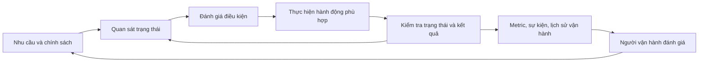
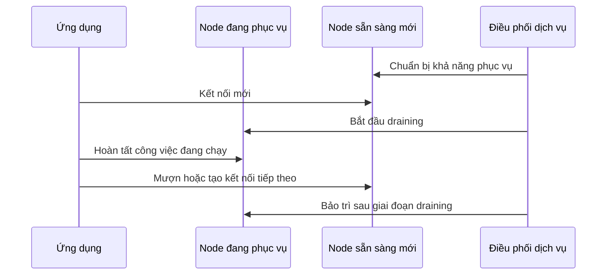

# Cơ chế tự động vận hành của Autonomous Database

Autonomous Database tự động hóa nhiều công việc thường do đội quản trị database thực hiện: cấp phát tài nguyên, bảo trì phần mềm, sao lưu, quản lý một phần hiệu năng và vận hành hạ tầng. Giá trị của dịch vụ nằm ở khả năng thực hiện các công việc đó theo cấu hình và chính sách đã chọn, đồng thời cung cấp thông tin để người dùng kiểm chứng kết quả.

Với một ứng dụng Java trên Oracle Cloud Infrastructure, việc dùng Autonomous Database vẫn cần các quyết định về tenancy, compartment, IAM, kết nối mạng, tài khoản ứng dụng, giới hạn tài nguyên và phục hồi dữ liệu. Bài học giải thích cách những phần tự động phối hợp với nhau và cách đánh giá chúng trong vận hành thực tế.

Tài liệu Oracle hiện dùng tên **Oracle Autonomous AI Database**. Trong bài, “Autonomous Database” là cách gọi ngắn. Các ví dụ về auto scaling, maintenance và giám sát tập trung vào **Autonomous Database Serverless**; khi dùng Dedicated hoặc một gói dịch vụ khác, cần kiểm tra tài liệu tương ứng. Tên gọi hiện hành được Oracle công bố trong [ghi chú đổi tên dịch vụ](https://docs.oracle.com/en-us/iaas/releasenotes/autonomous-database-serverless/2025-10-oracle-autonomous-ai-database.htm).

Sau bài học, người học có thể:

- Giải thích vòng quan sát, quyết định và thực thi của một dịch vụ database tự động.
- Phân biệt các công việc do Oracle thực hiện với các chính sách khách hàng cần chọn.
- Nhận biết điều kiện của automatic indexing, auto scaling và bảo trì.
- Liên hệ tính sẵn sàng của database với connection pool, giao dịch và phục hồi của ứng dụng.
- Thu thập bằng chứng để đánh giá hiệu năng, an toàn dữ liệu và chi phí.

Các hành vi dịch vụ được đối chiếu với tài liệu Oracle ngày **20/11/2026**. Tùy chọn thực tế còn phụ thuộc deployment, workload, phiên bản, mô hình tài nguyên và gói dịch vụ.

## 1. “Tự động vận hành” hoạt động ở tầng nào?

### 1.1. Từ quản trị host sang khai báo nhu cầu

Ở mô hình tự quản, đội vận hành thường chuẩn bị máy chủ, cài hệ điều hành và database, cấu hình storage, thiết lập lịch backup và tổ chức patching. Autonomous Database cung cấp các hoạt động này qua dịch vụ được quản lý. Khách hàng gửi yêu cầu về cấu hình; Oracle thực hiện phần cấp phát và vận hành tương ứng. [Oracle: What is Autonomous AI Database?](https://docs.oracle.com/en-us/iaas/autonomous-database-serverless/doc/autonomous-intro-adb.html).

Sự thay đổi quan trọng là đối tượng người dùng quản lý:

| Ở tầng hạ tầng tự quản | Trong cách làm với Autonomous Database |
| --- | --- |
| Chọn host và cài phần mềm | Chọn loại triển khai, phiên bản và tài nguyên được dịch vụ hỗ trợ |
| Viết script cho nhiều tác vụ nền | Cấu hình khả năng tự động được cung cấp và quan sát kết quả |
| Theo dõi sức khỏe từng thành phần | Theo dõi tài nguyên database, sự kiện dịch vụ và sức khỏe ứng dụng |
| Tự điều phối mọi bước phục hồi | Chọn phương án, mốc đích và kiểm chứng luồng phục hồi của dịch vụ |

Đây là cách nhìn về trách nhiệm và giao diện quản trị. Không nên lấy một runbook chỉnh host của database tự quản rồi áp dụng nguyên vẹn vào Autonomous.

### 1.2. Mô hình học tập về vòng điều khiển

Có thể hình dung một công việc tự động qua vòng sau:



Sơ đồ là mô hình giải thích để học và vận hành. Ví dụ:

1. Khách hàng bật compute auto scaling và chọn tài nguyên nền.
2. Workload phát sinh nhu cầu tài nguyên cao hơn.
3. Dịch vụ sử dụng thêm tài nguyên trong phạm vi hỗ trợ.
4. Người vận hành đối chiếu mức sử dụng với độ trễ, lỗi và chi phí.
5. Nếu mục tiêu chưa đạt, đội ứng dụng xem lại SQL, service kết nối hoặc cấu hình nền.

Không cần giả định rằng mọi tác vụ đều dùng cùng một thuật toán “AI”. Lịch backup, rolling patching, phân phối tài nguyên và lựa chọn index là những cơ chế khác nhau, có điều kiện và cách kiểm chứng khác nhau.

### 1.3. Serverless và Dedicated có phạm vi điều khiển khác nhau

Serverless tập trung vào việc sử dụng database mà không phải quản lý một hạ tầng Exadata riêng. Dedicated dành hạ tầng cho một khách hàng và cung cấp các chính sách vận hành ở cấp fleet, container database và database theo mô hình của dịch vụ. Vì vậy, cách bố trí workload và quản lý maintenance có thể khác. [Oracle: Dedicated Deployment Overview](https://docs.oracle.com/en/cloud/paas/autonomous-database/dedicated/catalog/oracle-autonomous-ai-database-dedicated-exadata-infrastructure.pdf).

Không dùng một mặc định của Serverless để kết luận cấu hình của Dedicated. Trước khi đọc metric hoặc làm thay đổi, luôn xác định đúng deployment đang sử dụng.

## 2. Phần nào Oracle thực hiện, phần nào khách hàng chịu trách nhiệm?

Mô hình trách nhiệm của Oracle phân chia việc vận hành dịch vụ với việc quản lý ứng dụng và dữ liệu. Oracle thực hiện các tác vụ dịch vụ; khách hàng khởi tạo một số yêu cầu, chọn chính sách và theo dõi kết quả ứng dụng. [Oracle: Responsibility Model](https://docs.oracle.com/en/cloud/paas/autonomous-database/shared-responsibility-model.html).

| Nhóm việc | Dịch vụ đảm nhiệm | Khách hàng cần quyết định hoặc kiểm chứng |
| --- | --- | --- |
| Cấp phát | Triển khai tài nguyên theo yêu cầu | Region, compartment, workload, cấu hình ban đầu |
| Bảo trì | Thực hiện patching theo cơ chế dịch vụ | Lịch phù hợp và kiểm thử tương thích ứng dụng |
| Tài nguyên | Cấp phát và điều phối trong phạm vi cấu hình | Tài nguyên nền, tùy chọn auto scaling, ngân sách |
| Hiệu năng | Các cơ chế quản lý và tối ưu được hỗ trợ | SQL, schema, mức song song, service và mục tiêu độ trễ |
| Backup | Thực hiện cơ chế backup tự động | Chính sách lưu giữ, mốc phục hồi và diễn tập |
| An toàn truy cập | Các cơ chế bảo vệ của nền tảng | Quyền IAM, quyền dữ liệu, mạng và quản lý thông tin xác thực |
| Quan sát | Phát metric và sự kiện | Alarm, người nhận, hành động xử lý và SLO ứng dụng |

Một cách kiểm tra ranh giới là hỏi: **“Dịch vụ đã tự động thực hiện việc gì, theo quyết định nào, và bằng chứng kết quả nằm ở đâu?”**

Ví dụ, “backup được thực hiện tự động” chưa trả lời database nên quay về mốc nào sau khi xóa nhầm dữ liệu. Quyết định đó phụ thuộc nghiệp vụ và cần người vận hành xác định.

Tương tự, một tài khoản có quyền tạo database trong compartment không tự trở thành tài khoản đọc dữ liệu bên trong database. IAM của OCI, tài khoản database và quyền trên schema cần được thiết kế riêng.

## 3. Tự động cấp phát và điều phối tài nguyên

### 3.1. Cấp phát theo cấu hình khai báo

Khi tạo tài nguyên, người dùng chọn các thuộc tính được dịch vụ hỗ trợ, chẳng hạn workload, compute, storage và cách truy cập mạng. Dịch vụ thực hiện các bước cấp phát ở phía sau và công bố trạng thái tài nguyên.

Về vận hành, cần phân biệt:

- Yêu cầu đã được API tiếp nhận.
- Hoạt động cấp phát đã hoàn tất.
- Database sẵn sàng nhận kết nối.
- Ứng dụng kết nối đúng service và thực hiện được nghiệp vụ.

Bốn trạng thái này cần bằng chứng khác nhau. Một trang Console báo Available không chứng minh secret của ứng dụng đúng hoặc đường mạng từ Compute/OKE tới database đã hoạt động.

### 3.2. Tài nguyên nền là một quyết định vận hành

Tài nguyên nền tạo điểm xuất phát cho cơ chế cấp phát. Chọn quá thấp có thể làm workload thường xuyên cần thêm tài nguyên hoặc gặp giới hạn; chọn quá cao có thể trả tiền cho năng lực ít sử dụng.

Để chọn cấu hình, cần biết ít nhất:

| Đặc điểm workload | Ý nghĩa đối với cấu hình |
| --- | --- |
| Giao dịch ngắn, nhiều request đồng thời | Cần xem độ trễ và số kết nối đang sử dụng |
| Truy vấn phân tích dài | Cần xem CPU, I/O, song song và hàng đợi |
| Nạp dữ liệu theo đợt | Cần xem tốc độ nạp, thời gian hoàn tất và dung lượng |
| Tải tăng theo sự kiện | Cần xem biên độ đỉnh, thời gian đỉnh và khả năng mở rộng |
| Dữ liệu tăng liên tục | Cần xem dung lượng đã dùng, đã cấp phát và giới hạn |

Việc lựa chọn nên dựa trên workload đại diện. Một câu `SELECT 1 FROM dual` chứng minh được một phần đường kết nối, nhưng không đại diện cho tải nghiệp vụ.

## 4. Compute auto scaling và storage auto scaling

### 4.1. Hai tùy chọn phải được kiểm tra riêng

Trong Serverless, tài liệu Oracle mô tả compute auto scaling mặc định bật và storage auto scaling mặc định tắt khi tạo instance theo luồng được tài liệu áp dụng. Khi bật, compute có thể sử dụng tới ba lần tài nguyên nền; storage có thể mở rộng tới ba lần dung lượng nền, trong giới hạn hỗ trợ. [Oracle: Use Auto Scaling](https://docs.oracle.com/en-us/iaas/autonomous-database-serverless/doc/autonomous-auto-scale.html).

Đây là điểm xuất phát để đọc cấu hình, không phải cách xác định trạng thái của một database đang tồn tại. Database có thể đã được clone, chỉnh sửa hoặc sử dụng gói có giới hạn khác.

Ví dụ giả định, database có compute nền 4 ECPU. Biên 3 lần tương ứng 12 ECPU nếu các điều kiện và giới hạn áp dụng cho phép. “Cho phép tới 12” không có nghĩa database luôn được cấp 12 hoặc throughput tăng đúng 3 lần.

| Câu hỏi | Compute auto scaling | Storage auto scaling |
| --- | --- | --- |
| Nhu cầu chính | Tài nguyên xử lý khi workload cần thêm | Không gian lưu trữ khi dữ liệu tăng |
| Cấu hình cần đọc | Compute nền và trạng thái tùy chọn | Storage nền và trạng thái tùy chọn |
| Bằng chứng hiệu quả | Độ trễ, throughput, chờ tài nguyên | Dung lượng còn dùng được và tốc độ tăng |
| Rủi ro cần quản lý | Chi phí và giới hạn xử lý khác | Chi phí, giới hạn dung lượng và thu hồi không gian |

### 4.2. Auto scaling không giải quyết mọi loại chờ

Giả sử API chậm vì hai transaction cùng giữ và chờ một hàng dữ liệu. Bổ sung CPU có thể không loại bỏ nguyên nhân chờ khóa.

Các tình huống cần tách:

- Chờ CPU hoặc I/O do nhu cầu xử lý.
- Chờ khóa do thiết kế transaction.
- Chờ connection pool ở tầng Java.
- Chờ do giới hạn đồng thời của service.
- Chờ dịch vụ bên ngoài trong khi vẫn giữ transaction hoặc connection.

Chỉ sau khi xác định loại chờ mới có cơ sở đánh giá auto scaling. Một biểu đồ CPU thấp cùng API chậm là tín hiệu cần điều tra thêm, không đủ để kết luận tài nguyên thừa.

### 4.3. Used, allocated và base storage khác nhau

Ba đại lượng thường phải đọc cùng nhau:

- **Base storage**: dung lượng nền người dùng cấu hình.
- **Allocated storage**: không gian đã được cấp cho các tablespace.
- **Used storage**: không gian các đối tượng và thành phần dữ liệu đang sử dụng.

Xóa dữ liệu có thể giảm phần đã dùng nhưng chưa trả lại ngay phần đã cấp phát. Oracle cung cấp thao tác shrink với điều kiện và giới hạn riêng. Không nên xem xóa một bảng là bằng chứng hóa đơn storage sẽ giảm ngay. [Oracle: Shrink Storage and Storage Allocation](https://docs.oracle.com/en-us/iaas/autonomous-database-serverless/doc/autonomous-auto-scale.html).

Trong kế hoạch kiểm soát dung lượng, cần ghi trạng thái trước/sau, thời điểm số liệu cập nhật và mức ảnh hưởng của thao tác thu hồi không gian tới workload.

## 5. Tự động quản lý hiệu năng

### 5.1. Optimizer cần thống kê phù hợp

Optimizer dùng thống kê để ước lượng số hàng và chi phí các phương án thực thi. Nếu phân bố dữ liệu thay đổi nhiều, một execution plan từng phù hợp có thể không còn tốt.

Tài liệu Serverless phân biệt workload: Transaction Processing/JSON có cơ chế thu thập thống kê tự động; với Lakehouse, cách thu thập phụ thuộc đường nạp dữ liệu và cấu hình, trong đó một số direct-path load qua SQL tự thu thập thống kê. Không suy rằng mọi đường nạp và mọi workload có cùng mặc định. [Oracle: Manage Optimizer Statistics](https://docs.oracle.com/en/cloud/paas/autonomous-database/serverless/adbsb/manage-optimizer-stats.html).

Người học cần hiểu chuỗi tác động:

```text
Dữ liệu thay đổi
    → phân bố dữ liệu có thể thay đổi
    → ước lượng của optimizer có thể thay đổi
    → execution plan và chi phí thực thi có thể thay đổi
    → cần đối chiếu độ trễ và tài nguyên thực tế
```

Tự thu thập thống kê không thay thế thiết kế schema, điều kiện lọc phù hợp, bind variable hay cách chia transaction.

### 5.2. Automatic indexing là khả năng có điều kiện

Automatic indexing quan sát workload và quản lý index nhằm hỗ trợ hiệu năng. Tuy nhiên, tài liệu Serverless hiện hành nêu rằng **automatic indexing mặc định tắt** và cần bật **Real Application Testing (RAT)** trước khi bật tính năng này. [Oracle: Manage Automatic Indexing](https://docs.oracle.com/en-us/iaas/autonomous-database-serverless/doc/autonomous-auto-index.html).

Do đó, không được suy từ tên Autonomous rằng tất cả index đã được hệ thống tối ưu tự động. Cần biết cấu hình hiện tại, phạm vi workload được hỗ trợ và cách đánh giá kết quả.

Một mô hình giải thích cho việc đánh giá index là:

1. Quan sát các truy vấn đại diện.
2. Xác định cơ hội cải thiện đường truy cập.
3. Đánh giá lợi ích và chi phí của index.
4. Áp dụng theo chế độ được cấu hình.
5. Theo dõi lại khi dữ liệu hoặc workload thay đổi.

Khi đánh giá, cần xem cả truy vấn đọc và các thao tác ghi. Index có thể giúp tìm dữ liệu nhanh hơn nhưng phải được duy trì khi INSERT, UPDATE hoặc DELETE.

### 5.3. Kiểm tra cấu hình thay vì tự bật tính năng

Với tài khoản quản trị có quyền đọc view tương ứng, truy vấn sau chỉ xem cấu hình:

```sql
SELECT parameter_name,
       parameter_value
FROM dba_auto_index_config
WHERE parameter_name = 'AUTO_INDEX_MODE';
```

View `DBA_AUTO_INDEX_CONFIG` cung cấp cấu hình automatic indexing. [Oracle: DBA_AUTO_INDEX_CONFIG](https://docs.oracle.com/en/database/oracle/oracle-database/26/refrn/DBA_AUTO_INDEX_CONFIG.html).

Nếu truy vấn bị từ chối do quyền hoặc view không khả dụng trong môi trường đang dùng, ghi lại giới hạn quan sát. Không coi lỗi thiếu quyền là bằng chứng tính năng đã tắt.

Một bản đánh giá hiệu năng nên có SQL/workload đại diện, thời gian hoàn tất, phân bố latency, tài nguyên tiêu thụ và tác động tới phần ghi. Cấu hình đã bật chỉ chứng minh trạng thái cấu hình.

## 6. Phân phối workload qua database service

Autonomous Database có các service gắn với consumer group, chẳng hạn `TP`, `TPURGENT`, `HIGH`, `MEDIUM` và `LOW`. Những service này có đặc tính ưu tiên, mức song song và giới hạn đồng thời khác nhau. [Oracle: Database Service Names](https://docs.oracle.com/en-us/iaas/autonomous-database-serverless/doc/predefined-database-services-names.html).

| Service | Vai trò khái quát trong tài liệu |
| --- | --- |
| TP | Giao dịch ứng dụng thông thường |
| TPURGENT | Giao dịch có yêu cầu ưu tiên cao |
| HIGH | Báo cáo/batch ưu tiên cao, có cơ chế song song và hàng đợi |
| MEDIUM | Báo cáo/batch, có cơ chế song song và hàng đợi |
| LOW | Báo cáo/batch ưu tiên thấp, không tự chạy song song theo đặc tính mặc định mô tả |

Phải kiểm tra service thực sự được cung cấp và quy tắc của database đang dùng. Tên “HIGH” không chứng minh mọi API giao dịch chạy nhanh hơn khi chuyển sang đó.

Ví dụ một ứng dụng có:

- API tra cứu đơn hàng.
- Batch tổng hợp doanh thu cuối ngày.
- Tác vụ nạp dữ liệu từ hệ thống khác.

Nếu cả ba cùng dùng một service và một connection pool, việc phân tích nguyên nhân chậm sẽ khó hơn. Tách đường kết nối theo mục đích và đặt giới hạn phù hợp giúp quan sát rõ workload nào đang sử dụng tài nguyên.

Để xác nhận phiên hiện tại đang kết nối qua service nào:

```sql
SELECT SYS_CONTEXT('USERENV', 'SESSION_USER') AS session_user,
       SYS_CONTEXT('USERENV', 'SERVICE_NAME') AS service_name
FROM dual;
```

Kết quả phải được đối chiếu với cấu hình JDBC thực tế của ứng dụng. Không dùng tên service dự định trong tài liệu thiết kế thay cho bằng chứng phiên đang chạy.

## 7. Tự động vá lỗi và bảo trì

### 7.1. Cách rolling maintenance duy trì phục vụ

Oracle mô tả việc áp dụng rolling patch bằng cách làm database sẵn sàng trên các node mới trước khi vá các node cũ. Kết nối mới được hướng sang node mới để tiếp tục phục vụ. [Oracle: Rolling Maintenance](https://docs.oracle.com/en-us/iaas/releasenotes/autonomous-database-serverless/2025-07-best-practices-for-app-availability-during-maintenance.htm).

Có thể hình dung trình tự:



Sơ đồ thể hiện ý tưởng phục vụ trong quá trình bảo trì, không phải cam kết rằng mọi session đang giữ lâu đều được bảo toàn.

### 7.2. Kết nối cũ vẫn cần được xử lý

Tài liệu maintenance Serverless mô tả giai đoạn draining thường là **5 phút**; các kết nối còn giữ trên node cũ sau giai đoạn này có thể bị ngắt. Thời gian và ngoại lệ phải kiểm tra theo dịch vụ. Oracle khuyến nghị dùng connection pool với cấu hình hỗ trợ phù hợp. [Oracle: Maintenance and Application Availability](https://docs.oracle.com/en-us/iaas/autonomous-database-serverless/doc/maintenance-windows-patching.html).

Với ứng dụng Java, nên tổ chức vòng sử dụng connection theo một đơn vị công việc ngắn:

```java
try (Connection connection = dataSource.getConnection()) {
    // Thực hiện một đơn vị công việc database có phạm vi rõ ràng.
}
// Với pooled DataSource, close trả connection về pool.
```

Đoạn code chỉ minh họa vòng đời connection. Hành vi draining còn phụ thuộc driver, pool, phiên bản và cấu hình được Oracle hỗ trợ.

Giữ một connection trong suốt vòng đời ứng dụng, hoặc giữ connection khi chờ gọi HTTP bên ngoài, làm tăng nguy cơ công việc kéo dài qua giai đoạn draining.

### 7.3. Retry phải gắn với kết quả giao dịch

Khi kết nối mất sau khi gửi COMMIT, ứng dụng có thể chưa biết giao dịch đã commit hay chưa. Retry mù một thao tác “tạo đơn hàng” có thể tạo bản ghi lặp.

Thiết kế cần xét:

- Khóa idempotency hoặc định danh nghiệp vụ duy nhất.
- Cách kiểm tra giao dịch đã tồn tại.
- Ranh giới retry của một đơn vị nghiệp vụ.
- Cơ chế replay/continuity được hỗ trợ nếu lựa chọn sử dụng.

Các cơ chế nền tảng chỉ là một phần của bài toán. Đội ứng dụng phải kiểm chứng hành vi qua những tình huống mất kết nối phù hợp với đường JDBC đang dùng.

### 7.4. Patch tự động vẫn cần quan sát

Người vận hành cần biết lịch maintenance, timezone, lịch sử gần đây và các thay đổi ứng dụng diễn ra cùng thời điểm. Kiểm tra đường thông báo và người nhận để tránh một sự kiện quan trọng chỉ xuất hiện trong Console mà không tới đội trực.

Việc vá bản cập nhật định kỳ và nâng phiên bản lớn cần được đánh giá theo luồng dịch vụ tương ứng. Không dùng việc một lần patch thành công để kết luận mọi thay đổi phiên bản đều tương thích với ứng dụng.

## 8. Backup tự động, phục hồi và tính sẵn sàng

### 8.1. Dịch vụ tạo backup; người dùng xác định mục tiêu phục hồi

Autonomous Database thực hiện backup tự động và cung cấp khả năng phục hồi trong phạm vi retention được hỗ trợ. Người dùng vẫn cần chọn chính sách, mốc đích và kiểm tra dữ liệu sau phục hồi. [Oracle: Backup and Recovery](https://docs.oracle.com/en-us/iaas/autonomous-database-serverless/doc/backup-intro.html).

Ba việc cần phân biệt:

| Việc | Bằng chứng cần có |
| --- | --- |
| Backup đang hoạt động | Trạng thái backup và phạm vi dữ liệu được bảo vệ |
| Có thể phục hồi tới mốc cần thiết | Mốc đích còn hợp lệ và luồng phục hồi phù hợp |
| Ứng dụng phục hồi đúng | Dữ liệu, schema, quyền và tích hợp đã được kiểm chứng |

RPO là mức mất dữ liệu chấp nhận được; RTO là thời gian gián đoạn chấp nhận được. Hai mục tiêu này phải được đánh giá bằng bài diễn tập, không chỉ bằng số bản backup có trong danh sách.

Một lỗi xóa nhầm đã được commit có thể được cơ chế backup bảo vệ như mọi thay đổi khác. Để lấy lại trạng thái trước lỗi, cần chọn đúng mốc và đối soát các giao dịch hợp lệ xảy ra sau mốc đó.

### 8.2. HA, backup và DR có mục đích khác nhau

Khả năng duy trì phục vụ trong quá trình bảo trì, phục hồi dữ liệu cũ và phục hồi sau sự cố phạm vi lớn là các yêu cầu khác nhau.

Autonomous Data Guard cung cấp standby với các lựa chọn local hoặc cross-region theo phạm vi hỗ trợ. Loại peer, chính sách và phương thức chuyển vai cần được thiết lập, kiểm tra riêng. [Oracle: About Standby Databases](https://docs.oracle.com/en-us/iaas/autonomous-database-serverless/doc/autonomous-data-guard-about.html).

Không suy rằng một instance đã tự có kiến trúc DR liên region chỉ vì được gọi là Autonomous. Cần xác nhận peer, vị trí, độ trễ và luồng chuyển ứng dụng.

### 8.3. Tính nhất quán vượt ra ngoài database

Giả sử đơn hàng đã được thanh toán ở một cổng bên ngoài, nhưng database được quay về thời điểm trước thanh toán. Database và cổng thanh toán có thể giữ hai trạng thái khác nhau.

Runbook cần bao gồm outbox, consumer, object được tham chiếu và các tác động đã gửi ra ngoài. Việc khôi phục một database không tự đảo ngược một email đã gửi hoặc một giao dịch bên hệ thống khác.

Vì vậy, đánh giá khả năng tự vận hành phải bao gồm cả việc ứng dụng và đội vận hành có thể hoàn tất phục hồi nghiệp vụ như thế nào.

## 9. Tự động bảo vệ và ranh giới truy cập

### 9.1. Mã hóa và cập nhật bảo mật của dịch vụ

Autonomous Database cung cấp cấu hình bảo mật được chuẩn hóa, tự áp các bản cập nhật bảo mật và mã hóa dữ liệu khi lưu trữ cũng như khi truyền. [Oracle: Security Features Overview](https://docs.oracle.com/en-us/iaas/autonomous-database-serverless/doc/sercurity-features-overview.html).

Những cơ chế này bảo vệ các tầng tương ứng. Chúng không thay thế phân quyền dữ liệu: một tài khoản đã được cấp quyền đọc bảng vẫn có thể đọc dữ liệu theo quyền đó.

### 9.2. TLS, mTLS và wallet cần khớp cấu hình

Trong Serverless, Oracle mô tả mặc định hỗ trợ mTLS và có thể cấu hình cho phép cả mTLS lẫn TLS. Một số client hỗ trợ kết nối TLS không cần tải wallet khi instance đã cho phép và dùng đúng connection string. [Oracle: Encryption and Client Connections](https://docs.oracle.com/en-us/iaas/autonomous-database-serverless/doc/gs-security-and-authentation-autonomous-database.html).

Do đó, cần kiểm tra đồng thời:

- Cấu hình TLS/mTLS thực tế của database.
- Loại client và driver được dùng.
- Connection string tương ứng.
- Wallet hoặc trust configuration nếu đường kết nối yêu cầu.
- Tài khoản database và quyền dữ liệu.

Một wallet còn hợp lệ không tự tạo ra quyền đọc mọi bảng. Tương tự, đổi cách xác thực kết nối không thay thế thiết kế quyền SQL.

### 9.3. Mạng và IAM vẫn thuộc thiết kế của hệ thống

Người vận hành chọn public endpoint cùng ACL hoặc private endpoint cùng cấu hình VCN phù hợp. Client vẫn cần đường mạng và DNS tới endpoint. Các lớp kiểm soát truy cập mạng và quyền database được Oracle mô tả riêng. [Oracle: Access Control Layers](https://docs.oracle.com/en-us/iaas/autonomous-database-serverless/doc/gs-security-and-authentication-autonomous-database.html).

Trong một hệ thống Java, nên xác định riêng:

| Danh tính hoặc cấu hình | Mục đích |
| --- | --- |
| Người dùng/nhóm IAM | Quản lý tài nguyên OCI trong phạm vi cho phép |
| Tài khoản quản trị database | Thực hiện quản trị dữ liệu được dịch vụ hỗ trợ |
| Tài khoản ứng dụng | Thực hiện đúng các thao tác nghiệp vụ cần thiết |
| Wallet/secret/trust material | Hỗ trợ đường xác thực và kết nối tương ứng |
| ACL, NSG, route, DNS | Cho phép client tiếp cận endpoint theo thiết kế |

Không dùng tài khoản quản trị chung cho mọi thành phần ứng dụng. Gắn trách nhiệm quản lý secret và cập nhật cấu hình vào quy trình vận hành, kể cả khi phần patching database đã được tự động hóa.

## 10. Quan sát để biết tự động hóa có hiệu quả

### 10.1. Metric tài nguyên và metric nghiệp vụ

Serverless phát metric trong namespace `oci_autonomous_database`. Một số metric hữu ích gồm:

| Metric | Câu hỏi quan sát |
| --- | --- |
| `CpuUtilization` | CPU đang sử dụng ở mức nào so với năng lực được phép dùng? |
| `QueuedStatements` | SQL có bị xếp hàng không? |
| `SessionUtilization` | Mức sử dụng session có tiến sát giới hạn không? |
| `StorageUsed`, `StorageAllocated`, `StorageMax` | Dữ liệu và không gian được cấp phát đang biến đổi ra sao? |
| `DatabaseAvailability` | Dịch vụ có khả dụng cho kết nối trong khoảng quan sát không? |

Dimension `RESOURCEID` dùng để lọc đúng database. Tài liệu nêu alarm interval hợp lệ từ 5 phút trở lên; tần suất phát metric khác nhau, trong đó nhiều metric storage có nhịp giờ. [Oracle: Autonomous Database Metrics](https://docs.oracle.com/en-us/iaas/autonomous-database-serverless/doc/autonomous-monitor-metrics-list.html).

Đặt các số liệu này cạnh metric của ứng dụng: p95/p99 latency, tỷ lệ lỗi, throughput, thời gian chờ connection pool và tỷ lệ nghiệp vụ hoàn tất đúng.

Nếu cấu hình tài nguyên thay đổi, phần trăm sử dụng có thể thay đổi cách diễn giải. Khi so sánh trước/sau, ghi cả cấu hình và khoảng thời gian thay vì chỉ chụp một biểu đồ phần trăm.

### 10.2. Sự kiện giúp giải thích thay đổi

Autonomous Database cung cấp sự kiện về các thay đổi và hoạt động dịch vụ, gồm những nhóm phục vụ quan sát maintenance hoặc tài nguyên. Có thể dùng OCI Events và đường thông báo phù hợp để chuyển sự kiện tới nơi vận hành theo dõi. [Oracle: Autonomous Database Events](https://docs.oracle.com/en-us/iaas/autonomous-database-serverless/doc/autonomous-database-events.html).

Một timeline hữu ích có thể gồm:

```text
09:00  Triển khai phiên bản ứng dụng mới
09:10  Tăng lượng request
09:15  Thay đổi mức sử dụng tài nguyên
09:20  SQL bắt đầu bị xếp hàng
09:25  Điều chỉnh workload hoặc cấu hình
09:40  Kiểm tra latency, lỗi và chi phí sau thay đổi
```

Đây là ví dụ biên bản, không phải timeline đo trên tài nguyên thật. Mục tiêu là liên kết nguyên nhân, hành động và kết quả để tránh kết luận “dịch vụ tự điều chỉnh rồi nên không cần xem tiếp”.

### 10.3. Mỗi cảnh báo cần dẫn tới một hành động

| Tình huống | Hướng điều tra ban đầu |
| --- | --- |
| API chậm, CPU tăng, SQL xếp hàng | Xem workload, service, khả năng mở rộng và SQL tốn tài nguyên |
| API chậm, CPU thấp | Xem khóa, pool, mạng và dịch vụ bên ngoài |
| Session tăng cao | Xem số replica, kích thước pool và connection bị giữ lâu |
| Allocated storage tăng | Đối chiếu dữ liệu nạp, index, retention dữ liệu và khả năng thu hồi |
| Kết nối lỗi gần maintenance | Đối chiếu lịch, thời gian giữ connection và cấu hình pool/driver |
| Metric bị thiếu | Kiểm tra khoảng quan sát, phạm vi truy vấn và quyền xem |

Cần xác định người nhận, ngưỡng, khoảng đánh giá và bước xử lý đầu tiên. Một alarm đã tạo nhưng chưa thử đường thông báo chưa đủ để xem là cơ chế giám sát hoạt động.

## 11. Thực hành kiểm chứng cơ chế tự động

Bài thực hành dùng một Autonomous Database Serverless thử nghiệm đã được phép truy cập. Mục tiêu là thu thập bằng chứng; các lệnh dưới đây không tự bật tính năng, phát sinh tải hay thay đổi cấu hình.

### 11.1. Kiểm kê cấu hình bằng CLI

Ví dụ dành cho Bash, giả định OCI CLI đã có thông tin xác thực và quyền đọc tài nguyên:

```bash
ADB_OCID='THAY_BANG_AUTONOMOUS_DATABASE_OCID'
OCI_REGION='THAY_BANG_REGION_IDENTIFIER'

oci db autonomous-database get \
  --autonomous-database-id "$ADB_OCID" \
  --region "$OCI_REGION" \
  --output json
```

Lệnh lấy chi tiết Autonomous Database được mô tả trong [Oracle CLI: autonomous-database get](https://docs.oracle.com/en-us/iaas/tools/oci-cli/latest/oci_cli_docs/cmdref/db/autonomous-database/get.html).

Đối chiếu kết quả và Console để ghi:

- OCID, region, compartment và deployment.
- Workload, phiên bản và compute model.
- Tài nguyên nền cùng trạng thái hai loại auto scaling.
- Cấu hình kết nối và lịch maintenance.
- Trạng thái backup và cơ chế phục hồi đang có.

Không thay thế giá trị quan sát được bằng các mặc định đọc trong bài.

### 11.2. Quan sát service và thống kê của schema

Chạy truy vấn xác nhận service ở phần trước. Với các bảng thuộc schema thực hành, có thể đọc:

```sql
SELECT table_name,
       num_rows,
       last_analyzed,
       stale_stats
FROM user_tab_statistics
WHERE partition_name IS NULL
  AND subpartition_name IS NULL
ORDER BY table_name;
```

`NUM_ROWS` trong thống kê không phải một lệnh đếm thời gian thực. Khi cần đối chiếu dữ liệu thực tế, chọn phép kiểm tra có phạm vi phù hợp; không quét toàn bộ dữ liệu lớn chỉ để tạo một baseline.

Nếu có quyền quản trị, đọc cấu hình automatic indexing bằng truy vấn đã nêu. Ghi rõ tính năng đang bật hay tắt và nguồn bằng chứng.

### 11.3. Thiết kế phép thử có mục tiêu

Nếu tiếp tục một bài thử tải trên môi trường lab, hãy đặt trước giới hạn thời gian, mức song song và ngân sách. Giữ cùng dữ liệu, service kết nối và tiêu chí hoàn tất khi so sánh.

| Phần thử | Bằng chứng cần thu |
| --- | --- |
| Baseline | Cấu hình, workload, latency, lỗi và tài nguyên |
| Tải tăng có kiểm soát | Nhu cầu tài nguyên, queue và công việc hoàn tất |
| Sau khi tải giảm | Trạng thái tài nguyên, latency và chi phí liên quan |
| Kiểm tra connection pool | Thời gian giữ connection, kết nối lỗi và cách phục hồi |
| Diễn tập dữ liệu | Mốc phục hồi, kết quả dữ liệu và thời gian nghiệp vụ trở lại |

Không cần workload lớn để chứng minh đã hiểu cơ chế. Nếu chưa đủ điều kiện quan sát auto scaling hoặc maintenance, ghi giới hạn của kết luận thay vì tạo tải không đại diện.

### 11.4. Đánh giá kết quả

Một kết luận có cơ sở cần trả lời:

1. Cơ chế nào thực sự đang được bật?
2. Hành động tự động nào đã được quan sát?
3. Hành động đó cải thiện mục tiêu nào?
4. Còn nút thắt hoặc rủi ro nào?
5. Chi phí thay đổi ra sao?
6. Bằng chứng nào còn thiếu?

Ví dụ, “auto scaling đã bật” chỉ là kết luận về cấu hình. “Workload giữ được p95 dưới ngưỡng trong đợt tăng tải cụ thể” là kết luận có phạm vi kiểm chứng rõ hơn.

## 12. Kiểm soát chi phí trong hệ thống tự động

Compute và storage có thể phát sinh chi phí theo tài nguyên được cấu hình và các tính năng sử dụng. Tài liệu billing Serverless nêu rằng tài nguyên dùng thêm qua auto scaling có thể được tính phí; storage backup cũng cần được xét theo mô hình áp dụng. [Oracle: Autonomous Database Billing Summary](https://docs.oracle.com/en-us/iaas/autonomous-database-serverless/doc/autonomous-database-billing-overview.html).

Để quản lý chi phí, nên liên kết từng thành phần với chủ sở hữu và workload:

| Thành phần | Cách quản lý |
| --- | --- |
| Compute nền | Đối chiếu với nhu cầu thường xuyên |
| Compute dùng thêm | Theo dõi thời điểm đỉnh và nguyên nhân |
| Storage | Xem tăng trưởng, allocated space và dữ liệu cần giữ |
| Backup, clone, peer | Gắn với mục tiêu phục hồi hoặc kiểm thử cụ thể |
| Tài nguyên thử nghiệm | Ghi thời hạn sử dụng và kế hoạch thu hồi |
| Hóa đơn | Đối chiếu theo compartment, tag và thời gian hoạt động |

Budget alert là tín hiệu quan sát; không nên coi nó là cơ chế tự chặn mọi mức sử dụng. Tương tự, tính năng có giới hạn tài nguyên không bảo đảm tổng chi phí của toàn hệ thống đã nằm trong ngân sách.

Nếu auto scaling thường xuyên hoạt động mà nghiệp vụ vẫn chậm, cần xem cả hiệu quả SQL và cách phân bổ workload trước khi tăng cấu hình nền. Nếu tài nguyên được sử dụng hiệu quả và mục tiêu đạt, chi phí tăng có thể phản ánh nhu cầu nghiệp vụ thật; kết luận phải dựa trên số liệu.

## 13. Những ngộ nhận cần tránh

| Ngộ nhận | Cách hiểu và kiểm tra |
| --- | --- |
| Autonomous nghĩa là không cần người vận hành | Vẫn cần chính sách, quyền, giám sát ứng dụng và phục hồi nghiệp vụ |
| Mọi tính năng tối ưu đều bật mặc định | Đọc cấu hình và điều kiện của từng tính năng |
| Automatic indexing luôn tự sửa SQL chậm | Kiểm tra trạng thái, phạm vi hỗ trợ và kết quả workload |
| Auto scaling nghĩa là tăng tài nguyên vô hạn | Kiểm tra biên mở rộng, giới hạn và cách tính phí |
| Compute và storage auto scaling là một nút | Kiểm tra hai tùy chọn độc lập |
| Xóa dữ liệu thì storage và chi phí giảm ngay | Phân biệt used, allocated và base storage |
| Database online bảo đảm mọi session còn nguyên | Kiểm tra draining, pool, driver và giao dịch đang chạy |
| Có backup là tự khôi phục đúng khi xóa nhầm | Cần chọn mốc, phạm vi và kiểm chứng dữ liệu |
| Có tính sẵn sàng cao là đã có DR liên region | Xác nhận peer, vị trí và luồng chuyển ứng dụng |
| Mã hóa thay thế phân quyền | Thiết kế quyền IAM, quyền database và truy cập mạng |
| CPU thấp chứng minh database khỏe | Đọc thêm queue, khóa, session, latency và lỗi ứng dụng |
| Trạng thái Available chứng minh SLO đã đạt | Chạy kiểm tra nghiệp vụ từ đúng đường truy cập |

## 14. Bài tập vận dụng

Một ứng dụng Java dùng Autonomous Database để xử lý đơn hàng. Ban ngày có nhiều transaction ngắn; ban đêm chạy batch tổng hợp. Đội vận hành muốn giảm công việc bảo trì thủ công, giữ độ trễ API trong mục tiêu và kiểm soát chi phí.

Hãy thực hiện:

1. Lập bảng trách nhiệm giữa Oracle, đội nền tảng và đội ứng dụng.
2. Kiểm kê deployment, workload, tài nguyên nền và hai loại auto scaling.
3. Xác định service kết nối cho API và batch; giải thích bằng đặc tính workload.
4. Đọc trạng thái automatic indexing và mô tả điều kiện cần trước khi thay đổi.
5. Lập kế hoạch quan sát một đợt tăng tải với metric database và metric Java.
6. Mô tả cách pool và transaction phản ứng nếu connection bị ngắt trong maintenance.
7. Xây dựng một tình huống xóa nhầm cần backup/PITR và một tình huống cần DR.
8. Kiểm tra các lớp IAM, mạng, TLS/mTLS và quyền dữ liệu.
9. Đề xuất cảnh báo có người nhận và hành động cụ thể.
10. Trình bày chi phí cần theo dõi, kết quả đã kiểm chứng và giới hạn còn lại.

Đầu ra cần chỉ rõ **cơ chế tự động nào đang hoạt động, chính sách nào do khách hàng lựa chọn và bằng chứng nào cho thấy hệ thống đáp ứng mục tiêu**.
