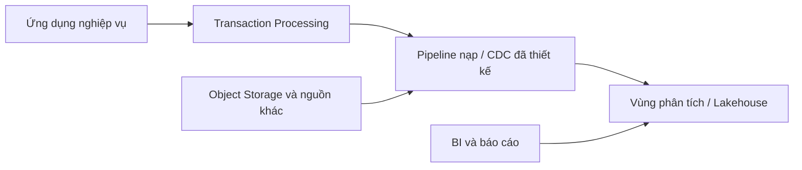

# Lựa chọn workload giao dịch, phân tích và JSON

Khi tạo Autonomous Database, hãy bắt đầu từ thao tác ứng dụng cần thực hiện, yêu cầu về độ trễ và cách dữ liệu tăng trưởng. Một API trả JSON chưa đủ để chọn JSON workload; một hệ thống có báo cáo cũng chưa đủ để tách ngay sang database phân tích.

Trong module **CLOUD_PROVIDERS_ORACLE**, bài này giúp người học chọn workload cho **Autonomous Database** dựa trên hồ sơ sử dụng, thay vì tên sản phẩm. Quyết định được đặt trong bối cảnh OCI: compartment và IAM, đường kết nối trong VCN, lưu trữ, giám sát, tự động hóa, chi phí và yêu cầu sẵn sàng.

Bài tập trung vào Autonomous Database Serverless. Các lựa chọn, giới hạn và thao tác chuyển đổi phải được đối chiếu theo region, phiên bản database, loại triển khai và tier thực tế. Dedicated Infrastructure hoặc các dịch vụ khác có thể có điều kiện riêng.

Sau bài học, người học có thể:

- Phân biệt workload giao dịch, phân tích và ứng dụng lấy JSON document làm trung tâm.
- Chọn giữa Transaction Processing, hướng phân tích Lakehouse và JSON workload.
- Nhận ra trường hợp cần workload hỗn hợp hoặc cần tách hệ thống phân tích.
- Phân biệt workload type với database service dùng khi kết nối.
- Xây dựng phép thử nhỏ, đo kết quả và ghi lại cơ sở lựa chọn.
- Lập phương án chuyển đổi khi nhu cầu dữ liệu thay đổi.

## 1. Ba câu hỏi độc lập trước khi chọn workload

### 1.1. Dữ liệu được tổ chức thế nào?

Dữ liệu có thể được tổ chức thành bảng quan hệ, JSON document, tập tin trong Object Storage hoặc kết hợp nhiều dạng. Đây là câu hỏi về mô hình dữ liệu.

Ví dụ:

- Đơn hàng có mã duy nhất, tổng tiền và trạng thái.
- Hồ sơ người dùng có thuộc tính tùy chọn, danh sách thiết bị và cấu hình thông báo.
- Lịch sử bán hàng nhiều năm được dùng để tổng hợp theo ngày, vùng và sản phẩm.

Một hệ thống có thể cần cả ba. Không phải mọi dữ liệu nhận từ HTTP dưới dạng JSON đều phải được lưu nguyên vẹn thành document.

### 1.2. Ứng dụng truy cập dữ liệu thế nào?

Đọc một đơn hàng theo khóa, cập nhật tồn kho, quét lịch sử bán hàng và tìm các document có một thuộc tính đều là những mẫu truy cập khác nhau.

Hai database có cùng dung lượng và cùng tỷ lệ đọc/ghi vẫn có thể cần thiết kế khác nhau:

- Hệ thống A chủ yếu đọc một vài dòng theo khóa.
- Hệ thống B chủ yếu quét hàng triệu dòng để tính tổng.

Tỷ lệ đọc 95% không tự chứng minh đây là workload phân tích.

### 1.3. Hệ thống được tối ưu và vận hành theo mục tiêu nào?

Workload type là lựa chọn cấu hình dịch vụ để phù hợp một nhóm nhu cầu. Nó không đồng nhất với định dạng dữ liệu hoặc một câu SQL cụ thể.

Tài liệu Oracle hiện dùng **Autonomous AI Lakehouse** cho hướng phát triển từ Autonomous Data Warehouse. **Transaction Processing** phục vụ giao dịch và tải hỗn hợp; **JSON** hướng đến ứng dụng lấy document làm trung tâm. Một số tài liệu hoặc công cụ cũ vẫn dùng tên Data Warehouse/ADW. [Oracle: các workload Autonomous](https://docs.oracle.com/en-us/iaas/autonomous-database-serverless/doc/about-autonomous-database-workloads.html).

Bài chỉ đi sâu ba nhóm trong đề bài. Những lựa chọn khác xuất hiện trong Console cần được đánh giá theo nhu cầu riêng, thay vì đưa vào cùng phép so sánh khi chưa có yêu cầu tương ứng.

## 2. Workload giao dịch: hoàn thành đúng một thao tác nghiệp vụ

Workload giao dịch, thường gọi là OLTP, có nhiều thao tác ngắn, được thực hiện đồng thời. Ứng dụng thường đọc hoặc thay đổi một lượng dữ liệu nhỏ cho mỗi nghiệp vụ.

Ví dụ:

- Tạo đơn hàng và trừ tồn kho.
- Ghi nhận thanh toán và cập nhật trạng thái.
- Đặt lịch khi vẫn còn chỗ.
- Cập nhật hồ sơ hoặc giỏ hàng.

### 2.1. Điểm trọng tâm là ranh giới giao dịch

Giả sử quy tắc nghiệp vụ yêu cầu tạo đơn hàng đồng thời với việc giữ hàng trong kho:

```text
Bắt đầu giao dịch
  Kiểm tra và giảm tồn kho nếu đủ hàng
  Ghi đơn hàng
  Ghi thông tin cần thiết khác
Commit khi toàn bộ thao tác thành công
Rollback nếu một bước thất bại
```

Nếu ứng dụng commit việc trừ kho trước khi ghi đơn, lỗi ở bước sau có thể để lại dữ liệu không đúng mong muốn. Chọn workload type không tự sửa ranh giới giao dịch trong code.

Tương tự, một truy vấn đọc nhanh chưa chứng minh ứng dụng xử lý đúng khi hai request cùng tranh chấp một mặt hàng cuối cùng.

### 2.2. Những số đo cần quan sát

| Số đo | Ý nghĩa |
| --- | --- |
| Giao dịch thành công mỗi giây | Năng lực xử lý nghiệp vụ thực |
| p95/p99 latency | Độ trễ phần đuôi dưới tải |
| Tỷ lệ lỗi và rollback | Chất lượng kết quả |
| Thời gian chờ khóa | Mức tranh chấp dữ liệu |
| Thời gian chờ connection | Khả năng phục vụ của ứng dụng và pool |
| Thời gian commit | Một phần chi phí hoàn tất giao dịch |

Không đếm một loạt request thất bại là throughput hữu dụng. Thời gian đo cũng cần bao gồm phần ứng dụng thực sự phải chờ, thay vì chỉ đo một câu SQL nhanh nhất.

### 2.3. Khi nào cân nhắc Transaction Processing?

Đây là ứng viên phù hợp để thử khi hệ thống có giao dịch nghiệp vụ, nhiều thao tác đồng thời, dữ liệu quan hệ đáng kể hoặc cần kết hợp bảng quan hệ với JSON. Nó cũng có thể phục vụ truy vấn phân tích và batch; sự phù hợp phải được kiểm chứng cùng tải giao dịch.

Lựa chọn ban đầu cần đi cùng thiết kế khóa, constraint, index, truy vấn, transaction và connection pool. Dịch vụ tự động hóa nhiều việc vận hành không làm các quyết định ứng dụng này biến mất.

## 3. Workload phân tích: trả lời câu hỏi trên nhiều dữ liệu

Workload phân tích, thường gọi là OLAP, tập trung vào việc đọc, kết hợp và tổng hợp dữ liệu để trả lời câu hỏi nghiệp vụ.

Ví dụ:

- Doanh thu theo tháng và khu vực.
- Tỷ lệ khách quay lại sau từng chiến dịch.
- Hành vi sử dụng theo nhiều sự kiện và khoảng thời gian.
- Đối chiếu dữ liệu từ bán hàng, vận chuyển và chăm sóc khách hàng.

Một truy vấn phân tích có thể chạy lâu hơn một request giao dịch nhưng vẫn đạt yêu cầu nếu nó hoàn thành đúng thời hạn của báo cáo.

### 3.1. Dấu hiệu nhận diện

| Đặc điểm | Ví dụ |
| --- | --- |
| Đọc nhiều dòng cho một kết quả | Tổng hợp lịch sử 24 tháng |
| Nhiều phép kết hợp | Nối đơn hàng, khách hàng và danh mục |
| Dữ liệu lịch sử lớn | Bảng fact tăng đều theo ngày |
| Nạp dữ liệu theo lô hoặc luồng | Đồng bộ dữ liệu vận hành sang vùng phân tích |
| Ưu tiên thời gian hoàn thành tập công việc | Hoàn thành bộ báo cáo trước giờ mở cửa |

Số người dùng ít không đồng nghĩa tải nhẹ. Một người chạy truy vấn quét lượng dữ liệu rất lớn có thể tạo nhu cầu tài nguyên đáng kể.

### 3.2. Lakehouse và dữ liệu ngoài database

Hướng Lakehouse phù hợp để đánh giá khi phần chủ đạo là phân tích, data mart, dữ liệu lịch sử hoặc khai thác dữ liệu trên nhiều hệ thống. Nó phát triển từ hướng Data Warehouse và mở rộng khả năng làm việc với các nền tảng dữ liệu mở, như Apache Iceberg.

Trong một thiết kế cụ thể, dữ liệu có thể được nạp vào bảng database hoặc được truy vấn từ nguồn ngoài qua cơ chế được hỗ trợ. Hai phương án có đường truy cập, chi phí và hành vi vận hành khác nhau.

Autonomous hỗ trợ external table cho dữ liệu trong cloud storage qua các công cụ như `DBMS_CLOUD`. Cần chuẩn bị quyền truy cập, định dạng và kiểm tra dữ liệu nguồn. [Oracle: Query External Data](https://docs.oracle.com/en-us/iaas/autonomous-database-serverless/doc/query-external-data.html).

Không mặc định mọi tệp nằm trong Object Storage đều lập tức truy vấn được, hoặc việc đọc dữ liệu ngoài luôn có hiệu năng như dữ liệu đã được tổ chức trong database.

### 3.3. Những số đo quan trọng

- Thời gian hoàn thành từng nhóm truy vấn và toàn bộ batch.
- Số truy vấn phân tích chạy đồng thời.
- Thời gian chờ trong hàng đợi.
- Khối lượng dữ liệu đọc và độ chọn lọc của điều kiện lọc.
- Thời gian nạp dữ liệu và độ trễ cập nhật.
- Tổng tài nguyên tiêu thụ cho một bộ báo cáo.

Cần ghi rõ **độ tươi dữ liệu**: báo cáo phản ánh dữ liệu mới nhất đến thời điểm nào. Đây là mục tiêu khác với RPO, vốn mô tả lượng dữ liệu có thể mất khi xảy ra sự cố.

## 4. Workload JSON: chọn theo document và vòng đời dữ liệu

JSON thích hợp để biểu diễn dữ liệu có cấu trúc lồng nhau, thuộc tính tùy chọn hoặc thay đổi theo loại đối tượng.

Ví dụ document hồ sơ:

```json
{
  "customerId": 501,
  "profileVersion": 2,
  "preferences": {
    "language": "vi",
    "emailNotification": true
  },
  "devices": [
    {
      "type": "mobile",
      "platform": "android"
    }
  ]
}
```

Một document như vậy có thể được đọc, cập nhật theo khóa hoặc được truy vấn theo thuộc tính bên trong.

### 4.1. JSON không loại bỏ thiết kế dữ liệu

Ứng dụng vẫn cần quyết định:

- Document nào là một đơn vị nghiệp vụ.
- Thuộc tính nào bắt buộc và cách kiểm tra kiểu dữ liệu.
- Cách biểu diễn phiên bản document.
- Cách tìm kiếm theo trường thường dùng.
- Cách xử lý hai bên cùng cập nhật.
- Chính sách lưu giữ và xóa dữ liệu.

Đưa mọi đơn hàng của một khách hàng vào một document tăng mãi có thể tạo điểm nóng cập nhật và tăng chi phí truyền dữ liệu. Ngược lại, tách document quá nhỏ có thể làm ứng dụng phải gọi nhiều lần cho một màn hình.

### 4.2. API document và SQL có thể cùng tồn tại

Autonomous JSON Database hỗ trợ mô hình ứng dụng document; SQL và các API document là những cách truy cập cần chọn theo nhu cầu. JSON không có nghĩa là chỉ có key-value, cũng không có nghĩa không dùng được giao dịch.

SODA là một tập API cho document. Với ứng dụng Java, có thể đánh giá document API hoặc JDBC cùng SQL/JSON, tùy cách thư viện ánh xạ collection và yêu cầu truy vấn. Không mặc định một bảng JSON tự tạo đã là collection sẵn sàng cho mọi API. [Oracle: Autonomous JSON Database](https://docs.oracle.com/en/cloud/paas/autonomous-json-database/).

Oracle cũng hỗ trợ lưu cột JSON cùng các cột quan hệ trong một bảng. Ví dụ, mã đơn hàng và số tiền có thể là cột quan hệ, trong khi thuộc tính mở rộng của sản phẩm nằm trong JSON. [Oracle: bảng có cột JSON](https://docs.oracle.com/en/database/oracle/oracle-database/26/adjsn/tables-json-columns.html).

### 4.3. Giới hạn cần kiểm tra trước khi chọn JSON workload

Theo tài liệu hiện hành, Autonomous JSON Database giới hạn **20 GB dữ liệu không thuộc JSON document collections**. Đây không phải giới hạn tổng cộng 20 GB cho toàn bộ JSON data; dung lượng sử dụng vẫn phải phù hợp tài nguyên được cấp và điều kiện dịch vụ. [Oracle: JSON workload và chuyển sang Transaction Processing](https://docs.oracle.com/en/cloud/paas/autonomous-database/serverless/adbsb/upgrade-json-transaction-processing.html).

Đừng chỉ nhìn tên bảng hoặc việc ứng dụng gửi JSON. Một cột văn bản chứa chuỗi JSON chưa tự chứng minh đối tượng được tính là JSON object theo quy định của dịch vụ. Cần đối chiếu kiểu cột, cấu trúc bảng và các đối tượng phụ thuộc.

Người quản trị có thể dùng `DBA_NONJSON_OBJECTS` để xác định những đối tượng được tính vào phần non-JSON. Quyền truy cập view và cách phân loại phải theo tài liệu của môi trường. [Oracle: DBA_NONJSON_OBJECTS](https://docs.oracle.com/en/cloud/paas/autonomous-database/serverless/adbsb/dba-nonjson-objects-view.html).

Nếu ứng dụng dự kiến có nhiều bảng quan hệ, dữ liệu audit, tài liệu nhị phân hoặc dữ liệu ngoài phạm vi JSON collections, hãy tính phần đó từ đầu. Không đợi sát ngưỡng mới chuẩn bị phương án khác.

## 5. So sánh ba nhóm để lập giả thuyết lựa chọn

Bảng dưới là hướng đánh giá, không phải bảng giới hạn tính năng tuyệt đối:

| Tiêu chí | Transaction Processing | Lakehouse / hướng phân tích | JSON workload |
| --- | --- | --- | --- |
| Nhu cầu chủ đạo | Giao dịch và tải hỗn hợp | Phân tích, tổng hợp, khai thác dữ liệu | Ứng dụng lấy document làm trung tâm |
| Mẫu thao tác điển hình | Đọc theo khóa, DML ngắn, commit | Scan, join, aggregate, nạp dữ liệu | Truy cập document, lọc thuộc tính, cập nhật document |
| Mô hình dữ liệu cần đánh giá | Quan hệ kết hợp JSON và dạng khác | Bảng phân tích cùng nguồn dữ liệu ngoài | JSON collections và phần non-JSON được cho phép |
| Mục tiêu thử nghiệm | Latency, TPS, tranh chấp | Thời gian báo cáo, concurrency, hàng đợi | Latency document, kích thước, index và tăng trưởng |
| Rủi ro thường bị bỏ sót | Báo cáo nặng ảnh hưởng API | Yêu cầu dữ liệu mới và pipeline | Giới hạn non-JSON, mô hình document tăng quá lớn |

Một hệ thống bán hàng có bảng đơn, lịch sử thay đổi và thuộc tính JSON không vì có cột JSON mà bắt buộc chọn JSON workload. Một database Transaction Processing có thể là giả thuyết hợp lý để thử trước.

Ngược lại, một kho hồ sơ document với phần quan hệ rất nhỏ có thể phù hợp để đánh giá JSON workload. Nếu nhu cầu chính là phân tích lượng lớn lịch sử từ nhiều nguồn, cần đánh giá hướng Lakehouse.

## 6. Thu thập hồ sơ workload trước khi provision

Hồ sơ nên mô tả cả tải trung bình lẫn tình huống bất lợi.

| Câu hỏi | Thông tin nên có |
| --- | --- |
| Đơn vị nghiệp vụ là gì? | Một đơn hàng, một cập nhật hồ sơ, một bộ báo cáo |
| Tải cao điểm ra sao? | Request/s, concurrency, lịch batch |
| Một thao tác chạm bao nhiêu dữ liệu? | Số dòng, kích thước document, phạm vi thời gian |
| Có tranh chấp không? | Nhiều request cùng ghi một đối tượng |
| Mục tiêu độ trễ là gì? | p95/p99 cho API, hạn hoàn thành báo cáo |
| Dữ liệu tăng thế nào? | Tăng trưởng JSON, non-JSON, index và lịch sử |
| Cần dữ liệu mới đến mức nào? | Đọc ngay sau ghi hay chấp nhận trễ |
| Sự cố được xử lý thế nào? | RPO, RTO và cách kiểm chứng phục hồi |
| Ai được truy cập? | User runtime, BI, job nạp dữ liệu, người vận hành |
| Giới hạn ngân sách nào áp dụng? | Lab, production, điều kiện mở rộng tài nguyên |

### Ví dụ hồ sơ minh họa

```text
Ứng dụng: đặt hàng
Tải cao điểm giả định: 300 giao dịch/giây
Mục tiêu API giả định: p95 dưới 250 ms, lỗi dưới 0,5%
Dữ liệu chính: quan hệ
Dữ liệu mở rộng: JSON mô tả thuộc tính sản phẩm
Báo cáo vận hành: theo ngày, truy vấn vài phút một lần
Báo cáo lịch sử: 24 tháng, chạy theo lịch
RPO/RTO: xác định riêng theo yêu cầu nghiệp vụ
```

Các con số trên là yêu cầu giả lập, không phải năng lực được bảo đảm của một cấu hình OCI. Với hồ sơ này, có thể bắt đầu thử Transaction Processing, sau đó đánh giá xem báo cáo lịch sử có cần tài nguyên tách riêng hay không.

## 7. Workload type khác với database service khi kết nối

Workload type được chọn cho database. Database service được chọn trong connection string để một nhóm session sử dụng cách phân bổ tài nguyên tương ứng.

Các service như `TP`, `LOW`, `MEDIUM`, `HIGH` có đặc tính concurrency và parallelism khác nhau. Theo hướng dẫn Oracle, `TP` hoặc `LOW` là lựa chọn để đánh giá cho thao tác ngắn; `MEDIUM` phục vụ nhiều nhu cầu phân tích; `HIGH` phù hợp một số tải phân tích có concurrency thấp. Kiểm tra các service và quy tắc thực tế của instance. [Oracle: predefined database services](https://docs.oracle.com/en/cloud/paas/autonomous-database/serverless/adbsb/predefined-database-services-names.html).

Ví dụ cách chia nhóm kết nối:

```text
Pool API       -> service dành cho giao dịch ngắn
Pool báo cáo   -> service được chọn cho phân tích
Job nạp dữ liệu -> service đã kiểm thử cho batch
```

Đổi sang `_high` không đổi workload type của database và không chứng minh hệ thống nhanh hơn. Nếu nhiều request phải xếp hàng, latency cuối cùng có thể tăng dù từng truy vấn đơn lẻ chạy nhanh.

Tách pool giúp đặt giới hạn cho từng nhóm ứng dụng. Nó không tạo ra hai database độc lập; CPU, I/O và các tài nguyên của instance vẫn có thể được chia sẻ.

## 8. Một database hỗn hợp hay tách riêng vùng phân tích?

### 8.1. Giữ cùng database khi có cơ sở

Có thể phù hợp khi:

- Báo cáo chủ yếu phục vụ vận hành.
- Cần đọc dữ liệu rất mới.
- Tải phân tích còn trong mức không làm hỏng SLO giao dịch.
- Đội ngũ muốn hạn chế số pipeline và bản sao dữ liệu.

Cần thử **đồng thời** báo cáo và giao dịch. Hai phép thử chạy riêng đều đạt chưa chứng minh chúng sẽ cùng đạt khi tranh chấp tài nguyên.

### 8.2. Tách vùng phân tích khi lợi ích đủ rõ

Có thể cần đánh giá khi dữ liệu lịch sử lớn, nguồn dữ liệu đa dạng hoặc truy vấn phân tích thường gây ảnh hưởng đến API.



Đây là kiến trúc khái niệm. Mũi tên không có nghĩa hệ thống tự đồng bộ chỉ vì đã tạo hai database. Phải chọn công cụ, cơ chế nhận diện thay đổi, lịch chạy và phương thức kiểm tra dữ liệu.

Tách hệ thống có thêm những trách nhiệm:

- Xác định nguồn dữ liệu có thẩm quyền.
- Đo độ trễ từ nguồn đến báo cáo.
- Xử lý bản ghi trùng, đến muộn và cập nhật/xóa.
- Kiểm tra schema thay đổi.
- Cấp quyền và bảo vệ dữ liệu sao chép.
- Duy trì khả năng khởi tạo lại hoặc đồng bộ bù.

Một bản clone tại một thời điểm cũng không tự trở thành pipeline CDC liên tục. Với mỗi cơ chế đồng bộ, cần biết trạng thái dữ liệu nào đang được phục vụ cho người dùng.

## 9. Thực hành nhận diện ba mẫu thao tác bằng SQL

Các ví dụ dưới dành cho **schema lab riêng trên Autonomous với Oracle AI Database 26ai**, có quyền tạo bảng và quota cần thiết. Chạy bằng SQL*Plus, SQLcl hoặc công cụ tương đương; điều chỉnh cách chạy PL/SQL theo client.

Phần native JSON không được sao chép nguyên sang database 19c. Nếu môi trường khác phiên bản, dùng cú pháp và kiểu lưu JSON được phiên bản đó hỗ trợ.

Không cần tạo ba database để học các mẫu truy vấn. Trước hết có thể dùng một môi trường lab đã được phép; phần so sánh workload cần một kế hoạch thử riêng.

### 9.1. Chuẩn bị bảng giao dịch

Tạo các bảng một lần trong schema trống tương ứng. DDL có thể tạo ranh giới commit, vì vậy hoàn thành bước tạo bảng trước khi thử rollback nghiệp vụ.

```sql
CREATE TABLE wl_inventory (
    product_id     NUMBER PRIMARY KEY,
    available_qty  NUMBER NOT NULL,
    CONSTRAINT wl_inventory_qty_ck CHECK (available_qty >= 0)
);

CREATE TABLE wl_orders (
    order_id       NUMBER PRIMARY KEY,
    customer_id    NUMBER NOT NULL,
    total_amount   NUMBER(12, 2) NOT NULL,
    order_status   VARCHAR2(20) NOT NULL,
    created_at     TIMESTAMP DEFAULT SYSTIMESTAMP NOT NULL,
    CONSTRAINT wl_orders_amount_ck CHECK (total_amount >= 0)
);

INSERT INTO wl_inventory (product_id, available_qty)
VALUES (101, 10);

COMMIT;
```

Các tên `wl_*` dành riêng cho ví dụ. Không dùng tên của bảng đang chứa dữ liệu thật và không xóa bảng cũ để làm cho script chạy lại.

### 9.2. Giao dịch: giảm tồn kho và ghi đơn cùng nhau

Tắt auto-commit của client. Với SQL*Plus/SQLcl:

```sql
SET AUTOCOMMIT OFF
```

Sau đó chạy trong session lab riêng:

```sql
DECLARE
    v_requested_qty NUMBER := 2;
BEGIN
    UPDATE wl_inventory
       SET available_qty = available_qty - v_requested_qty
     WHERE product_id = 101
       AND available_qty >= v_requested_qty;

    IF SQL%ROWCOUNT <> 1 THEN
        RAISE_APPLICATION_ERROR(-20001, 'Insufficient stock or unknown product');
    END IF;

    INSERT INTO wl_orders (
        order_id, customer_id, total_amount, order_status
    )
    VALUES (
        10001, 501, 250000, 'PAID'
    );
EXCEPTION
    WHEN OTHERS THEN
        ROLLBACK;
        RAISE;
END;
/

SELECT available_qty
FROM wl_inventory
WHERE product_id = 101;

SELECT order_id, order_status
FROM wl_orders
WHERE order_id = 10001;

ROLLBACK;

SELECT available_qty
FROM wl_inventory
WHERE product_id = 101;

SELECT COUNT(*) AS remaining_demo_order
FROM wl_orders
WHERE order_id = 10001;
```

Khi block thành công, cùng session nhìn thấy tồn kho còn 8 và đơn demo đã được ghi. Sau `ROLLBACK`, tồn kho trở lại 10 và đơn 10001 không còn. Các thay đổi chưa commit của transaction không phải dữ liệu đã công bố cho session khác.

Đây là phép minh họa tính nguyên tử, không phải triển khai checkout hoàn chỉnh. Ứng dụng thật còn cần xử lý idempotency, mã đơn duy nhất, lỗi kết nối và các bước bên ngoài database. Transaction database không tự bao phủ việc gọi một cổng thanh toán ngoài hệ thống.

### 9.3. Phân tích: tổng hợp nhiều đơn thành một báo cáo

Nạp dữ liệu **giả lập** nhỏ vào bảng lab:

```sql
INSERT INTO wl_orders (
    order_id, customer_id, total_amount, order_status, created_at
)
SELECT
    LEVEL,
    MOD(LEVEL, 80) + 1,
    10000 + MOD(LEVEL * 97, 10000),
    CASE WHEN MOD(LEVEL, 5) = 0 THEN 'CANCELLED' ELSE 'PAID' END,
    TIMESTAMP '2026-10-01 00:00:00'
        + NUMTODSINTERVAL(MOD(LEVEL, 30), 'DAY')
FROM dual
CONNECT BY LEVEL <= 1000;

COMMIT;
```

Bước nạp này chạy một lần trên bộ bảng vừa tạo; chạy lại sẽ trùng khóa. Ngày và số tiền chỉ phục vụ bài học.

Truy vấn báo cáo:

```sql
SELECT
    TRUNC(CAST(created_at AS DATE), 'MM') AS report_month,
    order_status,
    COUNT(*) AS order_count,
    SUM(total_amount) AS total_amount
FROM wl_orders
WHERE created_at >= TIMESTAMP '2026-10-01 00:00:00'
  AND created_at <  TIMESTAMP '2026-11-01 00:00:00'
GROUP BY
    TRUNC(CAST(created_at AS DATE), 'MM'),
    order_status
ORDER BY
    report_month,
    order_status;
```

Mẫu này đọc nhiều bản ghi để trả một tập kết quả nhỏ. Bộ 1.000 dòng chỉ giúp quan sát cú pháp và ý nghĩa kết quả; không đủ để kết luận một workload type nhanh hơn loại khác.

Trong ứng dụng thật, cần làm rõ cách hiểu thời gian và múi giờ của dữ liệu. Phạm vi tháng phải được xác định theo quy tắc nghiệp vụ, không chỉ theo cài đặt máy client.

### 9.4. JSON: lưu, đọc và cập nhật một document

Ví dụ dùng native `JSON` trên môi trường đã nêu. Kiểu này biểu diễn dữ liệu bằng định dạng nhị phân OSON của Oracle. [Oracle: JSON data type](https://docs.oracle.com/en/database/oracle/oracle-database/26/adjsn/json-data-type.html).

```sql
CREATE TABLE wl_documents (
    doc_id    VARCHAR2(64) PRIMARY KEY,
    document  JSON NOT NULL
);

INSERT INTO wl_documents (doc_id, document)
VALUES (
    'profile-501',
    JSON('{
      "customerId": 501,
      "profileVersion": 1,
      "preferences": {
        "language": "en",
        "emailNotification": true
      }
    }')
);

COMMIT;
```

Đọc thuộc tính bằng SQL/JSON:

```sql
SELECT
    doc_id,
    JSON_VALUE(
        document,
        '$.preferences.language'
        RETURNING VARCHAR2(10)
        ERROR ON ERROR
    ) AS preferred_language
FROM wl_documents
WHERE doc_id = 'profile-501';
```

Thử cập nhật một thuộc tính rồi rollback:

```sql
UPDATE wl_documents
SET document = JSON_TRANSFORM(
    document,
    SET '$.preferences.language' = 'vi'
)
WHERE doc_id = 'profile-501';

SELECT JSON_VALUE(
           document,
           '$.preferences.language'
           RETURNING VARCHAR2(10)
       ) AS preferred_language
FROM wl_documents
WHERE doc_id = 'profile-501';

ROLLBACK;
```

`JSON_TRANSFORM` trả dữ liệu JSON đã được biến đổi; đặt nó trong `UPDATE` mới cập nhật giá trị lưu trong bảng. [Oracle: JSON_TRANSFORM](https://docs.oracle.com/en/database/oracle/oracle-database/26/sqlrf/JSON_TRANSFORM.html).

Ví dụ cho thấy JSON có thể tham gia thao tác SQL và transaction. Nó chưa chứng minh cấu trúc bảng đáp ứng mọi quy tắc phân loại dung lượng của JSON workload; khi áp dụng thực tế, kiểm tra bằng công cụ của dịch vụ.

## 10. Thiết kế phép thử để chọn bằng bằng chứng

Đừng provision database, chạy một câu `SELECT` rồi kết luận đã chọn đúng workload.

### 10.1. Xác định điều kiện đạt trước khi chạy

Một bảng tiêu chí giả lập:

| Nhóm công việc | Tiêu chí minh họa |
| --- | --- |
| API giao dịch | 300 giao dịch/s, p95 dưới 250 ms, lỗi dưới 0,5% |
| Document API | p95 dưới 150 ms với kích thước và concurrency đã định |
| Báo cáo | Bộ báo cáo hoàn thành trong 10 phút |
| Tải hỗn hợp | Báo cáo chạy mà API vẫn đạt SLO |
| Độ tươi dữ liệu | Báo cáo chậm nguồn không quá 5 phút |
| Vận hành | Có cảnh báo, backup và chủ sở hữu rõ ràng |

Đây là tiêu chí tự đặt cho tình huống học tập. Chúng không biểu thị hiệu năng chuẩn hoặc cam kết của Oracle.

### 10.2. Giữ điều kiện thử có thể so sánh

Ghi lại:

- Workload type, phiên bản database, tier và region.
- ECPU, storage và trạng thái auto scaling.
- Database service, số connection và cấu hình pool.
- Schema, index, thống kê, kích thước cùng phân bố dữ liệu.
- Cách nạp dữ liệu, truy vấn và tham số.
- Vị trí client, đường mạng và phiên bản driver.
- Thời gian warm-up, thời lượng đo và số lần lặp.
- Tải chạy đồng thời cùng thay đổi cấu hình.

Chỉ dùng cùng số ECPU chưa đủ để gọi là phép so sánh công bằng. Có thể so theo **cùng ngân sách** hoặc **cùng mục tiêu phục vụ**, nhưng phải nêu rõ cách chọn.

Nếu một bên chạy auto scaling và một bên không, cần ghi nhận tài nguyên thực tế đã dùng. Nếu thử từ hai client có độ trễ mạng khác nhau, kết quả API có thể phản ánh mạng nhiều hơn khác biệt database.

### 10.3. Bao phủ tình huống khó

Dữ liệu mẫu cần có phân bố gần workload thật:

- Một vài sản phẩm có nhiều request hơn phần còn lại.
- Một số khách hàng có document lớn.
- Khoảng thời gian báo cáo dài hơn bình thường.
- Giao dịch đọc và ghi cùng một đối tượng.
- Job nạp dữ liệu chạy trong giờ cao điểm.
- Document thiếu trường hoặc có dữ liệu không hợp lệ.

Dữ liệu phân bố đều và không tranh chấp có thể làm một thiết kế trông tốt hơn thực tế. Ngược lại, thử một tình huống cực đoan không thuộc phạm vi nghiệp vụ cũng có thể dẫn đến cấp dư tài nguyên.

### 10.4. Đo từ ứng dụng đến database

Thời gian người dùng chờ có thể gồm:

```text
Chờ connection
+ round trip mạng
+ chờ tài nguyên / khóa
+ thực thi SQL
+ commit và truyền kết quả
+ xử lý trong ứng dụng
```

Tách các thành phần khi có thể. Một pool quá nhỏ, truy vấn lấy dư dữ liệu hoặc client parse JSON nhiều lần có thể làm latency cao dù database chưa dùng hết CPU.

Các công cụ giám sát Autonomous hiển thị tín hiệu như CPU, session đang chạy và statement đang xếp hàng. Dùng chúng để đối chiếu với metric ứng dụng theo cùng khoảng thời gian. [Oracle: theo dõi activity và utilization](https://docs.oracle.com/en/cloud/paas/autonomous-database/serverless/adbsb/mdw-monitoring-database-actions-database-monitor.html).

Đừng chỉ báo cáo trung bình. p95/p99, lỗi và độ dài hàng đợi thường giải thích rõ hơn điều gì xảy ra khi tải tăng.

## 11. Ba tình huống lựa chọn điển hình

### 11.1. Hệ thống đặt hàng có thuộc tính sản phẩm linh hoạt

**Đặc điểm:** bảng đơn hàng, tồn kho và thanh toán là phần cốt lõi; một số thuộc tính sản phẩm lưu JSON. API cần độ trễ thấp; báo cáo theo ngày phục vụ vận hành.

**Giả thuyết:** bắt đầu đánh giá Transaction Processing với mô hình quan hệ kết hợp JSON.

**Bằng chứng cần có:** giao dịch giữ hàng đúng khi đồng thời, latency dưới tải, truy vấn tìm thuộc tính JSON và ảnh hưởng của báo cáo.

**Điểm cần xem lại:** báo cáo lịch sử nhiều năm bắt đầu làm hỏng SLO của API. Lúc đó so sánh tối ưu/tách tải trong database với việc xây vùng phân tích riêng.

### 11.2. Nền tảng báo cáo từ nhiều hệ thống

**Đặc điểm:** nạp dữ liệu bán hàng, quảng cáo và logistics; nhiều truy vấn tổng hợp; chấp nhận độ trễ dữ liệu theo SLA của báo cáo.

**Giả thuyết:** đánh giá hướng Lakehouse cùng phương án nạp dữ liệu hoặc truy cập nguồn ngoài.

**Bằng chứng cần có:** thời gian nạp, đối soát dữ liệu, thời gian hoàn thành batch, concurrency BI và chi phí khi lịch chạy chồng nhau.

**Điểm cần xem lại:** người dùng yêu cầu dùng báo cáo để ra quyết định giao dịch tức thời. Phải kiểm tra độ tươi, tính nhất quán và đường xử lý nghiệp vụ, thay vì chỉ tăng ECPU cho truy vấn.

### 11.3. Kho hồ sơ cấu hình dạng document

**Đặc điểm:** phần lớn dữ liệu là JSON document, cấu trúc thay đổi theo loại khách hàng; dữ liệu quan hệ phụ trợ còn nhỏ.

**Giả thuyết:** đánh giá JSON workload, document API hoặc SQL/JSON và chiến lược index.

**Bằng chứng cần có:** latency theo kích thước document, cập nhật đồng thời, chất lượng validation và dự báo phần non-JSON.

**Điểm cần xem lại:** xuất hiện nhu cầu lưu nhiều dữ liệu ngoài JSON collections. Nếu dự báo vượt giới hạn dịch vụ, chuẩn bị Transaction Processing trước khi chạm ngưỡng.

Không đưa ra lựa chọn chỉ vì “JSON có vẻ rẻ hơn”. Lợi ích phải được xem cùng giá hiện hành, khả năng phù hợp với dữ liệu và chi phí thay đổi khi hệ thống tăng trưởng.

## 12. IAM, network và tính sẵn sàng trong quyết định workload

### 12.1. Workload type không quyết định ai được đọc dữ liệu

Thiết kế quyền theo vai trò:

| Vai trò | Phạm vi cần xem xét |
| --- | --- |
| Người provision | Quyền OCI trong compartment được giao |
| Runtime giao dịch | Quyền SQL cần cho nghiệp vụ |
| Người dùng BI | Quyền đọc tập dữ liệu được phép |
| Job nạp dữ liệu | Đọc nguồn và ghi đích theo phạm vi xác định |
| Người vận hành | Metric, cảnh báo, backup và thay đổi cấu hình |
| Quản lý secret | Phân phối credential, làm mới và thu hồi |

Tách user/pool giữa giao dịch, báo cáo và pipeline giúp giới hạn ảnh hưởng và truy vết. Chọn database phân tích không tự cấp quyền đọc toàn bộ dữ liệu cho nhóm BI.

Dữ liệu cá nhân trong JSON vẫn cần kiểm soát như khi nằm ở cột quan hệ. Tính linh hoạt của document không làm mất yêu cầu quản lý truy cập hoặc thời hạn lưu giữ.

### 12.2. Đặt client gần đường dữ liệu phù hợp

Chọn public/private access theo thiết kế network; chuẩn bị DNS, route, NSG/ACL và TLS/mTLS tương ứng. Dùng cùng đường kết nối khi đánh giá ứng dụng để tránh kết luận sai do khác biệt mạng.

Nếu tách database giao dịch và phân tích, kiểm tra thêm quyền Object Storage, quyền pipeline, lưu lượng truyền và vị trí region. Không sao chép credential quản trị sang mọi thành phần chỉ để kết nối nhanh.

### 12.3. Backup, HA và bản sao phân tích có vai trò khác nhau

- Backup phục vụ khôi phục theo chính sách.
- Cơ chế HA/DR được thiết kế để đáp ứng mục tiêu sẵn sàng và mất dữ liệu.
- Bản sao phân tích phục vụ truy vấn và có thể đã biến đổi hoặc lược bớt dữ liệu.

Một vùng phân tích có dữ liệu mới không tự thay thế database giao dịch khi xảy ra sự cố. Nó có thể không giữ đủ constraint, user, secret, service hoặc trạng thái ứng dụng để tiếp quản.

Xác định RPO/RTO và thực hành phục hồi theo phương án dịch vụ hỗ trợ. Không dùng khả năng query được bản sao làm bằng chứng duy nhất rằng kế hoạch DR đã đạt.

## 13. Chi phí và auto scaling

Compute, storage, backup và các tính năng bổ sung có cách tính phí cần xem theo workload và billing model. Đọc bảng giá/cost estimator hiện hành cho region và cấu hình dự kiến. [Oracle: Autonomous Database billing summary](https://docs.oracle.com/en-us/iaas/autonomous-database-serverless/doc/autonomous-database-billing-overview.html).

Không dùng bảng giá chép từ tài liệu cũ làm cơ sở duy nhất. Cũng không mặc định các workload có cùng mức storage tối thiểu, đơn vị cấp phát hay điều kiện tier.

### 13.1. So chi phí trên kết quả hữu dụng

Một số đơn vị so sánh:

```text
Giao dịch: tổng chi phí / số giao dịch thành công đạt SLO
Phân tích: tổng chi phí / một kỳ báo cáo hoàn thành
JSON: tổng chi phí / số thao tác document đạt SLO
```

Phép so phải dùng cùng phạm vi chi phí. Nếu phương án Lakehouse có thêm pipeline và bản sao storage, đưa các phần đó vào tổng. Nếu một phương án cần công sức vận hành lớn hơn, ghi rõ giả định thay vì coi thời gian đội ngũ là miễn phí.

### 13.2. Auto scaling cần được quan sát

Auto scaling hỗ trợ đáp ứng biến động tải trong giới hạn được dịch vụ quy định. Nó không bảo đảm sửa truy vấn kém, khóa tranh chấp hoặc giới hạn ở hệ thống bên ngoài.

Trong phép thử, ghi cả trạng thái bật/tắt lẫn tài nguyên thực tế. Sau khi đạt kết quả kỹ thuật, kiểm tra kịch bản tải cao điểm có còn phù hợp ngân sách.

Đặt budget/cảnh báo chi phí để theo dõi và thiết kế giới hạn kỹ thuật khi cần. Không mặc định một budget alert sẽ tự động dừng tài nguyên hoặc tạo trần chi phí cứng.

### 13.3. Quản lý tài nguyên thử nghiệm

Một bài đánh giá có thể tạo database, clone, Object Storage, job và log. Gắn tag như owner, purpose và thời hạn dự kiến, đồng thời ghi ai chịu trách nhiệm dọn.

Trước khi tạo thêm instance, xác định phép thử đó sẽ giải quyết câu hỏi nào. Sau thử nghiệm, giữ bằng chứng cần thiết và xử lý tài nguyên đúng chính sách dữ liệu.

## 14. Khi workload đã chọn không còn phù hợp

### 14.1. JSON sang Transaction Processing

Oracle có luồng promote Autonomous JSON Database sang Transaction Processing. Đây là một thay đổi sản phẩm được hỗ trợ; cần xem lại điều kiện, billing và những tài nguyên liên quan như clone.

Đừng mô tả khả năng promote như một bảo đảm rằng có thể đổi qua lại tùy ý mọi workload. Chuẩn bị kiểm thử client, theo dõi sau thay đổi và phương án xử lý nếu kết quả không đạt.

### 14.2. Chuyển giữa hướng giao dịch và phân tích

Oracle hỗ trợ một số hướng **clone khác workload type**, gồm Transaction Processing và Lakehouse. Có giới hạn đối với hướng clone và refreshable clone; không mặc định mọi tổ hợp đều được phép.

Clone khác workload không tự đổi lại toàn bộ thống kê và compression của các đối tượng đã có. Vì vậy phải đánh giá dữ liệu thực trên đích, thay vì coi việc clone xong là hoàn tất tối ưu. [Oracle: clone để đổi workload](https://docs.oracle.com/en/cloud/paas/autonomous-database/serverless/adbsb/autonomous-clone-cross-workload-type.html).

Kế hoạch chuyển ứng dụng có thể gồm:

1. Xác định mục tiêu và hướng chuyển được hỗ trợ.
2. Chuẩn bị đích và so sánh cấu hình.
3. Đối chiếu dữ liệu, schema, quyền và kết nối.
4. Đánh giá tải trên môi trường đích.
5. Xác định cách xử lý các ghi mới sau thời điểm tạo bản sao.
6. Chuyển client theo kế hoạch đã thử.
7. Xác minh dữ liệu và nghiệp vụ sau chuyển.
8. Kết thúc hoặc rollback theo điều kiện đã định.

Một clone tĩnh không tự nhận các giao dịch tiếp tục ghi ở nguồn. Việc rollback sau khi đích đã nhận ghi cũng cần xử lý dữ liệu; giữ lại nguồn cũ chưa đủ để tạo một phương án trở về đúng.

### 14.3. Workload type, service và tài nguyên là ba loại thay đổi

| Thay đổi | Mục tiêu |
| --- | --- |
| Chọn service khác | Điều chỉnh nhóm session theo cách xử lý phù hợp |
| Tăng/giảm tài nguyên | Điều chỉnh năng lực trong cấu hình dịch vụ |
| Đổi workload hoặc kiến trúc | Phù hợp mẫu sử dụng và phạm vi dữ liệu khác |

Hãy xác định nút nghẽn trước. Không dùng một thay đổi lớn như chuyển workload để chữa một lỗi SQL hoặc connection pool chưa được đo đạc.

## 15. Bài thực hành ra quyết định và bàn giao

Chọn một ứng dụng thực tế hoặc dùng tình huống đặt hàng trong bài. Mục tiêu là tạo một quyết định có bằng chứng, không phải tìm một workload luôn thắng mọi phép thử.

### 15.1. Các bước thực hiện

1. Mô tả dữ liệu quan hệ, JSON và những nguồn ngoài database.
2. Liệt kê các thao tác chủ đạo cùng tải cao điểm.
3. Đặt SLO cho giao dịch, document và báo cáo có liên quan.
4. Dự báo tăng trưởng dữ liệu, đặc biệt phần non-JSON nếu xét JSON workload.
5. Chọn một giả thuyết workload và giải thích vì sao.
6. Chạy ví dụ nhỏ để xác nhận hành vi dữ liệu/transaction.
7. Thiết kế phép thử đại diện với service và pool phù hợp.
8. Thử riêng từng nhóm rồi thử đồng thời.
9. So kết quả kỹ thuật, chi phí và trách nhiệm vận hành.
10. Ghi điều kiện nào sẽ khiến đội ngũ đánh giá lại lựa chọn.

Nếu chỉ có một môi trường lab, vẫn có thể hoàn thành bước phân loại và thiết kế thử nghiệm. Hãy ghi rõ phần nào là quan sát thực tế, phần nào là giả thuyết chưa được kiểm chứng.

### 15.2. Mẫu hồ sơ quyết định

```text
Ứng dụng và môi trường:
Workload chủ đạo:
Dữ liệu quan hệ / JSON / nguồn ngoài:
Tải và SLO:
Độ tươi dữ liệu cần đạt:
RPO / RTO:
Workload type dự kiến:
Database service và pool:
Tài nguyên / auto scaling:
Giới hạn hoặc điều kiện loại trừ:
Kết quả thử độc lập và tải hỗn hợp:
Chi phí cùng giả định:
Quyền truy cập, backup và giám sát:
Lý do lựa chọn:
Điều kiện cần đánh giá lại:
Chủ sở hữu và bước tiếp theo:
```

Hồ sơ nên tránh username/password thật hoặc nội dung wallet. Những tham chiếu cấu hình và kết quả đo thường đủ để người khác hiểu vì sao lựa chọn được đưa ra.

## 16. Những nguyên tắc cần giữ khi áp dụng

Chọn workload theo đơn vị nghiệp vụ, kiểu truy cập và mục tiêu phục vụ. Đánh giá JSON ở cả hai góc độ: mô hình document và giới hạn của JSON workload. Với phân tích, tính cả dữ liệu nguồn, độ tươi và ảnh hưởng lên giao dịch.

Một lựa chọn có cơ sở cần đi cùng service phù hợp, phép thử tải hỗn hợp, dự báo tăng trưởng và người chịu trách nhiệm vận hành. Khi nhu cầu thay đổi, dùng bằng chứng mới để quyết định điều chỉnh tài nguyên, tách hệ thống hoặc chuyển workload theo hướng được hỗ trợ.
