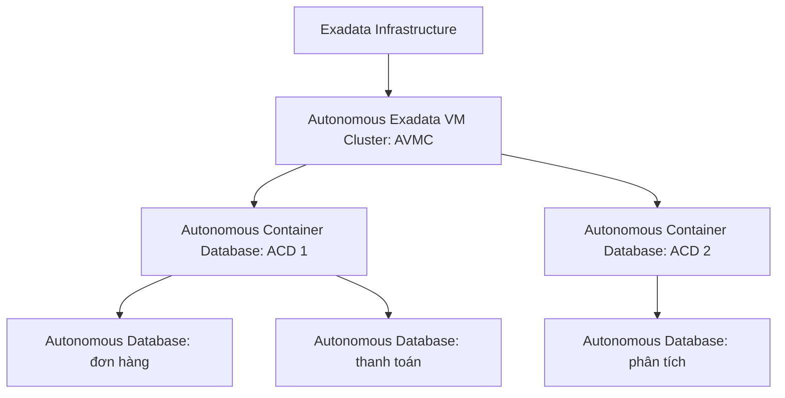
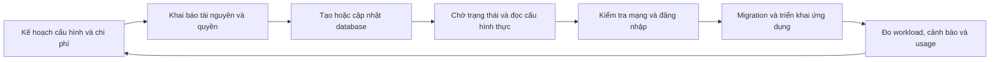

# Lựa chọn mô hình triển khai và cấu hình tài nguyên

Trong chương **Autonomous Database** của module `CLOUD_PROVIDERS_ORACLE`, bài học này hướng dẫn chọn mô hình triển khai và cấu hình tài nguyên cho Oracle Autonomous Database trên OCI. Một cấu hình phù hợp phải đồng thời đáp ứng nhu cầu xử lý, đường kết nối, mức cô lập, khả năng khôi phục và ngân sách vận hành.

Ví dụ xuyên suốt là một hệ thống Java xử lý đơn hàng: giao dịch ngắn chạy cả ngày, tải tăng trong khung khuyến mãi và có báo cáo cuối ngày. Người học sẽ lập phương án triển khai, chọn ECPU và storage ban đầu, quyết định có bật autoscaling hay không, rồi đo kết quả trước khi điều chỉnh.

Tài liệu Oracle hiện dùng tên **Autonomous AI Database** ở nhiều trang sản phẩm. Trong bài, Autonomous Database chỉ cùng nhóm dịch vụ đó. Phần thực hành tài nguyên tập trung vào **Serverless trả phí, ECPU, database độc lập ngoài elastic pool**; các quy tắc số học của lab không được áp dụng mặc định cho Dedicated, Always Free hay Developer.

## 1. Kết quả cần đạt

Sau bài học, người học có thể:

- Phân biệt Serverless, Dedicated Exadata Infrastructure và Exadata Cloud@Customer.
- Tách các quyết định về mô hình triển khai, workload type, service tier, mạng và tài nguyên.
- Đọc đúng ECPU, base compute, compute autoscaling, base storage và allocated storage.
- Chọn cấu hình xuất phát từ workload và kiểm tra lại bằng mục tiêu hiệu năng.
- Lập dự toán có cả baseline, autoscaling, backup và phương án HA/DR.
- Thực hiện một thay đổi tài nguyên có bước đọc cấu hình trước và sau thay đổi.

## 2. Chọn mô hình triển khai trước khi chọn số ECPU

### 2.1. Serverless: tập trung vào database của ứng dụng

Với **Autonomous Database Serverless**, Oracle quản lý việc bố trí database và hạ tầng phục vụ dịch vụ. Người dùng chọn tài nguyên và các thiết lập được dịch vụ cung cấp, thay vì triển khai trước một hệ thống Exadata riêng để chứa database. Mô hình này phù hợp để bắt đầu đánh giá khi nhóm muốn giảm công việc quản trị hạ tầng. [Oracle Autonomous AI Database](https://docs.oracle.com/en/cloud/paas/autonomous-database/).

Trong ví dụ hệ thống đơn hàng, nhóm có thể bắt đầu bằng một database Serverless cho môi trường thử nghiệm, kết nối từ Compute qua mạng riêng và đo tải đại diện. Các câu hỏi chủ yếu là: cần workload type nào, ECPU bao nhiêu, dữ liệu tăng ra sao và ứng dụng dùng service kết nối nào?

Từ “serverless” không có nghĩa không tồn tại server, không có hạn mức tài nguyên hoặc database đang chạy sẽ luôn không phát sinh compute khi nhàn rỗi. Cần đọc mô hình cấp phát và tính phí của dịch vụ thay vì suy ra từ tên gọi.

### 2.2. Dedicated: quản lý thêm một tầng tài nguyên dành riêng

Với **Autonomous Database on Dedicated Exadata Infrastructure**, tổ chức dùng tài nguyên Exadata dành riêng và có nhiều lựa chọn hơn về tổ chức workload, quản trị fleet và chính sách vận hành. Đây vẫn là dịch vụ Autonomous được quản lý, không phải một máy chủ database tự quản trị toàn bộ. [About Autonomous AI Database on Dedicated Exadata Infrastructure](https://docs.oracle.com/en/cloud/paas/autonomous-database/dedicated/adbaa/about-autonomous-ai-database-on-dedicated-exadata.html).

Quan hệ tài nguyên quan trọng:



AVMC liên kết hạ tầng Exadata với các ACD và cung cấp phạm vi cấu hình compute, memory, storage cùng mạng. Vì vậy, ngoài cấu hình từng database, nhóm vận hành phải lập kế hoạch năng lực ở các lớp chứa nó. [About Autonomous Exadata VM Cluster](https://docs.oracle.com/en/cloud/paas/autonomous-database/dedicated/adbaa/about-autonomous-exadata-vm-cluster.html).

Một yêu cầu tăng tài nguyên database không nên được đánh giá tách khỏi tài nguyên khả dụng của AVMC và các yêu cầu bảo đảm khi node bảo trì hoặc gặp lỗi. Dedicated tạo thêm quyền kiểm soát và nghĩa vụ hoạch định năng lực; bản thân nhãn Dedicated không phải bằng chứng một truy vấn sẽ nhanh hơn Serverless.

### 2.3. Exadata Cloud@Customer: xét nơi đặt hạ tầng

**Autonomous Database on Exadata Cloud@Customer** đưa dịch vụ đến hạ tầng Exadata tại trung tâm dữ liệu của khách hàng, phù hợp để xem xét khi dữ liệu hoặc workload phải ở địa điểm đó. Vẫn cần thiết kế kết nối với Oracle Cloud và đáp ứng các yêu cầu triển khai của dịch vụ. [Oracle Autonomous AI Database — Deployment Choices](https://docs.oracle.com/en/cloud/paas/autonomous-database/).

Khi đánh giá phương án này, liệt kê yêu cầu cụ thể: dữ liệu nào phải ở lại, kết nối nào được phép, độ trễ tới ứng dụng là bao nhiêu và đội nào chịu trách nhiệm về điều kiện tại trung tâm dữ liệu. Không thay toàn bộ phân tích đó bằng một lựa chọn mạng trong màn hình tạo database.

### 2.4. Bảng so sánh để lập phương án

Bảng sau là khung phân tích thiết kế:

| Tiêu chí | Serverless | Dedicated trên OCI | Exadata Cloud@Customer |
| --- | --- | --- | --- |
| Đơn vị nhóm ứng dụng tập trung quản lý | Database và các thiết lập được cung cấp | Database cùng cơ cấu fleet/hạ tầng dành riêng | Database/fleet và yêu cầu triển khai tại địa điểm khách hàng |
| Câu hỏi về năng lực | Database cần cấu hình và giới hạn gì? | Cả database và lớp chứa nó còn đủ tài nguyên không? | Năng lực tại chỗ và kết nối có đáp ứng tải không? |
| Câu hỏi về cô lập | Cô lập mà dịch vụ cung cấp có đáp ứng yêu cầu không? | Cần chia tài nguyên riêng ở những lớp nào? | Phải giữ những thành phần nào tại trung tâm dữ liệu? |
| Gánh nặng lập kế hoạch | Bắt đầu từ từng database và workload | Thêm quy hoạch AVMC, ACD và tài nguyên dùng chung trong tổ chức | Thêm ràng buộc địa điểm và phối hợp hạ tầng tại chỗ |
| Cách kiểm chứng | Đo workload, quyền, mạng và vận hành trên dịch vụ | Đo workload cùng tình huống cạnh tranh/failover trong fleet | Đo thêm các đường kết nối và kịch bản tại địa điểm khách hàng |

Phạm vi bài là các lựa chọn cốt lõi trong hệ sinh thái OCI. Khi doanh nghiệp đánh giá Dedicated Region hoặc dịch vụ Oracle Database trong môi trường multicloud, cần dùng tài liệu và tính năng khả dụng của đúng môi trường đích; không giả định mọi tổ hợp có cùng khả năng. [Dedicated Deployment Choices](https://docs.oracle.com/en/cloud/paas/autonomous-database/dedicated/adbaa/about-autonomous-ai-database-on-dedicated-exadata.html).

## 3. Tách năm quyết định khi tạo database

Một cấu hình có thể được đọc thành năm lớp:

```text
1. Deployment: database đặt trên mô hình hạ tầng nào?
2. Workload và phiên bản: tối ưu cho kiểu xử lý và tính năng nào?
3. Tier: Always Free, Developer hay cấu hình trả phí phù hợp?
4. Network và quyền: ai có đường kết nối và ai được truy cập dữ liệu?
5. Resources: ECPU, storage, autoscaling và năng lực khôi phục ra sao?
```

Đặt một database Serverless sau private endpoint không biến nó thành Dedicated Exadata Infrastructure. Chọn workload xử lý giao dịch cũng không tự tạo đầy đủ kiến trúc khôi phục cho ứng dụng. Mỗi lớp phải có lý do và bằng chứng riêng.

### 3.1. Workload type theo đặc tính xử lý

Trong tài liệu Serverless hiện hành, Oracle mô tả các workload như **Transaction Processing**, **Lakehouse**, **JSON Database**, **APEX Service** và **Vector Database**. Các lựa chọn có định hướng và điều kiện riêng. [About Autonomous AI Database Workload Types](https://docs.oracle.com/en/cloud/paas/autonomous-database/serverless/adbsb/about-autonomous-database-workloads.html).

Cách tiếp cận cho hệ thống đơn hàng:

| Nhu cầu chính | Phương án cần đánh giá | Bằng chứng cần thu thập |
| --- | --- | --- |
| Nhiều giao dịch ngắn, ghi/cập nhật liên tục | Transaction Processing | TPS, p95/p99 latency, contention và lỗi giao dịch |
| Phân tích nhiều dữ liệu, tổng hợp và xử lý theo lô | Lakehouse | Cỡ scan, thời gian batch, concurrency và mức song song |
| Ứng dụng chủ yếu dùng API/tính năng JSON | JSON Database hoặc lựa chọn đầy đủ tính năng phù hợp | API cần dùng, kiểu dữ liệu và giới hạn liên quan |
| Phát triển tập trung vào APEX | APEX Service hoặc database có APEX phù hợp | Cách triển khai ứng dụng và các loại kết nối cần thiết |
| Tìm kiếm vector là nhu cầu trọng tâm | Workload/vector features được hỗ trợ ở phiên bản đích | Khối lượng vector, index, độ trễ và tính năng ứng dụng cần |

Đây là điểm bắt đầu đánh giá, không có nghĩa chỉ một workload type mới chạy được một loại câu SQL. Một ứng dụng vừa có giao dịch vừa có báo cáo cần đo xem hai nhóm tải có ảnh hưởng lẫn nhau hay không, và có nên tách database hay lịch xử lý không.

Đối chiếu cả phiên bản và region trước khi thiết kế dựa vào một tính năng. Lab không yêu cầu tính năng riêng của một release mới; chọn phiên bản đang được hỗ trợ và tương thích với ứng dụng. Danh sách workload và phiên bản xuất hiện trong quy trình provision chính thức: [Provision an Autonomous AI Database Instance](https://docs.oracle.com/en-us/iaas/autonomous-database-serverless/doc/autonomous-provision.html).

### 3.2. Tier phát triển không thay thế thử nghiệm năng lực production

Always Free và Autonomous Database for Developers có phạm vi tài nguyên/tính năng riêng. Developer là cấu hình cố định cho phát triển, thử nghiệm; không phải cấu hình trả phí có thể tùy chọn toàn bộ tài nguyên như lab scaling của bài. [OCI CLI — Autonomous Database Tier Options](https://docs.oracle.com/en-us/iaas/tools/oci-cli/latest/oci_cli_docs/cmdref/db/autonomous-database/create.html).

Có thể dùng tier phát triển để học schema, SQL và kết nối trong phạm vi hỗ trợ. Khi cần chứng minh năng lực production hoặc thử tăng/giảm compute, dùng môi trường đại diện với lựa chọn tài nguyên phù hợp. Kết quả trên database nhỏ cố định không đủ để kết luận về throughput của một cấu hình khác.

### 3.3. Public/private endpoint là quyết định mạng

Serverless hỗ trợ các lựa chọn public endpoint với access control và private endpoint. Với private endpoint, cần chuẩn bị VCN, subnet, quy tắc mạng và đường truy cập phù hợp. Một số cấu hình còn cho phép bật thêm public access; vì vậy phải đọc trạng thái thực tế, không chỉ tên lựa chọn ban đầu. [Configure Network Access with Private Endpoints](https://docs.oracle.com/en-us/iaas/autonomous-database-serverless/doc/private-endpoints-autonomous.html).

Trong lab, chọn private endpoint cho database mà Compute trong VCN cần truy cập. Máy cá nhân và công cụ SQL cũng cần đường vào mạng đó. Việc đổi sang một ECPU lớn hơn không giải quyết được DNS sai, đường mạng thiếu hoặc thông tin đăng nhập không hợp lệ.

Kết nối Autonomous dùng cơ chế bảo mật được dịch vụ cung cấp như mTLS hoặc TLS theo cấu hình. Dùng đúng descriptor, chứng chỉ/wallet và client tương thích. [About Connecting to an Autonomous AI Database Instance](https://docs.oracle.com/en-us/iaas/autonomous-database-serverless/doc/connect-introduction.html).

## 4. Đọc cấu hình compute: ECPU, bộ nhớ và giới hạn

### 4.1. ECPU là đơn vị của mô hình compute

Trong Serverless, Oracle dùng **ECPU** làm đơn vị compute trừu tượng; tài liệu vẫn có thể nhắc OCPU cho mô hình cũ. Với cấu hình mới trong bài, dùng ECPU và ghi rõ compute model khi đọc số lượng CPU. Không lấy một con số OCPU từ ví dụ cũ rồi nhập nguyên số đó vào trường ECPU. [Compute Models in Autonomous AI Database](https://docs.oracle.com/en-us/iaas/autonomous-database-serverless/doc/autonomous-compute-models.html).

Cần tách các giá trị:

| Giá trị | Dùng để hiểu điều gì? |
| --- | --- |
| Compute model | Con số tài nguyên đang dùng đơn vị nào? |
| Base ECPU count | Mức compute cấu hình nền của database |
| Compute autoscaling | Dịch vụ có được dùng thêm tài nguyên theo cơ chế hỗ trợ không? |
| Hạn mức và điều kiện áp dụng | Cấu hình yêu cầu có hợp lệ và được phép không? |
| Số đo tiêu thụ/tính phí | Trong khoảng thời gian đó đã sử dụng hoặc được tính phí ra sao? |

ECPU không phải tên một shape OCI Compute, số core guest do `lscpu` báo hay số connection trong pool. Ứng dụng đánh giá năng lực qua workload và kết quả thực tế trên mô hình dịch vụ đang sử dụng.

### 4.2. Không cấu hình Serverless như một VM Flex

Ở mức database Serverless, bài thực hành chủ yếu cấu hình compute và storage mà dịch vụ cho phép, không chọn riêng một cặp OCPU/RAM của VM hay chỉnh hệ điều hành máy chủ. Dịch vụ quản lý nhiều thành phần bên dưới; người dùng quản lý schema, quyền và ứng dụng trong phạm vi được cung cấp.

Nếu workload gặp áp lực memory, thu thập thông tin SQL, mức song song, concurrency và chỉ số bộ nhớ trước khi thay đổi tài nguyên. Không suy ra “thêm storage sẽ thêm Java heap” hoặc “gấp đôi ECPU bảo đảm gấp đôi hiệu năng một truy vấn”. Java heap của dịch vụ trên Compute và bộ nhớ của database là hai phần khác nhau trong hệ thống.

Với Dedicated, AVMC có các lựa chọn memory và storage ở lớp hạ tầng riêng. Sizing phải tính cả database lẫn mức tài nguyên và dự phòng của AVMC; không áp dụng một tỷ lệ RAM/ECPU tự đặt cho tất cả các mô hình. [Plan and Observe Capacity on Dedicated Exadata Infrastructure](https://docs.oracle.com/en/cloud/paas/autonomous-database/dedicated/adbaa/plan-and-observe-capacity-for-autonomous-ai-database-on.html).

### 4.3. Quota, giới hạn dịch vụ và năng lực dùng được

Trước khi tạo hoặc scale, kiểm tra các nhóm ràng buộc:

- Giới hạn của offering, compute model, tier và workload đang dùng.
- Service limits của tenancy và compartment quota nếu được áp dụng.
- Điều kiện license/BYOL đã chọn.
- Năng lực khả dụng của hạ tầng/fleet nếu dùng Dedicated.
- Các thao tác đang diễn ra và tổ hợp thuộc tính được phép cập nhật cùng lúc.

Một yêu cầu cấu hình được xem là phù hợp workload chưa chắc được API chấp nhận ở thời điểm gửi. Thiết kế phải có cách xử lý thao tác thất bại và đọc lại trạng thái thực, thay vì coi request đã gửi là tài nguyên đã tăng.

## 5. Compute autoscaling: tăng trong giới hạn, không xóa baseline

### 5.1. Hiểu đúng mức tối đa ba lần

Với Serverless thuộc cấu hình hỗ trợ compute autoscaling, database có thể dùng **tổng compute tối đa ba lần base CPU** theo cơ chế của dịch vụ, cùng tài nguyên I/O liên quan. Oracle mô tả compute autoscaling mặc định bật khi provision thông thường; lab phải chọn trạng thái một cách chủ động. [Use Auto Scaling](https://docs.oracle.com/en-us/iaas/autonomous-database-serverless/doc/autonomous-auto-scale.html).

Ví dụ, giả định mọi giới hạn áp dụng đều cho phép:

```text
Base compute C = 4 ECPU
Compute autoscaling bật

Tổng compute tối đa theo cơ chế 3x = 3 * 4 = 12 ECPU
Phần tối đa vượt baseline         = 12 - 4 = 8 ECPU
```

“Ba lần” là tổng tối đa 12 trong ví dụ này, không phải thêm 12 để thành 16. Nó cũng không có nghĩa database luôn sử dụng hoặc luôn bị tính phí ở mức 12.

Đây là biên tài nguyên của cơ chế hỗ trợ, không phải lời hứa workload sẽ nhanh gấp ba. Một transaction chờ khóa, một truy vấn thiếu điều kiện lọc hay một ứng dụng tạo quá nhiều request vẫn cần được điều tra riêng.

### 5.2. Khi nào cân nhắc bật autoscaling?

| Đặc tính tải | Cách đánh giá cấu hình |
| --- | --- |
| Đỉnh tải ngắn và không đều | Đo cấu hình nền, thử autoscaling, theo dõi mức tăng và hiệu năng tại đỉnh |
| Tải cao kéo dài phần lớn thời gian | So sánh tăng base compute với việc thường xuyên vượt baseline |
| Lab cần so sánh hai cấu hình cố định | Tắt autoscaling trong các lần đo cố định để biết thay đổi nào tạo khác biệt |
| Workload chủ yếu chờ khóa/mạng | Điều tra nguyên nhân chờ trước khi tăng compute |
| Nhiều database có đỉnh tải lệch nhau | Đánh giá thêm mô hình pool nếu quy mô và điều kiện phù hợp |

Khi database đang chạy theo mô hình ECPU độc lập của bài, mức compute nền vẫn là thành phần tính phí dù ứng dụng dùng ít CPU hơn. Phần autoscaling dùng thêm được tính theo quy tắc tương ứng; không coi một biểu đồ utilization thấp là không có compute cost. [Serverless Features Billing](https://docs.oracle.com/en-us/iaas/autonomous-database-serverless/doc/autonomous-features-billing.html).

### 5.3. Phân biệt autoscaling và thay đổi base compute

Bật autoscaling cho base 4 ECPU và đổi base thành 8 ECPU là hai thay đổi khác nhau. Chúng có thể làm khác cả năng lực nền, biên sử dụng và cách phân bổ concurrency của các service.

Khi đánh giá, ghi đầy đủ:

```text
Trước: base 4 ECPU, autoscaling tắt, service TP
Sau:   base 8 ECPU, autoscaling tắt, service TP
```

Sau khi có kết quả của hai cấu hình cố định, mới mở một thử nghiệm khác:

```text
Thử riêng: base 4 ECPU, autoscaling bật, service TP
```

Nếu đồng thời đổi base, autoscaling, service kết nối và pool size, kết quả có thể tốt hơn nhưng chưa biết yếu tố nào tạo ra khác biệt.

## 6. Chọn storage: dung lượng dữ liệu và dung lượng được cấp phát

### 6.1. Các giá trị storage cần tách biệt

| Khái niệm | Ý nghĩa khi lập kế hoạch |
| --- | --- |
| Base/reserved storage | Dung lượng nền đã cấu hình cho database |
| Used storage | Dung lượng đang được sử dụng theo định nghĩa chỉ số |
| Allocated storage | Không gian đã được cấp phát cho database/tablespace |
| Backup storage | Dung lượng các bản backup theo chính sách giữ lại |
| Nhu cầu tăng trưởng | Dữ liệu, index, LOB và các hoạt động làm dung lượng tăng trong tương lai |

Các đại lượng không thể thay thế nhau. Một dataset 40 GB không có nghĩa toàn bộ cấu hình database, storage được cấp phát và backup chỉ cần 40 GB. Kiểm tra định nghĩa metric và cách dịch vụ báo cáo để so sánh cùng một loại dung lượng.

### 6.2. Lập ngân sách dung lượng cho ví dụ đơn hàng

Một phép tính **giả lập phục vụ thiết kế**, không phải yêu cầu tối thiểu của dịch vụ:

```text
Dữ liệu bảng/LOB dự kiến trong kỳ đầu:     24 GB
Index và cấu trúc liên quan dự kiến:      16 GB
Khoảng thao tác khi nạp/migration:        10 GB
Dự phòng tăng trưởng và sai số ước lượng: 20 GB
------------------------------------------------
Mục tiêu dung lượng cho lần thử đầu:      70 GB
Base storage chọn để thử:                100 GB
```

Mỗi khoản cần dựa trên dữ liệu mẫu và thao tác thực tế. Không cộng index lần nữa nếu số liệu đầu vào đã bao gồm nó. TEMP và các vùng hệ thống có cách quản lý riêng; khoảng dự phòng trong phép tính là một giả định cần kiểm chứng, không phải một quota được cấp riêng cho từng thành phần.

Sau khi nạp dữ liệu đại diện, đo lại kích thước và tốc độ tăng. Nếu dữ liệu tăng trung bình `g` GB mỗi tháng, dự báo phải bao phủ ít nhất thời gian đến lần mở rộng tiếp theo, cộng khoảng an toàn cho chiến dịch hoặc migration lớn.

### 6.3. Storage autoscaling là một lựa chọn độc lập

Theo quy trình scaling Serverless, storage autoscaling cho phép tăng đến ba lần base storage trong phạm vi hỗ trợ. Ví dụ base 100 GB có biên 300 GB theo cơ chế đó. Compute autoscaling và storage autoscaling là hai thiết lập riêng. [Add CPU or Storage Resources or Enable Auto Scaling](https://docs.oracle.com/en-us/iaas/autonomous-database-serverless/doc/autonomous-add-resources.html).

Không suy từ việc compute tự giảm sau đỉnh tải rằng storage được cấp phát cũng sẽ giảm ngay khi xóa dữ liệu. Xem lượng allocated, base và cơ chế shrink được hỗ trợ trước khi kết luận hóa đơn sẽ giảm. Thay đổi storage autoscaling khi database đã vượt base cũng cần đọc hiệu ứng mà Console/API thông báo.

Đơn vị cấu hình khác nhau theo workload và compute model. Trong lab Transaction Processing ECPU, dùng 100 **GB**; không nhập 100 vào trường đang chọn **TB**. Với phương án Lakehouse hoặc một tier khác, kiểm tra lại đơn vị và miền giá trị hợp lệ. [Autonomous AI Database Billing Summary](https://docs.oracle.com/en-us/iaas/autonomous-database-serverless/doc/autonomous-database-billing-overview.html).

### 6.4. Storage cũng liên quan hiệu năng, nhưng không phải nút tăng tốc chung

Cấu hình dịch vụ có quan hệ giữa compute, storage và khả năng I/O/cache. Vì vậy, không giả định mọi kích thước storage đều có cùng đặc tính I/O, hoặc tăng storage luôn thay thế được tăng compute. Đọc các điều kiện của cấu hình và đo workload thay vì tự áp dụng một tỷ lệ IOPS/GB của Block Volume sang Autonomous Database. [Add CPU or Storage Resources](https://docs.oracle.com/en-us/iaas/autonomous-database-serverless/doc/autonomous-add-resources.html).

Với ví dụ đơn hàng, nếu query đang đợi lock do transaction dài, thêm dung lượng storage không xử lý nguyên nhân đó. Nếu truy vấn scan nhiều dữ liệu và cache/I/O là phần chi phối, cần phân tích SQL và số đo I/O trước khi chọn thay đổi tài nguyên.

## 7. Service kết nối và concurrency là một phần của sizing

Autonomous Database cung cấp các predefined service như `TP`, `TPURGENT`, `HIGH`, `MEDIUM`, `LOW`, có đặc tính về ưu tiên, parallelism và concurrency. Chọn service là một phần của cấu hình workload, không đơn thuần là chọn tên kết nối dễ nhớ. [Database Service Names for Autonomous AI Database](https://docs.oracle.com/en-us/iaas/autonomous-database-serverless/doc/predefined-database-services-names.html).

Cách bắt đầu đánh giá:

| Workload của ví dụ | Service cần xem xét | Điều cần đo |
| --- | --- | --- |
| Request giao dịch ngắn của API | `TP` | Latency, throughput, active sessions và contention |
| Workload giao dịch cần mức ưu tiên khác | `TPURGENT` nếu phù hợp | Tác động đến các workload còn lại |
| Báo cáo có thể dùng parallelism | `MEDIUM` hoặc `HIGH` | Thời gian chạy, số statement cùng chạy và thời gian xếp hàng |
| Công việc ưu tiên thấp, không cần parallelism mặc định | `LOW` | Khả năng hoàn tất trong thời hạn và ảnh hưởng lên API |

Tên `HIGH` không có nghĩa mọi ứng dụng đều nhanh hơn nếu dùng nó. Một service có mức song song cao hơn có thể phù hợp cho ít câu SQL nặng, trong khi nhiều request cùng gửi phải chờ. Giới hạn cụ thể còn phụ thuộc số ECPU và trạng thái compute autoscaling. [Service Concurrency](https://docs.oracle.com/en-us/iaas/autonomous-database-serverless/doc/manage-service-concurrency.html).

Ứng dụng có 200 connection trong pool không đồng nghĩa database cần hoặc sẽ chạy 200 câu SQL nặng song song. Với nhiều pod/VM, cần cộng connection của tất cả replica và job nền; sau đó đối chiếu session limits, active concurrency và mục tiêu latency.

Ví dụ suy luận với số giả lập: bốn replica, mỗi replica tối đa 30 connection, tạo khả năng có 120 connection từ tầng ứng dụng, chưa kể migration và báo cáo. Con số này giúp review pool nhưng không thay thế số đo số session thực sự bận và thời gian chờ.

Khi kiểm tra kết nối bằng SQL, có thể quan sát service của session:

```sql
SELECT
    SYS_CONTEXT('USERENV', 'SESSION_USER') AS session_user,
    SYS_CONTEXT('USERENV', 'SERVICE_NAME') AS service_name
FROM dual;
```

Lấy alias/descriptor đúng từ cấu hình kết nối của database; không tự ghép một hậu tố service rồi coi như đã cấu hình xong. Thử nghiệm so sánh cấu hình phải giữ ổn định cả service và pool khi chưa chủ đích thay đổi chúng.

## 8. Chọn cấu hình xuất phát từ mục tiêu dịch vụ

### 8.1. Viết hồ sơ workload trước khi điền Console

Hồ sơ tối thiểu cho hệ thống đơn hàng:

```text
Nghiệp vụ chính: giao dịch đơn hàng ngắn, có ghi/cập nhật
Đặc tính tải: nền liên tục, tăng trong chiến dịch, báo cáo cuối ngày
Mục tiêu API: throughput và p95/p99 latency do nhóm sản phẩm xác định
Dữ liệu: kích thước hiện tại, tăng trưởng, LOB/index và retention
Kết nối: số replica, pool mỗi replica, job nền và service
Khôi phục: thời gian gián đoạn chấp nhận được và mức mất dữ liệu
Chi phí: giới hạn chi tiêu, người nhận cảnh báo và người xử lý
```

Không dùng số người dùng đăng ký làm đầu vào duy nhất cho ECPU. Số request đồng thời, độ phức tạp SQL, thời gian giữ transaction và cỡ dữ liệu mới giúp giải thích tải thực tế.

### 8.2. Bản cấu hình lab để bắt đầu đo

Đây là **cấu hình minh họa cho lab**, không phải sizing production đã được chứng minh:

| Thuộc tính | Giá trị lab | Lý do trong bài |
| --- | --- | --- |
| Deployment | Serverless | Tập trung học cấu hình từng database |
| Tier | Trả phí thông thường, ngoài elastic pool | Thực hành thay đổi tài nguyên được hỗ trợ |
| Workload | Transaction Processing | Đại diện API giao dịch |
| Compute model | ECPU | Dùng mô hình compute hiện hành của lab |
| Base compute | 4 ECPU | Điểm bắt đầu để so sánh với cấu hình khác |
| Compute autoscaling | Tắt trong lần đo đầu | Biết rõ mức compute cố định đang thử |
| Base storage | 100 GB | Kiểm chứng với dự toán dữ liệu giả lập |
| Storage autoscaling | Tắt trong lab có dữ liệu kiểm soát | Đo tăng trưởng và thay đổi storage có chủ đích |
| Network | Private endpoint, các đường truy cập được chuẩn bị | Kết nối với ứng dụng trong VCN |
| Service cho API | `TP` | Điểm xuất phát để đo giao dịch ngắn |
| License | Ghi rõ lựa chọn áp dụng | Đưa điều kiện quyền sử dụng vào dự toán |

Nếu một giá trị không hợp lệ trong region, offering hoặc tenancy đang dùng, ghi lại nguyên nhân và chọn một cấu hình lab được hỗ trợ trước khi chạy phép so sánh. Không sửa nhiều yếu tố âm thầm rồi so kết quả như cùng một thí nghiệm.

### 8.3. Đọc kết quả để quyết định thay đổi

| Bằng chứng | Quyết định cần đánh giá |
| --- | --- |
| CPU bận kéo dài, SQL có thể chạy song song/concurrent, latency tăng | Tăng base ECPU hoặc đánh giá compute autoscaling |
| CPU còn thấp nhưng nhiều SQL xếp hàng | Kiểm tra service, concurrency và chính sách tài nguyên |
| Blocking sessions tăng | Tìm transaction/SQL gây khóa và thời gian giữ lock |
| App chờ connection, database chưa bận tương ứng | Kiểm tra pool, connection leaks, timeout và mạng |
| Storage tăng nhanh gần biên | Dự báo thời gian hết chỗ, retention và phương án mở rộng |
| Tăng compute nhưng latency gần như không đổi | Tìm thành phần chi phối ở SQL, I/O, lock hoặc dependency khác |

Mục tiêu là giải thích được tại sao cần tài nguyên đó. Chọn cấu hình lớn hơn chỉ vì một lần benchmark nhanh hơn chưa đủ nếu giá trị tăng không giúp đạt thêm yêu cầu dịch vụ đáng kể.

## 9. Lập dự toán và kiểm soát chi phí

### 9.1. Tách các thành phần của phương án

Một khung dự toán cho Serverless ECPU độc lập:

```text
Chi phí phương án
  = compute nền trong thời gian hoạt động
  + compute phát sinh theo autoscaling/tính năng sử dụng
  + storage database theo quy tắc của workload
  + backup và retention
  + bản sao/standby hoặc phương án DR
  + công cụ và các tài nguyên liên quan của ứng dụng
```

Khung này không phải công thức hóa đơn cho mọi deployment. Với ECPU, tài liệu Serverless mô tả backup storage được tính riêng; database đã dừng có zero ECPU usage trong mô hình đó, nhưng các khoản lưu trữ và tài nguyên liên quan còn tồn tại vẫn cần được đánh giá. [Serverless Features Billing](https://docs.oracle.com/en-us/iaas/autonomous-database-serverless/doc/autonomous-features-billing.html).

Không lấy quy tắc backup của tài liệu OCPU cũ áp dụng sang ECPU. Nếu dùng Dedicated, phải lập dự toán cả lớp hạ tầng/AVMC và cách tổng hợp usage theo mô hình của Dedicated. [Billing on Dedicated Exadata Infrastructure](https://docs.oracle.com/en/cloud/paas/autonomous-database/dedicated/adbaa/billing-autonomous-ai-database-on-dedicated-exadata.html).

### 9.2. Ví dụ số lượng compute để lập kế hoạch

Giả định một database độc lập hoạt động đủ 24 giờ, không có standby hay công cụ dùng compute riêng, và sử dụng compute như sau:

```text
Base: 4 ECPU
22 giờ ở mức tính compute nền 4 ECPU
 2 giờ có mức compute tổng 8 ECPU do autoscaling

Lượng compute minh họa = 4 * 22 + 8 * 2
                       = 104 ECPU-giờ

Nếu cả ngày chỉ ở baseline: 4 * 24 = 96 ECPU-giờ
Phần tăng trong ví dụ:                    8 ECPU-giờ
```

Ví dụ tính trên **tổng** 8 ECPU trong hai giờ đỉnh, không cộng tiếp 4 baseline lần nữa trong cùng hai giờ đó. Đây là phép tính lượng sử dụng giả lập; để ra tiền cần đơn giá, quy tắc đo, license, workload và tính năng của hợp đồng áp dụng. Khi dự toán phải đối chiếu dữ liệu usage/cost thực tế của dịch vụ.

### 9.3. Budget là cảnh báo chi tiêu

OCI Budgets cung cấp soft limits và cảnh báo chi tiêu; budget không mặc nhiên ngăn database tiếp tục autoscale hay bảo đảm dừng tài nguyên đúng lúc chạm ngân sách. [Budgets](https://docs.oracle.com/en-us/iaas/Content/Billing/Concepts/budgetsoverview.htm).

Thiết kế kiểm soát chi phí nên có cả cấu hình tài nguyên được phép, quyền thay đổi, cảnh báo và người xử lý. Gắn owner/môi trường vào tag để truy vết; xem riêng mức chi của database lab, clone, backup và tài nguyên ứng dụng. Với môi trường không hoạt động liên tục, cân nhắc lịch start/stop được hỗ trợ sau khi đã xác định tác động tới người dùng và job nền.

### 9.4. Elastic pool là một bài toán gom compute

Serverless có elastic pool để nhóm nhiều database về cấp phát/tính phí compute, với pool leader và member. Pool có điều kiện, capacity và quy tắc billing riêng; không dùng nguyên phép tính database độc lập của lab cho pool. Tài liệu cũng phân biệt dedicated elastic pools trong Serverless, nên không suy từ chữ “dedicated” rằng đó chính là Dedicated Exadata Infrastructure. [About Elastic Pools](https://docs.oracle.com/en-us/iaas/autonomous-database-serverless/doc/elastic-pools-about.html).

Đánh giá pool khi có đủ database và dữ liệu tải để phân tích lợi ích gom tài nguyên. Một database nhỏ đầu tiên chưa phải bằng chứng tổ chức cần một pool; ngược lại, nhiều database nhàn rỗi cùng lúc cũng cần được kiểm tra theo quy tắc giá và dung lượng pool thực tế.

## 10. Thực hành: tạo cấu hình lab và thay đổi compute có kiểm chứng

### 10.1. Chuẩn bị môi trường

Lab dùng database Serverless ECPU trả phí thông thường, ngoài elastic pool, với cấu hình xuất phát ở mục 8.2. Chuẩn bị:

- Compartment lab và quyền IAM tạo/đọc/cập nhật database cùng tài nguyên mạng cần dùng.
- VCN, subnet và quy tắc mạng phù hợp với private endpoint; máy chạy ứng dụng/công cụ SQL có đường truy cập.
- OCI CLI đã cấu hình đúng profile và region nếu dùng phần lệnh bên dưới.
- Tài khoản ứng dụng có quyền cần thiết, descriptor kết nối và cấu hình TLS/mTLS phù hợp.
- Bộ dữ liệu và workload thử nghiệm có thể chạy lặp lại, kèm mục tiêu latency/throughput.

Lab tạo tài nguyên trả phí, nên dùng phạm vi ngân sách đã dành cho thực hành và ghi lại tài nguyên phát sinh. Nếu chỉ có Always Free hoặc Developer, thực hiện phần quan sát được tier hỗ trợ; muốn chạy phép so sánh scale cần một database có cấu hình tương ứng.

### 10.2. Tạo database từ Console

Theo quy trình provision Serverless, mở dịch vụ Autonomous Database và tạo database trong đúng compartment. Điền tên hiển thị dễ nhận diện, tên database hợp lệ, chọn Transaction Processing và phiên bản phù hợp. Chọn ECPU, 4 ECPU, 100 GB; chủ động tắt hai loại autoscaling trong lần đo nền. Thiết lập admin credential, network access và backup retention theo phương án lab. [Provision an Autonomous AI Database Instance](https://docs.oracle.com/en-us/iaas/autonomous-database-serverless/doc/autonomous-provision.html).

Chờ database về trạng thái cho phép sử dụng. Sau đó kiểm tra endpoint, kết nối bảo mật và tài khoản runtime. Người quản lý tài nguyên OCI và user đăng nhập SQL có các vai trò khác nhau; có quyền tạo tài nguyên chưa chứng minh ứng dụng đã đọc được bảng.

Ghi lại ít nhất OCID, region, compartment, deployment, workload, tier, compute model/count, storage/unit, autoscaling, network access và lựa chọn license. Khi một tham số khác với bản kế hoạch, giải thích trước khi đo.

### 10.3. Đọc cấu hình bằng OCI CLI

Ví dụ PowerShell, thay OCID bằng database lab thực tế. Lệnh `get` chỉ đọc thông tin tài nguyên:

```powershell
$ErrorActionPreference = 'Stop'
$env:ADB_OCID = '<OCID_DATABASE_LAB>'

$adbState = oci db autonomous-database get --autonomous-database-id $env:ADB_OCID | ConvertFrom-Json
if ($LASTEXITCODE -ne 0) {
    throw 'Khong doc duoc cau hinh Autonomous Database'
}

$adbState.data | Select-Object 'id', 'display-name', 'lifecycle-state', 'db-workload', 'is-dedicated', 'is-free-tier', 'is-dev-tier', 'compute-model', 'compute-count', 'data-storage-size-in-gbs', 'is-auto-scaling-enabled', 'is-auto-scaling-for-storage-enabled'
```

Đối chiếu kết quả với Console và OCID đã ghi. Tên trường đầu ra CLI thường có dấu gạch nối; không trộn với tên camelCase trong API request hay tên thuộc tính của Terraform. Tham khảo cú pháp và tham số chính thức tại [OCI CLI — autonomous-database get](https://docs.oracle.com/en-us/iaas/tools/oci-cli/latest/oci_cli_docs/cmdref/db/autonomous-database/get.html).

### 10.4. Đo cấu hình nền

Chạy workload với dữ liệu, service và pool đã chọn. Mỗi lần đo cần có giai đoạn ổn định để giảm ảnh hưởng của khởi động ứng dụng và nạp cache. Thu thập trong cùng một cửa sổ:

```text
Cấu hình: base 4 ECPU, compute autoscaling tắt
Tải: cùng dữ liệu, cùng luồng nghiệp vụ, cùng số request đồng thời
Ứng dụng: throughput, p95/p99 latency, lỗi, pool active/pending
Database: CPU, active/queued statements, sessions, waits và storage
Vận hành: thời điểm đo, tác vụ nền và trạng thái tài nguyên
```

Chưa kết luận chỉ từ một lần chạy. Nếu có số liệu bất thường, tìm khác biệt của workload, dữ liệu hoặc tác vụ nền trước khi dùng kết quả để quyết định sizing.

### 10.5. Tăng base compute lên 8 ECPU

Xác nhận lại đây là database lab Serverless trả phí, ECPU, ngoài pool và đang sẵn sàng. Các kiểm tra sau giúp tránh dùng nhầm tier/deployment trong ví dụ; việc ngoài pool phải được đối chiếu thêm trong cấu hình tài nguyên:

```powershell
if ($adbState.data.'is-dedicated' -eq $true -or
    $adbState.data.'is-free-tier' -eq $true -or
    $adbState.data.'is-dev-tier' -eq $true) {
    throw 'Vi du scale nay chi danh cho Serverless tra phi thong thuong'
}
if ($adbState.data.'compute-model' -ne 'ECPU' -or
    $adbState.data.'lifecycle-state' -ne 'AVAILABLE') {
    throw 'Can database ECPU o trang thai AVAILABLE'
}

$scaleArgs = @(
    'db', 'autonomous-database', 'update',
    '--autonomous-database-id', $env:ADB_OCID,
    '--compute-model', 'ECPU',
    '--compute-count', '8',
    '--is-auto-scaling-enabled', 'false',
    '--wait-for-state', 'AVAILABLE'
)
oci @scaleArgs
if ($LASTEXITCODE -ne 0) {
    throw 'Scale chua duoc xac nhan thanh cong; can doc lai trang thai'
}
```

Chạy lại bước `get`, xác nhận compute model/count và trạng thái autoscaling, rồi kiểm tra kết nối ứng dụng. Không coi một request cập nhật đã được chấp nhận là bước readback đã hoàn thành. Nếu CLI hết thời gian chờ, đọc lại trạng thái trước khi gửi thêm thao tác. [OCI CLI — autonomous-database update](https://docs.oracle.com/en-us/iaas/tools/oci-cli/latest/oci_cli_docs/cmdref/db/autonomous-database/update.html).

Giữ nguyên workload, service, dữ liệu và pool khi đo lại ở 8 ECPU. So sánh cả mức đạt mục tiêu lẫn lượng tài nguyên tăng, không chỉ phần trăm CPU.

### 10.6. Đánh giá kết quả và giảm tài nguyên có kế hoạch

Nếu 8 ECPU cải thiện rõ mục tiêu, xác định đó là cấu hình nền cần thiết hay chỉ cần cho một khoảng tải. Nếu gần như không cải thiện, dùng waits, queue và SQL để tìm yếu tố chi phối.

Trước khi trở lại 4 ECPU, kết thúc các job/transaction lab đang chạy và chuẩn bị ứng dụng kết nối lại. Tài liệu Serverless lưu ý giảm ECPU đáng kể có thể làm rớt connection, ngắt session hoặc hủy/rollback job chưa hoàn tất; không diễn giải mọi thao tác scale-down là không ảnh hưởng session. [Compute Models in Autonomous AI Database](https://docs.oracle.com/en-us/iaas/autonomous-database-serverless/doc/autonomous-compute-models.html).

Sau khi thay đổi về cấu hình được chọn, đọc lại và kiểm tra hoạt động. Nếu muốn thử autoscaling, mở một lần đo riêng tại base 4 ECPU, bật compute autoscaling trong **Manage resource allocation**, giữ ổn định các yếu tố khác và theo dõi mức dùng thêm. Biên 12 ECPU là cơ chế tối đa của ví dụ có hỗ trợ, không phải mức bắt buộc phải đạt khi chạy thử.

### 10.7. Hoàn tất lab

Ghi rõ cấu hình cuối, kết quả đo, mức chi đã quan sát và những tài nguyên sẽ tiếp tục tồn tại. Database/clone được giữ lại phải có owner và mục đích. Với tài nguyên không còn cần, thực hiện quy trình kết thúc lab của môi trường sau khi xác định dữ liệu cần giữ và backup liên quan; không tự coi dừng database là đã giải quyết mọi khoản chi.

## 11. Giám sát để biết lúc nào cần thay đổi tài nguyên

### 11.1. Đọc các chỉ số cùng nhau

| Chỉ số Serverless | Dùng để xem xét | Giới hạn khi diễn giải |
| --- | --- | --- |
| `CpuUtilization` | CPU đang sử dụng tương đối so với khả năng được phép dùng | Không tự quy đổi thành ECPU tính phí bằng cách nhân với base |
| `AverageActiveSessions` | Session đang xử lý hoặc chờ tài nguyên | Không đồng nghĩa tất cả đều đang dùng CPU |
| `QueuedStatements` | Có SQL phải xếp hàng hay không | Cần đối chiếu service và concurrency |
| `BlockingSessions` | Session gây chặn kéo dài theo định nghĩa metric | Cần tìm SQL/transaction liên quan |
| `StorageUsed`, `StorageAllocated`, `StorageMax` | Dữ liệu dùng, không gian cấp phát và mức tối đa | Không trộn ba đại lượng để tính phần còn lại |

Đối chiếu định nghĩa, đơn vị, tần suất thu thập và dimensions của namespace `oci_autonomous_database`. Metric CPU tổng không thay thế mục tiêu latency của ứng dụng. [Available Metrics: oci_autonomous_database](https://docs.oracle.com/en-us/iaas/autonomous-database-serverless/doc/autonomous-monitor-metrics-list.html).

Khi bật autoscaling, mẫu số của utilization và năng lực được phép dùng cần được hiểu theo định nghĩa metric. Một tỷ lệ CPU thấp hơn sau thay đổi không tự chứng minh lượng compute đã tính phí thấp hơn. Muốn đối soát tiền, xem thêm usage/cost reports theo resource và khoảng thời gian tương ứng.

### 11.2. Cảnh báo cần dẫn đến hành động

Các cảnh báo đề xuất cho ví dụ:

- API latency vượt mục tiêu cùng với lỗi hoặc pool pending tăng: kiểm tra tác động người dùng trước.
- Queue SQL kéo dài: xác nhận service, tải và chính sách concurrency.
- Storage tăng nhanh: dự báo thời gian tới biên thay vì chỉ cảnh báo khi gần đầy.
- Usage/cost tăng ngoài lịch tải dự kiến: tìm autoscaling, job, clone, công cụ hoặc bản sao mới phát sinh.

Ngưỡng và khoảng thời gian phải được chọn từ baseline, nhịp thu thập metric và thời gian phản ứng của đội vận hành. Không tạo một ngưỡng CPU cố định rồi mặc định đó là autoscaling policy của dịch vụ. Cảnh báo cần nêu database, môi trường, người xử lý và bước điều tra đầu tiên.

## 12. Tính sẵn sàng và tự động hóa đi cùng lựa chọn tài nguyên

### 12.1. Autoscaling không thay thế phương án khôi phục

Autoscaling giải quyết thay đổi tài nguyên trong cơ chế hỗ trợ. Backup giải quyết khả năng phục hồi dữ liệu trong chính sách giữ lại. Standby/DR phục vụ những tình huống gián đoạn khác. Dịch vụ có cơ chế backup/recovery tự động, nhưng ứng dụng vẫn cần xác định thời điểm khôi phục, quyền thực hiện và cách kiểm tra dữ liệu sau phục hồi. [About Backup and Recovery](https://docs.oracle.com/en-us/iaas/autonomous-database-serverless/doc/backup-intro.html).

Nếu mục tiêu dịch vụ đòi hỏi phương án standby, đánh giá Autonomous Data Guard hoặc lựa chọn DR được hỗ trợ theo deployment. Local và cross-region có điều kiện, hành vi chuyển đổi và chi phí riêng; kiểm chứng theo tài liệu của phương án đích. [About Standby Databases](https://docs.oracle.com/en-us/iaas/autonomous-database-serverless/doc/autonomous-data-guard-about.html).

Ví dụ phân tích: một database đáp ứng tải khuyến mãi với autoscaling vẫn chưa chứng minh ứng dụng sống được khi mất đường mạng tới region. Ngược lại, có standby nhưng pool không kết nối lại đúng hoặc retry làm lặp ghi đơn hàng thì kết quả nghiệp vụ cũng chưa đạt yêu cầu. Đo cả luồng phục hồi ứng dụng trong phạm vi diễn tập được giao.

### 12.2. Tự động hóa theo chuỗi có kiểm tra trạng thái



IaC quản lý các thuộc tính cloud trong phạm vi nó sở hữu; migration quản lý phiên bản schema. Khi có công cụ tự thay đổi tài nguyên hoặc lịch vận hành, xác định công cụ nào giữ cấu hình mong muốn để lần apply kế tiếp không vô tình ghi đè một quyết định sizing đã chấp nhận.

Không để script đồng thời thay compute, license, network và nhiều thuộc tính khác mà chưa kiểm tra tổ hợp API hỗ trợ. Ví dụ CLI của bài chỉ thay nhóm compute cần cho phép thử; danh sách hạn chế cập nhật đồng thời được công bố trong tham chiếu `update`. [OCI CLI — Update Parameters](https://docs.oracle.com/en-us/iaas/tools/oci-cli/latest/oci_cli_docs/cmdref/db/autonomous-database/update.html).

## 13. Những nhầm lẫn cần tránh

| Nhầm lẫn | Cách kiểm tra và quyết định phù hợp |
| --- | --- |
| Serverless luôn scale về zero khi nhàn rỗi | Đọc baseline, trạng thái running/stopped và quy tắc tính phí của mô hình |
| Private endpoint đồng nghĩa Dedicated | Xem deployment và network access như hai thuộc tính riêng |
| 4 ECPU autoscaling 3x nghĩa là được thêm 12 ECPU | Tính tổng biên 12 ECPU trong ví dụ, phần vượt baseline tối đa là 8 |
| Compute autoscaling cũng tự nới storage | Đọc riêng hai cờ autoscaling |
| Chọn `HIGH` sẽ làm mọi API nhanh hơn | Đo parallelism, active concurrency, queue và latency |
| Pool lớn hơn luôn tăng throughput | Cộng kết nối toàn ứng dụng và đo năng lực xử lý thực của database |
| Xóa dữ liệu là allocated storage và hóa đơn giảm ngay | Đối chiếu used/allocated/base và cơ chế shrink/billing được hỗ trợ |
| Budget là giới hạn chi tiêu cứng | Dùng budget làm cảnh báo, kèm giới hạn tài nguyên và quy trình xử lý |
| Database Dedicated luôn scale được theo yêu cầu | Kiểm tra capacity ở AVMC/fleet và phần dự phòng cần thiết |
| Tăng gấp đôi compute chắc chắn giảm một nửa latency | Xác định phần công việc bị giới hạn CPU và các điểm chờ khác |
| CLI trả thành công là cấu hình cuối đã đúng | Đọc lại resource, kiểm tra kết nối và đo hành vi sau thay đổi |

## 14. Tiêu chí hoàn thành bài thực hành

Người học hoàn thành khi có thể đưa ra:

1. Lý do chọn deployment, workload, tier và network access cho hệ thống đơn hàng.
2. Bảng cấu hình ban đầu có đơn vị, trạng thái autoscaling, điều kiện license và phạm vi áp dụng.
3. Kết quả đọc tài nguyên chứng minh cấu hình thực trước và sau lần scale.
4. So sánh workload có kiểm soát giữa các cấu hình, kèm latency, throughput, queue và lỗi.
5. Phép tính biên compute/storage cùng dự toán gồm baseline, backup và phương án khôi phục.
6. Cấu hình cuối đã được chọn, kế hoạch theo dõi tăng trưởng và người xử lý khi vượt mục tiêu.

Kết quả cần giải thích được vì sao mô hình và mức tài nguyên đó phục vụ ứng dụng, những giả định nào đã được đo và những điều kiện nào còn phải xác minh trước production.
