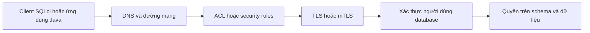
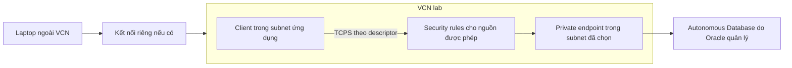

# Tạo database với public endpoint hoặc private endpoint

## 1. Mục tiêu và phạm vi

Trong chương **Autonomous Database** của module **CLOUD_PROVIDERS_ORACLE**, bài học này hướng dẫn tạo cơ sở dữ liệu với lựa chọn truy cập mạng phù hợp. Việc tạo tài nguyên được đặt trong bối cảnh tenancy, compartment, IAM, VCN, ứng dụng Java, giám sát và kiểm soát chi phí trên Oracle Cloud Infrastructure.

Phần thực hành tập trung vào **Autonomous Database Serverless** trên OCI, được tài liệu hiện hành gọi là Autonomous AI Database. Những bước chọn network của Serverless không được áp dụng nguyên xi cho Autonomous Database trên Dedicated Infrastructure.

Sau bài học, bạn có thể:

- Phân biệt loại endpoint với đường đi của lưu lượng và cơ chế xác thực.
- Tạo database public có ACL hoặc database private-only có kiểm soát bằng mạng VCN.
- Chuẩn bị IAM, subnet, DNS và security rules phù hợp.
- Lấy wallet/connection string và thử kết nối từ đúng vị trí client.
- Kiểm tra cả trường hợp được phép và trường hợp bị chặn.
- Ghi nhận cấu hình, chi phí và tài nguyên cần dọn sau lab.

Tình huống xuyên suốt là một ứng dụng Java quản lý đơn hàng. Trong giai đoạn học tập, lập trình viên muốn truy cập từ laptop; khi triển khai ứng dụng trong VCN, nhóm muốn database chỉ được truy cập qua mạng riêng. Hai nhu cầu này dẫn tới hai thiết kế khác nhau, chứ không chỉ thay một nhãn trên Console.

Các lệnh và cấu hình dưới đây là ví dụ để người học tự thực hiện trong môi trường được phép quản trị. Không sử dụng dữ liệu production cho bài lab; các tên tài nguyên, CIDR và địa chỉ mẫu cần được thay theo môi trường thực tế.

## 2. Hiểu đúng các lựa chọn endpoint

### 2.1. Public endpoint và private endpoint

Endpoint là điểm truy cập dịch vụ, thường được ứng dụng sử dụng thông qua hostname và connection descriptor. **Public endpoint** có địa chỉ public; **private endpoint** cung cấp điểm truy cập riêng gắn với VCN/subnet đã chọn.

| Lựa chọn trên Console | Đặc điểm | Cách giới hạn nguồn kết nối |
| --- | --- | --- |
| `Secure access from everywhere` | Public endpoint, không giới hạn nguồn bằng ACL khi chưa cấu hình ACL | Vẫn cần xác thực và kết nối bảo mật |
| `Secure access from allowed IPs and VCNs only` | Public endpoint có ACL | IP/CIDR public hoặc VCN phù hợp đường đi |
| `Private endpoint access only` | Điểm truy cập private trong VCN | Đường mạng riêng và các security rules liên quan |

Các lựa chọn cơ bản được mô tả trong [Oracle: About Network Access Options](https://docs.oracle.com/en/cloud/paas/autonomous-database/serverless/adbsb/network-access-options.html).

Public không có nghĩa là đăng nhập ẩn danh. Private cũng không tự cấp quyền truy vấn dữ liệu cho mọi workload trong VCN. Endpoint quyết định một phần của khả năng tiếp cận; quyền database vẫn phải được cấu hình.

### 2.2. Loại endpoint khác đường đi của packet

Một client trong private subnet có thể dùng public endpoint qua NAT Gateway. Trong trường hợp đó, database có thể nhìn thấy địa chỉ egress public của NAT, thay vì IP private của máy chạy ứng dụng.

Autonomous Database cũng hỗ trợ ACL theo VCN khi kết nối đi qua Service Gateway. Vì vậy, lưu lượng không đi qua public internet không đồng nghĩa database đã có private endpoint nằm trong subnet của bạn. [Oracle: Overview of Restricting Access with ACLs](https://docs.oracle.com/en/cloud/paas/autonomous-database/serverless/adbsb/security-restrict-acl.html).

Ba câu hỏi cần ghi riêng trong thiết kế:

```text
1. Database đang có endpoint nào?
2. Client đi đến endpoint đó bằng route nào?
3. Database nhận diện nguồn bằng IP hoặc VCN nào trên đường đi đó?
```

### 2.3. Private endpoint có thể đi kèm public access

Một cấu hình private endpoint được hỗ trợ có thêm tùy chọn **Allow public access**, tạo thêm đường public bị giới hạn bởi ACL. Do đó, khi yêu cầu private-only, phải kiểm tra tùy chọn này không được bật; chỉ nhìn thấy private IP chưa đủ để kết luận không có public endpoint. [Oracle: Configure Network Access with Private Endpoints](https://docs.oracle.com/en/cloud/paas/autonomous-database/serverless/adbsb/private-endpoints-autonomous.html).

Bài lab private dùng private-only. Nếu doanh nghiệp chủ động chọn cả hai endpoint, hồ sơ thiết kế phải ghi rõ nguồn nào được phép qua từng đường và lý do cần duy trì cả hai.

## 3. Ba lớp kiểm soát cần hoạt động đồng thời

Một lần đăng nhập thành công cần đi qua những lớp khác nhau:



IAM quản lý tài nguyên OCI nằm ở góc nhìn khác: ai được tạo database, đổi network, tải thông tin kết nối hoặc thực hiện API tương ứng.

| Lớp | Ví dụ điều khiển | Không tự thay thế cho |
| --- | --- | --- |
| IAM của OCI | Cho phép người vận hành tạo database trong compartment | Quyền `SELECT` trong schema |
| Mạng | ACL, NSG, security list, route và DNS | Danh tính database user |
| Kết nối bảo mật | TLS/mTLS và kiểm tra certificate | Quyền nghiệp vụ trong database |
| Database | Tài khoản, role và object privilege | Đường đi từ laptop đến VCN |

Oracle mô tả kiểm soát truy cập client qua chính sách mạng, giao thức kết nối và quyền của database user. Tài khoản `ADMIN` phục vụ quản trị; ứng dụng nên dùng tài khoản riêng có quyền phù hợp. [Oracle: Security and Authentication](https://docs.oracle.com/en/cloud/paas/autonomous-database/serverless/adbsb/gs-security-and-authentication-autonomous-database.html).

Ví dụ: người dùng mở được trang chi tiết database trên Console vẫn có thể không đăng nhập SQL được. Ngược lại, một database user có thể kết nối bằng công cụ SQL mà không có quyền thay đổi tài nguyên OCI.

## 4. Chuẩn bị tài nguyên và quyết định chung

### 4.1. Hồ sơ lab

Lập hai cấu hình để so sánh; có thể thực hiện lần lượt để giảm thời gian giữ tài nguyên:

| Mục | Nhánh public | Nhánh private |
| --- | --- | --- |
| Tên hiển thị minh họa | `adb-public-lab` | `adb-private-lab` |
| Database name minh họa | `ADBPUBLAB` | `ADBPRVLAB` |
| Network | Public với ACL nguồn thử nghiệm | Private-only |
| Client thử | Laptop có egress public đã xác định | Máy lab trong VCN hoặc có kết nối riêng |
| Bảo mật kết nối | Chọn mTLS cho lab | Chọn mTLS cho lab |
| Bằng chứng chính | Kết nối thành công từ nguồn ACL cho phép | Kết nối qua hostname/IP private đúng đích |

Tên database phải đáp ứng quy tắc và tính duy nhất của dịch vụ. Không coi display name là định danh duy nhất; ghi OCID sau khi tạo.

Chọn region, compartment, workload, release, compute, storage, auto scaling, backup và license theo nhu cầu lab cùng các lựa chọn hiện có. Không mặc định mức tài nguyên hay tính năng Free phù hợp với mọi endpoint. Kiểm tra cấu hình trước khi nhấn Create. [Oracle: Provision an Autonomous AI Database Instance](https://docs.oracle.com/en/cloud/paas/autonomous-database/serverless/adbsb/autonomous-provision.html).

### 4.2. Quyền IAM

Người thao tác cần quyền tạo/quản lý Autonomous Database trong compartment được giao. Với private endpoint còn cần các quyền mạng liên quan VCN, subnet, NSG, private IP và VNIC trong những compartment tương ứng.

Nếu database và network ở hai compartment khác nhau, kiểm tra quyền ở cả hai nơi. Danh sách VCN/subnet trống có thể là vấn đề IAM hoặc region, chưa chứng minh rằng tài nguyên chưa tồn tại. Đối chiếu từng thao tác với [Oracle: IAM Policies for Autonomous AI Database](https://docs.oracle.com/en-us/iaas/autonomous-database-serverless/doc/autonomous-database-iam-policies.html) và phần quyền private endpoint trong tài liệu cấu hình network.

Không cấp quyền quản trị toàn tenancy chỉ để làm xuất hiện một subnet trong danh sách chọn. Người quản trị có thể cấp phạm vi phù hợp với các compartment của lab.

### 4.3. Tài khoản và bí mật

Tạo mật khẩu `ADMIN` theo yêu cầu hiện hành của dịch vụ và lưu trong nơi quản lý bí mật phù hợp. Không chép mật khẩu, wallet hoặc token vào Git, ảnh chụp bài nộp hoặc log ứng dụng.

Với lab, dùng `ADMIN` để chuẩn bị tài khoản ứng dụng khi cần, sau đó kiểm tra kết nối bằng tài khoản ứng dụng. Điều này giúp phân biệt lỗi đường kết nối với lỗi phân quyền schema.

## 5. Nhánh A: tạo database với public endpoint có ACL

### 5.1. Xác định nguồn mà database nhìn thấy

Với laptop truy cập qua internet, ACL cần địa chỉ public của đường egress đang dùng. Không nhập `192.168.x.x` của laptop và kỳ vọng database nhìn thấy địa chỉ đó qua internet.

Nếu ứng dụng đi qua NAT Gateway, nguồn cần đối chiếu là public IP của NAT. Nếu đi qua Service Gateway, dùng lựa chọn ACL theo VCN phù hợp. Không dùng tên VCN như một allowlist chung cho mọi đường kết nối. [Oracle: Configure Network Access with ACLs](https://docs.oracle.com/en/cloud/paas/autonomous-database/serverless/adbsb/access-control-rules-autonomous.html).

Ví dụ kế hoạch nguồn:

| Client | Đường đi dự kiến | Dữ liệu cần xác minh trước khi đặt ACL |
| --- | --- | --- |
| Laptop tại văn phòng | Internet qua mạng doanh nghiệp | Egress public IP/CIDR được doanh nghiệp xác nhận |
| Laptop bật VPN | Tùy cấu hình split/full tunnel | Đường đi thực tế của kết nối database |
| VM trong private subnet | NAT Gateway | Public IP của NAT đang dùng |
| VM qua Oracle Services Network | Service Gateway | VCN OCID và phạm vi client phù hợp |

Địa chỉ `203.0.113.10/32`, nếu xuất hiện trong một bản thiết kế minh họa, chỉ là địa chỉ tài liệu. Phải thay bằng nguồn thực được cấp phép; không nhập nguyên địa chỉ mẫu vào lab.

### 5.2. Thao tác trên Console

1. Mở danh sách Autonomous Database tại đúng region và compartment.
2. Chọn tạo database; nhập thông tin chung đã chuẩn bị ở mục 4.
3. Tại network access, chọn **Secure access from allowed IPs and VCNs only**.
4. Thêm ACL cho nguồn lab đã xác minh. Với một public IPv4 cố định, có thể chọn địa chỉ riêng hoặc CIDR `/32` theo giao diện.
5. Chủ động chọn **Require mutual TLS (mTLS) authentication** cho lab này.
6. Kiểm tra workload, release, compute/storage, auto scaling, backup và license, rồi tạo tài nguyên.
7. Đợi lifecycle state đạt **Available**, lưu OCID và cấu hình network thực tế.

Đây là runbook lab sử dụng các lựa chọn provisioning và ACL của dịch vụ. Nếu region, tier hoặc workload không cung cấp lựa chọn dự định, dừng ở bước đối chiếu điều kiện; không chọn một cấu hình khác chỉ để hoàn tất biểu mẫu.

### 5.3. Xác minh public endpoint

Sau khi tạo, kiểm tra loại access, nội dung ACL và yêu cầu mTLS trên trang chi tiết. Lấy connection string từ chính database vừa tạo.

Thử kết nối từ nguồn được cho phép bằng wallet và tài khoản lab hợp lệ. Nếu có nguồn thứ hai được phép dùng để kiểm thử, xác nhận nguồn đó bị chặn khi không thuộc ACL. Không đổi đồng thời cả mật khẩu lẫn mạng, vì sẽ khó xác định nguyên nhân thất bại.

Nếu public IP của văn phòng hoặc VPN đổi, kết nối có thể mất do ACL không còn khớp. Cách xử lý là cập nhật đúng nguồn theo quy trình, không mở rộng thành mọi địa chỉ để khôi phục nhanh.

## 6. Nhánh B: thiết kế mạng cho private-only

### 6.1. Topology lab

Ví dụ trong một VCN lab riêng:

```text
VCN: 10.20.0.0/16
  Subnet ứng dụng: 10.20.1.0/24
    Máy lab/ứng dụng Java
  Subnet endpoint: 10.20.2.0/24
    Private endpoint của Autonomous Database
```

Các CIDR là giả định để giảng giải, không phải yêu cầu kích thước subnet của OCI. Phải kiểm tra không trùng mạng hiện có và còn địa chỉ khả dụng theo điều kiện dịch vụ.



Private endpoint là điểm truy cập dịch vụ trong mạng đã chọn; không có nghĩa bạn phải cài một Oracle Database VM mới trong subnet endpoint.

### 6.2. Đường mạng và DNS

Client cùng VCN cần có khả năng phân giải hostname và đi đến private IP của endpoint. Không cần NAT Gateway chỉ để kết nối hai điểm private trong cùng VCN. NAT phục vụ một nhu cầu egress khác nếu thiết kế có yêu cầu.

Với client ở peered VCN hoặc on-premises, cần chuẩn bị peering hoặc kết nối riêng như VPN/FastConnect, route hai chiều và cấu hình DNS phù hợp. Có route không tự chứng minh DNS hoạt động.

Oracle cung cấp Internet and VCN Resolver và cơ chế resolver tùy chỉnh. Với hybrid network, cần thiết kế cách chuyển tiếp truy vấn giữa các miền DNS liên quan. [Oracle: DNS in a Virtual Cloud Network](https://docs.oracle.com/en-us/iaas/Content/Network/Concepts/dns.htm).

Nếu cần nhận truy vấn DNS từ on-premises vào VCN, phân biệt **listening resolver endpoint** với forwarding endpoint. Không mặc định địa chỉ resolver link-local bên trong một VM có thể được dùng trực tiếp làm DNS server từ mọi mạng. [Oracle: Resolver Endpoints](https://docs.oracle.com/en-us/iaas/Content/Network/Concepts/dns-topic-resolver_endpoints.htm).

Với lab cơ bản, dùng subnet có cấu hình DHCP/DNS theo prerequisite của Autonomous và thử từ máy trong cùng VCN trước. Mở rộng đến on-premises sau khi đã chứng minh được nhánh cơ bản.

### 6.3. Security rules

Dùng NSG riêng, chẳng hạn `nsg-adb-lab`, giúp biểu diễn rõ nhóm kết nối đến database. Ví dụ bảng quy tắc thiết kế:

| Tại đâu | Hướng | Nguồn/đích minh họa | Protocol và destination port |
| --- | --- | --- | --- |
| Endpoint database | Ingress stateful | Từ `10.20.1.0/24` của client lab | TCP 1522 cho mTLS trong bài |
| Client ứng dụng | Egress stateful | Đến private IP hoặc phạm vi endpoint đã chọn | TCP theo connection descriptor |
| Endpoint cho công cụ web, nếu cần | Ingress stateful | Từ mạng quản trị được phép | TCP 443 |

Oracle có ví dụ private endpoint với ingress TCP 1522. [Oracle Architecture Center: Sample Configuration for a Service Private Endpoint](https://docs.oracle.com/en/solutions/private-access-oracle-service-network/configure-private-endpoint.html).

mTLS thường dùng 1522; TLS có lựa chọn port theo descriptor được dịch vụ cung cấp. Các công cụ web dùng HTTPS cần được xét riêng. Không áp dụng một rule SQL rồi suy ra Database Actions/APEX cũng truy cập được.

Quan trọng: security list và các NSG liên quan có quy tắc cho phép mang tính hợp. Một rule rộng trong security list có thể vẫn cho traffic đi qua dù NSG riêng rất hẹp; NSG không tự tạo lớp deny phủ lên mọi rule khác. [Oracle: Security Rules](https://docs.oracle.com/en-us/iaas/Content/Network/Concepts/securityrules.htm).

Nếu môi trường có thêm ZPR hoặc thiết bị firewall, phải xét các chính sách đó trong đường đi. Bảng trên chỉ mô tả thiết kế lab đơn giản, không thay thế việc kiểm tra toàn bộ cấu hình mạng.

## 7. Tạo database private-only trên Console

Chuẩn bị VCN/subnet trong region của database, quyền mạng tương ứng và các security rules trước khi bắt đầu.

1. Mở trang tạo Autonomous Database tại region và compartment lab.
2. Nhập thông tin chung và chọn cấu hình compute/storage trong ngân sách.
3. Tại network access, chọn **Private endpoint access only**.
4. Chọn đúng VCN, subnet và compartment chứa chúng. Nếu ở compartment khác, chuyển bộ lọc chọn tài nguyên phù hợp.
5. Gắn NSG lab đã chuẩn bị trong phần lựa chọn tương ứng.
6. Giữ **Allow public access** tắt cho mục tiêu private-only. Nếu tùy chọn không xuất hiện, vẫn đối chiếu cấu hình network sau tạo.
7. Chủ động bật yêu cầu mTLS cho nhánh thực hành này.
8. Kiểm tra các tùy chọn còn lại và tạo database. Theo dõi đến **Available**.
9. Ghi private hostname/IP, subnet OCID, NSG OCID và trạng thái public access.

Có thể đối chiếu thêm các trường `subnetId`, `nsgIds`, `privateEndpointLabel` và lựa chọn bảo mật trong mô hình tạo tài nguyên của [Oracle OCI SDK: CreateAutonomousDatabaseDetails](https://docs.oracle.com/en-us/iaas/tools/typescript/latest/modules/_database_lib_model_create_autonomous_database_details_.createautonomousdatabasedetails.html).

Dùng hostname do dịch vụ cung cấp để cấu hình client. Không tự dựng hostname từ database name và region, hoặc đổi sang IP literal để bỏ qua một lỗi DNS; việc đó có thể làm mất điều kiện kiểm tra danh tính TLS đúng cách.

**Available** xác nhận tiến trình provisioning đạt trạng thái sẵn sàng theo dịch vụ. Bước tiếp theo vẫn là kiểm tra truy cập từ client thực tế. Một laptop ngoài mạng riêng không tự truy cập được private endpoint chỉ vì người dùng đã đăng nhập OCI Console.

Có thể dùng máy lab trong VCN, hoặc Cloud Shell đã được cấu hình **Private Networking** phù hợp. Cloud Shell có lựa chọn mạng riêng và yêu cầu IAM/network riêng; không mặc định phiên Cloud Shell hiện tại đã nằm trong VCN database. [Oracle: Cloud Shell Networking](https://docs.oracle.com/en-us/iaas/Content/API/Concepts/cloudshellintro_topic-Cloud_Shell_Networking.htm).

## 8. TLS, mTLS, wallet và tài khoản database

### 8.1. Chọn giao thức có chủ đích

| Cấu hình | Cách hiểu |
| --- | --- |
| Require mTLS bật | Chỉ cho phép kiểu kết nối mTLS theo cấu hình dịch vụ |
| Require mTLS tắt | Cho phép TLS và mTLS nếu thỏa prerequisite |
| JDBC Thin với mTLS | Cần cấu hình client credentials phù hợp, như wallet/JKS |
| JDBC Thin với TLS | Có thể không cần wallet ở client đáp ứng điều kiện driver/JDK/trust |

Cho phép TLS yêu cầu cấu hình network thích hợp, như public endpoint có ACL hoặc private endpoint. Không hiểu việc bỏ chọn Require mTLS là chuyển sang truyền dữ liệu rõ. [Oracle: Update Network Options for TLS/mTLS](https://docs.oracle.com/en/cloud/paas/autonomous-database/serverless/adbsb/support-tls-mtls-authentication.html).

Bài chọn mTLS cho cả hai nhánh để người học so sánh đường mạng khi cơ chế kết nối được giữ nhất quán. Mật khẩu database và mật khẩu bảo vệ wallet là hai giá trị có vai trò khác nhau.

### 8.2. Lấy wallet và thông tin kết nối

Trên database đã tạo, mở **Database connection**, chọn instance wallet và tải xuống theo hướng dẫn. Instance wallet giới hạn phạm vi theo database; regional wallet có phạm vi rộng hơn và không phải lựa chọn mặc định cho ứng dụng lab. [Oracle: Download Database Connection Information](https://docs.oracle.com/en/cloud/paas/autonomous-database/serverless/adbsb/connect-download-wallet.html).

Lưu wallet ở thư mục được hạn chế quyền đọc. Dùng TNS alias/descriptor trong thông tin tải từ đúng database, đúng loại endpoint và đúng giao thức.

Trong cách đăng nhập username/password của lab, vẫn cần database user và mật khẩu hợp lệ bên cạnh client credentials mTLS. Wallet không tự tạo một tài khoản ứng dụng hay cấp quyền đọc mọi bảng. Nếu dùng IAM token hoặc cơ chế xác thực khác, đó là cấu hình riêng cần được chuẩn bị tương ứng.

## 9. Kiểm tra tài nguyên bằng OCI CLI

Ví dụ Bash dưới đây chỉ đọc thông tin. Thay OCID, region và profile bằng cấu hình lab:

```bash
REGION="ap-singapore-1"
PROFILE="LAB"
ADB_OCID="<autonomous-database-ocid-cua-lab>"

oci db autonomous-database get \
  --region "$REGION" \
  --profile "$PROFILE" \
  --autonomous-database-id "$ADB_OCID"
```

Lệnh lấy chi tiết database theo OCID. [OCI CLI: autonomous-database get](https://docs.oracle.com/en-us/iaas/tools/oci-cli/latest/oci_cli_docs/cmdref/db/autonomous-database/get.html).

Đối chiếu kết quả với Console và hồ sơ đã lập:

- OCID, compartment, region và lifecycle state có đúng không?
- Thông tin subnet, NSG, private endpoint và ACL có khớp nhánh triển khai không?
- Yêu cầu mTLS có đúng lựa chọn không?
- Có public access ngoài dự định không?

Tên field và dữ liệu trả về phụ thuộc API/CLI đang dùng. Không chỉ kiểm tra một field `subnet-id` rồi kết luận mọi cấu hình bảo mật đã đạt.

**Control plane và data plane có thể dùng đường kết nối khác nhau.** OCI CLI đọc được thông tin database không chứng minh SQL client đi đến database endpoint được. Ngược lại, lỗi quyền IAM khi chạy lệnh này không nhất thiết là database user không có quyền SQL.

Khi chia sẻ bằng chứng, giữ đủ thông tin định danh để đối chiếu và che bí mật. Không đưa toàn bộ wallet vào bài nộp chỉ để chứng minh đã tải thành công.

## 10. Kiểm tra DNS và TCP từ đúng client

Thực hiện kiểm tra trên máy thực sự sẽ chạy SQLcl hoặc ứng dụng Java. Một kết quả từ máy quản trị ở mạng khác không đại diện cho đường kết nối của ứng dụng.

### 10.1. Phân giải hostname

Ví dụ PowerShell trên Windows:

```powershell
$AdbEndpointHost = '<hostname-lay-tu-connection-descriptor>'
Resolve-DnsName -Name $AdbEndpointHost
```

Với nhánh private-only, đối chiếu kết quả private IP với thông tin endpoint thực tế. Nếu không phân giải được, kiểm tra DNS đang dùng, private resolver và cấu hình hybrid nếu có.

Không mặc định mọi người ngoài VCN đều không thể biết hostname hoặc private IP. Biết địa chỉ và có đường truy cập là hai vấn đề khác nhau; tiêu chí bảo mật cần xét route và quyền kết nối thực tế.

### 10.2. Thử cổng kết nối

Vì lab sử dụng mTLS với descriptor TCP 1522:

```powershell
Test-NetConnection -ComputerName $AdbEndpointHost -Port 1522
```

Nếu dùng một descriptor khác, lấy port trong descriptor đó. Lệnh thử TCP không gửi một giao dịch SQL và không xác minh quyền truy cập schema.

| Kết quả | Điều có thể kết luận | Điều chưa được chứng minh |
| --- | --- | --- |
| DNS không trả lời đúng | Cần xử lý lớp phân giải tên | Mật khẩu database sai hay đúng |
| DNS đúng, TCP thất bại | Cần kiểm tra route, ACL, security rules và đích | Wallet hợp lệ hay không |
| TCP thành công | Có thể thiết lập TCP đến đích thử | TLS, database login và quyền SQL |
| SQL login thành công | Kết nối bảo mật và xác thực đã qua với cấu hình đó | Mọi thao tác nghiệp vụ đều được cấp quyền |

Với private endpoint, đừng mở public access chỉ để vượt một lỗi DNS. Với public endpoint có ACL, đừng bỏ ACL chỉ vì một client đã đổi đường VPN.

### 10.3. Kiểm tra cả nguồn được phép và nguồn bị chặn

Lập bảng bằng chứng cho cùng endpoint và cơ chế kết nối:

| Nhánh | Nguồn thử | Kỳ vọng |
| --- | --- | --- |
| Public có ACL | Nguồn egress đã cho phép | Kết nối SQL thành công với credentials hợp lệ |
| Public có ACL | Nguồn thử không nằm trong ACL | Không được truy cập theo chính sách mạng |
| Private-only | Máy lab có route/DNS và rule phù hợp | Kết nối qua private endpoint thành công |
| Private-only | Máy không có đường vào mạng riêng | Không kết nối được qua đường đó |
| Private-only | Nguồn trong mạng riêng nhưng không được allow bởi tổng rule | Kết nối bị chặn theo thiết kế |

Chỉ thực hiện negative test từ máy thuộc phạm vi được phép. Giữ credentials hợp lệ và chỉ thay điều kiện mạng cần thử. Một lỗi sai mật khẩu không phải bằng chứng rằng ACL/NSG đã chặn traffic.

Nếu vẫn kết nối được từ nguồn tưởng đã bị chặn, kiểm tra tổng security rules, đường VPN/peering, ACL và khả năng client đang dùng public endpoint khác. Không kết luận kiểm soát mạng có hiệu lực chỉ dựa trên một rule vừa thêm.

## 11. Kết nối SQLcl và kiểm tra danh tính phiên

Khởi động SQLcl rồi chọn wallet đúng database:

```text
sql /nolog

SQL> set cloudconfig C:/lab-secrets/Wallet_lab.zip
SQL> connect app_user@tns_alias_thuc_te
```

Thay đường dẫn và alias bằng giá trị thật trong wallet. Nhập mật khẩu khi được hỏi; không ghi mật khẩu trực tiếp vào câu lệnh hoặc tài liệu. Cách cấu hình cloud wallet rồi kết nối bằng alias được mô tả tại [Oracle: Connect SQLcl with a Wallet](https://docs.oracle.com/en/cloud/paas/autonomous-database/serverless/adbsb/connect-sqlcl.html).

Sau khi kết nối:

```sql
SELECT USER AS db_user,
       SYS_CONTEXT('USERENV', 'SERVICE_NAME') AS service_name,
       SYS_CONTEXT('USERENV', 'CURRENT_SCHEMA') AS current_schema
FROM dual;
```

Kết quả giúp đối chiếu tài khoản và service của phiên. Có nhiều alias/service không có nghĩa tất cả đều là những database khác nhau; hãy chọn service phù hợp workload và thông tin kết nối của instance.

Dùng một bảng lab đã được tạo/cấp quyền để thử thao tác nghiệp vụ, chẳng hạn đọc một đơn hàng mẫu. Nếu cần kiểm tra ghi, dùng dữ liệu thử có định danh riêng và xác nhận commit/đọc lại bằng phiên khác theo kế hoạch lab.

Không cấp thêm quyền quản trị chỉ vì câu truy vấn nghiệp vụ báo thiếu quyền. Khi login đã thành công nhưng `SELECT` trên bảng bị từ chối, cần xem quyền object/schema, không sửa ACL mạng.

## 12. Cấu hình ứng dụng Java

### 12.1. JDBC Thin với mTLS

Với driver hỗ trợ cấu hình này, JDBC URL có thể dùng TNS alias và vị trí wallet:

```text
jdbc:oracle:thin:@tns_alias_thuc_te?TNS_ADMIN=/run/secrets/adb-wallet
```

Đường dẫn phải tồn tại bên trong môi trường chạy Java. Khi chạy container, thư mục trên máy host không tự xuất hiện trong container; cần mount hoặc phân phối bí mật đúng cách.

Dùng JDBC driver và các thư viện hỗ trợ wallet phù hợp với JDK/cách đóng gói đã chọn. Không chỉ thêm một file `ojdbc` rồi giả định mọi dependency mTLS đều đã đủ. [Oracle: JDBC Thin Connections with a Wallet](https://docs.oracle.com/en/cloud/paas/autonomous-database/serverless/adbsb/connect-jdbc-thin-wallet.html).

Không lưu wallet trong image công khai hoặc repository. Giữ cơ chế kiểm tra hostname/certificate của cấu hình do dịch vụ cung cấp, thay vì tắt validation để né lỗi TLS.

### 12.2. Ví dụ kiểm tra kết nối

Đoạn Java sau dùng biến môi trường đã được cung cấp bằng cơ chế quản lý bí mật của lab. Nó chỉ minh họa một lần kết nối; ứng dụng thực tế cần pool và cấu hình timeout phù hợp.

```java
import java.sql.Connection;
import java.sql.DriverManager;
import java.sql.ResultSet;
import java.sql.Statement;

public class AdbConnectionCheck {
    public static void main(String[] args) throws Exception {
        String url = requiredEnv("ADB_JDBC_URL");
        String user = requiredEnv("ADB_DB_USER");
        String password = requiredEnv("ADB_DB_PASSWORD");

        try (Connection connection = DriverManager.getConnection(url, user, password);
             Statement statement = connection.createStatement()) {
            statement.setQueryTimeout(10);

            try (ResultSet result = statement.executeQuery(
                    "select user, sys_context('USERENV', 'SERVICE_NAME') from dual")) {
                if (result.next()) {
                    System.out.println("Database user: " + result.getString(1));
                    System.out.println("Service: " + result.getString(2));
                }
            }
        }
    }

    private static String requiredEnv(String name) {
        String value = System.getenv(name);
        if (value == null || value.isBlank()) {
            throw new IllegalStateException("Missing configuration: " + name);
        }
        return value;
    }
}
```

Ví dụ sử dụng Java 11 trở lên và JDBC driver tương thích đã có trong runtime classpath. Không in mật khẩu hay toàn bộ cấu hình bí mật ra log. `setQueryTimeout(10)` giới hạn câu SQL theo driver; nó không phải cấu hình tổng thời gian DNS/TCP/TLS hoặc lấy connection từ pool.

Khi đưa ứng dụng từ laptop vào VCN, kiểm tra lại hostname/alias, vị trí wallet, tài khoản, DNS, egress, ACL/NSG và cách inject bí mật. Không sao chép nguyên kết quả kiểm thử laptop để nghiệm thu deployment.

## 13. Chẩn đoán lỗi theo lớp

| Triệu chứng | Kiểm tra trước | Hành động cần tránh |
| --- | --- | --- |
| Không thấy VCN/subnet khi tạo | Region, bộ lọc compartment và quyền mạng | Cấp quyền toàn tenancy theo phản xạ |
| Provisioning thất bại | Chi tiết operation, IAM, giới hạn tài nguyên và điều kiện subnet | Tạo lại nhiều instance khi chưa xác định trạng thái cũ |
| Không phân giải được hostname | Descriptor, resolver và DNS hybrid | Hardcode IP để né DNS/TLS |
| TCP timeout | Route, ACL, nguồn sau NAT/VPN và tổng security rules | Mở mọi nguồn và mọi port |
| TCP qua nhưng TLS lỗi | Kiểu kết nối, wallet, trust, hostname và driver | Tắt certificate validation |
| SQL login lỗi | Database user, mật khẩu/cơ chế xác thực và trạng thái tài khoản | Thay đổi VCN khi chưa có bằng chứng lỗi mạng |
| Login được nhưng không truy vấn được bảng | Schema và object privilege | Dùng ADMIN làm tài khoản ứng dụng lâu dài |
| JDBC được nhưng Database Actions không mở | URL HTTPS, DNS và đường đến công cụ web | Suy ra port SQL đủ cho HTTPS |
| Public từng dùng được rồi mất | Egress IP, VPN, ACL và thay đổi đường đi | Gỡ bỏ ACL để xử lý tạm |

Mã lỗi chỉ là đầu mối, không phải kết luận duy nhất. Ghi thời điểm, nguồn client, hostname/port, database OCID và bước thất bại; đối chiếu với cấu hình đang có hiệu lực.

Một browser mở OCI Console thành công chỉ chứng minh đường đến Console. Database Actions hoặc endpoint SQL có thể dùng đích mạng khác, đặc biệt với cấu hình private.

## 14. Đổi endpoint, quản lý outbound và tự động hóa

### 14.1. Thay đổi endpoint là thay đổi cấu hình ứng dụng

Dịch vụ có hỗ trợ cập nhật network access sau provisioning theo điều kiện tương ứng. Trước khi đổi:

1. Kiểm kê ứng dụng, batch, công cụ SQL và các tích hợp đang sử dụng database.
2. Chuẩn bị route, DNS, rules và client phía đích.
3. Đọc yêu cầu về trạng thái instance, TLS và wallet của đường chuyển đổi.
4. Chọn cửa sổ thay đổi, theo dõi tiến trình và thử lại kết nối mới.
5. Cập nhật connection string/wallet theo hướng dẫn rồi nghiệm thu ứng dụng.

ACL của public endpoint không tự trở thành security rules cho private endpoint. Sau khi chuyển network, phải dùng thông tin kết nối phù hợp và thực hiện đầy đủ kiểm tra từ client. Không coi đổi endpoint là một phương án HA tự động.

### 14.2. Inbound khác outbound

Chọn private endpoint cho client truy cập vào database chưa đủ để kết luận mọi kết nối database khởi tạo ra ngoài đều bị NSG của bạn kiểm soát. Những hoạt động như gọi HTTP, database link hoặc truy cập Object Storage có cơ chế routing và điều kiện riêng.

Nếu yêu cầu kiểm soát outbound, cần đọc và cấu hình cơ chế của Autonomous tương ứng, rồi kiểm tra các tích hợp dữ liệu. Endpoint ingress và chính sách outbound phải được đưa vào hai mục riêng trong thiết kế mạng.

### 14.3. Tự động hóa có thể kiểm tra cấu hình đích

Sau khi có quy trình Console đã hiểu rõ, có thể chuyển sang API/SDK/CLI hoặc công cụ khai báo được hỗ trợ. Tách bí mật khỏi file cấu hình; ghi rõ compartment, region, subnet, NSG, ACL và lựa chọn mTLS.

Ví dụ pseudocode nghiệm thu cho private-only:

```text
read actual database configuration
assert expected resource and compartment
assert expected private subnet and network controls
assert public access is not enabled
assert expected TLS/mTLS configuration
assert allowed client can connect and query
assert disallowed client is blocked for the intended reason
record evidence and resource owner
```

Đây là logic kiểm tra đề xuất, không phải tên field/API để sao chép trực tiếp. Khi API timeout, đọc lại trạng thái trước khi gửi lại thao tác tạo nhằm tránh phát sinh tài nguyên trùng.

## 15. Chi phí, tính sẵn sàng và dọn lab

Public/private endpoint là quyết định về truy cập mạng. Chọn private không tự cung cấp một standby hoặc thiết kế khôi phục thảm họa. Tính sẵn sàng cần được xem xét cùng cơ chế của dịch vụ, maintenance, khả năng reconnect của ứng dụng và yêu cầu khôi phục dữ liệu.

Khi dự toán lab, tính cả database compute/storage, auto scaling, backup và tài nguyên hỗ trợ như máy client, NAT hoặc kết nối hybrid nếu sử dụng. Không mặc định Always Free có đầy đủ lựa chọn, hoặc dừng database sẽ xóa mọi chi phí. Kiểm tra điều kiện tính phí thực tế tại [Oracle: Autonomous AI Database Serverless Features Billing](https://docs.oracle.com/en/cloud/paas/autonomous-database/serverless/adbsb/autonomous-features-billing.html).

Gán owner và thời hạn giữ tài nguyên. Nếu làm hai nhánh lần lượt, lưu bằng chứng của nhánh public trước khi dọn và chuyển sang nhánh private.

Sau bài thực hành:

- Lưu cấu hình và kết quả kiểm tra đã che bí mật.
- Xóa dữ liệu/tài nguyên lab theo đúng OCID và phương án giữ lại đã chọn.
- Xác minh tác động đến backup và các tài nguyên liên quan trước khi xác nhận terminate.
- Xóa ACL tạm và các security rules chỉ phục vụ lab khi không còn phụ thuộc.
- Thu hồi hoặc xử lý wallet, tài khoản và bí mật lab theo quy trình phù hợp.
- Chỉ dọn VCN/subnet/NSG hoặc máy thử nếu đó là tài nguyên riêng của bài và không còn workload khác dùng.

Không xóa mạng dùng chung để làm sạch một bài thực hành.

## 16. Tiêu chí hoàn thành

Bài lab được coi là hoàn thành khi có bằng chứng cho những điểm sau:

1. Ghi đúng region, compartment, OCID và cấu hình compute/storage/license.
2. Public endpoint có ACL khớp đường đi và nguồn egress thực tế.
3. Private-only có subnet, DNS, route và security rules đúng; public access không bật ngoài dự định.
4. Hiểu vì sao NSG phải được xét cùng security list và các chính sách khác.
5. DNS, TCP, TLS/mTLS, database login và truy vấn được kiểm tra thành từng lớp.
6. Kết nối thành công từ client được phép và negative test thất bại vì đúng điều kiện mạng cần kiểm tra.
7. SQLcl hoặc ứng dụng Java dùng đúng wallet/descriptor và tài khoản phù hợp.
8. Chi phí, quyền sở hữu và danh sách tài nguyên đã dọn/giữ lại được ghi nhận.

Kết quả cần đạt là một database có đường truy cập được thiết kế, kiểm soát và kiểm chứng rõ ràng: endpoint phù hợp vị trí client, network chỉ cho phép nguồn cần thiết, kết nối được bảo vệ và database user có đúng quyền nghiệp vụ.
