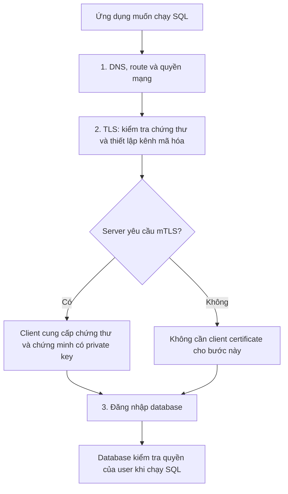

# Kết nối bằng TLS, mTLS và database wallet

Trong chương **Autonomous Database** của module **CLOUD_PROVIDERS_ORACLE**, bài này hướng dẫn kết nối một ứng dụng tới Autonomous Database trên OCI bằng TLS hoặc mutual TLS (mTLS). Người học sẽ phân biệt xác thực chứng thư với đăng nhập database, sử dụng wallet đúng cách và kiểm tra kết nối từ chính môi trường chạy ứng dụng.

Tình huống xuyên suốt: nhóm phát triển có một Autonomous Database phục vụ ứng dụng đơn hàng. Một máy phát triển dùng mTLS với instance wallet; một ứng dụng Java được triển khai ở môi trường mạng đã cho phép có thể dùng TLS không cần tải client wallet nếu đáp ứng điều kiện của dịch vụ và driver. Cả hai dùng tài khoản database riêng, với quyền phù hợp cho công việc.

Sau bài học, người học có thể:

- Giải thích TLS, mTLS, TCPS, truststore, keystore và wallet.
- Xác định đúng endpoint, cổng, service name và TNS alias.
- Chuẩn bị mạng, tài khoản database và quyền quản lý tài nguyên OCI.
- Kết nối bằng JDBC Thin với TLS và với mTLS.
- Đọc lỗi theo từng lớp, quản lý wallet và chuẩn bị thay chứng thư có kiểm soát.
- Ghi nhận bằng chứng kết nối mà không đưa secret vào mã nguồn hoặc log.

Phần thực hành tập trung vào **Autonomous Database Serverless**. Tài liệu Oracle hiện có thể dùng tên **Autonomous AI Database**. Với Dedicated hoặc hình thức triển khai khác, cần đối chiếu tài liệu tương ứng trước khi áp dụng các bước Console. Các ví dụ dùng đăng nhập database bằng username/password; xác thực bằng IAM token hoặc các hệ thống liên kết cần cấu hình riêng.

## 1. Nhìn kết nối qua ba lớp

Một kết nối thành công cần vượt qua ba lớp độc lập:



Ví dụ: tải được wallet từ Console chưa chứng minh máy tính tới được private endpoint. Mở được cổng database chưa chứng minh chứng thư được tin cậy. TLS handshake thành công cũng chưa chứng minh username/password đúng hoặc user được phép đọc bảng đơn hàng.

| Lớp | Câu hỏi cần trả lời | Ví dụ thông tin liên quan |
|---|---|---|
| Mạng | Máy chạy ứng dụng có tới được endpoint không? | DNS, IP, route, ACL, NSG, firewall |
| Kênh bảo mật | Client và server kiểm tra chứng thư như thế nào? | TLS, mTLS, trust anchor, client certificate |
| Database | Phiên làm việc được đăng nhập và phân quyền ra sao? | Database user, mật khẩu, quyền tạo session, quyền trên bảng |

Quyền IAM cho người dùng OCI quản lý hoặc tải thông tin kết nối là một lớp quản trị khác. Nó không tự cấp quyền SQL cho tài khoản ứng dụng. Bài lab cần ghi riêng người quản lý tài nguyên OCI và user đăng nhập database.

## 2. TLS và mTLS khác nhau ở đâu?

**TLS** cung cấp kênh truyền được mã hóa và bảo vệ tính toàn vẹn. Trong cách gọi của giao diện Autonomous Database, lựa chọn **TLS** thường chỉ kết nối xác thực server mà không yêu cầu client certificate.

**mTLS** là TLS có xác thực hai chiều bằng chứng thư. Client kiểm tra chứng thư server; phía dịch vụ cũng kiểm tra chứng thư client và bằng chứng sở hữu private key. mTLS không phải một giao thức không liên quan tới TLS.

Autonomous Database mặc định hỗ trợ mTLS. Có thể cấu hình để cho phép thêm TLS; khi đó hai loại kết nối có thể cùng tồn tại. Cả hai vẫn dùng kênh mã hóa. [Nguồn: About Connecting to an Autonomous AI Database Instance](https://docs.oracle.com/en/cloud/paas/autonomous-database/serverless/adbsb/connect-introduction.html).

| Đặc điểm | TLS theo lựa chọn của dịch vụ | mTLS |
|---|---|---|
| Client kiểm tra danh tính server | Có | Có |
| Server yêu cầu client certificate cho kênh này | Không | Có |
| Mã hóa lưu lượng | Có | Có |
| Oracle client wallet trong bài JDBC Thin | Không cần nếu đủ điều kiện | Dùng wallet hoặc keystore phù hợp |
| Đăng nhập database của ví dụ | Username/password | Username/password |
| Công việc vận hành chính | Trust của runtime, mạng, database credential | Các mục của TLS và thêm vòng đời client credential |

JDBC hiện dùng TLS 1.3 khi driver hỗ trợ và có thể fallback TLS 1.2. Không nên sao chép cấu hình cũ rồi khóa cứng mọi môi trường vào một phiên bản TLS mà chưa đối chiếu driver và chính sách đang áp dụng. [Nguồn: Connect with JDBC Thin Driver](https://docs.oracle.com/en/cloud/paas/autonomous-database/serverless/adbsb/connect-jdbc-thin.html).

### Không dùng nhầm khái niệm “không cần wallet”

Không cần tải **client wallet** không có nghĩa là bỏ kiểm tra chứng thư hoặc dùng kết nối không mã hóa. Client vẫn phải có nguồn tin cậy để xác minh server, thường qua truststore của runtime trong đường kết nối JDBC Thin.

Ngược lại, một client có wallet chưa đủ để kết luận đang dùng mTLS: wallet cũng có thể chỉ chứa trust material cho một cách cấu hình khác. Cần đối chiếu loại kết nối, descriptor và cấu hình thực tế.

Bài này chỉ hướng dẫn luồng JDBC Thin được Oracle hỗ trợ. Điều kiện “không cần wallet” không được suy rộng cho mọi phiên bản SQL*Plus, ODBC hoặc mọi Oracle Client. [Nguồn: các loại client và kết nối Autonomous Database](https://docs.oracle.com/en/cloud/paas/autonomous-database/serverless/adbsb/connect-preparing.html).

## 3. Wallet chứa gì và bảo vệ điều gì?

Trong bài này, **database connection wallet** là gói client credentials phục vụ kết nối. Nó khác với việc người quản trị tự quản lý wallet TDE chứa khóa mã hóa dữ liệu của một database khác.

Những khái niệm cần tách:

| Khái niệm | Vai trò |
|---|---|
| Certificate | Chứng thư gắn danh tính với public key |
| Private key | Bí mật dùng để chứng minh quyền sở hữu khóa tương ứng |
| Truststore | Nơi chứa các chứng thư hoặc trust anchor mà client tin cậy |
| Keystore | Nơi chứa khóa và chứng thư của một danh tính, tùy định dạng/cách dùng |
| Wallet | Container của Oracle cho credential/chứng thư; gói tải về còn có file cấu hình |
| TNS alias | Tên tra cứu một connect descriptor |

JDBC Thin dùng cơ chế TLS của Java; Oracle Wallet và JKS là các cách cung cấp vật liệu bảo mật cho client. Khi dùng định dạng Oracle Wallet, cần các thành phần Oracle PKI thích hợp. [Nguồn: JDBC Client-Side Security Features](https://docs.oracle.com/en/database/oracle/oracle-database/19/jjdbc/client-side-security.html).

Gói tải về thường có các file sau; không phải client nào cũng dùng tất cả:

| File | Mục đích chính |
|---|---|
| `cwallet.sso` | Auto-login wallet |
| `ewallet.p12` | PKCS#12 wallet |
| `keystore.jks` | Java keystore |
| `truststore.jks` | Java truststore |
| `tnsnames.ora` | Connect descriptors |
| `sqlnet.ora` | Cấu hình Oracle Net |
| `ojdbc.properties` | Thuộc tính kết nối JDBC |
| `README` | Thông tin hạn chứng thư và tài nguyên |

[Nguồn: Download Database Connection Information](https://docs.oracle.com/en/cloud/paas/autonomous-database/serverless/adbsb/connect-download-wallet.html).

### Ba loại bí mật thường bị nhầm

- **Mật khẩu database user** dùng cho đăng nhập database trong bài.
- **Mật khẩu wallet** bảo vệ các container như PKCS#12/JKS theo cách đóng gói.
- **Private key và các file auto-login** là vật liệu cần bảo vệ ngay cả khi ứng dụng không hỏi mật khẩu wallet mỗi lần chạy.

Auto-login cho phép công cụ mở wallet theo cơ chế của nó; không suy ra ứng dụng có thể bỏ database user/password trong ví dụ này. Hai lớp xác thực vẫn cần được chuẩn bị.

Đặt mật khẩu wallet không làm toàn bộ thư mục giải nén tự trở thành vùng an toàn. Một bản ZIP, file auto-login hoặc bản sao trong container image đều cần được kiểm soát truy cập. Đổi mật khẩu user cũng không tự thay thế client certificate.

Đề xuất cho nhóm đơn hàng: wallet được phân phối qua cơ chế quản lý secret hoặc kho bảo mật của đơn vị; ứng dụng chỉ đọc được phiên bản dành cho môi trường của mình. Không commit ZIP, private key hoặc thư mục wallet vào Git.

## 4. Chuẩn bị mạng và cấu hình dịch vụ

### 4.1. Chọn endpoint đúng với nơi chạy ứng dụng

| Nơi ứng dụng chạy | Điều cần chuẩn bị |
|---|---|
| Máy phát triển tới public endpoint | Nguồn truy cập được phép và đường outbound phù hợp |
| Compute/ứng dụng trong VCN tới private endpoint | DNS private, route và rule mạng liên quan |
| Mạng doanh nghiệp tới private endpoint | Kết nối mạng vào VCN và phân giải tên phù hợp |
| Container hoặc máy CI | DNS, mạng và secret trong chính runtime đó |

Không dùng kết quả từ laptop để suy rằng container trên máy khác cũng kết nối được. Một khác biệt về egress IP, DNS hoặc đường dẫn wallet đủ làm hai môi trường có kết quả khác nhau.

Với private endpoint, tài liệu Oracle nêu rule phù hợp cho cổng 1522 với mTLS, hoặc 1521/1522 với TLS theo cấu hình. Cổng 443 phục vụ các công cụ web như Database Actions/ORDS là luồng khác. [Nguồn: Configure Network Access with Private Endpoints](https://docs.oracle.com/en/cloud/paas/autonomous-database/serverless/adbsb/private-endpoints-autonomous.html).

Ví dụ chẩn đoán ban đầu trên Windows PowerShell:

```powershell
$adbHostName = '<HOST_TRONG_CONNECTION_STRING>'
$adbPort = 1522  # Thay bằng cổng của descriptor đang kiểm tra

Resolve-DnsName -Name $adbHostName
Test-NetConnection -ComputerName $adbHostName -Port $adbPort
```

TCP test thành công chỉ chứng minh khả năng mở kết nối tới cổng đó tại thời điểm thử. Nó chưa thực hiện đầy đủ việc xác minh chứng thư, đăng nhập hay chạy SQL.

### 4.2. Khi muốn cho phép TLS không có client certificate

Trên Serverless, để cho phép TLS cần có ACL cho public endpoint hoặc cấu hình private endpoint. Sau đó, tại phần **Network**, chỉnh **Mutual TLS (mTLS) Authentication**, bỏ chọn **Require mutual TLS (mTLS) authentication**, cập nhật và chờ trạng thái phù hợp. mTLS vẫn được phép. [Nguồn: Update Network Options to Allow TLS or Require Only mTLS](https://docs.oracle.com/en/cloud/paas/autonomous-database/serverless/adbsb/support-tls-mtls-authentication.html).

Chỉ thay cấu hình khi môi trường lab cho phép và đã biết các client đang dùng. Không mở allowlist cho toàn Internet chỉ để giải quyết một lỗi kết nối.

Nếu môi trường bắt buộc mTLS, người học hoàn thành nhánh mTLS và ghi rõ nhánh TLS không được thực hiện theo chính sách đó. Không cần hạ yêu cầu bảo mật của môi trường để lấy đủ ảnh chụp cho bài lab.

### 4.3. Chuẩn bị database user

Dùng một user riêng cho ứng dụng hoặc lab, được cấp quyền tạo session và các quyền SQL thực sự cần. Không sử dụng `ADMIN` làm tài khoản chạy ứng dụng chỉ vì đó là user đầu tiên được cung cấp.

Autonomous Database cho phép quản trị viên cấp từng quyền thay vì bắt buộc cấp một role rộng. Ví dụ, bài kiểm tra kết nối chỉ chạy truy vấn session/DUAL không cần toàn bộ quyền phát triển dữ liệu của `DWROLE`. [Nguồn: Manage User Roles and Privileges](https://docs.oracle.com/en/cloud/paas/autonomous-database/serverless/adbsb/manage-users-privileges.html).

## 5. Lấy đúng connection string và service

Mở database đúng compartment/region, chọn **Database connection**, rồi chọn loại TLS/mTLS và endpoint phù hợp nếu giao diện cung cấp nhiều lựa chọn. Sao chép descriptor của service cần dùng. Các TNS alias có thể giống nhau giữa hai loại kết nối nhưng descriptor khác nhau; mTLS dùng cổng 1522, TLS có thể dùng 1521 hoặc 1522. [Nguồn: View TNS Names and Connection Strings](https://docs.oracle.com/en/cloud/paas/autonomous-database/serverless/adbsb/connect-download-wallet.html).

### Phân biệt ba giá trị

| Giá trị | Ví dụ minh họa | Ý nghĩa |
|---|---|---|
| Host | `<ADB_HOST>` | Tên endpoint để phân giải DNS và kết nối |
| TNS alias | `orders_low` | Tên client tra trong `tnsnames.ora` |
| Service name | `<SERVICE_NAME_DAY_DU>` | Tên service gửi tới listener/database |

Không lấy tên hiển thị của database làm service name nếu Console cung cấp một giá trị khác. Cũng không thay service name bằng OCID hoặc SID.

Cấu trúc khái niệm của một descriptor:

```text
(description=
  (address=
    (protocol=tcps)
    (host=<ADB_HOST>)
    (port=<PORT_TU_CONSOLE>)
  )
  (connect_data=
    (service_name=<SERVICE_NAME_DAY_DU>)
  )
  (security=
    (ssl_server_dn_match=yes)
  )
)
```

Đây là sơ đồ cấu trúc, không phải chuỗi để chạy nguyên trạng. Khi thực hành, dùng toàn bộ descriptor từ database của mình, kể cả các thuộc tính bảo mật hoặc retry có sẵn. Không biến descriptor mTLS thành TLS bằng cách chỉ sửa cổng.

Các service như `low`, `medium`, `high`, `tp` và `tpurgent` phục vụ cách phân bổ tài nguyên/workload khác nhau; danh sách thực tế phụ thuộc loại database. Đối với phép thử ngắn trong lab, chọn service phù hợp đã được giao, không mặc định `high` luôn nhanh nhất. [Nguồn: Database Service Names for Autonomous AI Database](https://docs.oracle.com/en/cloud/paas/autonomous-database/serverless/adbsb/predefined-database-services-names.html).

### Giữ kiểm tra danh tính server

Trust chain trả lời chứng thư có được cấp bởi nguồn client tin cậy không. Kiểm tra danh tính endpoint còn giúp xác nhận chứng thư phù hợp server cần kết nối.

Giữ các thuộc tính xác minh do Oracle cung cấp, chẳng hạn `ssl_server_dn_match=yes`. Không sửa thành `no`, dùng “trust all” hoặc thay hostname bằng IP để lách lỗi chứng thư. Với descriptor và driver cụ thể, cách so khớp hostname/DN phải theo hướng dẫn tương ứng. [Nguồn: JDBC Client-Side Security Features — TLS](https://docs.oracle.com/en/database/oracle/oracle-database/19/jjdbc/client-side-security.html).

Nếu tổ chức dùng truststore tùy chỉnh, nó cần tin cậy đúng chuỗi CA cho endpoint hiện tại. Không tự tải một certificate không rõ nguồn rồi đưa vào truststore để làm hết lỗi PKIX.

## 6. Chuẩn bị Java và chương trình kiểm tra chung

Ví dụ dùng Java 17 trở lên, JDBC Thin và tài khoản lab. Chuẩn bị một bộ Oracle JDBC driver được hỗ trợ với JDK đang dùng. Các file minh họa bên dưới do người học tạo trong môi trường thực hành; bài không giả định chúng đã tồn tại.

Với TLS không wallet, JDBC Thin dùng trust configuration của Java phù hợp. Với Oracle Wallet, bổ sung các JAR liên quan như `oraclepki.jar`, `osdt_core.jar`, `osdt_cert.jar` theo bộ driver. Nếu dùng UCP, thêm thư viện UCP tương thích. [Nguồn: JDBC Thin Connections with a Wallet](https://docs.oracle.com/en/cloud/paas/autonomous-database/serverless/adbsb/connect-jdbc-thin-wallet.html).

Đề xuất bố trí thư mục chương trình lab:

```text
adb-connection-lab/
  AdbConnectionProbe.java
  lib/
    <Oracle JDBC driver và companion JARs tương thích>
```

Wallet được đặt ở vị trí bảo mật riêng, không chép vào thư mục source hoặc đóng gói trong JAR của ứng dụng. Trong `lib`, tránh để nhiều phiên bản JDBC driver cạnh tranh trên classpath.

### Chương trình chỉ đọc thông tin phiên

Tạo `AdbConnectionProbe.java`:

```java
import java.io.Console;
import java.sql.Connection;
import java.sql.DriverManager;
import java.sql.ResultSet;
import java.sql.Statement;
import java.util.Arrays;

public final class AdbConnectionProbe {
    private static String requiredEnv(String name) {
        String value = System.getenv(name);
        if (value == null || value.isBlank()) {
            throw new IllegalArgumentException("Missing environment variable: " + name);
        }
        return value;
    }

    public static void main(String[] args) throws Exception {
        String url = requiredEnv("ADB_JDBC_URL");
        String user = requiredEnv("ADB_DB_USER");

        Console console = System.console();
        if (console == null) {
            throw new IllegalStateException("Run this probe from an interactive terminal.");
        }

        char[] password = console.readPassword("Database password: ");
        if (password == null) {
            throw new IllegalStateException("No password was supplied.");
        }

        try {
            try (Connection connection =
                         DriverManager.getConnection(url, user, new String(password));
                 Statement statement = connection.createStatement()) {

                statement.setQueryTimeout(15);

                String query = """
                    SELECT SYS_CONTEXT('USERENV', 'SESSION_USER') AS session_user,
                           SYS_CONTEXT('USERENV', 'SERVICE_NAME') AS service_name,
                           SYS_CONTEXT('USERENV', 'NETWORK_PROTOCOL') AS network_protocol,
                           SYS_CONTEXT('USERENV', 'AUTHENTICATION_METHOD') AS auth_method
                    FROM dual
                    """;

                try (ResultSet result = statement.executeQuery(query)) {
                    if (!result.next()) {
                        throw new IllegalStateException("Session probe returned no row.");
                    }

                    System.out.printf(
                        "user=%s%nservice=%s%nprotocol=%s%nauth_method=%s%n",
                        result.getString("session_user"),
                        result.getString("service_name"),
                        result.getString("network_protocol"),
                        result.getString("auth_method")
                    );
                }
            }
        } finally {
            Arrays.fill(password, '\0');
        }
    }
}
```

Mật khẩu được nhập ở terminal thay vì ghi trong source hoặc JDBC URL. Việc xóa mảng `char[]` chỉ giảm một bản sao trong bộ nhớ; đoạn mã vẫn tạo `String` cho API JDBC, nên không tuyên bố mọi bản sao bí mật đã được xóa.

Chương trình là probe tương tác, không phải cơ chế cấp secret cho production. Ứng dụng chạy nền nên lấy credential qua cơ chế quản lý secret của môi trường.

### Biên dịch và chạy trên Windows

Từ thư mục chương trình lab, với driver trong `lib`:

```powershell
javac -cp ".\lib\*" AdbConnectionProbe.java

# Thiết lập ADB_JDBC_URL theo nhánh TLS hoặc mTLS ở phần tiếp theo.
$env:ADB_DB_USER = '<DATABASE_USER_CUA_LAB>'

java -cp ".;.\lib\*" AdbConnectionProbe
```

Dấu `;` ở đây nằm trong chuỗi classpath Windows, không phải một lệnh PowerShell nối tiếp. Trên Linux/macOS, classpath dùng dấu `:`.

`setQueryTimeout(15)` áp dụng cho truy vấn, không phải ngân sách 15 giây cho toàn bộ DNS, TCP, TLS và login. Thời gian thiết lập kết nối/retry cần được cấu hình riêng theo driver và yêu cầu ứng dụng.

### Đọc kết quả đúng phạm vi

`SYS_CONTEXT` cho phép quan sát user của session, service, giao thức và phương thức đăng nhập. `NETWORK_PROTOCOL` phản ánh protocol của kết nối; nó không cung cấp đầy đủ cipher suite hoặc loại client certificate đã dùng. [Nguồn: SYS_CONTEXT — USERENV](https://docs.oracle.com/en/database/oracle/oracle-database/19/sqlrf/SYS_CONTEXT.html).

Kỳ vọng trong lab:

- `user` là tài khoản lab đã được giao.
- `service` khớp service đích, không phải môi trường khác.
- `protocol` cho biết kết nối TCPS.
- `auth_method` có thể thể hiện phương thức đăng nhập bằng mật khẩu trong bài.

`PASSWORD` ở bước đăng nhập không có nghĩa TLS bị tắt. Tương tự, `TCPS` chưa đủ chứng minh đang dùng mTLS: cần kết hợp với cấu hình server, descriptor và vật liệu client của lần chạy.

## 7. Nhánh A — JDBC Thin dùng TLS không tải wallet

### 7.1. Điều kiện

Database đã cho phép TLS theo phần mạng; client có driver/JDK được hỗ trợ, trust phù hợp, user/password hợp lệ và đường mạng tới endpoint.

Oracle hỗ trợ đường JDBC Thin TLS không cần tải Oracle Wallet/JKS. Dùng **TLS connection string** lấy từ **Database connection** rồi thêm tiền tố JDBC, thay vì dùng nhầm descriptor mTLS. [Nguồn: JDBC Thin Connections Without a Wallet](https://docs.oracle.com/en/cloud/paas/autonomous-database/serverless/adbsb/connect-jdbc-thin-tls.html).

Thiết lập trong cùng terminal chạy probe:

```powershell
$env:ADB_JDBC_URL = 'jdbc:oracle:thin:@<TOAN_BO_TLS_CONNECT_DESCRIPTOR>'
$env:ADB_DB_USER = '<DATABASE_USER_CUA_LAB>'

java -cp ".;.\lib\*" AdbConnectionProbe
```

Thay placeholder bằng descriptor thật, không chỉ tên service. URL mẫu trên không chứa mật khẩu.

### 7.2. Bảo đảm phép thử không dựa vào wallet cũ

Để kiểm chứng đúng nhánh này, dùng runtime sạch, không cấu hình client wallet hoặc keystore mTLS của lần chạy trước. Kiểm tra các thuộc tính JVM và file cấu hình kết nối mà ứng dụng thực sự đọc.

Các cấu hình như `oracle.net.wallet_location`, `javax.net.ssl.keyStore` hoặc một `ojdbc.properties` được nạp từ nơi khác có thể khiến kết quả khác dự kiến. Việc lấy URL từ biến môi trường chưa tự xóa các thuộc tính JVM đã được thiết lập.

Không xóa hay sửa truststore dùng chung của JDK để tạo “môi trường sạch”. Client vẫn cần nguồn tin cậy để xác minh server. Với ứng dụng có cấu hình riêng, chỉ điều chỉnh cấu hình thuộc phạm vi bài lab.

### 7.3. Bằng chứng cần lưu

Ghi loại kết nối được chọn, phiên bản JDK/driver, user/service/protocol đã quan sát, thời điểm và môi trường chạy. Không chép mật khẩu hoặc dump toàn bộ cấu hình runtime vào báo cáo.

Nếu TLS chưa được phép theo chính sách môi trường, kết quả phù hợp là ghi rõ nhánh chưa thực hiện. Đừng tự chuyển sang kết nối TCP không mã hóa để thay thế.

## 8. Nhánh B — JDBC Thin dùng mTLS với instance wallet

### 8.1. Nhận wallet đúng database

Người có quyền mở **Database connection → Instance wallet → Download wallet**, đặt mật khẩu và lưu ZIP an toàn; hoặc nhận gói từ quản trị viên qua kênh được phép.

Instance wallet phục vụ một database; regional wallet có phạm vi nhiều database trong tenancy/region. Chọn instance wallet cho lab một database. [Nguồn: Download Database Connection Information — wallet types](https://docs.oracle.com/en/cloud/paas/autonomous-database/serverless/adbsb/connect-download-wallet.html).

Giải nén nguyên bộ vào vị trí bảo mật dành cho runtime. Ví dụ đường dẫn minh họa:

```text
C:/oci-lab-secrets/orders-wallet/
```

Chỉ process/người dùng được phép mới có quyền truy cập. Không đặt thư mục này trong thư mục được web server phục vụ, thư mục đồng bộ công khai hoặc container image dùng chung.

### 8.2. Chỉ rõ TNS_ADMIN và alias

Lấy TNS alias có trong `tnsnames.ora` của gói. Với JDBC hỗ trợ dạng URL này:

```powershell
$env:ADB_JDBC_URL = 'jdbc:oracle:thin:@<TNS_ALIAS>?TNS_ADMIN=C:/oci-lab-secrets/orders-wallet'
$env:ADB_DB_USER = '<DATABASE_USER_CUA_LAB>'

java -cp ".;.\lib\*" AdbConnectionProbe
```

`TNS_ADMIN` chỉ thư mục cấu hình, không chỉ trực tiếp vào ZIP. JDBC có thể dùng thông tin từ `tnsnames.ora` và `ojdbc.properties`; URL dạng này được tài liệu Oracle hướng dẫn cho driver từ 18.3. [Nguồn: JDBC Thin Connections with a Wallet — TNS_ADMIN](https://docs.oracle.com/en/cloud/paas/autonomous-database/serverless/adbsb/connect-jdbc-thin-wallet.html).

Các lưu ý thực hành:

- Thay alias đúng, không ghép alias với service name thành một chuỗi mới.
- Giữ file `ojdbc.properties` đi cùng cấu hình của gói; không thay hàng loạt thuộc tính theo ví dụ Internet.
- Bảo đảm các JAR cho Oracle Wallet có trên runtime classpath.
- Xác nhận process chạy bằng tài khoản hệ điều hành có quyền đọc thư mục.
- Khi chạy trong container, dùng đường dẫn bên trong container, không dùng đường dẫn host chưa được mount.

Với JKS, cấu hình keystore/truststore là một phương án riêng. Không bật đồng thời nhiều cấu hình wallet/JKS chỉ để thử cái nào hết lỗi. Bài lab chính chọn Oracle Wallet để giữ một luồng cấu hình dễ quan sát.

### 8.3. Kiểm tra bằng một phiên mới

Chạy probe để mở một connection mới; đối chiếu user, service và protocol như nhánh TLS. Ghi rõ wallet thuộc database nào và phiên bản gói đang được dùng, nhưng không ghi nội dung chứng thư/private key vào báo cáo.

Để chứng minh yêu cầu client certificate trong môi trường chỉ cho mTLS, có thể tổ chức một phép thử riêng với cấu hình client không có vật liệu mTLS và credential database vẫn đúng. Kết quả mong đợi là không thiết lập được kết nối, nhưng chỉ thực hiện khi chắc chắn đã loại cấu hình wallet/JKS ngầm.

Đừng cố tình dùng sai mật khẩu lặp lại nhiều lần để “kiểm tra mTLS”; lỗi mật khẩu thuộc lớp khác và có thể làm khóa user.

## 9. Kết nối bằng SQL Developer

Có thể dùng SQL Developer để thử độc lập với chương trình Java. Kết quả từ SQL Developer chỉ đại diện cho runtime của công cụ đó; chương trình Java riêng vẫn cần driver, trust và đường dẫn đúng.

### mTLS với Cloud Wallet

1. Tạo một database connection mới.
2. Chọn **Connection Type: Cloud Wallet**.
3. Chọn ZIP client credentials ở **Configuration File**.
4. Điền database user/password và chọn service từ gói.
5. Kết nối rồi chạy truy vấn kiểm tra session.

[Nguồn: Connect Oracle SQL Developer with a Wallet](https://docs.oracle.com/en/cloud/paas/autonomous-database/serverless/adbsb/connect-sql-dev182.html).

Công cụ nhận ZIP không có nghĩa JDBC URL `TNS_ADMIN` cũng nhận ZIP. Hai giao diện xử lý gói theo cách khác nhau.

### TLS với Custom JDBC

Khi TLS đã được phép:

1. Sao chép TLS descriptor của database.
2. Tạo connection kiểu **Custom JDBC**.
3. Điền URL `jdbc:oracle:thin:@` nối với descriptor đó.
4. Điền database user/password và kết nối.

[Nguồn: Connect Oracle SQL Developer Without a Wallet](https://docs.oracle.com/en/cloud/paas/autonomous-database/serverless/adbsb/connect-sqldev-tls.html).

Không lấy việc trình duyệt mở được Database Actions làm bằng chứng JDBC đã được cấu hình. Đó là client và đường truy cập khác.

## 10. Quản lý wallet và credential trong vận hành

### 10.1. Lập danh sách nơi đang dùng credential

Ví dụ hồ sơ vận hành cho nhóm đơn hàng:

| Thông tin | Nội dung cần lưu |
|---|---|
| Database đích | Region, OCID hoặc định danh nội bộ đã xác minh |
| Loại kết nối | TLS hay mTLS; public/private endpoint |
| Runtime | Máy, container, dịch vụ và chủ sở hữu |
| User database | User dành cho ứng dụng hoặc công việc |
| Wallet nếu có | Instance/regional, phiên bản phân phối, vị trí mount |
| Hạn chứng thư | Giá trị từ gói/chứng thư thực tế |
| Driver/JDK | Bộ phiên bản đang triển khai |
| Cách tạo connection mới | Pool/runtime nạp cấu hình thế nào |
| Cơ chế thay đổi | Phân phối secret, rollout và kiểm chứng |
| Theo dõi | Kết quả probe mới nhất, lỗi, người xử lý |

Thông tin hết hạn có trong `README` của gói wallet. Không đoán ngày hết hạn từ tên file hoặc từ một thời hạn truyền miệng. [Nguồn: Wallet README File](https://docs.oracle.com/en/cloud/paas/autonomous-database/serverless/adbsb/connect-download-wallet.html).

Mật khẩu database, mật khẩu wallet và client certificate có vòng đời khác nhau. Lịch thay một loại credential không tự xử lý các loại còn lại.

### 10.2. Phân phối ở thời điểm chạy

Đề xuất vận hành:

- Cấp wallet đúng môi trường và giới hạn người/process có quyền đọc.
- Mount secret vào runtime theo cơ chế của nền tảng, ưu tiên chỉ đọc đối với ứng dụng.
- Không đưa wallet vào Docker image, package phát hành hoặc artifact dùng chung.
- Không ghi mật khẩu vào tham số command line, source hoặc JDBC URL.
- Ghi phiên bản credential đã triển khai mà không ghi chính credential.
- Thu hồi các bản sao ở thư mục tải xuống, máy tạm và workspace CI theo chính sách đã thống nhất.

Với TLS không wallet, vẫn phải quản lý database credential và cập nhật trust/runtime. Giảm một file secret không làm mất các trách nhiệm đó.

Nếu nhiều ứng dụng chia sẻ cùng instance wallet, việc xoay credential có thể ảnh hưởng nhiều nơi. Một bản wallet cũng không phải bằng chứng nhận diện duy nhất của từng ứng dụng; cần kết hợp database user, quyền và thông tin session để quan sát theo ứng dụng.

### 10.3. Tải lại khác với rotate

Tải một gói mới là nhận vật liệu kết nối để triển khai. **Rotate wallet** là thay đổi khóa/chứng thư client theo cơ chế dịch vụ để vô hiệu khóa cũ theo phạm vi và thời điểm đã chọn. Không kết luận một bản sao bị lộ đã mất hiệu lực chỉ vì vừa download thêm một ZIP.

Tài liệu hiện hành có rotate ngay hoặc grace period 1–72 giờ; Always Free chỉ hỗ trợ rotate ngay. Rotate instance không vô hiệu regional wallet; rotate regional có phạm vi ảnh hưởng cả instance wallet tương ứng. Với grace period, session cũ có thể tiếp tục sau khi key cũ hết hiệu lực. [Nguồn: Rotate Wallets for Autonomous AI Database](https://docs.oracle.com/en/cloud/paas/autonomous-database/serverless/adbsb/wallet-rotate.html).

Vì vậy, runbook phải xác định rõ phạm vi credential cần thu hồi, ảnh hưởng tới client và yêu cầu xử lý session hiện có. Đổi mật khẩu database hoặc xóa một file trên laptop không thay thế toàn bộ quy trình thu hồi wallet.

### 10.4. Quy trình rollout được đề xuất

Với môi trường hỗ trợ cửa sổ chuyển tiếp:

1. Lập danh sách các runtime đang dùng credential và người phụ trách.
2. Chọn phạm vi thay đổi, thời điểm và cửa sổ phù hợp chính sách.
3. Nhận gói mới, đặt vào phiên bản secret/thư mục mới.
4. Từ một runtime thử, tạo **connection mới** bằng cấu hình mới và chạy truy vấn session.
5. Rollout tới các ứng dụng theo từng đợt; theo dõi lỗi kết nối và sức khỏe pool.
6. Xác nhận mọi runtime đã nạp phiên bản mới và tạo connection mới thành công.
7. Sau thời điểm thu hồi, kiểm tra lại yêu cầu loại credential cũ theo kế hoạch.
8. Dọn bản sao cũ và cập nhật hồ sơ vận hành.

Đây là quy trình đề xuất của bài, không phải cam kết tự động của OCI. Với rotation ngay hoặc khi nghi credential bị lộ, thứ tự và cửa sổ xử lý cần phù hợp mức độ khẩn cấp của sự cố.

Không quay lại wallet cũ sau khi nó đã bị vô hiệu và gọi đó là phương án rollback. Phương án phục hồi phải dựa trên credential còn hợp lệ, khả năng triển khai và cơ chế thu hồi đã chọn.

### 10.5. Connection pool dễ che giấu lỗi credential mới

Một request thành công có thể chỉ mượn connection cũ từ pool. Sau khi thay wallet, request đó chưa chứng minh process có thể mở connection mới.

Trong bài lab, probe Java luôn mở một connection mới nên hữu ích cho bước kiểm tra này. Trong ứng dụng thật, tổ chức kiểm thử có kiểm soát để pool tạo connection mới, theo cơ chế pool được hỗ trợ.

Không dừng toàn bộ pool hoặc restart database chỉ để kiểm tra một file khi chưa có kế hoạch thay đổi tương ứng. Cần phân biệt mục tiêu “xác nhận kết nối mới” với mục tiêu “cắt toàn bộ session cũ”.

Nếu chuyển dịch vụ từ cho phép TLS sang bắt buộc mTLS, Oracle nêu rằng các TLS connection hiện có bị ngắt. Vì vậy cần chuẩn bị các client liên quan trước thay đổi này. [Nguồn: Require mTLS and Disallow TLS Authentication](https://docs.oracle.com/en/cloud/paas/autonomous-database/serverless/adbsb/support-tls-mtls-authentication.html).

## 11. Chẩn đoán lỗi theo từng lớp

Bắt đầu từ thông tin của **process đang lỗi**, thay vì chỉ từ cấu hình mong muốn:

1. Database và endpoint nào đang được gọi?
2. Process dùng URL/alias nào, driver và JDK nào?
3. DNS và TCP từ runtime đó có hoạt động không?
4. Cấu hình trust, client key và wallet được nạp từ đâu?
5. Lỗi xảy ra ở handshake, login hay câu SQL sau login?

| Hiện tượng | Hướng kiểm tra ban đầu |
|---|---|
| Không phân giải hostname | DNS, private zone, môi trường container/VPN |
| TCP timeout | Route, nguồn truy cập, ACL/NSG/firewall, cổng của descriptor |
| Lỗi handshake | Phiên bản TLS, chuỗi chứng thư, client certificate nếu yêu cầu |
| Java báo PKIX hoặc không tìm được trust path | Truststore thực sự đang dùng, CA chain, runtime có bị thay cấu hình không |
| DN/hostname mismatch | Endpoint và descriptor đúng chưa; có bị thay bằng IP/alias tùy ý không |
| Không tìm thấy Oracle JDBC driver | Classpath và JAR đang dùng |
| Wallet dùng được ở laptop nhưng lỗi trong container | Secret mount, đường dẫn trong container và quyền của process |
| Có thể login nhưng lỗi đọc bảng | User/schema và quyền SQL; đây không còn chỉ là lỗi TLS |
| Sau đổi wallet ứng dụng vẫn chạy nhưng restart lại lỗi | Pool cũ còn session, runtime mới chưa nạp đúng credential |
| Cùng alias nhưng tới sai môi trường | Nguồn `tnsnames.ora` và cấu hình `TNS_ADMIN` thực tế |

Một số mã lỗi hữu ích để định hướng:

| Mã lỗi | Ý nghĩa và việc nên kiểm tra |
|---|---|
| [ORA-12154](https://docs.oracle.com/en/error-help/db/ora-12154/) | Không phân giải được connect identifier; kiểm tra alias, naming configuration và nơi đọc `tnsnames.ora` |
| [ORA-28759](https://docs.oracle.com/en/error-help/db/ora-28759/) | Không mở được file; xác định file, đường dẫn và quyền truy cập bị lỗi |
| [ORA-29024](https://docs.oracle.com/en/error-help/db/ora-29024/) | Xác minh chứng thư thất bại; điều tra chứng thư và tính hợp lệ |
| [ORA-01017](https://docs.oracle.com/en/error-help/db/ora-01017/) | Credential hoặc quyền đăng nhập không hợp lệ; kiểm tra phương thức đăng nhập và tài khoản đích |

Mã lỗi là điểm bắt đầu, không phải bằng chứng duy nhất của nguyên nhân. Một lỗi SSL tổng quát có thể bọc lỗi file hoặc lỗi trust ở lớp sâu hơn; cần xem exception chain/diagnostic tương ứng trong môi trường kiểm soát.

Khi trao đổi với nhóm vận hành, cung cấp thời điểm, database/endpoint đã làm mờ khi cần, phiên bản client, mã lỗi và bước cuối đã xác minh. Không gửi wallet ZIP, private key, mật khẩu hoặc bản dump chứa secret để minh họa lỗi.

## 12. Chọn TLS hay mTLS cho ứng dụng

| Điều kiện | Lựa chọn cần đánh giá |
|---|---|
| Chính sách yêu cầu client certificate | mTLS và quy trình quản lý wallet/keystore |
| JDBC Thin được hỗ trợ, mạng đã giới hạn, không bắt buộc client certificate | TLS không tải wallet có thể giảm công việc phân phối client credential |
| Có nhiều loại client cũ/mới | Đối chiếu hỗ trợ của từng client; tránh suy chung từ JDBC Thin |
| Ứng dụng có nhiều replica hoặc CI ngắn hạn | Đánh giá cách cấp secret, trust và tạo connection mới ở từng runtime |
| Cần thay credential thường xuyên | Đánh giá rollout, connection pool và kiểm chứng sau thay đổi |

Không xếp hạng bằng câu “mTLS luôn phù hợp nhất” hoặc “TLS không wallet luôn tiện hơn nên dùng mọi nơi”. Quyết định phụ thuộc mô hình đe dọa, chính sách, client và khả năng vận hành của nhóm.

Với ứng dụng đơn hàng trong bài, nhóm có thể duy trì mTLS cho môi trường yêu cầu client certificate, đồng thời sử dụng TLS ở môi trường khác nếu đã được cho phép. Hai loại kết nối phải được ghi rõ trong cấu hình; không để runtime tự dùng một wallet cũ ngoài dự kiến.

### Tính sẵn sàng và chi phí của kết nối

Thiết kế kết nối ổn định cần cả timeout phù hợp, pool có giới hạn, cập nhật driver và kế hoạch thay credential. Retry không giới hạn có thể giữ request treo lâu; retry đồng loạt từ nhiều replica có thể làm đợt khôi phục khó hơn.

Việc có TLS hoặc mTLS không tự cung cấp failover ứng dụng, replay giao dịch hay bảo đảm mọi request được thực thi đúng một lần. Các khả năng đó cần cấu hình và kiểm thử riêng.

Bài lab kết nối không cần tạo thêm database chỉ để so sánh hai giao thức nếu một database lab cho phép cả hai. Khi dự toán môi trường, tính cả tài nguyên database, nơi chạy client, kết nối mạng và công việc vận hành secret; không đưa ra giả định rằng chọn một loại TLS sẽ tự quyết định toàn bộ chi phí.

Sau thực hành, dừng các process thử không còn cần thiết, thu hồi quyền mạng tạm nếu đã được cấp và xử lý các bản sao wallet theo kế hoạch. Giữ nguyên tài nguyên dùng chung hoặc đang phục vụ công việc khác.

## 13. Tiêu chí hoàn thành

Người học hoàn thành bài khi có thể:

1. Chỉ ra sự khác nhau giữa khả năng tới endpoint, xác thực chứng thư và đăng nhập database.
2. Phân biệt host, TNS alias, service name và descriptor.
3. Giải thích vì sao không tải wallet vẫn có thể dùng TLS được mã hóa và xác minh server.
4. Giải thích vì sao wallet auto-login không tự thay database credential của ví dụ.
5. Kết nối mTLS bằng wallet đúng database và `TNS_ADMIN` đúng runtime.
6. Kết nối TLS không wallet nếu môi trường được phép; nếu không, ghi rõ giới hạn.
7. Quan sát đúng user/service/protocol bằng một connection mới.
8. Trình bày giới hạn của kết quả `TCPS` và phương thức đăng nhập trong `SYS_CONTEXT`.
9. Chẩn đoán ít nhất một lỗi cấu hình có kiểm soát theo đúng lớp mà không tắt xác minh server.
10. Có hồ sơ vị trí credential, hạn chứng thư và cách thay credential cho ứng dụng.

Báo cáo lab ghi đúng các nhánh đã thực hiện. Những ví dụ trên hướng dẫn thao tác và tiêu chí kiểm chứng; không có nghĩa bài viết đã thực hiện kết nối tới tenancy hoặc database của người học.

### Tài liệu Oracle tham khảo

- [About Connecting to an Autonomous AI Database Instance](https://docs.oracle.com/en/cloud/paas/autonomous-database/serverless/adbsb/connect-introduction.html)
- [Network Options for TLS and mTLS](https://docs.oracle.com/en/cloud/paas/autonomous-database/serverless/adbsb/support-tls-mtls-authentication.html)
- [JDBC Thin Connections Without a Wallet](https://docs.oracle.com/en/cloud/paas/autonomous-database/serverless/adbsb/connect-jdbc-thin-tls.html)
- [JDBC Thin Connections with a Wallet](https://docs.oracle.com/en/cloud/paas/autonomous-database/serverless/adbsb/connect-jdbc-thin-wallet.html)
- [Download Database Connection Information](https://docs.oracle.com/en/cloud/paas/autonomous-database/serverless/adbsb/connect-download-wallet.html)
- [Rotate Wallets for Autonomous AI Database](https://docs.oracle.com/en/cloud/paas/autonomous-database/serverless/adbsb/wallet-rotate.html)
