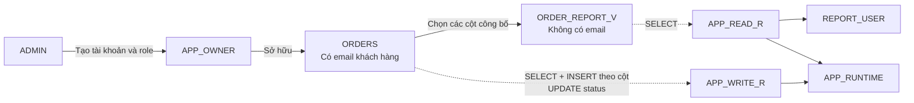

# Quản lý người dùng, schema và quyền truy cập dữ liệu

## Mục tiêu và phạm vi

Trong chương **Autonomous Database** của module **CLOUD_PROVIDERS_ORACLE**, phân quyền dữ liệu là phần công việc vẫn cần được thiết kế rõ dù dịch vụ đã tự động hóa nhiều tác vụ vận hành. Ứng dụng kết nối được database chưa có nghĩa ứng dụng chỉ truy cập đúng dữ liệu cần thiết.

Bài này sử dụng **Autonomous Database Serverless** làm môi trường tham chiếu. Tên sản phẩm trong tài liệu hoặc Console có thể là Autonomous AI Database. Các tùy chọn của Dedicated, phiên bản database và tích hợp danh tính có thể khác; cần đối chiếu môi trường thực tế trước khi áp dụng.

Sau bài học, người học có thể:

- Phân biệt người dùng OCI IAM, database user, schema và role trong database.
- Tách tài khoản sở hữu schema, tài khoản chạy ứng dụng và tài khoản báo cáo.
- Cấp quyền theo object/cột, giới hạn dữ liệu qua view và kiểm tra quyền thực tế.
- Xác định tác động của quota, Database Actions, PL/SQL và connection pool đến mô hình quyền.
- Thực hiện vòng đời cấp quyền, thay credential, thu hồi, khóa và dọn tài khoản lab.

Các đoạn SQL là hướng dẫn để người học thực hiện trong database lab được phép sử dụng. Chúng chưa được chạy trên một tenancy thực trong bài; mọi tên người dùng, dữ liệu và kết quả mong đợi đều phục vụ thực hành.

## 1. Xác định danh tính ở đúng lớp

Một yêu cầu truy vấn đi qua nhiều lớp kiểm soát:

```text
Quyền quản lý tài nguyên OCI
        ↓
Đường mạng và cấu hình kết nối an toàn
        ↓
Xác thực database user
        ↓
CREATE SESSION và trạng thái tài khoản
        ↓
Quyền trực tiếp, role đang có hiệu lực và chính sách dữ liệu
        ↓
Object/cột/dòng mà câu SQL được phép sử dụng
```

Đây là mô hình kiểm tra, không phải mô tả mọi câu SQL phải gọi OCI IAM qua mạng.

| Khái niệm | Phạm vi | Ví dụ |
| --- | --- | --- |
| OCI IAM user/group | Quản lý và truy cập dịch vụ OCI theo policy | Nhóm được xem Autonomous Database trong compartment |
| Database user | Danh tính được xác thực khi mở phiên SQL | `APP_RUNTIME` |
| Schema | Không gian chứa object thuộc một database user | `APP_OWNER.ORDERS` |
| Database role | Tập quyền có thể cấp cho user hoặc role khác | `APP_READ_R` |
| Connection service | Chính sách phục vụ workload/kết nối của database | Service được chọn trong connect string |
| Application user | Người dùng nghiệp vụ do ứng dụng quản lý | Khách hàng đăng nhập trang đặt hàng |

Có quyền xem database trên OCI Console không tự động có quyền `SELECT` bảng nghiệp vụ. Resource principal dùng để gọi OCI API cũng không mặc nhiên trở thành một tài khoản SQL có quyền đọc mọi schema.

Autonomous Database hỗ trợ tích hợp IAM authentication khi được cấu hình. Khi dùng mô hình này, cần kiểm tra cả thiết lập xác thực, ánh xạ database và quyền SQL; chỉ tạo IAM group chưa hoàn tất cấu hình. [Oracle: IAM Authentication with Autonomous AI Database](https://docs.oracle.com/en-us/iaas/autonomous-database-serverless/doc/manage-users-iam.html).

## 2. User, schema và vai trò của ADMIN

### User và schema liên hệ thế nào?

Database user có schema cùng tên. Ví dụ khi tạo `APP_OWNER`, các bảng do user này tạo trong schema của mình được định danh như `APP_OWNER.ORDERS`.

Các user trong ví dụ cùng ở một Autonomous Database; chúng không phải ba database độc lập. Một user có thể không sở hữu bảng nào nhưng vẫn đọc object của schema khác nếu được cấp quyền.

Role là tập quyền, không phải tài khoản có thể dùng password để đăng nhập, và không phải chủ sở hữu bảng.

### ADMIN không phải SYSDBA

`ADMIN` là tài khoản quản trị được cung cấp để quản lý user và các chức năng được dịch vụ cho phép. Oracle không cấp `SYSDBA` cho `ADMIN`; việc cấp quyền và truy cập schema hệ thống cũng có giới hạn riêng. Không xử lý lỗi phân quyền bằng cách tìm cách đăng nhập `SYS AS SYSDBA` như một database tự quản lý. [Oracle: ADMIN User Roles and Privileges](https://docs.oracle.com/en-us/iaas/autonomous-database-serverless/doc/autonomous-admin-user-roles.html).

Trong lab:

- `ADMIN` tạo tài khoản, role và điều chỉnh cấu hình quyền.
- `APP_OWNER` tạo bảng/view và cấp quyền trên object của mình.
- `APP_RUNTIME` chạy thao tác nghiệp vụ được cho phép.
- `REPORT_USER` chỉ đọc tập dữ liệu báo cáo được công bố.

Không dùng `ADMIN` làm credential JDBC của ứng dụng. Nếu ứng dụng chạy bằng owner, việc bỏ quyền DML của một role không đủ để hạn chế quyền sở hữu object của chính owner đó.

## 3. Thiết kế mô hình quyền trước khi chạy SQL

Lab mô phỏng dữ liệu đơn hàng. Email khách hàng chỉ cần cho tiến trình xử lý đơn; người dùng báo cáo chỉ cần mã đơn, số tiền, trạng thái và thời điểm tạo.

| Danh tính | Quyền cần có | Thao tác không được cấp trong lab |
| --- | --- | --- |
| `APP_OWNER` | Tạo bảng/view trong schema của mình; quota hữu hạn | Quản trị user khác hoặc object hệ thống |
| `APP_RUNTIME` | Đọc đơn, thêm dữ liệu vào các cột cho phép, cập nhật trạng thái | Đổi số tiền, xóa đơn, tạo bảng |
| `REPORT_USER` | Đọc view báo cáo không có email | Đọc trực tiếp bảng gốc, ghi dữ liệu, tạo object |
| `APP_READ_R` | `SELECT` trên view báo cáo | Quyền đọc bảng gốc |
| `APP_WRITE_R` | `SELECT` bảng gốc, `INSERT` theo cột, `UPDATE` cột trạng thái | `DELETE`, `UPDATE` số tiền |

`APP_WRITE_R` cho phép đọc email vì tiến trình xử lý đơn trong tình huống này có nhu cầu đó. Nếu nghiệp vụ không cần email, phải thiết kế interface/view khác thay vì giữ quyền đọc bảng gốc.



Sơ đồ biểu diễn quan hệ quyền, không phải luồng sao chép dữ liệu. View trong ví dụ truy vấn bảng nguồn khi được sử dụng.

## 4. Chuẩn bị phiên lab và credential

Cần có:

1. Autonomous Database đang hoạt động và một kết nối `ADMIN` được phép sử dụng.
2. SQL client đã cấu hình mạng, TLS hoặc mTLS đúng với database.
3. Các tên `APP_OWNER`, `APP_RUNTIME`, `REPORT_USER`, `APP_READ_R`, `APP_WRITE_R` chưa tồn tại trong lab này.
4. Quyết định ai quản lý credential và khi nào dọn tài khoản sau thực hành.

Ví dụ sử dụng SQL*Plus với alias kết nối đã cấu hình:

```text
sqlplus -L ADMIN@<ADB_TNS_ALIAS>
```

Để công cụ hỏi password; không viết password sau username trên command line. Thay placeholder bằng alias thực tế, không gõ nguyên dấu `<` và `>`.

Nếu dùng mTLS, wallet chứa vật liệu kết nối cần bảo vệ, nhưng các quyền SQL vẫn được xét theo danh tính database tương ứng. Với TLS không dùng wallet, database và client cần đáp ứng điều kiện hỗ trợ; không phải mọi môi trường đều có cùng cách kết nối. [Oracle: JDBC Thin Connections Without a Wallet](https://docs.oracle.com/en-us/iaas/autonomous-database-serverless/doc/connect-jdbc-thin-tls.html).

Trong mỗi connection, chạy truy vấn nhận diện trước khi thay đổi quyền hoặc dữ liệu:

```sql
select
  sys_context('USERENV', 'SESSION_USER') as session_user,
  sys_context('USERENV', 'CURRENT_SCHEMA') as current_schema,
  sys_context('USERENV', 'SERVICE_NAME') as service_name
from dual;
```

Dùng các connection riêng có tên rõ ràng cho `ADMIN`, `APP_OWNER`, `APP_RUNTIME` và `REPORT_USER`. Một thao tác thành công trong connection `ADMIN` không chứng minh runtime có quyền thực hiện thao tác đó.

## 5. Tạo user và role với quyền ban đầu nhỏ

### 5.1. Tạo tài khoản trong phiên ADMIN

Ví dụ dưới dành cho SQL*Plus; `ACCEPT`, `SET` và `UNDEFINE` là lệnh của client, không phải câu SQL để gửi nguyên khối qua JDBC.

```sql
set echo off
set verify off

accept owner_password char prompt 'Mat khau APP_OWNER: ' hide
create user APP_OWNER identified by "&owner_password";
undefine owner_password

accept runtime_password char prompt 'Mat khau APP_RUNTIME: ' hide
create user APP_RUNTIME identified by "&runtime_password";
undefine runtime_password

accept report_password char prompt 'Mat khau REPORT_USER: ' hide
create user REPORT_USER identified by "&report_password";
undefine report_password

grant create session to APP_OWNER, APP_RUNTIME, REPORT_USER;
grant create table, create view to APP_OWNER;
alter user APP_OWNER quota 20M on DATA;
```

Nhập ba password khác nhau, ngẫu nhiên, đáp ứng password policy hiện hành. Để tránh ký tự ảnh hưởng substitution trong ví dụ, dùng chữ, số và các ký tự `_`, `#`, `-`; tránh dấu nháy và dấu `&`. Không lưu giá trị đã nhập vào script hoặc biên bản lab.

Oracle cho phép tạo user bằng SQL client với `CREATE USER`, sau đó cấp quyền đăng nhập bằng `CREATE SESSION`. Nếu user đã tồn tại, kiểm tra chủ sở hữu và cấu hình hiện tại; không tự động drop rồi tạo lại để chạy tiếp một ví dụ. [Oracle: Create and Manage Users on Autonomous AI Database](https://docs.oracle.com/en-us/iaas/autonomous-database-serverless/doc/manage-users-create.html).

### 5.2. Hiểu quota theo chủ sở hữu dữ liệu

`20M` là giới hạn nhỏ do bài chọn cho schema lab, không phải một khuyến nghị dung lượng production. `APP_RUNTIME` thêm dòng vào bảng của `APP_OWNER` thì dung lượng được cấp cho segment thuộc owner; không cần cấp quota cho runtime chỉ để chữa lỗi ghi vào bảng của owner.

Phân biệt:

| Cấu hình | Cho phép gì? |
| --- | --- |
| `CREATE SESSION` | Mở phiên SQL |
| `CREATE TABLE` | Tạo bảng trong schema theo quyền được cấp |
| Quota trên `DATA` | Cho phép cấp phát dung lượng trong giới hạn |
| `INSERT` trên bảng của owner | Thêm dòng vào object được chỉ định |

Autonomous Database hỗ trợ quota hữu hạn. `UNLIMITED TABLESPACE` có thể vượt qua giới hạn quota cụ thể; kiểm tra quyền này nếu quota không có tác dụng như dự kiến. [Oracle: Manage User Roles and Privileges](https://docs.oracle.com/en-us/iaas/autonomous-database-serverless/doc/manage-users-privileges.html).

Quota storage không giới hạn toàn bộ chi phí: workload truy vấn, CPU, lưu trữ toàn database và các dịch vụ liên quan vẫn cần được quản lý riêng.

### 5.3. Tạo các role nghiệp vụ trong phiên ADMIN

```sql
create role APP_READ_R;
create role APP_WRITE_R;

grant APP_READ_R, APP_WRITE_R to APP_RUNTIME;
grant APP_READ_R to REPORT_USER;

alter user APP_RUNTIME default role APP_READ_R, APP_WRITE_R;
alter user REPORT_USER default role APP_READ_R;
```

Mở connection mới của runtime và report sau khi cấu hình. Không cấp `WITH ADMIN OPTION`; các tài khoản này không cần trao role cho người khác.

`DWROLE` là role tiện dụng cho nhiều công việc phát triển/phân tích và chứa các quyền tạo object, job cùng quyền sử dụng một số thành phần dịch vụ. Nó không có nghĩa là chỉ đọc dữ liệu, cũng không tự tạo quyền đọc mọi bảng nghiệp vụ của schema khác. Lab dùng role riêng để quyền dễ đối chiếu với yêu cầu.

## 6. Tạo dữ liệu và view công bố trong APP_OWNER

Mở phiên `APP_OWNER` qua cùng cấu hình kết nối an toàn, xác nhận `SESSION_USER` rồi tạo bảng:

```sql
create table ORDERS (
  order_id number generated always as identity primary key,
  customer_email varchar2(254) not null,
  total_amount number(12,2) not null,
  status varchar2(16) default 'NEW' not null,
  created_at timestamp default systimestamp not null,
  constraint orders_amount_ck check (total_amount >= 0),
  constraint orders_status_ck check (status in ('NEW', 'PAID', 'CANCELLED'))
);

insert into ORDERS (customer_email, total_amount, status)
values ('first@example.invalid', 125000, 'NEW');

commit;

create view ORDER_REPORT_V as
select order_id, total_amount, status, created_at
from ORDERS
with read only;
```

Dữ liệu dùng địa chỉ minh họa, không chứa thông tin khách hàng thật. Identity column sinh `order_id`; client không cần được cấp quyền gọi một sequence riêng do bài tự tạo.

View công bố bốn cột và không chứa `CUSTOMER_EMAIL`. Để giới hạn này có ý nghĩa, tài khoản báo cáo không được có một đường khác đọc bảng gốc, chẳng hạn direct grant, role khác hoặc quyền rộng trên các bảng.

View chỉ loại cột email khỏi interface này. Nó không tự thực hiện chính sách tách dữ liệu giữa các khách hàng hay tenant. Nếu cần giới hạn theo dòng, phải thiết kế thêm cơ chế phù hợp, ví dụ view có điều kiện kiểm soát hoặc Virtual Private Database theo yêu cầu. [Oracle: Table Privileges](https://docs.oracle.com/en/database/oracle/oracle-database/19/dbseg/table-privileges.html).

## 7. Cấp quyền object và quyền theo cột

Vẫn trong phiên `APP_OWNER`:

```sql
grant select on ORDER_REPORT_V to APP_READ_R;

grant select on ORDERS to APP_WRITE_R;
grant insert (customer_email, total_amount, status)
  on ORDERS to APP_WRITE_R;
grant update (status) on ORDERS to APP_WRITE_R;
```

Không cấp `DELETE`, không cấp quyền `UPDATE` trên toàn bảng và không cấp quyền chuyển tiếp object privilege bằng `WITH GRANT OPTION`.

Oracle cho phép giới hạn `INSERT` và `UPDATE` theo cột. Với `INSERT` giới hạn cột, các cột bắt buộc còn lại phải có giá trị được sinh hoặc default thích hợp; đó là lý do bảng dùng identity và default cho thời điểm tạo. [Oracle: Grants of User Privileges and Roles](https://docs.oracle.com/en/database/oracle/oracle-database/19/dbseg/grants-user-privileges-and-roles.html).

### Ba loại quyền không nên đánh đồng

| Loại | Ví dụ trong bài | Phạm vi |
| --- | --- | --- |
| System privilege | `CREATE TABLE` | Loại thao tác mà user được thực hiện |
| Object privilege | `SELECT ON APP_OWNER.ORDER_REPORT_V` | Object cụ thể |
| Column privilege | `UPDATE (STATUS) ON APP_OWNER.ORDERS` | Các cột được chỉ định |

Các `GRANT ... ON ORDERS` trong bài gắn với object đó. Bảng mới được migration tạo thêm không tự nhận các object grant này. Quy trình migration phải bao gồm quyền cho object mới; nếu phiên bản hỗ trợ schema privilege thì đó là một thiết kế khác cần đánh giá phạm vi riêng.

Các quyền dạng `... ANY TABLE` mở rộng sang nhiều object và không cần cho ví dụ này. Role tổng hợp quyền không làm một quyền quá rộng trở nên hẹp hơn. [Oracle: GRANT](https://docs.oracle.com/en/database/oracle/oracle-database/19/sqlrf/GRANT.html).

## 8. Kiểm tra bằng đúng tài khoản và thao tác

Các phép thử sau thực hiện trong connection riêng sau khi cấp quyền. Chạy thử nghiệm từ chối từng câu, ghi kết quả thực tế, không gom chúng vào migration script phải dừng ngay khi gặp lỗi đầu tiên.

### 8.1. REPORT_USER chỉ đọc view

Đăng nhập `REPORT_USER`, xác nhận danh tính rồi chạy:

```sql
select order_id, total_amount, status, created_at
from APP_OWNER.ORDER_REPORT_V
order by order_id;
```

Kỳ vọng truy vấn thành công và không có cột email trong interface báo cáo.

Các câu sau **phải bị từ chối** theo mô hình lab:

```sql
select customer_email from APP_OWNER.ORDERS;

update APP_OWNER.ORDERS
set status = 'PAID'
where 1 = 0;
```

Điều kiện `1 = 0` không thay đổi dữ liệu nếu môi trường vô tình có quyền rộng hơn dự kiến. Nếu câu `UPDATE` hoàn tất với thông báo không có dòng bị ảnh hưởng, phép thử phân quyền vẫn thất bại: câu lệnh đã được chấp nhận.

### 8.2. APP_RUNTIME được ghi trong phạm vi

Đăng nhập `APP_RUNTIME`, xác nhận user và tắt autocommit trong công cụ đang dùng. Với SQL*Plus:

```sql
set autocommit off

insert into APP_OWNER.ORDERS (customer_email, total_amount, status)
values ('runtime@example.invalid', 250000, 'NEW');

update APP_OWNER.ORDERS
set status = 'PAID'
where customer_email = 'runtime@example.invalid';

select order_id, customer_email, total_amount, status
from APP_OWNER.ORDERS
where customer_email = 'runtime@example.invalid';

rollback;
```

Kỳ vọng insert, update trạng thái và đọc bảng thành công. `ROLLBACK` kết thúc giao dịch thử, tránh để lại dòng mới hoặc khóa của phiên này. Nếu muốn kiểm tra lưu dữ liệu bền vững, dùng một giao dịch thử riêng có `COMMIT` và kế hoạch dọn dữ liệu.

Các câu sau phải bị từ chối:

```sql
update APP_OWNER.ORDERS
set total_amount = 1
where 1 = 0;

delete from APP_OWNER.ORDERS
where 1 = 0;
```

Câu đầu kiểm tra giới hạn cột, câu sau kiểm tra thiếu quyền xóa. Dù không có dòng khớp điều kiện, hệ thống vẫn phải kiểm tra quyền thực hiện câu lệnh.

### 8.3. Kiểm tra runtime không có quyền tạo bảng

Trong một phiên lab không còn giao dịch DML đang mở:

```sql
create table UNEXPECTED_DDL_PROBE (id number);
```

Kỳ vọng bị từ chối vì không có `CREATE TABLE`. Nếu câu lệnh thành công, ghi nhận mô hình quyền chưa đạt và xử lý object thử vừa tạo trong đúng schema lab. Nếu chỉ gặp lỗi quota, chưa thể kết luận user không có quyền tạo bảng; cần kiểm tra system privilege.

DDL có tác động giao dịch riêng, vì vậy không dùng câu DDL thử làm bước cuối trong một giao dịch mà người học còn định rollback.

### 8.4. Bảng kết quả mong đợi

| Tài khoản | Thao tác | Kết quả |
| --- | --- | --- |
| `REPORT_USER` | Đọc `ORDER_REPORT_V` | Cho phép |
| `REPORT_USER` | Đọc bảng `ORDERS`/email | Từ chối |
| `REPORT_USER` | Cập nhật `ORDERS` | Từ chối |
| `APP_RUNTIME` | Đọc `ORDERS` | Cho phép |
| `APP_RUNTIME` | Thêm dữ liệu vào các cột đã cấp | Cho phép |
| `APP_RUNTIME` | Cập nhật `STATUS` | Cho phép |
| `APP_RUNTIME` | Cập nhật `TOTAL_AMOUNT` | Từ chối |
| `APP_RUNTIME` | Xóa đơn hoặc tạo bảng | Từ chối |

Nếu một thao tác đáng lẽ từ chối lại thành công, tìm đường cấp quyền bổ sung. Đừng sửa bảng kỳ vọng để phù hợp một cấu hình cấp quyền quá rộng.

## 9. Kiểm tra quyền được cấp và quyền đang có hiệu lực

### Trong phiên người dùng

```sql
select granted_role, default_role, admin_option
from user_role_privs
order by granted_role;

select role from session_roles order by role;

select privilege from session_privs order by privilege;
```

`USER_ROLE_PRIVS` mô tả role đã cấp; `SESSION_ROLES` cho biết role đang được bật trong phiên. Role được cấp nhưng chưa bật có thể làm kết quả khác kỳ vọng.

`SESSION_PRIVS` chỉ liệt kê **system privileges**, không phải danh sách đầy đủ các quyền trên bảng/view. Không thấy `SELECT` trong view này không chứng minh user không đọc được một object. [Oracle: SESSION_PRIVS](https://docs.oracle.com/en/database/oracle/oracle-database/19/refrn/SESSION_PRIVS.html).

### Trong phiên ADMIN: kiểm tra tài khoản và role

```sql
select username, account_status, default_tablespace, profile
from dba_users
where username in ('APP_OWNER', 'APP_RUNTIME', 'REPORT_USER')
order by username;

select grantee, granted_role, default_role, admin_option
from dba_role_privs
where grantee in (
  'APP_OWNER', 'APP_RUNTIME', 'REPORT_USER', 'APP_READ_R', 'APP_WRITE_R'
)
order by grantee, granted_role;

select grantee, privilege, admin_option
from dba_sys_privs
where grantee in (
  'APP_OWNER', 'APP_RUNTIME', 'REPORT_USER', 'APP_READ_R', 'APP_WRITE_R'
)
order by grantee, privilege;
```

`DBA_ROLE_PRIVS` chứa quan hệ cấp role cho user hoặc role khác. Khi có role lồng nhau, truy vấn danh sách trên là điểm bắt đầu; cần đi tiếp các role được tham chiếu, không coi một cấp là toàn bộ quyền hiệu lực. [Oracle: DBA_ROLE_PRIVS](https://docs.oracle.com/en/database/oracle/oracle-database/19/refrn/DBA_ROLE_PRIVS.html).

### Kiểm tra riêng quyền object và cột

```sql
select grantee, owner, table_name, privilege, grantable
from dba_tab_privs
where owner = 'APP_OWNER'
order by grantee, table_name, privilege;

select grantee, owner, table_name, column_name, privilege, grantable
from dba_col_privs
where owner = 'APP_OWNER'
order by grantee, table_name, privilege, column_name;
```

`DBA_TAB_PRIVS` dùng để kiểm tra object grant; tên cột `TABLE_NAME` cũng xuất hiện với các loại object khác. [Oracle: DBA_TAB_PRIVS](https://docs.oracle.com/en/database/oracle/oracle-database/19/refrn/DBA_TAB_PRIVS.html).

Quyền `UPDATE (STATUS)` và `INSERT` theo cột phải được kiểm tra thêm trong `DBA_COL_PRIVS`. Chỉ đọc object grants sẽ bỏ sót phần thiết kế theo cột. [Oracle: DBA_COL_PRIVS](https://docs.oracle.com/en/database/oracle/oracle-database/19/refrn/DBA_COL_PRIVS.html).

Kiểm tra quota của owner:

```sql
select username, tablespace_name, bytes, max_bytes
from dba_ts_quotas
where username in ('APP_OWNER', 'APP_RUNTIME', 'REPORT_USER')
order by username, tablespace_name;
```

Khi phân tích vì sao một phép thử ngoài phạm vi vẫn chạy được, xét cả quyền trực tiếp, role lồng nhau, quyền cấp cho `PUBLIC`, quyền rộng và quyền sở hữu object. Không cấp các quyền đọc dictionary rộng cho runtime chỉ để chạy bộ truy vấn quản trị này.

## 10. CURRENT_SCHEMA và synonym không cấp quyền

Trong một phiên được phép dùng lệnh sau:

```sql
alter session set current_schema = APP_OWNER;
```

Tham chiếu không có prefix, chẳng hạn `ORDER_REPORT_V`, sẽ được phân giải theo schema đã chọn. Tuy nhiên, user đăng nhập và quyền của phiên không được nâng lên thành quyền của `APP_OWNER`. [Oracle: ALTER SESSION](https://docs.oracle.com/en/database/oracle/oracle-database/19/sqlrf/ALTER-SESSION.html).

Tương tự, synonym chỉ cung cấp tên tham chiếu thuận tiện; nó không thay thế object grant.

Nếu dùng `CURRENT_SCHEMA` trong connection pool, kiểm soát trạng thái từng connection và cách reset trước khi tái sử dụng. Việc đổi schema không phải cơ chế cô lập tenant, đặc biệt khi mọi connection đều dùng cùng một database user có quyền rộng.

Trong lab, dùng `APP_OWNER.<OBJECT_NAME>` giúp người học nhìn thấy rõ object thuộc về ai và tránh nhầm với object cùng tên trong schema hiện tại.

## 11. Quyền SQL và quyền khi chạy stored PL/SQL

Một truy vấn chạy được trực tiếp nhờ role chưa chứng minh nó có thể được dùng nguyên trạng trong một stored procedure.

| Bối cảnh | Điều cần xem xét |
| --- | --- |
| SQL trực tiếp của runtime | Quyền trực tiếp và role đang bật |
| Biên dịch stored PL/SQL có static SQL | Quyền của chủ sở hữu code đối với object tham chiếu |
| Stored PL/SQL `AUTHID DEFINER` | Ngữ cảnh và quyền của definer theo cơ chế PL/SQL |
| Stored PL/SQL `AUTHID CURRENT_USER` | Ngữ cảnh invoker, quyền và điều kiện liên quan |

Với stored code tham chiếu object của schema khác, thường cần direct grant cho chủ sở hữu code để biên dịch static SQL; chỉ cấp một role cho tài khoản rồi thấy SQL worksheet chạy được là chưa đủ. Với definer's rights, các role thông thường của user không hoạt động giống phiên SQL trực tiếp. [Oracle: Invoker's Rights and Definer's Rights](https://docs.oracle.com/en/database/oracle/oracle-database/19/lnpls/invokers-rights-and-definers-rights-authid-property.html).

Ví dụ thiết kế mở rộng: `APP_OWNER` cung cấp một package chỉ cho phép chuyển trạng thái hợp lệ và runtime được `EXECUTE` package, thay vì tự cập nhật bảng. Khi làm cách này:

- Chỉ cấp quyền tạo procedure/package cho tài khoản triển khai cần thiết.
- Kiểm tra người gọi, tham số và quy tắc chuyển trạng thái trong code.
- Quyết định rõ transaction do caller hay package kiểm soát.
- Đánh giá lại các quyền DML trực tiếp; giữ cả DML và package có thể cho phép bỏ qua kiểm tra trong package.

Không đổi mọi procedure sang invoker's rights hoặc cấp `ANY` privilege chỉ để làm lỗi biến mất. Cơ chế quyền là một phần của interface dữ liệu, cần được thiết kế cùng logic nghiệp vụ.

## 12. Database Actions, APEX và quyền truy cập công cụ

Có SQL credential hợp lệ không đồng nghĩa mọi công cụ web đã được bật cho user.

Trong Database Actions, tài khoản quản trị có thể vào **Administration → Database Users** để tạo/sửa tài khoản, quota, role và tùy chọn Web Access. Kiểm tra các role được giao diện tự cấp khi chọn tùy chọn; Web Access có thể đi kèm role bổ sung như `CONNECT`/`RESOURCE` theo quy trình công cụ. Điều đó ảnh hưởng mô hình quyền đã thiết kế cho runtime.

Nếu chỉ cần JDBC, không cần bật thêm công cụ web cho tài khoản ứng dụng. Nếu một người dùng thật cần Database Actions, tạo tài khoản phù hợp và kiểm tra quyền sau khi bật tính năng.

Database Actions có cơ chế cho phép schema truy cập qua ORDS; tài khoản `ADMIN` được chuẩn bị sẵn, còn tài khoản khác cần được cấu hình. Bật schema cho công cụ web không có nghĩa mọi bảng đã tự động được công bố thành REST API. [Oracle: Accessing Database Actions](https://docs.oracle.com/en/database/oracle/sql-developer-web/sdwad/accessing-sql-developer-web.html).

Các công cụ như Data Studio, Graph hoặc OML có yêu cầu role riêng. Không cấp một role lớn cho tài khoản báo cáo chỉ để hiện thêm một card trên giao diện. [Oracle: Connect with Built-In Database Actions](https://docs.oracle.com/en-us/iaas/autonomous-database-serverless/doc/connect-database-actions.html).

APEX workspace và người dùng đăng nhập ứng dụng APEX cũng không phải mặc nhiên là database user cùng tên. Cần xác định parsing schema và mô hình xác thực/phân quyền của ứng dụng; quyền dữ liệu của schema nền vẫn phải được quản lý.

## 13. Vòng đời tài khoản, password và thu hồi quyền

### Theo dõi trạng thái và profile

Dùng `DBA_USERS` để xem account status và profile. Có thể kiểm tra tham số password của các profile liên quan trong phiên `ADMIN`:

```sql
select profile, resource_name, limit
from dba_profiles
where resource_type = 'PASSWORD'
  and profile in (
    select profile from dba_users
    where username in ('APP_OWNER', 'APP_RUNTIME', 'REPORT_USER')
  )
order by profile, resource_name;
```

Autonomous Database cho phép quản lý profile nhưng có giới hạn riêng; một số profile/tài khoản do dịch vụ bảo vệ không được thay đổi tùy ý. Nếu dùng profile riêng cho ứng dụng, ghi rõ chính sách và kiểm thử reconnect. Không giảm password policy của toàn database để giải quyết một tài khoản dùng credential cũ. [Oracle: Manage User Profiles](https://docs.oracle.com/en-us/iaas/autonomous-database-serverless/doc/manage-user-profiles.html).

### Thay password trong quy trình có kiểm soát

Với tài khoản dùng password cục bộ của lab, `ADMIN` có thể đổi bằng prompt ẩn trong SQL*Plus:

```sql
set verify off
accept new_password char prompt 'Mat khau moi APP_RUNTIME: ' hide
alter user APP_RUNTIME identified by "&new_password";
undefine new_password
```

Quy trình ứng dụng cần phối hợp:

1. Xác định nơi lưu secret và mọi instance/pool dùng tài khoản.
2. Đổi password theo policy và cập nhật secret ứng dụng tương ứng.
3. Tạo kết nối mới để xác nhận credential mới; không chỉ tái dùng một connection còn sống.
4. Luân chuyển hoặc đóng các connection cũ theo kế hoạch phù hợp.
5. Xác nhận không còn tiến trình liên tục thử credential cũ gây khóa account.

Khả năng gradual password rollover phụ thuộc cấu hình profile và hỗ trợ của môi trường; không giả định password cũ và mới luôn cùng hợp lệ sau mỗi lần đổi.

Đưa một giá trị vào Vault không tự thay password của user đã tạo bằng `IDENTIFIED BY` trong lab. Các cơ chế xác thực dùng secret/identity bên ngoài có cấu hình và quy trình riêng; không suy hành vi tự đồng bộ chỉ từ việc ứng dụng có sử dụng Vault.

### Thu hồi một nhiệm vụ cụ thể

Ví dụ bỏ khả năng ghi của runtime, chạy bằng `ADMIN`:

```sql
revoke APP_WRITE_R from APP_RUNTIME;
```

Mở connection mới và kiểm tra runtime chỉ còn quyền đọc view qua `APP_READ_R`, không còn quyền đọc bảng gốc hoặc ghi từ role vừa bị gỡ. Nếu vẫn ghi được, tìm direct grant hoặc đường role khác.

Oracle có quy tắc hiệu lực khác nhau cho việc thu hồi role và thu hồi privilege. Một role đã bật trong phiên có thể tiếp tục được dùng trong phiên đó sau khi role bị thu hồi khỏi user, cho tới khi không còn được bật. Vì vậy cần xét connection pool và phiên đang mở trong kế hoạch thu hồi. [Oracle: REVOKE](https://docs.oracle.com/en/database/oracle/oracle-database/19/sqlrf/REVOKE.html).

Nếu bài thực hành cần trở lại ma trận ban đầu, cấp lại `APP_WRITE_R`, xác nhận default role và kết nối lại trước khi tiếp tục các phép thử.

### Khóa tài khoản khác xóa dữ liệu

Ví dụ khóa đăng nhập runtime:

```sql
alter user APP_RUNTIME account lock;
```

Khóa tài khoản không xóa object/schema và không thay thế việc xử lý những phiên đang tồn tại. Để mở lại sau khi đã xử lý nguyên nhân:

```sql
alter user APP_RUNTIME account unlock;
```

Nếu tài khoản đã hết hạn password hoặc nguyên nhân khác còn tồn tại, chỉ unlock chưa hoàn tất khôi phục. Mỗi lần thay đổi cần kiểm chứng bằng kết nối mới. [Oracle: ALTER USER](https://docs.oracle.com/en/database/oracle/oracle-database/19/sqlrf/ALTER-USER.html).

Với schema owner, có thể hạn chế khả năng đăng nhập sau migration theo quy trình triển khai trong khi vẫn để runtime truy cập object đã được cấp. Phải xác định tác động đến job và công cụ dùng owner trước khi thay đổi.

## 14. Audit và bằng chứng phân quyền

OCI Audit phục vụ hoạt động của API OCI; để đánh giá truy cập SQL cần audit ở tầng database phù hợp. Không dùng một sự kiện xem database trên Console làm bằng chứng ai đã đọc bảng `ORDERS`.

Autonomous Database có unified audit và các policy mặc định, nhưng không được suy rằng mọi câu `SELECT`/DML trên bảng nghiệp vụ đều được ghi đầy đủ ngay từ đầu. Xác định policy cần bật, kết quả cần thu thập và retention phù hợp.

Trong phiên quản trị được phép, ví dụ tra cứu các bản ghi liên quan lab:

```sql
select event_timestamp, dbusername, action_name,
       object_schema, object_name, return_code
from unified_audit_trail
where dbusername in ('APP_OWNER', 'APP_RUNTIME', 'REPORT_USER')
   or object_schema = 'APP_OWNER'
order by event_timestamp desc
fetch first 30 rows only;
```

Không có dòng trả về chưa chứng minh không có truy cập; có thể policy không bao phủ thao tác, dữ liệu chưa được thu thập hoặc đã hết retention. Oracle Data Safe hỗ trợ quản lý policy/thu thập audit và giữ dữ liệu theo cấu hình. [Oracle: Audit Autonomous AI Database](https://docs.oracle.com/en-us/iaas/autonomous-database-serverless/doc/adb-audit.html).

Biên bản lab nên ghi:

| Nội dung | Bằng chứng cần giữ |
| --- | --- |
| Danh tính | Database đích, username, service và thời điểm |
| Cấu hình quyền | User, role, object/cột, grantor và tùy chọn cấp tiếp |
| Kiểm thử cho phép | Câu SQL và kết quả đúng phạm vi |
| Kiểm thử từ chối | Câu SQL và mã lỗi thực tế |
| Thu hồi | Thay đổi đã thực hiện, phiên cũ và kết nối mới được kiểm tra |
| Credential | Vị trí quản lý secret; không ghi giá trị secret |

Audit có thể tăng dung lượng và chi phí lưu giữ. Chọn phạm vi và thời gian giữ theo nhu cầu điều tra; không thu thập dữ liệu nhạy cảm vào log ứng dụng chỉ để chứng minh quyền hoạt động.

## 15. Xử lý lỗi mà không mở rộng quyền tùy tiện

| Triệu chứng | Kiểm tra đầu tiên | Cách xử lý theo mô hình |
| --- | --- | --- |
| Không kết nối được endpoint | Mạng, TLS/mTLS, client và trạng thái database | Sửa lớp kết nối trước khi đổi SQL grants |
| `ORA-01017` | Username/password, phương thức xác thực và database đích | Kiểm tra credential đúng tài khoản; tránh thử lặp vô hạn |
| `ORA-28000` | Account status và nguồn đang thử password cũ | Xử lý nguồn gây khóa rồi unlock theo quyền quản trị |
| `ORA-01045` | `CREATE SESSION` của user | Cấp quyền đăng nhập nếu đúng yêu cầu |
| `ORA-01950` | Quota/privilege storage của owner chứa segment | Cấp quota hữu hạn cho đúng owner |
| `ORA-00942` | Object tồn tại, prefix schema và quyền truy cập | DBA/owner xác nhận cả sự tồn tại lẫn grants |
| `ORA-01031` | Operation, object/cột và role hiệu lực | Bổ sung đúng quyền cần thiết, không cấp role lớn để thử |
| SQL trực tiếp chạy nhưng procedure lỗi | Direct grants và `AUTHID`/biên dịch | Đối chiếu quyền của chủ sở hữu stored code |
| Báo cáo đọc được email | Direct grant, role rộng, quyền `PUBLIC`, interface khác | Thu hẹp đường truy cập bảng nguồn |
| Đã revoke nhưng pool còn truy cập | Role/privilege bị thu hồi, session cũ và grants khác | Kiểm thử riêng phiên hiện tại và kết nối mới |
| User kết nối SQL được nhưng không vào web tool | Cấu hình schema/web access và role công cụ | Chỉ bật đúng tính năng cần dùng |

Ví dụ, `ORA-00942` không luôn có nghĩa bảng không tồn tại. Cùng một object có thể được owner thấy nhưng bị che khỏi user chưa có quyền. Trước khi cấp quyền, xác nhận đang ở đúng Autonomous Database và đúng schema.

## 16. Dọn lab và tiêu chí hoàn thành

Khi chưa muốn xóa dữ liệu, ưu tiên thu hồi role hoặc khóa những tài khoản lab không dùng nữa. `DROP USER ... CASCADE` xóa cả object và dữ liệu của user; không dùng nó như một cách khóa truy cập tạm thời.

Nếu toàn bộ lab đã kết thúc, dữ liệu mẫu không còn cần và các connection liên quan đã đóng, `ADMIN` có thể dọn các đối tượng **dành riêng cho bài này** theo kế hoạch:

```sql
drop user REPORT_USER;
drop user APP_RUNTIME;
drop user APP_OWNER cascade;
drop role APP_READ_R;
drop role APP_WRITE_R;
```

Trước khi chạy, kiểm tra dependency và bảo đảm các tên này không được dùng chung với workload khác. Nếu tài khoản vẫn có session hoặc sở hữu object ngoài dự kiến, dừng thao tác và xác minh thay vì thêm `CASCADE` cho mọi lệnh.

Bài thực hành hoàn thành khi:

- Có ma trận quyền giải thích được vai trò của owner, runtime và report.
- Runtime không dùng `ADMIN`, không có quyền DDL và chỉ ghi các cột đã cấp.
- Report đọc view được nhưng không đọc bảng gốc/email hoặc ghi dữ liệu.
- Biết tra cứu role, object grants, column grants và quota bằng đúng tài khoản quản trị.
- Việc thu hồi/đổi credential được kiểm chứng bằng kết nối mới, có xét phiên và pool đang mở.
- Audit, quản lý secret và kế hoạch dọn lab được ghi nhận mà không lưu bí mật.

Tự động hóa vận hành của Autonomous Database không thay thế thiết kế quyền truy cập dữ liệu. Mô hình tốt phải cho biết tài khoản nào sở hữu dữ liệu, tài khoản nào sử dụng dữ liệu, quyền đến từ đâu và cách chứng minh giới hạn đó vẫn có hiệu lực khi ứng dụng vận hành.
