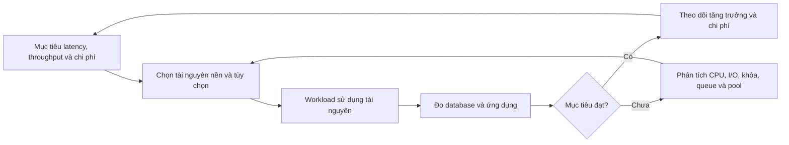

# Autoscaling compute, storage và quản lý mức sử dụng

Một API Java có thể cần ít tài nguyên trong phần lớn thời gian nhưng tăng tải mạnh khi có chương trình bán hàng. Cũng có hệ thống mà tải xử lý giảm sau mỗi đợt, trong khi dữ liệu và chi phí lưu trữ tiếp tục tăng. Hai tình huống này cần hai cách quản lý khác nhau.

Trong Autonomous Database, compute auto scaling hỗ trợ nhu cầu xử lý tăng, còn storage auto scaling hỗ trợ mở rộng không gian lưu trữ. Người vận hành vẫn phải chọn tài nguyên nền, xác định giới hạn, theo dõi chất lượng phục vụ và đối chiếu chi phí.

Bài học tập trung vào **Autonomous Database Serverless trên OCI, mô hình ECPU**, với ví dụ workload Transaction Processing. Không áp nguyên các con số và quy trình trong bài cho Dedicated, elastic pool, Always Free hoặc Developer. ECPU là đơn vị tài nguyên trừu tượng của dịch vụ; không quy đổi trực tiếp ECPU thành một vCPU của Compute. [Oracle: Compute Models](https://docs.oracle.com/en-us/iaas/autonomous-database-serverless/doc/autonomous-compute-models.html).

Sau bài học, người học cần có khả năng:

- Phân biệt điều chỉnh tài nguyên nền với bật auto scaling.
- Đọc đúng compute, storage used, allocated và maximum.
- Cấu hình hai loại auto scaling và đánh giá tác động khi tắt hoặc giảm tài nguyên.
- Kết hợp metric database, số liệu ứng dụng Java và báo cáo chi phí.
- Thiết kế một phép thử tăng tải có giới hạn và một phương án xử lý khi tới gần trần tài nguyên.

Các hành vi dịch vụ được đối chiếu với tài liệu Oracle ngày **20/11/2026**. Trước khi thay đổi, kiểm tra đúng workload, deployment, phiên bản, license và các tùy chọn của tài nguyên đang dùng.

## 1. Ba quyết định khác nhau về tài nguyên

### 1.1. Tài nguyên nền

**Base compute** là số ECPU người dùng cấu hình làm mức nền cho database. **Base storage** là dung lượng lưu trữ nền đã chọn.

Hai giá trị này là quyết định cấu hình. Một lượng request tăng lên không có nghĩa cấu hình nền đã được tự sửa thành giá trị lớn hơn.

Ví dụ minh họa:

| Thuộc tính | Cấu hình giả định |
| --- | --- |
| Deployment | Serverless |
| Workload | Transaction Processing |
| Compute model | ECPU |
| Base compute | 8 ECPU |
| Compute auto scaling | Bật |
| Base storage | 200 GB |
| Storage auto scaling | Bật |

Cần ghi cả giá trị và đơn vị. “200 storage” là thông tin chưa đủ để đối chiếu tài nguyên hoặc tính chi phí.

### 1.2. Điều chỉnh thủ công và auto scaling

| Cơ chế | Quyết định được thực hiện |
| --- | --- |
| Scale compute thủ công | Đổi số ECPU nền |
| Compute auto scaling | Cho phép dịch vụ dùng thêm compute/I/O trong phạm vi hỗ trợ khi workload cần |
| Scale storage thủ công | Đổi dung lượng nền |
| Storage auto scaling | Cho phép mở rộng storage vượt mức nền trong phạm vi hỗ trợ |
| Start/stop | Thay đổi vòng đời hoạt động của database |

Bật auto scaling không phải lịch tự dừng database. Tắt auto scaling cũng không đồng nghĩa database đã dừng.

Về quản lý, cần tách **cấu hình mong muốn**, **tài nguyên quan sát được** và **khối lượng được tính phí**. Chúng có liên hệ nhưng không phải cùng một đại lượng.

### 1.3. Vòng ra quyết định vận hành



Không nên chỉ hỏi “auto scaling đã bật chưa?”. Câu hỏi vận hành đầy đủ hơn là “cơ chế này có giúp workload đạt mục tiêu trong giới hạn chấp nhận được không?”.

## 2. Compute auto scaling: biên mở rộng và giới hạn

### 2.1. Hiểu đúng mức ba lần

Oracle mô tả compute auto scaling cho Serverless có thể sử dụng tới **ba lần CPU và I/O resources so với mức nền**, trong phạm vi điều kiện hỗ trợ. [Oracle: Add Resources or Enable Auto Scaling](https://docs.oracle.com/en-us/iaas/autonomous-database-serverless/doc/autonomous-add-resources.html).

Với cấu hình giả định 8 ECPU:

```text
Base compute:                   8 ECPU
Biên compute theo hệ số 3:      24 ECPU
```

Đây là biên cần đối chiếu với giới hạn thực tế, không phải cam kết database luôn có 24 ECPU hoặc sẽ xử lý nhanh gấp ba lần.

Khi đánh giá một cấu hình, cần đọc thêm license, giới hạn dịch vụ, loại tài nguyên và các tính năng đang sử dụng. Không dùng một hệ số duy nhất để suy ra toàn bộ khả năng mở rộng của hệ thống.

### 2.2. Không tự đặt ngưỡng kích hoạt thay cho dịch vụ

Không nên viết vào runbook rằng “CPU vượt 70% trong 2 phút thì OCI tự tăng gấp đôi” nếu không có cơ sở từ tài liệu và cơ chế áp dụng cho chính dịch vụ.

Những con số như 70% hoặc 2 phút có thể là **ngưỡng cảnh báo nội bộ** do đội vận hành lựa chọn. Chúng không tự trở thành thuật toán kích hoạt auto scaling.

Tương tự, một spike quá ngắn có thể khó đánh giá từ biểu đồ đã tổng hợp. Cần dùng cùng khoảng thời gian, cấu hình và mức tải để giải thích kết quả.

### 2.3. Thêm compute chỉ hữu ích khi xử lý đúng nút thắt

| Biểu hiện | Điều cần kiểm tra |
| --- | --- |
| CPU tăng cùng lượng SQL thực thi | SQL tốn CPU, mức song song, tài nguyên được phép dùng |
| SQL xếp hàng nhưng CPU chưa cao | Service, quy tắc đồng thời và loại workload |
| Nhiều transaction chờ khóa | Phạm vi transaction và dữ liệu bị tranh chấp |
| API chờ nhưng database ít hoạt động | Connection pool, mạng, ứng dụng hoặc dịch vụ bên ngoài |
| Batch đọc rất nhiều dữ liệu | Execution plan, I/O, cách lọc và lượng dữ liệu thực sự cần |
| Throughput không tăng khi tăng tải | Điểm bão hòa của toàn luồng, không chỉ database |

Ví dụ, hai transaction cùng sửa một bản ghi tồn kho có thể chờ nhau dù còn CPU. Tăng tài nguyên không loại bỏ quan hệ khóa đó.

Đội Java cần đo thời gian **chờ mượn connection**, **thực thi SQL**, **commit** và **xử lý ngoài database**. Nếu chỉ đo tổng thời gian HTTP request, rất khó biết phần nào được lợi từ auto scaling.

## 3. Storage: đọc đúng không gian và giới hạn

### 3.1. Bốn đại lượng cần ghi riêng

| Đại lượng | Ý nghĩa |
| --- | --- |
| Reserved base storage | Dung lượng nền người dùng cấu hình |
| Used storage | Không gian đang được sử dụng trong các tablespace |
| Allocated storage | Không gian đã cấp cho các tablespace, gồm phần còn trống bên trong |
| Maximum storage | Biên storage được cấu hình cho phép |

Khi storage auto scaling bật, biên thông thường là ba lần base storage, còn chịu giới hạn dịch vụ; tài liệu hiện nêu mốc thông thường tối đa 384 TB và có luồng yêu cầu hỗ trợ cho nhu cầu lớn hơn. [Oracle: Storage Auto Scaling and Allocation](https://docs.oracle.com/en-us/iaas/autonomous-database-serverless/doc/autonomous-auto-scale.html).

Phải dùng cùng đơn vị khi tính toán. Không trộn GB trên metric với TB trên Console mà bỏ qua quy ước chuyển đổi.

### 3.2. Một ví dụ giúp tránh đọc nhầm phần trăm

Giả sử database thực hành có:

| Giá trị | Dung lượng |
| --- | ---: |
| Base | 200 GB |
| Maximum | 600 GB |
| Allocated | 420 GB |
| Used | 260 GB |

Từ bộ số liệu giả định đó:

```text
Allocated / Maximum = 420 / 600 = 70%
Used / Maximum      = 260 / 600 ≈ 43,3%
Maximum - Allocated = 180 GB
Allocated - Used    = 160 GB
```

Bốn kết quả trả lời bốn câu hỏi khác nhau. “Đã dùng khoảng 43% maximum” không phủ nhận việc không gian cấp phát đã đạt 70% maximum.

Phần trống trong allocated và phần còn có thể cấp phát thêm cần được phân biệt. Cũng không nên coi toàn bộ hiệu số là dung lượng nghiệp vụ được bảo đảm, vì còn các thành phần hệ thống và cách phân bổ không gian.

### 3.3. Xóa dữ liệu chưa có nghĩa allocated giảm

DELETE, DROP, thu hồi không gian bên trong segment, shrink và giảm storage nền là những hoạt động khác nhau. Một thao tác nghiệp vụ xóa dữ liệu không chứng minh phần không gian đã cấp phát đã được trả lại.

Autonomous quản lý tablespace và vị trí đối tượng. Cần kiểm tra cả mức sử dụng từng tablespace khi gặp lỗi tăng trưởng, vì tổng dung lượng còn trống chưa chắc giải thích đầy đủ một tablespace đã đầy. [Oracle: Manage Tablespaces](https://docs.oracle.com/en-us/iaas/autonomous-database-serverless/doc/autonomous-database-tablespace-mgmt.html).

Ví dụ sau khi xóa dữ liệu, used giảm từ 260 GB xuống 120 GB nhưng allocated vẫn 420 GB. Đây là tình huống cần kiểm tra phân bổ không gian và cơ chế thu hồi; không nên tiếp tục xóa dữ liệu chỉ vì hóa đơn chưa giảm như dự đoán.

### 3.4. Shrink là một thao tác có điều kiện

Oracle cung cấp Shrink để giảm allocated storage khi đủ điều kiện. Thao tác có giới hạn về cấu hình, mức không gian có thể thu hồi và loại đối tượng; nó có thể dùng CPU và ảnh hưởng workload. Đọc đầy đủ điều kiện trước khi chọn thao tác. [Oracle: Shrink Storage](https://docs.oracle.com/en-us/iaas/autonomous-database-serverless/doc/autonomous-auto-scale.html).

Không giả định mọi database nhỏ, mọi loại index hoặc mọi lượng dữ liệu vừa xóa đều đáp ứng điều kiện shrink.

Một kế hoạch thu hồi nên ghi:

1. Used, allocated, base và maximum trước thay đổi.
2. Đối tượng hoặc dữ liệu đã được xử lý theo chính sách.
3. Điều kiện của thao tác thu hồi đang áp dụng.
4. Khoảng vận hành và tiêu chí dừng.
5. Dung lượng, hiệu năng và chi phí sau khi số liệu cập nhật.

## 4. Theo dõi mức sử dụng bằng đúng bằng chứng

### 4.1. Bộ metric tối thiểu

Serverless sử dụng namespace `oci_autonomous_database`. Các metric cần đọc đúng nghĩa gồm:

| Metric | Nội dung chính |
| --- | --- |
| `CpuUtilization` | Tỷ lệ CPU so với năng lực database được phép dùng |
| `QueuedStatements` | SQL đang xếp hàng |
| `SessionUtilization` | Mức sử dụng session |
| `StorageUsed`, `StorageAllocated`, `StorageMax` | Các đại lượng không gian tương ứng |
| `StorageUtilization` | Tỷ lệ maximum storage đã được cấp cho tablespace |
| `ECPUsAllocated` | Tổng ECPU được tính phí cho database, gồm local standby và database tools nếu có |

Lọc đúng dimension `RESOURCEID`. Alarm interval hợp lệ từ 5 phút trở lên; nhiều metric storage được phát theo giờ. [Oracle: Available Metrics](https://docs.oracle.com/en-us/iaas/autonomous-database-serverless/doc/autonomous-monitor-metrics-list.html).

### 4.2. Không dùng một metric cho mọi kết luận

Với `ECPUsAllocated`, cần xác định các thành phần đang được tính vào số liệu trước khi đối chiếu với compute nền của database chính. Ví dụ, giá trị lớn hơn một biên dự kiến có thể cần kiểm tra standby hoặc tools.

Không cộng các mẫu của một mức tài nguyên như cộng các sự kiện độc lập để suy ra ECPU-hour. Cần hiểu statistic, interval, đơn vị và phương pháp đo; khi đối soát thanh toán, dùng thêm báo cáo chi phí.

Với CPU%, hãy ghi cả cấu hình được phép dùng. Nếu mẫu số thay đổi khi điều chỉnh tài nguyên, cùng một phần trăm có thể đại diện mức tiêu thụ khác nhau.

Với storage, dùng bộ số liệu ở cùng thời điểm. Không lấy used lúc sáng, allocated lúc trưa và maximum sau một thay đổi buổi chiều rồi coi đó là một snapshot nhất quán.

### 4.3. Đọc metric database cạnh metric ứng dụng

Một dashboard cho ứng dụng Java nên đặt cạnh nhau:

- Request/giây và công việc nghiệp vụ hoàn tất/giây.
- p50, p95, p99 latency và tỷ lệ lỗi.
- Số connection đang dùng, chờ pool và thời gian chờ.
- SQL xếp hàng, session và mức sử dụng CPU.
- Used, allocated, maximum và tốc độ tăng dung lượng.
- Các lần đổi cấu hình, triển khai ứng dụng và tác vụ batch.

Một phương án scale chỉ được coi là cải thiện khi kết quả cần đạt được cải thiện. Tài nguyên được dùng nhiều hơn nhưng throughput không tăng, latency không giảm hoặc lỗi tăng là dấu hiệu cần xem lại.

## 5. Cấu hình qua Console và CLI

### 5.1. Kiểm kê trước khi thay đổi

Ghi region, compartment, database OCID, workload, compute model, license, pool nếu có, tài nguyên nền và trạng thái hai tùy chọn.

Ví dụ Bash dưới đây chỉ đọc metadata. OCI CLI cần được cấu hình thông tin xác thực và quyền xem tài nguyên:

```bash
ADB_OCID='THAY_BANG_AUTONOMOUS_DATABASE_OCID'
OCI_REGION='THAY_BANG_REGION_IDENTIFIER'

oci db autonomous-database get \
  --autonomous-database-id "$ADB_OCID" \
  --region "$OCI_REGION" \
  --output json
```

Tham chiếu: [Oracle CLI: autonomous-database get](https://docs.oracle.com/en-us/iaas/tools/oci-cli/latest/oci_cli_docs/cmdref/db/autonomous-database/get.html).

Đối chiếu kết quả với Console. Nếu một thuộc tính không xuất hiện hoặc có giá trị null, xác minh bằng giao diện/API tương ứng; không tự diễn giải thành 0 hay false.

### 5.2. Luồng Console

Từ trang chi tiết database, mở **Manage resource allocation**, xem compute, storage và hai tùy chọn auto scaling. Chọn thay đổi cần thực hiện, áp dụng rồi theo dõi trạng thái tới khi hoàn tất. Oracle mô tả trạng thái chuyển qua Scaling in Progress và trở về Available. [Oracle: Manage Resource Allocation](https://docs.oracle.com/en-us/iaas/autonomous-database-serverless/doc/autonomous-add-resources.html).

Một lần thay đổi nên có mục tiêu đo được, chẳng hạn giảm thời gian batch hoặc tăng khoảng dung lượng còn có thể cấp phát. Tránh vừa đổi service, tăng ECPU, sửa SQL và bật storage auto scaling trong cùng một phép so sánh.

### 5.3. Hai cờ CLI là độc lập

Các lệnh sau **thay đổi cấu hình**, dành cho tài nguyên lab đã xác định đúng OCID và phạm vi. Chúng minh họa việc bật từng tùy chọn, không phải lệnh đã được chạy trên tài nguyên của người học:

```bash
# Bật compute auto scaling.
oci db autonomous-database update \
  --autonomous-database-id "$ADB_OCID" \
  --region "$OCI_REGION" \
  --is-auto-scaling-enabled true

# Sau khi thao tác trước hoàn tất, bật storage auto scaling nếu cần.
oci db autonomous-database update \
  --autonomous-database-id "$ADB_OCID" \
  --region "$OCI_REGION" \
  --is-auto-scaling-for-storage-enabled true
```

Cú pháp hai cờ được mô tả trong [Oracle CLI: autonomous-database update](https://docs.oracle.com/en-us/iaas/tools/oci-cli/latest/oci_cli_docs/cmdref/db/autonomous-database/update.html).

Sau mỗi thay đổi, đọc lại metadata, xác nhận trạng thái hoàn tất và kiểm tra ứng dụng. Việc API tiếp nhận yêu cầu chưa chứng minh workload đã đạt mục tiêu.

### 5.4. IAM cho người xem và người thay đổi

Oracle phân biệt quyền xem với quyền quản lý tài nguyên. Tài liệu IAM liệt kê việc bật/tắt auto scaling và thay đổi compute/storage dưới phạm vi quyền `use autonomous-databases`; cần xét thêm điều kiện policy thực tế. [Oracle: Autonomous Database IAM Policies](https://docs.oracle.com/en-us/iaas/autonomous-database-serverless/doc/autonomous-database-iam-policies.html).

Nên tách nhóm chỉ quan sát với nhóm được điều chỉnh tài nguyên. Giới hạn phạm vi theo compartment và nhiệm vụ. Quyền này ở tầng tài nguyên OCI, không thay thế quyền SQL bên trong database.

## 6. Tắt auto scaling hoặc scale down có tác động gì?

### 6.1. Compute đang dùng vượt nền

Khi tắt compute auto scaling lúc mức CPU dùng vượt nền, dịch vụ đưa mức sử dụng về compute nền. Khi tắt storage auto scaling mà used vượt base, giao diện có thể yêu cầu nâng base theo mức phù hợp của workload. [Oracle: Disable Auto Scaling](https://docs.oracle.com/en-us/iaas/autonomous-database-serverless/doc/autonomous-remove-resources.html).

Vì vậy, “tắt để tiết kiệm” cần đi kèm kiểm tra nhu cầu tải hiện tại. Nếu workload thường xuyên cần hơn mức nền, tắt compute auto scaling có thể chuyển chi phí thành queue, latency hoặc thời gian batch kéo dài.

Tắt storage auto scaling cũng không có nghĩa phần dữ liệu đang tồn tại bị loại bỏ hoặc dung lượng nền tự trở lại giá trị cũ.

### 6.2. Giảm tài nguyên cần kiểm tra ứng dụng

Tài liệu ECPU lưu ý việc giảm compute đáng kể, ví dụ từ 30% trở lên, có thể gây rớt kết nối, ngắt session hoặc hủy và rollback công việc chưa hoàn tất. [Oracle: ECPU Scale-Down Considerations](https://docs.oracle.com/en-us/iaas/autonomous-database-serverless/doc/autonomous-compute-models.html).

Cần đánh giá mức giảm, công việc đang chạy, connection pool và khả năng xử lý giao dịch không rõ kết quả. Không lấy việc một lần scale up thuận lợi để suy rằng mọi scale down cũng có cùng tác động.

Với Java, cần trả connection về pool sau một đơn vị công việc, kiểm tra cấu hình driver/pool và thiết kế retry theo ranh giới transaction. Retry một thao tác ghi phải xét idempotency và khả năng giao dịch đã commit.

### 6.3. Pool là mô hình khác

Elastic pool có cơ chế chia sẻ và tính phí riêng. Tài liệu Serverless yêu cầu compute auto scaling tắt khi gia nhập elastic pool; dedicated elastic pool còn có điều kiện riêng về cả compute và storage auto scaling. [Oracle: Elastic Pool Operations](https://docs.oracle.com/en-us/iaas/autonomous-database-serverless/doc/elastic-pools-create-manage.html), [Oracle: Dedicated Elastic Pools](https://docs.oracle.com/en-us/iaas/autonomous-database-serverless/doc/dedicated-elastic-pools.html).

Nếu tài nguyên thuộc pool, phân tích ở cả cấp database và pool. Không dùng mô hình “một database có biên ba lần độc lập” cho mọi thành viên mà bỏ qua năng lực dùng chung.

## 7. Hiểu cách tính mức sử dụng và chi phí

### 7.1. Compute nền vẫn là mức tối thiểu khi database chạy

Với ECPU, Oracle mô tả mức tính phí khi chạy gồm compute nền và phần dùng thêm do auto scaling. Mức dùng được đo theo giây, tổng hợp theo giờ, với thời gian sử dụng tối thiểu một phút. [Oracle: Compute Auto Scaling Billing](https://docs.oracle.com/en-us/iaas/autonomous-database-serverless/doc/autonomous-features-billing.html).

Không suy rằng CPU nhàn rỗi thì database đang chạy sẽ được tính như 0 ECPU. Auto scaling giúp sử dụng thêm tài nguyên khi cần; lựa chọn base vẫn ảnh hưởng chi phí thường xuyên.

### 7.2. Ví dụ tính tài nguyên theo thời gian

Giả sử database có base 8 ECPU, auto scaling bật và chạy trọn một giờ. Bỏ qua các thành phần khác, giả định mức compute dùng để tính phí trong giờ đó như sau:

| Khoảng thời gian | Mức compute giả định | Phần thời gian |
| --- | ---: | ---: |
| 45 phút đầu | 8 ECPU | 0,75 giờ |
| 15 phút sau | 20 ECPU | 0,25 giờ |

```text
Compute trong giờ = 8 × 0,75 + 20 × 0,25
                  = 6 + 5
                  = 11 ECPU-hour
```

Nếu đơn giá áp dụng là P cho một ECPU-hour, thành phần compute của ví dụ là **11 × P**. Đây là phép tính minh họa từ mức sử dụng giả định, không phải kết quả đo hoặc báo giá.

So với cấu hình 24 ECPU nền chạy đủ giờ, khối lượng compute của ví dụ thấp hơn. Nhưng phép so sánh chi phí chỉ có ý nghĩa khi cả hai phương án đều đáp ứng cùng workload và mục tiêu phục vụ.

Ngược lại, nếu liên tục cần mức gần 24 ECPU, cần đánh giá lại lựa chọn base, cơ chế auto scaling và hiệu quả SQL. Không có một tỷ lệ sử dụng nào tự động quyết định phương án tối ưu cho mọi hệ thống.

### 7.3. Storage được tính theo dung lượng phù hợp của dịch vụ

Tài liệu mô tả phần storage trong mức nền được tính theo base; khi allocated vượt base với auto scaling, mức storage được tính theo dung lượng cấp phát và quy tắc làm tròn của workload. [Oracle: Storage Auto Scaling Billing](https://docs.oracle.com/en-us/iaas/autonomous-database-serverless/doc/autonomous-features-billing.html).

Trong ECPU, tài liệu billing phân biệt đơn vị tính của Lakehouse với Transaction Processing/JSON/APEX; backup storage cũng là thành phần cần xét riêng. [Oracle: Billing Summary](https://docs.oracle.com/en-us/iaas/autonomous-database-serverless/doc/autonomous-database-billing-overview.html).

Với bộ số liệu giả định base 200 GB, allocated 420 GB và used 260 GB:

- Dùng used 260 GB làm toàn bộ cơ sở dự toán storage có thể bỏ sót không gian đã cấp phát.
- Dùng maximum 600 GB làm toàn bộ mức storage đang tính phí cũng có thể sai.
- Sau khi used giảm, cần đọc lại allocated và số liệu tính phí trước khi kết luận đã tiết kiệm.

Tách rõ **biên dung lượng cho phép**, **dung lượng được cấp phát** và **lượng thực tế được ghi nhận để thanh toán**.

### 7.4. Những thành phần nằm ngoài compute chính

Một dự toán cần kiểm tra thêm:

| Thành phần | Câu hỏi đối chiếu |
| --- | --- |
| Backup storage | Retention và số bản đang giữ làm thay đổi dung lượng thế nào? |
| Local/cross-region peer | Kiến trúc phục hồi đang tạo tài nguyên nào? |
| Clone | Clone phục vụ việc gì, tồn tại tới khi nào? |
| Database tools | Có compute riêng đang hoạt động không? |
| Tính năng khác | Có cấu hình làm phát sinh SKU hoặc tài nguyên bổ sung không? |

Một số database tools trong mô hình ECPU có phân bổ compute riêng, độc lập compute chính và auto scaling của database. [Oracle: Database Tools Billing](https://docs.oracle.com/en/cloud/paas/autonomous-database/serverless/adbsb/autonomous-tools-billing.html).

Do đó, phép tính 3 × base compute không phải trần chi phí tổng của mọi thành phần gắn với database.

### 7.5. Đối soát bằng báo cáo

Khi đối chiếu chi phí, cần nhóm đúng tài nguyên, thời gian, SKU, đơn vị và license. Tài liệu ECPU hướng dẫn dùng Cost and Usage Reports, với các trường định danh tài nguyên và lượng được tính phí. [Oracle: ECPU Cost and Usage Information](https://docs.oracle.com/en-us/iaas/autonomous-database-serverless/doc/autonomous-compute-models.html).

Không lấy tổng số tiền của một compartment có nhiều database để kết luận auto scaling của một database tăng bất thường. Cũng không đối chiếu trực tiếp một mẫu metric 5 phút với một tổng chi phí theo ngày mà bỏ qua thời gian, đơn vị và các thành phần liên quan.

## 8. Dự báo dung lượng và đặt cảnh báo

### 8.1. Theo dõi khoảng dung lượng còn có thể cấp phát

Một chỉ số lập kế hoạch đơn giản:

```text
Khoảng còn có thể cấp phát ≈ Maximum - Allocated

Thời gian tới biên ≈
    (Maximum - Allocated) / Tốc độ tăng Allocated
```

Ví dụ giả định:

```text
Maximum:                  600 GB
Allocated:                420 GB
Tốc độ tăng Allocated:      30 GB/ngày

Khoảng còn lại:            180 GB
Thời gian dự kiến:           6 ngày
```

Đây là dự báo tuyến tính để lên kế hoạch. Nó không bảo đảm hệ thống còn ghi được đúng sáu ngày: batch, index, dữ liệu tạm và biến động workload có thể làm tốc độ khác.

Dùng nhiều khoảng quan sát để phân biệt tăng đều với cấp phát theo bước. Nếu tốc độ bằng 0 hoặc âm, không dùng công thức chia rồi coi kết quả là một cam kết vô thời hạn.

### 8.2. Kết hợp mức sử dụng và tốc độ tăng

Một cảnh báo dung lượng nên cân nhắc cả hai câu hỏi:

- Tỷ lệ cấp phát đã cao tới mức nào?
- Với tốc độ tăng hiện tại, còn bao lâu để xử lý trước khi chạm biên?

Ví dụ, allocated ở mức 75% nhưng sắp có một đợt nạp dữ liệu lớn có thể cần hành động sớm hơn mức 85% đang ổn định nhiều tháng.

Các con số 75% hoặc 85% là ngưỡng thiết kế minh họa. Chọn ngưỡng theo thời gian cần để điều tra, thay đổi cấu hình hoặc xử lý dữ liệu.

### 8.3. Bảng cảnh báo có hành động

| Tín hiệu | Điều tra đầu tiên | Hướng xử lý có thể đánh giá |
| --- | --- | --- |
| CPU cao cùng queue kéo dài | SQL, service, tải và giới hạn compute | Tối ưu workload hoặc điều chỉnh tài nguyên |
| Session gần giới hạn | Replica ứng dụng, pool và connection giữ lâu | Giảm tranh chấp tài nguyên, sửa vòng đời connection |
| Allocated gần maximum | Tốc độ tăng, batch và phân bổ tablespace | Tăng khả năng chứa hoặc xử lý dữ liệu theo chính sách |
| Used giảm nhưng allocated không giảm | Không gian còn giữ và điều kiện thu hồi | Lập kế hoạch shrink/scale down nếu phù hợp |
| ECPU tính phí tăng khó giải thích | Compute chính, peer, tools và thời gian | Đối chiếu báo cáo theo thành phần |
| Không có metric mới | Nhịp phát dữ liệu, query và quyền quan sát | Khôi phục đường quan sát trước khi kết luận |

Mỗi cảnh báo cần có OCID, khoảng thời gian, ngưỡng, người nhận và bước xử lý đầu tiên. Theo dõi cả việc chuyển thông báo tới đúng người.

### 8.4. Budget là ngưỡng mềm

OCI Budgets dùng để đặt ngưỡng chi tiêu mềm và cảnh báo theo mức chi thực tế hoặc dự báo. Tài liệu hiện nêu budget alert được đánh giá định kỳ mỗi 24 giờ. [Oracle: Budgets](https://docs.oracle.com/en-us/iaas/Content/Billing/Concepts/budgetsoverview.htm).

Vì vậy, không dùng budget alert như một bộ ngắt tức thời cho một spike compute vài phút.

Thiết kế kiểm soát nên phối hợp:

- Phân quyền thay đổi tài nguyên.
- Cấu hình nền và các giới hạn được dịch vụ hỗ trợ.
- Alarm vận hành về tài nguyên và chất lượng phục vụ.
- Budget và báo cáo chi phí.
- Chủ sở hữu workload, lịch xem xét và hành động khi vượt dự toán.

## 9. Kiểm tra tablespace khi còn dung lượng nhưng ghi vẫn lỗi

Tổng storage còn khoảng trống không loại trừ trường hợp một tablespace chạm giới hạn. Trên tài khoản có quyền quan sát phù hợp, có thể dùng truy vấn được Oracle đưa ra:

```sql
SELECT tablespace_name,
       used_percent
FROM dba_tablespace_usage_metrics
WHERE tablespace_name LIKE 'DATA%';
```

Oracle mô tả việc kiểm tra phân bố tablespace và các cách quản lý đối tượng tương ứng trong [hướng dẫn tablespace của Autonomous Database](https://docs.oracle.com/en-us/iaas/autonomous-database-serverless/doc/autonomous-database-tablespace-mgmt.html).

Nếu thiếu quyền đọc view, ghi lại giới hạn quan sát và dùng tài khoản quản trị được phân công. Không cấp quyền rộng cho tài khoản ứng dụng chỉ để đọc một chỉ số vận hành.

Một quy trình điều tra nên đi từ tổng thể tới phạm vi lỗi:

1. Xác nhận database, thời điểm và thông báo lỗi.
2. Đọc base, maximum, allocated và used.
3. Kiểm tra các tablespace liên quan.
4. Xác định bảng, index hoặc công việc đang tăng dung lượng.
5. Chọn biện pháp dựa trên phạm vi đã xác định.

Không chạy hàng loạt MOVE, rebuild hoặc purge khi chưa biết đối tượng nào gây áp lực. Các thao tác đó có thể tiêu thụ tài nguyên và thay đổi điều kiện đang cần điều tra.

## 10. Thực hành có kiểm soát

### 10.1. Chuẩn bị mục tiêu và phạm vi

Dùng database lab hỗ trợ các tùy chọn cần thử, client có đường mạng phù hợp và workload không chứa dữ liệu nhạy cảm. Trước khi bắt đầu, ghi:

| Nội dung | Ví dụ mục tiêu giả định |
| --- | --- |
| Workload | API đọc/ghi đơn hàng thử nghiệm |
| Chất lượng phục vụ | p95 dưới 300 ms ở mức tải đã xác định |
| Thời lượng | Một khung thử có thời điểm kết thúc |
| Mức song song | Các bước tăng đã giới hạn trước |
| Dữ liệu | Bộ dữ liệu có kích thước và phân bố được ghi lại |
| Chi phí | Mức sử dụng tối đa được chấp nhận cho bài thử |
| Dừng thử | Vượt ngưỡng lỗi, latency, dung lượng hoặc thời gian |

300 ms là mục tiêu minh họa, không phải đặc tính mặc định hay cam kết của OCI.

Đặt đủ thời gian quan sát theo nhịp metric. Một bài thử vài chục giây không thể tạo bằng chứng đầy đủ từ các metric storage phát theo giờ.

### 10.2. Giai đoạn A — Baseline

1. Đọc metadata bằng CLI và chụp cấu hình cần thiết.
2. Xác nhận đúng JDBC service, schema và số replica Java.
3. Ghi kích thước pool, cách timeout và ranh giới transaction.
4. Chạy workload ở mức thấp ổn định.
5. Thu số công việc hoàn tất, latency, lỗi và các metric liên quan.

Tách các kiểu công việc nếu có thể. Một batch dài và API giao dịch ngắn có thể làm biểu đồ tổng che mất sự khác biệt.

### 10.3. Giai đoạn B — Tăng tải từng bước

Giữ dữ liệu và service ổn định, tăng concurrency theo các mức đã định. Với mỗi mức, ghi thời gian đủ để quan sát trạng thái tương đối ổn định.

Cần trả lời:

- Throughput có tăng theo tải đưa vào không?
- Queue ở database hay thời gian chờ pool tăng trước?
- CPU và lượng compute liên quan thay đổi thế nào?
- Có giao dịch lỗi hoặc xử lý lặp không?
- Mức dùng thêm có nằm trong phạm vi đã dự kiến không?

Không cố tạo một giá trị autoscale chính xác bằng cách đoán số thread. Mục tiêu là quan sát phản ứng của workload và dịch vụ, không ép một biểu đồ khớp kỳ vọng.

### 10.4. Giai đoạn C — Giảm tải

Giảm tải về baseline và theo dõi tiếp. Phân biệt phần compute dùng thêm với base compute còn cấu hình.

Với storage, kiểm tra riêng sau khi dọn dữ liệu lab theo kế hoạch. Không dùng hành vi giảm compute để dự đoán allocated storage cũng sẽ tự giảm cùng cách.

Nếu cần đánh giá shrink hoặc scale down, lập một phần thử riêng sau khi xác nhận điều kiện hỗ trợ và tác động. Các thao tác này không phải bước dọn dữ liệu mặc định của mọi cuộc thử.

### 10.5. Giai đoạn D — Đối soát và khôi phục cấu hình

Đọc lại metadata, xác nhận chính xác các giá trị đã chọn và đo ứng dụng sau thay đổi cuối cùng. Cấu hình sau thử phải được ghi rõ, kể cả trường hợp storage nền đã thay đổi nên không quay về nguyên trạng bằng một thao tác đơn giản.

Đối chiếu số liệu chi phí khi báo cáo đã cập nhật. Ghi thời gian môi trường thử còn tồn tại, các clone hoặc tool đang chạy và người chịu trách nhiệm thu hồi.

### 10.6. Mẫu biên bản

| Nhóm | Thông tin cần lưu |
| --- | --- |
| Nhận diện | OCID, region, compartment, workload và phiên bản |
| Cấu hình | Base, hai cờ auto scaling, pool nếu có, service và license |
| Tải | Thời gian, dữ liệu, số client và mức song song |
| Kết quả | Throughput, p95/p99, lỗi, pool, queue và CPU |
| Storage | Used, allocated, maximum và thời điểm lấy số liệu |
| Chi phí | Đơn vị, thời gian, SKU và các thành phần liên quan |
| Kết luận | Mục tiêu đạt hay chưa, bằng chứng và giới hạn |

Bài học cung cấp quy trình và ví dụ; chúng không phải bằng chứng đã chạy thử trên một database OCI cụ thể.

## 11. Tình huống phân tích: API bán hàng và batch cuối ngày

Giả sử hệ thống có compute nền 8 ECPU, storage nền 200 GB và hai loại auto scaling bật. API giao dịch chạy suốt ngày; cuối ngày có batch nạp dữ liệu và tổng hợp doanh thu.

### Tình huống A — API chậm nhưng CPU thấp

Quan sát giả định:

- Thời gian chờ connection pool Java tăng.
- Pool thường xuyên hết connection rảnh.
- CPU database chưa cao.
- Một số request giữ connection trong khi chờ gọi hệ thống thanh toán.

Hướng phân tích là kiểm tra vòng đời connection và transaction. Bật thêm tài nguyên database hoặc tăng pool ngay có thể làm nhiều request cùng giữ tài nguyên hơn mà chưa xử lý nguyên nhân.

Sau khi thay đổi ứng dụng, cần so sánh thời gian chờ pool, thời gian giữ connection và tỷ lệ giao dịch đúng, thay vì chỉ xem CPU.

### Tình huống B — Batch làm dữ liệu tăng mạnh

Sau nhiều đợt nạp, số liệu giả định là:

```text
Base:       200 GB
Maximum:    600 GB
Allocated:  420 GB
Used:       260 GB
```

Đội vận hành cần kiểm tra dữ liệu tạm, lịch sử cần giữ, index và xu hướng tăng. Nếu tốc độ allocated tăng nhanh, phải xử lý trước khi chạm biên; không chờ used bằng maximum mới hành động.

Nếu dọn dữ liệu làm used giảm nhưng allocated giữ nguyên, bước tiếp theo là đánh giá thu hồi không gian và cách tính phí. Không coi việc xóa thêm dữ liệu là đáp án mặc định.

### Tình huống C — Muốn tắt autoscaling để khóa chi phí

Trước khi thay đổi, cần xác định:

1. Mức tải hiện tại có chạy được với base không?
2. Batch có yêu cầu thời gian hoàn tất hay cửa sổ nghiệp vụ nào?
3. Storage đã vượt base chưa?
4. Có cảnh báo về base mới khi tắt storage auto scaling không?
5. Connection pool và giao dịch có chịu được tác động của giảm tài nguyên không?
6. Các thành phần ngoài compute chính còn phát sinh chi phí gì?

Một phương án có thể là sửa workload, điều chỉnh lịch batch và chọn lại base theo số liệu. Kết luận cuối cùng phải bao gồm cả chi phí và chất lượng phục vụ đã đo.

## 12. Tự động hóa thay đổi cấu hình mà vẫn kiểm soát được

Cơ chế autoscaling của dịch vụ và một chương trình tự gọi API để đổi base là hai vòng điều khiển khác nhau. Nếu có thêm chương trình bên ngoài, cần tránh việc chúng phản ứng với cùng một tín hiệu theo cách khó dự đoán.

Một luồng quản lý cấu hình nên có:

- Một nguồn cấu hình mong muốn rõ ràng.
- Đọc trạng thái hiện tại trước khi gửi yêu cầu.
- Bỏ qua nếu cấu hình đã khớp.
- Theo dõi thao tác đang chạy để tránh yêu cầu trùng.
- Khoảng chờ và điều kiện đánh giá lại.
- Nhật ký thay đổi, chủ sở hữu và phương án xử lý khi mục tiêu không đạt.

Ví dụ, không tăng ECPU nền liên tục chỉ vì metric của một khoảng cũ vẫn cao trong lúc thao tác trước chưa hoàn tất. Cũng không giảm mạnh tài nguyên chỉ vì một mẫu tức thời thấp giữa hai đợt batch.

Khi biểu diễn cấu hình bằng IaC hoặc script, giữ compute nền, storage nền và hai cờ auto scaling như những thuộc tính riêng. Không gộp mọi ý nghĩa vào một nhãn “autoscaling on”.

## 13. Bài tập vận dụng

Cho một Autonomous Database Serverless Transaction Processing dùng ECPU, phục vụ ứng dụng Java. Tải thường ngày thấp, có hai giờ cao điểm và một batch tăng dữ liệu mỗi đêm.

Thực hiện các phần sau:

1. Kiểm kê cấu hình, license, deployment và các giới hạn liên quan.
2. Chọn base compute và giải thích dữ liệu cần có để bảo vệ lựa chọn đó.
3. Tính biên danh nghĩa khi bật compute auto scaling; nêu điều kiện phải kiểm tra thêm.
4. Giải thích used, allocated, maximum từ một bộ số liệu cùng thời điểm.
5. Dự báo thời gian gần chạm biên từ tốc độ tăng allocated và nêu giới hạn của dự báo.
6. Thiết kế cảnh báo về CPU/queue, session, storage và chi phí.
7. Tính ECPU-hour cho một đường sử dụng giả định, tách các thành phần ngoài compute chính.
8. Lập phép thử baseline, tăng tải và giảm tải có tiêu chí dừng.
9. Mô tả tác động khi tắt hai loại auto scaling và khi giảm ECPU đáng kể.
10. Đề xuất cách quản lý IAM, cấu hình sau thử và đối soát báo cáo chi phí.

Kết quả cần phân biệt rõ **giới hạn cấu hình**, **mức sử dụng đã quan sát**, **khối lượng được tính phí** và **mức đáp ứng nghiệp vụ**. Chỉ kết luận phương án phù hợp khi những bằng chứng này được đặt trong cùng phạm vi và thời gian.
