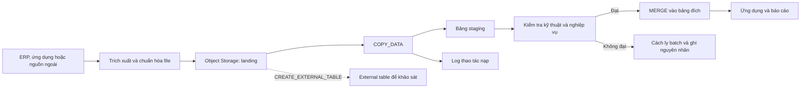

# Nạp dữ liệu từ Object Storage và nguồn bên ngoài

Trong chương Autonomous Database của module Oracle Cloud Infrastructure (OCI), nạp dữ liệu là điểm nối giữa lưu trữ, IAM, mạng và cơ sở dữ liệu. Một lệnh chạy thành công mới xác nhận được một phần công việc: hệ thống còn phải chứng minh đã lấy đúng nguồn, nạp đủ dữ liệu, xử lý được bản ghi lỗi và chạy lại mà không làm sai kết quả.

Bài học sử dụng Autonomous Database Serverless làm môi trường tham chiếu. Các ví dụ tập trung vào một luồng batch từ OCI Object Storage, sau đó mở rộng sang cloud storage khác, cơ sở dữ liệu từ xa và API. Với loại triển khai khác, cần đối chiếu khả năng hỗ trợ, quyền và cấu hình mạng tương ứng trước khi áp dụng.

Sau bài học, người học có thể:

- Chọn giữa sao chép dữ liệu vào bảng, truy vấn bằng external table và nhập dữ liệu bằng Data Pump.
- Thiết kế quyền truy cập bucket cho Autonomous Database và schema thực hiện nạp.
- Thực hiện một đợt nạp CSV bằng `DBMS_CLOUD.COPY_DATA`, đối soát và đưa dữ liệu vào bảng nghiệp vụ.
- Xây dựng phương án chạy lại, theo dõi lỗi và kiểm soát chi phí cho luồng nạp từ nguồn ngoài.

## 1. Phân biệt nạp dữ liệu và liên kết dữ liệu

**Nạp dữ liệu, hay load**, tạo bản sao dữ liệu trong một bảng của Autonomous Database. Sau khi nạp xong, truy vấn bảng này sử dụng bản sao đã lưu. Việc object nguồn thay đổi không tự cập nhật bảng đích.

**Liên kết dữ liệu, hay link**, tạo đối tượng để truy cập dữ liệu còn nằm ở nguồn, chẳng hạn external table trên Object Storage hoặc view sử dụng database link. Khi lựa chọn cách này, phải tính đến khả năng truy cập và độ ổn định của nguồn trong thời gian truy vấn. Oracle phân biệt hai thao tác này trong luồng Load và Link của Data Studio. [Load, Link, and Feed Data](https://docs.oracle.com/en/cloud/paas/autonomous-database/data-studio-guide/load-link-and-feed-data.html).

| Nhu cầu | Cách tiếp cận | Điều cần cân nhắc |
| --- | --- | --- |
| Nạp file định kỳ vào bảng báo cáo | `DBMS_CLOUD.COPY_DATA` | Cần staging, đối soát và cơ chế chống trùng |
| Khảo sát file trước khi quyết định lưu vào database | External table | Truy vấn còn phụ thuộc nguồn và định dạng file |
| Nạp thử một file trên máy cá nhân | Data Load trong Database Actions | Phù hợp thao tác tương tác; cần lưu lại cấu hình nếu chuyển thành job |
| Di chuyển schema từ Oracle Database | Oracle Data Pump Import | Cần xử lý metadata, quyền và tính tương thích của đối tượng |
| Lấy dữ liệu từ database khác | Database link hoặc công cụ tích hợp | Cần kiểm soát tải trên nguồn, mạng và mốc lấy tăng dần |
| Thu thập dữ liệu từ API có phân trang | Bộ thu thập hoặc luồng tích hợp, sau đó nạp | Cần xử lý token, giới hạn gọi, phân trang và retry |

Ví dụ, dashboard tài chính cần sử dụng dữ liệu đã chốt có thể đọc bảng nội bộ. Nhóm phân tích đang khám phá một bộ dữ liệu mới có thể bắt đầu bằng external table. Nếu mục tiêu là di chuyển cả cấu trúc schema và dữ liệu Oracle, cần đánh giá Data Pump thay vì tự chuyển mọi bảng thành CSV.

## 2. Kiến trúc của một luồng nạp có thể vận hành

Một kiến trúc batch nên tách dữ liệu nguồn, dữ liệu đang kiểm tra và dữ liệu được phép phục vụ ứng dụng.



Landing là nơi nhận file nguồn để có thể đối chiếu và phát lại. Staging là nơi giữ dữ liệu trước khi công bố. Bảng nghiệp vụ chỉ nhận batch đã vượt qua các điều kiện chấp nhận.

Trong thiết kế này, nên ưu tiên object bất biến theo từng batch, chẳng hạn:

```text
incoming/orders/business_date=2026-11-19/batch-0001/orders.csv
incoming/orders/business_date=2026-11-19/batch-0002/orders.csv
```

Đây là tên object theo quy ước của bài, không phải yêu cầu bắt buộc của dịch vụ. Không ghi đè cùng một tên file để biểu diễn nhiều lần chốt khác nhau nếu hệ thống cần tái lập kết quả.

Một manifest do bên xuất dữ liệu cung cấp có thể chứa mã batch, danh sách object, số bản ghi, tổng tiền, phiên bản schema và checksum. Manifest là thỏa thuận của pipeline; `COPY_DATA` không tự hiểu các tiêu chí nghiệp vụ trong manifest.

## 3. Chuẩn bị quyền và đường kết nối

Có ba lớp cần kiểm tra độc lập:

| Lớp | Câu hỏi cần trả lời |
| --- | --- |
| Quyền trong database | Schema nào được tạo bảng, chạy thao tác nạp và cập nhật bảng đích? Schema đã có quota phù hợp chưa? |
| Quyền với nguồn | Danh tính nào được đọc đúng object hoặc bucket? Credential còn hợp lệ không? |
| Mạng | Chính tiến trình nạp từ database có đến được endpoint nguồn qua DNS, route và các cơ chế kiểm soát mạng đang áp dụng không? |

Việc người vận hành mở được bucket trong OCI Console không chứng minh Autonomous Database có quyền đọc bucket. Tương tự, kết nối SQL từ laptop tới database thành công không chứng minh database truy cập được một nguồn từ xa.

Trong môi trường private endpoint, cần kiểm tra riêng luồng từ máy khách tới database và luồng outbound từ database tới nguồn. Không suy ra cấu hình outbound chỉ từ trạng thái public/private của kết nối SQL. Với nguồn trong VCN hoặc tại trung tâm dữ liệu, cần xác nhận đường mạng, DNS, cổng dịch vụ và cơ chế TLS cùng nhóm quản trị hạ tầng.

### 3.1. Ưu tiên resource principal cho nguồn OCI

Resource principal cho phép Autonomous Database sử dụng danh tính tài nguyên OCI. Sau khi cấu hình dynamic group và policy, quản trị viên bật quyền sử dụng credential hệ thống `OCI$RESOURCE_PRINCIPAL`. Cách này tránh phải đưa auth token cá nhân vào job. [Use Resource Principal](https://docs.oracle.com/en-us/iaas/autonomous-database-serverless/doc/resource-principal.html).

Ví dụ sau giả định schema `ETL_USER` đã được tạo và được cấp quyền database cần thiết. Chạy phần bật resource principal bằng tài khoản `ADMIN`:

```sql
BEGIN
  DBMS_CLOUD_ADMIN.ENABLE_RESOURCE_PRINCIPAL();

  DBMS_CLOUD_ADMIN.ENABLE_RESOURCE_PRINCIPAL(
    username => 'ETL_USER'
  );
END;
/
```

Dynamic group nên chỉ chứa Autonomous Database được phép nạp. Khi thiết lập rule, sử dụng OCID của database, không lấy nhầm OCID của compartment hoặc bucket. Với tenancy có identity domain, áp dụng cú pháp domain theo cấu hình IAM thực tế.

Một policy tham khảo cho dynamic group của database:

```text
Allow dynamic-group <identity-domain>/adb_ingest_dg to read objects in compartment data_ingestion where target.bucket.name = 'adb-landing'
```

Thay `<identity-domain>`, tên dynamic group và compartment theo môi trường. Policy phải được đặt tại phạm vi có hiệu lực đối với compartment chứa bucket. Mẫu quyền đọc object giới hạn theo bucket cũng được Oracle sử dụng trong hướng dẫn xuất dữ liệu vào Autonomous Database. [Export Data to Autonomous Database](https://docs.oracle.com/en-us/iaas/jms/doc/run-load-pipelines-exported-data.html).

Tách danh tính đọc dữ liệu khỏi danh tính quản trị bucket. Luồng ingest đọc file không cần được cấp toàn quyền xóa bucket. Nếu công cụ cần duyệt danh sách bucket để người dùng lựa chọn, hãy đánh giá thêm quyền duyệt phù hợp thay vì mở rộng mọi quyền để giao diện hoạt động.

### 3.2. Khi cần credential khác

Với nguồn cần khóa hoặc token, tạo credential theo loại nguồn và chỉ tham chiếu tên credential trong mã nạp. Nếu dùng OCI auth token, auth token không phải mật khẩu đăng nhập Console. Một credential được lưu trong database cũng không tự cấp thêm quyền IAM cho danh tính nguồn.

Ví dụ dưới đây chỉ minh họa cấu trúc; các giá trị trong dấu `<...>` là chỗ giữ chỗ:

```sql
BEGIN
  DBMS_CLOUD.CREATE_CREDENTIAL(
    credential_name => 'LANDING_READ_CRED',
    username        => '<OCI_USERNAME_THEO_IDENTITY_DOMAIN>',
    password        => '<OCI_AUTH_TOKEN>'
  );
END;
/
```

Đối chiếu cơ chế credential và định dạng username trước khi dùng cho tenancy thực tế. Oracle mô tả việc tạo credential và dùng lại tên credential trong hướng dẫn nạp vào bảng có sẵn. [Create Credentials and Copy Data](https://docs.oracle.com/en-us/iaas/autonomous-database-serverless/doc/load-data-cloud-copy.html).

Trong triển khai tự động, đưa bí mật vào qua cơ chế quản lý secret được phê duyệt; tránh lưu token trong Git, lịch sử terminal hoặc nhật ký job. Nếu dùng pre-authenticated request (PAR), coi URL là thông tin nhạy cảm, giới hạn phạm vi và thời hạn, đồng thời có phương án thu hồi.

## 4. Hợp đồng dữ liệu cho ví dụ thực hành

Tình huống: ứng dụng bán hàng xuất đơn hàng mỗi ngày vào bucket riêng `adb-landing`. Autonomous Database nạp file, kiểm tra, rồi cập nhật bảng `ORDERS` phục vụ báo cáo.

Các ví dụ SQL tiếp theo chạy bằng `ETL_USER`, trừ khi được ghi rõ là bước quản trị. Đây là bài thực hành chạy lần đầu trên schema dành riêng. Khi chạy lại, không thực hiện lại những lệnh `CREATE TABLE` đã thành công.

File CSV minh họa:

```csv
order_id,customer_id,order_date,amount,currency,order_status
1001,501,2026-11-19,1250000,VND,PAID
1002,502,2026-11-19,2450000,VND,NEW
1003,501,2026-11-19,450000,VND,PAID
```

Quy ước:

- File UTF-8, có một dòng tiêu đề, phân cách bằng dấu phẩy.
- Cột xuất đúng thứ tự đã công bố; dòng tiêu đề không mặc nhiên làm cơ chế ánh xạ theo tên.
- `order_date` biểu diễn ngày nghiệp vụ theo `YYYY-MM-DD`.
- `amount` là số, không chứa dấu phân cách hàng nghìn; ví dụ này chỉ có tiền VND.
- `order_id` là khóa nghiệp vụ của đơn hàng trong phạm vi bài.
- Batch có ba bản ghi và tổng `amount` bằng `4150000` VND, tính cả hai trạng thái `NEW` và `PAID`.

Nếu dữ liệu cần giữ thời điểm phát sinh và múi giờ, phải thiết kế trường timestamp tương ứng. Kiểu `DATE` trong ví dụ chỉ phục vụ hợp đồng ngày nghiệp vụ này.

URI Object Storage có dạng:

```text
https://objectstorage.<region>.oraclecloud.com/n/<namespace>/b/adb-landing/o/incoming/orders/business_date=2026-11-19/batch-0001/orders.csv
```

`namespace` là Object Storage namespace của tenancy, không mặc định là tên tenancy hoặc OCID. Phần sau `/o/` là tên object; phân biệt chữ hoa và chữ thường. Dùng URI object thực tế và mã hóa các ký tự đặc biệt khi cần, không dùng URL trang bucket trong Console.

## 5. Nạp CSV bằng COPY_DATA

### 5.1. Tạo bảng staging

Staging trong ví dụ cố ý chưa đặt khóa chính để có thể phát hiện trùng khóa trước khi công bố:

```sql
CREATE TABLE orders_stage (
  order_id      NUMBER(12),
  customer_id   NUMBER(12),
  order_date    DATE,
  amount        NUMBER(18,2),
  currency      VARCHAR2(3 CHAR),
  order_status  VARCHAR2(20 CHAR)
);
```

Bảng này chỉ dành cho một batch tại một thời điểm. Nếu nhiều job chạy đồng thời, cần staging riêng cho từng batch hoặc một thiết kế chứa `batch_id` cùng cơ chế gán batch rõ ràng. `COPY_DATA` không tự biết batch nghiệp vụ chỉ vì tên object có chứa mã batch.

Staging có kiểu dữ liệu giúp phát hiện sớm lỗi chuyển đổi. Nếu phải giữ nguyên mọi giá trị gốc để phân tích hoặc cần kiểm tra nghiêm ngặt trước khi làm tròn số, hãy dùng thêm staging dạng chuỗi. Không coi việc ép kiểu thành công là bằng chứng dữ liệu đúng nghiệp vụ.

### 5.2. Thực hiện thao tác nạp

Thay region và namespace trong URI trước khi chạy:

```sql
SET SERVEROUTPUT ON

DECLARE
  l_operation_id NUMBER;
BEGIN
  DBMS_CLOUD.COPY_DATA(
    table_name      => 'ORDERS_STAGE',
    credential_name => 'OCI$RESOURCE_PRINCIPAL',
    file_uri_list   =>
      'https://objectstorage.<region>.oraclecloud.com/n/<namespace>/b/adb-landing/o/incoming/orders/business_date=2026-11-19/batch-0001/orders.csv',
    format          => JSON_OBJECT(
      'type'        VALUE 'csv',
      'delimiter'   VALUE ',',
      'quote'       VALUE '"',
      'skipheaders' VALUE 1,
      'characterset' VALUE 'AL32UTF8',
      'dateformat'  VALUE 'YYYY-MM-DD',
      'blankasnull' VALUE 'true',
      'rejectlimit' VALUE 0,
      'logretention' VALUE 7
    ),
    operation_id    => l_operation_id
  );

  DBMS_OUTPUT.PUT_LINE('operation_id=' || l_operation_id);
END;
/
```

`COPY_DATA` nạp vào bảng đã tồn tại. Overload có `operation_id` trả mã thao tác để liên kết với log kỹ thuật; đây không phải mã batch nghiệp vụ. [DBMS_CLOUD Subprograms](https://docs.oracle.com/en-us/iaas/autonomous-database-serverless/doc/dbms-cloud-subprograms.html).

Ý nghĩa các lựa chọn định dạng chính:

| Lựa chọn | Ý nghĩa trong ví dụ |
| --- | --- |
| `type` và `delimiter` | Xác định CSV phân cách bằng dấu phẩy |
| `quote` | Nhận dấu ngoặc kép bao quanh trường |
| `skipheaders` | Bỏ một dòng đầu của mỗi file |
| `characterset` | Khai báo dữ liệu nguồn dùng UTF-8 theo tên charset Oracle |
| `dateformat` | Chuyển trường ngày theo mẫu đã thống nhất |
| `blankasnull` | Chuyển trường chỉ gồm khoảng trắng thành NULL |
| `rejectlimit` | Dùng 0 để không chấp nhận bản ghi bị loại trong thao tác nạp |
| `logretention` | Giữ log thao tác theo số ngày được chỉ định |

Các lựa chọn này cần khớp file thật. CSV có xuống dòng bên trong trường được quote cần cấu hình phù hợp, chẳng hạn biến thể CSV có embedded record delimiters; không nên áp dụng nguyên cấu hình mẫu cho mọi loại CSV. Xem danh sách và phạm vi áp dụng tại [DBMS_CLOUD Package Format Options](https://docs.oracle.com/en-us/iaas/autonomous-database-serverless/doc/format-options.html).

Đặc biệt, `rejectlimit` điều khiển lỗi nạp được access driver phát hiện; nó không kiểm tra tiền âm, sai mã tiền tệ hay trùng khóa nghiệp vụ khi staging chưa có ràng buộc.

### 5.3. Kiểm tra log của thao tác

```sql
SELECT id,
       table_name,
       status,
       rows_loaded,
       start_time,
       update_time,
       logfile_table,
       badfile_table
FROM user_load_operations
WHERE type = 'COPY'
  AND table_name = 'ORDERS_STAGE'
ORDER BY id DESC
FETCH FIRST 5 ROWS ONLY;
```

Ưu tiên tra đúng `ID` đã ghi nhận, nhất là khi có nhiều job. `USER_LOAD_OPERATIONS` mô tả các thao tác của schema hiện tại; phạm vi toàn database dành cho tài khoản có quyền phù hợp. Ý nghĩa các cột được mô tả tại [Track DBMS_CLOUD Load Operations](https://docs.oracle.com/en/cloud/paas/autonomous-database/serverless/adbsb/load-operations-views.html).

Lấy tên bảng từ `LOGFILE_TABLE` và `BADFILE_TABLE` của chính thao tác cần kiểm tra. Ví dụ, nếu kết quả trả về `COPY$12_LOG` và `COPY$12_BAD`:

```sql
SELECT * FROM COPY$12_LOG;
SELECT * FROM COPY$12_BAD;
```

Số `12` chỉ là minh họa, không được gắn cố định vào job. Log giúp phân biệt lỗi đọc nguồn, lỗi định dạng và bản ghi bị loại. Log và bad file có thời hạn lưu; cần chuyển bằng chứng cần giữ lâu hơn sang nơi theo dõi của pipeline. [Monitor and Troubleshoot COPY_DATA Loads](https://docs.oracle.com/en-us/iaas/autonomous-database-serverless/doc/load-data-cloud-monitor.html).

### 5.4. Đối soát dữ liệu đã nạp

Kiểm tra số lượng và tổng tiền:

```sql
SELECT COUNT(*) AS loaded_rows,
       SUM(amount) AS total_amount
FROM orders_stage;
```

Kết quả mong đợi của file mẫu:

| LOADED_ROWS | TOTAL_AMOUNT |
| --- | --- |
| 3 | 4150000 |

Kiểm tra điều kiện nghiệp vụ tối thiểu:

```sql
SELECT COUNT(*) AS invalid_business_rows
FROM orders_stage
WHERE order_id IS NULL
   OR order_id <= 0
   OR customer_id IS NULL
   OR customer_id <= 0
   OR order_date IS NULL
   OR amount IS NULL
   OR amount < 0
   OR currency IS NULL
   OR currency <> 'VND'
   OR order_status IS NULL
   OR order_status NOT IN ('NEW', 'PAID', 'CANCELLED');
```

Kiểm tra trùng khóa:

```sql
SELECT order_id, COUNT(*) AS occurrences
FROM orders_stage
GROUP BY order_id
HAVING COUNT(*) > 1;
```

Batch mẫu đạt khi có đúng ba dòng, tổng tiền đúng, `invalid_business_rows` bằng 0 và truy vấn trùng khóa không trả dòng.

Trong production, các kết quả trên phải được job kiểm tra và biến thành điều kiện dừng hoặc tiếp tục. Chỉ in kết quả ra log rồi vẫn chạy bước công bố không tạo được hàng rào chất lượng.

## 6. Đưa dữ liệu vào bảng nghiệp vụ và kiểm soát chạy lại

Tạo bảng đích một lần:

```sql
CREATE TABLE orders (
  order_id      NUMBER(12) CONSTRAINT orders_pk PRIMARY KEY,
  customer_id   NUMBER(12) NOT NULL,
  order_date    DATE NOT NULL,
  amount        NUMBER(18,2) NOT NULL,
  currency      VARCHAR2(3 CHAR) NOT NULL,
  order_status  VARCHAR2(20 CHAR) NOT NULL,
  CONSTRAINT orders_amount_ck CHECK (amount >= 0),
  CONSTRAINT orders_currency_ck CHECK (currency = 'VND'),
  CONSTRAINT orders_status_ck
    CHECK (order_status IN ('NEW', 'PAID', 'CANCELLED'))
);
```

Với giả định mỗi dòng nguồn là trạng thái đầy đủ, có thẩm quyền của đơn hàng và các batch được xử lý đúng thứ tự, có thể công bố bằng `MERGE`:

```sql
MERGE INTO orders t
USING orders_stage s
ON (t.order_id = s.order_id)
WHEN MATCHED THEN
  UPDATE SET
    t.customer_id  = s.customer_id,
    t.order_date   = s.order_date,
    t.amount       = s.amount,
    t.currency     = s.currency,
    t.order_status = s.order_status
WHEN NOT MATCHED THEN
  INSERT (
    order_id, customer_id, order_date,
    amount, currency, order_status
  )
  VALUES (
    s.order_id, s.customer_id, s.order_date,
    s.amount, s.currency, s.order_status
  );

COMMIT;
```

Chạy lại `MERGE` với cùng dữ liệu có thể giữ nguyên trạng thái nghiệp vụ và không thêm một đơn hàng mới có cùng khóa. Tuy nhiên, điều này chưa bảo đảm toàn bộ pipeline thực thi đúng một lần:

- Staging phải chỉ chứa dữ liệu của batch đang xử lý; nạp lặp vào staging rồi `MERGE` có thể tạo nguồn trùng khóa.
- Hai job không được tranh nhau xử lý cùng batch mà không có cơ chế claim hoặc khóa.
- Batch cũ chạy sau batch mới có thể ghi đè trạng thái mới. Nếu cho phép xử lý không theo thứ tự, cần `source_updated_at` hoặc số phiên bản và điều kiện cập nhật tương ứng.
- Việc xóa dữ liệu ở nguồn không tự được truyền qua `MERGE` trên. Cần hợp đồng riêng cho tombstone, trạng thái hủy hoặc đối soát snapshot đầy đủ.
- Trigger hoặc tác động bên ngoài vẫn cần đánh giá khi chạy lại, kể cả khi giá trị cuối trong bảng không đổi.

### 6.1. Sổ theo dõi batch

Một bảng điều khiển do hệ thống tự thiết kế nên lưu tối thiểu:

| Trường | Mục đích |
| --- | --- |
| `batch_id` | Định danh duy nhất của lần xuất dữ liệu |
| Danh sách object và phiên bản/checksum | Xác nhận chính xác bộ dữ liệu được xử lý |
| `schema_version` | Xác định hợp đồng dữ liệu áp dụng |
| Số dòng và tổng kiểm soát kỳ vọng | Cơ sở đối soát |
| `operation_id` của thao tác nạp | Liên kết log kỹ thuật |
| Trạng thái và thời điểm | Theo dõi đang xử lý, đã công bố hoặc thất bại |
| Mã lỗi và nguyên nhân | Hỗ trợ vận hành và chạy lại |

Checksum phải có thuật toán và cách tính được hai bên thống nhất. Không mặc nhiên coi mọi ETag của object là MD5 của nội dung, đặc biệt khi quy trình upload có thể thay đổi.

Có thể thiết kế trạng thái:

```text
RECEIVED -> LOADING -> VALIDATING -> PUBLISHED
                 -> FAILED
                            -> REJECTED
```

Tên trạng thái trên là quy ước ứng dụng. `PUBLISHED` chỉ được ghi sau khi bảng đích đã nhận đủ batch. Khi sổ batch và bảng đích cùng nằm trong database, nên cập nhật trạng thái công bố và dữ liệu nghiệp vụ trong cùng transaction DML.

Đặt các DDL như tạo bảng ngoài transaction công bố vì DDL có ngữ nghĩa commit riêng. Không giả định một lệnh `ROLLBACK` của ứng dụng sẽ hoàn tác mọi công việc mà công cụ nạp hoặc job khác đã thực hiện.

### 6.2. Quy trình chạy lại

Với staging dành riêng như bài mẫu, trước một lần nạp lại cần xác nhận không có job khác sử dụng nó, kiểm tra trạng thái batch và chuẩn bị lại staging theo quy trình đã duyệt. Không gọi tiếp `COPY_DATA` lên staging đang chứa bản sao của cùng batch.

Nếu job bị ngắt sau bước `MERGE` nhưng trước khi bên điều phối nhận được kết quả, trước tiên phải kiểm tra sổ batch và dữ liệu đã công bố. Nếu batch đã `PUBLISHED` và danh tính bộ object không thay đổi, điều phối có thể bỏ qua việc nạp lại.

Nếu chưa biết bước nào đã hoàn tất, cách phục hồi phải dựa trên bằng chứng đã lưu. Không chọn “nạp lại tất cả” chỉ vì lần gọi trước trả timeout.

## 7. External table: khảo sát trước khi sao chép

External table phù hợp khi cần kiểm tra schema, xem dữ liệu hoặc truy vấn nguồn bằng SQL trước khi quyết định nạp vào bảng nội bộ.

Ví dụ tạo external table trên cùng file CSV:

```sql
BEGIN
  DBMS_CLOUD.CREATE_EXTERNAL_TABLE(
    table_name      => 'ORDERS_EXT',
    credential_name => 'OCI$RESOURCE_PRINCIPAL',
    file_uri_list   =>
      'https://objectstorage.<region>.oraclecloud.com/n/<namespace>/b/adb-landing/o/incoming/orders/business_date=2026-11-19/batch-0001/orders.csv',
    column_list     =>
      'ORDER_ID NUMBER(12),
       CUSTOMER_ID NUMBER(12),
       ORDER_DATE DATE,
       AMOUNT NUMBER(18,2),
       CURRENCY VARCHAR2(3 CHAR),
       ORDER_STATUS VARCHAR2(20 CHAR)',
    format          => JSON_OBJECT(
      'type'        VALUE 'csv',
      'delimiter'   VALUE ',',
      'quote'       VALUE '"',
      'skipheaders' VALUE 1,
      'characterset' VALUE 'AL32UTF8',
      'dateformat'  VALUE 'YYYY-MM-DD',
      'rejectlimit' VALUE 0
    )
  );
END;
/
```

```sql
SELECT order_status,
       COUNT(*) AS order_count,
       SUM(amount) AS total_amount
FROM orders_ext
GROUP BY order_status;
```

`CREATE_EXTERNAL_TABLE` tạo đối tượng để truy vấn file ngoài database. Tạo được đối tượng chưa đủ để khẳng định toàn bộ file hợp lệ: phải chạy truy vấn hoặc quy trình validate phù hợp. [Query External Data](https://docs.oracle.com/en-us/iaas/autonomous-database-serverless/doc/query-external-data.html).

Khi muốn lưu bản sao, có thể dùng `INSERT INTO ... SELECT ... FROM orders_ext` vào staging rồi thực hiện các bước đối soát. Phải chọn một đường nạp cho batch; không vừa `COPY_DATA` vừa `INSERT` cùng file vào staging đó.

Nếu cần lưu dấu vết hoặc tái lập báo cáo, ghi nhận bộ object được dùng tại thời điểm công bố. External table tham chiếu nguồn có thể thay đổi không thay thế được một snapshot đã chốt.

## 8. Nhiều file, định dạng khác và thay đổi schema

### 8.1. Chốt rõ tập file của batch

`file_uri_list` có thể chỉ định danh sách URI; một số cách sử dụng hỗ trợ mẫu tên object. Với luồng cần đối soát chặt, ưu tiên danh sách object đã chốt trong manifest.

Một mẫu quá rộng như `incoming/orders/*` có thể bắt cả dữ liệu cũ, file đang thử nghiệm hoặc bản sửa lỗi. Thêm file mới trong lúc job chạy cũng làm việc giải thích “batch này gồm những file nào” trở nên khó khăn.

Nếu một lần nạp gồm nhiều file, tất cả phải tuân theo cùng hợp đồng được sử dụng: encoding, thứ tự cột, dòng tiêu đề, kiểu số và kiểu ngày. File không có header không được đưa vào cùng cấu hình bỏ một dòng đầu mà không đánh giá hậu quả.

### 8.2. JSON, Parquet, ORC và Avro

| Định dạng | Lợi ích thường gặp | Điểm cần thiết kế |
| --- | --- | --- |
| CSV | Dễ trao đổi và quan sát thủ công | Không có schema kiểu dữ liệu đầy đủ; dễ lệch delimiter, quote và NLS |
| JSON | Biểu diễn được cấu trúc linh hoạt | Cần quyết định giữ document hay trích trường sang bảng quan hệ |
| Parquet/ORC | Có metadata kiểu và tổ chức dạng cột | Cần đối chiếu ánh xạ kiểu, cấu trúc lồng và thay đổi schema |
| Avro | Có schema đi cùng dữ liệu | Cần kiểm soát tương thích schema và ánh xạ kiểu đích |

Với JSON, Oracle hỗ trợ `COPY_DATA` vào bảng và `COPY_COLLECTION` cho collection theo mô hình tương ứng; phải chọn cách xử lý phù hợp với cấu trúc đích. [Load JSON Documents](https://docs.oracle.com/en-us/iaas/autonomous-database-serverless/doc/autonomous-json-load.html).

Không suy rộng cơ chế lỗi CSV sang mọi định dạng. Với Parquet, ORC hoặc Avro, Oracle ghi rõ có trường hợp lỗi chuyển đổi cột tạo NULL và bad file không chứa bản ghi lỗi như người vận hành có thể kỳ vọng. Do đó vẫn cần kiểm tra NULL và các invariant nghiệp vụ sau khi nạp. [Monitor and Troubleshoot COPY_DATA Loads](https://docs.oracle.com/en-us/iaas/autonomous-database-serverless/doc/load-data-cloud-monitor.html).

Nếu nguồn đổi `amount` từ số sang chuỗi có đơn vị tiền hoặc thêm cột vào giữa CSV, phải tạo phiên bản hợp đồng mới. Không tự bật bỏ qua cột thiếu hay chuyển lỗi thành NULL để giữ job ở trạng thái xanh.

## 9. Nguồn ngoài OCI Object Storage

### 9.1. Cloud object storage khác

Autonomous Database có các cách tiếp cận nguồn cloud storage ngoài OCI, gồm Amazon S3, Azure và Google Cloud Storage, tùy giao diện và cơ chế được hỗ trợ. Phải đối chiếu URI cùng loại credential của nhà cung cấp. [Load Data into Autonomous Database](https://docs.oracle.com/en-us/iaas/autonomous-database-serverless/doc/load-data-autonomous.html).

Khi thiết kế luồng đa cloud, cần xác định:

- Nơi dữ liệu được lưu và khu vực của database xử lý.
- Quyền đọc object và thời hạn của credential phía nguồn.
- Chi phí truyền dữ liệu do phía cung cấp nguồn áp dụng.
- Yêu cầu lưu trú dữ liệu và quyền truy cập dữ liệu nhạy cảm.
- Cách giữ bản nguồn nếu cần đối soát sau này.

Credential resource principal của OCI không mặc nhiên thay thế credential của nhà cung cấp khác. Việc sửa hostname trong URI OCI thành hostname S3 cũng không tạo được kết nối tương đương.

### 9.2. File trên máy cá nhân

Đối với file nhỏ hoặc kiểm tra ban đầu, dùng Data Load trong Database Actions, chọn nguồn file cục bộ, xem trước và kiểm tra ánh xạ trước khi chạy. Các quyền để mở công cụ giao diện có thể khác quyền chạy một đoạn SQL; Oracle nêu yêu cầu role cho trang Data Load trong tài liệu giao diện. [The Data Load Page](https://docs.oracle.com/en-us/iaas/autonomous-database-serverless/doc/data-load.html).

Đường dẫn như `C:\exports\orders.csv` nằm trên máy người dùng không phải URI mà database có thể tự đọc qua `COPY_DATA`. Muốn tự động hóa, đưa file lên một vị trí nguồn được database hỗ trợ hoặc dùng công cụ client/tích hợp phù hợp.

Sau thử nghiệm thủ công, cần ghi lại schema, mapping và quy tắc chất lượng thành cấu hình hoặc mã có thể kiểm soát phiên bản. Tránh để quy trình production phụ thuộc việc một người nhớ phải chọn các tùy chọn nào trong wizard.

### 9.3. Database từ xa qua database link

Database link cho phép truy vấn bảng nguồn từ Autonomous Database. Sau khi một link đọc đã được quản trị viên thiết lập, luồng nạp có thể dùng một truy vấn dạng:

```sql
INSERT INTO orders_stage (
  order_id, customer_id, order_date,
  amount, currency, order_status
)
SELECT order_id,
       customer_id,
       order_date,
       amount,
       currency,
       order_status
FROM sales_orders@ERP_RO_LINK
WHERE source_updated_at >= :from_ts
  AND source_updated_at <  :to_ts;
```

`ERP_RO_LINK` là link đã cấu hình; `source_updated_at` là trường của nguồn theo hợp đồng ví dụ. Hai biến bind xác định cửa sổ trích xuất.

Để dùng nguồn private endpoint, phải có đường truy cập từ VCN liên quan tới database nguồn; VPN, FastConnect hoặc kết nối VCN có thể là thành phần của kiến trúc. Các tham số hostname, credential, wallet và private target cần chọn theo loại đích. [Database Links to a Private Endpoint](https://docs.oracle.com/en-us/iaas/autonomous-database-serverless/doc/database-links-oracledb-private.html).

Về logic trích xuất, cần giải quyết thêm các vấn đề sau:

- Chỉ nâng watermark sau khi batch đã được công bố.
- Có khóa phụ để phân biệt các dòng cùng timestamp khi dùng cursor phân trang.
- Xử lý bản ghi đến muộn, cập nhật muộn và thay đổi trong lúc quét.
- Có chiến lược đồng bộ xóa nếu nghiệp vụ yêu cầu.
- Giới hạn tần suất và khối lượng đọc để không ảnh hưởng hệ thống giao dịch.

Cửa sổ thời gian đơn giản ở trên chưa phải cơ chế CDC đầy đủ. Nguồn không cung cấp thời điểm cập nhật đáng tin cậy cần một thiết kế khác, như snapshot có đối soát hoặc công cụ CDC.

Với database không phải Oracle, chỉ áp dụng loại kết nối được hỗ trợ. Oracle-managed heterogeneous connectivity có các giới hạn riêng, trong đó kết nối được tài liệu hóa là phục vụ truy vấn nguồn. [Links to Non-Oracle Databases](https://docs.oracle.com/en-us/iaas/autonomous-database-serverless/doc/database-links-other-databases-oracle-managed.html).

### 9.4. API và SaaS

Một API trả JSON thường có phân trang, access token, giới hạn gọi và thông tin lỗi riêng. Không xem URL API bất kỳ là một file có thể đưa trực tiếp vào `COPY_DATA`.

Một thiết kế dễ kiểm soát là:

1. Bộ thu thập lấy các trang dữ liệu bằng danh tính chỉ có quyền cần thiết.
2. Bộ thu thập lưu các phần dữ liệu thành object bất biến và ghi manifest.
3. Chỉ đánh dấu batch sẵn sàng khi đã lấy đủ các trang.
4. Autonomous Database nạp bộ object đã chốt.
5. Kiểm tra số lượng và các tiêu chí nghiệp vụ trước khi công bố.
6. Lưu cursor hoặc mốc đồng bộ sau khi hoàn tất theo hợp đồng nguồn.

Nếu API bị giới hạn tần suất hoặc gặp lỗi tạm thời, retry cần có thời gian chờ và giới hạn. Nếu API trả lỗi xác thực hoặc dữ liệu vi phạm hợp đồng, chuyển sang xử lý nguyên nhân thay vì retry không giới hạn.

## 10. Data Pump khi nguồn là Oracle Database

Data Pump Import phù hợp với nhu cầu di chuyển dữ liệu và các đối tượng schema từ Oracle Database. File dump không phải CSV đổi phần mở rộng thành `.dmp`.

Ở mức quy trình:

1. Đánh giá các loại đối tượng và tính tương thích với Autonomous Database.
2. Tạo dump set bằng phương thức export thích hợp từ nguồn Oracle.
3. Đưa đầy đủ dump set vào Object Storage, kiểm tra danh sách file và quyền đọc.
4. Chuẩn bị credential, schema đích, quyền import và phương án remap nếu cần.
5. Chạy Data Pump Import hoặc công cụ giao diện tương ứng.
6. Đọc log và kiểm tra dữ liệu, đối tượng lỗi cùng các đối tượng chưa hợp lệ.

Cách chỉ định credential phụ thuộc phiên bản client Data Pump; tài liệu Oracle phân biệt client có tham số `CREDENTIAL` và cách dùng `DEFAULT_CREDENTIAL` với phiên bản cũ. Không dùng nguyên một lệnh import lấy từ môi trường khác khi chưa đối chiếu phiên bản và phạm vi quyền. [Import Data with Oracle Data Pump](https://docs.oracle.com/en/cloud/paas/autonomous-database/serverless/adbsb/load-data-data-pump-import.html).

Việc một API có khả năng đọc dữ liệu dạng Data Pump vào bảng không khiến nó tương đương với một quá trình import schema. Khi bài toán bao gồm metadata và đối tượng phụ thuộc, phải đánh giá bằng quy trình migration tương ứng.

## 11. Tự động hóa, quan sát và kiểm soát chi phí

### 11.1. Điều phối một batch

Luồng điều phối có thể thực hiện trong database hoặc một nền tảng tích hợp. Khung xử lý tham khảo:

```text
nhận tín hiệu batch sẵn sàng
xác nhận manifest và claim batch bằng khóa duy nhất
nếu batch đã công bố với cùng bộ object: kết thúc có ghi nhận
chuẩn bị staging dành riêng
nạp và lưu operation_id
đọc log, kiểm tra số dòng và dữ liệu nghiệp vụ
nếu không đạt: cách ly batch, ghi lỗi, dừng công bố
nếu đạt: MERGE và cập nhật PUBLISHED trong transaction công bố
lưu bằng chứng đối soát và giải phóng quyền xử lý batch
```

Một sự kiện object được tạo không nhất thiết có nghĩa toàn bộ batch nhiều file đã sẵn sàng. Nếu dùng event, nên phát tín hiệu hoàn tất hoặc kiểm tra manifest thay vì nạp ngay file đầu tiên.

Autonomous Database cũng có load pipeline cho việc nạp tăng dần theo lịch qua `DBMS_CLOUD_PIPELINE`. Cần kiểm tra cơ chế theo dõi file, điều kiện reset và cách xử lý sửa dữ liệu trước khi chọn làm cơ chế production. [About Data Pipelines](https://docs.oracle.com/en-us/iaas/autonomous-database-serverless/doc/pipelines-about.html).

### 11.2. Theo dõi kết quả mà người vận hành cần biết

Tách hai loại kết quả:

| Kết quả kỹ thuật | Kết quả nghiệp vụ |
| --- | --- |
| Job có khởi động và đọc được nguồn không? | Batch đã nhận đủ dữ liệu nguồn chưa? |
| Nạp được bao nhiêu dòng, mất bao lâu? | Số dòng, tổng tiền và khóa có khớp manifest không? |
| Có lỗi mạng, credential hoặc định dạng không? | Có tiền âm, thiếu trường bắt buộc hoặc cập nhật cũ ghi đè không? |
| Có log và operation ID không? | Batch đã được công bố hay đang bị cách ly? |

Cảnh báo nên gắn với hành động: batch trễ so với giờ chốt, số dòng lệch, có bản ghi bị loại, nguồn chưa hoàn tất hoặc thời gian nạp tăng bất thường. Một thông báo “job xong” không cho biết báo cáo đã có dữ liệu đúng hay chưa.

### 11.3. Hiệu năng và chi phí

Đánh giá bằng dữ liệu đại diện trước khi tăng compute. Theo dõi dung lượng nguồn, số file, độ lớn bản ghi, thời gian đọc nguồn, thời gian nạp và thời gian công bố.

Các quyết định có tác động rõ:

- Tránh quá nhiều file rất nhỏ; đo chi phí xử lý từng file và thời gian toàn batch.
- Chia file quá lớn theo kích thước hợp lý để cân bằng khả năng xử lý và phục hồi.
- Đặt nguồn gần nơi xử lý khi phù hợp với yêu cầu dữ liệu và mô hình chi phí.
- Tính cả dung lượng staging, bảng đích, log và các bản nguồn cần giữ.
- Đặt retention hoặc lifecycle cho landing và file tạm, nhưng giữ đủ thời gian phục hồi và đối soát.
- So sánh truy vấn external table lặp lại với lưu bản sao trong bảng nội bộ khi khối lượng truy vấn tăng.
- Lập lịch nạp để tránh tranh tài nguyên với báo cáo hoặc giao dịch quan trọng.

Không giả định mọi đường truyền nội vùng hoặc liên cloud đều miễn phí. Chi phí thực tế phụ thuộc dịch vụ, chiều truyền, khu vực và hợp đồng; cần dùng thông tin giá áp dụng cho môi trường khi lập dự toán.

Về tính sẵn sàng, dữ liệu đã công bố trong bảng nội bộ giúp ứng dụng không phải đọc lại nguồn ngoài cho mỗi truy vấn. Đổi lại, hệ thống phải công khai độ trễ cập nhật. Khi nguồn hoặc job gặp sự cố, dashboard cần biết đang sử dụng batch gần nhất nào thay vì âm thầm coi dữ liệu cũ là dữ liệu mới.

## 12. Khoanh vùng lỗi thường gặp

| Hiện tượng | Nhóm nguyên nhân cần kiểm tra | Cách xử lý ưu tiên |
| --- | --- | --- |
| Người dùng đọc được bucket nhưng job nạp bị từ chối | Quyền người dùng khác quyền resource principal; sai dynamic group hoặc policy | Xác định đúng danh tính của database và phạm vi bucket |
| Báo không tìm thấy object | Sai region, namespace, bucket, tên object hoặc mã hóa URI | Đối chiếu URI với object cụ thể đã được chốt |
| Credential tồn tại nhưng vẫn không đọc được | Secret hết hạn, sai loại credential hoặc thiếu quyền nguồn | Kiểm tra đồng thời xác thực và phân quyền |
| Timeout tới nguồn private | DNS, route, cổng, NSG/security list hoặc cấu hình outbound | Kiểm tra đường từ database tới nguồn |
| Dòng header bị xử lý như dữ liệu | Không bỏ header hoặc file không thống nhất | Kiểm tra file và số dòng header trước khi sửa cấu hình |
| Chuyển đổi ngày hoặc số thất bại | Sai format, dữ liệu NLS khác hợp đồng | Chỉ rõ định dạng hoặc giữ chuỗi gốc để kiểm tra |
| Chữ tiếng Việt sai | Encoding thực tế không khớp charset khai báo | Kiểm tra byte nguồn và thống nhất UTF-8 |
| Job hoàn tất nhưng thiếu dòng | Có reject, thiếu file, mẫu URI sai hoặc bộ nguồn chưa hoàn tất | Đối soát từng file với manifest và đọc log |
| MERGE lỗi hoặc kết quả không ổn định | Nguồn trùng khóa, job chạy đồng thời hoặc batch xử lý sai thứ tự | Kiểm tra staging, cơ chế claim và phiên bản dữ liệu |
| Chạy lại tạo thêm dòng | Append lặp hoặc thiếu khóa nghiệp vụ | Dừng công bố, làm sạch staging theo batch và sửa logic chạy lại |
| External table truy vấn lỗi sau khi đã tạo thành công | File chưa được đọc hết khi tạo; nguồn hoặc schema đã thay đổi | Truy vấn/validate nguồn và kiểm tra bộ object tham chiếu |

Khi thất bại, giữ lại thông tin nhận dạng batch, URI nguồn, operation ID và log trước khi dọn môi trường. Không dùng tăng `rejectlimit` hay bỏ ràng buộc như biện pháp sửa lỗi mặc định.

## 13. Thực hành hoàn chỉnh và tiêu chí đạt

Thực hiện trên môi trường thử nghiệm, với bucket riêng và schema dành cho bài:

1. Chuẩn bị file CSV mẫu, lưu đúng UTF-8 và upload vào object đã quy ước.
2. Cấu hình quyền đọc bucket cho database, bật resource principal cho schema thực hành.
3. Tạo `ORDERS_STAGE` và `ORDERS`.
4. Chạy `COPY_DATA` với URI thực tế, ghi nhận `operation_id`.
5. Kiểm tra thao tác nạp cùng các kết quả đối soát.
6. Công bố bằng `MERGE` sau khi các điều kiện đều đạt.
7. Chạy lại bước công bố với cùng staging, xác nhận bảng `ORDERS` vẫn có ba đơn hàng và tổng `amount` là `4150000`.
8. Tạo một object batch lỗi riêng với ngày không hợp lệ; xử lý qua staging riêng hoặc chuẩn bị lại staging theo quy trình an toàn. Xác nhận lỗi không làm batch đó được công bố.
9. Tạo `ORDERS_EXT` trên file hợp lệ và so sánh kết quả tổng hợp.
10. Ghi lại nguyên nhân, cách phục hồi và bằng chứng của từng batch; dọn tài nguyên thử nghiệm khi đã lưu đủ thông tin cần thiết.

Bước 7 chỉ kiểm tra việc phát lại thao tác công bố trên cùng dữ liệu. Để chứng minh pipeline chạy lại an toàn, cần kiểm tra thêm việc điều phối không nạp lặp vào staging và không xử lý đồng thời cùng batch.

Bài thực hành đạt khi giải thích được danh tính nào đọc nguồn, schema nào cập nhật đích, bộ object nào thuộc batch, vì sao số liệu được chấp nhận và hệ thống sẽ làm gì nếu bị ngắt giữa chừng.
