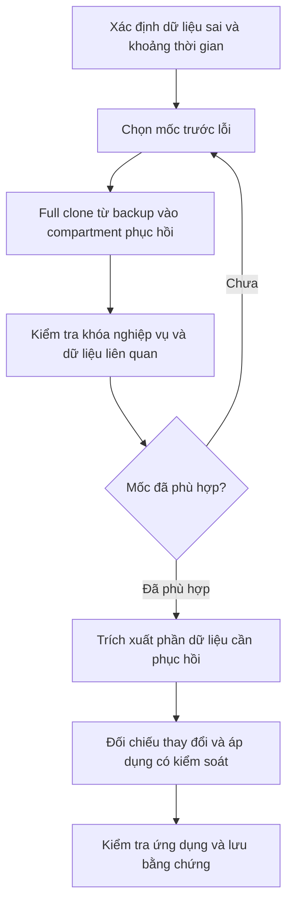

# Cloning, backup và phục hồi Autonomous Database

Trong chương **Autonomous Database** của module `CLOUD_PROVIDERS_ORACLE`, bài học này hướng dẫn tạo bản sao cơ sở dữ liệu, lựa chọn chính sách sao lưu và khôi phục dữ liệu trên Oracle Cloud Infrastructure (OCI). Các thao tác được đặt trong bối cảnh vận hành thực tế: phân quyền theo compartment, kiểm soát kết nối qua VCN, bảo vệ khóa mã hóa, đo thời gian phục hồi và quản lý chi phí.

## 1. Mục tiêu và phạm vi

Sau bài học, người học có thể:

- Chọn full clone, metadata clone hoặc refreshable clone theo mục đích sử dụng.
- Phân biệt phục hồi tại chỗ với tạo database mới từ backup.
- Chọn mốc phục hồi, diễn giải RPO/RTO và kiểm tra dữ liệu sau phục hồi.
- Thực hiện một bài thực hành xử lý xóa nhầm dữ liệu bằng clone từ backup.
- Xây dựng quy trình phục hồi có kiểm soát quyền, kết nối, chi phí và bằng chứng vận hành.

Bài tập trung vào **Autonomous Database Serverless trên OCI**, lấy database trả phí dùng mô hình ECPU làm môi trường thực hành. Tài liệu Oracle hiện dùng tên **Autonomous AI Database**; bài giữ tên Autonomous Database theo chương học. Không áp dụng nguyên xi các bước này cho Dedicated Exadata Infrastructure, Base Database Service hoặc Always Free vì khả năng và chính sách có thể khác.

Các đường dẫn Console trong bài bắt đầu từ trang chi tiết Autonomous Database. Tên menu có thể thay đổi; cần đối chiếu loại tài nguyên, OCID, region và compartment trước khi thao tác.

## 2. Phân biệt clone, backup, restore và recovery

**Clone** tạo một database mới từ database hoặc dữ liệu sao lưu. **Backup** lưu thông tin cần thiết để tái dựng trạng thái dữ liệu. **Restore** đưa dữ liệu sao lưu trở lại; **recovery** áp dụng thông tin thay đổi cần thiết để đạt mốc mong muốn. Trong Autonomous Database, dịch vụ điều phối restore và recovery, người vận hành chọn đích và xác minh kết quả.

| Nhu cầu | Hướng xử lý | Điểm cần quyết định |
|---|---|---|
| Tạo môi trường thử nghiệm có dữ liệu | Full clone | Dữ liệu nhạy cảm và cấu hình môi trường thử |
| Tạo môi trường có cấu trúc schema | Metadata clone | Cách nạp dữ liệu mẫu phù hợp |
| Duy trì bản sao phục vụ đọc | Refreshable clone | Độ trễ dữ liệu và lịch refresh |
| Xem dữ liệu tại thời điểm trước sự cố | Clone từ backup theo thời điểm | Mốc dữ liệu và phương án đối chiếu |
| Đưa toàn bộ database hiện hữu về quá khứ | Restore tại chỗ | Downtime và giao dịch sau mốc phục hồi |
| Lưu dữ liệu để truy hồi nhiều năm | Long-term backup | Retention, khóa mã hóa và cách tạo clone |
| Khôi phục một số bảng hoặc schema | Trích xuất logic, đối chiếu và nhập lại | Tính nhất quán giữa các đối tượng |

Loại clone và nguồn clone là hai lựa chọn khác nhau. Full clone có thể lấy nguồn từ database đang chạy hoặc từ backup. Clone từ backup tạo tài nguyên mới; nó không tự đưa ứng dụng đang dùng database nguồn sang tài nguyên mới. Oracle mô tả các loại và nguồn clone trong [About Cloning on Autonomous AI Database](https://docs.oracle.com/en-us/iaas/autonomous-database-serverless/doc/autonomous-clone-about.html).

Ví dụ, database bán hàng bị xóa nhầm 100 đơn hàng lúc 10:15. Tạo clone ở 10:14 giúp tìm lại các đơn bị mất. Restore toàn bộ database về 10:14 còn có thể loại bỏ các đơn hợp lệ được tạo sau thời điểm đó. Vì vậy, phải xác định cần lấy lại **một phần dữ liệu** hay **toàn bộ trạng thái database** trước khi chọn thao tác.

## 3. Chọn loại clone

### 3.1. Full clone

Full clone chứa dữ liệu và metadata của nguồn tại mốc được tạo. Có thể dùng nó để thử migration, kiểm tra thay đổi ứng dụng hoặc điều tra sự cố bằng dữ liệu gần với môi trường thật.

Quy trình tạo full clone từ database đang chạy:

1. Mở đúng database nguồn, chọn **More actions → Create clone**.
2. Chọn **Full clone** và nguồn **Clone from database instance**.
3. Chọn compartment đích, tên database và cấu hình compute/storage.
4. Thiết lập thông tin quản trị, kết nối mạng và khóa mã hóa cho đích.
5. Tạo clone, chờ trạng thái phù hợp rồi kiểm tra kết nối và dữ liệu.

Tham khảo [Clone an Autonomous AI Database Instance](https://docs.oracle.com/en-us/iaas/autonomous-database-serverless/doc/autonomous-clone.html). Clone là tài nguyên cần được quản lý riêng: ghi lại OCID, người sở hữu, mục đích và thời hạn sử dụng.

Full clone cũng sao chép dữ liệu nghiệp vụ. Trước khi cấp quyền cho nhóm phát triển, cần che dữ liệu cá nhân, kiểm tra tài khoản và vô hiệu hóa các đường tích hợp có thể gửi thư, gọi webhook hoặc đẩy dữ liệu ra hệ thống thật. Việc che dữ liệu phải hoàn thành trước khi mở quyền truy cập rộng hơn cho môi trường thử.

### 3.2. Metadata clone

Metadata clone tạo bản sao metadata schema mà không sao chép dữ liệu bảng nguồn. Nó hữu ích khi cần kiểm thử cấu trúc, mã SQL/PLSQL hoặc nạp bộ dữ liệu tổng hợp.

Không suy ra rằng một metadata clone hoàn toàn không chứa thông tin nhạy cảm. Tên đối tượng, mã chương trình hoặc cấu hình trong metadata có thể bộc lộ thông tin nội bộ. Cần kiểm kê các đối tượng và cấu hình tích hợp trước khi chia sẻ. Định nghĩa full clone và metadata clone được nêu tại [About Cloning](https://docs.oracle.com/en-us/iaas/autonomous-database-serverless/doc/autonomous-clone-about.html).

### 3.3. Refreshable clone

Refreshable clone duy trì một bản sao chỉ đọc có thể cập nhật từ nguồn. Nó phù hợp với báo cáo hoặc kiểm tra dữ liệu mà không cần một bản sao ghi độc lập. Có cả lựa chọn refreshable metadata clone cho nhu cầu đồng bộ metadata.

Oracle quy định giới hạn tuổi refresh là **7 ngày**; bỏ refresh quá giới hạn có thể làm clone tự ngắt khỏi nguồn. Clone được chủ động disconnect có cửa sổ reconnect **24 giờ** theo điều kiện hỗ trợ. Reconnect làm mất các thay đổi thử nghiệm trên clone; cần đọc điều kiện trước khi dùng quy trình này. Xem [About Refreshable Clones](https://docs.oracle.com/en-us/iaas/autonomous-database-serverless/doc/refreshable-clone-about.html).

Với nguồn dùng ECPU, có thể bật automatic refresh và cấu hình tần suất cùng độ trễ mong muốn. Cần giám sát cả lịch chạy lẫn mốc refresh thực tế; lịch đã cấu hình không chứng minh dữ liệu đã cập nhật. Xem [Edit Automatic Refresh Policy](https://docs.oracle.com/en-us/iaas/autonomous-database-serverless/doc/refreshable-clone-edit-auto-refresh.html).

Refresh thông thường tiến về mốc mới hơn lần trước. Hành vi truy vấn trong lúc refresh phụ thuộc phiên bản: Oracle mô tả refresh online ở 26ai và chờ hoàn tất ở 19c. Xem [Refresh a Refreshable Clone](https://docs.oracle.com/en-us/iaas/autonomous-database-serverless/doc/refreshable-clone-refresh.html). Bài thực hành dưới đây dùng full clone từ backup, không dùng refreshable clone để giữ một mốc lịch sử.

## 4. Hiểu chính sách backup

### 4.1. Automatic backup và cửa sổ phục hồi

Theo tài liệu Oracle, automatic backup mặc định giữ **60 ngày**. Với mô hình ECPU có thể cấu hình **1–60 ngày**; OCPU có chính sách 60 ngày. Dịch vụ sử dụng backup và thông tin thay đổi để hỗ trợ phục hồi theo thời điểm trong cửa sổ có dữ liệu khả dụng. Xem [About Backup and Recovery](https://docs.oracle.com/en-us/iaas/autonomous-database-serverless/doc/backup-intro.html).

Retention là khoảng thời gian giữ lịch sử, không phải tần suất sao lưu hay cam kết thời gian phục hồi. Ví dụ, retention 30 ngày không có nghĩa RPO là 30 ngày, và cũng không bảo đảm mọi lần restore hoàn thành trong một số phút cố định.

Với ECPU, thay đổi retention tại phần **Backup → Automatic backup retention period → Edit**. Rút ngắn retention có thể làm mất khả năng truy hồi các mốc cũ; tăng retention không tái tạo lịch sử đã hết hạn. **Backup Retention Lock** khóa chính sách automatic backup; không thể tự tắt hoặc sửa như một lựa chọn thông thường sau khi bật. Trường hợp ngoại lệ phải làm việc với Oracle theo quy trình hỗ trợ. Xem [Edit Automatic Backup Retention Period](https://docs.oracle.com/en-us/iaas/autonomous-database-serverless/doc/backup-edit-retention.html).

Chọn retention theo thời gian phát hiện lỗi. Nếu nghiệp vụ chỉ đối soát cuối tháng, chính sách giữ lịch sử vài ngày có thể hết hạn trước khi lỗi được phát hiện. Quyết định cần được ghi cùng yêu cầu nghiệp vụ và ngân sách.

### 4.2. Long-term backup

Long-term backup phục vụ lưu trữ dài hạn, với retention được Oracle hỗ trợ từ **3 tháng đến 10 năm**. Có thể tạo một lần hoặc lập lịch tuần, tháng, năm. Database phải có ít nhất một automatic backup trước khi tạo long-term backup. Xem [Create Long-Term Backups](https://docs.oracle.com/en-us/iaas/autonomous-database-serverless/doc/backup-long-term.html).

Một quy trình thiết lập gồm:

1. Mở tab **Backups**, chọn **Create long-term backup**.
2. Chọn retention theo yêu cầu lưu trữ.
3. Chọn chạy một lần hoặc lịch lặp lại.
4. Ghi rõ mốc nghiệp vụ mà bản sao phục vụ, chẳng hạn dữ liệu sau khi hoàn tất khóa sổ.
5. Theo dõi kết quả rồi diễn tập tạo database từ bản sao đó.

**Long-term backup được dùng để clone thành database mới, không dùng để restore tại chỗ database nguồn.** Nó cũng không cung cấp một cửa sổ PITR liên tục suốt toàn bộ số năm lưu trữ. Xem [About Backup and Recovery](https://docs.oracle.com/en-us/iaas/autonomous-database-serverless/doc/backup-intro.html).

Một lịch backup cuối tháng cần phối hợp với thời điểm hoàn tất đối soát. Backup chạy đúng lịch nhưng trước khi các batch quan trọng commit có thể không phản ánh trạng thái khóa sổ mong muốn.

### 4.3. Những phụ thuộc phải bảo vệ cùng backup

Có backup chưa đủ để khẳng định phục hồi được:

- Backup không chứa các file bên ngoài database được external table tham chiếu trên Object Storage.
- Với long-term backup mã hóa bằng customer-managed key, cần giữ khóa tương ứng khả dụng.
- Terminate database nguồn làm mất quyền truy cập long-term backup gắn với nó.
- Database mới hoặc mới clone có thể cần tới 4 giờ trước khi automatic backup xuất hiện.

Các giới hạn này được mô tả tại [Backup and Restore Notes](https://docs.oracle.com/en-us/iaas/autonomous-database-serverless/doc/backup-restore-notes.html).

Vì vậy, danh mục phục hồi cần bao gồm cả dữ liệu Object Storage, cấu hình ứng dụng, bí mật kết nối, quyền truy cập khóa và phiên bản phần mềm. Với dữ liệu lưu nhiều năm, cần kiểm tra khả năng chạy ứng dụng trên phiên bản database được hỗ trợ khi phục hồi, thay vì chỉ giữ lại file cấu hình của hệ thống cũ.

## 5. Chọn mốc phục hồi bằng RPO, RTO và bằng chứng

**RPO — Recovery Point Objective** là mục tiêu về lượng dữ liệu có thể mất, thường đo bằng thời gian. **RTO — Recovery Time Objective** là mục tiêu về thời gian đưa dịch vụ trở lại mức hoạt động chấp nhận được.

Hai mục tiêu cần được đo ở cấp ứng dụng. Có thể lập mô hình thời gian phục hồi như sau:

```text
Thời gian gián đoạn thực tế =
    thời gian phát hiện và xác định phạm vi
  + thời gian chuẩn bị quyền, tài nguyên và điểm phục hồi
  + thời gian restore hoặc tạo clone
  + thời gian kiểm tra và đối soát
  + thời gian kết nối lại ứng dụng
```

Đây là mô hình lập kế hoạch, không phải công thức tính SLA của Oracle. Nếu tạo clone mất 12 phút nhưng đối soát và mở lại ứng dụng mất 35 phút thì không thể báo thời gian khôi phục dịch vụ là 12 phút.

Giả sử có chuỗi sự kiện sau, tất cả đã quy về UTC:

| Thời điểm | Sự kiện |
|---|---|
| 03:00:00Z | Đợt xử lý hợp lệ hoàn tất |
| 03:05:00Z | Một lệnh xóa nhầm được commit |
| 03:06:00Z | Có thêm giao dịch hợp lệ |
| 03:20:00Z | Nhóm vận hành phát hiện lỗi |

Mốc 03:04:59Z chỉ là **ứng viên** trước lỗi. Cần xác minh rằng giao dịch hợp lệ cần giữ đã commit trước mốc này. Timestamp từ log ứng dụng có thể ghi thời điểm gửi yêu cầu, khác với thời điểm commit trong database.

Các dữ kiện cần lưu gồm:

- Timestamp có múi giờ, mã giao dịch và log xác nhận commit nếu có.
- Phạm vi bảng, khóa nghiệp vụ và quan hệ dữ liệu bị ảnh hưởng.
- Thời điểm gần nhất đã kiểm tra là đúng và thời điểm đầu tiên biết là sai.
- Các giao dịch hợp lệ phát sinh sau mốc dự kiến.
- Mốc được chọn và kết quả kiểm tra trên database phục hồi.

Ở Việt Nam, 10:05 giờ UTC+07:00 tương ứng 03:05Z cùng ngày. Không nhập thời gian địa phương kèm ký tự `Z`, vì `Z` biểu thị UTC.

## 6. Chuẩn bị IAM, mạng và tài nguyên

### 6.1. Tách quyền cloud và quyền SQL

OCI IAM quyết định ai có thể đọc thông tin tài nguyên, tạo clone hoặc gọi thao tác quản trị. Quyền trong database quyết định tài khoản SQL được truy vấn, xuất hay sửa dữ liệu nào. Có quyền SQL không tự cấp quyền restore qua OCI; có quyền OCI cũng không thay thế thiết kế quyền SQL.

Ví dụ chính sách cho một nhóm được đọc một nguồn và quản lý database trong compartment phục hồi:

```text
Allow group ADBRecoveryOperators to read autonomous-databases in compartment ProdData where target.id = '<SOURCE_AUTONOMOUS_DATABASE_OCID>'
Allow group ADBRecoveryOperators to manage autonomous-databases in compartment RecoveryLab
```

Thay tên nhóm, compartment và OCID trước khi dùng. `manage` có phạm vi rộng trong compartment đích; đây là ví dụ lab, cần thu hẹp theo vai trò khi triển khai thực tế. Chính sách tạo clone trong cùng tenancy được Oracle hướng dẫn tại [Prerequisites for Cloning](https://docs.oracle.com/en-us/iaas/autonomous-database-serverless/doc/autonomous-clone-prerequisites.html).

Quyền tạo clone ở `RecoveryLab` không phải quyền restore database trong `ProdData`. Nếu sử dụng private endpoint, Vault hoặc nguồn ở tenancy khác, phải chuẩn bị thêm các quyền tương ứng.

### 6.2. Chuẩn bị đường kết nối đến database đích

Một clone có dữ liệu đúng nhưng ứng dụng không kết nối được vẫn chưa hoàn thành mục tiêu phục hồi. Trước khi tạo clone, xác định:

- Region và compartment đích đã đúng hay chưa.
- Compute, storage và quota có đủ hay không.
- Máy kiểm tra sẽ kết nối qua public endpoint có ACL hay private endpoint.
- Với private endpoint: VCN, subnet, DNS, NSG và đường đi từ máy kiểm tra đã sẵn sàng chưa.
- Cách lấy chuỗi kết nối và wallet của database đích nếu chế độ kết nối yêu cầu.
- Ai được truy cập clone, trong bao lâu và với mục đích nào.

Không giả định endpoint, wallet và cấu hình ứng dụng của nguồn sẽ tự dùng đúng cho clone. Trong bài thực hành, luôn mở riêng phiên SQL nguồn và phiên SQL đích, đặt nhãn rõ ràng để tránh chạy lệnh trên sai database.

## 7. Quy trình clone từ backup

Clone từ backup thích hợp khi cần kiểm tra một mốc lịch sử, lấy lại dữ liệu có chọn lọc hoặc xác minh khả năng phục hồi mà vẫn giữ nguyên database hiện hữu để đối chiếu.



Các bước trên Console:

1. Mở database nguồn và chọn **Create clone**.
2. Chọn **Full clone**, nguồn **Clone from a backup**.
3. Chọn timestamp để PITR, chọn backup từ danh sách hoặc chọn latest backup timestamp theo mục đích.
4. Nhập cấu hình tài nguyên đích, mạng, quản trị và khóa mã hóa.
5. Tạo clone; theo dõi tiến trình trước khi kết nối.

Đối với lỗi logic đã commit, cần chọn mốc trước lỗi; latest backup có thể đã chứa lỗi. Với lựa chọn latest backup, có thể kiểm tra mốc phục hồi bằng truy vấn sau khi được cấp quyền:

```sql
SELECT last_recover_time, last_recover_scn
FROM dba_pdbs;
```

Các tùy chọn nguồn backup và truy vấn này được mô tả tại [Clone an Autonomous AI Database from a Backup](https://docs.oracle.com/en-us/iaas/autonomous-database-serverless/doc/autonomous-clone-backup.html).

Sau khi clone khả dụng, cần kiểm tra ít nhất một bản ghi đã biết trước mốc và một thay đổi đã biết sau mốc. Chỉ kiểm tra số lượng dòng dễ bỏ sót trường hợp một dòng bị xóa nhưng dòng khác được thêm vào.

## 8. Quy trình restore tại chỗ

Restore tại chỗ phù hợp khi đã quyết định đưa **toàn bộ database hiện hữu** về mốc được chọn. Trước thao tác, cần dừng hoặc cô lập luồng ghi từ ứng dụng, batch, consumer và các công cụ quản trị; đồng thời lưu bằng chứng về các giao dịch có thể phải xử lý lại.

Trên trang database, chọn **More actions → Restore**, nhập timestamp hoặc chọn backup, rồi thực hiện restore. Database không truy cập được trong quá trình này; khi hoàn tất, trạng thái trở về **Available**. Xem [Restore and Recover your Autonomous AI Database](https://docs.oracle.com/en-us/iaas/autonomous-database-serverless/doc/backup-recover.html).

Một runbook restore nên có các bước:

1. Xác nhận OCID, region, người chịu trách nhiệm và mốc phục hồi.
2. Xác định các nguồn ghi; ngăn chúng tự kết nối lại trong lúc kiểm tra.
3. Ghi nhận dữ liệu hợp lệ sau mốc cần phục hồi để lập kế hoạch đối soát.
4. Thực hiện restore và theo dõi tiến trình.
5. Kiểm tra dữ liệu, đối tượng, quyền và cấu hình kết nối cần thiết.
6. Đối chiếu với hệ thống ngoài: thanh toán, hàng đợi, kho hoặc đối tác.
7. Mở lại các nguồn ghi theo thứ tự đã định và theo dõi lỗi ứng dụng.

Việc đưa database về quá khứ không đảo ngược giao dịch ở hệ thống thanh toán hoặc thông điệp đã gửi ra ngoài. Cần có cơ chế idempotency, đối soát hoặc nghiệp vụ bù trừ để tránh xử lý hai lần.

Oracle còn lưu ý restore đưa các file trong `DATA_PUMP_DIR` và thư mục do người dùng tạo về mốc được chọn; các workspace, project và notebook Oracle Machine Learning không được restore theo thao tác này. Xem [Restore and Recover](https://docs.oracle.com/en-us/iaas/autonomous-database-serverless/doc/backup-recover.html). Các thành phần đó cần kế hoạch lưu trữ và kiểm tra riêng.

## 9. Thực hành: lấy lại bản ghi bị xóa mà vẫn giữ giao dịch mới

### 9.1. Điều kiện thực hành

Dùng database lab trả phí, có automatic backup khả dụng, và một schema học tập trống có quyền tạo bảng, chèn, xóa và truy vấn. Không chạy các lệnh sửa dữ liệu sau đây trên database sản xuất.

Bài thực hành tạo ba giao dịch tổng hợp. Mục tiêu cuối cùng là khôi phục giao dịch `1001` đã bị xóa và vẫn giữ giao dịch `1003` được thêm sau mốc dùng để clone. Chọn cùng phiên bản database cho nguồn và đích nếu được hỗ trợ, để tập trung vào phục hồi dữ liệu.

Trước khi bắt đầu, ghi OCID nguồn, compartment phục hồi, ngân sách cho clone và kết quả kiểm tra backup. Không coi việc vừa provision xong database là bằng chứng đã có mốc backup sử dụng được.

### 9.2. Tạo trạng thái ban đầu

Chạy trong schema lab trên database nguồn:

```sql
CREATE TABLE recovery_lab_orders (
    order_id     NUMBER PRIMARY KEY,
    amount       NUMBER(12, 2) NOT NULL,
    order_status VARCHAR2(20) NOT NULL
);

INSERT INTO recovery_lab_orders
VALUES (1001, 100.00, 'PAID');

INSERT INTO recovery_lab_orders
VALUES (1002, 200.00, 'PAID');

COMMIT;

SELECT order_id, amount, order_status
FROM recovery_lab_orders
ORDER BY order_id;

SELECT TO_CHAR(
           SYSTIMESTAMP AT TIME ZONE 'UTC',
           'YYYY-MM-DD"T"HH24:MI:SS.FF3"Z"'
       ) AS clean_time_utc
FROM dual;
```

Ghi lại giá trị `clean_time_utc` sau commit. Đây là mốc ứng viên cho bản sao sạch; đặt tên là `T_clean` trong biên bản thực hành. Kết quả hiện tại gồm hai dòng `1001`, `1002`, tổng tiền 300.

Tách hai giai đoạn thực hành bằng một khoảng thời gian rõ ràng, rồi mới chạy phần tiếp theo. Không thực hiện các thay đổi kế tiếp sát mốc đến mức khó đối chiếu độ chính xác timestamp.

### 9.3. Thêm giao dịch mới và mô phỏng xóa nhầm

Chạy trên database nguồn:

```sql
INSERT INTO recovery_lab_orders
VALUES (1003, 300.00, 'PAID');

COMMIT;

DELETE FROM recovery_lab_orders
WHERE order_id = 1001;

COMMIT;

SELECT order_id, amount, order_status
FROM recovery_lab_orders
ORDER BY order_id;

SELECT COUNT(*) AS row_count, SUM(amount) AS total_amount
FROM recovery_lab_orders;
```

Kết quả nguồn lúc này có hai dòng `1002`, `1003`, tổng tiền 500. Lệnh xóa đã commit nên `ROLLBACK` của phiên hiện tại không lấy lại được dòng `1001`.

### 9.4. Tạo full clone tại T_clean

Trên Console, dùng quy trình clone từ backup và chọn timestamp `T_clean`. Đặt clone trong compartment phục hồi, giới hạn mạng và cấp quyền truy vấn cho người thực hành.

Nếu dịch vụ chưa chấp nhận mốc vừa ghi, kiểm tra trạng thái backup, múi giờ và thời điểm có thể phục hồi; chờ dữ liệu backup khả dụng rồi thử lại. Không đổi sang latest backup chỉ để vượt qua lỗi, vì nó có thể chứa thao tác xóa nhầm.

Kết nối vào **clone** bằng thông tin của tài nguyên đích, rồi chạy:

```sql
SELECT order_id, amount, order_status
FROM recovery_lab_orders
ORDER BY order_id;

SELECT COUNT(*) AS row_count, SUM(amount) AS total_amount
FROM recovery_lab_orders;

SELECT COUNT(*) AS orders_created_after_clean_time
FROM recovery_lab_orders
WHERE order_id = 1003;
```

Kết quả mong đợi:

| Nơi kiểm tra | Các order_id hiện có | Số dòng | Tổng tiền |
|---|---|---:|---:|
| Nguồn sau lỗi | 1002, 1003 | 2 | 500 |
| Clone tại T_clean | 1001, 1002 | 2 | 300 |

Truy vấn kiểm tra `1003` trên clone phải trả về 0. Hai database đều có hai dòng nhưng dữ liệu khác nhau; ví dụ này cho thấy vì sao chỉ dùng `COUNT(*)` là chưa đủ.

Nếu clone thiếu bảng hoặc thiếu dòng đã commit ở giai đoạn đầu, cần kiểm tra lại mốc trước khi tiếp tục. Không sửa dữ liệu trên nguồn để che lấp một điểm phục hồi không đúng.

### 9.5. Khôi phục có chọn lọc trong phạm vi lab

Trên clone, đọc lại bản ghi cần phục hồi:

```sql
SELECT order_id, amount, order_status
FROM recovery_lab_orders
WHERE order_id = 1001;
```

Với dữ liệu tổng hợp nhỏ trong bài, sau khi xác nhận các giá trị đúng như trên, chạy lại phần chèn có điều kiện sau trên **database nguồn**:

```sql
INSERT INTO recovery_lab_orders (order_id, amount, order_status)
SELECT 1001, 100.00, 'PAID'
FROM dual
WHERE NOT EXISTS (
    SELECT 1
    FROM recovery_lab_orders
    WHERE order_id = 1001
);

SELECT order_id, amount, order_status
FROM recovery_lab_orders
ORDER BY order_id;

SELECT COUNT(*) AS row_count, SUM(amount) AS total_amount
FROM recovery_lab_orders;

COMMIT;
```

Kết quả cuối cùng phải có `1001`, `1002`, `1003`, ba dòng, tổng tiền 600. Điều kiện `NOT EXISTS` tránh chèn lại một khóa đã có; nó không chứng minh một bản ghi hiện hữu có nội dung đúng. Nếu khóa `1001` đã tồn tại nhưng khác dữ liệu, phải dừng để đối chiếu.

Lệnh chèn trên chỉ phù hợp với bộ dữ liệu tổng hợp đã biết của bài. Với dữ liệu thực, cần xuất từ clone, nhập vào vùng staging, đối chiếu khóa, nội dung và quan hệ trước khi cập nhật đích. Không suy rộng thành quy trình chép thủ công dữ liệu sản xuất.

### 9.6. Bằng chứng hoàn thành

Lưu trong biên bản vận hành của người thực hành:

- OCID nguồn, OCID clone, timestamp yêu cầu và thời gian clone hoàn tất.
- Kết quả truy vấn nguồn sau lỗi, clone tại mốc sạch và nguồn sau sửa.
- Khóa đã phục hồi, các thay đổi mới đã giữ lại và cách kiểm tra.
- Thời gian từ lúc phát hiện đến lúc dữ liệu được kiểm chứng.
- Chi phí quan sát được và quyết định giữ hay xóa clone.

Bài tập đạt mục tiêu khi dữ liệu bị mất đã được lấy lại, dữ liệu mới vẫn tồn tại và có bằng chứng đối chiếu. Trạng thái **Available** của clone chỉ xác nhận một phần của quy trình.

## 10. Dùng OCI CLI để kiểm kê và minh họa restore

Các ví dụ dưới đây dùng **PowerShell**, giả định OCI CLI đã được cấu hình và principal có quyền phù hợp. Thay OCID, profile, region và timestamp theo môi trường. Bài chỉ cung cấp lệnh; người học thực thi trên tài nguyên lab đã xác định.

Liệt kê backup của đúng database:

```powershell
$databaseId = '<AUTONOMOUS_DATABASE_OCID>'
$regionName = '<OCI_REGION_ID>'

oci db autonomous-database-backup list --autonomous-database-id $databaseId --region $regionName --all --output json
```

`--all` lấy đầy đủ các trang kết quả. Cần đọc trạng thái và thời gian của backup; danh sách có phần tử không tự chứng minh mọi timestamp yêu cầu đều hợp lệ. Xem [OCI CLI: autonomous-database-backup list](https://docs.oracle.com/en-us/iaas/tools/oci-cli/latest/oci_cli_docs/cmdref/db/autonomous-database-backup/list.html).

Lệnh sau **thay đổi trạng thái database đích**, chỉ sử dụng khi đã chọn restore tại chỗ và dừng các luồng ghi. Nó không thuộc quy trình phục hồi có chọn lọc ở phần 9:

```powershell
$databaseId = '<LAB_AUTONOMOUS_DATABASE_OCID>'
$regionName = '<OCI_REGION_ID>'
$restoreTimestamp = '<VALID_UTC_TIMESTAMP_IN_RECOVERY_WINDOW>'

oci db autonomous-database restore --autonomous-database-id $databaseId --region $regionName --timestamp $restoreTimestamp --wait-for-state AVAILABLE
```

Timestamp UTC hợp lệ có dạng `2026-11-20T03:04:59Z`; ngày giờ minh họa phải được thay bằng mốc thuộc cửa sổ phục hồi thật. Nếu chờ bị timeout, kiểm tra tiến trình hiện có trước khi gửi lại thao tác. Timeout phía CLI không đồng nghĩa thao tác phía dịch vụ đã thất bại. Cú pháp và trạng thái chờ được mô tả tại [OCI CLI: autonomous-database restore](https://docs.oracle.com/en-us/iaas/tools/oci-cli/latest/oci_cli_docs/cmdref/db/autonomous-database/restore.html).

Một tiến trình tự động hóa nên ghi request ID, OCID, timestamp yêu cầu và kết quả kiểm tra dữ liệu; không chỉ ghi mã thoát của lệnh.

## 11. Kiểm tra sau phục hồi

Nên thiết kế bộ kiểm tra trước khi sự cố xảy ra để có tiêu chí rõ ràng:

| Lớp kiểm tra | Ví dụ bằng chứng |
|---|---|
| Đúng tài nguyên | OCID, region, compartment, chuỗi kết nối |
| Đúng mốc | Bản ghi trước mốc tồn tại, thay đổi sau mốc có trạng thái dự kiến |
| Dữ liệu nghiệp vụ | Đơn hàng, số dư, tồn kho hoặc tổng hợp theo kỳ |
| Quan hệ dữ liệu | Đơn có đủ chi tiết, không có khóa ngoại mồ côi |
| Đối tượng và quyền | Bảng, view, package và tài khoản cần thiết hoạt động |
| Tích hợp | Thanh toán, thông điệp và batch không bị xử lý lặp |
| Ứng dụng | Kết nối được, đọc/ghi thử đúng phạm vi cho phép |
| Vận hành | Có log, người phụ trách và quyết định mở lại dịch vụ |

Với bảng đơn hàng thật, tổng tiền cần đối chiếu theo trạng thái, thời gian và đơn vị tiền tệ. Một tổng chung có thể che giấu sai lệch giữa nhiều nhóm dữ liệu.

Nếu dữ liệu tham chiếu tới file trong Object Storage, cần kiểm tra cả phiên bản file. Metadata database đúng mốc nhưng file ngoài đã bị ghi đè vẫn có thể tạo kết quả truy vấn sai.

## 12. Giám sát, chi phí và vòng đời clone

### 12.1. Các tín hiệu cần theo dõi

Một dashboard vận hành cho backup và phục hồi nên thể hiện:

- Retention đang cấu hình và khả năng truy hồi các mốc quan trọng.
- Lần backup hoặc long-term backup gần nhất đã hoàn tất.
- Lịch long-term backup sắp tới và kết quả các lần chạy.
- Mốc refresh thực tế, hạn refresh và lỗi refresh nếu dùng refreshable clone.
- Tiến trình clone/restore đang chạy, thời lượng và lỗi.
- Ngày diễn tập gần nhất, thời gian phục hồi đo được và lỗi dữ liệu phát hiện.

Console cung cấp thông tin backup và danh sách trong tab **Backups**; xem [View Backup Information and Backups](https://docs.oracle.com/en-us/iaas/autonomous-database-serverless/doc/backup-list-backups.html). Có thể dùng Events kết hợp Notifications để theo dõi các thao tác được dịch vụ phát sự kiện; xem [Use Autonomous AI Database Events](https://docs.oracle.com/en-us/iaas/autonomous-database-serverless/doc/autonomous-database-events.html).

Đối với tự động hóa, phân biệt sự kiện bắt đầu với kết quả kết thúc. Một sự kiện “đã bắt đầu backup” không phải bằng chứng backup thành công; tương tự, tạo tài nguyên xong chưa thay thế được bước kiểm tra dữ liệu.

### 12.2. Tính đủ chi phí

Khi lập ngân sách, cần tính:

```text
Chi phí phương án =
    compute của nguồn và tài nguyên phục hồi
  + database storage
  + backup storage
  + tài nguyên mạng, lưu trữ ngoài và dịch vụ liên quan
  + thời gian giữ tài nguyên sau khi hoàn thành mục đích
```

Đây là danh mục ước tính, không phải công thức định giá. Với ECPU, backup storage được tính thêm; long-term backup và các lựa chọn clone/DR có cách tính riêng. Không áp dụng giả định “backup luôn đã bao gồm trong giá database” cho mọi compute model. Kiểm tra [Autonomous AI Database Serverless Features Billing](https://docs.oracle.com/en-us/iaas/autonomous-database-serverless/doc/autonomous-features-billing.html) và thông tin giá đúng region trước khi triển khai.

Mỗi clone nên có tag như `Owner`, `Purpose`, `Environment`, `ExpiresOn`. Đây là quy ước vận hành gợi ý; tag ngày hết hạn không tự tạo hành động xóa nếu chưa có tiến trình thực thi.

Sau diễn tập, lưu bằng chứng cần thiết, thu hồi quyền tạm và dọn tài nguyên theo chính sách. Không terminate database nguồn chỉ để giảm chi phí khi còn phụ thuộc long-term backup của nó. Stop database cũng cần được xem xét cùng chi phí storage và backup còn giữ.

## 13. Backup trong chiến lược tính sẵn sàng

Backup, clone và disaster recovery giải quyết các tình huống khác nhau. Một refreshable clone phục vụ đọc không tự trở thành standby có cơ chế failover của Autonomous Data Guard. Một backup trong region cũng không chứng minh có thể phục hồi khi toàn bộ region không truy cập được.

Với Autonomous Data Guard cross-region, Oracle cho phép bật replication của automatic backup sang peer; tính năng này không mặc định được bật và có cửa sổ lịch sử riêng. Xem [About Autonomous Data Guard with Cross-Region Standby](https://docs.oracle.com/en-us/iaas/autonomous-database-serverless/doc/adg-about-cross-region--cross-tenancy.html).

Kế hoạch vận hành cần phân biệt:

| Tình huống | Câu hỏi cần trả lời |
|---|---|
| Xóa nhầm hoặc sửa sai dữ liệu | Có mốc trước lỗi và cách giữ giao dịch hợp lệ sau đó không? |
| Database không phục vụ được | Có phương án phục hồi dịch vụ và kết nối ứng dụng đã diễn tập không? |
| Region không khả dụng | Dữ liệu, khóa, quyền và hạ tầng phục hồi có ở địa điểm cần thiết không? |
| Truy hồi dữ liệu nhiều năm trước | Backup còn truy cập được và ứng dụng còn đọc được dữ liệu không? |

Khi lựa chọn phương án, cần ghi rõ phạm vi sự cố, RPO/RTO mục tiêu, mức chi phí và kết quả diễn tập. Đối với lỗi logic, việc sao chép trạng thái mới nhất sang nơi khác có thể mang theo chính lỗi đó; lịch sử backup và bằng chứng chọn mốc vẫn cần thiết.

## 14. Các lỗi thường gặp

| Hiện tượng hoặc hiểu nhầm | Cách xử lý |
|---|---|
| Vừa tạo database nhưng chưa thấy backup | Kiểm tra khả năng backup và thời gian chờ, không giả định đã có điểm phục hồi |
| Timestamp bị từ chối | Kiểm tra UTC/offset, cửa sổ retention và mốc khả dụng |
| Clone có dữ liệu nhưng thiếu phần cần tìm | Kiểm tra commit và mốc trước/sau lỗi bằng khóa nghiệp vụ |
| Clone đã Available nhưng không kết nối được | Kiểm tra endpoint, DNS, ACL/NSG, đường đi và thông tin kết nối đích |
| Chọn latest backup để sửa xóa nhầm | Xác định mốc trước commit lỗi, kiểm tra trên clone trước |
| Dùng long-term backup để restore nguồn | Lập phương án clone thành database mới và kiểm tra chuyển ứng dụng |
| Retention tăng nhưng không thấy lịch sử cũ | Lịch sử đã hết hạn không được tạo lại bằng cách tăng retention |
| Hai bên có cùng số dòng nên kết luận đúng | Đối chiếu khóa, giá trị, tổng hợp và quan hệ giữa bảng |
| Restore xong thì mở ngay mọi luồng ghi | Hoàn tất đối soát và mở lại theo thứ tự, theo dõi xử lý lặp |
| Có backup nên bỏ qua diễn tập | Đo thời gian thực tế và kiểm tra dữ liệu, khóa, mạng, quyền |

Một phương án phục hồi hoàn chỉnh phải trả lời được bốn điều: **phục hồi dữ liệu nào, tại mốc nào, vào tài nguyên nào và dùng bằng chứng gì để cho phép ứng dụng hoạt động trở lại**.
