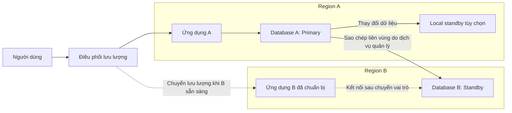

# Autonomous Data Guard và khả năng phục hồi liên vùng

## 1. Mục tiêu và phạm vi

Trong module **CLOUD_PROVIDERS_ORACLE**, chương **Autonomous Database**, bài học này giải thích cách thiết kế và vận hành khả năng phục hồi cơ sở dữ liệu khi một vùng OCI gặp sự cố. Chủ đề kết nối Autonomous Database với tenancy, compartment, IAM, VCN, tầng ứng dụng, giám sát, tự động hóa và kiểm soát chi phí.

Sau bài học, người học có thể:

- Phân biệt khả năng sẵn sàng trong vùng với khả năng phục hồi liên vùng.
- Chọn local standby hoặc cross-region standby theo yêu cầu nghiệp vụ.
- Phân biệt switchover, failover và chuyển hoạt động trở về vùng ban đầu.
- Chuẩn bị mạng, quyền truy cập và cấu hình ứng dụng trước khi chuyển vùng.
- Đo thời gian phục hồi và đối soát giao dịch sau chuyển vai trò database.
- Xây dựng runbook có thể thực hiện ngay cả khi vùng chính không truy cập được.

Các thao tác trong bài dùng **Autonomous Database Serverless trên OCI**, với ECPU làm mô hình tính toán tham chiếu. Tài liệu Oracle hiện có thể hiển thị tên **Autonomous AI Database Serverless**. Không áp dụng nguyên xi các thao tác này cho Autonomous Database trên Dedicated Exadata Infrastructure hoặc cho Oracle Database tự quản trị.

Bài thực hành là hướng dẫn trên môi trường lab; các ví dụ chưa biểu thị một lần triển khai OCI thực tế.

## 2. Autonomous Data Guard bảo vệ điều gì?

### 2.1. Primary và standby

**Primary database** phục vụ hoạt động của ứng dụng. **Standby database** nhận thay đổi từ primary để có thể tiếp quản khi cần. Autonomous Data Guard là khả năng được Oracle quản lý: người dùng chọn cấu hình bảo vệ và thực hiện các thao tác dịch vụ, thay vì tự cài đặt Data Guard Broker hoặc điều khiển máy chủ database.

Có hai vị trí triển khai chính:

| Cấu hình | Vị trí standby | Mục đích |
| --- | --- | --- |
| Local standby | Cùng OCI region với primary | Giảm gián đoạn do sự cố trong vùng |
| Cross-region standby | Một region khác được dịch vụ hỗ trợ | Duy trì khả năng phục hồi khi vùng chính không khả dụng |

Có thể phối hợp cả hai. Local standby được đặt khác Availability Domain nếu vùng có nhiều AD; ở vùng chỉ có một AD, dịch vụ sử dụng Fault Domain khác. Cấu hình này vẫn nằm trong cùng region. Xem [About Standby Databases](https://docs.oracle.com/en-us/iaas/autonomous-database-serverless/doc/autonomous-data-guard-about.html).

Một sai lầm thiết kế là coi hai AD trong cùng region đã giải quyết toàn bộ rủi ro của region. Chúng giúp giảm phạm vi ảnh hưởng của một số sự cố, nhưng kế hoạch ứng phó mất cả vùng cần tài nguyên và đường vận hành ở vùng khác.

### 2.2. Cơ sở dữ liệu dự phòng không đồng nghĩa toàn bộ hệ thống dự phòng

Autonomous Data Guard giải quyết một phần của hệ thống: khả năng chuyển vai trò database. Ứng dụng còn cần nơi chạy, đường mạng, thông tin xác thực, endpoint và các dịch vụ phụ thuộc.



Sơ đồ mô tả các thành phần logic. Nó không có nghĩa người học phải tự dựng một luồng sao chép redo qua VCN của ứng dụng.

Ví dụ, hệ thống bán hàng chuyển database thành công sang Region B nhưng máy chủ ứng dụng chỉ có ở Region A. Database đã phục hồi, song khách hàng vẫn không đặt hàng được. Vì vậy, tiêu chí hoàn tất DR phải gắn với giao dịch nghiệp vụ thành công.

### 2.3. Standby không phải một read replica dùng tùy ý

Standby thông thường không mở để ứng dụng truy vấn chỉ đọc. Không đưa nó vào thiết kế báo cáo như một database đang phục vụ truy vấn. Autonomous Data Guard cũng không khả dụng cho Always Free Autonomous Database. Xem [Autonomous Data Guard Notes](https://docs.oracle.com/en-us/iaas/autonomous-database-serverless/doc/autonomous-data-guard-notes.html).

Khả năng snapshot standby dành cho kiểm thử có hành vi khác và được trình bày riêng ở phần cuối bài.

## 3. Hiểu đúng RTO và RPO

### 3.1. Đặt mục tiêu từ nghiệp vụ

**RTO — Recovery Time Objective** là mục tiêu thời gian khôi phục. Khi đưa ra một con số, cần nói rõ mốc bắt đầu và điều kiện kết thúc phép đo.

**RPO — Recovery Point Objective** là mục tiêu về khoảng dữ liệu có thể mất, tính theo thời gian. RPO 60 giây không có nghĩa chắc chắn mất đúng 60 giây giao dịch; nó mô tả mức tổn thất mục tiêu mà thiết kế phải đáp ứng.

Ví dụ yêu cầu cho dịch vụ đơn hàng:

| Yêu cầu | Cách diễn đạt có thể kiểm chứng |
| --- | --- |
| Khôi phục dịch vụ | Trong 20 phút từ khi khách hàng bắt đầu không đặt hàng được |
| Bảo toàn dữ liệu | Khoảng giao dịch đã xác nhận nhưng chưa có ở hệ thống phục hồi không vượt 60 giây |
| Tránh thu tiền hai lần | Mỗi yêu cầu thanh toán có khóa idempotency và cơ chế đối soát |
| Có thể vận hành khi mất vùng | Đội trực có quyền và đường truy cập Region B độc lập với Region A |

Đây là ví dụ mục tiêu do tổ chức tự đặt, không phải cam kết của Oracle.

### 3.2. Mục tiêu dịch vụ của Autonomous Data Guard

Theo tài liệu dịch vụ được tham chiếu ngày **20/11/2026**, các mục tiêu chính gồm:

| Thao tác | RTO mục tiêu của dịch vụ database | RPO mục tiêu |
| --- | --- | --- |
| Switchover tới local standby | 2 phút | 0 |
| Failover tới local standby | 2 phút | Mục tiêu 0; automatic failover còn phụ thuộc giới hạn mất dữ liệu cấu hình |
| Switchover tới cross-region standby | Dưới 10 phút | 0 |
| Manual failover tới cross-region standby | Dưới 10 phút | Tối đa 1 phút |
| Automatic failover tới cross-region standby | Không có trong Autonomous Data Guard | Không áp dụng |

Đối chiếu [Recovery Time Objective và Recovery Point Objective](https://docs.oracle.com/en-us/iaas/autonomous-database-serverless/doc/autonomous-data-guard-about.html) và [Service Level Objectives](https://docs.oracle.com/en-us/iaas/autonomous-database-serverless/doc/availability-slo.html). Các giá trị là mục tiêu dịch vụ cho cấu hình tương ứng; không suy ra rằng mọi lần diễn tập hoặc mọi ứng dụng đều phục hồi trong đúng khoảng đó.

Với local automatic failover, giới hạn mất dữ liệu mặc định là **0 giây**, có thể cấu hình trong khoảng **0–3600 giây**. Nếu dịch vụ không bảo đảm được giới hạn đã chọn, automatic failover không diễn ra; người vận hành cần đánh giá phương án manual failover. Giới hạn này không biến cross-region failover thành tự động. Xem [Automatic Failover with a Standby Database](https://docs.oracle.com/en-us/iaas/autonomous-database-serverless/doc/autonomous-data-guard-auto-failover.html).

### 3.3. RTO của ứng dụng thường dài hơn thao tác chuyển database

Oracle xác định thời gian chuyển liên vùng từ khi thao tác được khởi tạo. Thiết kế vận hành phải cộng cả thời gian phát hiện, quyết định và đưa ứng dụng trở lại phục vụ. Xem [Oracle MAA for Autonomous Database Serverless](https://docs.oracle.com/en/database/oracle/oracle-database/26/haovw/autonomous-database-serverless.html).

Một mô hình lập ngân sách thời gian:

```text
Thời gian phục hồi ứng dụng
≈ thời gian phát hiện
+ thời gian đánh giá và quyết định
+ thời gian chuyển vai trò database
+ thời gian khởi động và kết nối ứng dụng
+ thời gian kiểm tra nghiệp vụ và chuyển lưu lượng
```

Các công việc có thể thực hiện song song sẽ giảm tổng thời gian thực tế. Công thức giúp tránh bỏ sót công việc, không yêu cầu cộng cơ học mọi khoảng thời gian.

Ví dụ giả định: phát hiện mất 2 phút, quyết định mất 3 phút, database chuyển vai trò mất 6 phút, ứng dụng và kiểm tra mất 5 phút. Tổng thời gian là khoảng 16 phút, dù thao tác database chỉ mất 6 phút.

Không dùng riêng thời điểm work request thành công làm mốc kết thúc RTO của hệ thống.

## 4. Switchover, failover và chuyển về vùng ban đầu

| Khái niệm | Khi sử dụng | Điều cần ghi nhớ |
| --- | --- | --- |
| Switchover | Chuyển vai trò có kế hoạch, hai phía đủ điều kiện phối hợp | Mục tiêu không mất dữ liệu |
| Failover | Primary không thể tiếp tục phục vụ, phải cho standby tiếp quản | Có thể mất dữ liệu, nhất là khi chuyển liên vùng |
| Chuyển về vùng ban đầu | Vận hành trở lại tại vùng trước sự cố | Chỉ thực hiện khi topology được khôi phục và đủ điều kiện chuyển vai trò |

Trong bài này, “failback” là tên gọi quy trình đưa dịch vụ về vùng cũ. Không giả định Console có một nút Failback làm thay toàn bộ quy trình.

Phân biệt hai câu hỏi khi có cảnh báo:

1. **Ứng dụng không truy cập được database vì nguyên nhân nào?** DNS, ACL, NSG, thông tin xác thực hoặc connection pool đều có thể gây lỗi mà database vẫn hoạt động.
2. **Có cần đổi primary hay không?** Quyết định phải dựa trên bằng chứng về database và phạm vi sự cố, không chỉ một lỗi HTTP.

Để diễn tập khả năng chuyển vùng khi cả hai phía vẫn hoạt động, sử dụng switchover. Không cần gây hỏng database hoặc tạo sự cố vùng để kiểm tra đường kết nối của ứng dụng.

## 5. Chuẩn bị trước khi bật bảo vệ liên vùng

### 5.1. Chọn vùng và kiểm tra năng lực triển khai

Không mặc định mọi cặp region đều hỗ trợ cấu hình mong muốn. Chọn vùng đích được dịch vụ cho phép, kiểm tra đăng ký region, giới hạn dịch vụ, quota compartment và tài nguyên còn khả dụng.

Cần lập bảng thông tin tối thiểu:

| Thông tin | Region A | Region B |
| --- | --- | --- |
| Vai trò ban đầu | Primary | Standby |
| OCID database | Ghi giá trị thực | Ghi giá trị thực sau tạo peer |
| Compartment | Compartment nguồn | Compartment đích |
| VCN, subnet, NSG | Cấu hình nguồn | Cấu hình ứng dụng và endpoint đích |
| Cấu hình kết nối | Tham chiếu cấu hình A | Tham chiếu cấu hình B |
| Quyền của đội trực | Đã kiểm tra | Đã kiểm tra |
| Nơi chạy ứng dụng | Compute hoặc nền tảng nguồn | Compute hoặc nền tảng dự phòng |
| Bằng chứng gần nhất | Thời điểm kiểm thử | Kết quả kết nối và diễn tập |

Không ghi mật khẩu hoặc nội dung wallet vào bảng vận hành.

### 5.2. Phân biệt IAM với quyền trong database

IAM cho phép quản lý tài nguyên OCI. Tài khoản và quyền SQL cho phép ứng dụng truy cập dữ liệu. Có quyền quản lý database trên Console không tự chứng minh ứng dụng đăng nhập và thực hiện giao dịch được.

Ví dụ policy cho nhóm chỉ quan sát:

```text
Allow group DR-Observers to inspect autonomous-databases in compartment OracleDatabaseProd
Allow group DR-Observers to inspect autonomous-databases in compartment OracleDatabaseDR
```

Thay tên nhóm và compartment theo tenancy thực tế. Nhóm vận hành cần quyền tương ứng cho switchover/failover tại phạm vi tài nguyên liên quan. Oracle xếp các API này trong quyền `use autonomous-databases`; có thể thu hẹp bằng điều kiện thao tác thay vì cấp quyền rộng cho cả tenancy. Quyền xem database cũng không bao gồm mọi quyền Monitoring, Events hoặc mạng. Xem [IAM Policies for Autonomous AI Database](https://docs.oracle.com/en-us/iaas/autonomous-database-serverless/doc/autonomous-database-iam-policies.html).

Nên kiểm thử bằng đúng danh tính sẽ thực hiện DR. Một lần diễn tập thành công bằng tài khoản quản trị toàn tenancy không chứng minh đội trực đã đủ quyền.

### 5.3. Chuẩn bị đường truy cập độc lập

Đường vận hành tới Region B phải còn dùng được khi Region A mất kết nối. Ví dụ cần tránh: cả hai database nằm ở hai vùng nhưng máy duy nhất chứa công cụ quản trị và cấu hình xác thực lại nằm tại Region A.

Với private endpoint, kiểm tra riêng:

- Máy ứng dụng B phân giải được tên database đích.
- Đường định tuyến tới endpoint B tồn tại.
- NSG, security list và ACL cho phép đúng nguồn kết nối.
- Cấu hình TLS hoặc mTLS khớp với yêu cầu của database.
- Nhóm vận hành lấy được secret cần thiết khi nguồn chính không khả dụng.

Mạng và private endpoint của remote peer có cấu hình riêng; không coi chúng được đồng bộ đầy đủ từ nguồn. Khi thiết kế kết nối dùng wallet qua các VCN khác vùng, cần xử lý VCN peering và DNS forwarding theo yêu cầu Oracle. Xem [About Autonomous Data Guard with Cross-Region Standby](https://docs.oracle.com/en-us/iaas/autonomous-database-serverless/doc/adg-about-cross-region--cross-tenancy.html).

### 5.4. Khóa mã hóa, cấu hình và dịch vụ phụ thuộc

Nếu sử dụng customer-managed encryption key, xác nhận cơ chế hỗ trợ khóa tại vùng đích trước khi triển khai. Không để kế hoạch DR phụ thuộc vào một khóa chỉ truy cập được ở vùng đang gặp sự cố.

Phân loại các phụ thuộc:

| Thành phần | Câu hỏi cần trả lời |
| --- | --- |
| Image hoặc gói triển khai ứng dụng | Region B lấy bản phát hành đã kiểm thử từ đâu? |
| Secret và wallet | Có lấy được độc lập với Region A không? |
| Object Storage | Tệp đính kèm, dữ liệu nhập và external table có truy cập được không? |
| Hàng đợi và tác vụ nền | Có cần dừng consumer cũ hoặc chống xử lý lặp không? |
| Cổng thanh toán | Đối soát kết quả giao dịch chưa rõ trạng thái bằng cách nào? |
| DNS hoặc bộ điều phối lưu lượng | Chỉ chuyển tới B khi điều kiện sẵn sàng nào đạt? |
| Giám sát | Ai nhận cảnh báo nếu hệ thống thông báo ở A không hoạt động? |

Việc một credential vẫn tồn tại trong database không chứng minh dịch vụ bên ngoài mà credential trỏ tới vẫn khả dụng.

## 6. Cấu hình Autonomous Data Guard trên Console

### 6.1. Thêm local standby nếu thiết kế yêu cầu

Trên trang chi tiết primary, vào **Disaster recovery**, mở menu tại mục **Local**, chọn **Upgrade to Autonomous Data Guard**, chọn loại bảo vệ và đặt giới hạn mất dữ liệu cho automatic failover.

Theo dõi work request và trạng thái peer cho đến khi standby sẵn sàng. Primary có thể trở lại `Available` trước khi việc tạo standby hoàn tất; không dùng riêng trạng thái primary để kết luận đã được bảo vệ. Xem [Enable Autonomous Data Guard](https://docs.oracle.com/en-us/iaas/autonomous-database-serverless/doc/autonomous-data-guard-update-type.html).

Local standby là tùy chọn bổ sung trong kiến trúc minh họa, không phải bước bắt buộc trước mọi cấu hình cross-region.

### 6.2. Thêm cross-region standby

Khi primary đủ điều kiện:

1. Mở tab **Disaster recovery** và chọn **Add peer database**.
2. Chọn region đích được hỗ trợ và compartment đích.
3. Chọn DR type **Autonomous Data Guard**.
4. Nếu nguồn dùng private endpoint, chỉ định VCN và subnet cho peer ở vùng đích.
5. Quyết định riêng có bật sao chép backup liên vùng hay không.
6. Tạo peer, theo dõi work request và xác nhận peer có vai trò standby, đúng region và đúng DR type.

Primary vẫn có thể phục vụ trong quá trình tạo peer, nhưng peer đang `Provisioning` chưa phải bằng chứng DR đã sẵn sàng. Xem [Add a Cross Region Standby Database](https://docs.oracle.com/en-us/iaas/autonomous-database-serverless/doc/autonomous-data-guard-enable.html).

Không nhầm **Backup-Based Disaster Recovery peer** với **Autonomous Data Guard standby** khi đọc Console. Chúng có cơ chế và mục tiêu phục hồi khác nhau.

### 6.3. Ghi nhận cấu hình sau triển khai

Biên bản cấu hình nên chứa:

- OCID và region của từng database.
- DR type, vai trò và trạng thái của từng peer.
- Thời điểm work request tạo peer hoàn tất.
- Kết quả kiểm tra mạng và cấu hình ứng dụng ở vùng đích.
- Phạm vi backup và cách truy cập backup khi mất vùng.
- Lịch diễn tập đầu tiên cùng người chịu trách nhiệm.

Chụp được màn hình “đã tạo peer” mới xác nhận cấu hình tài nguyên. Chứng minh khả năng phục hồi cần một lần thử chuyển vai trò và chạy giao dịch.

## 7. Chuẩn bị ứng dụng để kết nối sau chuyển vùng

### 7.1. Connection string và wallet phải theo đúng database

Với cross-region DR, wallet và connection string mặc định của từng database chứa hostname của chính database đó. Không suy ra wallet nguồn tự động giúp ứng dụng chuyển sang vùng khác.

Chuẩn bị cấu hình theo database sẽ giữ vai trò primary sau chuyển vùng; với mTLS, lấy wallet phù hợp từ database đó và kiểm tra cơ chế cập nhật an toàn. Endpoint các công cụ như APEX, ORDS hoặc Database Actions cũng cần được rà soát khi đổi region. Xem [Cross-Region Disaster Recovery Connection Strings and Wallets](https://docs.oracle.com/en-us/iaas/autonomous-database-serverless/doc/adg-about-cross-region--cross-tenancy.html).

Một cách tổ chức ứng dụng là giữ hai cấu hình triển khai:

```text
Cấu hình ứng dụng A:
    region = A
    database = database A
    cấu hình kết nối = tham chiếu bí mật của A

Cấu hình ứng dụng B:
    region = B
    database = database B
    cấu hình kết nối = tham chiếu bí mật của B
```

Đây là mô hình cấu hình minh họa, không phải tên biến bắt buộc của OCI hoặc Oracle JDBC.

### 7.2. Khôi phục connection pool và xử lý giao dịch chưa rõ kết quả

Ứng dụng đang giữ kết nối cũ có thể tiếp tục lỗi sau khi database mới sẵn sàng. Quy trình khôi phục cần loại bỏ kết nối hỏng, tạo kết nối tới primary hiện tại và xác minh giao dịch.

Đặc biệt, lỗi kết nối ngay sau yêu cầu `COMMIT` không chứng minh giao dịch đã rollback. Có thể database đã commit nhưng phản hồi chưa đến ứng dụng.

Ví dụ một lệnh thanh toán có `request_id = PAY-20261120-0001`:

1. Ứng dụng gửi lệnh và mất kết nối trước khi nhận kết quả.
2. Sau DR, ứng dụng tra cứu theo `request_id`.
3. Nếu đã có kết quả, sử dụng kết quả đó.
4. Nếu chưa có, đối chiếu thêm hệ thống thanh toán và nhật ký nghiệp vụ trước khi quyết định gửi lại.
5. Nếu gửi lại, dùng cùng khóa idempotency theo hợp đồng của dịch vụ đích.

Ràng buộc duy nhất trong database giúp chống ghi trùng trong phần dữ liệu đã phục hồi. Nó không tự giải quyết một khoản thu đã thành công ở cổng thanh toán nhưng bản ghi tương ứng bị mất trong cửa sổ RPO.

Không coi cơ chế retry là bảo đảm giao dịch được thực hiện đúng một lần.

### 7.3. Chuyển tầng ứng dụng cùng với database

Đặt ứng dụng đang phục vụ gần primary hiện tại giúp tránh độ trễ liên vùng và giảm phụ thuộc vào vùng đã gặp sự cố. Oracle trình bày mô hình này trong [hướng dẫn chuẩn bị mid-tier cho cross-region DR](https://blogs.oracle.com/autonomous-ai-database/configure-your-mid-tier-applications-for-cross-region-disaster-recovery).

Trước khi đưa lưu lượng tới B, kiểm tra cả:

- Kết nối được tới database B.
- Thực hiện được một giao dịch đọc và ghi có kiểm soát.
- Những dịch vụ bắt buộc của nghiệp vụ đều đáp ứng.
- Tác vụ nền và consumer ở A đã được dừng hoặc điều phối để tránh chạy trùng.
- Ứng dụng báo đúng region đang phục vụ để hỗ trợ chẩn đoán.

## 8. Thực hành: switchover có kế hoạch từ A sang B

### 8.1. Môi trường và điều kiện đầu vào

Dùng hai region được hỗ trợ trong cùng tenancy, với primary A và standby B đã sẵn sàng. Chuẩn bị ứng dụng thử ở B và tài khoản SQL lab có quyền tạo bảng trong schema của mình.

Không dùng schema nghiệp vụ thật cho ví dụ. Giữ một nhật ký giao dịch đã được xác nhận bên ngoài database đang bảo vệ, để có cơ sở đối soát khi kiểm tra phục hồi.

Ví dụ biểu mẫu nhật ký:

| Thời điểm UTC | Request ID | Kết quả phía ứng dụng | Region phục vụ |
| --- | --- | --- | --- |
| Thời điểm nhận phản hồi commit | Mã giao dịch | Thành công hoặc chưa rõ | A hoặc B |

Nhật ký ngoài database nên ở vị trí còn truy cập được khi mất Region A.

### 8.2. Tạo dữ liệu đánh dấu

Kết nối tới primary A và chạy một lần:

```sql
CREATE TABLE dr_probe (
    request_id   VARCHAR2(80) PRIMARY KEY,
    source_label VARCHAR2(40) NOT NULL,
    created_at   TIMESTAMP WITH TIME ZONE DEFAULT SYSTIMESTAMP NOT NULL
);

INSERT INTO dr_probe (request_id, source_label)
VALUES ('DR-LAB-A-0001', 'REGION_A');

COMMIT;

SELECT request_id, source_label, created_at
FROM dr_probe
WHERE request_id = 'DR-LAB-A-0001';
```

Ghi lại kết quả cùng thời điểm nhận phản hồi commit. Cột `created_at` là thời điểm chèn dữ liệu, không phải dấu thời gian commit chính xác.

Một dòng đánh dấu chỉ chứng minh sự hiện diện của dòng đó. Nó chưa đủ để kết luận RPO của mọi giao dịch đạt yêu cầu.

### 8.3. Thực hiện chuyển vai trò

Tạm dừng nguồn ghi và tác vụ nền của bài lab, chờ giao dịch đang chạy hoàn tất. Ghi thời điểm bắt đầu gián đoạn có kế hoạch.

Đối với cross-region switchover, phải khởi tạo từ **trang chi tiết standby B**:

1. Chọn region B hoặc mở liên kết peer từ tab Disaster recovery.
2. Kiểm tra đúng OCID và vai trò standby của B.
3. Chọn **Switchover**, xác nhận database theo hộp thoại.
4. Theo dõi trạng thái chuyển vai trò và work request.
5. Xác nhận B trở thành primary và kiểm tra lại topology.

Switchover phối hợp hai phía với mục tiêu không mất dữ liệu. Không thể coi thao tác là có thể hủy tùy ý sau khi chuyển vai trò liên vùng đã bắt đầu. Xem [Perform a Switchover](https://docs.oracle.com/en-us/iaas/autonomous-database-serverless/doc/autonomous-data-guard-switchover.html).

Tên menu có thể thay đổi theo giao diện; cần nhận diện đúng tài nguyên, vai trò và loại thao tác.

### 8.4. Xác minh trên primary B

Dùng cấu hình kết nối của B, tạo kết nối mới rồi chạy:

```sql
SELECT request_id, source_label, created_at
FROM dr_probe
WHERE request_id = 'DR-LAB-A-0001';

INSERT INTO dr_probe (request_id, source_label)
VALUES ('DR-LAB-B-0001', 'REGION_B');

COMMIT;

SELECT request_id, source_label
FROM dr_probe
WHERE request_id IN ('DR-LAB-A-0001', 'DR-LAB-B-0001')
ORDER BY request_id;
```

Kết quả mong đợi: thấy dòng từ A và ghi được dòng mới tại B. Sau đó chạy kiểm tra nghiệp vụ qua ứng dụng B, cho phép lưu lượng thử và ghi thời điểm giao dịch đầu tiên thành công.

Nếu đã có dòng `DR-LAB-B-0001` do một lần thử trước, dùng request ID mới hoặc kiểm tra kết quả cũ. Không xóa dấu vết cũ chỉ để làm cho kịch bản trông thành công.

### 8.5. Đánh giá kết quả

| Phép đo | Mốc bắt đầu | Mốc kết thúc |
| --- | --- | --- |
| Thời gian thao tác database | Lúc khởi tạo switchover | Lúc primary mới sẵn sàng theo dịch vụ |
| Gián đoạn của ứng dụng | Lúc ứng dụng ngừng phục vụ ghi | Lúc giao dịch nghiệp vụ mới thành công |
| Tính toàn vẹn dữ liệu mẫu | Tập request đã xác nhận trước chuyển | Kết quả tra cứu trên primary mới |
| Khả năng vận hành | Đăng nhập bằng danh tính đội trực | Hoàn tất các bước bằng quyền thực tế |

Biên bản cần giữ cả kết quả thất bại. Ví dụ “database chuyển vai trò trong 5 phút, ứng dụng mất thêm 12 phút do DNS” chỉ ra chính xác phần cần cải thiện.

## 9. Runbook khi Region A gặp sự cố thật

Quy trình dưới đây là khung vận hành cần diễn tập trước khi đưa vào sử dụng.

### 9.1. Thu thập bằng chứng và chọn phạm vi khôi phục

1. Xác nhận lỗi từ nhiều điểm kiểm tra; phân biệt lỗi mạng ứng dụng với lỗi database.
2. Ghi thời điểm bắt đầu ảnh hưởng và các request đang chưa rõ trạng thái.
3. Kiểm tra khả năng phục hồi trong vùng, trạng thái local standby nếu có.
4. Kiểm tra từ Region B: peer, quyền, mạng và ứng dụng dự phòng.
5. Chốt người điều phối, người thao tác và người kiểm tra nghiệp vụ.

Oracle hướng dẫn ưu tiên phương án local khi local standby còn khả dụng. Với quy trình Console liên vùng, thử switchover từ standby; khi thao tác đó không thành công, Console cung cấp đường manual failover. Manual failover có thể mất dữ liệu. Xem [Perform a Manual Failover](https://docs.oracle.com/en-us/iaas/autonomous-database-serverless/doc/autonomous-data-guard-failover.html).

Không cần đợi truy cập lại được trang primary A mới bắt đầu kiểm tra tài nguyên B. Thông tin truy cập B phải nằm sẵn trong runbook.

### 9.2. Quyết định chấp nhận rủi ro dữ liệu

Trước manual failover, ghi nhận:

- Thời điểm và giá trị lag gần nhất, kèm độ mới của mẫu đo.
- Những giao dịch đã xác nhận gần thời điểm sự cố.
- Những kết quả đang chưa rõ cần đối soát.
- Ngưỡng RPO nghiệp vụ và ảnh hưởng nếu vượt ngưỡng.
- Người có thẩm quyền quyết định theo quy trình của tổ chức.

Đây là bước thiết kế trách nhiệm vận hành. Autonomous Data Guard không tự quyết định thay doanh nghiệp liệu mất một nhóm giao dịch thanh toán có chấp nhận được hay không.

Giá trị lag cũ không chứng minh trạng thái hiện tại. Nếu không thể xác nhận, ghi rõ “chưa biết” thay vì chuyển một mẫu đo thiếu cập nhật thành kết luận không mất dữ liệu.

### 9.3. Chuyển database và mở lại dịch vụ

Từ B, thực hiện đường chuyển vai trò phù hợp với trạng thái dịch vụ. Theo dõi kết quả thao tác, xác minh B là primary và kết nối trực tiếp tới B.

Tiếp theo:

1. Dừng hoặc cô lập luồng ghi của ứng dụng A còn sót lại.
2. Nạp cấu hình kết nối B và tạo lại connection pool cần thiết.
3. Kiểm tra đọc dữ liệu đã xác nhận và ghi giao dịch kiểm tra mới.
4. Đối soát giao dịch có kết quả chưa rõ.
5. Chuyển lưu lượng theo từng bước và theo dõi lỗi.
6. Ghi thời điểm khôi phục nghiệp vụ, không chỉ thời điểm database đổi vai trò.

Không tự mở database cũ như một primary độc lập để “tạm phục vụ thêm” khi DR chưa ổn định. Mục tiêu vận hành là một nơi ghi dữ liệu nghiệp vụ được chỉ định rõ.

### 9.4. Khôi phục mức bảo vệ sau sự cố

Sau khi phục vụ tại B, kiểm tra các peer, trạng thái đồng bộ, backup và các cảnh báo của primary hiện tại. Không coi việc ứng dụng trở lại hoạt động đồng nghĩa hệ thống đã có đủ mức bảo vệ như trước.

Khi A trở lại:

- Chờ dịch vụ hoàn tất kết nối lại hoặc tái tạo peer cần thiết.
- Xác minh vai trò và trạng thái thực tế, không dựa vào tên display name cũ.
- Kiểm tra mạng, quyền và cấu hình A như một vùng đích mới.
- Chỉ lập kế hoạch chuyển về khi đồng bộ và điều kiện chuyển vai trò đã đạt.
- Dùng một đợt switchover có kế hoạch để đưa dịch vụ về nếu thiết kế yêu cầu.

Không chuyển về chỉ vì trang Console của A đã truy cập lại được.

## 10. Giám sát khả năng phục hồi

### 10.1. Theo dõi lag ở đúng tài nguyên

Namespace `oci_autonomous_database` có metric **PeerLag**, đơn vị giây. Với local peer, xem metric tại primary; với cross-region peer, xem tại tài nguyên peer. Tài liệu metrics quy định interval cảnh báo từ **5 phút** trở lên. Xem [Available Metrics: oci_autonomous_database](https://docs.oracle.com/en-us/iaas/autonomous-database-serverless/doc/autonomous-monitor-metrics-list.html).

Ví dụ biểu thức MQL để thảo luận một cảnh báo:

```text
PeerLag[5m].max() > 30
```

Đây là ngưỡng minh họa. Khi cấu hình thật, lọc đúng database/peer, chọn compartment và region phù hợp, rồi kiểm tra dữ liệu phát ra.

Một cảnh báo tổng hợp trên cửa sổ 5 phút không tạo cơ chế bảo đảm RPO 30 hoặc 60 giây. Cần hiểu chu kỳ phát metric, độ trễ thu thập, cấu hình trigger và thời gian con người phản ứng.

Ngoài giá trị lag, phải phát hiện trường hợp thiếu dữ liệu. Không có mẫu đo không tương đương lag bằng 0.

### 10.2. Events và thông báo

Các sự kiện hữu ích gồm bắt đầu và kết thúc switchover, manual failover và automatic failover. Ví dụ loại sự kiện kết thúc switchover:

```text
com.oraclecloud.databaseservice.switchoverautonomousdatabase.end
```

Với remote standby, Oracle lưu ý sự kiện được gửi cho database đang giữ vai trò primary. Quy tắc ở một region hoặc chỉ lọc OCID primary cũ có thể không còn bao phủ primary mới. Xem [Events and Notifications for a Standby Database](https://docs.oracle.com/en-us/iaas/autonomous-database-serverless/doc/autonomous-data-guard-events.html).

Thiết kế kênh nhận thông báo và kiểm thử sau khi đổi vai trò. Sự kiện kết thúc cũng phải được đọc cùng kết quả thao tác, không mặc định “end” đồng nghĩa thành công.

### 10.3. Kiểm tra từ góc nhìn người dùng

Nên có ba lớp tín hiệu:

| Lớp | Tín hiệu | Ý nghĩa |
| --- | --- | --- |
| Dịch vụ database | Vai trò, lifecycle, peer, work request | Chuyển vai trò và bảo vệ có hoạt động không |
| Kết nối ứng dụng | DNS, TLS, đăng nhập, pool | Ứng dụng có tới được primary hiện tại không |
| Nghiệp vụ | Tạo yêu cầu, đọc kết quả, chống xử lý lặp | Người dùng đã thực hiện được công việc chưa |

Đặt điểm kiểm tra ở vị trí không cùng phụ thuộc vào Region A. Một hệ thống giám sát mất điện cùng ứng dụng sẽ không cung cấp bằng chứng cần thiết khi DR.

## 11. Tự động hóa có kiểm soát

### 11.1. Tách triển khai khỏi phản ứng sự cố

Có thể dùng Infrastructure as Code và quy trình triển khai để chuẩn bị VCN, subnet, NSG, máy ứng dụng, cảnh báo và tham chiếu cấu hình của từng vùng.

Phần điều phối khi sự cố cần biết vai trò hiện tại, trạng thái thao tác đang chạy và điều kiện mở lưu lượng. Một chuỗi điều phối minh họa:

```text
Đọc vai trò và trạng thái tài nguyên
→ xác minh database đích đủ điều kiện
→ xác nhận quyết định chuyển vùng
→ gửi một yêu cầu chuyển vai trò
→ chờ kết quả hoặc xử lý timeout
→ cấu hình ứng dụng cho primary hiện tại
→ kiểm tra đọc/ghi và nghiệp vụ
→ mở lưu lượng
→ kiểm tra lại mức bảo vệ DR
```

Nếu lệnh bị timeout, đọc lại trạng thái trước khi gửi thêm yêu cầu. Một timeout của client không chứng minh phía dịch vụ chưa thực hiện thao tác.

Automation nên lưu request ID, thời điểm UTC, OCID mục tiêu và kết quả, đồng thời tránh ghi secret vào log.

### 11.2. OCI Full Stack Disaster Recovery

OCI Full Stack Disaster Recovery có thể điều phối chuyển vùng cho nhiều thành phần thay vì chỉ database. Tích hợp Autonomous Database trong tài liệu hiện hành yêu cầu ECPU và cross-region Autonomous Data Guard peers; không dùng local standby hoặc Backup-Based Disaster Recovery peer cho tích hợp này.

Cần tạo DR Protection Groups ở các vùng, thêm thành viên liên quan, cấu hình IAM và kiểm tra DR plan. Xem [Use OCI Full Stack Disaster Recovery with Autonomous AI Database](https://docs.oracle.com/en-us/iaas/autonomous-database-serverless/doc/full-stack-disaster-recovery.html).

Công cụ điều phối giúp thực hiện runbook. Nó không chứng minh ứng dụng đã có đường mạng, cấu hình kết nối hoặc cơ chế đối soát giao dịch đúng; những điều này vẫn phải được kiểm thử.

## 12. Backup và snapshot standby trong thiết kế phục hồi

### 12.1. Giữ đường phục hồi cho sai sót logic

Sao chép các thay đổi giúp standby theo kịp primary. Vì vậy, một lệnh xóa nhầm đã commit cũng có thể xuất hiện ở phía dự phòng. Chuyển vai trò không tự đưa dữ liệu trở về thời điểm trước lệnh xóa.

Thiết kế nên có các đường xử lý khác nhau:

| Tình huống | Hướng phục hồi cần xem xét |
| --- | --- |
| Primary không khả dụng, standby còn tốt | Chuyển vai trò phù hợp |
| Xóa hoặc cập nhật nhầm đã lan truyền | Khôi phục tới thời điểm phù hợp hoặc lấy lại dữ liệu từ bản phục hồi |
| Không truy cập được backup ở vùng nguồn | Phương án backup có thể truy cập ở vùng khác |
| Lỗi cấu hình ứng dụng | Sửa hoặc quay lại cấu hình đúng, không mặc định đổi primary |
| Dữ liệu bên ngoài database không khả dụng | Khôi phục dịch vụ hoặc bản sao dữ liệu phụ thuộc |

Backup, retention và diễn tập restore cần có trong kế hoạch cùng với Data Guard. Kiểm tra riêng tùy chọn sao chép backup liên vùng; việc có standby không tự chứng minh mọi bản backup mong muốn đều đã sẵn ở đích.

### 12.2. Snapshot standby để kiểm thử vùng dự phòng

Cross-region peer có thể chuyển thành **snapshot standby** để mở đọc/ghi phục vụ kiểm thử. Trong chế độ này, thay đổi từ primary vẫn được gửi nhưng chưa áp dụng; khi nối lại, thay đổi thử nghiệm trên snapshot bị loại bỏ và thay đổi từ nguồn được áp dụng. Chế độ này giới hạn tối đa 48 giờ.

Không kết luận snapshot đã ngừng mọi bảo vệ DR, cũng không coi nó có cùng trạng thái sẵn sàng chuyển vai trò như standby bình thường: việc trở lại và áp dụng dữ liệu cần thời gian. Xem [Convert Cross Region Peer to Snapshot Standby](https://docs.oracle.com/en-us/iaas/autonomous-database-serverless/doc/autonomous-data-guard-snapshot-standby.html).

Đây là lựa chọn hữu ích để thử ứng dụng B, nhưng không thay thế phép đo switchover và khôi phục lưu lượng từ đầu đến cuối. Ghi rõ thời điểm dự kiến nối lại và tránh coi dữ liệu thử trên snapshot là dữ liệu nghiệp vụ cần giữ.

## 13. Kiểm soát chi phí và lựa chọn mức bảo vệ

Theo mô hình ECPU thông thường được tài liệu billing mô tả:

| Thành phần bổ sung | Cơ sở tính phí bổ sung |
| --- | --- |
| Local Autonomous Data Guard peer | Base ECPU và dung lượng storage tương ứng primary |
| Cross-region Autonomous Data Guard peer | Base ECPU và 2 lần dung lượng storage tương ứng primary |
| Sao chép backup liên vùng tùy chọn | Phần phí backup liên vùng riêng |

Storage có tính đến phần auto scale được sử dụng; compute auto scale của primary không được cộng thêm theo cùng cách vào standby thông thường. Kiểm tra cơ chế riêng nếu dùng elastic pool. Xem [Oracle Autonomous AI Database Serverless Features Billing](https://docs.oracle.com/en-us/iaas/autonomous-database-serverless/doc/autonomous-features-billing.html).

Ngoài database, dự toán cần có máy ứng dụng B, mạng, cân bằng tải, lưu trữ phụ thuộc, giám sát và tài nguyên chạy diễn tập. Không đưa ra tổng chi phí chỉ từ số ECPU của primary.

Có thể lập ngân sách theo công thức:

```text
Ngân sách vận hành DR
= chi phí bảo vệ database
+ chi phí tầng ứng dụng dự phòng
+ chi phí dữ liệu và dịch vụ phụ thuộc
+ chi phí giám sát, vận hành và diễn tập
```

Các lựa chọn cần gắn với nhu cầu:

- Dịch vụ chấp nhận thời gian khôi phục dài có thể xem xét giải pháp dựa trên backup.
- Dịch vụ cần tiếp quản database nhanh xem xét Autonomous Data Guard.
- Dịch vụ cần bảo vệ nhiều phạm vi sự cố có thể phối hợp local và cross-region standby.
- Dịch vụ cần nhiều vùng dự phòng phải kiểm tra khả năng hỗ trợ, giới hạn, khóa mã hóa và chi phí của từng cấu hình cụ thể.

Dùng tags, ngân sách và báo cáo sử dụng để theo dõi từng thành phần. Sau bài lab, rà soát và thu hồi tài nguyên thử theo quy trình được phép; không để standby và máy dự phòng chạy lâu dài mà không có chủ sở hữu.

## 14. Lỗi thường gặp và cách chẩn đoán

| Biểu hiện hoặc hiểu lầm | Kiểm tra cần làm |
| --- | --- |
| Đã tạo standby nên ứng dụng chắc chắn đạt RTO | Diễn tập cả ứng dụng, secret, mạng và chuyển lưu lượng |
| Chờ cross-region tự failover | Kiểm tra runbook hoặc công cụ điều phối được triển khai |
| Primary Available nên peer đã sẵn sàng | Kiểm tra trạng thái peer và work request |
| Ứng dụng B không kết nối sau chuyển vai trò | Kiểm tra hostname, wallet, DNS, route, NSG, ACL và pool |
| Dùng standby để chạy báo cáo | Xem lại giới hạn của standby thông thường |
| PeerLag bằng 0 trong mẫu cũ nên chắc chắn không mất dữ liệu | Kiểm tra độ mới mẫu đo và đối soát giao dịch đã xác nhận |
| Không thấy metric nên lag bằng 0 | Kiểm tra sai region, sai tài nguyên, quyền hoặc thiếu dữ liệu |
| Database đã phục hồi nhưng tác vụ chạy hai lần | Kiểm tra scheduler, consumer và khóa idempotency |
| Sau DR không còn cảnh báo | Kiểm tra bộ lọc OCID, region và primary hiện tại |
| Muốn chuyển về ngay khi A hoạt động lại | Chờ peer phục hồi, đồng bộ và diễn tập đường quay về |
| Xóa nhầm bảng nên failover để lấy dữ liệu cũ | Đánh giá khả năng phục hồi theo thời điểm và backup |
| Có standby nên bỏ backup | Kiểm tra các tình huống cần lịch sử dữ liệu hoặc phục hồi đồng thời nhiều phía |

## 15. Tiêu chí nghiệm thu một phương án DR

Một phương án đủ cơ sở đưa vào vận hành cần có bằng chứng cho các điểm sau:

- **Cấu hình:** primary, peer, region và DR type đúng thiết kế.
- **Quyền:** danh tính đội trực thực hiện được các bước trong phạm vi cần thiết.
- **Đường vận hành:** có thể kiểm tra và thao tác tại B khi không truy cập A.
- **Kết nối:** ứng dụng B phân giải tên, xác thực và kết nối đúng primary.
- **Dữ liệu:** các giao dịch đã xác nhận được đối soát, các kết quả chưa rõ được xử lý.
- **Thời gian:** đo từ ảnh hưởng nghiệp vụ đến giao dịch thành công, tách riêng thời gian database.
- **Giám sát:** cảnh báo và thông báo vẫn bao phủ primary mới.
- **Bảo vệ tiếp theo:** backup và peer đạt trạng thái mong muốn sau chuyển vùng.
- **Chuyển về:** có quy trình, điều kiện và bằng chứng kiểm thử.
- **Chi phí:** tài nguyên dự phòng có chủ sở hữu và được theo dõi ngân sách.

Mỗi lần diễn tập nên lưu thời điểm UTC, vai trò trước/sau, OCID đã thao tác, work request, kết quả kiểm tra và phần chậm hơn mục tiêu. Các con số đo được cùng các phụ thuộc còn thiếu là đầu vào để cải thiện thiết kế.
