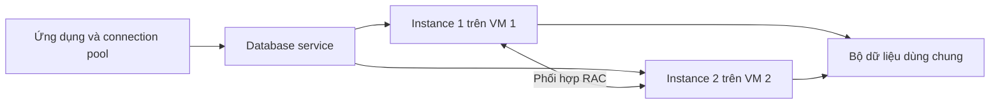
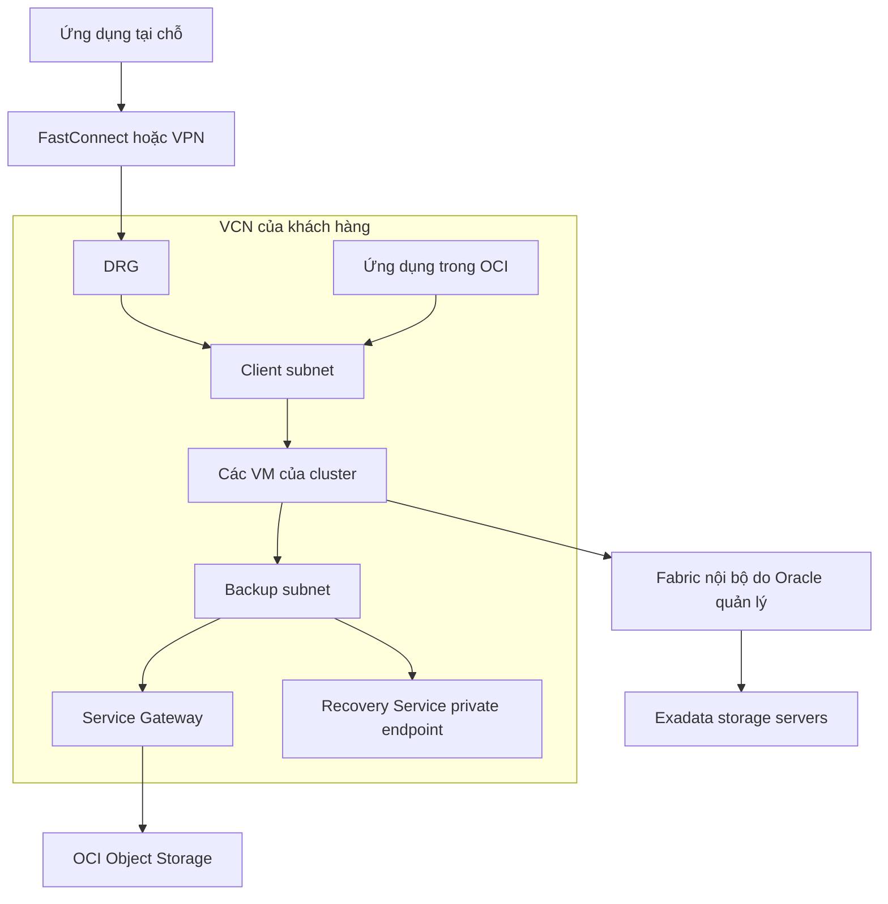

# Kiến trúc Exadata Database Service trên OCI

Oracle Exadata Database Service đưa nền tảng Exadata vào mô hình dịch vụ cơ sở dữ liệu trên đám mây. Để thiết kế và vận hành đúng, cần nhìn đồng thời tài nguyên OCI, máy chủ vật lý, VM cluster, phần mềm Oracle Database và các đường truyền dữ liệu.

Bài học thuộc chương **Exadata và Cloud@Customer** của module **CLOUD_PROVIDERS_ORACLE**. Trọng tâm là **Exadata Database Service on Dedicated Infrastructure (ExaDB-D)** trong trung tâm dữ liệu OCI. Đây là nền tảng cho việc kết hợp tenancy, compartment, IAM, VCN, giám sát và tự động hóa vào một hệ thống cơ sở dữ liệu Oracle. [Kiến trúc tổng thể ExaDB-D của Oracle](https://docs.oracle.com/en/engineered-systems/exadata-cloud-service/ecsid/).

## 1. Phạm vi và mục tiêu kiến trúc

Sau bài học, người học có thể:

- Phân biệt infrastructure, VM cluster, Database Home, database và database instance.
- Theo dõi một kết nối từ ứng dụng tới dịch vụ cơ sở dữ liệu.
- Giải thích vai trò của RAC, ASM, Smart Scan, backup và Data Guard.
- Xác định ranh giới phân quyền, bảo trì, tài nguyên và miền lỗi.
- Lập phương án triển khai có giám sát, khả năng khôi phục và dự toán chi phí.

Exadata trên OCI và Exadata Cloud@Customer khác nhau trước hết ở vị trí đặt hạ tầng. Với Cloud@Customer, phần cứng Oracle được đặt tại trung tâm dữ liệu khách hàng và kết nối với OCI để thực hiện tự động hóa, quản trị. Vì vậy, không áp nguyên xi thiết kế mạng OCI của bài này vào mạng tại chỗ. [Kiến trúc Cloud@Customer](https://docs.oracle.com/en/engineered-systems/exadata-cloud-at-customer/eccid/all_diagrams.html).

Bài sử dụng **VM cluster với lưu trữ ASM** làm cấu hình tham chiếu. ExaDB-D hiện còn hỗ trợ cấu hình lưu trữ Exascale trên hạ tầng phù hợp; khi đó cần xét thêm storage pool và storage vault. Không được suy ra mọi VM cluster đều có cùng cách tổ chức disk group. [Các cấu hình lưu trữ ExaDB-D](https://docs.oracle.com/en/engineered-systems/exadata-cloud-service/ecscm/ecs-storage-config.html).

## 2. Hai góc nhìn: tài nguyên dịch vụ và thành phần thực thi

### 2.1. Cây tài nguyên quản trị

Mô hình tài nguyên gồm **Cloud Exadata Infrastructure** làm tài nguyên cha và **Cloud VM Cluster** gắn với hạ tầng đó. Cấp infrastructure quản lý cấu hình máy chủ và lịch bảo trì hạ tầng; cấp VM cluster gắn với mạng, tài nguyên xử lý và Grid Infrastructure. Đây là mô hình cần dùng khi đọc Console hoặc thiết kế tự động hóa. [Mô hình tài nguyên và cách khởi tạo](https://docs.oracle.com/en/engineered-systems/exadata-cloud-service/ecscm/ecs-create-instance.html).

```text
Cloud Exadata Infrastructure
├── Cloud VM Cluster: giao dịch
│   ├── Database Home A
│   │   ├── CDB bán hàng
│   │   │   └── PDB nghiệp vụ
│   │   └── CDB kế toán
│   └── Database Home B
│       └── CDB đang thử nghiệm bản vá
└── Cloud VM Cluster: kiểm thử
    └── Database Home C
        └── CDB kiểm thử
```

Đây là cây quan hệ tài nguyên minh họa, không phải cây thư mục trên đĩa. Cũng không nên xem cây này là sơ đồ đầy đủ của các compartment: phải kiểm tra compartment và OCID của từng tài nguyên khi cấp quyền.

**Database Home** chứa bộ phần mềm Oracle Database. Nhiều database dùng chung một home sẽ dùng chung bộ binary và phiên bản của home đó. **CDB** là cơ sở dữ liệu container; **PDB** chứa môi trường dữ liệu ứng dụng bên trong CDB. Tách home hỗ trợ tổ chức phiên bản và bảo trì, nhưng không tự tách CPU, bộ nhớ hay miền lỗi phần cứng. [Quản lý database trên Exadata](https://docs.oracle.com/en/engineered-systems/exadata-cloud-service/ecscm/manage-databases.html).

Ví dụ, hai database cùng home có thể chịu ảnh hưởng của cùng một thay đổi binary. Nếu cần thử bản vá trước khi đưa vào sản xuất, thiết kế nên chỉ rõ home thử nghiệm, database thử nghiệm và trình tự chuyển đổi; chỉ đổi tên database không tạo ra ranh giới bảo trì.

### 2.2. Các lớp thực thi

| Lớp | Thành phần chính | Câu hỏi cần trả lời khi thiết kế |
| --- | --- | --- |
| Ứng dụng | Driver, connection pool, database service | Ứng dụng tìm endpoint và kết nối lại thế nào? |
| Database | CDB, PDB, instance, tiến trình Oracle | Dữ liệu và workload nào dùng chung tài nguyên? |
| Cluster | Guest VM, Grid Infrastructure, RAC | Các node phối hợp và phát hiện lỗi thế nào? |
| Hạ tầng | Database server, storage server, network fabric | Năng lực vật lý và miền lỗi nằm ở đâu? |

Database server cung cấp năng lực chạy VM và database instance; storage server phục vụ lưu trữ Exadata. Hai loại máy chủ liên kết qua fabric tốc độ cao, độ trễ thấp. Guest VM nằm trên hypervisor, tạo ranh giới giữa môi trường khách hàng và hạ tầng Oracle quản lý. [Các lớp vật lý và VM trong kiến trúc ExaDB-D](https://docs.oracle.com/en/engineered-systems/exadata-cloud-service/ecsid/all_diagrams.html).

Vì vậy, một thao tác “tăng tài nguyên” phải nêu rõ lớp tác động. Tăng CPU cho VM cluster, thêm database server và thêm storage server giải quyết những nhu cầu khác nhau.

## 3. VM cluster và Oracle RAC

### 3.1. VM cluster là đơn vị tổ chức môi trường chạy

Một VM cluster tập hợp các guest VM trên những database server được lựa chọn. Multi-VM cho phép có nhiều cluster trên cùng infrastructure; node subsetting cho phép cluster sử dụng một tập con máy chủ. Số cluster và cách phân bổ thực tế phụ thuộc cấu hình, phiên bản và tài nguyên còn lại. [Quản lý VM cluster và node subsetting](https://docs.oracle.com/en/engineered-systems/exadata-cloud-service/ecscm/manage-vm-clusters.html).

Ví dụ thiết kế có bốn database server: cluster giao dịch đặt VM trên server 1 và 2, cluster kiểm thử đặt VM trên server 3 và 4. Cách bố trí này giúp giải thích ranh giới compute, nhưng cần tiếp tục hỏi hai cluster dùng chung những storage server, thiết bị mạng và lịch bảo trì nào. Hai cluster riêng chưa đủ chứng minh độc lập trước mọi sự cố.

### 3.2. Một database có thể có nhiều instance

Trong RAC, các database instance trên nhiều node cùng truy cập một bộ dữ liệu dùng chung. Instance là bộ nhớ và tiến trình thực thi; database là dữ liệu và các cấu trúc lưu trữ liên quan. Interconnect riêng phục vụ phối hợp giữa các instance. [Kiến trúc Oracle RAC](https://docs.oracle.com/en/database/oracle/oracle-database/26/racad/introduction-to-oracle-rac/overview-of-oracle-rac-architecture-and-processing.html).



Sơ đồ mô tả quan hệ logic, không biểu diễn toàn bộ listener và thiết bị mạng.

Hệ quả thiết kế là phải kiểm thử cả hai phía: database còn instance phục vụ, và ứng dụng có thể chuyển kết nối sang instance đó. Nếu connection pool giữ kết nối hỏng quá lâu, người dùng vẫn thấy gián đoạn dù một instance khác đang hoạt động. Cần định nghĩa thời gian phát hiện lỗi, thời gian lấy lại kết nối và cách xử lý giao dịch có kết quả chưa xác định.

## 4. Lưu trữ Exadata: dữ liệu, phục hồi và xử lý gần dữ liệu

### 4.1. ASM trong cấu hình tham chiếu

Với cấu hình ASM, **DATA** dành cho datafile; **RECO** chủ yếu phục vụ Fast Recovery Area và các tệp liên quan khôi phục. Tên thực tế có thể kèm hậu tố môi trường. Lựa chọn backup cục bộ hoặc SPARSE cho snapshot ảnh hưởng phân bổ dung lượng. Dung lượng đĩa thô không phải dung lượng có thể cấp hết cho dữ liệu ứng dụng. [Tổ chức lưu trữ ASM](https://docs.oracle.com/en/engineered-systems/exadata-cloud-service/ecscm/ecs-storage-config.html).

Khi lập kế hoạch, nên tách các đại lượng:

```text
Nhu cầu lưu trữ vận hành
= dữ liệu hiện tại
+ tăng trưởng dự kiến
+ dung lượng phục hồi
+ clone/snapshot nếu có
+ khoảng trống cho vận hành và xử lý sự cố
```

Đây là khung ước lượng nhu cầu, không phải công thức chuyển đổi raw capacity thành usable capacity của Oracle.

Ví dụ giả định: dữ liệu hiện tại 8 TB và tăng 0,3 TB mỗi tháng. Sau 12 tháng, riêng dữ liệu đã là 11,6 TB. Nếu chỉ chọn cấu hình theo 8 TB ban đầu, kế hoạch chưa tính được tăng trưởng, redo lưu giữ, clone và khoảng trống phục hồi.

### 4.2. Smart Scan

Smart Scan đưa một phần xử lý truy vấn xuống storage server, chẳng hạn lọc hàng và chọn cột cho những phép scan đủ điều kiện. Nhờ đó, ít dữ liệu không cần thiết phải truyền về database server. Khả năng offload phụ thuộc đường thực thi và thao tác được hỗ trợ. [Cơ chế Smart Scan](https://docs.oracle.com/en/engineered-systems/exadata-database-machine/sagug/offloading-data-search-retrieval-processing.html).

Ví dụ SQL minh họa:

```sql
SELECT store_id, SUM(net_amount)
FROM sales_fact
WHERE business_date >= DATE '2026-10-01'
  AND business_date <  DATE '2026-11-01'
GROUP BY store_id;
```

Nếu workload thực tế đủ điều kiện offload, phần lọc dữ liệu có thể được xử lý gần nơi lưu trữ. Tuy nhiên, không thể chỉ nhìn câu SQL này để kết luận Smart Scan chắc chắn diễn ra hoặc dự báo tốc độ. Cần xem execution plan và số liệu thực thi.

Một thao tác tìm một đơn hàng theo khóa duy nhất và một báo cáo quét nhiều tỷ dòng có hành vi rất khác nhau. Khi ứng dụng chậm vì khóa dữ liệu hoặc gọi SQL quá nhiều lần, tăng năng lực scan có thể không xử lý được nguyên nhân.

### 4.3. Chia sẻ tài nguyên I/O

I/O Resource Management (IORM) điều phối tài nguyên I/O giữa các database khi có tranh chấp. Có thể đặt mục tiêu và shares theo ưu tiên workload. Đây là cơ chế quản lý tài nguyên dùng chung, không phải cam kết mọi truy vấn đều đạt một độ trễ cố định. [Quản lý IORM](https://docs.oracle.com/en/engineered-systems/exadata-cloud-service/ecscm/ecs-manage-iorm.html).

Ví dụ, nhóm thiết kế có thể ưu tiên database giao dịch hơn database báo cáo trong giờ bán hàng. Cần đo lại cả thời gian phản hồi giao dịch lẫn thời gian hoàn tất báo cáo; mục tiêu kinh doanh sẽ quyết định mức đánh đổi chấp nhận được.

## 5. Mạng: tách kết nối ứng dụng, backup và quản trị

### 5.1. Luồng dữ liệu và luồng điều khiển

Ứng dụng dùng Oracle Net để truy cập database; quản trị viên dùng OCI Console, CLI hoặc API để quản lý tài nguyên dịch vụ. Luồng quản trị hạ tầng đi qua môi trường dịch vụ Oracle. Vì vậy, quyền gọi API và khả năng kết nối SQL là hai điều kiện cần kiểm tra riêng. [Các luồng truy cập trong kiến trúc tổng thể](https://docs.oracle.com/en/engineered-systems/exadata-cloud-service/ecsid/).

Ví dụ, quản trị viên có thể xem VM cluster trên Console nhưng máy ứng dụng vẫn không phân giải được DNS của database. Ngược lại, ứng dụng có thể đang xử lý giao dịch bình thường trong khi một thao tác quản trị không thực hiện được. Khi ghi nhận sự cố, phải nêu rõ luồng nào thất bại.

### 5.2. Các mạng cần nhận diện

| Mạng | Vai trò | Điểm cần làm rõ trong thiết kế |
| --- | --- | --- |
| Client network | Kết nối ứng dụng và quản trị guest theo quyền được cấp | Nguồn kết nối, DNS, listener, route |
| Backup network | Luồng tới đích backup theo cấu hình dịch vụ | Đường đi, băng thông, quy tắc bảo mật |
| Interconnect nội bộ | Trao đổi RAC và truy cập storage | Không dùng làm mạng truy cập ứng dụng |
| Management network | Quản trị hạ tầng và tự động hóa Oracle | Ranh giới với mạng khách hàng |

ExaDB-D đặt các kết nối khách hàng trong VCN, với client subnet và backup subnet riêng. Kết nối từ tại chỗ có thể đi qua DRG bằng FastConnect hoặc Site-to-Site VPN. Object Storage có thể được truy cập qua Service Gateway. [Thiết kế VCN cho Exadata](https://docs.oracle.com/en/engineered-systems/exadata-cloud-service/ecsid/exadbd_vcn.html).



Hai nhánh backup minh họa các lựa chọn đích, không yêu cầu bật đồng thời. Với Recovery Service, cần cấu hình subnet đăng ký cho dịch vụ và private endpoint tương ứng; không mặc định dùng cùng đường đi Service Gateway của Object Storage. [Chuẩn bị kết nối Recovery Service](https://docs.oracle.com/en-us/iaas/recovery-service/doc/getting-started-recovery-service.html).

Các mũi tên thể hiện khả năng kết nối cần có. Chúng không thay thế route table, NSG, security list hoặc các yêu cầu mạng riêng của dịch vụ.

### 5.3. SCAN, listener và database service

Ứng dụng nên kết nối qua tên SCAN và database service thay vì cố định vào IP một VM. SCAN hỗ trợ tìm listener thích hợp; service xác định dịch vụ database mà ứng dụng yêu cầu. Từ đó, kết nối được chuyển đến instance phục vụ. [Luồng kết nối ứng dụng tới Exadata](https://docs.oracle.com/en/solutions/migrate-to-oracle-vmware-solution/index.html).

Chuỗi JDBC sau chỉ minh họa cấu trúc kết nối Oracle Net:

```text
jdbc:oracle:thin:@//sales-scan.db.example.internal:1521/sales_rw.example.internal
```

Tên miền, cổng và service đều là ví dụ; phải lấy cấu hình thật từ database đích. Với TCPS, cần cấu hình driver, trust và endpoint theo môi trường.

Một phép thử TCP tới listener chưa đủ chứng minh ứng dụng kết nối được. Cần kiểm tra theo thứ tự: phân giải DNS, route hai chiều, quy tắc mạng, listener, service, xác thực, rồi truy vấn nghiệp vụ. Lỗi tại mỗi bước cần bằng chứng riêng để tránh mở rộng quyền mạng một cách thiếu căn cứ.

### 5.4. Dự trù subnet và IP

Subnet cần đủ địa chỉ cho node, VIP, SCAN, các địa chỉ dịch vụ và kế hoạch mở rộng. Phải kiểm tra CIDR dự kiến với các dải dành riêng của Exadata và mạng doanh nghiệp; không sao chép nguyên CIDR từ một ví dụ khác. [Yêu cầu mạng Exadata](https://docs.oracle.com/en-us/iaas/exadatacloud/doc/ecs-network-setup.html).

Trong hồ sơ thiết kế nên có bảng ghi subnet, CIDR, route table, NSG, nguồn được phép và bên chịu trách nhiệm DNS. Nếu kết nối xuyên từ tại chỗ, bổ sung cách phân giải tên riêng và route chiều về. Một subnet “còn IP” chưa chứng minh toàn bộ đường kết nối hợp lệ.

## 6. Ranh giới trách nhiệm và bảo mật

### 6.1. Oracle quản lý hạ tầng; khách hàng quản lý môi trường database

| Phạm vi | Trách nhiệm chủ đạo |
| --- | --- |
| Phần cứng, hypervisor, storage server và fabric | Oracle quản lý, giám sát và bảo trì hạ tầng |
| Guest OS, Grid Infrastructure, Oracle Database software | Khách hàng chịu trách nhiệm quản lý và bảo trì, có công cụ tự động hóa hỗ trợ |
| Dữ liệu, schema, tài khoản và chính sách truy cập | Khách hàng thiết kế và vận hành |
| Đường truy cập trong VCN khách hàng | Khách hàng cấu hình mạng và kiểm soát truy cập |

Dịch vụ được quản lý không đồng nghĩa Oracle quyết định toàn bộ bản vá và thiết lập bên trong guest. Cần lập lịch cho cả phần hạ tầng lẫn phần mềm khách hàng quản lý. [Phân chia trách nhiệm ExaDB-D](https://docs.oracle.com/en/engineered-systems/exadata-cloud-service/ecscm/exa-service-desc.html).

### 6.2. Ba lớp quyền khác nhau

- **OCI IAM**: quyền đọc hoặc thay đổi tài nguyên cloud.
- **Hệ điều hành**: quyền đăng nhập guest VM và thực hiện tác vụ được cấp.
- **Database**: quyền đăng nhập, truy cập dữ liệu và quản trị bên trong database.

Khách hàng kiểm soát truy cập vào VM và database; Oracle kiểm soát hạ tầng do Oracle quản lý. TDE bảo vệ dữ liệu lưu trữ, nhưng quyền database và bảo vệ đường kết nối vẫn cần được thiết kế riêng. [Hướng dẫn bảo mật ExaDB-D](https://docs.oracle.com/en/engineered-systems/exadata-cloud-service/ecscm/ecs-security-guide.html).

Ví dụ IAM chỉ phục vụ quan sát hai loại tài nguyên:

```text
Allow group ExadataObservers to inspect cloud-exadata-infrastructures in compartment DatabaseProd
Allow group ExadataObservers to inspect cloud-vmclusters in compartment DatabaseProd
```

Tên group và compartment là tên mẫu; cần dùng định danh phù hợp với identity domain thực tế. Hai dòng này không phải bộ policy đầy đủ cho tạo cluster, quản lý database hay xem mọi metric. Các thao tác có thể cần quyền trên nhiều loại tài nguyên liên quan. [Policy cho Exadata Cloud Infrastructure](https://docs.oracle.com/en/engineered-systems/exadata-cloud-service/ecscm/ecs-policy-details.html).

Trong một tổ chức, nên phân biệt người thiết kế mạng, người vận hành database và người quan sát chi phí. Nếu một tài khoản có thể vừa thay đổi SSH key vừa quản trị database, phải đánh giá quyền tổng hợp của tài khoản đó, không chỉ nhìn tên nhóm.

## 7. Tính sẵn sàng, khôi phục và miền lỗi

### 7.1. Phân tích lỗi theo lớp

Bảng dưới đây là khung phân tích thiết kế, không phải cam kết SLA:

| Tình huống | Cơ chế cần xem xét | Cần kiểm thử thêm |
| --- | --- | --- |
| Một database instance mất | RAC và database service | Connection pool, giao dịch đang chạy |
| Một máy chủ hoặc thiết bị lưu trữ lỗi | Dự phòng hạ tầng, cấu hình cluster và storage | Năng lực còn lại khi suy giảm |
| Xóa nhầm dữ liệu | Backup và khả năng phục hồi tới thời điểm cần thiết | Thời gian restore và xác minh dữ liệu |
| Mất một hạ tầng hoặc một địa điểm | Standby ở miền lỗi khác | Đường mạng và quy trình chuyển vai trò |
| Mất toàn region | Phương án DR ngoài region | Ứng dụng, DNS, khóa và dịch vụ phụ thuộc |

RAC dùng chung bộ dữ liệu, nên việc có nhiều instance không tạo thêm một bản database độc lập để xử lý mọi thảm họa.

### 7.2. Backup và Data Guard giải quyết những yêu cầu khác nhau

Automatic backup có thể dùng Autonomous Recovery Service hoặc Object Storage. Cần xác định retention, đích backup, quyền sử dụng khóa và đường truyền phục hồi. Không tự trộn công cụ backup quản lý bởi dịch vụ với script RMAN độc lập nếu chưa tuân thủ mô hình được hỗ trợ. [Quản lý backup và recovery Exadata](https://docs.oracle.com/en/engineered-systems/exadata-cloud-service/ecscm/ecs-managing-db-backup-and-recovery.html).

Data Guard duy trì database standby. Oracle khuyến nghị primary và standby của workload sản xuất ở các Exadata infrastructure khác nhau; nếu cần cô lập lỗi region, phải đặt standby ở region khác. Standby cùng infrastructure vẫn chia sẻ rủi ro hạ tầng đó. [Data Guard với Exadata Cloud Infrastructure](https://docs.oracle.com/en/engineered-systems/exadata-cloud-service/ecscm/ecs-using-data-guard.html).

Khi lập mục tiêu khôi phục:

- **RPO** là mức mất dữ liệu tối đa có thể chấp nhận.
- **RTO** là thời gian tối đa chấp nhận để khôi phục dịch vụ.

Ví dụ giả định, nghiệp vụ yêu cầu RPO 5 phút và RTO 30 phút. Nhóm thiết kế phải đo redo transport/apply lag và thời gian chuyển dịch vụ, sau đó diễn tập cả ứng dụng. Việc một thao tác chuyển vai trò database hoàn tất trong 10 phút chưa chứng minh toàn hệ thống đáp ứng RTO nếu ứng dụng mất thêm 40 phút để khởi động và kết nối lại.

Backup còn cần thiết ngay cả khi có standby, vì sai sót logic có thể lan sang standby. Bản thiết kế phải ghi rõ cách chọn thời điểm phục hồi và cách xác nhận dữ liệu sau phục hồi.

## 8. Năng lực, mở rộng và chi phí

### 8.1. Phân biệt thay đổi phân bổ với mở rộng vật lý

| Nhu cầu quan sát được | Hướng đánh giá |
| --- | --- |
| Thiếu CPU nhưng hạ tầng còn năng lực | Điều chỉnh CPU cấp cho VM cluster |
| Thiếu bộ nhớ hoặc tài nguyên VM | Đánh giá cấu hình VM, workload và giới hạn còn lại |
| Thiếu năng lực database server | Đánh giá thêm database server và bố trí VM |
| Thiếu dung lượng hoặc năng lực lưu trữ | Đánh giá thêm storage server, cấp phát và rebalance |
| Workload tranh chấp nhau | Đánh giá phân tách cluster, resource plan và IORM |

Khả năng mở rộng phụ thuộc thế hệ hạ tầng và cấu hình. Đơn vị CPU cũng phải đọc đúng: các thế hệ dùng OCPU và những thế hệ mới dùng ECPU không được thay thế số lượng cho nhau trong dự toán. Scale CPU và mở rộng máy chủ là những thao tác khác nhau. [Các lựa chọn mở rộng Exadata](https://docs.oracle.com/en/engineered-systems/exadata-cloud-service/ecscm/ecs-manage-infrastructure.html).

Ví dụ giả định với hai node có năng lực bằng nhau: bình thường mỗi node chạy ở mức 40%. Khi một node mất, tải chuyển sang node còn lại có thể tiến gần 80% nếu tổng workload giữ nguyên. Đây là phép tính dung lượng đơn giản, chưa tính chi phí chuyển đổi và đặc điểm workload; nên dùng làm điểm khởi đầu cho thử tải suy giảm.

### 8.2. Chi phí có phần hạ tầng và phần sử dụng

Chi phí ExaDB-D cần xét hạ tầng đã cấp, CPU sử dụng, lựa chọn License Included hoặc BYOL và các dịch vụ đi kèm. Giảm CPU hoặc xóa VM cluster không tự kết thúc phí của infrastructure còn tồn tại. Đơn giá, thời gian tính phí tối thiểu và điều kiện license phải kiểm tra theo cấu hình, hợp đồng và bảng giá hiện hành. [Mô hình sử dụng và tính phí](https://docs.oracle.com/en/engineered-systems/exadata-cloud-service/ecscm/exa-service-desc.html).

Khung dự toán nội bộ có thể tổ chức như sau:

```text
Chi phí dự kiến trong kỳ
= hạ tầng chính
+ CPU của các VM cluster
+ backup và lưu giữ
+ hạ tầng/CPU dự phòng DR
+ kết nối mạng
+ giám sát hoặc công cụ bổ sung có tính phí
```

Đây là danh sách nhóm chi phí cần rà soát, không phải biểu thức hóa đơn chính thức. Nên gắn mỗi tài nguyên với môi trường, chủ sở hữu và mục đích sử dụng để giải thích được khoản chi. Với môi trường học tập, có thể bắt đầu bằng bài thiết kế và quan sát tài nguyên có sẵn thay vì tự cấp một hệ thống Exadata mới.

## 9. Giám sát và bảo trì theo kiến trúc

### 9.1. Quan sát cả ứng dụng, cluster và database

OCI cung cấp metric cho VM cluster trong namespace `oci_database_cluster`; metric database có các namespace liên quan tùy cấu hình dịch vụ. Dòng metric phụ thuộc thành phần thu thập và đường mạng. Khi mất metric, cần kiểm tra agent, IAM và kết nối trước khi kết luận database không có tải. [Giám sát VM cluster và database](https://docs.oracle.com/en-us/iaas/exadatacloud/doc/monitor-metrics-for-vmcluster-resources.html).

Danh sách sau là đề xuất theo dõi cho một thiết kế:

| Góc quan sát | Bằng chứng nên thu thập | Quyết định hỗ trợ |
| --- | --- | --- |
| Ứng dụng | Độ trễ p95/p99, lỗi kết nối, timeout | Người dùng có đang bị ảnh hưởng? |
| VM và cluster | CPU, bộ nhớ, trạng thái node | Có thiếu năng lực hoặc mất node? |
| Database | Wait, SQL tiêu tốn tài nguyên, khóa | Tối ưu SQL hay mở rộng tài nguyên? |
| Storage | Dung lượng dùng được, tốc độ tăng, I/O latency | Khi nào cần bổ sung hoặc điều phối I/O? |
| Recovery | Kết quả backup, lần diễn tập restore, standby lag | Có còn đáp ứng RPO/RTO? |

Các chỉ số nghiệp vụ và số liệu database chuyên sâu có thể cần công cụ bổ sung; không mặc định mọi mục trong bảng đều là metric có sẵn trong cùng một namespace.

### 9.2. Lịch bảo trì phải đi cùng hành vi ứng dụng

Bản vá Database Home tác động tới phần mềm dùng chung trong home. Cần đánh giá tương thích, chạy precheck theo quy trình và chọn kế hoạch bảo trì phù hợp với loại cập nhật. [Bản vá và cập nhật Exadata](https://docs.oracle.com/en/engineered-systems/exadata-cloud-service/ecscm/ecs-patch-update.html).

Một kế hoạch thực tế nên chỉ rõ:

1. Thành phần được cập nhật và database chịu ảnh hưởng.
2. Năng lực khi từng node tạm ngừng phục vụ.
3. Cách rút hoặc phục hồi kết nối ứng dụng.
4. Bằng chứng trước và sau bảo trì.
5. Điều kiện dừng và phương án khôi phục được hỗ trợ.

“Rolling” mô tả cách thay đổi lần lượt các thành phần; trải nghiệm người dùng còn phụ thuộc service, driver, connection pool và giao dịch đang chạy. Cần kiểm thử hành vi ứng dụng bằng workload đại diện.

## 10. Thực hành đọc kiến trúc từ một môi trường có sẵn

### 10.1. Điều kiện thực hành

Sử dụng tenancy và tài nguyên đã được cấp cho việc học, OCI CLI đã cấu hình xác thực, region đúng và quyền quan sát tương ứng. Các lệnh dưới đây chỉ liệt kê hoặc đọc tài nguyên. Chúng là ví dụ để người học thực hiện trong môi trường được giao, không phải kết quả của một lần chạy thật.

Ví dụ dùng PowerShell; thay các giá trị mẫu bằng OCID và region thực tế.

### 10.2. Tìm infrastructure và VM cluster

```powershell
$labCompartmentId = 'ocid1.compartment.oc1..REPLACE_ME'
$labRegion = 'REPLACE_ME'

oci db cloud-exa-infra list --compartment-id $labCompartmentId --region $labRegion --all
```

Ghi nhận OCID infrastructure, trạng thái và availability domain từ kết quả. Lệnh `cloud-exa-infra list` trả tài nguyên trong compartment được chỉ định. [Tham chiếu lệnh liệt kê infrastructure](https://docs.oracle.com/en-us/iaas/tools/oci-cli/latest/oci_cli_docs/cmdref/db/cloud-exa-infra/list.html).

```powershell
$labInfrastructureId = 'ocid1.cloudexadatainfrastructure.oc1.REPLACE_ME'

oci db cloud-vm-cluster list --compartment-id $labCompartmentId --cloud-exa-infra-id $labInfrastructureId --region $labRegion --all
```

Nếu VM cluster nằm ở compartment khác, dùng compartment tương ứng khi liệt kê. Bộ lọc infrastructure giúp xác định quan hệ tài nguyên. Kết quả rỗng cần được đối chiếu với region, compartment và quyền của người gọi. [Tham chiếu lệnh liệt kê VM cluster](https://docs.oracle.com/en-us/iaas/tools/oci-cli/latest/oci_cli_docs/cmdref/db/cloud-vm-cluster/list.html).

### 10.3. Đọc cluster và Database Home

```powershell
$labClusterId = 'ocid1.cloudvmcluster.oc1.REPLACE_ME'

oci db cloud-vm-cluster get --cloud-vm-cluster-id $labClusterId --region $labRegion

oci db db-home list --compartment-id $labCompartmentId --vm-cluster-id $labClusterId --region $labRegion --all
```

Đối chiếu ID infrastructure cha, subnet, cấu hình CPU và Grid Infrastructure trong thông tin cluster. Sau đó nhận diện các home và phiên bản phần mềm. Dùng compartment chứa home nếu khác giá trị mẫu. [Tham chiếu đọc cluster](https://docs.oracle.com/en-us/iaas/tools/oci-cli/latest/oci_cli_docs/cmdref/db/cloud-vm-cluster/get.html), [tham chiếu liệt kê Database Home](https://docs.oracle.com/en-us/iaas/tools/oci-cli/latest/oci_cli_docs/cmdref/db/db-home/list.html).

### 10.4. Sản phẩm thực hành

Tạo một sơ đồ hoặc bảng ghi nhận trong phạm vi bài tập được giao, gồm:

- Infrastructure và VM cluster liên quan.
- Database Home, database và service ứng dụng sử dụng.
- Client subnet, backup subnet, đường kết nối từ ứng dụng.
- Đích backup và miền lỗi của standby nếu có.
- Nhóm chịu trách nhiệm mạng, database và bảo trì.

Nếu chưa được cấp môi trường Exadata, hoàn thành các mục này dưới dạng thiết kế giả định và đánh dấu rõ thông tin chưa kiểm chứng. Không điền trạng thái thành công giả vào bảng.

## 11. Ví dụ quyết định kiến trúc cho hệ thống bán hàng

Giả sử doanh nghiệp có ứng dụng bán hàng chạy trên OCI Compute, yêu cầu database riêng tư, báo cáo cuối ngày và khả năng tiếp tục vận hành khi một node lỗi. Các quyết định sau là ví dụ thiết kế, chưa phải cấu hình đã được triển khai hay thử tải:

| Quyết định | Mục đích | Điều kiện cần xác minh |
| --- | --- | --- |
| Đặt VM cluster trong client và backup subnet riêng | Tổ chức luồng kết nối và backup | CIDR, DNS, route, quy tắc dịch vụ |
| Kết nối qua SCAN và service bán hàng | Tránh cố định ứng dụng vào một node | Driver, pool và thử lỗi node |
| Dự trù năng lực khi thiếu một node | Duy trì tải giao dịch trong chế độ suy giảm | Thử tải với tỷ lệ lỗi và độ trễ thực tế |
| Lập ưu tiên I/O cho giao dịch | Hạn chế tranh chấp với báo cáo | Thời gian phản hồi và thời hạn hoàn tất báo cáo |
| Backup ra đích ngoài lưu trữ vận hành | Có phương án phục hồi dữ liệu | Retention, quyền khóa, diễn tập restore |
| Đặt standby ở hạ tầng khác khi yêu cầu DR | Cô lập sự cố hạ tầng chính | Độ trễ mạng, lag và diễn tập chuyển vai trò |

Từ các quyết định này, hồ sơ triển khai cần ghi cụ thể nguồn kết nối, các OCID liên quan, quyền của từng nhóm, mục tiêu khôi phục và chi phí dự kiến. Mọi mục tiêu như “chuyển đổi trong 30 phút” phải đi kèm phép đo để có thể nghiệm thu.

## 12. Những nhầm lẫn cần tránh khi đọc sơ đồ

| Nhầm lẫn | Cách diễn giải chính xác hơn |
| --- | --- |
| Một VM cluster là một database | Cluster là môi trường chạy; cần đọc tiếp home và database |
| Hai RAC instance là hai bản database độc lập | Các instance cùng truy cập bộ dữ liệu dùng chung |
| Hai VM cluster tạo DR hoàn chỉnh | Phải xem chúng còn dùng chung hạ tầng và miền lỗi nào |
| Có SCAN thì mọi giao dịch tự phục hồi | Cần kiểm thử cả driver, pool và hành vi giao dịch |
| IAM cho phép xem cluster thì SQL đăng nhập được | IAM, mạng, OS và quyền database là các lớp khác nhau |
| Có backup nghĩa là đã đạt RTO | Cần đo quá trình phục hồi và đưa ứng dụng trở lại |
| Giảm CPU làm hết mọi chi phí Exadata | Infrastructure và các dịch vụ đi kèm vẫn cần được tính |
| Mọi cấu hình ExaDB-D đều dùng ASM giống nhau | Phải xác định cấu hình ASM hay Exascale đang sử dụng |

Khi đánh giá một kiến trúc Exadata trên OCI, hãy lần theo một yêu cầu từ ứng dụng tới service, instance và dữ liệu; sau đó lần theo một sự cố tới cơ chế phục hồi và nhóm chịu trách nhiệm. Cách đọc này biến sơ đồ thành một thiết kế có thể triển khai, đo lường và vận hành.
