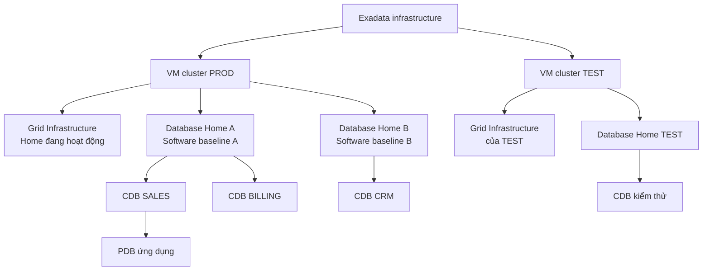
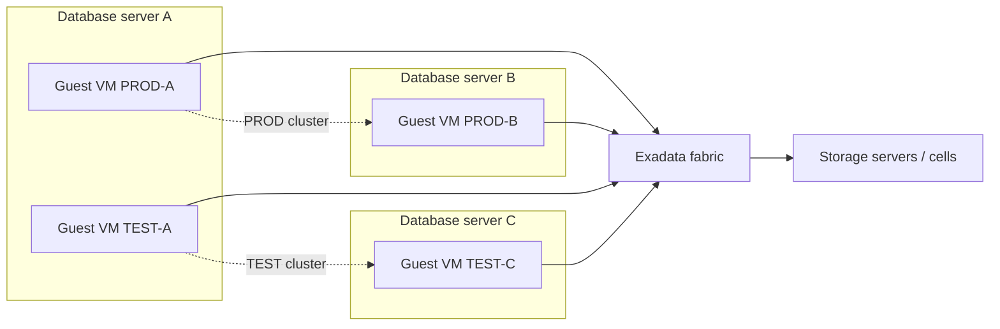

# Exadata infrastructure, VM clusters và database homes

## Mục tiêu và phạm vi

Trong chương **Exadata và Cloud@Customer** của module **CLOUD_PROVIDERS_ORACLE**, ba khái niệm infrastructure, VM cluster và Database Home giúp xác định tài nguyên nào đang được cấp phát, phần mềm nào đang chạy và thay đổi nào có thể ảnh hưởng đến database.

Bài này tập trung vào **Exadata Database Service on Dedicated Infrastructure** trong OCI và đối chiếu với **Exadata Database Service on Cloud@Customer**. Mô hình minh họa dùng database do khách hàng quản trị và lưu trữ ASM. Autonomous Database trên Exadata và cấu hình dùng Exascale có mô hình/tùy chọn riêng; không áp dụng nguyên trạng mọi chi tiết của bài cho các dịch vụ đó.

Sau bài học, người học có thể:

- Vẽ quan hệ infrastructure → VM cluster → Database Home → database.
- Phân biệt database server vật lý, guest VM, Oracle Grid Infrastructure và Oracle Database binaries.
- Chọn lớp thay đổi phù hợp khi thiếu capacity, cần phiên bản database khác hoặc cần bảo trì.
- Kiểm kê tài nguyên bằng Console/CLI và nhận diện đúng họ API của Dedicated Infrastructure và Cloud@Customer.
- Đánh giá phạm vi ảnh hưởng, phân quyền, giám sát, tính sẵn sàng và chi phí của từng lớp.

Tên tài nguyên, số liệu capacity và ví dụ bên dưới là giả định phục vụ học tập. Các lệnh thực hành chỉ đọc thông tin; bài không yêu cầu tạo hoặc xóa một hệ thống Exadata thực để hiểu kiến trúc.

## 1. Ba lớp trả lời ba câu hỏi khác nhau

| Lớp | Câu hỏi chính | Ví dụ quyết định |
| --- | --- | --- |
| Exadata infrastructure | Có những tài nguyên hạ tầng Exadata nào để sử dụng? | Số database server/storage server, capacity và bảo trì hạ tầng |
| VM cluster | Phần tài nguyên nào được cấp cho môi trường database này? | Placement của VM, CPU/memory, mạng và Grid Infrastructure |
| Database Home | Database sử dụng bộ phần mềm Oracle nào? | Version/image/RU, đường dẫn software và vòng đời cập nhật |

Trong mô hình tài nguyên hiện hành của Dedicated Infrastructure, infrastructure và cloud VM cluster là các tài nguyên tách biệt. VM cluster là tài nguyên con của infrastructure; chỉ có infrastructure chưa đủ để chạy một database của người dùng. [Oracle: Creating an Exadata Cloud Infrastructure Instance](https://docs.oracle.com/en-us/iaas/exadatacloud/doc/ecs-create-instance.html).

Một cách ghi nhớ khi xử lý yêu cầu:

```text
Cần thêm khả năng phần cứng hoặc capacity nền → xem infrastructure.
Cần môi trường VM/GI/mạng hoặc phân bổ tài nguyên → xem VM cluster.
Cần bộ Oracle Database software khác → xem Database Home.
Cần dữ liệu, CDB/PDB hoặc service ứng dụng → xem database và cấu hình của nó.
```

Đây là điểm bắt đầu phân tích, không phải lệnh tự động scale. Một vấn đề hiệu năng còn có thể bắt nguồn từ SQL, khóa, cấu hình database hoặc mạng, nên phải đo trước khi chọn giải pháp.

## 2. Exadata infrastructure gồm những gì?

### Database server và storage server có nhiệm vụ khác nhau

Database server cung cấp compute và chạy các guest VM chứa phần mềm database. Exadata storage server, thường gọi là storage cell, phục vụ lớp lưu trữ và các chức năng Exadata tương ứng. Hai nhóm được kết nối qua fabric nội bộ có độ trễ thấp; topology và công nghệ cụ thể phụ thuộc thế hệ hệ thống. [Oracle: Rack Overview](https://docs.oracle.com/en/engineered-systems/exadata-cloud-service/ecsid/exadbd_rack.html).

Infrastructure resource biểu diễn cấu hình và capacity của hạ tầng được cấp cho dịch vụ. Khi đọc thông tin, cần tách:

- Số và loại database server.
- Số và loại storage server.
- CPU/memory/local storage có thể phân bổ cho VM.
- Storage capacity theo các cách đo được dịch vụ hiển thị.
- Maintenance, lifecycle state và các resource con đang sử dụng.

Không đồng nhất một OCI resource với một thư mục cài Oracle hoặc một CDB. Infrastructure có thể còn nguyên trong khi một VM cluster hoặc một database đã bị thay thế.

### Phần cứng có sẵn chưa chắc đã được workload sử dụng

Một phần capacity có thể còn chưa phân bổ cho VM cluster. Khi bổ sung capacity hạ tầng, còn phải thực hiện bước phân bổ/mở rộng ở lớp phù hợp để workload sử dụng được phần mới.

Tương tự, một biểu đồ CPU thấp trong một VM không nói toàn bộ infrastructure còn đủ memory, local storage hoặc slot VM để tạo thêm cluster. Đánh giá capacity phải xét nhiều chiều.

Các giới hạn như số VM cluster tối đa, số VM trên một server, CPU tối thiểu và bước tăng tài nguyên phụ thuộc model, phiên bản và tính năng đang hỗ trợ. Kiểm tra bảng cấu hình hiện hành, không ghi nhớ một con số từ một thế hệ Exadata làm giới hạn chung cho mọi hệ thống.

## 3. VM cluster là môi trường chạy database

Một VM cluster tập hợp các guest VM đặt trên những database server được chọn. Đây không phải Kubernetes cluster, và cũng không phải tên khác của một database.

VM cluster gắn với các thành phần như:

| Thành phần | Vai trò |
| --- | --- |
| Guest VM/node | Môi trường hệ điều hành nơi phần mềm database hoạt động |
| CPU và memory | Capacity compute được cấp cho môi trường |
| Local filesystem | Không gian cho software và các nội dung cục bộ theo cấu hình |
| Client/backup network | Các đường truy cập và truyền dữ liệu phục vụ workload/vận hành |
| Grid Infrastructure | Thành phần quản lý cluster và lớp ASM trong mô hình ASM |
| Database Homes | Các bộ Oracle Database software được triển khai trong cluster |

Oracle tách guest VM của khách hàng với hypervisor/hạ tầng do Oracle quản lý. Một database server vật lý có thể chứa VM thuộc các cluster khác nhau khi cấu hình Multi-VM hỗ trợ. [Oracle: VMs and Database Servers](https://docs.oracle.com/en/engineered-systems/exadata-cloud-service/ecsid/exadbd_vmdb.html).

### Multi-VM và node subsetting

Multi-VM cho phép chia cùng infrastructure thành nhiều VM cluster. Node subsetting cho phép một cluster sử dụng một tập con database server, thay vì bắt buộc trải trên mọi server của infrastructure.

Ví dụ một topology giả định:

```text
Database server A: VM-PROD-A, VM-TEST-A
Database server B: VM-PROD-B
Database server C: VM-TEST-C

VM cluster PROD: VM-PROD-A + VM-PROD-B
VM cluster TEST: VM-TEST-A + VM-TEST-C
```

Hai cluster có thể cùng dùng database server A, nhưng không có nghĩa chúng là cùng một guest VM hoặc cùng một GI cluster. Khi server A bảo trì, cả hai môi trường có thể bị tác động tại các VM nằm trên server đó.

Node subsetting có thể hỗ trợ cấu hình một VM trong những trường hợp được dịch vụ cho phép; tên gọi cluster không tự chứng minh có dự phòng node. Oracle khuyến nghị có nhiều VM phù hợp để đáp ứng tính sẵn sàng. [Oracle: Manage VM Clusters](https://docs.oracle.com/en-us/iaas/exadatacloud/doc/manage-vm-clusters.html).

## 4. Hai góc nhìn phải được giữ đồng thời

### Góc nhìn tài nguyên và phần mềm



Đây là quan hệ quản lý/phụ thuộc được minh họa. Database Home A và B không phải hai máy ảo mới. Các database nằm dưới những Home đó vẫn sử dụng tài nguyên VM cluster tương ứng.

### Góc nhìn placement vật lý



Cây tài nguyên cho biết database thuộc Home và cluster nào. Placement cho biết lỗi/bảo trì ở một server vật lý có thể chạm đến những VM nào. Chỉ một trong hai góc nhìn là chưa đủ để đánh giá phạm vi ảnh hưởng.

Việc chia nhiều cluster trên cùng infrastructure hỗ trợ tổ chức môi trường và tài nguyên, nhưng không tạo ra nhiều hạ tầng vật lý độc lập. [Oracle: VM Clusters Architecture](https://docs.oracle.com/en/engineered-systems/exadata-cloud-service/ecsid/exadbd_vmclusters.html).

## 5. Database Home là bộ phần mềm, không phải dữ liệu database

Oracle mô tả Database Home là vị trí thư mục trên các database VM chứa Oracle Database software binaries. Một VM cluster có thể có nhiều Database Home. [Oracle: Create Oracle Database Homes](https://docs.oracle.com/en-us/iaas/exadatacloud/doc/creating-database-homes-exacc.html).

| Khái niệm | Nội dung cần phân biệt |
| --- | --- |
| Database Home | Oracle Database binaries, version/image và inventory liên quan |
| GI Home | Phần mềm Oracle Grid Infrastructure |
| Database | Dữ liệu và metadata của database, cấu hình, instance/service liên quan |
| CDB/PDB | Cấu trúc multitenant bên trong database |
| Database software image | Nguồn phần mềm dùng để tạo Home theo cách được hỗ trợ |
| Backup | Dữ liệu và thông tin cần thiết cho phương án khôi phục |

Một Home mới chưa có nghĩa có database mới. Home mới cũng không tự sao chép dữ liệu từ Home cũ.

Trong cấu hình ASM của bài, datafile thuộc lớp lưu trữ database được quản lý phù hợp, không phải toàn bộ dữ liệu nghiệp vụ nằm trong thư mục `ORACLE_HOME`. Vì vậy, thấy filesystem chứa binaries còn trống chưa chứng minh database còn đủ data storage, và ngược lại.

### Một Home có thể phục vụ nhiều database

Trong ví dụ, SALES và BILLING dùng Home A. Chúng dùng chung bộ binaries của Home, nên cần được tính đến khi Home đó thay đổi. Một Home khác giúp có software baseline/vòng đời cập nhật riêng trong cùng cluster, nhưng không tự cấp riêng CPU, memory, mạng hay hạ tầng lưu trữ vật lý.

Các database vẫn có metadata SQL patch và trạng thái riêng. Không suy rằng chỉ kiểm tra version hiển thị của Home là đã xác nhận mọi CDB/PDB đều hoàn tất mọi bước SQL patch.

### GI Home là lớp khác

GI quản lý các chức năng cluster và ASM trong mô hình này. Database Home chứa phần mềm Oracle Database chạy workload. Tạo Database Home mới không nâng cấp GI đang hoạt động.

Một số quy trình hiện hành quản lý cả các GI Home như tài nguyên riêng. Cần xác định Home GI nào đang active, thay vì đếm số thư mục/Home rồi kết luận cluster đã chuyển version. Ma trận tương thích giữa guest software, GI và database image vẫn phải được kiểm tra.

## 6. Khi nào dùng chung Home, khi nào tách Home hoặc cluster?

Giả sử SALES, BILLING và CRM cùng dùng một infrastructure. Đặt câu hỏi theo mức cô lập thực sự cần:

| Nhu cầu | Điểm bắt đầu thiết kế | Vẫn cần đánh giá |
| --- | --- | --- |
| Hai database cùng baseline và lịch cập nhật | Có thể dùng chung Database Home | Tác động chung của thay đổi Home và điều kiện hỗ trợ |
| Một database cần baseline khác | Tạo/chọn Home khác trong cluster | Tương thích GI, dung lượng software và quy trình di chuyển |
| PROD và TEST cần phân bổ tài nguyên/mạng/quy trình riêng | VM cluster riêng khi phù hợp | Capacity, server cùng chia sẻ và phạm vi bảo trì infrastructure |
| Workload cần độc lập với sự cố cả infrastructure/site | Kiến trúc ở hạ tầng/failure domain phù hợp | Data Guard/DR, mạng, RPO/RTO và quy trình ứng dụng |
| Chỉ cần schema mới trong database hiện có | Thiết kế ở lớp database | Quyền SQL, quota và mức cô lập nghiệp vụ |

Tách Home thường là quyết định về phần mềm và vòng đời cập nhật. Tách VM cluster là quyết định lớn hơn về môi trường chạy và phân bổ tài nguyên. Tách infrastructure liên quan phạm vi phần cứng và vận hành rộng hơn.

Không tạo thêm một cluster chỉ vì hai ứng dụng có tên khác nhau; cũng không gom mọi database vào một Home chỉ vì cùng major release. Yêu cầu về thay đổi, khả dụng và tài nguyên mới là cơ sở quyết định.

## 7. Đọc capacity theo đúng lớp

### CPU, memory và local storage

Lập bảng capacity cho từng database server trước khi tổng hợp toàn infrastructure. Trong giới hạn mô hình được hỗ trợ, có thể dùng quan hệ kiểm tra:

```text
Tổng memory cấp cho các VM trên một server
    ≤ memory có thể phân bổ cho VM của server đó

Tài nguyên cần cho mỗi VM mới
    phải đáp ứng trên từng server được chọn
```

Phần memory có thể phân bổ phải lấy từ dữ liệu dịch vụ sau các overhead/reservation liên quan; không dùng toàn bộ RAM vật lý làm số có thể cấp phát.

Ví dụ minh họa về placement:

| Database server | Memory còn phân bổ được | Yêu cầu của VM mới |
| --- | --- | --- |
| A | 64 GB | 128 GB |
| B | 256 GB | 128 GB |

Toàn hệ thống còn 320 GB, lớn hơn tổng yêu cầu 256 GB, nhưng placement dự kiến vẫn không đáp ứng trên server A. Cộng tổng toàn hệ thống đã che mất nút thắt từng server.

Các con số trên không phải cấu hình Exadata cụ thể hay kích thước VM được khuyến nghị. Khi thực hành, kiểm tra thêm bước tăng hợp lệ, tài nguyên đồng nhất giữa các VM theo cấu hình, slot VM và local storage.

### ECPU/OCPU và phạm vi con số

Xác định đơn vị CPU được model/service sử dụng, trường đang hiển thị là tổng cluster hay trên mỗi VM, và khác biệt giữa capacity hạ tầng với compute được cấp/bật cho cluster. Không cộng các trường khác đơn vị hoặc dùng phép quy đổi tùy ý.

CPU được cấp thêm cho cluster không tự tối ưu SQL hoặc loại bỏ mọi giới hạn database. Nếu có thiết lập giới hạn tài nguyên ở tầng database, cần kiểm tra cùng cấu hình cluster.

### Storage có nhiều cách đo

| Chỉ số | Không được nhầm với |
| --- | --- |
| Raw capacity của thiết bị | Dung lượng usable cho workload |
| Usable storage sau cơ chế bảo vệ dữ liệu | Dung lượng đã phân bổ cho một cluster/database |
| Space được cấp cho cấu hình lưu trữ | Space còn trống trong diskgroup hoặc lớp tương ứng |
| Local filesystem trên VM | Không gian datafile của database |
| Data/Recovery storage | Hai nhu cầu có tốc độ tăng và chính sách khác nhau |

Trong ASM, redundancy và các reservation liên quan ảnh hưởng cách hiểu dung lượng. Không lấy dung lượng thô của storage server làm cam kết dung lượng ứng dụng có thể sử dụng.

Mở rộng số server và phân bổ capacity cho VM cluster là các bước khác nhau. Luôn kiểm tra sau thay đổi xem capacity mới đã hiện ở đúng lớp, thay vì chỉ thấy infrastructure cập nhật thành công.

## 8. Mạng và luồng truy cập

Cần phân biệt ba nhóm luồng:

| Luồng | Mục đích |
| --- | --- |
| Client network | Ứng dụng/SQL client và các kết nối đến database theo cấu hình |
| Backup network | Lưu lượng phục vụ backup và các chức năng liên quan theo thiết kế |
| Hạ tầng quản lý/fabric | Quản lý hệ thống và giao tiếp nội bộ Exadata theo phạm vi Oracle quản lý |

Dedicated Infrastructure sử dụng VCN/subnet và các thành phần mạng được cấu hình cho VM cluster. Kế hoạch cần bao gồm DNS, địa chỉ, route, security rules và kết nối tới đích backup thực tế. [Oracle: Network Setup for Exadata Cloud Infrastructure](https://docs.oracle.com/en-us/iaas/exadatacloud/doc/ecs-network-setup.html).

Không dùng OCID của Home hoặc display name của infrastructure làm JDBC endpoint. Ứng dụng kết nối bằng database service và endpoint được cấu hình, trong khi IAM/API thao tác với resource identifiers.

SSH vào một guest VM thành công cũng chưa chứng minh SQL client vào đúng database/PDB. Tương tự, Console đọc được cluster không chứng minh đường client network đang hoạt động.

Với workload cần HA, thiết kế kết nối phải đi cùng cơ chế database service, DNS và khả năng xử lý reconnect của client. Không chỉ kiểm tra một phiên SQL đang sống rồi coi như đã kiểm thử mọi tình huống node mất kết nối.

## 9. Dedicated Infrastructure và Cloud@Customer khác ở đâu?

| Khía cạnh | Dedicated Infrastructure trong OCI | Exadata Cloud@Customer |
| --- | --- | --- |
| Vị trí hạ tầng | Data center của OCI theo triển khai dịch vụ | Data center của khách hàng |
| Phần cứng dịch vụ | Oracle quản lý theo dịch vụ | Oracle sở hữu/quản lý theo dịch vụ tại site khách hàng |
| Kết nối ứng dụng | VCN và mạng kết nối tới OCI | Mạng client/backup được chuẩn bị tại site |
| Cloud automation | OCI control plane và các thành phần dịch vụ | Có CPS và kết nối automation tới OCI |
| Resource/API infrastructure | Nhóm Cloud Exadata Infrastructure | Nhóm Exadata Infrastructure cho Cloud@Customer |
| Resource/API VM cluster | Cloud VM Cluster | VM Cluster cho Cloud@Customer |

Cloud@Customer có control plane server infrastructure và secure automation tunnel kết nối tới vùng OCI phục vụ quản trị/automation. Đường SQL của ứng dụng và đường cloud management là hai đường có mục đích khác nhau. [Oracle: Exadata Cloud@Customer Architecture Overview](https://docs.oracle.com/en/engineered-systems/exadata-cloud-at-customer/eccid/exacc_overview.html).

Không suy rằng đặt máy tại data center khách hàng có nghĩa dịch vụ hoàn toàn không cần kết nối tới OCI. Khi có sự cố đường quản lý, phải phân biệt tác động tới automation với tình trạng data plane đang quan sát; kết quả cụ thể phụ thuộc thành phần và sự cố thực tế.

Khái niệm Database Home vẫn tồn tại trong VM cluster của Cloud@Customer. Console cho phép đi từ VM cluster tới danh sách Home và xem tài nguyên liên quan. [Oracle: Manage Database Homes on Cloud@Customer](https://docs.oracle.com/en-us/iaas/exadata/doc/ecc-manage-database-homes.html).

### Không trộn với Autonomous Exadata VM Cluster

Cùng một nền tảng Exadata có thể phục vụ các dòng dịch vụ khác nhau. Autonomous Exadata VM Cluster, Autonomous Container Database và Autonomous Database có mô hình provisioning/vận hành riêng. Không dùng một hướng dẫn tạo Database Home cho Exadata Database Service làm hướng dẫn quản trị binaries của Autonomous Database.

## 10. Ranh giới trách nhiệm và quyền truy cập

Với Dedicated Infrastructure do khách hàng quản trị database, Oracle chịu trách nhiệm hạ tầng như hardware, hypervisor và lớp nền tương ứng. Khách hàng chịu trách nhiệm guest VM OS, GI và database software maintenance theo dịch vụ; cloud automation cung cấp công cụ để thực hiện nhiều thao tác đó. [Oracle: Service Description and Responsibilities](https://docs.oracle.com/en-us/iaas/exadatacloud/doc/exa-service-desc.html).

| Nhóm công việc | Chủ thể/quy trình cần xác định |
| --- | --- |
| Sự cố/bảo trì hardware và host nền | Oracle và lịch maintenance dịch vụ |
| Guest OS, GI, Database Home | Nhóm vận hành theo quy trình được hỗ trợ |
| Dữ liệu, schema, SQL user, service | DBA/nhóm ứng dụng theo phân quyền |
| Mạng khách hàng, DNS, firewall, site Cloud@Customer | Nhóm network/site phối hợp phạm vi dịch vụ |
| Backup, restore và kiểm thử DR | Các nhóm chịu trách nhiệm theo mục tiêu đã thống nhất |

Có quyền quản lý một resource OCI không tự động cấp tài khoản hệ điều hành hoặc quyền SQL. Ba lớp IAM, OS và database vẫn phải được kiểm soát riêng.

### Mẫu quyền kiểm kê trên Dedicated Infrastructure

Giả sử các tài nguyên cần kiểm kê nằm trong compartment `ExadataLab`. Mẫu policy chỉ cho phép xem metadata phục vụ bài:

```text
Allow group 'Default'/'ExadataInventory' to inspect cloud-exadata-infrastructures in compartment ExadataLab
Allow group 'Default'/'ExadataInventory' to inspect cloud-vmclusters in compartment ExadataLab
Allow group 'Default'/'ExadataInventory' to inspect db-homes in compartment ExadataLab
Allow group 'Default'/'ExadataInventory' to inspect databases in compartment ExadataLab
Allow group 'Default'/'ExadataInventory' to inspect db-nodes in compartment ExadataLab
```

Thay domain/group/compartment thực tế và đặt policy tại vị trí phù hợp. Xem network, metrics hoặc các tài nguyên khác có thể cần quyền bổ sung theo đúng tab/thao tác.

Tên resource type của Dedicated Infrastructure bao gồm `cloud-exadata-infrastructures` và `cloud-vmclusters`. Khi làm Cloud@Customer, kiểm tra các type như `exadata-infrastructures`, `vmclusters` và quyền mạng cluster tương ứng; không sao chép nguyên policy rồi chỉ đổi display name. [Oracle: Dedicated Infrastructure Policy Details](https://docs.oracle.com/en-us/iaas/exadatacloud/doc/ecs-policy-details.html), [Oracle: Cloud@Customer Policy Details](https://docs.oracle.com/en-us/iaas/exadata/doc/ecc-policy-details.html).

## 11. Trình tự xây dựng môi trường và kiểm tra đầu ra

Đây là trình tự tư duy cho một triển khai được cho phép, không phải yêu cầu tạo mới infrastructure trong bài kiểm kê:

1. **Chuẩn bị hạ tầng:** region/site, quyền, capacity và các điều kiện triển khai.
2. **Chuẩn bị mạng:** client/backup, DNS, địa chỉ và các đường quản trị cần thiết.
3. **Infrastructure sẵn sàng:** xác minh resource và capacity thực tế.
4. **VM cluster:** chọn infrastructure/placement, cấp tài nguyên, cấu hình mạng và GI phù hợp.
5. **Database Home:** chọn image/version được hỗ trợ trong cluster đó.
6. **Database/PDB:** tạo trong Home thích hợp, cùng cấu hình encryption, backup và service.
7. **Nghiệm thu:** kiểm tra đường ứng dụng, quyền, giám sát, backup/restore và yêu cầu khả dụng.

Một số wizard có thể gộp nhiều bước trong giao diện, nhưng các resource và phạm vi trách nhiệm vẫn cần được phân biệt. Không suy từ tên một nút Create rằng mọi tài nguyên con đã tồn tại hoặc sẵn sàng.

Oracle cho phép tạo thêm Database Home và database trong VM cluster. Với database được provision qua các quy trình CDB hiện hành, còn cần hiểu PDB/service bên trong, thay vì coi Database Home là đơn vị nghiệp vụ cuối cùng. [Oracle: Manage Databases on Exadata Cloud Infrastructure](https://docs.oracle.com/en-us/iaas/exadatacloud/doc/manage-databases.html).

Khi chọn Home/image, xác minh tối thiểu:

| Điều kiện | Cần xác nhận |
| --- | --- |
| Hardware và guest software | Hỗ trợ release/image dự kiến |
| GI | Tương thích database release và quy trình cập nhật |
| Version/RU/image | Được dịch vụ cho phép trong thời điểm triển khai |
| Local storage | Đủ cho Home mới, staging và tác vụ liên quan |
| Database mục tiêu | Đúng cluster, Home và cấu hình cần dùng |
| Quy trình vận hành | Có precheck, cửa sổ thay đổi và phương án khôi phục |

Tên major release giống nhau chưa đủ để kết luận mọi tổ hợp tương thích.

## 12. Thực hành kiểm kê bằng Console và OCI CLI

### 12.1. Bắt đầu từ Console

Chọn đúng region và compartment. Trong phần **Oracle Exadata Database Service on Dedicated Infrastructure**:

- Mở infrastructure, ghi nhận model, server/capacity và maintenance.
- Mở VM cluster, ghi nhận parent infrastructure, VM/node placement, tài nguyên và GI.
- Mở **Database Homes**, ghi nhận OCID, software version, trạng thái và đường dẫn nếu hiển thị.
- Mở các database liên quan để đối chiếu Home và service/database identifiers.

Với Cloud@Customer, chọn đúng nhóm dịch vụ và VM cluster tương ứng. Dùng OCID và liên kết parent trong metadata, không chỉ nối các tài nguyên theo tên hiển thị giống nhau.

### 12.2. Đọc Dedicated Infrastructure

Ví dụ PowerShell với OCI CLI đã cấu hình sẵn profile/xác thực được phép. Thay toàn bộ placeholder bằng OCID/region thực tế:

```powershell
$taskRegion = '<OCI_REGION>'
$infraId = '<CLOUD_EXADATA_INFRASTRUCTURE_OCID>'
$clusterId = '<CLOUD_VM_CLUSTER_OCID>'
$compartmentId = '<COMPARTMENT_CHUA_DB_HOMES_OCID>'

oci db cloud-exa-infra get --cloud-exa-infra-id $infraId --region $taskRegion
oci db cloud-vm-cluster get --cloud-vm-cluster-id $clusterId --region $taskRegion
oci db db-home list --compartment-id $compartmentId --vm-cluster-id $clusterId --all --region $taskRegion
```

Lệnh CLI dùng tên `cloud-exa-infra`; tên này không giống nguyên văn resource type IAM `cloud-exadata-infrastructures`. Đối chiếu cú pháp trong [Oracle CLI: cloud-exa-infra get](https://docs.oracle.com/en-us/iaas/tools/oci-cli/latest/oci_cli_docs/cmdref/db/cloud-exa-infra/get.html) và [Oracle CLI: cloud-vm-cluster get](https://docs.oracle.com/en-us/iaas/tools/oci-cli/latest/oci_cli_docs/cmdref/db/cloud-vm-cluster/get.html).

`db-home list` hỗ trợ lọc theo VM cluster; `--all` lấy các trang kết quả thay vì chỉ dựa vào trang đầu. Sau khi chọn một Home từ kết quả, đọc chi tiết:

```powershell
$dbHomeId = '<DB_HOME_OCID>'
oci db db-home get --db-home-id $dbHomeId --region $taskRegion
```

Tham khảo [Oracle CLI: db-home list](https://docs.oracle.com/en-us/iaas/tools/oci-cli/latest/oci_cli_docs/cmdref/db/db-home/list.html) và [Oracle CLI: db-home get](https://docs.oracle.com/en-us/iaas/tools/oci-cli/latest/oci_cli_docs/cmdref/db/db-home/get.html).

Kết quả cần kiểm tra là đúng parent cluster, đúng version, lifecycle state và các database liên quan trên Console. Danh sách rỗng còn có thể do sai compartment, sai filter hoặc quyền, không đủ để kết luận cluster không có Home.

### 12.3. Đọc Cloud@Customer bằng đúng họ lệnh

```powershell
$taskRegion = '<OCI_REGION_QUAN_LY_EXACC>'
$exaccInfraId = '<EXACC_EXADATA_INFRASTRUCTURE_OCID>'
$exaccClusterId = '<EXACC_VM_CLUSTER_OCID>'

oci db exadata-infrastructure get --exadata-infrastructure-id $exaccInfraId --region $taskRegion
oci db vm-cluster get --vm-cluster-id $exaccClusterId --region $taskRegion
```

`exadata-infrastructure get` và `vm-cluster get` này áp dụng cho Cloud@Customer. Một OCID đúng định dạng nhưng đưa vào sai họ API vẫn không trở thành tài nguyên hợp lệ của API đó. [Oracle CLI: exadata-infrastructure get](https://docs.oracle.com/en-us/iaas/tools/oci-cli/latest/oci_cli_docs/cmdref/db/exadata-infrastructure/get.html), [Oracle CLI: vm-cluster get](https://docs.oracle.com/en-us/iaas/tools/oci-cli/latest/oci_cli_docs/cmdref/db/vm-cluster/get.html).

Không cần chạy lệnh create/update/terminate để hoàn thành bài kiểm kê. Nếu lệnh xem thông tin lỗi, ghi lại operation, region, loại resource và request ID phù hợp; không in credential/config xác thực ra biên bản.

### 12.4. Phiếu kiểm kê đầu ra

| Trường | Nội dung cần ghi |
| --- | --- |
| Dòng dịch vụ | Dedicated Infrastructure hay Cloud@Customer |
| Infrastructure | OCID, region/site, model và capacity |
| VM cluster | OCID, parent infrastructure, VM placement và tài nguyên |
| GI | Version và Home active nếu môi trường có thông tin này |
| Database Home | OCID, parent cluster, software version/image, trạng thái |
| Database | Tên/OCID, Home hiện tại, CDB/PDB và service liên quan |
| Vận hành | Chủ sở hữu, lịch maintenance, backup và nguồn metrics |

Phiếu không cần chứa password, private key hoặc nội dung wallet.

## 13. Đối chiếu resource với database đang chạy

Nếu có quyền DBA trên một database lab đã tồn tại, có thể đọc thông tin trong phiên SQL để bổ sung góc nhìn runtime:

```sql
select name, db_unique_name, database_role, open_mode
from v$database;

select inst_id, instance_name, host_name, version, status
from gv$instance
order by inst_id;
```

Các truy vấn này giúp nhận diện database và instance đang hoạt động; chúng không tự cung cấp toàn bộ inventory của infrastructure hoặc version của hypervisor/storage server.

Để kiểm tra phần SQL patch trong container đang kết nối, khi có quyền thích hợp:

```sql
select patch_id, action, status, action_time, description
from dba_registry_sqlpatch
order by action_time;
```

Đối chiếu lịch sử SQL patch với software inventory và work request theo quy trình được hỗ trợ. `DBA_REGISTRY_SQLPATCH` ở một container không chứng minh mọi PDB trong CDB đều đã đạt trạng thái mong muốn.

Quyền IAM để đọc metadata trên Console/CLI không tự cấp quyền truy vấn các view DBA/GV$ này. Nếu chỉ được giao kiểm kê control plane, ghi rõ phần runtime chưa được xác minh, thay vì dùng một credential quản trị ngoài phạm vi.

## 14. Bảo trì: xác định lớp thay đổi và phạm vi ảnh hưởng

| Thay đổi | Phạm vi cần rà soát |
| --- | --- |
| Bảo trì host/storage infrastructure | Các VM/cluster và database phụ thuộc hạ tầng liên quan |
| Guest OS hoặc GI trong cluster | Các workload trong VM cluster theo phương thức thực hiện |
| Cập nhật Database Home | Các database dùng Home và các bước SQL patch tương ứng |
| Di chuyển database sang Home khác | Database mục tiêu, service và dependency của thao tác |
| Cập nhật ứng dụng/schema | User, object và workload nghiệp vụ liên quan |

Một database ở Home B không tự miễn nhiễm với bảo trì GI hoặc host chỉ vì Home A đang dùng baseline khác.

### Bảo trì rolling vẫn cần thiết kế ứng dụng phù hợp

Oracle có quy trình infrastructure maintenance rolling, trong đó các database server được xử lý lần lượt và VM trên host tương ứng có thể bị dừng/khởi động. Ứng dụng phải được thiết kế cho tình huống instance restart và capacity còn lại; rolling không phải cam kết mọi phiên SQL đều giữ nguyên. [Oracle: Configure Oracle-Managed Infrastructure Maintenance](https://docs.oracle.com/en-us/iaas/exadatacloud/doc/exa-conf-oracle-man-infra.html).

Trước thay đổi, cần biết:

- Database/service có thể phục vụ trên node còn lại hay không.
- Capacity đã cấp trên phần còn lại có chịu được workload khi mất một node không.
- Connection pool, timeout, retry và transaction xử lý gián đoạn thế nào.
- Thay đổi có yêu cầu downtime hoặc có các precondition đặc biệt không.

RAC giúp khả dụng ở phạm vi cluster theo thiết kế, nhưng không thay thế backup hoặc DR cho sự cố cả site. Nhiều cluster trên cùng infrastructure vẫn chia sẻ một số failure domain.

### Home mới và chuyển database

Một cách quản lý software lifecycle là chuẩn bị Home đích được hỗ trợ, chạy precheck, rồi di chuyển database theo workflow dịch vụ. Không coi thao tác này là copy một thư mục hoặc sao chép dữ liệu giữa hai database.

Tài liệu Console có quy trình **Move To Another Home** và nêu database có thể được dừng ở Home hiện tại rồi khởi động ở Home đích. Không tự giả định thao tác luôn online hoặc luôn rolling. [Oracle: Managing Oracle Database Homes](https://docs.oracle.com/en-us/iaas/exadatacloud/doc/ecs-manage-dbhomes.html).

Phân biệt thay đổi RU/bản vá với nâng major release; chúng có yêu cầu tương thích và kiểm tra khác nhau. Home cũ còn tồn tại cũng chưa đủ để cam kết rollback hợp lệ sau mọi thay đổi SQL/dictionary.

## 15. Giám sát, chi phí và xử lý tình huống

### Theo dõi theo lớp

| Lớp | Câu hỏi giám sát |
| --- | --- |
| Infrastructure | Có maintenance/sự cố nào? Capacity nền và phân bổ còn phù hợp không? |
| VM cluster/node | CPU, memory, local filesystem, GI và trạng thái VM thế nào? |
| Database Home | Baseline/version có đúng và tác vụ phần mềm đã hoàn tất chưa? |
| Database/PDB | Workload, kết nối, dung lượng, wait/error và service có đạt yêu cầu không? |
| Ứng dụng | Độ trễ, lỗi giao dịch, reconnect và tỷ lệ thành công thực tế ra sao? |

Oracle cung cấp metrics cho VM cluster và database, có điều kiện về quyền và thành phần thu thập. Không có biểu đồ chưa chắc workload bằng không; có thể thiếu quyền, agent hoặc đường xuất metrics. [Oracle: Monitor Metrics for VM Cluster Resources](https://docs.oracle.com/en-us/iaas/exadatacloud/doc/monitor-metrics-for-vmcluster-resources.html).

Không dùng một metric CPU trung bình toàn cluster để che việc một node quá tải hoặc filesystem chứa Home mới gần đầy.

### Chi phí gắn với tài nguyên còn giữ

Tách capacity hạ tầng, compute sử dụng theo model và các chi phí backup/giám sát/liên quan khi lập ngân sách. Không mặc định có một khoản tính phí độc lập cho mỗi Database Home, cũng không suy Home mới là miễn phí trong mọi khía cạnh: nó còn dùng filesystem, công sức vận hành và có thể kéo theo nhu cầu capacity khác.

Giảm workload hoặc xóa một database không tự xóa infrastructure. Giảm compute của cluster cũng không có nghĩa mọi chi phí nền đã chấm dứt. Đối chiếu đúng model sử dụng và tài nguyên còn giữ, không lấy số database làm toàn bộ thước đo chi phí.

### Tình huống chẩn đoán

| Hiện tượng | Phân tích ban đầu | Bằng chứng cần lấy |
| --- | --- | --- |
| Không tạo được VM cluster dù còn CPU | Có thể thiếu memory, slot VM, local storage hoặc placement | Capacity từng server và precheck/work request |
| Tạo Database Home lỗi | Image/GI/guest không tương thích hoặc filesystem/automation có vấn đề | Image/version, free space, operation error |
| Database bị gián đoạn khi host bảo trì | VM nằm trên host bị xử lý, service/client chưa chịu được gián đoạn | Placement, lịch maintenance, trạng thái service và log ứng dụng |
| Hai database ở hai Home cùng lỗi GI | Home tách software database nhưng vẫn chung cluster | GI/node state và các database phụ thuộc |
| Infrastructure vừa mở rộng nhưng cluster chưa có thêm tài nguyên | Capacity mới chưa được phân bổ hoặc thay đổi cluster chưa hoàn tất | Inventory ở cả infrastructure và cluster |
| Database không hiện đúng Home sau thao tác bằng host tooling | Cần đối chiếu nguồn metadata và trạng thái đồng bộ/tác vụ | Thời điểm, tool được dùng, ID và inventory thực tế |
| Không xóa được Home | Vẫn có database phụ thuộc hoặc tác vụ liên quan | Danh sách database, lifecycle và dependency |

Không giải quyết Home chưa trống bằng cách xóa database chưa được đánh giá. Database Home chỉ được dọn khi các phụ thuộc và nhu cầu khôi phục đã được xử lý theo workflow dịch vụ.

## 16. Bài tập thiết kế và tiêu chí hoàn thành

### Bài tập: chọn đúng lớp thay đổi

Cho một infrastructure có cluster PROD và TEST. PROD có hai Database Home, TEST có một Home. Hãy lập phương án cho các yêu cầu:

1. CRM cần baseline phần mềm mới nhưng chưa có nhu cầu tách compute.
2. TEST cần thêm memory, trong khi một database server đã gần hết khả năng phân bổ.
3. PROD cần tiếp tục phục vụ trong một đợt rolling host maintenance.
4. Cần xóa một Home cũ đang được BILLING sử dụng.

Một phương án đạt yêu cầu phải chỉ ra:

| Yêu cầu | Nội dung phải làm rõ |
| --- | --- |
| CRM đổi baseline | Home đích, tương thích, precheck, gián đoạn và kế hoạch khôi phục |
| TEST thêm memory | Capacity/placement từng server; các phương án ở cluster hoặc infrastructure |
| PROD chịu bảo trì | Node/service còn lại, capacity khi mất node và kiểm thử ứng dụng |
| Dọn Home cũ | Dependency của BILLING, workflow di chuyển/retire và bằng chứng Home đã trống |

Bài tập không yêu cầu thực hiện scale, patch hoặc terminate thật. Giá trị học tập nằm ở cách xác định resource bị thay đổi và workload có thể chịu ảnh hưởng.

### Tiêu chí hoàn thành

- Vẽ được cả cây resource và placement VM trên database server.
- Giải thích được vì sao Database Home khác GI Home và khác data storage.
- Nối được một database với Home, VM cluster và infrastructure bằng identifier thực tế hoặc mô hình lab.
- Phân biệt đúng họ resource/API của Dedicated Infrastructure với Cloud@Customer.
- Xác định được giới hạn của việc tách Home, tách cluster và tách infrastructure.
- Có phiếu kiểm kê không chứa bí mật và ghi rõ phần nào đã/chưa được xác minh.
- Đánh giá thay đổi theo capacity, quyền, maintenance, khả dụng và tài nguyên còn phát sinh chi phí.

Khi hiểu đúng các lớp này, người vận hành có thể trả lời rõ một thay đổi sẽ tác động đến phần mềm, môi trường VM hay hạ tầng vật lý, và cần bằng chứng gì để xác nhận database cùng ứng dụng vẫn đáp ứng yêu cầu.
