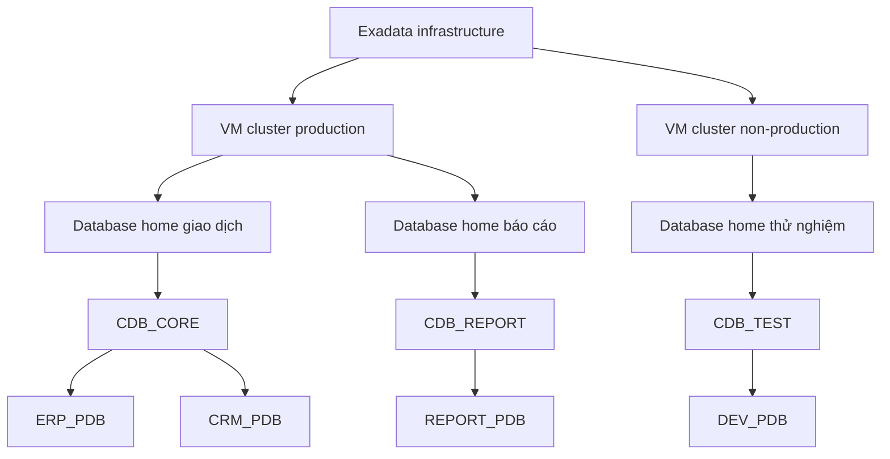

# Lập kế hoạch tài nguyên và hợp nhất nhiều database

Hợp nhất database trên Exadata là bài toán đặt nhiều workload lên tài nguyên dùng chung trong khi vẫn giữ được mức dịch vụ đã cam kết. Một hệ thống còn nhiều CPU ở giờ thấp điểm vẫn có thể thiếu bộ nhớ khi mất node, nghẽn I/O lúc chạy báo cáo hoặc hết vùng phục hồi khi đường truyền backup bị gián đoạn.

Trong chương **Exadata và Cloud@Customer** của nội dung Oracle Cloud Infrastructure (OCI), bài này tập trung vào cách lập kế hoạch cho **Exadata Database Service on Dedicated Infrastructure** và **Exadata Database Service on Cloud@Customer** với database do đội ngũ khách hàng quản trị. Mục tiêu là quyết định database nào nên ở chung, cấp tài nguyên ở tầng nào, kiểm soát tranh chấp ra sao và dựa vào bằng chứng nào để tiếp nhận thêm workload.

Sau bài học, người học có thể:

- Lập hồ sơ tải và phân biệt tài nguyên vật lý, tài nguyên đã cấp với tài nguyên thực dùng.
- Chọn ranh giới hợp nhất giữa infrastructure, VM cluster, database home, CDB và PDB.
- Ước lượng CPU, bộ nhớ, lưu trữ và băng thông cho trạng thái bình thường lẫn trạng thái suy giảm.
- Thiết kế chính sách ưu tiên, giám sát và quy trình mở rộng gắn với chi phí.
- Chuẩn bị hồ sơ tiếp nhận database có tiêu chí đo được và phương án quay lui.

## 1. Xác định phạm vi trước khi tính cấu hình

### 1.1. Hai nơi triển khai, cùng một phương pháp lập kế hoạch

Với Exadata Database Service on Dedicated Infrastructure, hạ tầng Exadata nằm trong OCI. Với Exadata Database Service on Cloud@Customer, hạ tầng được đặt tại cơ sở của khách hàng và được cung cấp theo mô hình dịch vụ tương ứng. Vị trí triển khai làm thay đổi các yếu tố cần đưa vào kế hoạch: mạng kết nối ứng dụng, đường backup, nơi đặt dự phòng, thời gian bổ sung phần cứng và trách nhiệm vận hành tại cơ sở.

Không dùng một bảng giới hạn chung cho mọi thế hệ Exadata. Khả năng cấp OCPU hoặc ECPU, số node có thể chọn cho VM cluster, cách thay đổi bộ nhớ, loại lưu trữ và giới hạn dịch vụ phụ thuộc cấu hình thực tế. Khi lập phương án, ghi rõ:

| Thông tin cần chốt | Ý nghĩa đối với phương án |
| --- | --- |
| Dịch vụ và thế hệ phần cứng | Xác định các tính năng và giới hạn được hỗ trợ |
| Danh sách database server và storage server | Biết tài nguyên vật lý thực có và phạm vi lỗi |
| Phiên bản database, Grid Infrastructure và mức cập nhật | Kiểm tra tương thích, công cụ quản trị và lịch bảo trì |
| Đơn vị CPU của tài nguyên | Tránh nhầm OCPU, ECPU với CPU logic trong hệ điều hành |
| Loại lưu trữ và mô hình dự phòng | Xác định dung lượng sử dụng được, hiệu năng và cách mở rộng |
| Mô hình bản quyền, chủ sở hữu và môi trường | Gắn lựa chọn kỹ thuật với trách nhiệm và chi phí |

Trong ExaDB-D, kiến trúc có một hoặc nhiều VM cluster; node subsetting cho phép lựa chọn một tập database server cho VM cluster theo khả năng được hỗ trợ. Vì vậy, không mặc định mọi VM cluster đều dùng tất cả server trong infrastructure. Tham khảo [kiến trúc kỹ thuật ExaDB-D của Oracle](https://docs.oracle.com/en/engineered-systems/exadata-cloud-service/ecsid/all_diagrams.html).

### 1.2. Đặt mục tiêu dịch vụ trước mục tiêu mật độ

Một phương án cần trả lời ít nhất bốn câu hỏi:

1. Ứng dụng cần thời gian đáp ứng và thông lượng nào trong giờ cao điểm?
2. Khi mất một node hoặc đang bảo trì, workload nào vẫn phải giữ mức dịch vụ?
3. Có thể mất bao nhiêu dữ liệu và mất bao lâu để phục hồi?
4. Doanh nghiệp chấp nhận những database nào cùng chịu ảnh hưởng của một thay đổi hoặc sự cố?

**SLO** là mục tiêu mức dịch vụ, chẳng hạn độ trễ P95 của giao dịch thanh toán dưới 200 ms. **RPO** là mục tiêu về mức mất dữ liệu có thể chấp nhận; **RTO** là mục tiêu thời gian khôi phục dịch vụ.

Các con số trong bài là dữ liệu giả định để minh họa phương pháp, không phải cấu hình tối thiểu, giới hạn hay cam kết hiệu năng của Oracle.

## 2. Hiểu các tầng hợp nhất và phạm vi ảnh hưởng

Một cách bố trí có thể gồm hai CDB production và một CDB non-production:



Sơ đồ biểu diễn quan hệ quản trị; không mô tả đầy đủ đường đi I/O hoặc cách phân bố vật lý.

| Tầng | Có thể dùng để quyết định gì? | Điều vẫn cần tính riêng |
| --- | --- | --- |
| Infrastructure | Tổng năng lực vật lý, kế hoạch mở rộng và miền lỗi | VM cluster cùng infrastructure vẫn có phụ thuộc chung |
| VM cluster | Cấp CPU, bộ nhớ, tài nguyên VM và tổ chức môi trường | Tài nguyên riêng của VM không tạo thêm công suất cho storage server dùng chung |
| Database home | Quản lý bộ Oracle Database binaries và chu kỳ cập nhật | Database home không phải hạn mức CPU hay bộ nhớ |
| CDB | Gom PDB có thể chia sẻ nền tảng database và chu kỳ vận hành | Sự cố CDB có thể ảnh hưởng nhiều PDB |
| PDB | Tách dữ liệu ứng dụng, quản trị và chính sách tài nguyên trong CDB | PDB không có VM hay SGA riêng như một database instance độc lập |

Cần phân biệt **database** với **instance**. Trong RAC, một database có thể được nhiều instance trên các node khác nhau truy cập. Vì vậy, số database không bằng số instance; ngân sách bộ nhớ phải xét từng instance đang chạy trên từng VM.

Nhiều PDB trong cùng CDB chia sẻ các tài nguyên ở cấp CDB instance. Không cộng bộ nhớ như thể mỗi PDB có một SGA độc lập. Ngược lại, nhiều CDB trên cùng VM tạo nhiều tập SGA, tiến trình nền và hoạt động bảo trì cần được tính vào ngân sách.

Một compartment trong OCI giúp tổ chức tài nguyên và quyền điều khiển cloud. Nó không thay thế phân quyền người dùng database, không tạo hạn mức CPU cho PDB và không tự cô lập I/O.

## 3. Thu thập hồ sơ tải có thể dùng để ra quyết định

### 3.1. Mỗi workload phải có người chịu trách nhiệm

Trước khi hỏi “gom được bao nhiêu database”, lập danh mục với các trường sau:

| Nhóm | Dữ liệu cần thu |
| --- | --- |
| Nghiệp vụ | Ứng dụng, chủ sở hữu, mức quan trọng, giờ phục vụ |
| Mức dịch vụ | SLO độ trễ, throughput, RPO, RTO, cửa sổ bảo trì |
| Tương thích | Phiên bản, mức cập nhật, bộ ký tự, timezone file, tùy chọn sử dụng, phụ thuộc ngoài |
| CPU | CPU thực dùng theo thời gian, đỉnh ngắn hạn, mức đồng thời, parallel execution |
| Bộ nhớ | SGA, PGA quan sát được, đỉnh PGA, số phiên, nhu cầu In-Memory nếu có |
| I/O | IOPS, MB/s, kích thước I/O, tỷ lệ đọc/ghi, độ trễ và redo |
| Dung lượng | Datafile, mức đã sử dụng, TEMP, UNDO, vùng phục hồi, tốc độ tăng |
| Vận hành | Backup, thu thập thống kê, ETL, refresh dữ liệu, clone, báo cáo cuối kỳ |
| Mạng | Đường kết nối ứng dụng, backup, replication, RTT và throughput thực tế |
| Cách ly | Dữ liệu nhạy cảm, đội quản trị, yêu cầu tách môi trường và phạm vi sự cố |

Không suy ra nhu cầu CPU chỉ từ số core của máy cũ hoặc số lượng database. Máy cũ có thể đang cấp thừa, đang nghẽn I/O hoặc bị giới hạn bởi phần mềm; thế hệ CPU và hành vi Exadata cũng có thể khác.

### 3.2. Đo theo thời gian và giữ các tải trùng nhau

Khoảng quan sát phải chứa những chu kỳ có ý nghĩa: ngày làm việc, cuối tuần, backup, cuối tháng và các đợt cao điểm nghiệp vụ. Nếu chưa quan sát được một sự kiện hiếm, ghi nó thành giả định cần thử tải thay vì xem như không có tải.

Nên lưu cả trung bình, phân vị và đỉnh ngắn hạn, cùng dấu thời gian và múi giờ. Khoảng lấy mẫu quá dài có thể che mất vài phút quá tải gây timeout.

Có hai phép tính khác nhau:

```text
Tổng các đỉnh riêng lẻ = peak(A) + peak(B) + peak(C)

Đỉnh của tổng tải đồng thời = peak(A(t) + B(t) + C(t))
```

Đỉnh của tổng tải đồng thời hữu ích cho hợp nhất khi các lịch tải được duy trì. Tổng các đỉnh riêng lẻ là một kịch bản kiểm tra khi lịch chạy có thể trùng nhau. Tương tự, không cộng các P95 riêng rồi gọi kết quả đó là P95 của tổng tải.

Dữ liệu AWR/ASH hoặc công cụ quản trị có thể hỗ trợ nếu môi trường có quyền sử dụng phù hợp. Phương án thu thập cũng có thể dùng metric hệ điều hành, metric dịch vụ và các view được phép truy cập. Ghi rõ nguồn đo và điều kiện sử dụng để người khác tái lập được kết quả.

## 4. Chọn nhóm database nên ở chung

### 4.1. Gom theo khả năng vận hành chung

Hai workload có tải thấp chưa chắc phù hợp để ở cùng CDB. Cần kiểm tra:

- Chúng có thể dùng cùng phiên bản database và cùng lịch cập nhật ở cấp CDB không?
- Cửa sổ bảo trì và yêu cầu khôi phục có tương thích không?
- Các đội có chấp nhận chung phạm vi ảnh hưởng khi CDB lỗi hoặc restart không?
- Yêu cầu mã hóa, khóa, audit và quyền quản trị có đáp ứng được ở ranh giới đã chọn không?
- Một workload có tạo đỉnh PGA, parallel execution, redo hoặc TEMP bất thường không?
- Khi giảm tải, có nhóm nào được phép tạm dừng để bảo vệ giao dịch quan trọng không?

Có thể chọn các mức hợp nhất sau:

| Lựa chọn | Lợi ích chính | Đánh đổi |
| --- | --- | --- |
| Nhiều PDB trong một CDB | Giảm lặp lại một phần overhead và thống nhất quản trị | Chia sẻ instance và phạm vi vận hành cấp CDB |
| Nhiều CDB trong một VM cluster | Tách cấu hình database, tập PDB và một phần lịch vận hành | Tốn thêm bộ nhớ, tiến trình và chi phí quản trị |
| Nhiều VM cluster trong một infrastructure | Tách môi trường VM, phân bổ tài nguyên và quyền quản trị rõ hơn | Vẫn phải xét phụ thuộc phần cứng và lưu trữ chung |
| Infrastructure hoặc địa điểm khác | Giảm những phụ thuộc chung tương ứng | Tăng chi phí và công việc kết nối, vận hành, bảo vệ dữ liệu |

Không dùng việc tách database home như bằng chứng đã cô lập hiệu năng. Mục đích chính của database home là quản lý binaries; hiệu năng vẫn phụ thuộc tài nguyên nơi các instance chạy.

### 4.2. Viết quy tắc tiếp nhận và ngoại lệ

Ví dụ quy tắc nội bộ:

- Production và môi trường thử nghiệm tải lớn ở VM cluster khác nhau.
- PDB có cùng chu kỳ cập nhật có thể xét vào cùng CDB sau kiểm tra tương thích.
- Báo cáo có thể ở cùng infrastructure với OLTP nếu có chính sách giới hạn và đã đo ảnh hưởng.
- Database cần độc lập trước sự cố toàn infrastructure phải có phương án ở miền lỗi khác.

Đây là quyết định thiết kế cho một tổ chức, không phải quy định bắt buộc của dịch vụ. Mỗi ngoại lệ cần có chủ sở hữu, lý do, tác động tới SLO và điều kiện xem xét lại.

## 5. Lập ngân sách CPU cho cả trạng thái suy giảm

### 5.1. Tách ba loại số liệu CPU

Trong bảng kế hoạch, ghi riêng:

1. **Năng lực vật lý/khả dụng:** tài nguyên mà infrastructure và cấu hình hiện tại có thể cung cấp.
2. **Tài nguyên đã cấp hoặc kích hoạt:** CPU được cấp cho VM cluster theo mô hình dịch vụ.
3. **Mức sử dụng:** CPU thực tế của hệ điều hành, database và workload.

OCPU/ECPU là đơn vị của dịch vụ; CPU logic mà hệ điều hành hoặc tham số database nhìn thấy là khái niệm khác. Phải dùng quy tắc của đúng thế hệ tài nguyên và kiểm tra trên VM thực tế, không áp dụng một hệ số chuyển đổi cho mọi cấu hình.

Một chỉ số phân tích hữu ích là:

```text
CPU database trung bình trong khoảng đo
    = số giây DB CPU tăng thêm / số giây thời gian thực của khoảng đo
```

Ví dụ, DB CPU tăng 600 giây trong 60 giây tương ứng trung bình 10 CPU logic bận xử lý database trong khoảng đó. Chỉ số này không bao gồm toàn bộ công việc của host, không cho biết trực tiếp độ trễ và không tự chuyển thành số OCPU/ECPU cần mua. Với RAC, cần tổng hợp đúng các instance trong cùng khoảng đo, tránh cộng hai lần cùng phạm vi thống kê.

### 5.2. Tính năng lực sau khi mất node

Giả sử:

- VM cluster có `N` node tương đương.
- Mỗi node có `C` đơn vị CPU hiệu dụng đã hiệu chuẩn trên hệ đích.
- `f` là số node không sẵn sàng trong kịch bản đang xét.
- `u` là tỷ lệ sử dụng mục tiêu do đội vận hành chọn.
- `D` là tải đồng thời cần phục vụ trong kịch bản đó.

Điều kiện sàng lọc:

```text
D <= (N - f) × C × u
```

Nếu cấu hình không đồng đều, thay `(N - f) × C` bằng tổng năng lực các node thực sự còn phục vụ. Nếu các service chỉ chạy trên một tập node, dùng năng lực của tập node đó.

Phép tính này giả định tải có thể phân phối theo thiết kế. Nó chưa chứng minh RAC cân bằng tuyến tính: còn phải đo ảnh hưởng cache lạnh, reconnect, truy cập dữ liệu giữa instance, giao dịch dài và điểm nóng.

### 5.3. Ví dụ: đủ CPU khi bình thường nhưng thiếu khi mất một node

Giả định VM cluster production có hai node. Sau phần dự phòng hệ thống đã xác định, mỗi node cung cấp `64 U` CPU hiệu dụng. `U` là đơn vị nội bộ của ví dụ, không phải tên shape hay đơn vị tính phí OCI.

Đội vận hành chọn mức mục tiêu tối đa 70% cho tải được giữ lại khi mất một node:

```text
Ngân sách CPU ở trạng thái mất một node
    = (2 - 1) × 64 × 0,70
    = 44,8 U
```

Tải cần xét trên toàn cụm:

| Workload | Vị trí | CPU trong kịch bản tải trùng nhau | Mức ưu tiên |
| --- | --- | ---: | --- |
| ERP | ERP_PDB trong CDB_CORE | 24 U | Phải duy trì |
| CRM | CRM_PDB trong CDB_CORE | 12 U | Phải duy trì |
| Báo cáo/ETL | REPORT_PDB trong CDB_REPORT | 20 U | Được phép giảm hoặc hoãn |
| Tổng | | 56 U | |

Khi hai node hoạt động, 56 U trên tổng 128 U tương ứng khoảng 43,8%. Nếu chỉ nhìn tỷ lệ này, người vận hành có thể kết luận còn nhiều chỗ trống.

Khi mất một node, cùng tải đó cần 87,5% năng lực node còn lại, vượt mục tiêu 70%. Phần giao dịch quan trọng cần 36 U; ngân sách còn lại theo mục tiêu là:

```text
44,8 - 36 = 8,8 U
```

Một phương án là giảm tải báo cáo xuống tối đa khoảng 8 U hiệu dụng trong kịch bản đã thử nghiệm. Tổng còn 44 U, tương ứng 68,75% của node còn lại. Để thực hiện, cần kết hợp lịch job, mức đồng thời, service placement và giới hạn tài nguyên phù hợp; ghi một con số vào bảng chưa tạo ra cơ chế giới hạn.

Các lựa chọn khác gồm tăng năng lực thực có, đưa báo cáo sang nơi khác hoặc thay đổi mức dịch vụ được chủ ứng dụng chấp thuận. Không dựa vào lời hứa “khi có lỗi sẽ tăng CPU” nếu chưa xác nhận tài nguyên còn trống, quyền thao tác và thời gian mở rộng.

## 6. Lập ngân sách bộ nhớ theo từng VM và instance

CPU rảnh không giúp một VM có thể nhận thêm SGA nếu bộ nhớ đã cấp gần hết. Cần lập bảng bộ nhớ cho từng node, kể cả khi các node ban đầu được cấu hình giống nhau.

Một mô hình ngân sách:

```text
RAM của VM phải đủ cho:
    hệ điều hành và thành phần nền tảng
  + tổng SGA của các database instance trên VM
  + PGA dự kiến ở mức đồng thời cần phục vụ
  + tác vụ phụ trợ có thể chạy đồng thời
  + phần dự phòng đã chọn
```

PGA phụ thuộc phiên, thao tác sort/hash và parallel execution. `PGA_AGGREGATE_TARGET` là mục tiêu điều chỉnh, không phải bằng chứng mọi thời điểm PGA đều nằm dưới đúng con số đó. Cần xét thêm hành vi giới hạn, lỗi có thể phát sinh khi vượt ngưỡng và tải thực tế.

Giả sử mỗi VM production có 512 GiB RAM. Hai CDB đều có instance trên VM đó:

| Thành phần trên một VM | Ngân sách giả định |
| --- | ---: |
| Hệ điều hành, Grid Infrastructure, ASM, agent và dịch vụ nền | 64 GiB |
| SGA của CDB_CORE instance | 160 GiB |
| SGA của CDB_REPORT instance | 48 GiB |
| PGA dự kiến của CDB_CORE instance | 64 GiB |
| PGA dự kiến của CDB_REPORT instance | 24 GiB |
| Tác vụ phụ trợ ngoài các mục đã tính | 32 GiB |
| Dự phòng tăng tải và dao động | 80 GiB |
| Tổng | 472 GiB |

Còn 40 GiB ngoài phần dự phòng đã ghi. Đây mới là ngân sách bình thường. Nếu khi mất node, tổng PGA trên VM còn lại tăng từ 88 lên 120 GiB, tổng ngân sách thành 504 GiB. Cần thử kịch bản này để xác nhận, bao gồm số phiên reconnect và mức đồng thời sau sự cố.

Không tự động nhân đôi toàn bộ SGA khi mất một node: SGA thuộc từng instance đã tồn tại theo cấu hình. Tuy nhiên, workload chuyển sang có thể làm tăng PGA, phiên, nhu cầu cache và hoạt động nền trên node còn lại.

Các điểm cần kiểm tra thêm:

- HugePages và cấu hình bộ nhớ phải phù hợp tổng SGA cùng phiên bản đang dùng.
- Không tính lại cùng một khoản dự phòng ở cả ngân sách VM và ngân sách CDB mà không giải thích.
- Trong một CDB, không cộng các mức giới hạn PDB như thể tất cả đều là phần RAM đã dành riêng.
- Sau thay đổi CPU hoặc mức parallelism, đo lại PGA; hai loại tài nguyên có liên hệ với nhau.
- Chỉ chọn mức tăng mật độ sau khi xem cả trạng thái thiếu bộ nhớ, không chỉ số lượng PDB tối đa được hỗ trợ.

## 7. Tính dung lượng bằng ngân sách tăng trưởng và phục hồi

### 7.1. Phân biệt các loại dung lượng

Cần tách ít nhất bốn nhóm:

| Nhóm | Bao gồm hoặc phục vụ |
| --- | --- |
| Lưu trữ database dùng chung | Datafile, index, TEMP, UNDO và thành phần khác theo cấu hình |
| Vùng phục hồi | Archived redo, flashback log, backup cục bộ nếu được cấu hình, các thành phần phục hồi |
| Filesystem của VM | Database home, patch staging, log, audit, dump và tác vụ quản trị |
| Nơi lưu backup bên ngoài | Dữ liệu backup theo retention và khả năng phục hồi của đích backup |

Không dùng dung lượng raw của storage server làm dung lượng cấp cho ứng dụng. Lấy dung lượng usable theo cơ chế bảo vệ và mô hình lưu trữ thực tế; đồng thời phân biệt phần đã cấp cho VM cluster với phần thực còn dùng được.

Môi trường dùng ASM cần xét từng disk group và khả năng sử dụng thực tế của nó. Với mô hình lưu trữ khác, dùng các pool và metric tương ứng. Tổng còn trống trên toàn hệ thống không chứng minh vùng mà database đang dùng còn đủ chỗ.

### 7.2. Ví dụ tính dung lượng có headroom

Giả định các khoản dưới đây đều được quy đổi về cùng cơ sở dung lượng usable, sử dụng TB thập phân:

- Dữ liệu thường trực hiện tại, gồm các phần đã phân bổ cần giữ: 12 TB.
- Tăng trưởng thường trực: 0,35 TB/tháng trong 12 tháng.
- TEMP và nhu cầu vận hành đồng thời bổ sung: 2 TB.
- Vùng phục hồi dự kiến tại chỗ: 3 TB.
- Dung lượng tạm cho migration hoặc clone: 2 TB.
- Mục tiêu luôn còn 20% dung lượng chưa sử dụng.

```text
Nhu cầu trước headroom
    = 12 + (0,35 × 12) + 2 + 3 + 2
    = 23,2 TB

Dung lượng usable cần có
    = 23,2 / (1 - 0,20)
    = 29 TB
```

Chia cho 0,8 có nghĩa phần nhu cầu chiếm tối đa 80% tổng dung lượng. Nhân 23,2 với 1,2 chỉ cho 27,84 TB và không đạt đúng mục tiêu còn trống 20% của tổng.

Con số 29 TB là điều kiện tổng hợp. Phải tiếp tục phân bổ vào vùng dữ liệu, vùng phục hồi và pool tương ứng; không mặc định hai vùng có thể tự mượn chỗ của nhau. Nếu clone nằm ở pool khác hoặc backup không nằm tại chỗ, điều chỉnh đúng ngân sách thay vì tính trùng.

### 7.3. Dung lượng phục hồi phải gắn với thời gian gián đoạn

Archived redo có thể tích tụ khi backup hoặc vận chuyển log bị chậm. Một ước lượng ban đầu:

```text
Dung lượng archived redo cần giữ
    = tốc độ phát sinh redo thiết kế
    × thời gian phải giữ trong kịch bản gián đoạn
```

Ví dụ 150 GB/giờ trong tám giờ cần 1,2 TB chỉ cho archived redo, trước flashback log và các thành phần khác. Nếu hai database cùng gặp gián đoạn, phải cộng tải tương ứng.

Không giả định tỷ lệ nén hoặc mức tiết kiệm của snapshot clone nếu chưa đo. Bản sao có thể tăng dung lượng khi dữ liệu nguồn hoặc bản sao thay đổi. Kiểm tra autoextend của datafile và giới hạn ở đúng tầng để một PDB không làm đầy tài nguyên phục vụ nhiều database.

## 8. Đánh giá I/O và mạng theo tác vụ đồng thời

Một workload OLTP thường nhạy với độ trễ; báo cáo và ETL có thể đòi hỏi throughput lớn. Hai workload có cùng MB/s vẫn có ảnh hưởng khác nhau do kích thước I/O, tính ngẫu nhiên, tỷ lệ ghi và hành vi cache.

Cần kiểm tra đồng thời:

- IOPS và độ trễ của giao dịch nhỏ.
- Throughput đọc lớn của báo cáo.
- Redo, commit latency và lượng ghi.
- Nhu cầu TEMP khi sort hoặc hash tràn bộ nhớ.
- Hoạt động backup, restore, rebalance và tác vụ quản trị.
- Tranh chấp cache, tài nguyên storage server và mạng liên quan.

Không lấy kết quả đọc tuần tự đơn lẻ làm bằng chứng cho độ trễ giao dịch khi nhiều database hoạt động.

Ví dụ, đọc 1,8 TB trong hai giờ cần throughput trung bình tối thiểu khoảng 250 MB/s theo đơn vị thập phân. Phục hồi 12 TB trong bốn giờ cần khoảng 833 MB/s chỉ cho việc chuyển dữ liệu, chưa tính giải nén, ghi dữ liệu, áp dụng redo, khởi động và xác nhận ứng dụng. RTO phải bao gồm toàn bộ đường phục hồi.

Với Cloud@Customer, kiểm tra trực tiếp mạng ứng dụng, mạng backup, đích lưu và nơi nhận Data Guard theo thiết kế. Với triển khai trong OCI, kiểm tra mạng ứng dụng qua VCN và các kết nối ngoài OCI nếu có. Tính throughput đầu cuối từ phép đo thực tế; tốc độ danh nghĩa của một cổng mạng không phải tốc độ backup đảm bảo.

## 9. Kiểm soát tranh chấp ở đúng tầng

### 9.1. Một lớp giới hạn không thay thế các lớp còn lại

| Tầng kiểm soát | Mục đích | Cần xác minh |
| --- | --- | --- |
| Cấp tài nguyên VM cluster | Đặt ngân sách cho môi trường VM | Tổng năng lực vật lý và khả năng mở rộng còn lại |
| Instance caging | Hạn chế CPU của database instance theo cơ chế Resource Manager | Plan đang có hiệu lực và giá trị CPU trên từng instance |
| CDB resource plan | Phân chia tài nguyên giữa PDB trong CDB | Directive cho từng PDB và directive mặc định |
| Consumer group trong PDB/database | Phân loại giao dịch, batch, báo cáo | Mapping session/service có đưa đúng workload vào nhóm không |
| I/O Resource Management | Điều phối I/O giữa các database trên Exadata | Chính sách và giao diện được hỗ trợ bởi dịch vụ đang dùng |
| Lịch job, pool kết nối, mức parallelism | Kiểm soát lượng công việc đồng thời từ đầu vào | Ứng dụng có tạo đỉnh đồng thời ngoài dự kiến không |

Với Oracle Database 19c, `CPU_COUNT` liên quan số CPU thread mà database sử dụng. Instance caging cần Resource Manager quản lý CPU; đặt tham số CPU riêng lẻ chưa đủ để kết luận cơ chế caging đã hoạt động. Nếu cố định `CPU_COUNT`, cần xem lại nó sau khi scale CPU của VM vì database không còn tự theo dõi số CPU theo cách mặc định. Xem [tham số CPU_COUNT](https://docs.oracle.com/en/database/oracle/oracle-database/19/refrn/CPU_COUNT.html).

CDB plan chỉ phân chia tài nguyên trong phạm vi CDB. Nó không tự giải quyết việc CDB_CORE và CDB_REPORT cùng tranh CPU của VM.

### 9.2. Phân biệt shares với giới hạn

**Shares** thể hiện trọng số tương đối khi có tranh chấp. Chẳng hạn, ERP_PDB có tám shares và CRM_PDB có bốn shares thì tỷ lệ định hướng giữa hai PDB đang tranh chấp là 2:1. Đây không phải phép đặt riêng một lượng CPU vật lý cố định; còn phải xét PDB khác, công việc nội bộ, các giới hạn và khả năng đáp ứng của tầng bên dưới.

**Utilization limit** đặt trần theo phạm vi tài nguyên mà cơ chế tương ứng quản lý. Một PDB có trần thấp vẫn có thể bị giới hạn khi các PDB khác đang rảnh. Trần 25% của một CDB không đồng nghĩa 25% toàn bộ Exadata infrastructure.

Oracle cung cấp shares và utilization limit trong [cơ chế quản lý tài nguyên PDB](https://docs.oracle.com/en/database/oracle/oracle-database/19/multi/using-oracle-resource-manager-for-pdbs-with-sql-plus.html). Chọn trọng số theo ưu tiên nghiệp vụ; chọn trần theo nhu cầu bảo vệ workload và kết quả đo.

Với IORM, Oracle mô tả khả năng điều phối I/O giữa database bằng các directive và shares. Trong ExaDB-D, cần quản lý qua giao diện dịch vụ được hỗ trợ; không sao chép nguyên quy trình Console của ExaDB-D sang Cloud@Customer nếu chưa xác nhận tài nguyên tương ứng. Xem [quản lý IORM trên Exadata Cloud Infrastructure](https://docs.oracle.com/en/engineered-systems/exadata-cloud-service/ecscm/ecs-manage-iorm.html).

IORM không tạo thêm băng thông và không thay thế việc cấp đủ CPU, RAM hoặc dung lượng.

## 10. Minh họa kiểm tra và cấu hình chính sách ở CDB

Phần SQL dưới đây minh họa Oracle Database 19c. Thực hiện trên **CDB thử nghiệm riêng**, kết nối vào `CDB$ROOT` bằng tài khoản có quyền phù hợp. Các câu lệnh tạo plan chỉ dùng khi `ERP_PDB` và `CRM_PDB` đã tồn tại trong CDB đó.

### 10.1. Ghi nhận hiện trạng

Các truy vấn sau chỉ đọc thông tin:

```sql
SELECT SYS_CONTEXT('USERENV', 'CON_NAME') AS current_container
FROM dual;

SELECT con_id, name, open_mode
FROM v$pdbs
ORDER BY con_id;

SELECT inst_id, name, value
FROM gv$parameter
WHERE name IN (
    'cpu_count',
    'resource_manager_plan',
    'sga_target',
    'pga_aggregate_target',
    'pga_aggregate_limit'
)
ORDER BY inst_id, name;

SELECT plan, pluggable_database, shares, utilization_limit
FROM dba_cdb_rsrc_plan_directives
ORDER BY plan, pluggable_database;
```

Với RAC, `GV$` giúp nhìn các instance thay vì chỉ instance đang kết nối. Giá trị tham số là cấu hình, không phải biểu đồ sử dụng. View directive cho biết các plan được định nghĩa; phải đối chiếu với plan đang hoạt động và cửa sổ Scheduler, không mặc định mọi plan trong view đều đang được áp dụng.

Lưu lại `RESOURCE_MANAGER_PLAN` hiện tại của từng instance, các plan hiện có và cơ chế chuyển plan theo lịch trước khi thử thay đổi.

### 10.2. Tạo plan thử nghiệm cho hai PDB giao dịch

Giả định tên `LAB_CORE_PLAN` chưa tồn tại, không có pending area của thay đổi khác và người thực hiện có quyền `ADMINISTER_RESOURCE_MANAGER`. Chạy trong `CDB$ROOT` của CDB thử nghiệm:

```sql
BEGIN
    DBMS_RESOURCE_MANAGER.CREATE_PENDING_AREA();

    DBMS_RESOURCE_MANAGER.CREATE_CDB_PLAN(
        plan    => 'LAB_CORE_PLAN',
        comment => 'Lab allocation for ERP and CRM'
    );

    DBMS_RESOURCE_MANAGER.CREATE_CDB_PLAN_DIRECTIVE(
        plan               => 'LAB_CORE_PLAN',
        pluggable_database => 'ERP_PDB',
        shares             => 8,
        utilization_limit  => 100
    );

    DBMS_RESOURCE_MANAGER.CREATE_CDB_PLAN_DIRECTIVE(
        plan               => 'LAB_CORE_PLAN',
        pluggable_database => 'CRM_PDB',
        shares             => 4,
        utilization_limit  => 100
    );

    DBMS_RESOURCE_MANAGER.UPDATE_CDB_DEFAULT_DIRECTIVE(
        plan                  => 'LAB_CORE_PLAN',
        new_shares            => 1,
        new_utilization_limit => 10
    );

    DBMS_RESOURCE_MANAGER.VALIDATE_PENDING_AREA();
    DBMS_RESOURCE_MANAGER.SUBMIT_PENDING_AREA();
END;
/
```

Ví dụ dùng API được mô tả trong [DBMS_RESOURCE_MANAGER](https://docs.oracle.com/en/database/oracle/oracle-database/19/arpls/DBMS_RESOURCE_MANAGER.html). Directive mặc định áp dụng cho PDB chưa có directive riêng; phải xem lại khi tiếp nhận PDB mới.

Tạo plan chưa kích hoạt nó. Nếu CDB thử nghiệm dùng SPFILE và cấu hình cho phép đặt tham số như sau, có thể kích hoạt bằng:

```sql
ALTER SYSTEM SET resource_manager_plan = 'LAB_CORE_PLAN'
    SCOPE = BOTH SID = '*';
```

Sau đó truy vấn lại cấu hình trên từng instance, xác nhận plan thực có hiệu lực và quan sát tải cạnh tranh. Với RAC có cấu hình ghi đè riêng từng instance, không chỉ dựa vào một lệnh dùng `SID='*'`. Theo dõi cả sự chuyển plan khi cửa sổ bảo trì chạy.

Plan này chỉ minh họa ưu tiên ERP và CRM trong CDB_CORE. Nó không giới hạn CDB_REPORT ở mức 8 U của ví dụ sizing, không tạo ngân sách RAM và không đặt hạn mức chi phí cloud.

Nếu thử nghiệm không đạt yêu cầu, khôi phục giá trị plan đã ghi nhận và xác minh trên từng instance; xử lý các đối tượng lab theo quy trình thay đổi sau đó. Nếu block tạo plan lỗi, xem pending area và nguyên nhân trước khi làm tiếp, không xóa thay đổi của người khác.

## 11. Tính tài nguyên cho bảo trì, HA và DR

### 11.1. Bảo trì là một trạng thái có tải

Ngoài mất node bất ngờ, cần lập kịch bản cho:

- Một VM hoặc database instance tạm ngừng phục vụ trong bảo trì.
- Di chuyển database sang home đã cập nhật, cùng thời gian giữ home cũ để quay lui.
- Backup chạy trùng đợt tải cao hoặc bị kéo dài.
- Tạo clone, migration và thu thập thống kê sau nạp dữ liệu.
- Khởi động lại nhiều database và làm ấm cache.

Đừng giả định mọi thao tác scale đều diễn ra tức thời và không ảnh hưởng. Tài liệu Cloud@Customer mô tả thay đổi bộ nhớ có rolling restart VM; hành vi của filesystem còn phụ thuộc phần cứng và loại thao tác. Lập lịch và kiểm tra điều kiện của đúng hệ thống tại [Manage VM Clusters](https://docs.oracle.com/en-us/iaas/exadata/doc/ecc-manage-vm-clusters.html).

Tài nguyên chưa cấp của infrastructure có thể dùng cho mở rộng nếu cấu hình và dịch vụ cho phép. Tuy nhiên, quota còn trống, ngân sách còn lại và năng lực vật lý có sẵn là ba điều kiện khác nhau.

### 11.2. RAC không thay thế DR

RAC hỗ trợ tính sẵn sàng ở cấp instance/node theo kiến trúc triển khai. Nó không tự bảo vệ khỏi mọi sự cố storage, toàn infrastructure hoặc toàn địa điểm. Hai VM cluster trên cùng hạ tầng vẫn có những phụ thuộc chung.

Nếu thiết kế dùng Data Guard, dự phòng tài nguyên cho standby gồm:

- Dung lượng database và redo ở phía nhận.
- CPU, bộ nhớ và I/O để apply theo kịp tốc độ phát sinh.
- Mạng truyền redo và khả năng bắt kịp sau gián đoạn.
- Năng lực chạy workload cần giữ lại sau chuyển vai trò.
- Backup và hoạt động bảo trì tại cả hai phía theo chính sách.

Một standby đang dùng ít CPU không chứng minh nó đủ phục vụ primary sau failover. Phải đo workload sau chuyển vai trò và tác động của các database khác đang ở cùng nơi dự phòng.

RTO cần bao gồm phát hiện sự cố, quyết định chuyển, thao tác kỹ thuật, kết nối lại và kiểm tra ứng dụng. Với phục hồi từ backup, tính cả restore, recovery và kiểm tra tính dùng được của dữ liệu.

## 12. Gắn phân bổ tài nguyên với trách nhiệm và chi phí

### 12.1. Phân quyền theo hành động vận hành

Xác định rõ ai có thể:

- Thay đổi tài nguyên infrastructure và VM cluster.
- Tạo database home, CDB, PDB hoặc clone.
- Đổi resource plan, lịch batch và cấu hình parallelism.
- Thực hiện backup, restore và chuyển vai trò.
- Phê duyệt tăng ngân sách hoặc thay đổi mức dịch vụ.

Quyền OCI IAM và quyền database phục vụ các lớp quản trị khác nhau. Một đội chỉ cần quản trị PDB không mặc nhiên cần quyền tăng CPU VM cluster; ngược lại, người được phép scale tài nguyên cloud không mặc nhiên cần quyền đọc dữ liệu ứng dụng.

Gắn mỗi tài nguyên với chủ sở hữu và môi trường qua thông tin quản trị phù hợp. Với nhiều PDB dùng chung một CDB, cần duy trì danh mục ánh xạ PDB với ứng dụng; chỉ nhìn nhãn của VM cluster sẽ không thể phân bổ chi phí chi tiết.

### 12.2. Dùng mô hình tổng chi phí

Một bảng dự toán nội bộ có thể tách:

```text
Tổng chi phí dự kiến
    = chi phí nền tảng hạ tầng theo hợp đồng
    + chi phí sử dụng CPU/database theo mô hình được chọn
    + backup và lưu trữ bổ sung
    + kết nối và dữ liệu truyền có phát sinh tính phí
    + hạ tầng dự phòng
    + chi phí vận hành, kiểm thử và bảo trì
```

Đây là mô hình phân tích, không phải công thức hóa đơn Oracle. Phải lấy đơn vị đo, thời gian tính phí, điều kiện License Included/BYOL và các khoản cam kết từ cấu hình cùng hợp đồng thực tế. Không suy ra quyền bản quyền chỉ từ số PDB hoặc một giá trị `CPU_COUNT`.

Phương án tăng mật độ có thể giảm overhead trên từng ứng dụng nhưng cũng tăng chi phí điều phối lịch bảo trì và phạm vi ảnh hưởng. Phương án tách VM cluster làm trách nhiệm rõ hơn nhưng có thể để lại nhiều phần công suất chưa dùng.

Khi chia chi phí, có thể tách phần nền tảng theo tài nguyên đã cam kết và phần biến đổi theo usage đo được. Ghi rõ quy tắc để ứng dụng dùng ít CPU nhưng giữ nhiều RAM, dung lượng hoặc năng lực dự phòng không bị xem như không có chi phí.

## 13. Thiết kế bảng theo dõi và điều kiện mở rộng

Theo dõi theo bốn tầng: infrastructure, VM/node, database instance và PDB/workload. Liên kết metric hạ tầng với độ trễ và lỗi ứng dụng; một dashboard chỉ có CPU toàn cụm sẽ bỏ sót nhiều vấn đề.

| Tín hiệu | Câu hỏi vận hành |
| --- | --- |
| Độ trễ và throughput theo ứng dụng | Mức dịch vụ có được giữ khi tải chung tăng không? |
| CPU từng node, hàng đợi và thời gian chờ tài nguyên | Có node lệch tải hoặc bị caging ngoài dự kiến không? |
| SGA, PGA, mức đồng thời, tình trạng bộ nhớ VM | Có nguy cơ thiếu RAM khi reconnect hoặc tăng parallelism không? |
| I/O latency, throughput, TEMP và redo | Workload nào tạo đợt tranh chấp? |
| Dung lượng usable còn lại theo pool/vùng | Bao lâu nữa sẽ chạm giới hạn khi giữ tốc độ tăng hiện tại? |
| Tuổi backup, thời gian backup, độ trễ apply | Khả năng phục hồi có đang suy giảm không? |
| Plan đang áp dụng và thay đổi cấu hình | Chính sách thực tế có khớp hồ sơ đã phê duyệt không? |
| Chi phí và tài nguyên đã cấp | Mức tăng có tương ứng workload và ngân sách không? |

Hai chỉ số dự báo hữu ích:

```text
Biên CPU cho tải quan trọng khi mất node
    = năng lực mục tiêu của các node còn lại
    - CPU của tải quan trọng trong kịch bản thiết kế

Thời gian còn lại trước ngưỡng dung lượng
    = dung lượng còn lại sau các khoản phải dự phòng
    / tốc độ tăng ròng dự kiến
```

Trong ví dụ CPU, biên cho ERP và CRM là 8,8 U trước khi cấp thêm phần cho báo cáo. Khi dự báo tăng trưởng làm biên này giảm, cần hành động trước khi CPU bình thường đạt 100%.

Thời gian còn lại về dung lượng phải tính tới đợt tăng theo kỳ, retention và tác vụ migration; không chỉ ngoại suy một ngày yên tĩnh. Ngưỡng cảnh báo phải cho đội vận hành đủ thời gian thực hiện hành động đã chọn.

Mỗi cảnh báo cần gắn với hành động và người chịu trách nhiệm: hoãn job nào, tăng tài nguyên nào, kiểm tra nguyên nhân gì, khi nào chuyển lên cấp xử lý tiếp theo.

## 14. Quy trình tiếp nhận thêm database hoặc PDB

Một quy trình tiếp nhận có thể thực hiện theo thứ tự:

1. **Xác nhận chủ sở hữu và mức dịch vụ.** Ghi giờ cao điểm, SLO, RPO/RTO, cửa sổ bảo trì và nhóm được quyền quyết định giảm tải.
2. **Kiểm tra khả năng ở chung.** Xác nhận tương thích phiên bản, quyền quản trị, dữ liệu và phạm vi ảnh hưởng.
3. **Cập nhật tải đồng thời.** Đưa workload mới vào chuỗi thời gian CPU, bộ nhớ, I/O, redo và lịch tác vụ.
4. **Tính lại ngân sách mọi trạng thái.** Bao gồm bình thường, mất node, bảo trì và hoạt động phục hồi quan trọng.
5. **Chọn tầng đặt workload.** PDB mới, CDB mới, VM cluster mới hoặc vị trí khác phải xuất phát từ yêu cầu đã ghi.
6. **Chuẩn bị chính sách tài nguyên và kết nối.** Có directive rõ ràng, service phù hợp, giới hạn đồng thời và quy tắc cho workload chưa phân loại.
7. **Thử tải trong môi trường phù hợp.** Chạy hỗn hợp workload, kiểm tra lịch backup và kịch bản suy giảm đã được cho phép.
8. **Triển khai theo đợt.** Quan sát tác động tới cả workload mới và các ứng dụng đã có; giữ phương án quay lui có thể thực hiện.
9. **Đối chiếu sau triển khai.** So sánh tải, dung lượng và chi phí với giả định; cập nhật hồ sơ trước đợt tiếp nhận kế tiếp.

Bằng chứng chấp nhận nên là số liệu, chẳng hạn “ERP giữ SLO trong kịch bản một node không phục vụ và báo cáo đã giảm theo chính sách”, thay vì “database tạo thành công”.

Với automation, trước khi thay đổi tài nguyên hãy đọc trạng thái hiện tại, kiểm tra điều kiện cho phép, ghi nhận thay đổi và chờ công việc kết thúc. Chỉ chuyển bước khi tài nguyên đạt trạng thái yêu cầu. Sau đó xác minh cấu hình bên trong database, vì tăng CPU của VM không đảm bảo mọi cấu hình cố định trong database đã tự thay đổi.

## 15. Những sai lầm làm phương án hợp nhất mất an toàn

| Sai lầm | Hệ quả | Cách xử lý |
| --- | --- | --- |
| Chia tổng CPU cho số database | Bỏ qua tải, mức quan trọng và thời điểm cao điểm | Phân bổ theo hồ sơ workload và SLO |
| Chỉ dùng CPU trung bình toàn cụm | Che khuất lệch tải và thiếu công suất khi mất node | Xem từng node và tính trạng thái suy giảm |
| Chỉ đếm PDB tối đa được hỗ trợ | Đánh đồng giới hạn sản phẩm với mật độ vận hành được | Dựa vào ngân sách CPU, RAM, I/O và thử tải |
| Coi shares là tài nguyên dành riêng tuyệt đối | Cam kết mức dịch vụ vượt năng lực thực có | Kiểm tra phạm vi, giới hạn và các bên tranh chấp |
| Gom mọi môi trường để tận dụng RAM | Tăng phạm vi ảnh hưởng của thử nghiệm và bảo trì | Chọn ranh giới theo yêu cầu cách ly |
| Quên TEMP, redo, clone và home cũ | Đầy lưu trữ trong vận hành hoặc migration | Lập ngân sách riêng cho các thành phần này |
| Coi backup thành công là đã đạt RTO | Không biết restore và recovery mất bao lâu | Đo phục hồi đầu cuối cùng kiểm tra ứng dụng |
| Dự định scale sau khi có sự cố | Có thể thiếu năng lực vật lý hoặc thời gian xử lý | Chuẩn bị công suất và phương án giảm tải trước |
| Không kiểm tra sau khi đổi CPU | Cấu hình caging hoặc parallelism lệch thiết kế | Đối chiếu tham số và đo lại tải trên các instance |

## 16. Hồ sơ cần có để vận hành phương án

Kết quả của việc lập kế hoạch là một bộ thông tin có thể dùng lại khi tải hoặc hạ tầng thay đổi:

- Danh mục database/PDB, chủ sở hữu, SLO và quan hệ với VM cluster, database home, CDB.
- Baseline có dấu thời gian, nguồn đo, chu kỳ cao điểm và các giả định chưa được kiểm chứng.
- Bảng CPU, bộ nhớ, dung lượng, I/O và mạng cho từng trạng thái thiết kế.
- Quy tắc phân nhóm, resource plan, lịch job và thứ tự giảm tải khi thiếu tài nguyên.
- Kế hoạch backup, phục hồi, HA/DR và bằng chứng thử nghiệm liên quan.
- Mô hình chi phí, ngưỡng mở rộng, thời gian chuẩn bị và người quyết định.
- Quy trình tiếp nhận, quan sát sau triển khai và quay lui.

Đối với ví dụ trong bài, quyết định cho nhận thêm một PDB phải xét lại cả ngân sách 44,8 U khi mất node, RAM của từng VM, phân bổ 29 TB usable theo từng vùng và tác động của workload mới tới backup, phục hồi. Khoảng trống ở một tài nguyên chỉ có ý nghĩa khi những ràng buộc còn lại cũng được đáp ứng.
