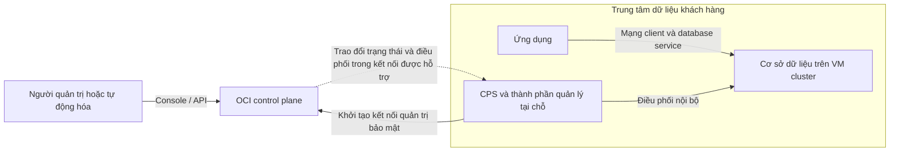

# Exadata Cloud@Customer và kết nối với OCI control plane

Exadata Cloud@Customer đưa hạ tầng Exadata đến trung tâm dữ liệu của khách hàng nhưng vẫn cung cấp cách quản lý theo mô hình dịch vụ đám mây. Cơ sở dữ liệu phục vụ ứng dụng tại chỗ; các thao tác quản trị dịch vụ được điều phối thông qua OCI control plane và các thành phần quản lý do Oracle cung cấp tại địa điểm triển khai.

Trong chương **Exadata và Cloud@Customer** của module **CLOUD_PROVIDERS_ORACLE**, bài học này giải thích mối quan hệ giữa vị trí đặt dữ liệu, đường phục vụ ứng dụng và đường quản trị dịch vụ. Người học sẽ biết cách phối hợp IAM, mạng, giám sát và tự động hóa để triển khai kết nối có thể vận hành, thay vì chỉ kiểm tra rằng một cổng TCP đã mở.

Sau bài học, người học có thể:

- Phân biệt control plane, đường tự động hóa tại chỗ và data plane phục vụ ứng dụng.
- Giải thích vai trò của thành phần điều khiển tại chỗ và kết nối tới OCI.
- Lập bảng luồng mạng, điều kiện DNS/TLS/thời gian và bằng chứng nghiệm thu.
- Đánh giá ảnh hưởng của mất kết nối quản trị mà không suy diễn thành mất dịch vụ cơ sở dữ liệu.
- Tổ chức kiểm tra, cảnh báo và xử lý sự cố theo từng lớp.

Phạm vi chính là **Exadata Database Service on Cloud@Customer**. Những chi tiết thuộc Autonomous Database on Cloud@Customer phải được xác định theo mô hình dịch vụ riêng; không mặc định mọi chức năng và ranh giới quản lý đều giống nhau.

## 1. Đặt tại chỗ không có nghĩa là vận hành tách rời OCI

Trong một hệ thống cơ sở dữ liệu hoàn toàn tự quản lý, khách hàng tự tổ chức toàn bộ quy trình cấp phát, theo dõi và bảo trì. Với Exadata Cloud@Customer, phần cứng đặt tại cơ sở khách hàng nhưng vòng đời dịch vụ được liên kết với OCI.

**OCI control plane** là lớp cung cấp giao diện và cơ chế quản lý tài nguyên dịch vụ. Người vận hành sử dụng OCI Console, API hoặc công cụ được hỗ trợ để xem trạng thái và yêu cầu thao tác. Các yêu cầu có thể liên quan đến hạ tầng Exadata, VM cluster và tài nguyên cơ sở dữ liệu, tùy quyền và khả năng của dịch vụ.

Điều đó tạo ra hai câu hỏi độc lập:

1. Ứng dụng có truy cập được database và thực hiện giao dịch không?
2. Dịch vụ có liên lạc được với OCI để tiếp nhận, điều phối và báo trạng thái các thao tác quản lý không?

Một câu trả lời “có” không thay thế cho câu còn lại. Hệ thống có thể tiếp tục phục vụ giao dịch trong lúc đường quản trị bị gián đoạn; cũng có thể quản trị được tài nguyên nhưng ứng dụng lỗi vì mạng client, database service hoặc cấu hình kết nối.

Đây là cơ sở để thiết kế giám sát và phân loại sự cố đúng phạm vi.

## 2. Ba nhóm đường đi cần tách biệt

### 2.1. Đường quản trị giữa địa điểm triển khai và OCI

Đường này phục vụ liên lạc giữa thành phần quản lý tại chỗ và dịch vụ điều khiển trên OCI. Nó hỗ trợ các hoạt động như đồng bộ trạng thái, nhận và điều phối công việc quản lý, cũng như trao đổi thông tin vận hành trong phạm vi dịch vụ.

Trong kiến trúc Cloud@Customer, **control plane server — CPS** là thành phần điều khiển tại chỗ do Oracle quản lý. Không nên xem CPS như một máy chủ database thông thường để DBA tự đăng nhập và sửa cấu hình.

Kết nối bảo mật tới OCI được thiết lập theo thiết kế kết nối của dịch vụ, với các kết nối hướng ra ngoài từ phía triển khai tại chỗ. Tuy nhiên, một phiên được khởi tạo theo hướng outbound vẫn truyền thông tin theo cả hai chiều sau khi thiết lập. Từ “outbound” mô tả chiều thiết lập kết nối, không có nghĩa OCI không thể điều phối tác vụ xuống hệ thống.

### 2.2. Đường tự động hóa và quản lý trong hệ thống tại chỗ

Thành phần điều khiển cần liên lạc với những thành phần được quản lý ở phía Cloud@Customer để thực hiện công việc. Luồng này khác với đường từ ứng dụng đến database và khác với đường đi ra OCI.

Một kết nối tới OCI hoạt động tốt chưa chứng minh tác vụ sẽ hoàn tất nếu phần liên lạc nội bộ cần thiết bị lỗi. Ngược lại, các máy trong hệ thống tại chỗ nhìn thấy nhau cũng chưa chứng minh đường quản trị ra OCI đã sẵn sàng.

Tên mạng, phạm vi địa chỉ, cổng và điểm kết nối cụ thể phải lấy từ thiết kế triển khai của Oracle cho hệ thống tương ứng. Các nhóm luồng trong bài là cách phân tích chức năng, không phải danh sách tên mạng chính thức áp dụng cho mọi thế hệ.

### 2.3. Đường dữ liệu giữa ứng dụng và database

Ứng dụng kết nối đến database qua mạng client và các địa chỉ/service được cấu hình cho môi trường đó. Đường truy cập này phục vụ truy vấn, giao dịch, kết nối lại và truyền kết quả.

Trong luồng truy cập database thông thường, ứng dụng không gửi từng câu SQL qua OCI control plane rồi mới đến database tại chỗ. Vì vậy, độ trễ tới endpoint quản trị OCI và độ trễ của giao dịch ứng dụng là hai chỉ số khác nhau.

Thiết kế mạng client vẫn cần đủ năng lực, đường đi dự phòng và cách xử lý lỗi kết nối phù hợp. Kết nối quản trị tốt không sửa được một connection string sai hoặc firewall chặn luồng database.

### 2.4. Sơ đồ logic



Sơ đồ chỉ thể hiện vai trò và luồng logic. Nó không mô tả đầy đủ tuyến mạng, mọi lớp phần mềm, cấu hình dự phòng hoặc cách truy cập hỗ trợ của một triển khai cụ thể. Mũi tên điều phối nội bộ cũng không có nghĩa CPS xử lý các câu SQL của ứng dụng.

## 3. OCI quản lý những gì qua kết nối này?

### 3.1. Nhận diện và tổ chức tài nguyên

Tài nguyên Cloud@Customer được quản lý trong ngữ cảnh tenancy, region và compartment của OCI theo khả năng dịch vụ. OCID giúp nhận diện tài nguyên trong các thao tác và nhật ký.

Compartment giúp tổ chức và phân quyền đối với tài nguyên OCI. Nó không phải ranh giới VLAN hoặc subnet trong trung tâm dữ liệu khách hàng. Một policy IAM đúng vẫn không thay thế được tuyến mạng hoặc luật firewall cần thiết.

Region gắn với dịch vụ điều khiển không tự quyết định nơi lưu mọi loại dữ liệu. Cần phân tích riêng vị trí database, bản sao lưu, dữ liệu sao chép, nhật ký và thông tin vận hành.

### 3.2. Yêu cầu quản trị và tiến trình thực thi

Một thao tác quản lý thường có vòng đời khái quát:

```text
Xác thực và kiểm tra quyền trên OCI
        ↓
Tiếp nhận yêu cầu hợp lệ
        ↓
Điều phối tới thành phần tại chỗ
        ↓
Thực hiện các bước trên tài nguyên đích
        ↓
Cập nhật tiến độ, kết quả hoặc thông tin lỗi
```

Luồng thực tế phụ thuộc thao tác và có thể gồm nhiều bước. Khi một API tiếp nhận yêu cầu, tài nguyên chưa nhất thiết đã hoàn tất thay đổi. Người vận hành phải kiểm tra trạng thái tác vụ hoặc tài nguyên theo giao diện mà thao tác hỗ trợ.

Đặc biệt, lỗi hết thời gian chờ ở phía client không chứng minh yêu cầu chưa được nhận. Trước khi gửi lại, cần kiểm tra tác vụ đã tồn tại hay chưa để tránh tạo yêu cầu trùng.

### 3.3. Trạng thái hiển thị và trạng thái thực tế

Trạng thái trên OCI có thể chưa cập nhật kịp khi mất liên lạc. Khi điều tra, cần ghi cả thời điểm quan sát và nguồn dữ liệu:

- Trạng thái nào được OCI ghi nhận gần nhất?
- Tại thời điểm đó, ứng dụng còn giao dịch được không?
- Thành phần tại chỗ có đang thực hiện tác vụ đã nhận trước đó không?
- Thông báo hoặc lỗi có mã tác vụ và thời điểm liên quan không?

Không kết luận hệ thống khỏe chỉ từ một màn hình cũ, và không khởi động lại database chỉ để làm trạng thái quản trị thay đổi.

## 4. Dữ liệu ở đâu và những thông tin nào có thể đi ra ngoài?

Giá trị chính của Cloud@Customer là đưa môi trường chạy database về địa điểm khách hàng. Tuy nhiên, cần tách các loại thông tin khi đánh giá yêu cầu lưu trú dữ liệu:

| Loại thông tin | Đường đi hoặc nơi lưu cần xác định | Câu hỏi cần trả lời |
| --- | --- | --- |
| Dữ liệu nghiệp vụ trong database | Các thành phần lưu trữ của triển khai tại chỗ | Database và dữ liệu chính nằm ở địa điểm nào? |
| Kết quả truy vấn | Đường ứng dụng và database | Ứng dụng hoặc người dùng nhận kết quả ở đâu? |
| Metadata và trạng thái quản lý | Kết nối quản trị tới dịch vụ OCI | Trường thông tin nào được trao đổi để vận hành dịch vụ? |
| Telemetry và dữ liệu chẩn đoán | Cơ chế theo dõi, chẩn đoán và hỗ trợ được cấu hình | Những thông tin nào được thu thập, truyền và lưu giữ? |
| Bản sao lưu hoặc bản sao dữ liệu | Theo đích sao lưu và kiến trúc sao chép đã chọn | Có đưa bản sao tới OCI hoặc địa điểm khác không? |
| Hồ sơ hỗ trợ và tệp đính kèm | Theo quy trình hỗ trợ | Tệp có chứa SQL, tên đối tượng hoặc dữ liệu nhạy cảm không? |

Không thể suy ra “không có bất kỳ thông tin nào rời trung tâm dữ liệu” chỉ vì database chạy tại chỗ. Đồng thời, cũng không nên suy ra mọi dữ liệu nghiệp vụ đều đi qua control plane.

Khách hàng cần xác định yêu cầu dữ liệu, cấu hình các dịch vụ liên quan và kiểm soát nội dung chia sẻ khi hỗ trợ. Khi đánh giá một luồng cụ thể, cần ghi rõ nguồn, đích, loại thông tin, mục đích và người có quyền truy cập.

## 5. Điều kiện để kết nối control plane hoạt động

### 5.1. Danh sách endpoint và luồng mạng được xác nhận

Trước khi cấu hình firewall, đội mạng cần có bộ yêu cầu kết nối của đúng dịch vụ và triển khai. Tối thiểu cần xác định:

- Nguồn kết nối và phạm vi địa chỉ nguồn được phép.
- FQDN hoặc endpoint đích, mục đích sử dụng và cách cập nhật khi có thay đổi.
- Giao thức, cổng, chiều thiết lập kết nối và yêu cầu đối với lưu lượng phản hồi.
- Tuyến đi, thiết bị NAT, firewall hoặc proxy xuất hiện trên đường đi.
- Các phụ thuộc như DNS và dịch vụ đồng bộ thời gian.
- Đơn vị phê duyệt, đơn vị vận hành và bằng chứng kiểm tra.

Không dùng một danh sách endpoint của môi trường khác chỉ vì cùng có chữ OCI. Cũng không mở toàn bộ Internet để thay cho việc xác định yêu cầu kết nối.

Một bảng nội bộ có thể được tổ chức như sau:

| Nhóm luồng | Nguồn logic | Đích logic | Mục đích | Bên cần phối hợp |
| --- | --- | --- | --- | --- |
| Quản trị ra OCI | Thành phần quản lý tại chỗ | Endpoint dịch vụ OCI được xác nhận | Điều phối và trao đổi trạng thái | Oracle, mạng và bảo mật khách hàng |
| Tự động hóa tại chỗ | Thành phần quản lý | Thành phần được quản lý | Thực hiện công việc dịch vụ | Oracle và đầu mối triển khai khách hàng |
| DNS/thời gian | Thành phần cần sử dụng | Dịch vụ DNS/thời gian theo thiết kế | Phân giải tên và duy trì thời gian phù hợp | Oracle và đội hạ tầng khách hàng |
| Truy cập ứng dụng | Máy chủ ứng dụng | Database service trên mạng client | Giao dịch nghiệp vụ | Đội ứng dụng, DBA và mạng |
| Sao lưu/sao chép | Thành phần tham gia theo cấu hình | Đích sao lưu hoặc hệ thống nhận bản sao | Bảo vệ và phục hồi dữ liệu | DBA, mạng và chủ dịch vụ liên quan |

Đây là bảng phân loại, không phải bộ luật firewall có thể áp dụng trực tiếp. Mỗi dòng phải được triển khai thành nguồn, đích và cổng cụ thể đã được xác nhận.

### 5.2. DNS phải trả về kết quả có thể sử dụng

Nếu endpoint được nhận diện bằng tên, thành phần nguồn cần dùng được bộ phân giải phù hợp. Một máy quản trị phân giải được tên chưa chứng minh CPS cũng phân giải được, vì hai nguồn có thể dùng DNS hoặc chính sách khác nhau.

Cần kiểm tra lỗi phân giải, sự khác nhau giữa các DNS server, tuyến tới DNS và cấu hình chuyển tiếp. Không tự cố định địa chỉ IP lấy từ một lần phân giải nếu cơ chế dịch vụ yêu cầu dùng tên miền.

### 5.3. TCP thông chưa đủ, TLS cũng phải đúng

HTTPS thường dùng TCP 443, nhưng không nên lấy một cổng phổ biến làm toàn bộ đặc tả kết nối Cloud@Customer. Phải dùng đúng cổng và endpoint được yêu cầu cho từng luồng.

Kiểm tra TCP thành công chỉ cho biết có thể thiết lập kết nối tới địa chỉ và cổng được thử. Phiên quản trị còn có thể thất bại vì chứng thư không hợp lệ, sai tên, chuỗi tin cậy không được chấp nhận hoặc thiết bị trung gian can thiệp.

SSL/TLS inspection của doanh nghiệp có thể thay đổi chứng thư mà đầu cuối nhìn thấy. Nếu cơ chế dịch vụ không hỗ trợ sự can thiệp đó, cần xử lý bằng cấu hình mạng được phê duyệt và được Oracle hỗ trợ. Không bỏ kiểm tra chứng thư để che lỗi.

### 5.4. Đồng bộ thời gian

Sai lệch đồng hồ có thể gây khó khăn cho xác thực, xác minh chứng thư và đối chiếu nhật ký. Dịch vụ đồng bộ thời gian và đường truy cập tới nó cần tuân theo thiết kế triển khai.

Khi thu thập bằng chứng, nên dùng UTC hoặc luôn ghi kèm múi giờ. Dòng lỗi lúc 10:00 ở hai hệ thống không có ý nghĩa tương đương nếu một bên dùng giờ địa phương và bên còn lại dùng UTC.

### 5.5. NAT, proxy và thời gian giữ phiên

Thiết bị trung gian có thể làm kết nối gián đoạn dù luật cho phép cổng đã tồn tại. Các yếu tố cần kiểm tra gồm bảng trạng thái, thời gian giữ phiên, giới hạn kết nối, thay đổi địa chỉ nguồn và sự khác nhau giữa đường đi và đường về.

Nếu thiết kế sử dụng proxy, phải xác nhận mô hình proxy, cơ chế xác thực và cấu hình đó được dịch vụ hỗ trợ. Không tự chèn một proxy mới vào đường quản trị rồi kỳ vọng hệ thống tự thích nghi.

Đường dự phòng cũng phải được thử. Một tuyến thứ hai không giúp ích nếu nó đi qua cùng thiết bị bị lỗi hoặc chưa có luật cho phép tương ứng.

## 6. FastConnect hoặc VPN không tự giải quyết kết nối control plane

Trong OCI, FastConnect và VPN có thể phục vụ những nhu cầu kết nối khác nhau của doanh nghiệp. Tuy nhiên, có đường riêng giữa doanh nghiệp và OCI không tự chứng minh các endpoint control plane cần cho Cloud@Customer đã truy cập được.

Cần trả lời ba câu hỏi riêng:

1. Endpoint cần truy cập là gì, thuộc loại truy cập nào?
2. Dịch vụ hỗ trợ mô hình kết nối nào cho endpoint đó?
3. Tuyến, DNS, firewall và cơ chế trung gian hiện tại có thực hiện đúng mô hình đó không?

Nếu giải pháp sử dụng endpoint công khai, phải có đường truy cập được hỗ trợ tới endpoint công khai đó. Không mặc định một private subnet, một DRG hoặc một kết nối FastConnect hiện có là đủ.

Ngược lại, cũng không mặc định mọi lưu lượng giữa Cloud@Customer và một dịch vụ OCI đều phải dùng cùng một tuyến. Luồng quản trị, sao lưu, ứng dụng hoặc sao chép dữ liệu có thể có yêu cầu khác nhau.

Quyết định triển khai phải dựa trên sơ đồ kết nối đã được Oracle xác nhận và các yêu cầu an ninh của khách hàng, thay vì chỉ dựa trên tên công nghệ mạng đã mua.

## 7. Quy trình triển khai và nghiệm thu kết nối

### 7.1. Chuẩn bị trước khi cài đặt

Oracle và khách hàng cần thống nhất vai trò, địa chỉ, kết nối và điều kiện trung tâm dữ liệu. Khách hàng chuẩn bị các phần thuộc phạm vi của mình, chẳng hạn nguồn điện, làm mát, địa chỉ mạng, DNS và các luật mạng đã được thiết kế.

Phải có đầu mối cho từng nhóm: mạng, bảo mật, cơ sở vật chất, OCI/IAM và DBA. Việc một đội chỉ xác nhận “đã mở firewall” chưa đủ để nghiệm thu toàn bộ đường quản trị.

### 7.2. Liên kết với môi trường OCI

Việc đăng ký, kích hoạt và liên kết hạ tầng với ngữ cảnh OCI được thực hiện theo quy trình dịch vụ. Người phụ trách xác minh đúng tenancy, region, compartment và định danh tài nguyên trong phạm vi được giao.

Thông tin onboarding hoặc thông tin xác thực chỉ được xử lý qua cơ chế được phép. Không đưa khóa bí mật hay tệp chứa thông tin đăng nhập vào tài liệu mạng hoặc hồ sơ hỗ trợ chung.

### 7.3. Nghiệm thu theo nhiều lớp

| Lớp kiểm tra | Bằng chứng cần có | Điều chưa thể kết luận chỉ từ lớp này |
| --- | --- | --- |
| DNS | Nguồn thử phân giải được tên đích đúng thiết kế | TCP/TLS và xác thực dịch vụ đã thành công |
| TCP | Nguồn thử thiết lập được kết nối tới cổng yêu cầu | Endpoint đã chấp nhận phiên quản trị của CPS |
| TLS | Thỏa thuận TLS và kiểm tra chứng thư thành công trong luồng thử | Mọi quyền IAM và quyền quản lý tài nguyên đều đúng |
| Liên lạc quản trị thực tế | Oracle/dịch vụ xác nhận thành phần tại chỗ giao tiếp và báo trạng thái | Mọi thao tác vòng đời đều hoàn tất |
| Thao tác dịch vụ | Một thao tác được phép có kết quả và trạng thái đúng | Ứng dụng đã đạt yêu cầu giao dịch |
| Ứng dụng | Luồng nghiệp vụ thử thành công trên mạng client | Đường control plane sẽ không gặp lỗi sau này |

Thao tác nghiệm thu nên có phạm vi nhỏ, được thống nhất trước và phù hợp với môi trường. Không tạo một VM cluster hoặc database sản xuất chỉ để kiểm tra mạng nếu chưa có yêu cầu và kế hoạch tài nguyên tương ứng.

### 7.4. Giữ bằng chứng

Hồ sơ nghiệm thu nên có thời gian thử, vị trí nguồn thử, endpoint đích, tuyến đi dự kiến, kết quả từng lớp và người xác nhận. Với bước thực hiện trên thành phần Oracle quản lý, cần dùng bằng chứng do Oracle hoặc công cụ dịch vụ cung cấp theo quy trình.

Không đánh đồng kết quả từ máy cá nhân với kết quả từ thành phần quản trị tại chỗ. Một máy khác có thể dùng chung đường Internet nhưng khác luật firewall, proxy, DNS hoặc địa chỉ NAT.

## 8. Ví dụ kiểm tra từ máy được phép

Các lệnh dưới đây dùng trên một **máy Windows được phép kiểm tra**, không phải hướng dẫn đăng nhập vào CPS. Chỉ chạy với endpoint và cổng đã được xác nhận; không quét cả dải địa chỉ để suy ra cấu hình dịch vụ.

```powershell
# Thay bằng FQDN đã được xác nhận cho luồng cần kiểm tra.
$OciEndpointHost = '<OCI_ENDPOINT_FQDN_DA_XAC_NHAN>'

# 443 chỉ là ví dụ cho một endpoint HTTPS đã được xác nhận.
$ApprovedTcpPort = 443

# Kiểm tra phân giải tên.
Resolve-DnsName -Name $OciEndpointHost

# Kiểm tra kết nối TCP từ chính máy đang chạy lệnh.
Test-NetConnection -ComputerName $OciEndpointHost -Port $ApprovedTcpPort -InformationLevel Detailed
```

Với endpoint HTTPS trên cổng 443 đã được phép kiểm tra, có thể quan sát một yêu cầu HEAD không mang thông tin xác thực:

```powershell
curl.exe --verbose --head --connect-timeout 10 --max-time 20 "https://${OciEndpointHost}/"
```

Trước khi chạy, phải thay placeholder bằng tên thật. Không dùng tùy chọn bỏ xác minh chứng thư. Một số endpoint không hỗ trợ HEAD tại đường dẫn gốc hoặc yêu cầu xác thực; mã HTTP lỗi vì vậy cần được diễn giải trong đúng ngữ cảnh.

Kết quả cần hiểu theo từng lớp:

- Không phân giải được tên: kiểm tra DNS từ nguồn thử.
- Phân giải được nhưng TCP thất bại: kiểm tra tuyến, firewall, NAT và khả năng truy cập đích.
- TCP thành công nhưng TLS thất bại: kiểm tra chứng thư, thời gian, tên endpoint và thiết bị trung gian.
- Nhận được phản hồi HTTP: đã có thêm bằng chứng về đường HTTPS từ nguồn thử; chưa chứng minh phiên dịch vụ của CPS hoạt động.
- Kiểm tra từ máy thử thành công nhưng dịch vụ vẫn lỗi: chuyển sang kiểm tra nguồn thực tế, đăng ký dịch vụ, đường tự động hóa nội bộ và trạng thái tác vụ với Oracle.

Một phản hồi HTTP 401 hoặc 403 không tự chứng minh có lỗi mạng; nó có thể là kết quả của xác thực hoặc phân quyền. Ngược lại, không coi mã 401/403 là bằng chứng rằng thành phần Cloud@Customer đã xác thực thành công.

Nhật ký chi tiết có thể chứa hostname, địa chỉ và thông tin hệ thống. Chỉ chia sẻ phần cần thiết qua kênh phù hợp, đồng thời giữ bản gốc trong nơi lưu trữ được phép.

## 9. Khi mất kết nối tới OCI, điều gì có thể xảy ra?

Mất kết nối control plane là sự cố cần xử lý, nhưng tác động phụ thuộc phạm vi lỗi và công việc đang diễn ra.

| Hoạt động | Điều cần dự kiến khi đường quản trị bị gián đoạn | Cách đánh giá |
| --- | --- | --- |
| Giao dịch database đang phục vụ tại chỗ | Có thể tiếp tục nếu database, mạng client và các phụ thuộc còn hoạt động | Kiểm tra trực tiếp từ ứng dụng và database |
| Xem trạng thái trên OCI | Có thể lỗi hoặc chỉ thấy trạng thái gần nhất | Đối chiếu thời điểm cập nhật và các nguồn tại chỗ |
| Cấp phát hoặc thay đổi tài nguyên | Có thể bị chặn, chờ hoặc không hoàn tất | Kiểm tra trạng thái tác vụ, không chỉ kết quả một lần gọi API |
| Công việc đã bắt đầu | Có thể đang chạy, đã xong nhưng chưa báo trạng thái, hoặc đã lỗi ở một bước | Phối hợp Oracle xác định bước và trạng thái thực tế |
| Bảo trì do dịch vụ điều phối | Có thể bị ảnh hưởng bởi mất liên lạc hoặc mất phụ thuộc nội bộ | Theo dõi thông báo, tác vụ và hướng dẫn xử lý |
| Thu thập trạng thái/chẩn đoán | Có thể gián đoạn hoặc chậm cập nhật | Dùng thêm giám sát được phép ở phía khách hàng |
| Sao lưu và sao chép dữ liệu | Phụ thuộc cơ chế, đích và các kết nối riêng của cấu hình | Kiểm tra từng công việc, không suy từ trạng thái control plane |

Không bảo đảm database sẽ tiếp tục hoạt động trong mọi trường hợp mất kết nối. Nếu nguyên nhân là mất điện, lỗi mạng diện rộng hoặc một phụ thuộc dùng chung, cả quản trị và giao dịch có thể bị ảnh hưởng.

Tương tự, không khẳng định mọi tác vụ đang chạy sẽ dừng ngay khi đường quản trị mất. Trạng thái không chắc chắn phải được điều tra, không được thay bằng giả định thuận tiện.

### 9.1. Thứ tự xử lý

1. Xác định ứng dụng còn phục vụ được không và phạm vi người dùng bị ảnh hưởng.
2. Ghi thời điểm bắt đầu, thay đổi gần nhất và tài nguyên liên quan.
3. Kiểm tra thông báo dịch vụ và trạng thái tác vụ đang tồn tại.
4. Đội mạng kiểm tra các phụ thuộc thuộc khách hàng: DNS, tuyến, firewall, NAT, proxy và đường dự phòng.
5. Oracle kiểm tra các thành phần quản trị thuộc phạm vi Oracle quản lý.
6. Sau khi kết nối phục hồi, đối chiếu trạng thái tài nguyên và tác vụ trước khi gửi lệnh mới.

Không tự khởi động lại CPS, sửa agent hoặc chỉnh cấu hình thành phần Oracle quản lý. Những thao tác đó cần theo quy trình của Oracle.

### 9.2. Khôi phục đường mạng chưa phải kết thúc sự cố

Sau khi DNS, TCP và TLS đã hoạt động trở lại, cần xác minh dịch vụ thực sự liên lạc được, trạng thái được cập nhật và công việc tồn đọng đã được đối chiếu.

Chỉ thử lại tác vụ khi hiểu trạng thái yêu cầu trước. Nếu thao tác hỗ trợ cơ chế chống yêu cầu trùng, hệ thống tự động hóa phải sử dụng theo đặc tả của đúng thao tác; không mặc định mọi API đều có cùng cơ chế.

Không chuyển region quản lý, đăng ký lại hạ tầng hoặc tạo tài nguyên thay thế chỉ để vượt qua lỗi kết nối khi chưa có hướng dẫn phù hợp. Đó là thay đổi vòng đời dịch vụ, không phải phép thử mạng đơn giản.

## 10. IAM và bảo mật kết nối là hai lớp kiểm soát bổ sung

Để thực hiện một thao tác thành công, hệ thống vừa cần có đường liên lạc, vừa cần nhận diện và quyền phù hợp.

### 10.1. Quyền trên OCI

Khách hàng quản lý người dùng, nhóm, policy và phạm vi compartment theo tổ chức của mình. Nên tách vai trò chỉ xem trạng thái khỏi vai trò được phép thay đổi tài nguyên.

Nếu dùng tự động hóa, chọn cơ chế xác thực mà môi trường và thao tác hỗ trợ. Chủ thể tự động hóa chỉ được cấp quyền cần thiết trên tài nguyên mục tiêu; khóa hoặc thông tin bí mật phải được bảo vệ và quản lý vòng đời.

Người quản trị tenancy không đương nhiên là người có quyền SQL trong database. Ngược lại, DBA có quyền cao trong database không đương nhiên có quyền đổi tài nguyên Cloud@Customer trên OCI.

### 10.2. Quyền và kiểm soát mạng

Firewall kiểm soát nguồn, đích và kết nối mạng; IAM kiểm soát ai được thực hiện thao tác dịch vụ. Không mở rộng IAM để sửa lỗi TCP, và không mở rộng firewall để sửa lỗi quyền truy cập tài nguyên.

Khi có lỗi, cần phân loại rõ:

| Dấu hiệu | Nhóm cần kiểm tra |
| --- | --- |
| Không phân giải được FQDN | DNS và cấu hình nguồn kết nối |
| Kết nối TCP hết thời gian chờ | Tuyến, ACL/firewall, NAT, đích và thiết bị trung gian |
| Xác minh TLS thất bại | Tên, chứng thư, thời gian và cơ chế can thiệp TLS |
| API trả lỗi xác thực/phân quyền | Thông tin xác thực, policy, compartment và tài nguyên mục tiêu |
| API tiếp nhận nhưng công việc không tiến triển | Đường quản trị thực tế, thành phần tại chỗ, phụ thuộc và trạng thái tác vụ |

### 10.3. Truy cập hỗ trợ

Kết nối control plane không đồng nghĩa mọi người dùng OCI có thể mở phiên vào database. Các cơ chế quản trị, hỗ trợ và truy cập dữ liệu có phạm vi kiểm soát khác nhau.

Việc Oracle truy cập hỗ trợ phải được xử lý theo cơ chế dịch vụ và chính sách phù hợp với triển khai. Khách hàng cần biết ai là đầu mối, nhật ký nào có thể dùng và cách xử lý yêu cầu hỗ trợ, thay vì tự xây một đường truy cập ngoài thiết kế.

## 11. Giám sát và tự động hóa khi vận hành

### 11.1. Theo dõi ít nhất hai góc nhìn

**Góc nhìn dịch vụ quản trị:** trạng thái tài nguyên, thông báo, tiến độ tác vụ và khả năng trao đổi trạng thái với thành phần tại chỗ.

**Góc nhìn phục vụ nghiệp vụ:** khả năng kết nối ứng dụng, tỷ lệ lỗi, độ trễ và kết quả giao dịch thử.

Ngoài ra, đội mạng cần quan sát các phụ thuộc do khách hàng quản lý. Tín hiệu và metric cụ thể phải lấy từ những gì dịch vụ và công cụ mạng thực tế cung cấp; không tự giả định có sẵn một metric heartbeat mang tên bất kỳ.

Cảnh báo nên có người nhận, ngưỡng, thời gian quan sát và hành động mong đợi. Đặt khoảng thời gian phù hợp để tránh báo động theo từng dao động rất ngắn, nhưng không để mất liên lạc kéo dài mà không có người xử lý.

### 11.2. Tự động hóa theo trạng thái

Luồng tự động hóa quản lý tài nguyên nên tuân theo nguyên tắc:

```text
Đọc trạng thái hiện tại và kiểm tra quyền
        ↓
Xác nhận không có công việc xung đột
        ↓
Gửi yêu cầu theo giao diện được hỗ trợ
        ↓
Lưu định danh yêu cầu/tác vụ nếu giao diện cung cấp
        ↓
Theo dõi đến trạng thái kết thúc hoặc ngưỡng cần can thiệp
        ↓
Đối chiếu tài nguyên và kiểm chứng kết quả
```

Nếu có lỗi mạng, không gửi lại không giới hạn. Cần dùng thời gian chờ, số lần thử và cơ chế đối chiếu phù hợp với thao tác. Khi không xác định được yêu cầu trước đã được nhận hay chưa, dừng thao tác phụ thuộc và chuyển cho người điều phối.

Thông báo lỗi nên giữ đủ định danh và thời gian nhưng không chứa khóa API, token hoặc thông tin bí mật.

### 11.3. Chi phí và năng lực kết nối

Cần dự trù chi phí đường truyền, thiết bị dự phòng, giải pháp giám sát và nhân sự vận hành. Tuy nhiên, không chọn băng thông chỉ dựa trên câu “có database dung lượng lớn”.

Control plane và truyền bản sao lưu có đặc tính tải khác nhau. Sao lưu, phục hồi hoặc đồng bộ dữ liệu tới một đích OCI có thể là phần đáng kể trong tính toán băng thông và chi phí, tùy cấu hình.

Không coi đường quản trị là đường dùng chung mặc định cho mọi luồng dữ liệu. Kế hoạch dung lượng phải bắt đầu bằng bảng luồng và khối lượng thực tế của từng nhóm công việc.

## 12. Tình huống: thay đổi proxy làm mất quản trị nhưng ứng dụng vẫn chạy

Một doanh nghiệp vận hành Exadata Cloud@Customer tại trung tâm dữ liệu chính. Ứng dụng ERP truy cập database qua mạng client nội bộ. Cuối tuần, đội bảo mật thay đổi chính sách trên thiết bị trung gian phục vụ kết nối ra ngoài.

Sau thay đổi, người vận hành không nhận được cập nhật trạng thái như dự kiến và một tác vụ quản trị không hoàn tất. Trong khi đó, người dùng ERP vẫn đăng nhập và ghi nhận giao dịch.

### 12.1. Cách phân tích

Không kết luận database cần khởi động lại. Nhóm vận hành chia việc:

1. **Đội ứng dụng và DBA** xác nhận trạng thái giao dịch thực tế, giữ bằng chứng về phạm vi nghiệp vụ còn hoạt động.
2. **Đội OCI** ghi tài nguyên, lỗi và định danh tác vụ, đồng thời kiểm tra thông báo dịch vụ.
3. **Đội mạng/bảo mật** đối chiếu thời điểm thay đổi proxy, DNS, luật đi ra và hành vi TLS.
4. **Oracle** kiểm tra liên lạc của thành phần điều khiển tại chỗ và bước công việc đang thực hiện.

Một máy cá nhân truy cập được OCI Console không chứng minh kết nối của CPS còn tốt: trình duyệt của người quản trị có thể đi qua mạng, proxy hoặc chính sách khác.

### 12.2. Cách khôi phục

Giả sử bằng chứng cho thấy chính sách mới can thiệp vào phiên TLS theo cách không tương thích với luồng dịch vụ. Đội mạng/bảo mật điều chỉnh theo cấu hình đã được phê duyệt và được Oracle hỗ trợ, thay vì bỏ kiểm tra chứng thư trên thành phần đích.

Sau khi kết nối được phục hồi, nhóm vận hành:

- Xác nhận trạng thái quản trị tiếp tục cập nhật.
- Kiểm tra tác vụ cũ đã hoàn tất, thất bại hay còn đang chạy.
- Chỉ thực hiện lại bước cần thiết sau khi loại trừ yêu cầu trùng.
- Xác nhận ứng dụng vẫn phục vụ và không có ảnh hưởng ngoài phạm vi đã ghi nhận.
- Bổ sung luồng Cloud@Customer vào danh sách phải đánh giá trước những thay đổi mạng tương tự.

Giá trị của việc tách các luồng nằm ở quyết định xử lý: bảo vệ phần phục vụ đang hoạt động, khôi phục đúng đường bị lỗi và giữ bằng chứng để phối hợp giữa khách hàng với Oracle.

## 13. Checklist thiết kế và bàn giao

- [ ] Đã xác định đúng loại dịch vụ Cloud@Customer và ngữ cảnh OCI quản lý?
- [ ] Sơ đồ có tách đường control plane, đường quản lý nội bộ, mạng client và các luồng sao lưu/sao chép?
- [ ] Bảng endpoint, nguồn, đích, cổng và tuyến được Oracle cùng các đội liên quan xác nhận?
- [ ] DNS và đồng bộ thời gian đã được kiểm tra từ phạm vi phù hợp?
- [ ] NAT, firewall và proxy có đáp ứng mô hình kết nối được hỗ trợ?
- [ ] TLS được xác minh đúng, không dùng cách bỏ kiểm tra chứng thư?
- [ ] Có bằng chứng liên lạc quản trị thực tế, thay vì chỉ kết quả TCP từ máy thử?
- [ ] Có kiểm chứng riêng cho giao dịch database của ứng dụng?
- [ ] IAM giới hạn theo vai trò, compartment và thao tác cần thiết?
- [ ] Đã xác định dữ liệu, metadata, telemetry và bản sao lưu được truyền/lưu ở đâu?
- [ ] Có đầu mối và quy trình khi mất kết nối hoặc tác vụ ở trạng thái chưa rõ?
- [ ] Có cách giám sát đường quản trị độc lập với góc nhìn ứng dụng?
- [ ] Đường dự phòng và điều kiện khôi phục đã được kiểm thử trong phạm vi cho phép?
- [ ] Hồ sơ bàn giao có thời gian, định danh tài nguyên, kết quả thử và bên xác nhận?

Exadata Cloud@Customer cần được vận hành như một dịch vụ có hạ tầng tại chỗ và lớp quản trị liên kết với OCI. Thiết kế đúng phải bảo đảm đồng thời khả năng phục vụ database và khả năng quản lý vòng đời dịch vụ. Hai mục tiêu này được kiểm chứng bằng các luồng, quyền và bằng chứng riêng, rồi phối hợp trong cùng một quy trình vận hành.

