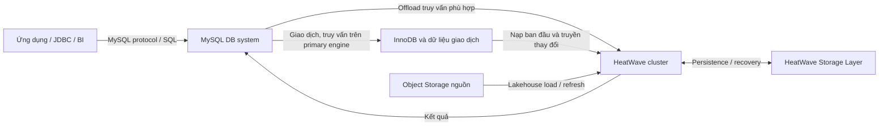

# Kiến trúc MySQL HeatWave và lựa chọn trường hợp sử dụng

Một ứng dụng bán hàng thường có hai nhóm công việc rất khác nhau: ghi nhận từng đơn hàng trong thời gian ngắn và tổng hợp hàng triệu đơn hàng để phân tích doanh thu. Cả hai đều dùng SQL, nhưng cách đọc dữ liệu, mức song song và yêu cầu tài nguyên không giống nhau. Nếu chạy báo cáo lớn trên cùng đường xử lý giao dịch mà không đo tác động, ứng dụng có thể chậm đúng lúc cần phản hồi nhanh.

**MySQL HeatWave** kết hợp nền tảng MySQL được quản lý với cụm xử lý tăng tốc cho những truy vấn phù hợp. Trong chương **MySQL HeatWave và NoSQL** của lộ trình Oracle Cloud Infrastructure (OCI), bài này giải thích các thành phần kiến trúc, cách dữ liệu đi vào cụm tăng tốc, cách truy vấn được lựa chọn để thực thi và tiêu chí chọn trường hợp sử dụng.

Sau bài học, người học có thể:

- Phân biệt MySQL DB system, InnoDB, HeatWave cluster, read replica và các instance phục vụ high availability.
- Mô tả luồng xử lý giao dịch, nạp dữ liệu, truyền thay đổi và thực thi truy vấn phân tích.
- Giải thích vì sao một câu SQL có thể chạy trên InnoDB dù DB system đã có HeatWave cluster.
- Chọn workload ứng viên dựa trên mẫu truy vấn, độ mới dữ liệu, khả năng tương thích và mục tiêu vận hành.
- Chuẩn bị thử nghiệm có bằng chứng về hiệu năng, tính đúng đắn, chi phí và khả năng phục hồi.

## 1. Bắt đầu từ hai kiểu workload

### 1.1. OLTP: xử lý giao dịch

**Online Transaction Processing — OLTP** phục vụ các hoạt động như tạo đơn hàng, cập nhật tồn kho, thanh toán và tra cứu một khách hàng.

Đặc trưng thường gặp:

- Mỗi thao tác truy cập một lượng dữ liệu tương đối nhỏ.
- Có nhiều yêu cầu đồng thời và nhiều thao tác ghi.
- Cần transaction, ràng buộc dữ liệu và cơ chế điều khiển truy cập đồng thời.
- Độ trễ của từng yêu cầu quan trọng hơn việc quét toàn bộ dữ liệu thật nhanh.

Ví dụ:

```sql
SELECT order_id, customer_id, total_amount
FROM orders
WHERE order_id = 1001;
```

Với khóa chính phù hợp, đây có thể là một phép tra cứu rất hiệu quả trên InnoDB. Đưa truy vấn qua một cụm phân tán không mặc nhiên đem lại lợi ích.

### 1.2. OLAP: xử lý phân tích

**Online Analytical Processing — OLAP** phục vụ tổng hợp, so sánh và tìm xu hướng trên nhiều bản ghi.

Ví dụ:

```sql
SELECT customer_id, SUM(total_amount) AS revenue
FROM orders
WHERE ordered_on >= '2026-10-01'
  AND ordered_on <  '2026-11-01'
GROUP BY customer_id;
```

Truy vấn này có thể đọc nhiều đơn hàng, tổng hợp rồi trả về ít dòng. Khi dữ liệu và phép kết hợp đủ lớn, khả năng đọc theo cột và xử lý song song trở nên hữu ích.

**HTAP — Hybrid Transactional/Analytical Processing** là cách mô tả nhu cầu phục vụ giao dịch và phân tích trên dữ liệu vận hành. Với HeatWave, điều cần đánh giá là cả hai nhóm workload có đạt mục tiêu khi cùng hoạt động hay không, không chỉ một truy vấn báo cáo chạy nhanh hơn.

## 2. Bản đồ kiến trúc MySQL HeatWave trên OCI

### 2.1. Các thành phần chính

| Thành phần | Vai trò |
| --- | --- |
| MySQL DB system | Cung cấp endpoint MySQL, xử lý kết nối, giao dịch và điều phối truy vấn |
| InnoDB | Lưu trữ và xử lý bảng giao dịch trong phạm vi bài học |
| HeatWave plugin | Tích hợp việc quản lý cụm, lập lịch và trả kết quả với DB system |
| HeatWave cluster | Các node lưu dữ liệu đã nạp và thực hiện xử lý tăng tốc |
| HeatWave Storage Layer | Lớp persistence phục vụ việc khôi phục dữ liệu tăng tốc |
| Object Storage nguồn | Nơi chứa dữ liệu bên ngoài có thể được nạp qua Lakehouse |
| Ứng dụng hoặc công cụ BI | Gửi SQL qua kết nối MySQL tới DB system |

Một DB system standalone có một MySQL instance; cấu hình high availability có nhiều instance theo mô hình dịch vụ. Khách hàng kết nối MySQL endpoint, không đăng nhập hệ điều hành của DB system như một máy Compute tự quản trị. Xem [tổng quan DB system](https://docs.oracle.com/en-us/iaas/mysql-database/doc/overview-db-system.html).

HeatWave cluster gồm một hoặc nhiều node. Ứng dụng vẫn kết nối DB system; truy vấn đủ điều kiện được chuyển tới cluster, và kết quả quay về qua DB system. Vai trò plugin được mô tả trong [tổng quan HeatWave cluster](https://docs.oracle.com/en-us/iaas/mysql-database/doc/overview-heatwave.html).

### 2.2. Sơ đồ luồng xử lý



Sơ đồ thể hiện quan hệ logic. Đường điều khiển qua OCI Console, API, CLI, IAM và hệ thống giám sát không được vẽ đầy đủ.

Hai ô Object Storage nguồn và Storage Layer biểu diễn **hai vai trò khác nhau**: một bên là dữ liệu đầu vào do ứng dụng hoặc pipeline quản lý; một bên phục vụ biểu diễn nội bộ và khôi phục của dịch vụ.

### 2.3. HeatWave node không phải writable shard của ứng dụng

Dữ liệu nạp vào HeatWave được phân bố để phục vụ xử lý song song. Điều đó không có nghĩa ứng dụng phải chọn node để ghi một đơn hàng hoặc tự chia bảng giao dịch sang các node HeatWave.

Ứng dụng tiếp tục làm việc với mô hình MySQL của DB system. Khi hệ thống chậm ở thao tác ghi, lock hoặc transaction dài, trước hết phải phân tích đường OLTP. Thêm node tăng tốc phân tích không tự loại bỏ các điểm nghẽn này.

## 3. Vì sao HeatWave phù hợp với một số truy vấn phân tích?

### 3.1. Biểu diễn theo cột và thực thi theo khối

HeatWave sử dụng biểu diễn **in-memory hybrid-columnar** và xử lý vectorized. Có thể hiểu ở mức khái niệm: dữ liệu cần cho các phép lọc, tổng hợp và kết hợp được tổ chức để xử lý nhiều giá trị trong một lượt, thay vì diễn giải toàn bộ công việc như từng hàng độc lập. Kiến trúc còn phân chia công việc giữa node và core. Xem [đặc điểm kiến trúc HeatWave](https://dev.mysql.com/doc/heatwave/en/mys-hw-about-heatwave.html).

Một truy vấn doanh thu chỉ đọc vài cột của bảng có nhiều cột có thể hưởng lợi từ cách tổ chức này. Nhưng mức lợi ích còn phụ thuộc số hàng cần đọc, tính chọn lọc của điều kiện, phân bố dữ liệu và chi phí kết hợp.

### 3.2. Song song không có nghĩa tăng tốc tuyến tính

Một cách nghĩ khi đánh giá truy vấn:

```text
Thời gian trả kết quả
    = thời gian chờ
    + chuẩn bị và đồng bộ cần thiết
    + xử lý dữ liệu
    + trao đổi / tổng hợp kết quả
    + truyền kết quả tới client
```

Đây là mô hình phân tích, không phải công thức nội bộ cố định của sản phẩm.

Nếu phần tính toán chiếm chủ yếu, tăng khả năng xử lý song song có thể giúp nhiều. Nếu truy vấn chỉ đọc một dòng, kết quả trả về quá lớn hoặc dữ liệu bị lệch mạnh về một nhóm, các thành phần khác có thể chi phối.

Ví dụ, truy vấn tổng doanh thu theo 20 khu vực thường trả ít dòng sau khi xử lý nhiều dữ liệu. Ngược lại, xuất toàn bộ hàng trăm triệu dòng cho client có thể bị giới hạn bởi truyền dữ liệu và khả năng nhận của client. Cùng đọc một bảng lớn nhưng hai công việc cần cách đánh giá khác nhau.

## 4. Vòng đời dữ liệu trong cụm tăng tốc

### 4.1. Nạp dữ liệu ban đầu

Có HeatWave cluster chưa đồng nghĩa mọi bảng đã sẵn sàng cho truy vấn tăng tốc. Với đường dữ liệu từ DB system, cần xác định bảng/cột phù hợp và nạp dữ liệu cần thiết.

Hai bước cần phân biệt:

1. Khai báo bảng sử dụng `RAPID` làm secondary engine.
2. Nạp dữ liệu vào secondary engine.

Tùy phiên bản và công cụ, các bước chuẩn bị có thể được tự động hóa. Bài học dùng cú pháp khai báo tường minh để quan sát rõ vai trò; xem [khai báo secondary engine](https://dev.mysql.com/doc/heatwave/en/mys-hw-defining-secondary-engine.html).

Nạp dữ liệu dùng tài nguyên của DB system và cluster. Cần chọn thời điểm, mức đồng thời và theo dõi ảnh hưởng tới giao dịch. Tài liệu [chuẩn bị nạp dữ liệu](https://dev.mysql.com/doc/heatwave/en/mys-hw-data-load-prerequisites.html) lưu ý tải nạp chia sẻ tài nguyên với DML/DDL trên DB system.

### 4.2. Truyền thay đổi từ dữ liệu giao dịch

Sau khi nạp bảng, thay đổi `INSERT`, `UPDATE`, `DELETE` trên DB system được truyền sang biểu diễn tương ứng trong HeatWave. DML không chờ từng thay đổi được áp dụng xong ở cluster. Cơ chế có các thời điểm kích hoạt truyền, gồm khi truy vấn cần dữ liệu mới; bảng stale do lỗi truyền thay đổi không được dùng để offload. Xem [change propagation](https://dev.mysql.com/doc/heatwave/en/mys-hw-change-propagation.html).

Từ góc độ thiết kế ứng dụng, cần kiểm tra:

- Dữ liệu nào đã commit và nằm trong phạm vi truy vấn?
- Truy vấn thực sự chạy trên engine nào?
- Có thời gian chờ đồng bộ trước khi thực thi không?
- Khi truyền thay đổi lỗi, hệ thống fallback hay báo lỗi theo chế độ nào?

Không lấy một chu kỳ truyền nội bộ làm cam kết “dashboard luôn mới trong đúng từng ấy mili giây”. Độ trễ quan sát ở ứng dụng còn gồm lịch refresh dashboard, hàng đợi, thời gian truy vấn và đường mạng.

### 4.3. “Không cần ETL riêng” phải được hiểu đúng

Đối với dữ liệu MySQL đang được tăng tốc, hệ thống có thể giảm nhu cầu xây một pipeline ETL sang kho phân tích độc lập chỉ để chạy báo cáo. Tuy nhiên, kiến trúc vẫn có công việc nạp, tổ chức và truyền dữ liệu nội bộ.

Vì vậy:

- Vẫn có biểu diễn dữ liệu bổ sung cho xử lý phân tích.
- Vẫn cần quản lý dữ liệu nào được nạp và trạng thái của nó.
- Chuẩn hóa mã sản phẩm, hợp nhất định danh khách hàng hoặc sửa dữ liệu sai vẫn là công việc nghiệp vụ.
- Nguồn dữ liệu bên ngoài không tự xuất hiện trong MySQL chỉ vì bật HeatWave.

Lợi ích giảm pipeline cần được đánh giá theo kiến trúc hiện tại của tổ chức. Nếu pipeline đang thực hiện nhiều bước làm sạch và đối soát, phải xác định những bước nào vẫn còn cần thiết.

### 4.4. Persistence phục vụ phục hồi, không thay thế backup

Dữ liệu đã nạp và thay đổi được truyền có thể được lưu trong HeatWave Storage Layer để phục hồi cụm. Cơ chế và khả năng khôi phục sau restart phụ thuộc phiên bản; xem [quản lý dữ liệu và khôi phục trong HeatWave](https://dev.mysql.com/doc/heatwave/en/mys-hw-about-analytics.html).

Không đồng nhất lớp này với bản backup theo retention của doanh nghiệp. Backup/restore DB system, khả năng quay lại một mốc dữ liệu và việc khôi phục khả năng chạy analytics là các yêu cầu cần kiểm tra riêng.

## 5. Truy vấn được chọn chạy ở đâu?

### 5.1. Các điều kiện phải được kiểm tra

Một câu SQL có thể hợp lệ trong MySQL nhưng không được HeatWave tăng tốc. Với đường truy vấn bảng từ DB system, các điều kiện thường phải xem gồm:

- Bảng/cột liên quan đã được chuẩn bị và nạp phù hợp.
- Truy vấn dùng chức năng, toán tử và SQL mode được hỗ trợ.
- Trạng thái transaction và autocommit đáp ứng yêu cầu.
- Cluster và dữ liệu cần dùng đang sẵn sàng.
- Chính sách lựa chọn engine quyết định offload trong hoàn cảnh đó.

Danh sách chi tiết phải lấy theo phiên bản triển khai tại [điều kiện chạy truy vấn trên HeatWave](https://dev.mysql.com/doc/heatwave/en/mys-hw-query-prerequisites.html).

Không mặc định optimizer sẽ chia mọi truy vấn thành một phần chạy trên InnoDB và một phần chạy trên HeatWave khi có bảng hoặc biểu thức không được hỗ trợ. Phải kiểm tra kế hoạch và hành vi cụ thể.

### 5.2. Ba chế độ secondary engine

Biến session `use_secondary_engine` có các chế độ sau:

| Chế độ | Ý nghĩa |
| --- | --- |
| `OFF` | Không dùng secondary engine cho truy vấn trong session |
| `ON` | Cho phép dùng khi phù hợp; có khả năng fallback về primary engine |
| `FORCED` | Yêu cầu chạy bằng secondary engine; lỗi nếu không thể thực hiện |

Các giá trị và phạm vi session được mô tả trong [system variables của HeatWave](https://dev.mysql.com/doc/heatwave/en/heatwave-system-variables.html).

`FORCED` hữu ích khi chẩn đoán hoặc chứng minh một truy vấn được hỗ trợ. Nó không phải công tắc nên bật mặc định cho mọi luồng ứng dụng: nếu cluster không sẵn sàng hoặc truy vấn không phù hợp, hành vi lỗi sẽ khác với chế độ cho phép fallback.

Với ứng dụng Java dùng connection pool, thay đổi session có thể đi theo connection được tái sử dụng. Nếu dùng chế độ thử nghiệm, phải có cách khôi phục trạng thái hoặc tách connection lab để không làm thay đổi hành vi của request khác.

### 5.3. Phân biệt “không hỗ trợ” và “không được chọn”

Một truy vấn không offload có thể do:

- Không đáp ứng yêu cầu dữ liệu hoặc câu SQL.
- Cluster chưa sẵn sàng.
- Chi phí ước lượng hoặc chính sách offload quyết định đường InnoDB có lợi hơn.
- Trạng thái dữ liệu khiến việc offload chưa phù hợp.

Cơ chế lựa chọn có thay đổi theo phiên bản; không nên xử lý mọi trường hợp bằng cách hạ một ngưỡng cost cố định. Tài liệu [chẩn đoán offload](https://dev.mysql.com/doc/heatwave/en/mys-hw-debugging-queries.html) mô tả cách xem nguyên nhân và sử dụng optimizer trace.

Một báo cáo đột ngột dùng nhiều CPU DB system có thể là dấu hiệu fallback. Do đó, kiến trúc cần theo dõi đường thực thi cùng với thời gian chạy.

## 6. Phân biệt HeatWave với các cơ chế khác

| Cơ chế | Bài toán chính | Không nên suy ra |
| --- | --- | --- |
| HeatWave cluster | Tăng tốc truy vấn và các khả năng được hỗ trợ trên dữ liệu đã chuẩn bị | Thêm node là tăng số nơi ứng dụng có thể ghi OLTP |
| Read replica | Phục vụ chiến lược đọc trên bản sao MySQL theo cấu hình | Replica có cùng cách xử lý columnar phân tán như HeatWave |
| Các secondary instance của HA | Hỗ trợ tính sẵn sàng của DB system | Đây là những read replica mà ứng dụng tùy ý kết nối |
| Backup | Giữ dữ liệu để phục hồi theo chính sách | Có backup là analytics hoạt động lại ngay |
| Inbound replication | Đưa thay đổi từ nguồn MySQL vào DB system theo thiết kế | Đồng nghĩa trực tiếp với change propagation nội bộ HeatWave |
| Lakehouse load/refresh | Đưa dữ liệu Object Storage vào đường xử lý HeatWave | Mọi object thay đổi đều được thấy tức thời mà không có cơ chế refresh |

Chọn replica khi bài toán được xác định là mở rộng đường đọc phù hợp với MySQL và chấp nhận các đặc tính sao chép tương ứng. Chọn HeatWave làm ứng viên khi vấn đề là xử lý phân tích mà kiến trúc tăng tốc có thể giải quyết. Hai quyết định cần dựa trên phép đo; tên gọi “đọc” chưa đủ để chọn.

## 7. Lakehouse, AutoML, GenAI và Autopilot nằm ở đâu?

### 7.1. HeatWave Lakehouse: mở rộng nguồn dữ liệu

Lakehouse cho phép xử lý dữ liệu từ Object Storage bằng HeatWave. Dữ liệu nguồn được đọc và chuyển sang biểu diễn phù hợp; external table mô tả dữ liệu bên ngoài, không có nghĩa các hàng đó đã được nhập thành bảng InnoDB. Xem [tổng quan HeatWave Lakehouse](https://dev.mysql.com/doc/heatwave/en/mys-hw-lakehouse-overview.html).

Ví dụ, tổ chức có đơn hàng trong MySQL và dữ liệu quảng cáo theo ngày trong Object Storage. Lakehouse là ứng viên để phân tích các nguồn này nếu định dạng, schema, quyền truy cập và truy vấn đáp ứng điều kiện.

Khi đánh giá, cần bổ sung các câu hỏi về nguồn:

- Ai tạo file và xác nhận một lô dữ liệu đã hoàn chỉnh?
- Kiểu dữ liệu và cách mã hóa có nhất quán giữa các ngày không?
- File mới hoặc thay đổi được refresh theo cơ chế nào?
- Dữ liệu có bị trùng, thiếu hoặc đến muộn không?

Độ mới của file nguồn và chu kỳ refresh là hai phần của yêu cầu nghiệp vụ. Không lấy cơ chế change propagation của bảng InnoDB để suy ra hành vi cho mọi external table.

### 7.2. HeatWave AutoML: mô hình dự đoán

AutoML hỗ trợ tạo mô hình, dự đoán và giải thích trên dữ liệu phù hợp. Các nhóm bài toán gồm phân loại, hồi quy, dự báo, phát hiện bất thường và gợi ý. Xem [tổng quan HeatWave AutoML](https://dev.mysql.com/doc/heatwave/en/mys-hwaml-features.html).

Ví dụ ứng viên là dự đoán nhu cầu theo sản phẩm hoặc khả năng khách hàng ngừng sử dụng dịch vụ. Điều kiện chọn không chỉ là dữ liệu đang nằm trong MySQL: phải có nhãn hoặc mục tiêu rõ ràng, phương pháp chia dữ liệu và thước đo chất lượng phù hợp.

Tự động hóa huấn luyện không loại bỏ trách nhiệm kiểm tra rò rỉ dữ liệu, dữ liệu thiếu đại diện và suy giảm chất lượng theo thời gian.

### 7.3. HeatWave GenAI: tìm kiếm ngữ nghĩa và tạo nội dung

GenAI tích hợp các khả năng như vector store, embedding, tìm kiếm có RAG và tương tác với mô hình ngôn ngữ. Mô hình có thể là loại tích hợp hoặc dịch vụ ngoài theo cấu hình được hỗ trợ. Xem [tổng quan HeatWave GenAI](https://dev.mysql.com/doc/heatwave/en/mys-hw-genai-overview.html).

Một ứng viên là trợ lý tra cứu tài liệu sản phẩm có dẫn nguồn. Việc chọn giải pháp cần xét ngôn ngữ, quyền đọc tài liệu, chất lượng truy hồi và đường đi dữ liệu tới mô hình. Có vector store không tự đảm bảo người dùng chỉ nhận nội dung họ được phép xem, hoặc câu trả lời luôn đúng.

### 7.4. Autopilot: hỗ trợ vận hành và tối ưu

Autopilot cung cấp các cơ chế tự động hoặc khuyến nghị cho những công việc như nạp dữ liệu, encoding và placement. Auto Parallel Load hỗ trợ quy trình chuẩn bị/nạp; xem [nạp dữ liệu bằng Auto Parallel Load](https://dev.mysql.com/doc/heatwave/en/mys-hw-auto-parallel-load.html).

Các khuyến nghị có thể dựa vào workload và lịch sử truy vấn. Vì vậy, thử nghiệm phải có workload đại diện. Tự động hóa giúp giảm công việc thủ công nhưng không thay cho việc kiểm tra kết quả sau thay đổi. Tham khảo [cách Autopilot hỗ trợ workload OLTP và OLAP](https://blogs.oracle.com/mysql/optimize-oltp-and-olap-workloads-with-mysql-heatwave-autopilot).

## 8. Đặt kiến trúc trong OCI

### 8.1. Kết nối ứng dụng và công cụ BI

DB system endpoint trong OCI không mặc nhiên là endpoint công khai trên Internet. Cần có đường kết nối phù hợp như ứng dụng trong VCN, kết nối mạng riêng hoặc Bastion cho quản trị theo thiết kế. Xem [tổng quan kết nối tới DB system](https://docs.oracle.com/en-us/iaas/mysql-database/doc/overview-connecting-db-system.html).

Một kiến trúc cơ bản có thể đặt:

- Ứng dụng trên Compute hoặc nền tảng chạy ứng dụng trong mạng có route tới DB system.
- DB system trong subnet được kiểm soát truy cập.
- Công cụ BI qua đường mạng đã xác định rõ nguồn.
- Object Storage cùng quyền đọc cần thiết nếu dùng Lakehouse.

Cần kiểm tra route, NSG/security list, cổng kết nối, TLS, thông tin đăng nhập và timeout. Một kết nối không tới được DB system chưa phải vấn đề của optimizer hay HeatWave.

### 8.2. Tách quyền điều khiển cloud và quyền dữ liệu

OCI IAM quản lý các hành động tài nguyên cloud theo policy. Quyền MySQL quyết định người dùng được kết nối, xem hoặc thay đổi đối tượng dữ liệu nào.

Ví dụ phân vai:

| Vai trò | Phạm vi trách nhiệm dự kiến |
| --- | --- |
| Nhóm hạ tầng | Quản lý tài nguyên, mạng, cấu hình dịch vụ và quan sát vận hành |
| DBA | Schema, người dùng, quyền dữ liệu, cấu hình và chẩn đoán SQL |
| Nhóm phân tích | Đọc tập dữ liệu đã cấp quyền, xây dashboard, báo cáo |
| Ứng dụng giao dịch | Thực hiện các thao tác nghiệp vụ cần thiết |
| Nhóm thử nghiệm | Dùng dữ liệu và tài nguyên lab trong phạm vi được giao |

Không cấp rộng quyền quản trị cloud chỉ để công cụ BI chạy `SELECT`. Với Lakehouse hoặc GenAI, cũng phải xác định quyền đối với nguồn dữ liệu ngoài và tài liệu được sử dụng.

## 9. Tính sẵn sàng của giao dịch và analytics là hai mục tiêu

### 9.1. DB system HA không đồng nghĩa analytics luôn sẵn sàng tức thời

Trên OCI, DB system HA có một primary và hai secondary instance, sử dụng Group Replication theo mô hình dịch vụ. HeatWave cluster gắn với primary; khi đổi primary, có thể cần gắn lại hoặc phục hồi cụm trước khi truy vấn HeatWave chạy lại. Xem [high availability của MySQL HeatWave](https://docs.oracle.com/en-us/iaas/mysql-database/doc/overview-high-availability.html).

Vì vậy, nên ghi riêng:

- Thời gian ứng dụng giao dịch kết nối lại và tiếp tục xử lý.
- Thời gian dữ liệu/cụm tăng tốc sẵn sàng.
- Hành vi truy vấn phân tích trong khoảng chuyển tiếp.
- Tải DB system khi những truy vấn được phép fallback chạy trên InnoDB.

Số lượng node tăng tốc không thay thế thiết kế HA của DB system.

### 9.2. Định nghĩa trạng thái suy giảm có thể chấp nhận

Giả sử hệ thống bán hàng yêu cầu checkout tiếp tục phục vụ sau khôi phục primary, còn dashboard được phép gián đoạn thêm một khoảng đã thống nhất. Đây là hai mục tiêu nghiệp vụ khác nhau và phải thử riêng.

Một phương án có thể cho dashboard tạm ngừng refresh trong khi analytics phục hồi, thay vì để nhiều truy vấn lớn cùng fallback và gây áp lực lên giao dịch. Phương án khác có thể cho phép một tập báo cáo nhỏ chạy trên InnoDB. Quyết định phải xuất phát từ năng lực đo được và mức dịch vụ, không chỉ chế độ `ON` hay `FORCED`.

Backup, restore và phương án dự phòng cho sự cố rộng hơn vẫn cần được thiết kế. Một cụm có thể tái nạp dữ liệu tăng tốc chưa chứng minh doanh nghiệp khôi phục được dữ liệu nguồn sau mọi tình huống.

## 10. Những trường hợp sử dụng đáng đánh giá

Các ví dụ dưới đây là tình huống thiết kế, không phải kết quả benchmark hoặc cam kết của dịch vụ.

### 10.1. Dashboard vận hành trên dữ liệu MySQL

Một hệ thống thương mại điện tử cần tổng hợp doanh thu theo cửa hàng, vùng và kênh bán trong ngày. Dữ liệu giao dịch đã ở MySQL; truy vấn cần quét và tổng hợp nhiều dòng, trả về kết quả nhỏ.

HeatWave là ứng viên khi:

- Các bảng và biểu thức quan trọng được hỗ trợ.
- Nhu cầu độ mới được kiểm tra trên luồng cập nhật thực.
- Có thể đo tác động tới giao dịch trong lúc báo cáo chạy.
- Lợi ích giảm pipeline phân tích riêng có giá trị với đội vận hành.

Không dừng ở phép đo một truy vấn. Cần thử số dashboard đồng thời và lịch refresh vào giờ cao điểm.

### 10.2. Báo cáo kết hợp nhiều bảng nghiệp vụ

Một SaaS cần phân tích mức sử dụng theo khách hàng và gói dịch vụ. Truy vấn có nhiều phép join, lọc theo thời gian và tổng hợp.

Đây là ứng viên nếu dữ liệu đã được mô hình hóa đúng và join xử lý được trên HeatWave. Cần theo dõi tenant lớn, phân bố khóa, mức đồng thời và kích thước kết quả. Một báo cáo toàn hệ thống và báo cáo của từng tenant có thể có đường xử lý tối ưu khác nhau.

### 10.3. Kết hợp dữ liệu vận hành với dữ liệu trong Object Storage

Một nhà bán lẻ giữ đơn hàng gần đây trong MySQL và dữ liệu chiến dịch trong Object Storage. Yêu cầu là so sánh doanh thu theo chiến dịch, không phải đưa mọi file vào giao dịch checkout.

Lakehouse đáng đánh giá nếu đáp ứng schema, định dạng và truy vấn cần dùng. Trước khi chọn, cần chứng minh dữ liệu nguồn hoàn chỉnh, refresh đúng lịch và đối soát được. Nếu dữ liệu chiến dịch chỉ cập nhật cuối ngày, HeatWave không làm nó trở thành nguồn cập nhật từng giây.

### 10.4. Phân tích kết hợp dự đoán

Một đội muốn từ dữ liệu lịch sử dự đoán nhu cầu tuần tới và đưa kết quả vào dashboard. AutoML có thể là ứng viên khi mục tiêu, dữ liệu và cách đánh giá phù hợp.

Thước đo cần có cả chất lượng dự đoán và hiệu năng vận hành. Mô hình chạy nhanh nhưng dự đoán kém không tạo ra quyết định tốt hơn; mô hình đạt điểm cao trên dữ liệu bị rò rỉ cũng không phải bằng chứng dùng được.

### 10.5. Tra cứu tài liệu gắn với ứng dụng MySQL

Ứng dụng quản lý sản phẩm muốn bổ sung hỏi đáp trên hướng dẫn kỹ thuật. GenAI có thể là ứng viên nếu mô hình, ngôn ngữ và cơ chế truy hồi đáp ứng yêu cầu.

Kiến trúc cần làm rõ dữ liệu tài liệu được nạp ở đâu, người dùng nào được xem, khi nào cập nhật và cách kiểm tra câu trả lời. Đánh giá này độc lập với việc truy vấn doanh thu có được tăng tốc hay không.

## 11. Khi nào cần cân nhắc phương án khác?

| Đặc điểm nhu cầu | Hướng đánh giá ban đầu |
| --- | --- |
| Chủ yếu tra cứu khóa chính, ghi ngắn, ít phân tích | Tối ưu MySQL/InnoDB và cấu hình DB system trước |
| Truy vấn phân tích lớn trên dữ liệu MySQL phù hợp | Đánh giá HeatWave cluster và đường offload |
| Nhiều truy vấn đọc đơn giản có thể phục vụ bằng replica | Đánh giá chiến lược read replica và độ trễ sao chép |
| Nhiều nguồn doanh nghiệp cần biến đổi, lịch sử hóa và quản trị dữ liệu phức tạp | So sánh kiến trúc kho dữ liệu hoặc lakehouse rộng hơn |
| Truy cập chủ yếu theo khóa, JSON hoặc bảng với mô hình dung lượng/throughput khác | Đánh giá Oracle NoSQL theo mẫu truy cập |
| Cần toàn quyền hệ điều hành hoặc plugin không được dịch vụ hỗ trợ | Đánh giá giới hạn dịch vụ quản lý và phương án tự quản trị |

Oracle NoSQL Database Cloud Service hỗ trợ JSON, Table và Key-Value cùng mô hình cấp tài nguyên riêng; xem [tổng quan Oracle NoSQL](https://docs.oracle.com/en-us/iaas/nosql-database/index.html). Có dữ liệu JSON không tự quyết định phải chọn NoSQL; cần xét quan hệ, transaction, mẫu truy vấn và cách mở rộng.

Những dấu hiệu HeatWave chưa giải quyết đúng vấn đề:

- Thời gian chủ yếu nằm trong chờ lock hoặc gọi dịch vụ ngoài.
- SQL lấy một lượng dữ liệu rất nhỏ đã có index tốt.
- Các truy vấn quan trọng không đáp ứng điều kiện offload.
- Nhu cầu chủ yếu là tăng số giao dịch ghi.
- Kết quả quá lớn khiến đường truyền hoặc client là điểm nghẽn.
- Mức sử dụng phân tích quá ít để bù công suất bổ sung.

Không dùng danh sách này để loại bỏ sản phẩm chỉ bằng suy đoán. Hãy xác định điểm nghẽn hiện tại, sau đó thử phương án trực tiếp giải quyết nó.

## 12. Minh họa SQL: quan sát hai đường thực thi

Ví dụ dùng một schema lab mới trên DB system OCI đã có HeatWave cluster tương thích và sẵn sàng. Kết nối bằng tài khoản có quyền tạo schema/bảng, nạp dữ liệu và chạy truy vấn. Không chạy trong schema production hoặc session đang có transaction nghiệp vụ.

Dữ liệu nhỏ giúp kiểm tra kết quả và đường thực thi; nó không phù hợp để kết luận mức tăng tốc.

### 12.1. Tạo dữ liệu có kết quả đối chiếu rõ ràng

Chọn tên schema chưa tồn tại. Nếu lệnh tạo schema báo trùng tên, dùng một schema lab mới thay vì xóa dữ liệu cũ.

```sql
CREATE DATABASE heatwave_arch_lab;
USE heatwave_arch_lab;

CREATE TABLE customers (
    customer_id BIGINT NOT NULL,
    segment VARCHAR(20) NOT NULL,
    PRIMARY KEY (customer_id)
) ENGINE = InnoDB;

CREATE TABLE orders (
    order_id BIGINT NOT NULL,
    customer_id BIGINT NOT NULL,
    ordered_on DATE NOT NULL,
    total_amount DECIMAL(12, 2) NOT NULL,
    PRIMARY KEY (order_id)
) ENGINE = InnoDB;

INSERT INTO customers (customer_id, segment) VALUES
    (1, 'SMB'),
    (2, 'ENTERPRISE'),
    (3, 'SMB');

INSERT INTO orders
    (order_id, customer_id, ordered_on, total_amount)
VALUES
    (1001, 1, '2026-10-01', 120.00),
    (1002, 1, '2026-10-02', 180.00),
    (1003, 2, '2026-10-03', 400.00),
    (1004, 3, '2026-10-04',  80.00),
    (1005, 2, '2026-11-01', 150.00);
```

Trong session lab mới, bật autocommit và lấy kết quả trên InnoDB:

```sql
SET SESSION autocommit = 1;
SET SESSION use_secondary_engine = 'OFF';

SELECT
    c.segment,
    COUNT(*) AS order_count,
    SUM(o.total_amount) AS revenue
FROM orders AS o
JOIN customers AS c
    ON c.customer_id = o.customer_id
WHERE o.ordered_on >= '2026-10-01'
  AND o.ordered_on <  '2026-11-01'
GROUP BY c.segment
ORDER BY c.segment;
```

Kết quả kỳ vọng từ dữ liệu đã khai báo:

| segment | order_count | revenue |
| --- | ---: | ---: |
| ENTERPRISE | 1 | 400.00 |
| SMB | 3 | 380.00 |

Khoảng lọc nửa mở loại đơn ngày 1/11. Với bảng có thời gian trong ngày, cách chọn biên cũng cần thống nhất múi giờ và kiểu dữ liệu.

### 12.2. Khai báo và nạp secondary engine

```sql
ALTER TABLE customers SECONDARY_ENGINE = RAPID;
ALTER TABLE orders SECONDARY_ENGINE = RAPID;

ALTER TABLE customers SECONDARY_LOAD;
SHOW WARNINGS;

ALTER TABLE orders SECONDARY_LOAD;
SHOW WARNINGS;
```

`SECONDARY_LOAD` là bước nạp dữ liệu, không chỉ là khai báo metadata. Những khả năng tự chuẩn bị hoặc loại cột khi nạp phụ thuộc phiên bản; đọc warning và xác nhận bảng/cột thực sự được dùng. Xem [nạp bảng vào HeatWave](https://dev.mysql.com/doc/heatwave/en/mys-hw-secondary-load.html).

Có thể xem định nghĩa:

```sql
SHOW CREATE TABLE customers;
SHOW CREATE TABLE orders;
```

Định nghĩa secondary engine và trạng thái nạp là hai thông tin khác nhau. Khi dùng metadata để theo dõi trạng thái, đối chiếu điều kiện của phiên bản tại [xem định nghĩa secondary engine](https://dev.mysql.com/doc/heatwave/en/mys-hw-metadata-queries-secondary-engine.html).

### 12.3. Quan sát kế hoạch chạy trên HeatWave

Trong session lab, buộc secondary engine để chẩn đoán:

```sql
SET SESSION use_secondary_engine = 'FORCED';

EXPLAIN FORMAT = TRADITIONAL
SELECT
    c.segment,
    COUNT(*) AS order_count,
    SUM(o.total_amount) AS revenue
FROM orders AS o
JOIN customers AS c
    ON c.customer_id = o.customer_id
WHERE o.ordered_on >= '2026-10-01'
  AND o.ordered_on <  '2026-11-01'
GROUP BY c.segment
ORDER BY c.segment;
```

Trong dạng kết quả có cột `Extra`, dấu hiệu offload là `Using secondary engine RAPID`. Xem [EXPLAIN và xác nhận offload](https://dev.mysql.com/doc/heatwave/en/mys-hw-run-query.html).

Chạy lại câu `SELECT` tổng hợp ở bước 12.1 trong session này và đối chiếu kết quả kỳ vọng. Nếu có lỗi, đọc nguyên nhân về điều kiện truy vấn, trạng thái dữ liệu và cluster; không biến lỗi thành thành công bằng cách bỏ qua việc xác minh engine.

Khi thử xong:

```sql
SET SESSION use_secondary_engine = 'ON';
```

Với dữ liệu nhỏ, chế độ tự chọn có thể quyết định chạy trên InnoDB. Đây không phải bằng chứng HeatWave hỏng; cần workload đủ đại diện để đánh giá hiệu năng.

### 12.4. Quan sát thay đổi dữ liệu

Trong schema lab, thêm một đơn tháng 10:

```sql
INSERT INTO orders
    (order_id, customer_id, ordered_on, total_amount)
VALUES
    (1006, 3, '2026-10-15', 20.00);
```

Sau khi commit, chạy lại truy vấn tổng hợp với chế độ và kế hoạch đã kiểm tra. Kết quả SMB phải là bốn đơn, doanh thu 400.00; ENTERPRISE không đổi.

Mục tiêu là kiểm tra đường đọc và kết quả sau cập nhật. Không thêm một lệnh chờ cố định rồi coi đó là bằng chứng về độ trễ bảo đảm. Với hệ thống thật, đo dưới tải ghi và mức đồng thời cần phục vụ.

Các đoạn SQL trong bài là hướng dẫn thực hành; việc tạo file bài học không đồng nghĩa đã thực thi hoặc benchmark chúng trên một DB system.

## 13. Thiết kế thử nghiệm để quyết định có nên dùng

### 13.1. Chọn tập truy vấn đại diện

Không chỉ lấy truy vấn có khả năng tăng tốc cao nhất. Chọn các nhóm:

- Tra cứu và ghi giao dịch quan trọng.
- Báo cáo tổng hợp có khối lượng lớn.
- Join tiêu biểu giữa các bảng chính.
- Truy vấn của tenant nhỏ và tenant lớn nếu là SaaS.
- Truy vấn có biểu thức hoặc kiểu dữ liệu dễ gặp hạn chế.
- Lịch refresh đồng thời và các đợt dữ liệu mới nạp.

Ghi riêng truy vấn nào không được hỗ trợ, truy vấn nào không được chọn và truy vấn nào chạy trên HeatWave. Số lượng câu SQL ít nhưng chiếm phần lớn tổng thời gian cần được chú ý hơn việc đếm mọi câu như nhau.

### 13.2. Tách mục tiêu khỏi kết quả

Ví dụ mục tiêu giả định cho một thử nghiệm:

| Hạng mục | Mục tiêu do đội dự án đặt |
| --- | --- |
| Checkout | Giữ độ trễ P95 dưới 150 ms ở mức đồng thời thiết kế |
| Báo cáo doanh thu | Trả kết quả trong năm giây ở số dashboard dự kiến |
| Tính đúng đắn | Tổng tiền và số đơn khớp nguồn trong cùng phạm vi dữ liệu |
| Độ mới | Đáp ứng cửa sổ nghiệp vụ đã thống nhất |
| Trạng thái suy giảm | Hành vi dashboard được xác định khi cluster chưa sẵn sàng |
| Chi phí | Nằm trong ngân sách của phương án được xét |

Đây không phải chỉ tiêu mặc định hay số liệu đã đạt của MySQL HeatWave.

### 13.3. So sánh trong điều kiện có ý nghĩa

Khi đo InnoDB và HeatWave:

- Dùng cùng logic, tham số và phạm vi dữ liệu.
- Ghi rõ phiên bản, shape, số node, tập bảng/cột được nạp.
- Ghi trạng thái cache, thời gian nạp, số truy vấn đồng thời và tải ghi.
- Chạy nhiều lượt, xem phân bố độ trễ thay vì chọn lượt nhanh nhất.
- Giữ dữ liệu ổn định hoặc có mốc đối chiếu rõ ràng khi so kết quả.
- Với số thực hoặc thời gian, xác định quy tắc so sánh phù hợp.

```text
Hệ số tăng tốc của một truy vấn
    = thời gian đường cơ sở / thời gian trên phương án mới
```

Hệ số này chỉ mô tả điều kiện đã đo. Một truy vấn nhanh hơn nhiều không đồng nghĩa toàn ứng dụng nhanh hơn cùng tỷ lệ.

### 13.4. Đo tác động và đường phục hồi

Quan sát cả giao dịch trong lúc chạy phân tích, nạp dữ liệu hoặc truyền đợt thay đổi lớn. Sau đó thử các tình huống suy giảm trong môi trường được phép:

- Analytics tạm không sẵn sàng.
- DB system thay đổi primary theo kế hoạch thử nghiệm.
- Dữ liệu tăng tốc cần phục hồi hoặc nạp lại.
- Một nhóm truy vấn fallback gây thêm tải lên InnoDB.
- Nguồn Object Storage có lô đến muộn hoặc lỗi schema.

Bằng chứng nên trả lời được “ứng dụng sẽ thấy gì” và “mất bao lâu để trở lại mức dịch vụ”, không chỉ “cluster có trạng thái hoạt động”.

## 14. Tài nguyên, giám sát và chi phí phải đi cùng lựa chọn kiến trúc

### 14.1. Định cỡ hai phía

DB system vẫn phải đủ năng lực cho giao dịch, kết nối, nạp dữ liệu và những truy vấn còn chạy trên InnoDB. HeatWave cluster cần đủ tài nguyên cho tập dữ liệu tăng tốc và workload đồng thời.

Không quy đổi trực tiếp dung lượng database trên đĩa thành RAM HeatWave theo tỷ lệ cố định. Tập cột được nạp, kiểu dữ liệu, encoding, workspace và workload đều ảnh hưởng. Dùng công cụ ước lượng được hỗ trợ, sau đó kiểm tra bằng dữ liệu thực.

Nếu tăng node HeatWave mà bottleneck nằm ở transaction ghi, cần quay lại kế hoạch DB system, SQL và ứng dụng. Nếu DB system khỏe nhưng analytics chờ hoặc thiếu tài nguyên, cần xem phía cluster và cách tổ chức workload.

### 14.2. Theo dõi đúng dấu hiệu

| Nhóm tín hiệu | Mục đích |
| --- | --- |
| TPS, độ trễ giao dịch, lỗi và timeout | Xác nhận ứng dụng giao dịch còn đạt mục tiêu |
| CPU, bộ nhớ, kết nối, lock và I/O DB system | Phát hiện điểm nghẽn phía MySQL |
| Trạng thái node, bộ nhớ và hàng đợi cluster | Xem khả năng phục vụ analytics |
| Bảng/cột đã nạp, load/reload và change propagation | Xác nhận dữ liệu tăng tốc dùng được |
| Kế hoạch và đường offload của truy vấn quan trọng | Phát hiện thay đổi hoặc fallback |
| Thời gian refresh và tuổi dữ liệu nguồn | Kiểm tra độ mới mà người dùng nhận được |
| Backup, restore, thời gian khôi phục hai đường xử lý | Kiểm tra khả năng phục hồi |
| Usage và tài nguyên đã cấp | Đối chiếu năng lực với ngân sách |

Không cảnh báo chỉ theo CPU. Một dashboard trả số liệu cũ hoặc một báo cáo đã fallback có thể cần xử lý dù CPU trung bình chưa cao.

### 14.3. So sánh tổng chi phí của phương án

Bảng đánh giá nội bộ cần tính các thành phần thực có: DB system, cấu hình HA, HeatWave cluster, lưu trữ/backup, dữ liệu nguồn bên ngoài, mạng và công việc vận hành.

Giá, đơn vị tính và khả năng triển khai phải lấy từ cấu hình, region cùng điều kiện dịch vụ hiện hành. Tính cả chi phí chuẩn bị và duy trì pipeline của phương án đang so sánh.

Một giải pháp giảm nhiều công việc ETL có thể có giá trị vận hành. Ngược lại, một cụm ít được sử dụng có thể chưa hợp lý về chi phí. Kết luận nên gắn với lịch chạy, mức đồng thời và mục tiêu cụ thể.

## 15. Hồ sơ quyết định kiến trúc

Kết quả đánh giá MySQL HeatWave nên thể hiện được:

1. **Bài toán:** nhóm truy vấn hoặc luồng nghiệp vụ đang gặp giới hạn nào.
2. **Dữ liệu:** nguồn, bảng/cột, độ mới, tốc độ tăng và điều kiện truy cập.
3. **Kiến trúc:** DB system, cluster, mạng, HA và các khả năng bổ sung thực sự cần dùng.
4. **Tương thích:** truy vấn được hỗ trợ, được offload, fallback và ngoại lệ.
5. **Bằng chứng:** kết quả đúng, độ trễ, throughput, tải hỗn hợp và phục hồi.
6. **Vận hành:** giám sát, xử lý suy giảm, nạp/refresh, backup và người chịu trách nhiệm.
7. **Chi phí:** cấu hình đã xét, giả định sử dụng và thời điểm cần đánh giá lại.

Một kết luận có thể là: “chọn HeatWave cho tập báo cáo doanh thu đã chứng minh offload và giữ được SLO giao dịch; giữ tra cứu khóa chính trên đường MySQL; bổ sung Lakehouse khi nguồn chiến dịch và quy trình refresh đáp ứng yêu cầu”. Một kết luận khác có thể là chưa cần cluster vì điểm nghẽn nằm ở lock hoặc truy vấn OLTP.

Điều quyết định là sự phù hợp giữa kiến trúc, dữ liệu và workload đã đo. Tên sản phẩm hoặc khả năng tăng tốc một câu SQL riêng lẻ chưa đủ để thay thế bằng chứng đó.
