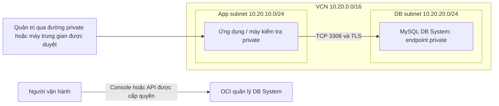

# Provision MySQL DB System trong private subnet

Trong OCI, triển khai MySQL DB System trong private subnet giúp ứng dụng truy cập cơ sở dữ liệu qua địa chỉ nội bộ và kiểm soát rõ nguồn kết nối. Để hệ thống sử dụng được, cần chuẩn bị đồng thời quyền quản lý tài nguyên, địa chỉ mạng, luật cho phép lưu lượng, tài khoản MySQL và cấu hình TLS.

Bài học thuộc chương **MySQL HeatWave và NoSQL** của module **CLOUD_PROVIDERS_ORACLE**, tập trung vào quy trình tạo một MySQL DB System có endpoint private, sau đó xác nhận khả năng truy cập từ đúng môi trường ứng dụng. Phạm vi không bao gồm triển khai Oracle NoSQL Database hoặc xây dựng một HeatWave cluster phục vụ phân tích.

Sau bài học, người học có thể:

- Thiết kế luồng kết nối từ ứng dụng đến MySQL trong cùng VCN.
- Chuẩn bị private subnet và luật mạng có phạm vi rõ ràng.
- Tạo DB System bằng giao diện dịch vụ và ghi lại thông tin bàn giao.
- Kiểm tra lần lượt mạng, TLS, đăng nhập và quyền SQL.
- Bổ sung yêu cầu về sao lưu, tính sẵn sàng, giám sát và chi phí trước khi đưa vào sử dụng.

## 1. Hiểu đúng đối tượng cần tạo

### 1.1. DB System là tài nguyên dịch vụ được quản lý

MySQL DB System cung cấp môi trường MySQL do dịch vụ quản lý. Người vận hành chọn cấu hình được hỗ trợ, mạng đích và các chính sách liên quan; không cài MySQL bằng trình quản lý gói lên một máy chủ Compute rồi coi đó là cùng mô hình.

Việc tạo DB System không đồng nghĩa đã tạo một HeatWave cluster. Thành phần phục vụ phân tích, nếu cần, được cấu hình theo khả năng và quy trình riêng của dịch vụ. Một ứng dụng giao dịch sử dụng MySQL có thể bắt đầu với DB System phù hợp mà chưa cần thêm tài nguyên phân tích.

### 1.2. Private subnet và endpoint private giải quyết những phần khác nhau

**Private subnet** là subnet được cấu hình để không cho VNIC sử dụng địa chỉ public theo cơ chế OCI. DB System trong thiết kế này được truy cập qua endpoint private của nó.

Không nên chỉ bỏ route đến Internet Gateway rồi gọi subnet đó là private. Cần chọn đúng chế độ subnet và kiểm tra cấu hình thực tế.

Private subnet cũng không đồng nghĩa:

- Mọi tài nguyên bên trong đều được phép truy cập database.
- Database không cần mật khẩu, tài khoản riêng hoặc TLS.
- Tất cả các luồng outbound đều bị chặn.
- Sao lưu, phục hồi và tính sẵn sàng đã được giải quyết.

NAT Gateway có thể phục vụ một số nhu cầu kết nối outbound của tài nguyên trong private subnet theo thiết kế. Việc có NAT không biến endpoint MySQL thành endpoint public và cũng không tạo đường inbound từ Internet đến MySQL.

### 1.3. Hai nhóm quyền độc lập

| Nhóm quyền | Điều khiển điều gì? | Ví dụ |
| --- | --- | --- |
| OCI IAM | Ai được xem, tạo hoặc thay đổi tài nguyên OCI | Tạo DB System trong compartment được giao |
| Quyền MySQL | Ai được đăng nhập và thao tác trên dữ liệu | Ứng dụng đọc/ghi các bảng trong schema của mình |

Người tạo được DB System chưa đương nhiên có quyền đăng nhập bằng một tài khoản MySQL bất kỳ. Ngược lại, người có mật khẩu MySQL cũng cần đường mạng hợp lệ để kết nối.

## 2. Kiến trúc thực hành

Giả sử phòng lab sử dụng một VCN trong cùng region với DB System:

| Thành phần | Giá trị minh họa | Mục đích |
| --- | --- | --- |
| VCN | `10.20.0.0/16` | Không gian mạng của bài lab |
| App subnet | `10.20.10.0/24`, private | Đặt máy ứng dụng hoặc máy kiểm tra được phép |
| DB subnet | `10.20.20.0/24`, private | Dành cho MySQL DB System |
| Máy kiểm tra | Ví dụ `10.20.10.25` | Chạy MySQL client từ mạng ứng dụng |
| Cổng ứng dụng | TCP `3306` | MySQL classic protocol |

Các CIDR chỉ là ví dụ, phải thay nếu trùng với mạng đang có hoặc mạng cần kết nối qua VPN/FastConnect. Địa chỉ DB System sẽ lấy từ kết quả provision, không tự giả định trước một IP còn trống.



Sơ đồ tách đường quản lý tài nguyên OCI khỏi đường kết nối dữ liệu MySQL. Một lần gọi API thành công không chứng minh máy ứng dụng đã truy cập được endpoint database.

Với hai subnet trong cùng VCN ở cấu hình định tuyến thông thường, lưu lượng nội bộ sử dụng định tuyến của VCN; không cần đưa luồng ứng dụng–database qua Internet Gateway hoặc NAT Gateway.

Nếu tổ chức có chèn thiết bị kiểm tra lưu lượng hoặc dùng cấu hình định tuyến đặc biệt, phải đánh giá thêm các tuyến và đường về. Bài thực hành sử dụng mô hình nội bộ đơn giản, không chèn thiết bị trung gian.

## 3. Chuẩn bị trước khi provision

### 3.1. Kiểm tra quyền và phạm vi OCI

Người vận hành cần được cấp các quyền phù hợp để:

- Quản lý tài nguyên MySQL trong compartment mục tiêu.
- Xem và sử dụng VCN/subnet đã được phê duyệt.
- Thực hiện các thay đổi mạng nếu công việc đó thuộc vai trò được giao.
- Sử dụng khóa, tag hoặc các tài nguyên phụ thuộc khi cấu hình lựa chọn yêu cầu.

Không cấp quyền quản trị toàn tenancy chỉ để vượt qua một lỗi tạo tài nguyên. Nếu người provision và người quản trị mạng là hai nhóm riêng, hãy chuẩn bị mạng trước và bàn giao subnet đích.

Cú pháp policy và các quyền phụ thuộc phải theo loại tài nguyên cùng cấu hình thực tế. Một policy quản lý MySQL không tự thay thế quyền mạng hoặc quyền với khóa mã hóa do khách hàng quản lý.

### 3.2. Kiểm tra điều kiện tài nguyên

| Điều kiện | Việc phải xác nhận |
| --- | --- |
| Region và khả năng cung cấp dịch vụ | Region có hỗ trợ cấu hình cần dùng, shape có thể cấp phát |
| Quota/service limit | Còn hạn mức cho DB System và cấu hình đã chọn |
| Subnet | Là private subnet đúng region, đủ địa chỉ cho cấu hình hiện tại và dự phòng |
| Dung lượng | Phù hợp dữ liệu, chỉ mục, tăng trưởng và đặc tính tải |
| Tính sẵn sàng | Chọn single-instance hoặc cấu hình HA được dịch vụ hỗ trợ theo yêu cầu |
| Sao lưu | Có lịch, thời gian lưu và mục tiêu phục hồi được xác định |
| Đường truy cập | Có máy hoặc mạng nguồn được phép tới endpoint private |
| Thông tin bí mật | Có nơi lưu và quy trình cấp phát mật khẩu quản trị |

Không chọn dung lượng hoặc shape bằng một con số tối thiểu cố định lấy từ ví dụ cũ. Hãy dùng lựa chọn được dịch vụ chấp nhận trong môi trường thực tế, rồi đối chiếu với nhu cầu và ngân sách.

### 3.3. Chuẩn bị máy kiểm tra

Máy kiểm tra cần có MySQL client tương thích và một đường truy cập quản trị đã được phê duyệt. Có thể dùng máy Compute private trong app subnet rồi truy cập máy đó bằng phương án phù hợp.

Không mở SSH vào DB System như khi vận hành một máy Linux tự quản lý. Trong bài này, các lệnh kiểm tra kết nối được chạy ở phía client.

OCI Cloud Shell thông thường không tự có đường tới mọi private subnet của người dùng. Chỉ dùng một môi trường Cloud Shell có cấu hình mạng private phù hợp khi đã xác nhận tính năng và quyền truy cập tương ứng.

## 4. Thiết lập luật mạng cho luồng MySQL

### 4.1. Dùng security list riêng cho DB subnet

Bài thực hành dùng **security list** để mô tả luật tại subnet, vì đây là ranh giới có thể kiểm tra rõ ràng. Gắn một security list dành riêng cho DB subnet và rà soát tất cả security list đang áp dụng.

Luật cho phép trong OCI có tính cộng gộp. Một security list chặt chẽ không vô hiệu hóa một luật rộng vẫn còn trong security list khác hoặc nhóm bảo mật áp dụng cho tài nguyên.

Nếu triển khai sử dụng NSG, chỉ cấu hình trên những tài nguyên mà dịch vụ hỗ trợ gắn NSG và đánh giá cùng các luật security list. Quy trình trong bài không phụ thuộc vào việc có thể gắn NSG trực tiếp cho DB System.

### 4.2. Luật tối thiểu cho ứng dụng

Với app subnet dành riêng cho ứng dụng được phép, có thể bắt đầu bằng bảng luồng sau:

| Vị trí áp dụng | Chiều | Nguồn hoặc đích | Giao thức/cổng | Kiểu |
| --- | --- | --- | --- | --- |
| DB subnet | Ingress | Nguồn `10.20.10.0/24` | TCP, cổng đích `3306` | Stateful |
| Phía máy ứng dụng | Egress | Đích trong DB subnet hoặc endpoint DB được quản lý phù hợp | TCP, cổng đích `3306` | Stateful |
| DB subnet, chỉ khi cần | Ingress | Nguồn quản trị private đã được xác nhận | TCP, cổng đích `3306` | Stateful |

Trong lab chỉ có một máy kiểm tra, có thể thu hẹp nguồn ingress thành `10.20.10.25/32`. Khi ứng dụng có nhiều instance hoặc tự động mở rộng, cần chọn nguồn phản ánh đúng cách cấp địa chỉ thực tế.

Luật stateful cho phép lưu lượng phản hồi của kết nối đã được chấp nhận. Không thêm một dải cổng phản hồi rộng chỉ vì phía client dùng cổng nguồn tạm thời.

Lưu ý rằng security list áp dụng ở cấp subnet, không phải riêng một database. Đây là lý do nên dành DB subnet cho nhóm tài nguyên có cùng yêu cầu bảo mật.

### 4.3. Những luật không cần cho bài này

- Không mở TCP `3306` từ `0.0.0.0/0`.
- Không mở SSH vào DB System để phục vụ kết nối MySQL.
- Không mở thêm cổng MySQL X Protocol chỉ vì thấy trong một ví dụ khác; chỉ mở nếu ứng dụng thực sự dùng và cấu hình dịch vụ hỗ trợ.
- Không mở rộng mọi giao thức giữa hai subnet để sửa một lỗi chưa được phân loại.

Một luật nguồn `0.0.0.0/0` vẫn quá rộng ngay cả khi endpoint đang là private. Nó làm tăng phạm vi nguồn được cho phép nếu sau này có thêm peering, VPN hoặc các tuyến mới.

### 4.4. Kiểm tra route và các phụ thuộc

Đối với thiết kế cùng VCN, kiểm tra rằng hai subnet thực sự thuộc đúng VCN và không có cấu hình định tuyến đặc biệt làm thay đổi đường đi dự kiến.

Nếu nguồn truy cập từ on-premises, cần có kết nối VPN/FastConnect phù hợp, DRG và các tuyến hai chiều, đồng thời kiểm tra CIDR không trùng. Firewall tại chỗ và luật OCI phải cùng cho phép luồng.

Không tự thêm NAT Gateway hoặc Service Gateway chỉ để mong khắc phục lỗi kết nối ứng dụng–database. Các gateway phục vụ mục đích khác phải được thiết kế riêng. Cũng không suy ra mọi hoạt động nội bộ của dịch vụ sao lưu được quản lý đều cần đi qua NAT của khách hàng.

## 5. Tạo MySQL DB System

Các nhóm trường dưới đây mô tả quyết định cần thực hiện. Tên nhãn và cách bố trí giao diện có thể khác nhau theo phiên bản dịch vụ.

### Bước 1: Chọn đúng ngữ cảnh

Trong OCI Console, vào khu vực quản lý dịch vụ MySQL, chọn tạo DB System và xác nhận region cùng compartment mục tiêu.

Đặt tên dễ nhận diện, ví dụ `mysql-orders-lab`. Bổ sung tag theo quy ước môi trường và nhóm chịu chi phí nếu tổ chức yêu cầu.

Đừng nhầm compartment chứa DB System với compartment chứa mạng. Trong tổ chức tách quyền, hai tài nguyên có thể được quản lý ở các compartment khác nhau, miễn là quyền truy cập và cách lựa chọn tài nguyên phù hợp.

### Bước 2: Chọn cấu hình phục vụ tải

Chọn shape, dung lượng và cấu hình MySQL được hỗ trợ. Với lab, chọn cấu hình phù hợp ngân sách; với sản xuất, đánh giá tải ghi/đọc, bộ nhớ, I/O và tăng trưởng.

Quyết định có cần HA ngay khi tạo hay không. HA cải thiện tính sẵn sàng theo cơ chế dịch vụ, nhưng không thay thế sao lưu hoặc phương án khôi phục khi dữ liệu bị sửa sai.

Không mặc định cấu hình có thể đổi về sau mà không có tác động. Ghi nhận giới hạn, điều kiện thay đổi và cửa sổ cần thiết theo tài nguyên thực tế.

### Bước 3: Chọn mạng private

Chọn VCN `10.20.0.0/16` và DB subnet `10.20.20.0/24` của ví dụ, sau khi đối chiếu với tên và OCID thật.

Xác nhận subnet ở chế độ private, có đủ địa chỉ và đang áp dụng đúng luật mạng. Không chọn nhầm app subnet chỉ vì subnet đó đang cho phép kết nối dễ hơn.

Nếu có các trường liên quan endpoint, cổng hoặc tên mạng, sử dụng giá trị theo thiết kế đã thống nhất. Bài này dùng MySQL classic protocol trên TCP `3306`; nếu thay đổi cổng, phải thay đồng bộ luật mạng, client và hồ sơ bàn giao.

### Bước 4: Thiết lập tài khoản quản trị MySQL

Chọn tên quản trị được dịch vụ cho phép, ví dụ `dbadmin_lab`, và cung cấp mật khẩu mạnh qua cơ chế nhập được hỗ trợ.

Lưu thông tin bí mật trong nơi được phê duyệt. Không đưa mật khẩu vào tag, tên tài nguyên, ảnh chụp màn hình hoặc repository.

Đây là tài khoản quản trị để khởi tạo và vận hành theo phạm vi dịch vụ. Ứng dụng sẽ dùng tài khoản riêng, không dùng tài khoản này trong connection pool.

### Bước 5: Cấu hình sao lưu và thời gian vận hành

Chọn chính sách sao lưu, thời gian lưu, cửa sổ thực hiện và các lựa chọn bảo trì mà dịch vụ cung cấp. Đối chiếu với yêu cầu RPO/RTO của hệ thống.

RPO là mục tiêu về mức dữ liệu có thể mất; RTO là mục tiêu về thời gian khôi phục khả năng phục vụ. Việc bật sao lưu không tự chứng minh đã đạt hai mục tiêu đó.

Nếu cần khóa mã hóa do khách hàng quản lý hoặc lựa chọn bổ sung khác, xác minh đầy đủ quyền, phụ thuộc và quy trình vận hành trước khi bật.

### Bước 6: Xem lại và gửi yêu cầu

Rà soát tên, compartment, cấu hình, subnet, tài khoản quản trị và chính sách đã chọn. Xem chi phí ước tính hoặc căn cứ tính phí hiện hành của môi trường trước khi tạo.

Gửi yêu cầu một lần và theo dõi trạng thái tài nguyên cùng tác vụ liên quan. Nếu giao diện bị ngắt hoặc báo hết thời gian chờ, kiểm tra xem DB System đã được tạo hay chưa trước khi gửi lại.

### Bước 7: Chờ hoàn tất và ghi endpoint

Khi DB System đạt trạng thái sẵn sàng theo dịch vụ, ghi lại:

- OCID, tên tài nguyên, region và compartment.
- VCN/subnet đã dùng và địa chỉ endpoint private.
- Cổng kết nối, tên hoặc cơ chế phân giải endpoint nếu có.
- Cấu hình tài nguyên, HA, sao lưu và cửa sổ bảo trì đã chọn.
- Người vận hành, nhóm ứng dụng và vị trí tham chiếu tới thông tin bí mật.

Không ghi mật khẩu vào cùng bảng bàn giao có phạm vi chia sẻ rộng. Endpoint cần lấy từ tài nguyên đã tạo, không tự đoán IP dựa trên CIDR.

Trạng thái sẵn sàng ở lớp OCI chỉ xác nhận phần vòng đời tương ứng. Bước tiếp theo vẫn phải kiểm tra đường mạng và phiên MySQL từ phía client.

## 6. Kiểm tra kết nối từ private client

Các lệnh sau chạy trên máy Linux được phép trong app subnet. Đây là ví dụ để thực hiện trong môi trường lab, không phải lệnh chạy trên DB System.

### 6.1. Xác nhận thông số đích

```bash
# Thay placeholder bằng endpoint thật sau khi DB System được tạo.
MYSQL_ENDPOINT='<private-ip-hoac-ten-endpoint-da-xac-nhan>'
MYSQL_PORT='3306'
MYSQL_ADMIN_USER='dbadmin_lab'

# Cần có công cụ nc phù hợp trên máy client.
nc -vz -w 5 "$MYSQL_ENDPOINT" "$MYSQL_PORT"
```

Nếu dùng tên endpoint, kiểm tra phân giải từ chính máy client. Nếu dùng IP private, phải kiểm tra IP đó còn đúng với thông tin endpoint do dịch vụ công bố.

TCP thành công chưa chứng minh mật khẩu đúng, TLS đạt yêu cầu hoặc tài khoản được phép vào schema.

### 6.2. Mở phiên MySQL có mã hóa

```bash
mysql --protocol=TCP \
  --host="$MYSQL_ENDPOINT" \
  --port="$MYSQL_PORT" \
  --user="$MYSQL_ADMIN_USER" \
  --password \
  --ssl-mode=REQUIRED
```

Tùy chọn `--password` không kèm giá trị yêu cầu nhập mật khẩu tương tác, giúp tránh đặt mật khẩu trực tiếp trong dòng lệnh. Không thêm mật khẩu vào biến shell hoặc tham số chỉ để rút ngắn thao tác.

`--ssl-mode=REQUIRED` yêu cầu mã hóa nhưng **không xác minh danh tính máy chủ bằng chứng thư**. Nó phù hợp để minh họa bước kiểm tra phiên mã hóa; chưa đủ để kết luận cấu hình xác thực máy chủ đã hoàn tất.

Khi môi trường cung cấp CA và tên endpoint phù hợp với chứng thư, cấu hình client có thể dùng dạng:

```bash
mysql --protocol=TCP \
  --host='<ten-endpoint-khop-chung-thu>' \
  --port=3306 \
  --user=dbadmin_lab \
  --password \
  --ssl-mode=VERIFY_IDENTITY \
  --ssl-ca='<duong-dan-den-ca-pem-da-xac-nhan>'
```

Đường dẫn CA và tên endpoint là placeholder, phải thay bằng thông tin được xác nhận cho dịch vụ thực tế. `VERIFY_CA` kiểm tra chuỗi tin cậy; `VERIFY_IDENTITY` bổ sung kiểm tra danh tính theo tên máy chủ.

Không giả định tên DNS tự đặt hoặc một IP private bất kỳ sẽ khớp chứng thư. Trước khi đưa vào sản xuất, phải chọn và kiểm chứng cơ chế TLS phù hợp với khả năng chứng thư của dịch vụ và yêu cầu bảo mật của tổ chức.

### 6.3. Xác nhận phiên SQL

```sql
SELECT 1 AS connectivity_test;

SELECT CURRENT_USER() AS authenticated_account,
       USER() AS client_identity,
       VERSION() AS mysql_version;

SHOW SESSION STATUS LIKE 'Ssl_cipher';
```

`CURRENT_USER()` cho biết tài khoản MySQL đã được khớp để xác thực; `USER()` cung cấp thông tin người dùng/kết nối phía client. Chúng có thể khác nhau về phần host và hữu ích khi kiểm tra quyền truy cập.

Giá trị `Ssl_cipher` không rỗng cho biết phiên đang dùng một bộ mã TLS. Kết quả này không tự chứng minh client đã xác minh chứng thư và tên máy chủ; phải đối chiếu cả tùy chọn client đã sử dụng.

## 7. Tạo tài khoản ứng dụng có quyền giới hạn

Sau khi đăng nhập bằng tài khoản quản trị, tạo schema và tài khoản phục vụ ứng dụng trong phạm vi được dịch vụ cho phép. Ví dụ sau dành cho lab mới, không chạy nguyên trạng trên một schema đang có dữ liệu.

```sql
CREATE DATABASE orders_lab CHARACTER SET utf8mb4;

CREATE TABLE orders_lab.connection_probe (
    probe_id BIGINT UNSIGNED NOT NULL AUTO_INCREMENT,
    note VARCHAR(120) NOT NULL,
    created_at TIMESTAMP NOT NULL DEFAULT CURRENT_TIMESTAMP,
    PRIMARY KEY (probe_id)
) ENGINE=InnoDB;

-- Chỉ minh họa cú pháp: thay placeholder bằng bí mật được cấp đúng quy trình.
CREATE USER 'orders_app'@'10.20.10.25'
    IDENTIFIED BY '<MAT_KHAU_UNG_DUNG_CAN_THAY>'
    REQUIRE SSL;

GRANT SELECT, INSERT, UPDATE, DELETE
ON orders_lab.*
TO 'orders_app'@'10.20.10.25';
```

Giá trị host `10.20.10.25` là IP minh họa của máy client. Phải xác minh địa chỉ nguồn mà MySQL thực tế nhìn thấy, đặc biệt nếu dùng proxy, tunnel hoặc một đường có NAT.

Không dùng nguyên mật khẩu placeholder, không lưu mật khẩu thật trong repository và không để lịch sử thao tác chứa thông tin bí mật ngoài chính sách cho phép.

Tài khoản ứng dụng ở ví dụ không có quyền tạo bảng, xóa schema hoặc quản lý người dùng. Nếu ứng dụng cần migration, nên có một vai trò hoặc tài khoản triển khai riêng với vòng đời quyền được quản lý.

`REQUIRE SSL` yêu cầu phiên mã hóa khi đăng nhập tài khoản này; nó không thay thế việc cấu hình client để xác minh máy chủ.

### 7.1. Kiểm tra bằng chính tài khoản ứng dụng

Thoát phiên quản trị, kết nối lại bằng `orders_app` từ máy được phép và giữ cấu hình TLS phù hợp. Sau đó thực hiện một giao dịch thử trong schema lab:

```sql
USE orders_lab;

SELECT CURRENT_USER();

START TRANSACTION;

INSERT INTO connection_probe (note)
VALUES ('private-subnet-connectivity-check');

SELECT probe_id, note, created_at
FROM connection_probe
WHERE probe_id = LAST_INSERT_ID();

ROLLBACK;
```

Giao dịch thử xác nhận tài khoản có thể đọc/ghi trong phạm vi được cấp; `ROLLBACK` loại bỏ bản ghi thử trong bảng InnoDB. Bước này không thay thế kiểm thử toàn bộ nghiệp vụ của một ứng dụng thật.

Ngoài trường hợp truy cập hợp lệ, cần xác nhận một nguồn không được cho phép không thể mở phiên MySQL. Chỉ kiểm tra từ nguồn được phê duyệt cho bài lab, không quét mạng hoặc thay đổi luật sản xuất để tạo tình huống thử.

## 8. Quản trị database private mà không mở public MySQL

### 8.1. Kết nối private từ mạng doanh nghiệp

Với VPN hoặc FastConnect được thiết kế phù hợp, người quản trị có thể đi từ mạng doanh nghiệp tới endpoint private. Điều kiện gồm route hai chiều, không trùng CIDR, luật mạng và tài khoản MySQL hợp lệ.

Không mặc định việc VPN đã kết nối đồng nghĩa mọi private subnet đều truy cập được. Cần kiểm tra route và phạm vi nguồn cho đúng luồng TCP `3306`.

### 8.2. Dùng máy client trung gian

Một lựa chọn khác là truy cập máy Compute được phép trong mạng nội bộ bằng cơ chế Bastion hoặc phương án quản trị được phê duyệt, rồi chạy MySQL client trên máy đó.

Trong mô hình này, database nhìn thấy nguồn kết nối từ máy client trung gian theo đường đi thực tế. Luật mạng và phần host của tài khoản MySQL phải phù hợp với nguồn đó.

Không tạo một tài khoản hệ điều hành trên DB System hoặc yêu cầu SSH trực tiếp vào máy chủ database như một bước mặc định của dịch vụ được quản lý.

### 8.3. Lưu ý nếu dùng port forwarding

Nếu phương án được hỗ trợ sử dụng chuyển tiếp cổng, địa chỉ kết nối cục bộ có thể là `127.0.0.1`, trong khi chứng thư máy chủ được phát hành cho danh tính khác.

Không hạ mức xác minh TLS chỉ để bỏ qua lỗi tên. Cần thiết kế cách định danh endpoint và cấu hình client phù hợp với cơ chế tunnel cùng chứng thư được dịch vụ hỗ trợ.

Tunnel cũng không loại bỏ nhu cầu phân quyền, quản lý bí mật và giới hạn nguồn. Nó chỉ thay đổi cách đi tới đích.

## 9. Phân loại lỗi khi kết nối thất bại

| Dấu hiệu | Nhóm nguyên nhân cần kiểm tra | Hành động phù hợp |
| --- | --- | --- |
| Không thấy VCN/subnet khi tạo | Sai region, compartment hoặc thiếu quyền | Kiểm tra ngữ cảnh và quyền sử dụng tài nguyên |
| Tạo DB System thất bại | Hạn mức, capacity, địa chỉ subnet, cấu hình hoặc quyền phụ thuộc | Xem chi tiết tác vụ trước khi thay đổi thiết kế |
| Chờ kết nối rồi timeout | Sai endpoint, thiếu route, luật chặn hoặc firewall phía client | Kiểm tra nguồn/đích/cổng và đường về |
| Kết nối bị từ chối | Sai cổng, dịch vụ chưa sẵn sàng hoặc đích không đúng | Đối chiếu endpoint/cổng và trạng thái dịch vụ |
| `Access denied` | Sai thông tin đăng nhập, host không khớp hoặc điều kiện tài khoản | Kiểm tra tài khoản và nguồn client; không mở rộng firewall tùy tiện |
| Lỗi TLS/chứng thư | Tên không khớp, CA không đúng, client không tương thích hoặc cấu hình TLS sai | Kiểm tra chuỗi tin cậy và danh tính; không bỏ xác minh như cách sửa mặc định |
| Đăng nhập được nhưng không dùng được schema | Thiếu quyền MySQL hoặc chọn sai schema | Kiểm tra grants với tài khoản có thẩm quyền |
| Máy lab kết nối được nhưng ứng dụng lỗi | Connection string, secret, driver, pool hoặc luật từ nguồn ứng dụng khác | Kiểm tra bằng đúng môi trường chạy ứng dụng |

Các dấu hiệu là điểm bắt đầu khoanh vùng, không phải bằng chứng duy nhất kết luận nguyên nhân. Ví dụ, thiết bị trung gian chủ động từ chối cũng có thể tạo biểu hiện khác với việc thiếu route.

Không dùng `ping` làm điều kiện duy nhất đánh giá MySQL. ICMP và TCP `3306` có thể chịu các chính sách khác nhau.

Khi mở hỗ trợ, cung cấp thời điểm có múi giờ, OCID tài nguyên, nguồn thử, endpoint, cổng và thông báo lỗi đã loại bỏ bí mật. Không gửi mật khẩu hoặc khóa truy cập trong hồ sơ.

## 10. Hoàn thiện vận hành sau khi provision

### 10.1. Sao lưu và phục hồi

Kiểm tra rằng chính sách sao lưu đã được áp dụng và có kết quả thành công. Lập một lần phục hồi thử có phạm vi phù hợp để xác nhận dữ liệu, thời gian phục hồi và quyền cần dùng.

Khi phục hồi sang DB System khác, phải kiểm tra lại endpoint, subnet, luật mạng, tài khoản và cấu hình ứng dụng. Đừng giả định tài nguyên mới luôn có cùng địa chỉ hoặc cùng trạng thái mạng với tài nguyên nguồn.

Nếu cần bảo vệ khỏi xóa nhầm hoặc sự cố lớn hơn, hãy xác định cơ chế và thời gian lưu phù hợp với khả năng dịch vụ. HA không thay thế bản sao dữ liệu dùng để phục hồi sau thao tác nghiệp vụ sai.

### 10.2. Tính sẵn sàng của ứng dụng

Dù chọn HA, ứng dụng vẫn cần timeout hợp lý, khả năng kết nối lại và quản lý connection pool. Một sự kiện chuyển đổi có thể làm mất các phiên hiện có.

Khi thiết kế retry giao dịch, phải xem xét tính lặp an toàn. Nếu client mất phản hồi sau khi server đã commit, gửi lại toàn bộ yêu cầu mà không có cơ chế chống trùng có thể tạo tác động nghiệp vụ hai lần.

Kiểm thử hành vi này trên môi trường phù hợp trước khi tin rằng việc chọn HA đã hoàn thành yêu cầu liên tục dịch vụ.

### 10.3. Giám sát

Thiết lập các tín hiệu sẵn có trong dịch vụ và ở phía ứng dụng cho:

- Trạng thái DB System và công việc quản lý.
- Dung lượng lưu trữ, xu hướng tăng trưởng và sử dụng tài nguyên.
- Số kết nối, lỗi kết nối, độ trễ và tải truy vấn.
- Kết quả sao lưu, tiến trình phục hồi thử và các sự kiện bảo trì.

Metric, ngưỡng và khả năng thu thập phải được xác nhận trong môi trường thực tế. Cảnh báo cần có người nhận và hành động, không chỉ một biểu đồ trên Console.

### 10.4. Bí mật và quyền truy cập

Tách tài khoản ứng dụng khỏi tài khoản quản trị. Quản lý vòng đời bí mật, kiểm tra việc thu hồi khi nhân sự hoặc workload thay đổi và cập nhật ứng dụng khi xoay vòng mật khẩu.

Tính riêng tư của mạng không thay thế kiểm soát truy cập dữ liệu. Khi thêm peering, VPN, subnet hoặc môi trường dùng chung, phải rà soát lại phạm vi nguồn được phép.

### 10.5. Chi phí

Ghi nhận những cấu phần có thể phát sinh chi phí theo cấu hình đã chọn: tài nguyên DB System, lưu trữ, HA, sao lưu, tài nguyên phân tích bổ sung nếu có và máy kiểm tra cùng hạ tầng truy cập.

Không mặc định trạng thái dừng hoặc không có kết nối sẽ ngừng mọi khoản tính phí. Với lab, hãy xác định trước thời điểm kết thúc và chính sách giữ dữ liệu.

Việc chọn private subnet là quyết định về truy cập mạng; nó không tự làm DB System nhỏ hơn, rẻ hơn hoặc có HA.

## 11. Tự động hóa cùng một thiết kế

Sau khi đã xác định đúng cấu hình, có thể dùng công cụ IaC, OCI CLI hoặc SDK được hỗ trợ để tái tạo tài nguyên. Tự động hóa phải giữ nguyên các quyết định về private subnet, luật mạng, thông tin bí mật và sao lưu.

Đầu vào nên có định danh rõ ràng thay vì chọn theo tên dễ trùng:

| Đầu vào | Cách quản lý |
| --- | --- |
| Region và compartment | Khai báo rõ theo môi trường |
| VCN/subnet | Dùng định danh tài nguyên đã được kiểm chứng |
| Shape, dung lượng và HA | Theo cấu hình được hỗ trợ, hạn mức và nhu cầu |
| Quy tắc truy cập | Ghi nguồn, đích, giao thức và cổng cụ thể |
| Mật khẩu quản trị | Lấy từ cơ chế bí mật phù hợp, tránh lộ trong log hoặc state |
| Sao lưu và bảo trì | Khai báo rõ lựa chọn và người chịu trách nhiệm |

Không đưa một ví dụ CLI có mật khẩu thật vào pipeline. Tùy công cụ, thông tin nhạy cảm có thể xuất hiện trong state, kế hoạch thay đổi hoặc nhật ký; cần bảo vệ các nơi lưu đó.

Pipeline cần theo dõi tác vụ đến trạng thái phù hợp rồi mới chạy bước kiểm chứng kết nối. Nếu yêu cầu tạo bị timeout, đối chiếu tài nguyên trước khi gửi lại; không tạo thêm DB System chỉ vì chưa nhận được phản hồi.

Không dùng việc tự động mở rộng nguồn `0.0.0.0/0` như cơ chế sửa lỗi kết nối.

## 12. Tiêu chí nghiệm thu và kết thúc lab

Một lần provision được coi là đạt mục tiêu bài học khi có đủ bằng chứng:

- [ ] DB System nằm đúng compartment, region và private subnet đã thiết kế.
- [ ] Endpoint private và cổng được ghi nhận từ tài nguyên thực tế.
- [ ] Tất cả luật mạng áp dụng đã được rà soát, không còn đường cho phép quá rộng ngoài yêu cầu.
- [ ] Máy client được phép kết nối TCP tới endpoint.
- [ ] Phiên MySQL dùng TLS và mức xác thực máy chủ được ghi rõ.
- [ ] Tài khoản ứng dụng đăng nhập và thực hiện được thao tác SQL trong phạm vi được cấp.
- [ ] Nguồn không được cho phép không mở được phiên trong phép thử đã phê duyệt.
- [ ] Tài khoản quản trị không được dùng làm tài khoản ứng dụng.
- [ ] Sao lưu, giám sát, nhu cầu HA và trách nhiệm vận hành đã có người phụ trách.
- [ ] Chi phí và phương án xử lý tài nguyên sau lab đã được xác định.

Nếu kết thúc lab, trước khi xóa phải xác nhận có cần giữ dữ liệu hoặc bản sao lưu. Chỉ xóa DB System cùng các tài nguyên dành riêng cho lab trong đúng phạm vi được phép; không xóa subnet, security list hoặc VCN đang dùng chung.

Mục tiêu của bài là một MySQL DB System truy cập được qua mạng private từ đúng nguồn, sử dụng tài khoản và TLS phù hợp, đồng thời có thông tin vận hành để bàn giao. Việc tạo thành công trên OCI là bước khởi đầu; khả năng sử dụng an toàn phải được chứng minh ở cả mạng, phiên kết nối và quyền dữ liệu.

