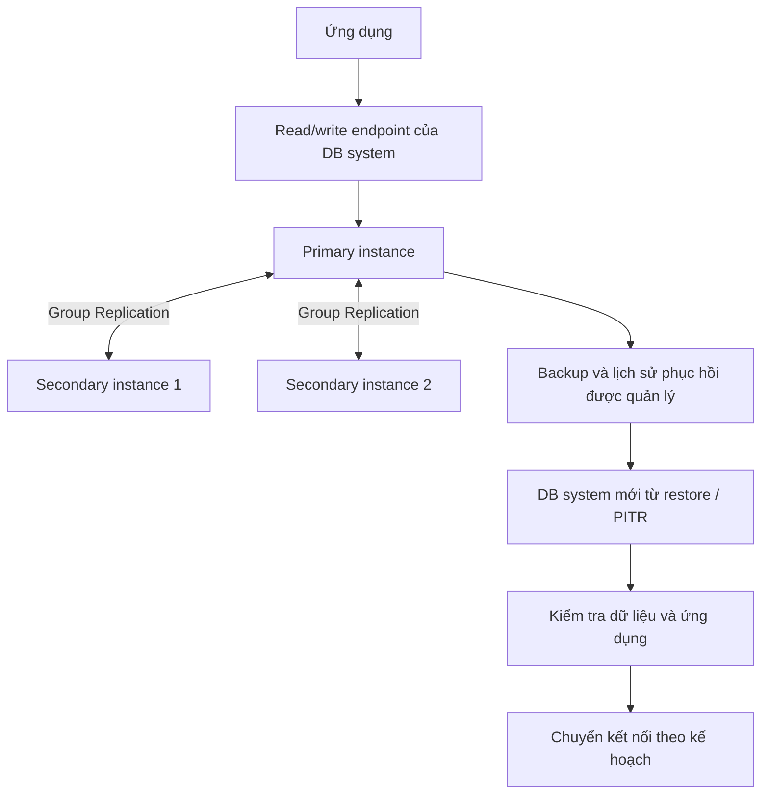

# MySQL backup, restore và high availability

Một hệ thống MySQL có thể ngừng phục vụ vì instance lỗi, dữ liệu bị sửa nhầm, đường mạng gián đoạn hoặc cả khu vực triển khai gặp sự cố. Mỗi tình huống cần một cơ chế bảo vệ khác nhau. Có ba instance không giúp lấy lại những hàng đã bị xóa hợp lệ; có một backup tốt cũng không làm ứng dụng tự kết nối lại khi primary thay đổi.

Trong chương **MySQL HeatWave và NoSQL** của lộ trình Oracle Cloud Infrastructure (OCI), bài này tập trung vào **MySQL HeatWave Service trên OCI**: lập kế hoạch backup, khôi phục từ backup hoặc theo thời điểm, vận hành high availability (HA) và kiểm chứng khả năng phục hồi của ứng dụng. Các thao tác được mô tả theo dịch vụ quản lý; không giả định người dùng có quyền SSH vào DB system hoặc tự sao chép filesystem của MySQL.

Sau bài học, người học có thể:

- Chọn cơ chế bảo vệ theo loại sự cố và mục tiêu RPO/RTO.
- Phân biệt kiểu backup, cách tạo backup, retention và point-in-time recovery.
- Lập quy trình restore sang DB system mới, đối soát dữ liệu và chuyển ứng dụng.
- Giải thích failover, switchover và trách nhiệm xử lý kết nối ở phía ứng dụng.
- Thiết kế kiểm tra phục hồi, cảnh báo, phân quyền và ngân sách cho môi trường có HeatWave.

## 1. Chọn cơ chế theo sự cố cần xử lý

### 1.1. Bốn khái niệm phải tách biệt

| Khái niệm | Mục tiêu chính | Giới hạn cần nhớ |
| --- | --- | --- |
| Backup | Giữ trạng thái dữ liệu để có thể phục hồi về sau | Cần thời gian restore, kiểm tra và đưa ứng dụng trở lại |
| Restore | Tạo lại dữ liệu từ nguồn phục hồi đã chọn | Không tự xác nhận tính đúng đắn nghiệp vụ |
| Point-in-time recovery — PITR | Phục hồi tới một thời điểm được hỗ trợ | Cần backup, lịch sử log và khoảng thời gian phục hồi hợp lệ |
| High availability — HA | Giảm gián đoạn khi thành phần trong phạm vi HA gặp lỗi | Thay đổi dữ liệu sai vẫn có thể được sao chép sang các thành viên |

**Disaster recovery — DR** mở rộng bài toán tới những sự cố có phạm vi lớn hơn, chẳng hạn mất region hoặc mất cả một tập phụ thuộc. DR cần tính cả dữ liệu, ứng dụng, mạng, quyền truy cập và quy trình điều hành.

### 1.2. Ánh xạ tình huống với hành động

| Tình huống | Hướng xử lý ban đầu |
| --- | --- |
| Primary instance lỗi trong DB system HA | Theo dõi failover và khả năng ứng dụng kết nối lại |
| Xóa hoặc cập nhật sai đã commit | Xác định phạm vi, chọn PITR hoặc phục hồi vào hệ thống tạm để lấy dữ liệu đúng |
| Cần đưa một bản dữ liệu vào môi trường kiểm tra | Restore backup sang DB system mới được cách ly |
| Dữ liệu giao dịch phục vụ được nhưng HeatWave chưa sẵn sàng | Khôi phục đường analytics và quản lý tải fallback |
| Region nguồn không sử dụng được | Thực hiện phương án DR đã chuẩn bị ở nơi khác |
| Không truy cập được từ ứng dụng | Kiểm tra mạng, DNS, TLS, tài khoản và pool kết nối trước khi kết luận database đã mất |

Một câu lệnh `DELETE` hợp lệ đã commit không trở thành lỗi hạ tầng chỉ vì nó gây hậu quả nghiệp vụ. Chuyển primary không quay ngược transaction đó.

## 2. Kiến trúc HA và đường phục hồi là hai luồng khác nhau

### 2.1. HA của DB system trên OCI

DB system HA gồm một primary và hai secondary instance. Dịch vụ sử dụng MySQL Group Replication; vị trí các instance phụ thuộc region, loại subnet và availability/fault domain. Primary cung cấp đường đọc/ghi của DB system. Xem [tổng quan high availability](https://docs.oracle.com/en-us/iaas/mysql-database/doc/overview-high-availability.html).



Sơ đồ thể hiện quan hệ logic. Ba instance HA không phải ba backup độc lập theo thời gian; DB system mới sau restore cũng không phải một thành viên được tự động thêm vào cụm cũ.

Các secondary instance HA không nên được xem như read replica mà người dùng tùy ý kết nối để kiểm tra hoặc chạy báo cáo. Giới hạn truy cập được mô tả trong [các giới hạn HA](https://docs.oracle.com/en-us/iaas/mysql-database/doc/limitations2.html).

### 2.2. Endpoint không đổi và endpoint mới có ý nghĩa khác nhau

Khi đổi primary trong một DB system HA, dịch vụ giữ read/write endpoint của DB system. Tuy nhiên, connection đang tồn tại có thể bị đóng, vì vậy ứng dụng vẫn cần mở lại kết nối.

Khi restore hoặc PITR, đích là **DB system mới**. Cần xác định endpoint đích và cách chuyển ứng dụng; không giả định nó tự thay thế endpoint nguồn.

Hồ sơ vận hành nên lưu cả tên dễ đọc và OCID. Tên hiển thị có thể giống nhau, còn việc khôi phục nhầm nguồn hoặc chuyển nhầm endpoint là rủi ro thực tế khi nhiều môi trường cùng tồn tại.

## 3. Định nghĩa RPO và RTO bằng dữ liệu có thể đo

### 3.1. RPO: khoảng dữ liệu có thể không khôi phục được

**Recovery Point Objective — RPO** là mục tiêu về mức mất dữ liệu có thể chấp nhận. Đơn vị thường là thời gian, nhưng khi đối soát phải gắn với transaction và sự kiện nghiệp vụ.

Một chỉ số quan sát:

```text
Khoảng dữ liệu có nguy cơ chưa phục hồi được
    = thời điểm sự cố
    - điểm phục hồi gần nhất thực sự sử dụng được
```

Không suy ra RPO bằng cách đếm số bản sao. Cũng không lấy lịch backup hằng ngày làm bằng chứng luôn có đúng một backup thành công mỗi ngày.

Nếu sự cố là dữ liệu sai đã commit, có thể chủ động chọn một mốc cũ hơn để loại bỏ transaction sai. Khi đó phải xử lý riêng các transaction đúng phát sinh sau mốc được chọn.

### 3.2. RTO: thời gian đưa dịch vụ trở lại mức chấp nhận

**Recovery Time Objective — RTO** là mục tiêu thời gian khôi phục dịch vụ. Thời gian restore database chỉ là một thành phần:

```text
Thời gian phục hồi đầu cuối
    = phát hiện và xác định sự cố
    + quyết định / cách ly
    + cấp tài nguyên và phục hồi dữ liệu
    + kiểm tra
    + chuyển kết nối
    + xác nhận nghiệp vụ hoạt động
```

Ví dụ phân bổ một RTO giả định 60 phút:

| Công việc | Ngân sách thời gian |
| --- | ---: |
| Phát hiện và thu thập thông tin | 5 phút |
| Xác định phương án, cách ly thay đổi gây hại | 5 phút |
| Tạo đích và phục hồi dữ liệu | 25 phút |
| Kiểm tra database và dữ liệu | 8 phút |
| Chuyển kết nối | 5 phút |
| Xác nhận nghiệp vụ | 7 phút |
| Tổng dự kiến | 55 phút |
| Phần dự phòng | 5 phút |

Đây là kế hoạch minh họa, không phải thời gian cam kết của OCI. Nếu diễn tập mất 75 phút, cần thay đổi phương án hoặc mục tiêu; không thể kết luận đạt RTO vì riêng bước restore chỉ mất 25 phút.

Nên có mục tiêu riêng cho giao dịch và analytics. Checkout hoạt động trở lại chưa chắc đồng nghĩa dashboard HeatWave đã hoạt động trở lại.

## 4. Hiểu đúng các loại backup

### 4.1. Kiểu nội dung và cách tạo là hai trục khác nhau

MySQL HeatWave hỗ trợ **full** và **incremental** backup. Full ghi nhận toàn bộ dữ liệu cần sao lưu; incremental ghi nhận phần thay đổi. Dịch vụ quản lý quan hệ giữa các backup, người dùng chọn recovery point được hỗ trợ thay vì tự ráp chuỗi file như một hệ thống tự quản trị. Xem [tổng quan backup](https://docs.oracle.com/en-us/iaas/mysql-database/doc/overview-backups.html).

Một backup còn có cách tạo:

| Cách tạo | Công dụng vận hành |
| --- | --- |
| Automatic | Bảo vệ định kỳ theo backup plan |
| Manual | Tạo mốc chủ động trước thay đổi hoặc cho một yêu cầu cụ thể |
| Final | Tạo trước khi xóa DB system nếu deletion plan yêu cầu |
| Operator | Do đội hỗ trợ dịch vụ tạo để phục vụ công việc của họ |

Vì vậy, “manual” không đồng nghĩa “full”, còn “automatic” không đồng nghĩa một loại dữ liệu backup hoàn toàn khác. Cần đọc cả hai thuộc tính.

### 4.2. Chọn backup theo điểm phục hồi

Với mỗi backup quan trọng, ghi nhận:

- OCID backup và OCID DB system nguồn.
- Region, compartment và thời gian liên quan.
- Kiểu backup, cách tạo và trạng thái.
- Retention hoặc ngày hết hạn.
- Phiên bản MySQL, trạng thái mã hóa và cấu hình nguồn cần tham chiếu.
- Kết quả validate, preparation và lần restore thử gần nhất nếu có.

Một backup có tên “before-release” chỉ hữu ích nếu biết nó thuộc release nào, thời điểm nào và đã hoàn tất chưa.

Không tự xóa các backup được dịch vụ tạo cho hỗ trợ hoặc điều tra khi chưa hiểu mục đích. Quy trình vòng đời phải phân biệt dữ liệu phục vụ phục hồi, kiểm thử và điều tra.

## 5. Thiết kế automatic backup và retention

### 5.1. Lập một backup plan có thể vận hành

Một kế hoạch nên xác định:

| Trường kế hoạch | Câu hỏi cần trả lời |
| --- | --- |
| Tần suất và cửa sổ backup | Khi nào bắt đầu, có trùng bảo trì hoặc batch lớn không? |
| Retention | Cần quay lại bao xa khi phát hiện lỗi muộn? |
| PITR | Có được bật và đã có khoảng phục hồi khả dụng chưa? |
| Soft delete | Có khoảng đệm khi backup tới hạn xóa không? |
| Cross-region copy | Region đích nào, bản copy đã hoàn tất chưa? |
| Validation / restore drill | Ai kiểm tra và theo chu kỳ nào? |
| Cảnh báo | Khi nào coi là mất khả năng bảo vệ? |

Ví dụ một ứng dụng chọn automatic backup mỗi ngày, retention 14 ngày, PITR và một bản copy ở region khác. Đây là quyết định nội bộ cần kiểm tra với loại DB system và giới hạn hiện hành, không phải mặc định áp dụng cho mọi môi trường.

Cửa sổ backup được cấu hình theo UTC; thao tác bảo trì xung đột có thể làm lịch backup bị chậm hoặc bỏ qua theo điều kiện dịch vụ. Xem [chỉnh backup plan](https://docs.oracle.com/en-us/iaas/mysql-database/doc/managing-backup.html).

### 5.2. Retention phải dài hơn thời gian phát hiện sai sót

Nếu dữ liệu bị xử lý sai nhưng ba tuần sau mới phát hiện, retention một tuần có thể không còn mốc đúng cần dùng. Hãy xét:

- Chu kỳ đối soát hoặc chốt sổ.
- Thời gian phát hiện lỗi ứng dụng.
- Thời gian cần điều tra và quyết định.
- Nhu cầu giữ dữ liệu cho những đợt thay đổi lớn.

Retention của backup cũng không thay thế lịch sử nghiệp vụ. Có backup cũ không làm việc trích xuất một vài thay đổi trở nên tự động; cần mô hình audit hoặc sự kiện phù hợp nếu muốn đối soát chi tiết.

### 5.3. Bảo vệ trước thao tác xóa

Ba tùy chọn cần phân biệt:

- **Delete protection:** bảo vệ thao tác xóa DB system.
- **Retain automatic backups:** quyết định giữ automatic backup sau khi DB system bị xóa.
- **Final backup:** yêu cầu tạo backup cuối trước khi xóa.

Các tùy chọn được mô tả trong [deletion plan của DB system](https://docs.oracle.com/en-us/iaas/mysql-database/doc/advanced-options.html). Không suy ra rằng bật một tùy chọn sẽ tự bật các tùy chọn còn lại.

Soft delete là lớp bảo vệ bổ sung ở cấp backup. Trong trạng thái `DELETE_SCHEDULED`, cần hủy lịch xóa để đưa backup về trạng thái cho phép trước khi restore. Không xem soft delete như một chính sách lưu giữ bất biến không thể bị người có quyền thay đổi.

Trước khi xóa tài nguyên nguồn sau diễn tập hoặc cutover, kiểm tra kế hoạch giữ dữ liệu bằng OCID và thời hạn cụ thể. Không lấy hành động xóa DB system làm cách nhanh để tái sử dụng IP của nguồn.

## 6. Point-in-time recovery: chọn đúng mốc

### 6.1. PITR cần được chuẩn bị từ trước

Để dùng PITR, bật automatic backups rồi bật PITR trên backup plan. Dịch vụ phục hồi backup phù hợp và áp dụng các transaction đã commit tới mốc chọn. Oracle mô tả RPO xấp xỉ năm phút cho DB system đang hoạt động; phải kiểm tra cửa sổ phục hồi thực tế thay vì coi đây là cam kết chính xác cho mọi sự cố. Xem [PITR của MySQL HeatWave](https://docs.oracle.com/en-us/iaas/mysql-database/doc/point-time-recovery.html).

Những điều phải xác minh trước khi thao tác:

- Earliest và latest recovery point đang khả dụng.
- Mốc cần chọn có nằm trong khoảng đó không.
- Backup/log cần thiết còn tồn tại và dùng được không.
- Tính năng được hỗ trợ trên loại DB system và phiên bản đang dùng.

Bật PITR hôm nay không tạo lại toàn bộ lịch sử từ trước khi bật. Một backup lỗi hoặc khoảng lịch sử không đủ cũng có thể làm phạm vi hay thời gian phục hồi khác dự kiến.

### 6.2. Ví dụ chọn mốc trước transaction gây hại

Giả sử các thời điểm dưới đây đều là UTC, ngày 20/11/2026:

| Thời điểm | Sự kiện |
| --- | --- |
| 02:00:00Z | Có backup làm nền phục hồi |
| 03:14:20Z | Transaction hợp lệ A commit |
| 03:15:10Z | Transaction cập nhật sai B commit |
| 03:16:30Z | Transaction hợp lệ C commit |
| 03:25:00Z | Phát hiện dữ liệu sai |

Nếu xác minh được ranh giới này, có thể xét mốc `03:15:00Z`, sau A và trước B, với điều kiện mốc đó nằm trong cửa sổ PITR khả dụng.

Chọn “latest available” sau 03:15:10Z sẽ đưa transaction sai B trở lại. Chọn mốc trước B cũng đồng thời loại C khỏi trạng thái phục hồi toàn DB system.

Vì vậy, có hai hướng nghiệp vụ:

1. **Quay toàn hệ thống về mốc cũ:** chấp nhận và xử lý những transaction đúng sau mốc đó.
2. **Phục hồi vào DB system tạm:** lấy dữ liệu đúng cần thiết, đối soát và sửa có kiểm soát trên hệ thống đang phục vụ.

Hướng thứ hai tránh quay ngược mọi bảng nhưng khó hơn về quan hệ dữ liệu, giao dịch sau đó và tác động bên ngoài. Không sao chép riêng vài hàng chỉ dựa vào số lượng hàng.

### 6.3. Dùng UTC và ranh giới transaction

`2026-11-20T03:15:00.000Z` tương ứng 10:15 tại Việt Nam. Trong hồ sơ sự cố, lưu múi giờ của log ứng dụng, thời gian database và thời gian được nhập vào công cụ phục hồi.

Cần xác định thời điểm commit, không chỉ lúc người dùng nhấn nút hoặc câu SQL bắt đầu chạy. Không dựa vào phần mili giây của input để phân biệt những transaction quá sát nhau nếu API không phục hồi ở độ phân giải đó.

Đối với sự cố có ranh giới không chắc chắn, phục hồi vào đích cách ly và kiểm tra nhiều mốc ứng viên sẽ an toàn hơn việc chuyển ứng dụng ngay vào mốc ước lượng đầu tiên.

## 7. Quy trình restore sang DB system mới

### 7.1. Chuẩn bị đích phục hồi

Restore từ backup của dịch vụ tạo một DB system mới trong cùng tenancy; đích có thể giữ thông tin đăng nhập quản trị của nguồn tại thời điểm backup. Phải chuẩn bị mạng và kiểm soát truy cập trước khi cho client kết nối. Xem [restore từ backup](https://docs.oracle.com/en-us/iaas/mysql-database/doc/restoring-backup.html).

Một hồ sơ đích nên có:

| Nhóm | Thông tin cần chốt |
| --- | --- |
| Định danh | Backup/PITR nguồn, OCID, region, compartment, mục đích |
| Compute | Shape hỗ trợ, năng lực và capacity khả dụng |
| Lưu trữ | Dung lượng, tăng trưởng và cấu hình cần dùng |
| Phiên bản | Phiên bản được phục hồi và tương thích với ứng dụng |
| Mạng | VCN, subnet, route, NSG, endpoint và nguồn kết nối |
| Quyền | IAM để tạo/đọc nguồn, quyền khóa mã hóa nếu áp dụng, tài khoản MySQL |
| Bảo vệ tiếp theo | Backup plan, PITR, HA và deletion plan của đích |
| Phụ thuộc | Job, sự kiện, replication, BI, dịch vụ ngoài và bí mật truy cập |

Không giả định quota còn trống đồng nghĩa luôn có capacity tức thời. Lỗi `OutOfHostCapacity` có thể ảnh hưởng kế hoạch tạo đích; xem [lỗi work request và capacity](https://docs.oracle.com/en-us/iaas/mysql-database/doc/troubleshooting-work-request-errors.html).

### 7.2. Thực hiện theo các cổng kiểm tra

1. **Xác nhận nguồn:** đúng backup hoặc DB system, đúng mốc và trạng thái cho phép.
2. **Tạo đích:** đặt tên thể hiện mục đích phục hồi; ghi nhận OCID mới.
3. **Theo dõi công việc:** chờ hoàn tất hoặc xử lý lỗi, không chỉ dựa vào việc API đã nhận yêu cầu.
4. **Xác nhận truy cập:** kết nối từ đường quản trị đã chuẩn bị.
5. **Kiểm tra dữ liệu:** schema, dữ liệu, tài khoản và tính đúng đắn theo phạm vi đã chọn.
6. **Kiểm tra ứng dụng:** đọc/ghi thử trong môi trường kiểm soát, xử lý job và tác động bên ngoài.
7. **Chuyển kết nối:** chỉ thực hiện sau khi các tiêu chí chấp nhận đạt.
8. **Bảo vệ đích:** xác nhận backup, PITR, HA và cảnh báo của DB system mới.

Mỗi bước phải có đầu vào, kết quả và điều kiện dừng. Một DB system ở trạng thái hoạt động chưa chứng minh đúng dữ liệu hoặc ứng dụng đã phục vụ được.

### 7.3. Tránh tác động ngoài ý muốn từ bản phục hồi

Bản phục hồi có thể chứa cấu hình và đối tượng nghiệp vụ cũ. Trước khi mở đường ra ngoài hoặc bật workload, kiểm tra:

- Event Scheduler, job ứng dụng và tác vụ định kỳ.
- Tài khoản dịch vụ, quyền và cấu hình bí mật.
- Kênh replication hoặc tích hợp cần thiết lập lại.
- Các công việc gửi email, đồng bộ dữ liệu, thanh toán hoặc xuất bản sự kiện.

Giữ bản dùng để điều tra hoặc diễn tập trong phạm vi mạng phù hợp. “Chỉ là bản restore” không làm dữ liệu và quyền trong đó bớt nhạy cảm.

## 8. Ví dụ OCI CLI cho backup và restore

Các lệnh sau minh họa trong **Bash**, chẳng hạn OCI Cloud Shell, với CLI đã cấu hình đúng region và IAM. Thay toàn bộ placeholder bằng giá trị của môi trường lab. Đây là hướng dẫn trong bài, không phải các thao tác đã được chạy khi tạo tài liệu.

### 8.1. Tạo manual backup trước một thay đổi

```bash
DB_SYSTEM_OCID="ocid1.mysqldbsystem.oc1.<region>.<source>"

oci mysql backup create \
  --db-system-id "$DB_SYSTEM_OCID" \
  --backup-type FULL \
  --display-name "before-schema-change-lab" \
  --retention-in-days 14 \
  --soft-delete ENABLED \
  --wait-for-state SUCCEEDED
```

Manual backup có thể tạo qua Console hoặc CLI; tham khảo [tạo manual backup](https://docs.oracle.com/en-us/iaas/mysql-database/doc/creating-manual-backup.html).

Ở lệnh này, `--wait-for-state` chờ **work request**, vì vậy dùng trạng thái như `SUCCEEDED`, không nhầm với trạng thái `ACTIVE` của tài nguyên. Các giá trị được mô tả trong [OCI CLI backup create](https://docs.oracle.com/en-us/iaas/tools/oci-cli/latest/oci_cli_docs/cmdref/mysql/backup/create.html).

Lưu OCID backup từ kết quả/Console và kiểm tra:

```bash
BACKUP_OCID="ocid1.mysqlbackup.oc1.<region>.<backup>"

oci mysql backup get --backup-id "$BACKUP_OCID"
```

Nếu CLI timeout, kiểm tra tài nguyên và work request trước khi gửi lại. Timeout phía client không chứng minh công việc phía dịch vụ đã bị hủy.

### 8.2. Tạo DB system từ backup

Ví dụ này chỉ minh họa những trường cốt lõi; trước khi dùng cho production phải bổ sung cấu hình đã chốt trong hồ sơ đích:

```bash
oci mysql db-system create \
  --compartment-id "ocid1.compartment.oc1..<target-compartment>" \
  --subnet-id "ocid1.subnet.oc1.<region>.<target-subnet>" \
  --availability-domain "<availability-domain-name>" \
  --shape-name "<supported-mysql-shape>" \
  --display-name "mysql-restore-lab" \
  --source '{"sourceType":"BACKUP","backupId":"<backup-ocid>"}'
```

Đây là tạo tài nguyên mới; tên hiển thị không xác định nguồn dữ liệu. Ghi nhận OCID và endpoint đích sau khi tạo.

Với PITR, đối tượng `source` dùng DB system nguồn và thời điểm thay vì backup ID:

```json
{
  "sourceType": "PITR",
  "dbSystemId": "<source-db-system-ocid>",
  "recoveryPoint": "2026-11-20T03:15:00.000Z"
}
```

Chỉ dùng mốc trên khi nó thực sự là mốc phù hợp trong lab. Định dạng và điều kiện PITR phải đối chiếu tài liệu của phiên bản dịch vụ. Không bỏ `recoveryPoint` trong một thao tác cần quay về trước lỗi rồi mặc định kết quả sẽ đúng ý.

## 9. Validate backup và kiểm tra phục hồi nghiệp vụ

### 9.1. Ba mức bằng chứng

| Mức | Điều được xác nhận | Điều chưa được xác nhận đầy đủ |
| --- | --- | --- |
| Backup hoàn tất | Dịch vụ đã tạo được backup | Mốc đó có đúng với nhu cầu sự cố hay không |
| Backup được validate | Tính toàn vẹn và khả năng restore theo kiểm tra của dịch vụ | Ứng dụng, tích hợp và dữ liệu nghiệp vụ có đúng không |
| Restore drill đầu cuối | Dữ liệu và ứng dụng phục vụ theo tiêu chí đã đặt | Mọi sự cố tương lai đều có cùng kết quả/thời gian |

Dịch vụ có thao tác validate và tùy chọn prepare backup để hỗ trợ restore. Có thể thực hiện qua Console hoặc CLI; xem [validate và prepare backup](https://docs.oracle.com/en-us/iaas/mysql-database/doc/managing-backup.html).

Thời gian restore ước lượng trong thông tin backup không bao gồm toàn bộ công việc như PITR, thiết lập HA, HeatWave hoặc kiểm tra ứng dụng. Xem [thông tin validation của backup](https://docs.oracle.com/en-us/iaas/mysql-database/doc/viewing-backup-details.html).

Một kết quả validate tốt không thay thế cuộc diễn tập có endpoint, quyền truy cập và luồng nghiệp vụ thực tế.

### 9.2. Thực hành bằng dữ liệu dấu mốc

Dùng schema lab mới, tài khoản phù hợp và kết nối tới đúng DB system nguồn. Không dùng schema production hoặc tái sử dụng tên đang có dữ liệu.

```sql
CREATE DATABASE recovery_lab;
USE recovery_lab;

CREATE TABLE recovery_probe (
    probe_id BIGINT NOT NULL,
    marker VARCHAR(64) NOT NULL,
    amount DECIMAL(12, 2) NOT NULL,
    created_at TIMESTAMP(6) NOT NULL DEFAULT CURRENT_TIMESTAMP(6),
    PRIMARY KEY (probe_id),
    UNIQUE KEY uk_recovery_probe_marker (marker)
) ENGINE = InnoDB;

SET SESSION time_zone = '+00:00';

START TRANSACTION;
INSERT INTO recovery_probe (probe_id, marker, amount)
VALUES (1, 'before_backup', 100.00);
COMMIT;

SELECT UTC_TIMESTAMP(6) AS observed_at_utc;
SELECT probe_id, marker, amount
FROM recovery_probe
ORDER BY probe_id;
```

Tạo manual backup sau khi transaction trên commit, rồi chờ backup hoàn tất. Chỉ sau đó, trên nguồn, thêm:

```sql
START TRANSACTION;
INSERT INTO recovery_lab.recovery_probe (probe_id, marker, amount)
VALUES (2, 'after_backup', 200.00);
COMMIT;
```

Restore đúng backup đã chọn sang đích mới. Trong điều kiện không có thay đổi nào khác, kết quả kỳ vọng:

| Nơi kiểm tra | before_backup | after_backup | Tổng amount |
| --- | --- | --- | ---: |
| Nguồn sau bước thêm thứ hai | Có | Có | 300.00 |
| Đích từ backup đã chọn | Có | Không | 100.00 |

Kiểm tra trên **endpoint đích**, không dựa vào cửa sổ terminal cũ:

```sql
SELECT @@hostname AS mysql_host, DATABASE() AS current_database;

SELECT probe_id, marker, amount
FROM recovery_lab.recovery_probe
ORDER BY probe_id;

SELECT
    COUNT(*) AS row_count,
    SUM(amount) AS total_amount
FROM recovery_lab.recovery_probe;
```

Dấu mốc này chứng minh một phần phạm vi phục hồi. Nó không thay thế kiểm tra toàn bộ ứng dụng.

### 9.3. Đối soát theo bất biến nghiệp vụ

Với hệ thống thực, có thể cần:

- Các bảng và object quan trọng tồn tại đúng phiên bản.
- Số lượng đơn theo trạng thái và khoảng thời gian khớp nguồn đối soát.
- Tổng tiền, số dư hoặc tồn kho đáp ứng các bất biến đã định nghĩa.
- Quan hệ giữa đơn, chi tiết, thanh toán và sự kiện không bị đứt.
- Tài khoản ứng dụng có đúng quyền và kết nối TLS hoạt động.
- Transaction thử có thể commit, đọc lại và được nhận diện bằng request ID.
- Job, báo cáo và tích hợp hoạt động theo trạng thái đã quyết định.

Khi nguồn vẫn có ghi, hai truy vấn chạy ở hai thời điểm khác nhau có thể cho số liệu khác mà không phải restore sai. Cần dùng mốc dữ liệu, khoảng thời gian hoặc nguồn đối soát ổn định; không so hai tổng đang thay đổi rồi kết luận ngay.

## 10. Bật HA: điều kiện và kiểm tra trước thay đổi

### 10.1. HA là thay đổi kiến trúc có điều kiện

Trước khi bật HA, kiểm tra cấu hình tương thích, primary key, crash recovery, hoạt động replication và tải đang chạy. Không thực hiện khi HeatWave đang load/reload mà chưa kiểm tra điều kiện. Quy trình hiện hành nằm tại [bật hoặc tắt HA](https://docs.oracle.com/en-us/iaas/mysql-database/doc/enabling-or-disabling-high-availability.html).

Việc tạo thêm secondary cần tài nguyên và thời gian. Chỉ đánh dấu thành công khi dịch vụ hoàn tất và kiểm tra phía ứng dụng đạt, không phải khi người vận hành vừa chọn Enable.

Cần lưu cấu hình nguồn và backup phục hồi được trước các thay đổi lớn. Nếu đổi configuration hoặc điều kiện khác dẫn tới restart, phải tính ảnh hưởng đó riêng trong kế hoạch.

### 10.2. Kiểm tra primary key

HA sử dụng Group Replication và yêu cầu primary key theo điều kiện dịch vụ. Có thể tìm bảng cần xem xét bằng truy vấn chỉ đọc:

```sql
SELECT t.table_schema, t.table_name
FROM information_schema.tables AS t
WHERE t.table_type = 'BASE TABLE'
  AND t.table_schema NOT IN (
      'mysql', 'sys', 'performance_schema', 'information_schema'
  )
  AND NOT EXISTS (
      SELECT 1
      FROM information_schema.statistics AS s
      WHERE s.table_schema = t.table_schema
        AND s.table_name = t.table_name
        AND s.index_name = 'PRIMARY'
  )
ORDER BY t.table_schema, t.table_name;
```

Tài liệu [điều kiện HA và primary key](https://docs.oracle.com/en-us/iaas/mysql-database/doc/prerequisites1.html) mô tả các lựa chọn bổ sung khóa, gồm invisible primary key theo phiên bản/công cụ.

Đừng tự động thêm một khóa mới vào mọi bảng mà không đánh giá dữ liệu, DDL và ứng dụng. Truy vấn không trả hàng cũng chưa kiểm tra hết các điều kiện HA.

### 10.3. Kiểm tra vị trí và mức dịch vụ

Ghi rõ preferred primary placement, current primary placement và phạm vi availability/fault domain của các thành viên.

Hai câu hỏi cần được trả lời bằng phép thử:

- Khi primary đổi vị trí, ứng dụng có mở lại connection và tiếp tục đúng transaction không?
- Độ trễ giữa ứng dụng và primary mới có còn đạt SLO không?

HA trong một region không tự trở thành DR liên region. Việc không truy cập được toàn bộ phụ thuộc của region cần một kế hoạch rộng hơn.

## 11. Failover và switchover ở góc nhìn ứng dụng

### 11.1. Failover là phản ứng với lỗi

Khi primary không hoạt động, dịch vụ có thể thực hiện failover. Existing connection có thể bị mất; ứng dụng phải xử lý lỗi kết nối và trạng thái request.

Một số thao tác tự phục hồi không tạo customer work request tương ứng. Có thể cần kiểm tra Audit/events và trạng thái dịch vụ; xem [automatic recovery và preventive operations](https://docs.oracle.com/en-us/iaas/mysql-database/doc/automatic-recovery-and-preventive-operations.html).

Không gửi liên tiếp restart, stop/start hoặc thay đổi cấu hình chỉ vì thấy DB system ở trạng thái updating. Trước hết xác định dịch vụ đang thực hiện công việc gì và công việc đó đã kết thúc chưa.

### 11.2. Switchover là chuyển primary có kế hoạch

Switchover cho phép chọn vị trí primary khác. Khi thực sự đổi primary, kết nối phải mở lại; transaction đang chạy có thể chịu ảnh hưởng theo phiên bản và điều kiện dịch vụ. Xem [quy trình switchover](https://docs.oracle.com/en-us/iaas/mysql-database/doc/switchover.html).

Một đợt diễn tập có thể làm theo thứ tự:

1. Xác nhận các thành viên và backup đang ở trạng thái phù hợp.
2. Ghi lại request/dữ liệu dấu mốc đã commit.
3. Đặt tải kiểm thử với request ID có thể đối soát.
4. Thực hiện switchover được lên kế hoạch.
5. Theo dõi thời gian mất kết nối, lỗi và việc tạo connection mới.
6. Kiểm tra dữ liệu trước/sau, giao dịch trùng và độ trễ.
7. Xác nhận analytics, job và các tích hợp cần thiết.
8. Ghi lại kết quả và quyết định có chuyển lại hay không.

Nếu chỉ “switchover” tới chính vị trí primary hiện tại, phép thử có thể không tạo một lần chuyển primary thật sự. Phải kiểm tra current placement trước và sau.

### 11.3. Không áp một thời gian gián đoạn cho mọi workload

Transaction dài, lượng ghi lớn, vị trí ứng dụng và khả năng phục hồi của pool kết nối đều tác động tới thời gian người dùng quan sát được.

Diễn tập trên hệ thống không có tải và không có transaction quan trọng chỉ cho một phần bằng chứng. Cần mô phỏng mức đồng thời và kiểu request đại diện trong môi trường được phép.

## 12. Xử lý retry và transaction chưa biết kết quả

### 12.1. Mất connection sau COMMIT là tình huống đặc biệt

Xét chuỗi sự kiện:

1. Ứng dụng gửi `COMMIT`.
2. Database có thể đã commit.
3. Connection đứt trước khi ứng dụng nhận phản hồi.

Ứng dụng không được kết luận “thao tác chắc chắn thất bại” chỉ từ timeout. Nếu tạo lại thanh toán hoặc đơn hàng bằng một request mới, có thể sinh tác động trùng.

Một nguyên tắc thiết kế là dùng **idempotency key/request ID** ổn định cho cùng một yêu cầu nghiệp vụ và ràng buộc duy nhất thích hợp trong database.

### 12.2. Luồng xử lý khái niệm

```text
nhận request với operation_id
    |
    v
tra cứu kết quả đã ghi nhận theo operation_id
    |
    +-- đã có --> xác nhận payload phù hợp và trả lại kết quả
    |
    +-- chưa có --> thực hiện transaction với ràng buộc duy nhất
                        |
                        +-- commit xác nhận --> trả kết quả
                        |
                        +-- mất connection --> kết nối mới,
                                               đối soát cùng operation_id
```

Việc tra cứu trước không tự tránh race condition. Ràng buộc ở database và cách ghi kết quả trong transaction vẫn cần thiết. Cùng operation ID nhưng payload khác phải được phát hiện, không âm thầm coi là cùng yêu cầu.

Với tác động bên ngoài như thanh toán hoặc gửi sự kiện, cần thêm cơ chế idempotency của dịch vụ đích, outbox hoặc quy trình đối soát phù hợp. Một unique key trong MySQL không tự điều khiển mọi tác động ở hệ thống khác.

### 12.3. Pool kết nối và giới hạn retry

Ứng dụng Java cần loại connection hỏng khỏi pool, mở connection mới và phục hồi trạng thái session cần thiết. Kết nối lại không đồng nghĩa transaction dở được tự tái chạy an toàn.

Retry cần có deadline, số lần giới hạn và backoff phù hợp; tránh tạo một đợt reconnect đồng loạt làm quá tải primary mới. Với lỗi dữ liệu hoặc SQL không hợp lệ, retry không thay thế việc xử lý nguyên nhân.

Tách phép đo “database có endpoint trả lời” khỏi “ứng dụng xử lý đúng request sau reconnect”.

## 13. Khôi phục HeatWave và dữ liệu Lakehouse

### 13.1. Dữ liệu giao dịch và dữ liệu tăng tốc có vòng đời khác nhau

Các ma trận restore/PITR của dịch vụ phân biệt dữ liệu InnoDB với dữ liệu HeatWave/Lakehouse. Không suy ra restore DB system đã khôi phục toàn bộ dữ liệu Lakehouse hoặc mọi bảng đã được nạp sẵn vào cluster. Cần kiểm tra kịch bản nguồn/đích được hỗ trợ trong [ma trận restore](https://docs.oracle.com/en-us/iaas/mysql-database/doc/restoring-backup.html).

Hồ sơ phục hồi analytics nên giữ:

- Danh sách bảng/cột cần tăng tốc.
- Cách chuẩn bị và nạp dữ liệu theo phiên bản.
- Định nghĩa nguồn ngoài, vị trí object và schema.
- Quyền truy cập nguồn, dữ liệu nguồn cần giữ và cách refresh.
- Truy vấn kiểm tra offload cùng kết quả nghiệp vụ mong đợi.

Nếu nguồn Object Storage bị xóa hoặc đổi schema, backup InnoDB không tự giải quyết được vấn đề đó.

### 13.2. HA cũng có thể cần thời gian phục hồi analytics

HeatWave cluster gắn với primary. Khi primary chuyển vị trí, cụm có thể cần gắn lại hoặc tạo/phục hồi theo vị trí mới. Vì vậy, đo riêng thời gian:

- Đường giao dịch phục vụ trở lại.
- Cluster sẵn sàng.
- Các bảng quan trọng dùng được.
- Truy vấn thật sự chạy trên HeatWave và đạt SLO.

Trong giai đoạn chuyển tiếp, có thể tạm ngừng refresh dashboard hoặc chỉ cho phép tập truy vấn nhẹ trên InnoDB theo chính sách đã thử nghiệm. Không để hàng loạt báo cáo fallback gây ảnh hưởng giao dịch chỉ vì endpoint MySQL đã trả lời.

## 14. Cross-region backup và DR

### 14.1. Bản copy ở region khác là một đầu vào phục hồi

Dịch vụ hỗ trợ copy backup sang region khác trong phạm vi được cho phép. Việc copy cần quyền như `MYSQL_BACKUP_COPY`; quyền này không tự nằm trong aggregate resource type `mysql-family`. Bản copy không mang theo đầy đủ cấu hình DB system nguồn; xem [copy backup sang region khác](https://docs.oracle.com/en-us/iaas/mysql-database/doc/managing-backup.html).

Kế hoạch cần chuẩn bị tại đích:

- Subscription region, compartment và quyền truy cập.
- VCN, subnet, kết nối ứng dụng và rule mạng.
- Capacity, shape, phiên bản và configuration.
- Khóa mã hóa và quyền dùng khóa nếu áp dụng.
- Bí mật ứng dụng, DNS/cấu hình kết nối và dịch vụ phụ thuộc.
- Backup plan và HA cho tài nguyên sau khôi phục.

Không đợi tới khi nguồn mất truy cập mới phát hiện region đích chưa có mạng hoặc người trực không có quyền tạo tài nguyên.

### 14.2. RPO của bản copy phải tính độ trễ copy

Giả sử backup tại nguồn hoàn tất lúc 02:00Z nhưng tới 02:25Z mới copy xong ở đích. Trước 02:25Z, không thể coi bản copy đó đã là recovery point sẵn sàng tại đích.

Khi đo RPO cho mất region, dùng bản thực sự dùng được ở region đích. Không chỉ nhìn backup mới nhất ở nguồn, cũng không suy ra bản copy mang theo toàn bộ lịch sử PITR.

Một phương án replication liên region được hỗ trợ có thể được đánh giá nếu backup/restore chưa đạt yêu cầu. Nhưng vẫn phải có backup để xử lý lỗi logic và một quy trình chuyển vai trò, kết nối, đối soát đã được thử.

### 14.3. Capacity và chi phí là một phần thiết kế

Phục hồi sang region khác có thể cần công suất chưa được cấp trước. Nếu RTO ngắn, phải đánh giá điều kiện tài nguyên và phương án dự phòng phù hợp thay vì chỉ có một lệnh tạo DB system.

Chi phí có thể gồm backup, bản copy, dữ liệu truyền, tài nguyên diễn tập, DB system đích, HA và HeatWave. Dùng cấu hình cùng giá hiện hành để dự toán; không so phương án chỉ theo chi phí backup mỗi tháng.

## 15. Giám sát, phân quyền và tự động hóa

### 15.1. Giám sát khả năng phục hồi

| Tín hiệu | Ý nghĩa vận hành |
| --- | --- |
| Tuổi backup thành công gần nhất | Có còn đáp ứng mức bảo vệ đã đặt không? |
| Backup bị lỗi hoặc bỏ lỡ cửa sổ | Có cần tạo mốc thay thế và điều tra không? |
| Earliest/latest PITR thực tế | Có bao phủ thời điểm cần phục hồi không? |
| Bản copy ở region đích | Recovery point DR đã thật sự sẵn sàng chưa? |
| Validation/preparation | Có lỗi, quá hạn kiểm tra hoặc ước lượng thay đổi không? |
| Thời gian restore drill | RTO đầu cuối còn thực tế với dung lượng hiện tại không? |
| Sự kiện HA, connection error và request trùng | Ứng dụng có phục hồi đúng khi primary đổi không? |
| HeatWave readiness và fallback | Analytics có gây tải ngoài dự kiến lên giao dịch không? |
| Retention, deletion plan, quyền và khóa | Có thay đổi làm mất khả năng bảo vệ không? |

Cảnh báo phải có người chịu trách nhiệm và hành động tiếp theo. Một email “backup failed” chưa đủ nếu không có ai xác định recovery point còn sử dụng được.

### 15.2. Tách quyền theo tác vụ

Có thể tách người xem trạng thái, người tạo backup, người restore, người xóa backup và người thay đổi IAM/khóa. Phạm vi cụ thể phải đủ cho công việc trực sự cố, đồng thời được kiểm tra trong diễn tập.

Quyền cloud và quyền MySQL khác nhau. Người được tạo DB system từ backup chưa chắc có đường mạng để kết nối; người có tài khoản MySQL chưa chắc được đọc hoặc dùng backup trên OCI.

Ghi audit về thay đổi backup plan, xóa tài nguyên, restore và chuyển primary. Với backup dùng khóa do khách hàng quản lý, phải bảo vệ cả vòng đời và khả năng sử dụng khóa theo yêu cầu phục hồi.

### 15.3. Automation cần theo dõi trạng thái thật

Một workflow tự động nên:

1. Kiểm tra region, OCID, trạng thái và điều kiện đầu vào.
2. Gửi yêu cầu và lưu định danh công việc/tài nguyên.
3. Theo dõi hoàn tất hoặc lỗi có deadline.
4. Đọc lại trạng thái và metadata của đích.
5. Chạy kiểm tra dữ liệu/ứng dụng trong phạm vi được giao.
6. Ghi kết quả và dừng ở bước chuyển ứng dụng nếu tiêu chí chưa đạt.

Không tự tạo nhiều đích restore khi lần gọi trước timeout. Không đánh dấu thành công chỉ từ HTTP/API đã chấp nhận yêu cầu. Dữ liệu log phục vụ kiểm tra nên có định danh và thời gian, tránh ghi mật khẩu hay dữ liệu nhạy cảm không cần thiết.

## 16. Runbook sự cố và hồ sơ chấp nhận

### 16.1. Runbook phục hồi dữ liệu

Một trình tự có thể dùng:

1. **Nhận diện:** sự cố kết nối, instance, dữ liệu logic hay phạm vi region?
2. **Khoanh vùng:** ngăn luồng tiếp tục làm sai dữ liệu theo cách đã được phê duyệt.
3. **Thu thập:** thời gian UTC, OCID, transaction/request ID và bằng chứng liên quan.
4. **Chọn nguồn:** backup hoặc PITR nằm trước tác động cần loại bỏ.
5. **Chọn phạm vi:** phục hồi toàn hệ thống hay trích/sửa dữ liệu có kiểm soát.
6. **Tạo đích cách ly:** xác nhận quyền, mạng, capacity và cơ chế mã hóa.
7. **Phục hồi và đối soát:** kiểm tra dữ liệu, transaction đúng sau mốc và tác động ngoài.
8. **Chuyển phục vụ:** dừng/kiểm soát writer cũ, cập nhật kết nối, mở lại pool và kiểm tra.
9. **Theo dõi:** độ trễ, lỗi, dữ liệu trùng, analytics và tác vụ nền.
10. **Bảo vệ và kết thúc:** xác nhận backup/HA của đích, thời hạn giữ nguồn và kết quả sự cố.

Nếu đã có ghi trên đích mới, “quay lại nguồn cũ” trở thành một bài toán dữ liệu mới. Không chuyển ngược endpoint một cách máy móc; phải xét dữ liệu đã phát sinh ở cả hai phía và bảo đảm chỉ một nơi được coi là nguồn ghi chính theo thiết kế.

### 16.2. Hồ sơ cần lưu sau diễn tập

- Cấu hình nguồn, nguồn phục hồi, mốc thời gian và OCID đích.
- Loại sự cố mô phỏng cùng phạm vi được phép.
- Thời gian từng bước và RTO đầu cuối quan sát được.
- Recovery point thực dùng, transaction đã đối soát và phần dữ liệu cần xử lý.
- Kết quả kiểm tra database, ứng dụng, retry và analytics.
- Lỗi về quyền, mạng, capacity hoặc cấu hình đã gặp.
- Chi phí diễn tập và kế hoạch giữ/xóa tài nguyên theo thời hạn.
- Việc cần khắc phục, người chịu trách nhiệm và lịch kiểm tra lại.

Một phương án đạt yêu cầu khi có thể phục hồi **đúng dữ liệu**, đưa **đúng ứng dụng** trở lại trong **thời gian chấp nhận được**, rồi tiếp tục được bảo vệ sau đó. Backup, PITR và HA chỉ phát huy đầy đủ khi cùng nằm trong quy trình đã được kiểm chứng này.
