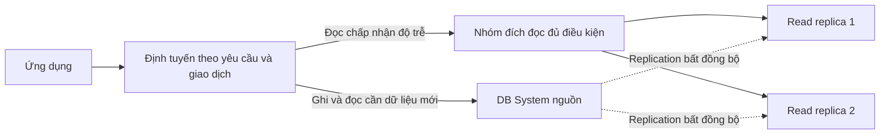

# Read replicas, replication và mở rộng đọc MySQL

Khi một ứng dụng MySQL có nhiều truy vấn đọc, tăng tài nguyên của DB System nguồn không phải lựa chọn duy nhất. Read replica cho phép chuyển một phần truy vấn sang các bản sao dữ liệu, qua đó giảm tải đọc trên nguồn. Hiệu quả phụ thuộc vào loại truy vấn, khả năng sao chép và cách ứng dụng chấp nhận dữ liệu chưa cập nhật tức thời.

Bài học thuộc chương **MySQL HeatWave và NoSQL** của module **CLOUD_PROVIDERS_ORACLE**, tập trung vào MySQL trong OCI: thiết kế read replica trong mạng private, phân quyền, định tuyến, giám sát và kiểm soát chi phí. Các giới hạn, shape và chức năng endpoint cần được xác nhận theo dịch vụ thực tế; không lấy một giới hạn tài nguyên cố định làm nguyên tắc thiết kế.

Sau bài học, người học có thể:

- Phân biệt replication, read replica, HA và tăng tốc phân tích bằng HeatWave.
- Giải thích vì sao giao dịch đã commit ở nguồn vẫn có thể chưa xuất hiện trên replica.
- Phân loại truy vấn để chọn đúng nơi thực thi.
- Lập kế hoạch tạo replica, kiểm chứng đồng bộ và đưa vào phục vụ.
- Theo dõi độ trễ, lỗi sao chép, khả năng đáp ứng và chi phí mở rộng đọc.

## 1. Phân biệt bốn khái niệm

| Khái niệm | Mục tiêu chính | Điều không nên suy ra |
| --- | --- | --- |
| Replication | Truyền và áp dụng thay đổi từ hệ thống nguồn tới bản sao | Mọi bản sao đều tức thời hoặc tự được ứng dụng sử dụng |
| Read replica | Cung cấp đích đọc bổ sung từ dữ liệu sao chép | Replica là một nút ghi độc lập cho cùng tập dữ liệu |
| High Availability — HA | Duy trì khả năng phục vụ theo cơ chế dự phòng và chuyển đổi của dịch vụ | Các thành phần dự phòng mặc nhiên là endpoint đọc cho ứng dụng |
| HeatWave | Phục vụ tăng tốc các workload phân tích được hỗ trợ | HeatWave cluster là cùng một cơ chế với các MySQL read replica thông thường |

Replication là cơ chế nền tảng; read replica là một cách sử dụng bản sao để mở rộng đọc. HA và read replica có thể cùng xuất hiện trong thiết kế, nhưng giải quyết các mục tiêu khác nhau.

### 1.1. Read replica được dịch vụ quản lý và replication tự cấu hình

Trong OCI, cần phân biệt read replica do dịch vụ MySQL quản lý với các cấu hình replication khác, chẳng hạn sao chép từ một MySQL bên ngoài vào OCI hoặc từ OCI tới hệ thống khác.

Read replica được tạo và gắn với nguồn qua vòng đời dịch vụ được hỗ trợ. Các kiểu replication khác có thể cần channel, tài khoản sao chép, cấu hình nguồn và kết nối riêng theo chiều truyền dữ liệu.

Không lấy hướng dẫn cấu hình một channel inbound rồi áp dụng trực tiếp để sửa cấu hình của read replica do dịch vụ quản lý. Việc tự chạy lệnh thay nguồn sao chép hoặc dừng luồng sao chép trên tài nguyên được quản lý có thể không được phép và có thể phá vỡ trạng thái dịch vụ.

### 1.2. Mở rộng đọc không phải chia nhỏ dữ liệu

Một read replica thông thường duy trì bản sao dữ liệu của nguồn trong phạm vi replication được cấu hình. Khi thêm replica, ứng dụng có thêm năng lực thực thi đọc, nhưng chưa chia dữ liệu thành các shard độc lập.

Đặc biệt, các replica không tự phân tán tải ghi của một nguồn. Tải ghi vẫn phải được xử lý ở nguồn và những thay đổi đó vẫn phải được áp dụng trên mỗi replica.

## 2. Cơ chế sao chép và độ trễ

Luồng logic của replication bất đồng bộ có thể hình dung như sau:

```text
Ứng dụng ghi giao dịch ở nguồn
        ↓
Nguồn commit và ghi nhận thay đổi theo cấu hình
        ↓
Thay đổi được truyền tới replica
        ↓
Replica tiếp nhận và áp dụng
        ↓
Truy vấn đọc trên replica nhìn thấy thay đổi đã áp dụng
```

Ở mô hình bất đồng bộ, phản hồi commit thành công tại nguồn không chờ mọi read replica áp dụng xong giao dịch. Vì vậy, tại một thời điểm, nguồn và replica có thể trả về hai trạng thái dữ liệu khác nhau.

### 2.1. Ví dụ read-after-write

Khách hàng đặt đơn hàng:

1. Ứng dụng ghi đơn `ORDER-42` vào nguồn.
2. Nguồn commit thành công và ứng dụng thông báo tạo đơn thành công.
3. Màn hình chi tiết gửi truy vấn đọc tới replica.
4. Replica chưa áp dụng giao dịch mới nên chưa tìm thấy đơn.

Database không nhất thiết mất dữ liệu. Vấn đề là ứng dụng đã chuyển một phép đọc cần thấy kết quả ghi vừa xong sang nơi chưa theo kịp.

### 2.2. Lag phát sinh ở nhiều công đoạn

Độ trễ có thể tăng do:

- Nguồn phát sinh nhiều thay đổi hoặc giao dịch lớn.
- Đường truyền chậm, gián đoạn hoặc không đủ năng lực cho lượng thay đổi.
- Replica thiếu CPU, bộ nhớ hoặc I/O để áp dụng thay đổi.
- Truy vấn báo cáo trên replica cạnh tranh tài nguyên với việc áp dụng replication.
- Lỗi luồng sao chép, giao dịch chưa áp dụng được hoặc công việc nội bộ cần xử lý.

Giảm lưu lượng đọc trên nguồn không bảo đảm giảm lag. Một replica đang chạy truy vấn nặng có thể chậm áp dụng thay đổi và trả dữ liệu cũ lâu hơn.

### 2.3. Cần định nghĩa độ mới theo nghiệp vụ

Câu “chấp nhận eventual consistency” phải được cụ thể hóa. Ví dụ:

| Nhóm dữ liệu | Yêu cầu có thể đặt | Hệ quả định tuyến |
| --- | --- | --- |
| Chi tiết đơn vừa tạo | Phải thấy kết quả ghi vừa được xác nhận | Đọc nguồn hoặc dùng cơ chế bảo đảm đã áp dụng giao dịch |
| Danh mục gợi ý | Có thể chấp nhận chậm trong một ngưỡng nội bộ | Có thể đọc replica đang đạt ngưỡng |
| Báo cáo tổng hợp | Có thể chấp nhận thời điểm dữ liệu riêng | Dùng replica và hiển thị thời điểm dữ liệu khi phù hợp |
| Số dư hoặc quyết định cấp quyền | Cần tính đúng đắn theo giao dịch hiện tại | Không đọc replica chỉ để giảm tải nếu chưa có mô hình nhất quán phù hợp |

Ngưỡng thời gian là quyết định nghiệp vụ cần đo và kiểm chứng. Nó không phải cam kết rằng mọi giao dịch sẽ luôn tới replica trong cùng khoảng thời gian.

## 3. Thiết kế topology đọc/ghi



Nhóm đích đọc trong sơ đồ là khái niệm logic. Nó có thể được thực hiện bằng khả năng endpoint của dịch vụ, thành phần trung gian được hỗ trợ hoặc logic chọn datasource ở ứng dụng.

### 3.1. Endpoint không tự hiểu nghiệp vụ

Endpoint nguồn dùng cho tải ghi và các phép đọc cần chạy tại nguồn. Endpoint replica dùng cho các phiên đọc được lựa chọn.

Nếu dùng read-replica load balancer của dịch vụ, phải xác nhận thành viên, cách chọn đích, xử lý kết nối và hành vi khi không còn replica sẵn sàng. Không mặc định nó phân tích từng câu SQL hoặc tự cung cấp read-after-write consistency.

Một kết nối đã mở thường gắn với một đích thực thi trong vòng đời kết nối đó theo cơ chế của thành phần trung gian. Cân bằng các kết nối không đồng nghĩa phân phối đều chi phí của từng truy vấn.

Connection pool tồn tại lâu có thể khiến một replica nhận nhiều phiên nặng hơn replica khác. Cần theo dõi phân bố tải thực tế, thay vì chỉ đếm số replica hoặc số kết nối.

### 3.2. Định tuyến theo giao dịch và trạng thái phiên

Không chỉ kiểm tra câu SQL bắt đầu bằng `SELECT` để quyết định chuyển sang replica. Những trường hợp cần đánh giá riêng gồm:

- `SELECT ... FOR UPDATE` hoặc phép đọc có khóa phục vụ cập nhật.
- Đọc rồi ghi trong cùng một giao dịch nghiệp vụ.
- Phiên đang sử dụng bảng tạm, biến phiên hoặc trạng thái kết nối.
- Phép đọc cần quan sát thay đổi vừa ghi ở nguồn.
- Truy vấn phụ thuộc snapshot hoặc mức cô lập của một giao dịch đã mở.

Một giao dịch cần được giữ trên datasource phù hợp từ đầu đến cuối. Không mở giao dịch ở nguồn rồi tùy ý chuyển câu đọc giữa giao dịch sang replica khác.

Tùy chọn read-only của driver hoặc annotation trong framework có thể chỉ là một gợi ý; chúng không tự tạo read replica, không tự chọn endpoint và không tự bảo đảm mức độ mới dữ liệu.

### 3.3. Tách pool và tài khoản

Nên có cấu hình tách biệt cho nguồn và tải đọc:

| Thành phần | Mục đích | Kiểm soát cần có |
| --- | --- | --- |
| Pool nguồn | Ghi và đọc nhất quán theo thiết kế | Giới hạn kết nối, quyền ghi cần thiết, timeout |
| Pool replica | Đọc chấp nhận độ trễ | Tài khoản chỉ đọc, kiểm tra sức khỏe và điều kiện độ mới |
| Bộ chọn đích | Quyết định theo ngữ cảnh nghiệp vụ | Không đổi đích giữa giao dịch; có quy tắc khi thiếu replica |

Tài khoản chỉ đọc giúp giảm rủi ro một câu ghi bị gửi nhầm, kể cả khi endpoint đọc có thể chuyển tới nguồn theo một cấu hình fallback. Cờ read-only ở máy chủ không nên là lớp bảo vệ duy nhất.

## 4. Chuẩn bị tài nguyên và kết nối trong OCI

### 4.1. Kiểm tra điều kiện của nguồn

Trước khi tạo replica, xác nhận:

1. DB System nguồn ở trạng thái phù hợp và hỗ trợ read replicas với cấu hình hiện tại.
2. Phiên bản, shape, quota và capacity đáp ứng lựa chọn cần tạo.
3. Các điều kiện replication do dịch vụ yêu cầu đã được đáp ứng theo cơ chế được hỗ trợ.
4. Có dung lượng và năng lực để xử lý giai đoạn tạo bản sao ban đầu rồi bắt kịp thay đổi.
5. Đã xác định tải đọc nào sẽ chuyển đi và mức độ mới mà tải đó yêu cầu.

Không tự chỉnh binlog hoặc tham số replication bị dịch vụ quản lý chỉ để vượt qua một lỗi kiểm tra điều kiện. Cần dùng cấu hình, quy trình hoặc hỗ trợ được dịch vụ cho phép.

Replica cũng không mặc nhiên được phép đặt ở bất kỳ region hoặc topology nào. Phải chọn vị trí và cấu hình theo phạm vi dịch vụ hỗ trợ; nếu cần sao chép liên vùng hoặc phục hồi thảm họa, đánh giá đó là một yêu cầu kiến trúc riêng.

### 4.2. IAM và tài khoản MySQL

Người vận hành cần quyền quản lý read replica và sử dụng các tài nguyên phụ thuộc trong compartment liên quan. Quyền tạo tài nguyên OCI độc lập với quyền truy vấn dữ liệu MySQL.

Ứng dụng nên dùng tài khoản chỉ đọc với quyền trên đúng schema hoặc bảng. Tài khoản quản trị và tài khoản ứng dụng ghi không nên được đưa vào pool đọc chỉ để thuận tiện.

Việc tạo và thay đổi tài khoản cần theo mô hình quản lý người dùng của dịch vụ và cấu hình replication. Không tự tạo schema hoặc tài khoản trực tiếp trên replica để làm cho bản sao khác với nguồn.

### 4.3. Mạng private và TLS

Xác định endpoint nguồn, endpoint replica hoặc endpoint phân phối đọc và các nguồn client được phép truy cập. Kiểm tra route, luật mạng và DNS từ chính môi trường ứng dụng.

Chỉ cho phép các cổng thực sự dùng; với MySQL classic protocol thường là TCP `3306` theo cấu hình endpoint. Không mở rộng nguồn thành `0.0.0.0/0` vì ứng dụng vừa có thêm replica.

Nếu truy cập qua mạng khác, cần tuyến hai chiều và các luật mạng tương ứng. Luồng replication nội bộ do dịch vụ quản lý phải theo yêu cầu triển khai; không suy ra chỉ cần mở cổng từ ứng dụng là đã chuẩn bị toàn bộ kết nối.

Giữ mã hóa TLS và cơ chế xác thực máy chủ phù hợp trên mọi pool. Thay endpoint có thể làm thay đổi tên cần kiểm tra trong chứng thư; không hạ mức xác minh chỉ để bỏ qua lỗi khi chuyển đích.

## 5. Tạo và đưa read replica vào phục vụ

### Bước 1: Ghi đường cơ sở

Trước khi tạo, thu thập độ trễ truy vấn, thông lượng, CPU, I/O, số kết nối và tỷ lệ đọc/ghi của nguồn. Tách truy vấn nặng khỏi các phép đọc nhỏ để biết tải nào đang gây vấn đề.

Nếu nguyên nhân là thiếu chỉ mục hoặc một truy vấn quét quá lớn, thêm replica có thể chỉ sao chép vấn đề sang nhiều máy. Kiểm tra kế hoạch truy vấn và cách truy cập dữ liệu trước khi mở rộng.

### Bước 2: Tạo qua vòng đời dịch vụ

Trong phần quản lý DB System nguồn trên OCI, dùng chức năng tạo read replica được dịch vụ hỗ trợ. Chọn cấu hình, vị trí và các lựa chọn được cung cấp cho nguồn thực tế.

Ghi tên, định danh tài nguyên, nguồn liên kết và cấu hình đích. Theo dõi công việc đến trạng thái phù hợp; nếu yêu cầu bị timeout, kiểm tra tài nguyên đã tồn tại trước khi gửi lại.

Giai đoạn sao chép ban đầu và bắt kịp thay đổi có thể tiêu thụ tài nguyên. Không đưa toàn bộ tải đọc vào ngay khi mới thấy một endpoint.

### Bước 3: Kiểm chứng replica

Kiểm tra đồng thời:

- Trạng thái vòng đời và trạng thái replication không có lỗi cần xử lý.
- Endpoint có thể truy cập từ đúng nguồn client.
- Tài khoản đọc đăng nhập được với TLS theo yêu cầu.
- Dữ liệu mẫu ở nguồn đã xuất hiện trên replica trong điều kiện thử.
- Độ trễ sao chép và hiệu năng truy vấn đạt ngưỡng đưa vào phục vụ.

Việc tạo thành công trên OCI chưa đủ chứng minh replica luôn mới hoặc truy vấn ứng dụng chạy nhanh.

### Bước 4: Chuyển tải từng phần

Bắt đầu bằng nhóm truy vấn chịu được độ trễ và một phần lưu lượng nhỏ. Theo dõi nguồn cùng replica rồi mới tăng tỷ lệ.

Giữ cơ chế đưa replica ra khỏi nhóm đọc khi lỗi hoặc không đạt điều kiện độ mới. Chính sách đưa trở lại phải có thời gian quan sát ổn định để tránh chuyển vào/ra liên tục.

### Bước 5: Bàn giao

Bàn giao endpoint, vai trò từng pool, tài khoản tham chiếu tới kho bí mật, ngưỡng vận hành, chính sách fallback và người xử lý cảnh báo. Không lưu mật khẩu trong bảng topology.

## 6. Chọn chiến lược đọc sau ghi

Có ba nhóm giải pháp thường dùng. Chọn theo yêu cầu của từng luồng nghiệp vụ, thay vì áp dụng một phương án cho toàn ứng dụng.

### 6.1. Đọc lại ở nguồn

Sau khi ghi, gửi các phép đọc cần thấy kết quả vừa commit tới nguồn. Đây là cách đơn giản để tránh độ trễ replication trong luồng đó.

Tuy nhiên, phải giữ đúng ranh giới giao dịch và mức cô lập. Một giao dịch đã có snapshot cũ có thể tiếp tục quan sát snapshot đó; việc kết nối tới nguồn không tự sửa mọi lỗi logic về transaction.

Nguồn cũng phải là đích ghi hiện tại theo trạng thái dịch vụ, nhất là sau chuyển đổi. Không giữ một địa chỉ máy nội bộ đã cũ thay cho endpoint nguồn được hỗ trợ.

### 6.2. Giữ người dùng ở nguồn trong một khoảng thời gian

Ứng dụng có thể đánh dấu một phiên hoặc đối tượng vừa ghi và tạm gửi các phép đọc liên quan tới nguồn.

Cách này dễ triển khai nhưng một thời gian chờ cố định không chứng minh replica đã theo kịp. Nếu lag tăng bất thường, hết khoảng giữ nguồn vẫn có thể đọc dữ liệu cũ.

Nếu chỉ dùng khoảng thời gian làm heuristic, phải mô tả đúng giới hạn của nó và không áp dụng cho luồng có yêu cầu nhất quán nghiêm ngặt.

### 6.3. Đợi replica áp dụng giao dịch cụ thể

Với MySQL có GTID và các chức năng cần thiết được hỗ trợ, ứng dụng có thể mang thông tin giao dịch vừa ghi sang bước đọc, rồi đợi đích replica áp dụng.

**GTID — Global Transaction Identifier** nhận diện giao dịch trong hệ thống replication. Mục tiêu ở đây là kiểm tra rằng giao dịch cần quan sát đã được thực thi trên chính replica sẽ phục vụ phép đọc.

Luồng khái quát:

1. Ghi và commit ở nguồn.
2. Lấy định danh giao dịch bằng cơ chế nguồn/client được hỗ trợ.
3. Mở hoặc giữ một kết nối tới replica được chọn.
4. Chờ replica đó áp dụng GTID trong một thời hạn giới hạn.
5. Nếu thành công, bắt đầu phép đọc với snapshot phù hợp trên cùng kết nối.
6. Nếu không thành công, áp dụng phương án đã chọn: đọc nguồn, trả trạng thái chờ hoặc báo không đáp ứng độ mới.

Ví dụ MySQL minh họa bước chờ, chỉ dùng nếu dịch vụ, cấu hình và quyền thực tế hỗ trợ:

```sql
-- Placeholder phải được thay bằng GTID/GTID set hợp lệ đã thu thập.
-- 2 giây là thời hạn minh họa nội bộ, không phải cam kết của dịch vụ.
SELECT WAIT_FOR_EXECUTED_GTID_SET(
    '<GTID_HOAC_GTID_SET_DA_XAC_NHAN>',
    2
) AS wait_result;
```

Kết quả `0` biểu thị điều kiện đã đạt; `1` biểu thị hết thời gian chờ. Lỗi hoặc kết quả khác không được coi là thành công.

Không lấy tùy tiện toàn bộ tập GTID toàn cục chỉ để thay cho định danh giao dịch của yêu cầu hiện tại. Tập quá lớn hoặc không đúng phạm vi có thể tạo chờ đợi không cần thiết.

Đặc biệt, không chờ trên replica A rồi trả kết nối vào pool và đọc bằng một kết nối khác có thể tới replica B. Bằng chứng đã áp dụng trên A không bảo đảm B đã theo kịp.

Cũng không tạo snapshot đọc cũ trước khi chờ rồi tiếp tục dùng snapshot đó. Cơ chế nhất quán cần được thiết kế cùng transaction, pool và driver, không chỉ thêm một câu SQL chờ.

## 7. Giám sát replication và sức khỏe đích đọc

### 7.1. Bốn nhóm thông tin

| Nhóm | Cần quan sát | Quyết định hỗ trợ |
| --- | --- | --- |
| Vòng đời dịch vụ | Tài nguyên sẵn sàng, công việc lỗi, sự kiện bảo trì | Có nên cho phép nhận kết nối mới? |
| Replication | Luồng nhận/áp dụng, độ trễ, lỗi và tiến độ | Đích có đáp ứng yêu cầu độ mới? |
| Hiệu năng replica | CPU, bộ nhớ, I/O, kết nối, độ trễ truy vấn | Cần giảm tải, tối ưu hay tăng năng lực? |
| Góc nhìn ứng dụng | Lỗi, timeout, kết quả stale, tỷ lệ fallback | Nghiệp vụ có đạt yêu cầu? |

Tên metric và cách thu thập phụ thuộc dịch vụ cùng quyền truy cập thực tế. Không giả định một kiểm tra TCP hoặc một metric lag là đủ để kết luận replica khỏe.

### 7.2. Ví dụ truy vấn chẩn đoán

Với tài khoản vận hành có quyền được dịch vụ cho phép, có thể dùng các quan sát MySQL sau:

```sql
SELECT @@server_uuid AS server_uuid,
       @@read_only AS server_read_only,
       @@super_read_only AS server_super_read_only;

-- Cú pháp kết thúc \G phù hợp với MySQL command-line client.
SHOW REPLICA STATUS\G
```

`server_uuid` giúp phân biệt đích thực thi khi kiểm tra nhiều replica. Các cờ read-only chỉ là một phần bằng chứng; không dùng riêng chúng để suy ra đầy đủ vai trò, quyền hay trạng thái vòng đời OCI.

Lệnh xem trạng thái replication cần quyền phù hợp và có thể chịu giới hạn của dịch vụ. Nếu không được phép, sử dụng trạng thái/metric do dịch vụ cung cấp hoặc quy trình hỗ trợ; không cấp quyền quản trị rộng cho tài khoản ứng dụng chỉ để chạy chẩn đoán.

Với cấu hình và phiên bản có các trường tương ứng, cần xem đồng thời:

- Luồng nhận và luồng áp dụng có đang hoạt động không.
- Độ trễ được báo, chẳng hạn `Seconds_Behind_Source`.
- Lỗi nhận hoặc áp dụng gần nhất.
- Tiến độ giao dịch được nhận và được thực thi.

Một giá trị lag bằng `0` không tự chứng minh replica có mọi giao dịch mới nhất của nguồn. Ví dụ, replica có thể đã áp dụng hết phần nhận được trong khi đường nhận thay đổi đang gặp vấn đề.

Giá trị không có hoặc không xác định cũng không nên được chuyển thành `0`. Bộ giám sát cần phân biệt dữ liệu thiếu, mất liên lạc và trạng thái thật sự đạt ngưỡng.

### 7.3. Probe dữ liệu phải có ý nghĩa

Trong một schema lab hoặc cơ chế kiểm tra được phê duyệt, có thể ghi một mốc tại nguồn rồi kiểm tra sự xuất hiện ở từng replica. Probe cần ghi thời điểm, đích thực thi và giới hạn chờ.

Cách này bổ sung góc nhìn end-to-end, nhưng phải tránh ghi dữ liệu kiểm tra vào bảng nghiệp vụ hoặc tạo tải không cần thiết. Nếu đo độ trễ bằng đồng hồ ở nhiều máy, cần đồng bộ thời gian và hiểu sai số phép đo.

Một probe thành công chỉ là kết quả tại thời điểm kiểm tra; không thay cho điều kiện vận hành liên tục.

## 8. Chọn kích thước và số lượng replica

### 8.1. Replica cần năng lực áp dụng thay đổi

Không nên chọn replica rất nhỏ chỉ vì nó không nhận ghi trực tiếp từ ứng dụng. Replica vẫn thực hiện công việc áp dụng các thay đổi và duy trì cấu trúc dữ liệu.

Nếu tốc độ áp dụng thấp hơn tốc độ phát sinh thay đổi trong thời gian dài, replica sẽ tụt lại dù gần như không có client đọc.

Khi có lag, phân biệt hai tình huống:

| Tình huống | Hướng xử lý có thể phù hợp |
| --- | --- |
| Replica áp dụng tốt nhưng bị quá tải bởi truy vấn đọc | Giảm concurrency, tối ưu truy vấn, tăng tài nguyên hoặc chia tải sang replica khác |
| Replica không theo kịp luồng thay đổi ngay cả khi ít truy vấn | Điều tra replication, giao dịch lớn và năng lực áp dụng; thêm replica tương tự chưa chắc giải quyết |

### 8.2. Tăng số đích không tạo hiệu quả tuyến tính

Hiệu quả phụ thuộc truy vấn, bộ nhớ đệm, chi phí replication và phân bố kết nối. Thêm hai replica không có nghĩa chắc chắn tăng gấp đôi thông lượng có ích.

Truy vấn đầu tiên trên replica mới có thể chậm vì cache chưa được làm nóng. Việc tăng lưu lượng nên theo từng giai đoạn, quan sát độ trễ truy vấn cùng khả năng bắt kịp dữ liệu.

Chỉ chuyển truy vấn đọc sang replica không làm các giao dịch ghi ở nguồn rẻ hơn. Nguồn vẫn có thể nghẽn ở khóa, CPU, I/O hoặc logic giao dịch.

### 8.3. Tính đủ chi phí

Cần dự trù compute, lưu trữ và các tài nguyên liên quan cho từng replica theo mô hình dịch vụ. Replica thường mang theo bản sao dữ liệu nên số lượng bản sao ảnh hưởng trực tiếp tới tổng tài nguyên.

Đánh giá thêm chi phí kết nối, truyền dữ liệu khi có luồng liên quan và nhân sự vận hành. Không mặc định việc tạo read replica đã bao gồm khả năng HA hoặc bảo vệ dữ liệu riêng cho mọi tình huống.

Một quyết định tốt dựa trên kết quả trước/sau: nguồn giảm tải bao nhiêu, truy vấn nhanh hơn bao nhiêu, lag có đạt yêu cầu không và chi phí tăng bao nhiêu.

## 9. Xử lý sự cố và thay đổi vòng đời

### 9.1. Khi replica không còn đủ điều kiện

Một replica có thể kết nối được nhưng không nên nhận tải vì lag vượt ngưỡng. Cũng có thể dữ liệu còn mới nhưng endpoint mất khả năng phục vụ. Cần xem khả năng truy cập và độ mới là hai điều kiện riêng.

Quy trình xử lý tham khảo:

1. Xác định replica bị ảnh hưởng, thời điểm bắt đầu và nhóm truy vấn đang dùng nó.
2. Ngừng đưa kết nối đọc mới tới đích đó theo cơ chế định tuyến được hỗ trợ.
3. Kiểm soát tác động tới kết nối đang tồn tại theo timeout và chính sách ứng dụng.
4. Kiểm tra replication, tài nguyên, tải truy vấn và sự kiện dịch vụ.
5. Giảm tải hoặc xử lý nguyên nhân theo phạm vi được phép.
6. Chỉ đưa trở lại khi đủ điều kiện trong một khoảng quan sát ổn định.

Không mặc định chuyển mọi truy vấn về nguồn khi một replica lỗi. Nguồn có thể không đủ dự phòng để tiếp nhận đồng thời tất cả báo cáo và lưu lượng ứng dụng.

Chính sách fallback nên ưu tiên: giữ nguồn cho ghi và luồng quan trọng; giảm concurrency hoặc tạm hoãn báo cáo; trả kết quả cache chỉ với nghiệp vụ chấp nhận được.

### 9.2. Khi nguồn gặp sự cố

Read replica không nên được coi là đích ghi thay thế tự động nếu dịch vụ và runbook chưa xác định cơ chế đó. Không tự tắt cờ read-only và gửi ghi tới replica như một thao tác khôi phục mặc định.

Nếu thiết kế có chức năng chuyển đổi hoặc thay nguồn được hỗ trợ, cần xác định lượng dữ liệu có thể thiếu, quyền thực hiện, endpoint sau thay đổi và cách tránh hai nơi cùng nhận ghi.

HA của nguồn, chuyển đổi phục hồi và định tuyến đọc phải được điều phối. Các pool kết nối cần phản ứng với thay đổi endpoint/trạng thái theo cách được hỗ trợ, thay vì giữ kết nối lỗi vô thời hạn.

### 9.3. Khi replica tụt lại quá lâu

Khả năng bắt kịp phụ thuộc cả việc các thay đổi cần thiết còn có thể lấy từ nguồn. Nếu khoảng gián đoạn vượt phạm vi dữ liệu replication còn sẵn có, có thể cần tạo lại bản sao theo quy trình dịch vụ.

Không bỏ qua giao dịch lỗi hoặc chỉnh vị trí replication chỉ để làm chỉ số lag trở về đẹp. Những can thiệp như vậy có thể tạo dữ liệu lệch nhưng khó phát hiện.

Ghi nhận trạng thái, lỗi và định danh tác vụ; phối hợp hỗ trợ khi công việc thuộc phần dịch vụ quản lý.

### 9.4. Bản sao không thay thế sao lưu

Một lệnh xóa nhầm hợp lệ ở nguồn có thể được sao chép tới các replica. Vì vậy, có nhiều replica không đồng nghĩa có nhiều điểm phục hồi trước thao tác xóa.

Vẫn cần chính sách sao lưu và diễn tập phục hồi. Nếu mục tiêu là phục hồi thảm họa hoặc lưu giữ dữ liệu theo thời điểm, phải thiết kế riêng thay vì suy ra từ topology mở rộng đọc.

## 10. Ví dụ: tách tải đọc cho ứng dụng bán hàng

Giả sử một ứng dụng có ba nhóm thao tác:

| Nhóm | Yêu cầu | Đích dự kiến |
| --- | --- | --- |
| Đặt hàng và xem đơn vừa tạo | Không được hiển thị như chưa có đơn sau thông báo thành công | Nguồn, với ranh giới giao dịch phù hợp |
| Duyệt danh mục | Chấp nhận chậm trong một ngưỡng nội bộ đã chọn | Replica đáp ứng điều kiện độ mới |
| Báo cáo tổng hợp theo giờ | Không cần phản ánh mọi giao dịch vừa commit | Replica phục vụ báo cáo hoặc đích phân tích phù hợp |

Đội vận hành tạo replica đầu tiên và chỉ chuyển một phần lưu lượng duyệt danh mục. Họ giữ việc đặt hàng cùng màn hình xác nhận trên nguồn.

Kết quả thử cho thấy nguồn giảm tải đọc, nhưng một báo cáo dài trên replica làm lag tăng. Thay vì tạo thêm replica ngay lập tức, đội xử lý theo thứ tự:

1. Kiểm tra kế hoạch và lượng dữ liệu quét của báo cáo.
2. Giới hạn số báo cáo đồng thời và thời gian chạy.
3. Đo lại năng lực áp dụng replication khi tải báo cáo giảm.
4. Nếu cần tách workload, cân nhắc replica riêng hoặc giải pháp phân tích như HeatWave sau khi đánh giá tính phù hợp.

Nếu thêm replica thứ hai, họ còn phải cập nhật nhóm đích đọc, kiểm tra kết nối/TLS và đánh giá phân bố tải qua các pool. Việc tạo tài nguyên mới chưa tự làm ứng dụng sử dụng nó.

### 10.1. Một lỗi nghiệp vụ cần tránh

Khi trang chi tiết không thấy đơn trên replica, ứng dụng không được tự tạo đơn lần nữa chỉ vì truy vấn đọc trả về rỗng. Tạo đơn cần cơ chế chống trùng phù hợp và phải phân biệt “chưa sao chép tới nơi đọc” với “giao dịch ghi thất bại”.

Đây là lý do phân loại consistency phải có trước khi mở rộng đọc, thay vì xử lý như một tối ưu hiệu năng thuần túy.

### 10.2. Tiêu chí đánh giá sau triển khai

Đội dự án so sánh:

- Độ trễ và thông lượng của từng nhóm truy vấn.
- Tải còn lại trên nguồn và mức dự phòng cho ghi.
- Độ trễ replication dưới tải thông thường và lúc cao điểm.
- Tỷ lệ fallback, lỗi kết nối và thời gian phục hồi khi mất một replica.
- Số tình huống đọc dữ liệu cũ gây ảnh hưởng nghiệp vụ.
- Tổng chi phí so với mục tiêu hiệu năng đạt được.

Số replica là thông số triển khai; các kết quả này mới cho biết phương án có đáp ứng yêu cầu hay không.

## 11. Checklist trước khi đưa vào sử dụng

- [ ] Đã xác định đúng DB System nguồn và kiểu read replica do dịch vụ hỗ trợ?
- [ ] Đã phân biệt mở rộng đọc với HA, sao lưu và phục hồi thảm họa?
- [ ] Mỗi nhóm truy vấn có yêu cầu độ mới và đích thực thi rõ ràng?
- [ ] Các phép đọc sau ghi và giao dịch có khóa không bị chuyển tùy tiện sang replica?
- [ ] Pool kết nối giữ đúng datasource trong một giao dịch?
- [ ] Endpoint, thành viên nhóm đọc và hành vi fallback đã được kiểm chứng?
- [ ] Tài khoản đọc có quyền tối thiểu và thông tin bí mật được bảo vệ?
- [ ] Route, luật mạng, DNS và TLS được kiểm tra từ đúng môi trường ứng dụng?
- [ ] Replica đã bắt kịp dữ liệu mẫu và đáp ứng yêu cầu dưới tải dự kiến?
- [ ] Giám sát phân biệt lag, lỗi replication, dữ liệu metric thiếu và lỗi kết nối?
- [ ] Có chính sách đưa replica lỗi ra khỏi nhóm đọc và điều kiện đưa trở lại?
- [ ] Nguồn có giới hạn bảo vệ khi nhận tải fallback?
- [ ] Quy trình xử lý nguồn lỗi không dựa vào việc tự biến replica thành nguồn ghi?
- [ ] Sao lưu, phục hồi thử và chi phí đã được giao người phụ trách?

Read replica hữu ích khi ứng dụng có tải đọc có thể tách và chấp nhận mô hình dữ liệu phù hợp. Một thiết kế hoàn chỉnh nối ba phần với nhau: replication duy trì bản sao, ứng dụng chọn đúng nơi đọc và vận hành giữ các đích đọc trong điều kiện phục vụ đã cam kết.

