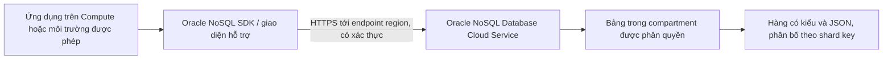

# Oracle NoSQL Database Cloud Service và mô hình dữ liệu

Oracle NoSQL Database Cloud Service là dịch vụ cơ sở dữ liệu NoSQL được quản lý trên OCI. Ứng dụng làm việc với bảng, hàng, khóa và dữ liệu có cấu trúc hoặc JSON qua các giao diện được hỗ trợ. Để sử dụng hiệu quả, cần thiết kế từ các mẫu truy cập: biết khóa nào khi đọc, đọc trong phạm vi nào, cập nhật có cạnh tranh không và chấp nhận dữ liệu mới đến mức nào.

Bài học thuộc chương **MySQL HeatWave và NoSQL** của module **CLOUD_PROVIDERS_ORACLE**, tập trung vào mô hình dữ liệu NoSQL trong ngữ cảnh tenancy, compartment, IAM, kết nối, giám sát và kiểm soát chi phí của OCI.

Sau bài học, người học có thể:

- Phân biệt Oracle NoSQL Database Cloud Service với MySQL HeatWave và một cơ sở dữ liệu quan hệ tự quản lý.
- Thiết kế cột, JSON, primary key và shard key theo mẫu truy cập.
- Giải thích ảnh hưởng của consistency, TTL và ghi có điều kiện.
- Nhận diện hot key, truy vấn quét rộng và chi phí của secondary index.
- Tổ chức quy trình tạo bảng, thử dữ liệu và bàn giao vận hành.

## 1. Định vị dịch vụ và trách nhiệm

### 1.1. Dịch vụ được quản lý, mô hình vẫn do ứng dụng quyết định

Oracle cung cấp hạ tầng và cơ chế vận hành dịch vụ. Khách hàng xác định bảng, cấu trúc hàng, khóa, chỉ mục, quyền truy cập và cách ứng dụng xử lý dữ liệu.

Việc không quản lý máy chủ database không loại bỏ các quyết định về dung lượng, năng lực đọc/ghi, độ trễ, phục hồi và tính đúng đắn nghiệp vụ.

Khách hàng cũng không đặt một bảng NoSQL vào private subnet theo cách tạo một MySQL DB System. Ứng dụng cần một đường kết nối được hỗ trợ tới endpoint dịch vụ OCI và cơ chế xác thực phù hợp.

### 1.2. So sánh với MySQL HeatWave

| Khía cạnh | MySQL HeatWave | Oracle NoSQL Database Cloud Service |
| --- | --- | --- |
| Trọng tâm mô hình | Quan hệ, schema và giao dịch theo khả năng MySQL; các chức năng HeatWave phục vụ workload được hỗ trợ | Bảng phân tán, truy cập theo khóa, dữ liệu có cấu trúc/JSON và mẫu truy cập phù hợp |
| Thiết kế truy vấn | Có thể dựa trên quan hệ, join và chỉ mục của MySQL | Cần chú ý khóa, phạm vi shard, chỉ mục và lượng dữ liệu phải đọc |
| Truy cập ứng dụng | Driver/protocol MySQL theo cấu hình endpoint | SDK/API và truy vấn SQL theo khả năng Oracle NoSQL |
| Định danh ứng dụng | Tài khoản và quyền MySQL cùng quyền quản lý OCI | Cơ chế xác thực/phân quyền dịch vụ OCI theo môi trường client |
| Quyết định quan trọng | Giao dịch, kế hoạch SQL, kết nối và năng lực DB System | Primary key, shard key, hình dạng hàng, consistency và capacity |

NoSQL không có nghĩa là không có schema hoặc không có SQL. Dịch vụ cho phép trường có kiểu cùng trường JSON và hỗ trợ ngôn ngữ truy vấn theo khả năng của Oracle NoSQL.

Ngược lại, việc có SQL không làm dịch vụ trở thành một MySQL khác. Không chuyển nguyên thiết kế nhiều bảng quan hệ và các join tùy ý sang NoSQL rồi kỳ vọng cùng cách thực thi.

## 2. Các thành phần của mô hình dữ liệu

### 2.1. Table và row

**Table** định nghĩa cấu trúc dữ liệu cùng primary key. **Row** là một bản ghi được nhận diện bởi đầy đủ khóa chính.

Một hàng có thể kết hợp:

- Trường có kiểu rõ ràng như `STRING`, `LONG`, `BOOLEAN` hoặc `TIMESTAMP`.
- Kiểu cấu trúc như record, array hoặc map khi phù hợp.
- Trường `JSON` cho phần dữ liệu có cấu trúc linh hoạt.

Trường có kiểu giúp kiểm soát những thành phần ổn định. JSON phù hợp với các thuộc tính thay đổi theo loại thiết bị hoặc phiên bản sự kiện, nhưng vẫn cần hợp đồng dữ liệu ở phía ứng dụng.

### 2.2. Primary key

Primary key xác định duy nhất một hàng trong bảng và cung cấp cách truy cập trực tiếp khi ứng dụng biết đầy đủ các thành phần khóa.

Không nên dùng giá trị có thể thay đổi như tên hiển thị làm thành phần khóa chỉ vì nó dễ đọc. Cần xác định trước phạm vi duy nhất: toàn hệ thống, trong một tenant, trong một thiết bị hay trong một khoảng thời gian.

Các trường primary key phải tuân theo các quy tắc kiểu và giá trị của dịch vụ; không thiết kế dựa trên khóa bị thiếu hoặc `NULL`.

### 2.3. Shard key

Shard key là phần của primary key dùng cho phân bố dữ liệu. Những hàng có cùng giá trị shard key được đặt trong cùng phạm vi phân vùng tương ứng.

Lựa chọn này ảnh hưởng đến:

- Mức độ phân tán tải đọc/ghi.
- Khả năng truy vấn trong một phạm vi đã biết.
- Kích thước nhóm dữ liệu cùng shard key.
- Các thao tác nhiều hàng có ràng buộc về vị trí dữ liệu.

Shard key không phải địa chỉ của một máy chủ mà ứng dụng phải quản lý. Dịch vụ vận hành phân vùng; ứng dụng thiết kế các giá trị khóa để tránh dồn tải vào một phạm vi.

### 2.4. Secondary index

Secondary index tạo đường truy cập theo trường ngoài primary key hoặc một đường dẫn dữ liệu được hỗ trợ, bao gồm một số trường hợp JSON.

Chỉ mục không miễn phí: cần lưu trữ và phải được duy trì khi dữ liệu thay đổi. Không tạo chỉ mục cho mọi thuộc tính JSON chỉ để phòng khi có truy vấn.

Ưu tiên xác định các truy vấn cần phục vụ, tần suất, độ chọn lọc và lượng dữ liệu dự kiến đọc trước khi chọn chỉ mục.

## 3. Bắt đầu bằng mẫu truy cập

Giả sử hệ thống thu nhận sự kiện cảm biến cho nhiều khách hàng. Trước khi viết DDL, liệt kê các thao tác:

| Mẫu truy cập | Thông tin đã biết | Kết quả cần lấy |
| --- | --- | --- |
| Ghi sự kiện | Tenant, thiết bị, thời điểm và ID sự kiện | Tạo bản ghi, xử lý retry không sinh bản ghi khác |
| Đọc một sự kiện | Tenant, thiết bị, ngày và ID sự kiện | Một hàng cụ thể |
| Xem sự kiện trong ngày | Tenant, thiết bị và ngày | Một tập hàng có giới hạn, có phân trang |
| Xem khoảng thời gian | Tenant, thiết bị, ngày và khoảng thời gian | Các sự kiện thuộc khoảng cần xem |
| Báo cáo toàn hệ thống | Khoảng thời gian trên nhiều thiết bị | Một workload riêng cần đánh giá lượng quét |

Không nên tối ưu mọi truy vấn bằng cùng một khóa. Đường truy cập chính là theo tenant, thiết bị và ngày; báo cáo toàn hệ thống không nên trở thành lý do làm mọi thao tác ghi hoặc đọc điểm trở nên đắt hơn.

## 4. Ví dụ thiết kế bảng sự kiện

### 4.1. DDL

Ví dụ dùng cú pháp bảng Oracle NoSQL để tạo một mô hình lab:

```sql
CREATE TABLE IF NOT EXISTS device_events (
    tenant_id STRING,
    device_id STRING,
    event_day STRING,
    event_id STRING,
    occurred_at TIMESTAMP(3),
    payload JSON,
    PRIMARY KEY (SHARD(tenant_id, device_id, event_day), event_id)
) USING TTL 30 DAYS;
```

Các lựa chọn trong ví dụ:

- Shard key gồm `tenant_id`, `device_id`, `event_day` để nhóm sự kiện theo thiết bị và ngày.
- `event_id` hoàn thành primary key và phân biệt các sự kiện trong nhóm đó.
- `occurred_at` là timestamp có độ chính xác mili giây trong ví dụ.
- `payload` chứa thuộc tính linh hoạt.
- TTL mặc định là 30 ngày cho mục đích lab, không phải yêu cầu bắt buộc của dịch vụ.

DDL mô tả schema; cấu hình năng lực và dung lượng bảng cần được cung cấp qua cơ chế tạo bảng mà dịch vụ yêu cầu. Chỉ có DDL chưa nhất thiết đủ thông tin để provision một bảng cloud.

`IF NOT EXISTS` không phải công cụ kiểm tra schema hiện có giống hoàn toàn schema mong muốn. Nếu bảng đã tồn tại, cần đọc lại định nghĩa và đối chiếu trước khi dùng.

### 4.2. Một hàng ở dạng minh họa

```json
{
  "tenant_id": "tenant-a",
  "device_id": "sensor-017",
  "event_day": "2026-11-20",
  "event_id": "evt-000042",
  "occurred_at": "2026-11-20T08:15:30.125Z",
  "payload": {
    "schema_version": 1,
    "temperature": 30.5,
    "battery_pct": 88,
    "status": "normal"
  }
}
```

Đây là biểu diễn logic của hàng, không phải cam kết rằng mọi SDK nhận timestamp dưới dạng chuỗi JSON mà không cần chuyển kiểu. Khi ghi bằng client, phải bind/chuyển `occurred_at` đúng kiểu được SDK hỗ trợ.

Ứng dụng tính `event_day` theo một quy ước cố định, chẳng hạn ngày UTC của thời điểm sự kiện. Không dùng giờ địa phương ở một client và UTC ở client khác.

### 4.3. Đọc điểm và truy vấn trong một nhóm

Khi biết đầy đủ primary key, dùng thao tác đọc theo khóa của SDK/API phù hợp. Khóa trong ví dụ gồm cả bốn thành phần; chỉ có `event_id` chưa đủ.

Khi cần danh sách trong ngày, có thể dùng truy vấn có tham số:

```sql
DECLARE $tenant STRING; $device STRING; $day STRING;

SELECT e.event_id, e.occurred_at, e.payload
FROM device_events e
WHERE e.tenant_id = $tenant
  AND e.device_id = $device
  AND e.event_day = $day
ORDER BY e.event_id
LIMIT 100;
```

Các biến phải được bind bằng cơ chế prepared query của client. Không nối chuỗi tenant hoặc device trực tiếp vào câu SQL.

Điều kiện đã xác định toàn bộ shard key, giúp thu hẹp phạm vi truy cập. Sắp xếp ở ví dụ là theo `event_id`, không phải mặc nhiên theo thời điểm phát sinh.

`LIMIT 100` chỉ giới hạn kết quả của truy vấn ví dụ. Để duyệt dữ liệu đầy đủ, cần thiết kế phân trang theo cơ chế continuation được API/SDK hỗ trợ và giữ đúng câu truy vấn cùng tham số.

Không dùng OFFSET tăng dần như một mặc định cho tập dữ liệu lớn; cần đánh giá chi phí đọc và tính ổn định của cách phân trang.

### 4.4. Chỉ mục theo thời gian khi thực sự cần

Nếu truy vấn khoảng thời gian trong ngày là đường truy cập quan trọng, cân nhắc:

```sql
CREATE INDEX idx_device_events_time
ON device_events (tenant_id, device_id, event_day, occurred_at);
```

Sau đó truy vấn có thể mang đủ điều kiện prefix cùng khoảng timestamp:

```sql
DECLARE $tenant STRING; $device STRING; $day STRING;
        $from_time TIMESTAMP(3); $to_time TIMESTAMP(3);

SELECT e.event_id, e.occurred_at, e.payload
FROM device_events e
WHERE e.tenant_id = $tenant
  AND e.device_id = $device
  AND e.event_day = $day
  AND e.occurred_at >= $from_time
  AND e.occurred_at < $to_time;
```

Cần kiểm tra kế hoạch và chi phí truy vấn bằng công cụ được hỗ trợ, không suy ra việc có chỉ mục bảo đảm mọi câu SQL đều dùng nó hiệu quả.

Với khoảng thời gian kéo dài nhiều ngày, ứng dụng phải xử lý nhiều nhóm ngày hoặc dùng đường truy vấn khác đã được đánh giá. Kết quả và chi phí cần được tổng hợp có kiểm soát.

## 5. Chọn shard key để tránh điểm nóng

### 5.1. Ba phương án và đánh đổi

| Shard key | Điểm thuận lợi | Rủi ro |
| --- | --- | --- |
| Chỉ `tenant_id` | Dễ gom dữ liệu theo tenant | Một tenant lớn có thể dồn tải và tăng kích thước nhóm dữ liệu |
| `tenant_id, device_id` | Phân tán theo thiết bị | Một thiết bị rất nóng hoặc có lịch sử dài vẫn tạo nhóm lớn |
| `tenant_id, device_id, event_day` | Chia lịch sử thành nhóm có phạm vi thời gian | Truy vấn nhiều ngày phải truy cập nhiều nhóm |

Không có shard key tốt cho mọi ứng dụng. Chọn theo phân bố thực tế, đặc biệt phải nhìn tenant/thiết bị lớn nhất chứ không chỉ giá trị trung bình.

### 5.2. Khi bucket theo ngày vẫn quá nóng

Nếu một thiết bị phát sinh lượng dữ liệu rất lớn trong một ngày, có thể cần thêm bucket phân phối, chẳng hạn dựa trên một hàm xác định từ ID sự kiện.

Đổi lại, truy vấn toàn bộ ngày phải đọc nhiều bucket rồi hợp nhất. Số bucket, thuật toán và phiên bản cách tính phải được kiểm soát.

Không chọn bucket ngẫu nhiên lại ở mỗi lần retry. Cùng một sự kiện có thể rơi vào khóa khác và tạo bản ghi trùng.

### 5.3. Tính duy nhất phải gắn với toàn bộ khóa

Trong bảng ví dụ, cùng `event_id` nhưng khác `event_day` là hai primary key khác nhau. Dịch vụ không tự suy ra đó là cùng sự kiện nghiệp vụ.

Để chống trùng, ứng dụng phải tái sử dụng đúng tenant, thiết bị, ngày và ID đã xác định. Nếu yêu cầu duy nhất toàn cục khác với mô hình này, cần thiết kế thêm cơ chế tương ứng, không trông chờ primary key cục bộ tự giải quyết.

## 6. Mô hình JSON: linh hoạt có kiểm soát

### 6.1. Tách trường ổn định khỏi thuộc tính linh hoạt

Trong ví dụ, tenant, thiết bị, ngày, ID và thời điểm là các trường ổn định. Nhiệt độ, pin hoặc thuộc tính riêng của một loại cảm biến nằm trong `payload`.

Đừng đưa mọi thông tin vào một JSON duy nhất chỉ vì dịch vụ cho phép. Các trường phục vụ khóa, kiểm tra kiểu và đường truy cập thường xuyên nên được thiết kế rõ ràng.

Ứng dụng cần quy định:

- Trường nào bắt buộc và trường nào có thể thiếu.
- Đơn vị đo, miền giá trị và cách biểu diễn thời gian.
- Phân biệt giá trị thiếu, `null` và giá trị mặc định.
- Phiên bản schema của payload và cách đọc phiên bản cũ.

Một trường JSON cho phép cấu trúc thay đổi không tự bảo đảm dữ liệu có ý nghĩa nghiệp vụ đúng.

### 6.2. Nhúng hay tham chiếu?

| Cách thiết kế | Phù hợp khi | Đánh đổi |
| --- | --- | --- |
| Nhúng dữ liệu liên quan trong một hàng | Dữ liệu thường được đọc/cập nhật cùng nhau, kích thước có giới hạn | Hàng lớn hơn, dễ phát sinh cạnh tranh cập nhật trên cùng khóa |
| Tách thành nhiều hàng và tham chiếu khóa | Các phần có vòng đời hoặc tần suất truy cập khác nhau | Cần nhiều lần đọc và xử lý nhất quán giữa các phần |
| Lưu bản sao một thuộc tính ở nhiều hàng | Muốn tránh truy cập bổ sung cho đường đọc quan trọng | Cần quy tắc cập nhật và chấp nhận dữ liệu trùng lặp |

Ví dụ, một cấu hình thiết bị nhỏ có thể nằm trong một hàng. Toàn bộ lịch sử sự kiện không nên tăng mãi trong một array của cùng hàng cấu hình.

Không giả định NoSQL tự join tùy ý giữa các bảng độc lập như mô hình quan hệ. Nếu một mẫu truy cập cần gom nhiều nguồn dữ liệu, hãy tính cả số lần gọi, dung lượng đọc và cơ chế đồng bộ các bản sao thuộc tính.

### 6.3. Thay đổi schema

Khi payload đổi từ phiên bản 1 sang 2, client cần đọc được dữ liệu đã lưu hoặc có kế hoạch chuyển đổi. Một chỉ mục trên một đường dẫn JSON cũng phải được đánh giá nếu kiểu hoặc tên trường thay đổi.

Với trường có kiểu và primary key, thay đổi phải theo khả năng tiến hóa schema của dịch vụ. Không coi việc đổi shard key là một chỉnh sửa vô hại; nó có thể đòi hỏi mô hình mới, di chuyển dữ liệu và chuyển ứng dụng.

## 7. Consistency và tính đúng đắn của cập nhật

### 7.1. Eventual và absolute consistency

Oracle NoSQL cung cấp lựa chọn consistency cho những thao tác đọc phù hợp. Hai khái niệm cần biết là:

| Lựa chọn | Ý nghĩa thực hành | Cách dùng tham khảo |
| --- | --- | --- |
| Eventual consistency | Có thể đọc trạng thái chưa phản ánh thay đổi mới nhất | Luồng chịu được dữ liệu chậm cập nhật theo thiết kế |
| Absolute consistency | Yêu cầu đọc theo mức nhất quán mạnh của dịch vụ | Luồng cần quan sát trạng thái cập nhật theo ngữ nghĩa được hỗ trợ |

Cấu hình thực tế phải theo thao tác và SDK; không suy ra mọi API đều nhận cùng một tùy chọn. Chi phí và đặc tính độ trễ cũng có thể khác nhau.

Eventual consistency không phải lời hứa “luôn chậm đúng một số giây”. Nếu nghiệp vụ có giới hạn độ mới, cần xác định cách đo, xử lý khi không đáp ứng và trường hợp phải dùng lựa chọn mạnh hơn.

Absolute consistency của một phép đọc không tự biến nhiều lần gọi độc lập thành một giao dịch. Giữa lần đọc và lần ghi, một client khác vẫn có thể thay đổi hàng.

### 7.2. Ghi có điều kiện bằng version

Một thao tác đọc có thể trả về version của hàng. Khi ghi lại, ứng dụng dùng điều kiện version để tránh ghi đè một cập nhật đã xảy ra sau lần đọc.

Luồng dưới đây là pseudocode, không phải tên hàm của một SDK cụ thể:

```text
row, version = read(key, consistency = ABSOLUTE)
new_row = apply_business_change(row)

result = put_if_version(key, new_row, expected_version = version)

if result indicates conflict:
    read latest row
    recompute or report conflict according to business rules
```

Ví dụ, hai tiến trình cùng đọc cấu hình phiên bản A. Tiến trình thứ nhất cập nhật thành B; tiến trình thứ hai không được phép ghi đè B bằng kết quả tính từ A nếu điều kiện version không còn đúng.

Retry phải đọc lại và tính lại khi cần, không chỉ lặp lại vô hạn một bản cập nhật cũ. Cũng cần xử lý trường hợp hàng đã bị xóa hoặc hết hạn.

### 7.3. Tạo có điều kiện và chống trùng

Với sự kiện bất biến, thao tác chỉ tạo khi khóa chưa tồn tại giúp xử lý retry. Nếu hàng đã tồn tại, ứng dụng xác định đó là sự kiện đã nhận hay một xung đột ID thật sự.

Put/upsert vào cùng khóa không tự đồng nghĩa với tính lặp an toàn về nghiệp vụ: dữ liệu lần gửi sau có thể khác và ghi đè dữ liệu trước.

Nếu client timeout sau khi gửi, kết quả có thể chưa rõ vì yêu cầu có thể đã được thực hiện. Cần giữ khóa nghiệp vụ ổn định, đọc/đối chiếu hoặc dùng điều kiện phù hợp trước khi quyết định thử lại.

### 7.4. Phạm vi nguyên tử

Các thao tác trên một hàng cung cấp đơn vị quan trọng để thiết kế cập nhật nguyên tử. Với thao tác nhiều hàng, phải tuân theo API và các ràng buộc về cùng shard key, cách khai báo điều kiện và xử lý thất bại.

Không suy ra có thể cập nhật tùy ý nhiều bảng, nhiều shard trong một giao dịch như một hệ thống quan hệ. Nếu một bất biến nghiệp vụ trải qua nhiều hàng, cần lựa chọn mô hình, cơ chế API hoặc quy trình bù phù hợp.

## 8. TTL và vòng đời dữ liệu

**TTL — Time To Live** xác định thời hạn tồn tại của hàng theo cơ chế dịch vụ. Nó hữu ích cho sự kiện tạm, phiên hoặc dữ liệu chỉ cần giữ trong một khoảng thời gian.

Trong bảng ví dụ, `USING TTL 30 DAYS` đặt TTL mặc định. Tùy thao tác được hỗ trợ, ứng dụng có thể cung cấp hoặc điều chỉnh thời hạn ở cấp hàng.

Cần phân biệt:

1. **Thời điểm nghiệp vụ:** giá trị `occurred_at` của sự kiện.
2. **Thời điểm hết hạn:** được xác định theo TTL và cách ghi/cập nhật hàng.
3. **Thời điểm thu hồi vật lý:** quá trình dọn dữ liệu sau khi hết hạn.

Một sự kiện cũ được gửi lên muộn không tự hết hạn theo `occurred_at`. Nếu chính sách lưu giữ phải tính từ thời điểm phát sinh, ứng dụng phải tính thời hạn phù hợp bằng cơ chế được hỗ trợ.

Đừng mặc định mỗi lần cập nhật đều gia hạn hoặc đều giữ nguyên TTL. Hãy xác định rõ lựa chọn của request và kiểm tra thời điểm hết hạn trong kịch bản cập nhật.

Hàng hết hạn không còn được sử dụng như hàng còn hiệu lực, nhưng việc thu hồi vật lý có thể không tức thời. Không dùng TTL làm bằng chứng rằng dung lượng hoặc mọi yêu cầu xóa dữ liệu đã hoàn tất đúng một giây xác định.

TTL không thay thế bản sao lưu hoặc cơ chế phục hồi. Một bản sao cùng tham gia vòng đời xóa dữ liệu cũng không tự tạo điểm khôi phục trước thời điểm xóa.

## 9. Năng lực đọc/ghi và chi phí của mô hình

### 9.1. Capacity không chỉ là số request

Dịch vụ sử dụng các khái niệm năng lực đọc, năng lực ghi và lưu trữ. Ở chế độ provisioned, khách hàng cấu hình năng lực theo các đơn vị mà dịch vụ quy định; chế độ on-demand điều chỉnh cách sử dụng và tính phí theo cơ chế của dịch vụ.

On-demand không có nghĩa không còn hạn mức hoặc không thể bị giới hạn. Vẫn phải đánh giá giới hạn, phân bố khóa và nhu cầu đột biến.

Một request không mặc nhiên tương đương một read unit hoặc write unit. Mức tiêu thụ phụ thuộc loại thao tác, lượng dữ liệu, cách làm tròn, consistency và công việc liên quan theo quy định dịch vụ.

Có thể bắt đầu ước tính bằng công thức nội bộ:

```text
Năng lực đọc dự kiến
    ≈ số thao tác đọc mỗi giây × đơn vị đọc trung bình mỗi thao tác

Năng lực ghi dự kiến
    ≈ số thao tác ghi mỗi giây × đơn vị ghi trung bình mỗi thao tác
```

Ví dụ, nếu phép đo cho thấy một workload cần trung bình 2 đơn vị đọc mỗi thao tác và có 1.200 thao tác mỗi giây, mức nền là khoảng 2.400 đơn vị đọc mỗi giây trước dự phòng. Đây là số liệu giả định để minh họa phép tính, không phải quy tắc tính phí của Oracle.

### 9.2. Chi phí phát sinh từ truy vấn và hình dạng hàng

Những lựa chọn thường làm tăng chi phí:

- Quét nhiều hàng rồi chỉ trả về một số ít.
- Đọc toàn bộ JSON lớn khi chỉ cần vài trường.
- Giữ array hoặc lịch sử tăng không giới hạn trong một hàng.
- Tạo nhiều chỉ mục ít được sử dụng.
- Truy vấn qua nhiều nhóm shard mà không giới hạn phạm vi.
- Retry quá mức khi đang bị throttling.

Không tính chi phí chỉ từ số hàng trả về. Một truy vấn trả về mười hàng vẫn có thể phải đọc nhiều dữ liệu hơn để tìm ra chúng.

Đo năng lực tiêu thụ từ kết quả/metric được cung cấp và thử dưới tải có phân bố gần thực tế. Tăng tổng capacity không tự giải quyết một khóa nóng.

### 9.3. Lưu trữ và thời gian giữ

Tổng dung lượng cần xét cả dữ liệu cùng cấu trúc/chỉ mục liên quan theo cách dịch vụ ghi nhận. Lập kế hoạch theo tốc độ phát sinh, kích thước thực tế, thời gian giữ và độ trễ dọn dữ liệu.

Không coi hàng hết hạn bằng TTL là dung lượng chắc chắn được giải phóng ngay lập tức. Cũng không áp dụng một mức giá cố định từ ví dụ học tập để lập ngân sách thật.

## 10. Kết nối và phân quyền trong OCI

### 10.1. Luồng truy cập



Ứng dụng cần endpoint đúng region, ngữ cảnh compartment đúng và đường mạng tới dịch vụ theo phương án được hỗ trợ. Nếu cần kiểm soát truy cập private, phải thiết kế theo khả năng kết nối OCI của dịch vụ; không áp dụng nguyên luật TCP `3306` của MySQL.

Không dùng MySQL Connector/J để kết nối tới endpoint Oracle NoSQL. Với ứng dụng Java, chọn Oracle NoSQL client phù hợp với Cloud Service và cơ chế xác thực của môi trường.

### 10.2. Danh tính và quyền

Ứng dụng sử dụng cơ chế xác thực OCI mà client hỗ trợ, chẳng hạn danh tính workload phù hợp hoặc thông tin xác thực được quản lý. Tránh sao chép khóa cá nhân của lập trình viên vào máy ứng dụng như cách triển khai mặc định.

Tách các nhu cầu:

| Vai trò | Phạm vi cần xem xét |
| --- | --- |
| Nhóm triển khai schema | Tạo/thay đổi bảng và chỉ mục theo yêu cầu |
| Workload thu nhận | Thực hiện các thao tác hàng cần thiết trên bảng được giao |
| Workload truy vấn | Đọc/truy vấn theo nhu cầu, không mặc nhiên có quyền đổi bảng |
| Nhóm vận hành | Xem trạng thái, năng lực, lỗi và thực hiện thay đổi được phê duyệt |

Cú pháp policy và loại quyền phải được xác nhận cho tài nguyên thực tế. Không cấp quyền quản trị toàn tenancy chỉ để một workload ghi sự kiện.

### 10.3. Tenant của ứng dụng không phải tenancy OCI

Trường `tenant_id` trong bảng là thành phần mô hình ứng dụng. Nó không tự tạo ranh giới IAM theo từng hàng.

Nếu một dịch vụ ứng dụng có quyền đọc cả bảng, ứng dụng vẫn phải kiểm tra danh tính người gọi và buộc truy vấn vào tenant được phép. Không tin `tenant_id` do client gửi lên mà không đối chiếu quyền.

Compartment giúp tổ chức quyền đối với tài nguyên OCI; primary key giúp tổ chức dữ liệu. Hai cơ chế cần phối hợp nhưng không thay thế nhau.

## 11. Quy trình thực hành tạo mô hình

### Bước 1: Chốt hợp đồng dữ liệu

Ghi lại các mẫu đọc/ghi, trường bắt buộc, cách tạo ID, cách tính ngày, yêu cầu consistency và thời gian giữ. Xác định trước kích thước hàng và phân bố thiết bị dự kiến.

### Bước 2: Chuẩn bị OCI

Chọn region, compartment, quyền triển khai và danh tính ứng dụng. Kiểm tra khả năng cung cấp dịch vụ, hạn mức, đường kết nối cùng ngân sách.

### Bước 3: Tạo bảng và capacity

Dùng OCI Console hoặc API/SDK được hỗ trợ để gửi DDL cùng lựa chọn capacity/lưu trữ cần thiết. Theo dõi trạng thái công việc và chờ bảng sẵn sàng theo cơ chế dịch vụ.

Không gửi lại yêu cầu tạo chỉ vì client timeout. Trước hết kiểm tra bảng hoặc công việc đã được tiếp nhận chưa.

### Bước 4: Ghi và đọc một sự kiện

Chuyển timestamp đúng kiểu, tính khóa một lần và dùng thao tác tạo có điều kiện khi phù hợp. Đọc lại bằng đầy đủ primary key với consistency đã chọn.

Thử lại cùng sự kiện bằng cùng khóa để xác nhận hành vi chống trùng của ứng dụng, không chỉ xác nhận có thể ghi thêm hàng.

### Bước 5: Kiểm tra đường truy vấn

Bind tham số và chạy truy vấn một thiết bị trong một ngày. Đo lượng đọc, độ trễ và phân trang. Chỉ thêm chỉ mục khi workload cần, rồi so sánh trước/sau.

### Bước 6: Kiểm tra cạnh tranh và vòng đời

Thử cập nhật có version, xung đột ghi và yêu cầu bị timeout trong phạm vi lab. Kiểm tra TTL bằng một cấu hình thử được hỗ trợ, không thay TTL dữ liệu đang cần giữ chỉ để quan sát nhanh.

### Bước 7: Bàn giao

Bàn giao định danh bảng, schema, chỉ mục, lựa chọn capacity, quy tắc khóa, yêu cầu consistency, TTL, quyền, dashboard và đầu mối vận hành. Chỉ ghi tham chiếu tới kho bí mật, không đưa bí mật vào tài liệu.

## 12. Giám sát và xử lý dấu hiệu bất thường

| Dấu hiệu | Nội dung cần kiểm tra | Hành động phù hợp |
| --- | --- | --- |
| Throttling | Capacity, burst, khóa nóng và số lần retry | Điều chỉnh tải hoặc năng lực; dùng backoff có giới hạn theo hướng dẫn SDK |
| Truy vấn chậm | Phạm vi shard, lượng quét, chỉ mục và kích thước kết quả | Thu hẹp truy vấn, chọn chỉ mục có ích, phân trang |
| Đọc không thấy bản ghi mới | Consistency, khóa đầy đủ, region và trạng thái ghi | Phân biệt dữ liệu chưa mới với sai khóa hoặc yêu cầu ghi chưa rõ kết quả |
| Ghi có điều kiện thất bại | Version thay đổi, hàng đã tồn tại hoặc đã hết hạn | Đọc lại/đối chiếu theo quy tắc nghiệp vụ |
| Dữ liệu mất sớm hơn dự kiến | TTL của hàng, thao tác cập nhật và cách tính thời hạn | Kiểm tra thời điểm hết hạn, không chỉ trường thời gian sự kiện |
| Lỗi xác thực/phân quyền | Danh tính client, policy, compartment và tài nguyên đích | Sửa đúng phạm vi quyền, không mở rộng mạng tùy tiện |
| Dung lượng tăng | Tốc độ phát sinh, kích thước hàng, chỉ mục và vòng đời | Kiểm tra mô hình cùng chính sách giữ, không chỉ tăng quota |

Retry cần phân loại lỗi. Không lặp lại lỗi schema hoặc thiếu quyền như cách xử lý một giới hạn tạm thời. Với ghi không rõ kết quả, luôn xét khả năng yêu cầu trước đã thực hiện.

Đặt cảnh báo theo tín hiệu dịch vụ thực sự cung cấp và gắn người nhận cùng hành động. Nếu cần phục hồi dữ liệu, phải xác định cơ chế xuất, sao lưu hoặc khôi phục được hỗ trợ và diễn tập trong phạm vi phù hợp; tính sẵn sàng của dịch vụ không tự chứng minh khả năng phục hồi sau xóa nhầm.

## 13. Checklist đánh giá mô hình

- [ ] Mỗi thao tác đọc/ghi quan trọng có mẫu truy cập rõ ràng?
- [ ] Primary key phản ánh đúng phạm vi duy nhất của dữ liệu?
- [ ] Shard key phân tán được tenant/thiết bị có tải lớn nhất?
- [ ] Retry giữ nguyên khóa và có quy tắc chống trùng hoặc ghi có điều kiện?
- [ ] Các trường ổn định có kiểu phù hợp; JSON có hợp đồng và phiên bản?
- [ ] Truy vấn có phạm vi, tham số và phân trang được kiểm soát?
- [ ] Secondary index phục vụ một nhu cầu đã đo, có tính chi phí ghi/lưu trữ?
- [ ] Consistency được chọn theo nghiệp vụ, không dựa vào mặc định chưa kiểm tra?
- [ ] Các cập nhật cạnh tranh có cơ chế bảo vệ version hoặc phương án tương đương?
- [ ] TTL được hiểu độc lập với thời điểm nghiệp vụ và thời gian dọn vật lý?
- [ ] Capacity và lưu trữ được tính từ phép đo, có dự phòng và cảnh báo?
- [ ] IAM cùng kiểm soát tenant ở ứng dụng được xác định riêng?
- [ ] Có phương án vận hành, phục hồi dữ liệu và ngân sách?

Mô hình NoSQL hiệu quả bắt đầu từ đường truy cập và các bất biến nghiệp vụ. Oracle NoSQL Database Cloud Service cung cấp nền tảng bảng phân tán, dữ liệu có kiểu/JSON và các cơ chế nhất quán; ứng dụng phải kết hợp chúng thành khóa, truy vấn, cập nhật và vòng đời dữ liệu phù hợp.

