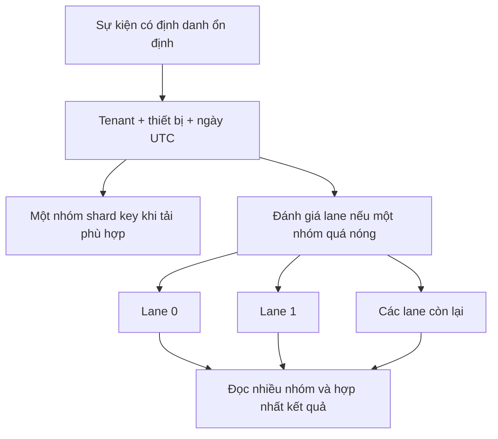

# Thiết kế khóa, bảng, capacity và TTL cho NoSQL

Trong Oracle NoSQL Database Cloud Service, một bảng không chỉ là nơi chứa tài liệu JSON. Lựa chọn khóa quyết định đường truy cập và cách phân bố tải; schema ảnh hưởng kích thước bản ghi và khả năng kiểm soát dữ liệu; capacity quyết định ngân sách đọc, ghi, lưu trữ; TTL quyết định khi nào một hàng hết hiệu lực trong database.

Bốn quyết định này liên hệ trực tiếp. Nếu một thiết bị tạo phần lớn sự kiện, tăng capacity toàn bảng có thể chưa giải quyết được điểm nóng của khóa. Nếu thêm index để giảm đọc quét, mỗi lần ghi có thể tốn thêm tài nguyên. Nếu giảm TTL mặc định, dữ liệu cũ không tự đồng loạt nhận thời hạn mới.

Trong chương **MySQL HeatWave và NoSQL** của lộ trình Oracle Cloud Infrastructure (OCI), bài này tập trung vào thiết kế cho **Oracle NoSQL Database Cloud Service**. Ví dụ xuyên suốt là một ứng dụng thu thập sự kiện thiết bị theo tenant. Các số liệu là giả định để học cách tính, không phải kết quả benchmark, cấu hình mặc định hoặc giới hạn dịch vụ.

Sau bài học, người học có thể:

- Chuyển yêu cầu nghiệp vụ thành mẫu truy cập và phạm vi khóa.
- Chọn primary key, shard key và cách chia bucket có đánh đổi rõ ràng.
- Thiết kế bảng kết hợp cột có kiểu với JSON, cùng index cần thiết.
- Ước lượng RU, WU và dung lượng từ workload, kích thước và retention.
- Phân biệt TTL mặc định, TTL từng hàng, thời điểm hết hạn và hạn sử dụng do ứng dụng kiểm tra.
- Chuẩn bị kiểm tra tải lệch, cập nhật, retry và vòng đời dữ liệu.

## 1. Bắt đầu từ mẫu truy cập

### 1.1. Viết câu hỏi trước khi viết DDL

Giả sử ứng dụng cần các chức năng:

| Mẫu truy cập | Thông tin đầu vào | Kết quả mong muốn |
| --- | --- | --- |
| Ghi sự kiện | Tenant, thiết bị, thời điểm, event ID và payload | Một sự kiện được ghi có thể nhận diện lại |
| Đọc một sự kiện | Đủ các thành phần khóa đã lưu trong định danh | Một hàng hoặc không có hàng |
| Lịch sử thiết bị | Tenant, thiết bị, khoảng thời gian | Các sự kiện mới nhất, có phân trang |
| Tìm sự kiện theo loại | Tenant, loại sự kiện, khoảng thời gian | Danh sách có điều kiện, theo đường truy cập phù hợp |
| Dọn dữ liệu ngắn hạn | Chính sách retention | Hàng hết hạn theo thiết kế |

Cần ghi thêm cho từng dòng: tần suất, đỉnh tải, độ trễ mục tiêu, số hàng trả về, mức nhất quán và ai được gọi.

“Ứng dụng có 100.000 thiết bị” chưa đủ để định cỡ. Cần biết bao nhiêu thiết bị hoạt động cùng lúc, một thiết bị có thể gửi bao nhiêu sự kiện mỗi giây và có đợt phát lại dữ liệu sau mất kết nối hay không.

### 1.2. Phân biệt đường phục vụ và đường phân tích

Một API đọc 100 sự kiện gần nhất của một thiết bị có mẫu truy cập khác với câu hỏi “tổng số sự kiện lỗi của mọi tenant trong một năm”.

Nếu đặt cả hai vào cùng một API truy vấn không giới hạn, phép tổng hợp lớn có thể tiêu thụ capacity phục vụ request trực tuyến. Hãy xác định ngay truy vấn nào cần đáp ứng nhanh và truy vấn nào cần pipeline hoặc hệ thống phân tích riêng.

SQL trong NoSQL giúp biểu diễn truy vấn, nhưng không làm mọi kiểu truy vấn có cùng chi phí.

## 2. Primary key và shard key có vai trò khác nhau

### 2.1. Primary key xác định danh tính của hàng

Primary key có một hoặc nhiều cột, xác định duy nhất một hàng trong bảng.

Ví dụ khóa đầy đủ:

```text
tenant_id
+ device_id
+ day_bucket
+ event_ms
+ event_id
```

Hai hàng có cùng `event_id` nhưng khác `device_id` hoặc `event_ms` vẫn có thể là hai khóa khác nhau. Nếu nghiệp vụ yêu cầu event ID duy nhất trong toàn tenant, phải thiết kế cơ chế đáp ứng phạm vi đó; không suy ra điều này chỉ vì event ID xuất hiện trong khóa ghép.

Khóa phải ổn định khi retry. Nếu mỗi lần gửi lại tạo timestamp hoặc event ID mới, database sẽ nhìn thấy một sự kiện mới.

### 2.2. Shard key quyết định cách nhóm để phân bố

Shard key là phần được chọn từ primary key để phân bố hàng. Những hàng có cùng giá trị shard key được đặt cùng phạm vi shard. Nếu không khai báo phần shard key riêng, primary key được dùng theo quy tắc của hệ thống. Xem [khái niệm cloud về khóa và phân bố dữ liệu](https://docs.oracle.com/en/cloud/paas/nosql-cloud/dtddt/cloud-concepts.html).

Ví dụ:

```sql
PRIMARY KEY (
    SHARD(tenant_id, device_id, day_bucket),
    event_ms,
    event_id
)
```

Trong ví dụ này:

- `tenant_id, device_id, day_bucket` là shard key.
- Cả năm cột tạo thành primary key.
- Các sự kiện của một thiết bị trong một ngày UTC thuộc cùng nhóm shard key.
- `event_ms, event_id` phân biệt các hàng bên trong nhóm và hỗ trợ truy cập theo thứ tự khóa.

Một giá trị shard key không đồng nghĩa được cấp một server riêng. Nhiều nhóm có thể cùng nằm trên một shard vật lý; dịch vụ quản lý phân bố hạ tầng.

### 2.3. Khóa là quyết định có chi phí thay đổi cao

Primary key và shard key được xác định khi tạo bảng và không phải các cột có thể tùy ý thay đổi bằng một lệnh sửa schema. Nếu cần đổi mô hình khóa, thường phải thiết kế bảng đích và di chuyển dữ liệu. Xem [thiết kế primary key và shard key](https://docs.oracle.com/en/database/other-databases/nosql-database/23.1/nsdev/table-modelling-and-design1.html).

Vì vậy, nên kiểm tra mẫu truy cập và tải lệch trước khi đưa bảng vào production.

## 3. Chọn shard key bằng cách cân bằng phân bố và truy cập

### 3.1. Cardinality cao chưa đủ

**Cardinality** là số giá trị khác nhau. Một trường có nhiều giá trị có thể giúp phân bố, nhưng cần xem cả tần suất truy cập từng giá trị.

Ví dụ:

| Ứng viên shard key | Thuận lợi | Vấn đề phải kiểm tra |
| --- | --- | --- |
| `tenant_id` | Dễ truy cập theo tenant | Tenant lớn có thể dồn phần lớn tải vào một nhóm |
| `tenant_id, device_id` | Phân bố theo thiết bị | Một thiết bị rất nóng hoặc giữ lịch sử quá lớn |
| `tenant_id, device_id, day_bucket` | Giới hạn lịch sử mỗi nhóm theo ngày | Đọc nhiều ngày cần nhiều nhóm |
| Toàn bộ định danh sự kiện | Phân bố theo nhiều khóa | Đọc lịch sử thiết bị phải có đường truy vấn bổ sung |

Không chọn khóa chỉ vì nó có nhiều giá trị trên toàn bộ lịch sử. Điều quan trọng là các giá trị **đang hoạt động trong cùng khoảng thời gian** có phân bố tốt không.

### 3.2. Bucket thời gian có hai tác dụng cần phân biệt

Bucket theo ngày có thể:

- Giới hạn lượng dữ liệu trong một nhóm theo thời gian.
- Cho phép ứng dụng xác định nhóm cần đọc từ khoảng ngày.

Nhưng nó không chia một luồng ghi rất nóng trong ngày thành nhiều nhóm đồng thời. Nếu một thiết bị chiếm phần lớn tải trong hôm nay, toàn bộ sự kiện hôm nay của thiết bị đó vẫn dùng cùng shard key.

Tương tự, chỉ dùng “ngày hiện tại” làm shard key có thể tạo rất ít nhóm đang ghi. Đặc tính tăng dần của timestamp tự nó chưa đủ để kết luận về hotspot; phải nhìn vào phần khóa được dùng để phân bố.

### 3.3. Thêm lane khi có bằng chứng cần chia tải

Nếu một thiết bị thực sự tạo điểm nóng, có thể đánh giá thêm một lane:

```text
lane = stable_hash(event_id) mod 8

shard key:
tenant_id + device_id + day_bucket + lane
```

Đây là kỹ thuật do ứng dụng thiết kế, không phải yêu cầu mặc định của dịch vụ.

Hàm hash phải ổn định giữa các ngôn ngữ và lần triển khai. Cùng sự kiện khi retry phải nhận cùng lane; thay đổi số lane cũng cần có quy tắc phiên bản hoặc di chuyển dữ liệu.

Đánh đổi khi đọc lịch sử một ngày là tối đa tám nhóm thay vì một nhóm. Đọc nhiều ngày còn cần hợp nhất thêm kết quả giữa các ngày.



Không thêm lane để dự phòng một cách máy móc. Chi phí fan-out, sắp xếp và trạng thái phân trang có thể lớn hơn lợi ích nếu tải vốn đã phân bố tốt.

### 3.4. Đồng vị trí và atomicity

Nếu cần thay đổi nhiều hàng trong một thao tác atomic, phải kiểm tra điều kiện API và phạm vi shard key. Ví dụ `WriteMultipleRequest` hỗ trợ nhóm thao tác put/delete có cùng phần shard key theo điều kiện của SDK. Xem [WriteMultipleRequest](https://docs.oracle.com/en/database/other-databases/nosql-database/25.3/java-sdk/oracle/nosql/driver/ops/WriteMultipleRequest.html).

Thêm ngày hoặc lane vào shard key có thể làm các hàng trước đây cùng nhóm trở thành khác nhóm. Phải đánh giá lại yêu cầu atomicity, không chỉ throughput.

## 4. Thiết kế bảng: cột có kiểu và JSON

### 4.1. Đưa dữ liệu định tuyến ra cột rõ ràng

Ví dụ bảng lab:

```sql
CREATE TABLE telemetry_events_lab (
    tenant_id STRING,
    device_id STRING,
    day_bucket STRING,
    event_ms LONG,
    event_id STRING,
    event_type STRING,
    schema_version INTEGER,
    expires_at_ms LONG,
    payload JSON,
    PRIMARY KEY (
        SHARD(tenant_id, device_id, day_bucket),
        event_ms,
        event_id
    )
) USING TTL 30 DAYS
```

DDL minh họa một bảng có cột định kiểu và cột JSON, tương tự mẫu được mô tả trong [tạo bảng bằng SQL](https://docs.oracle.com/en/database/other-databases/nosql-database/26.1/nsdev/using-sql-commands-create-table.html).

Các giá trị cần thống nhất ở phía ứng dụng:

| Cột | Quy tắc thiết kế |
| --- | --- |
| `tenant_id` | Lấy từ danh tính đã xác thực và phạm vi được phép |
| `device_id` | Định danh ổn định của thiết bị trong tenant |
| `day_bucket` | Ngày UTC suy ra từ thời điểm sự kiện theo quy tắc đã chọn |
| `event_ms` | Epoch milliseconds, giữ nguyên khi retry |
| `event_id` | Phân biệt sự kiện cùng thời điểm và phục vụ đối soát |
| `event_type` | Giá trị được chuẩn hóa nếu dùng để lọc/index |
| `schema_version` | Phiên bản payload để reader xử lý tương thích |
| `expires_at_ms` | Hạn sử dụng tuyệt đối do ứng dụng kiểm tra khi cần |
| `payload` | Thuộc tính linh hoạt, có kiểm soát kích thước và cấu trúc |

`expires_at_ms` là một cột thông thường. Đặt giá trị cột này không tự cấu hình native TTL.

### 4.2. Chọn kích thước đơn vị ghi và đọc

Một hàng nên gắn với đơn vị mà ứng dụng thường đọc hoặc cập nhật.

Với dữ liệu sự kiện, một hàng cho một sự kiện thường dễ giới hạn kích thước và retry hơn một hàng chứa mảng lịch sử không ngừng tăng. Mảng quá lớn làm một cập nhật nhỏ tác động tới đơn vị dữ liệu lớn hơn và có thể chạm giới hạn bản ghi.

JSON linh hoạt không có nghĩa bỏ validation. Cần quy định trường bắt buộc, kiểu, kích thước tối đa, cách xử lý trường chưa biết và phiên bản payload. Những quyết định này ảnh hưởng cả tính đúng đắn lẫn capacity.

Nếu payload lớn nhưng API thường chỉ cần metadata nhỏ, có thể đánh giá tách phần dữ liệu; khi đó phải quản lý thêm quyền truy cập, tính nhất quán và vòng đời của hai phần.

## 5. Truy vấn theo đường khóa đã thiết kế

### 5.1. Đọc một hàng cần khóa đầy đủ

Để đọc trực tiếp bằng API get, cần biết đủ năm giá trị khóa của ví dụ.

Nếu API chỉ nhận `event_id`, ứng dụng không thể tự suy ra `day_bucket` hoặc `event_ms` từ một UUID ngẫu nhiên. Hãy chọn một trong các phương án phù hợp:

- Định danh API mang đủ thành phần hoặc mã hóa thông tin định tuyến một cách an toàn.
- Có bảng tra cứu bổ sung.
- Có index phục vụ truy vấn đó.

Phương án tra cứu bổ sung tạo thêm đọc/ghi, độ trễ và quy tắc đồng bộ. Cần tính vào capacity và vòng đời dữ liệu.

### 5.2. Đọc một thiết bị trong một bucket

Ví dụ truy vấn có biến bind:

```sql
DECLARE $tenant STRING;
DECLARE $device STRING;
DECLARE $bucket STRING;
DECLARE $from_ms LONG;
DECLARE $to_ms LONG;
DECLARE $now_ms LONG;

SELECT
    e.event_ms,
    e.event_id,
    e.event_type,
    e.payload
FROM telemetry_events_lab e
WHERE e.tenant_id = $tenant
  AND e.device_id = $device
  AND e.day_bucket = $bucket
  AND e.event_ms >= $from_ms
  AND e.event_ms < $to_ms
  AND e.expires_at_ms > $now_ms
ORDER BY e.event_ms DESC, e.event_id DESC
LIMIT 100
```

Ứng dụng bind các biến, không nối chuỗi giá trị từ request vào SQL.

Ba điều kiện đầu xác định đầy đủ shard key. Khoảng thời gian nửa mở giúp ghép các khoảng không trùng biên. `event_id` là thành phần phân xử khi nhiều sự kiện có cùng millisecond.

Điều kiện `expires_at_ms` hỗ trợ hạn sử dụng nghiệp vụ, nhưng có thể là một điều kiện lọc thêm. Số hàng trả về ít không chứng minh số hàng phải đọc ít; cần xem kế hoạch và consumed units.

### 5.3. Đọc nhiều ngày và phân trang

Khoảng 24 giờ có thể đi qua hai ngày UTC. Ứng dụng phải xác định các bucket liên quan, đọc và hợp nhất theo `event_ms, event_id`. Nếu có lane, cần hợp nhất thêm các lane.

Không lấy 100 hàng đầu của một bucket rồi kết luận đó là 100 hàng mới nhất của toàn khoảng mà chưa xử lý các bucket còn lại.

Phân biệt:

- **Phân trang API nghiệp vụ:** người dùng lấy tiếp lịch sử.
- **Các batch nội bộ của SDK:** một truy vấn cần nhiều lần gọi để hoàn tất.

Với Java SDK, một batch có thể rỗng dù truy vấn chưa xong; dùng trạng thái hoàn tất của request thay vì dừng ngay khi danh sách rỗng. Request cũng không dùng chung giữa nhiều thread. Xem [QueryRequest và partial results](https://docs.oracle.com/en/database/other-databases/nosql-database/25.3/java-sdk/oracle/nosql/driver/ops/QueryRequest.html).

Khi dữ liệu đang được thêm hoặc hết hạn, phải xác định mức ổn định mà API phân trang cam kết. Cursor nên gắn với tenant, điều kiện lọc và trạng thái đọc cần thiết; không để client sửa cursor để đổi phạm vi truy cập.

## 6. Index và bảng phục vụ truy cập bổ sung

### 6.1. Thêm index cho mẫu truy vấn có giá trị

Nếu thường tìm sự kiện theo loại trong một tenant, có thể đánh giá:

```sql
CREATE INDEX idx_telemetry_by_type
ON telemetry_events_lab (tenant_id, event_type, event_ms)
```

Mục tiêu là tạo đường tìm kiếm theo trường lọc quan trọng. Cần kiểm tra index được hỗ trợ, đã sẵn sàng và được optimizer dùng trong môi trường thực tế.

Index không đổi primary/shard key của bảng. Một truy vấn có index nhưng không cố định đầy đủ shard key vẫn cần được đánh giá về phân tán và chi phí.

### 6.2. Mỗi index có đánh đổi đọc, ghi và lưu trữ

Với từng index, ghi:

- Query nào cần nó và tần suất query.
- Số hàng thực phải đọc so với số hàng trả về.
- Chi phí bảo trì khi insert, update và delete.
- Dung lượng index và ảnh hưởng khi dữ liệu tăng.
- Điều kiện sort hoặc projection có còn cần công việc bổ sung không.

Cột JSON có thể được index theo đường dẫn phù hợp; chọn dữ liệu có kiểu ở các trường truy cập quan trọng giúp kiểm soát giá trị. Khả năng index và schema được giới thiệu trong [Cloud Concepts](https://docs.oracle.com/en/cloud/paas/nosql-cloud/dtddt/cloud-concepts.html).

### 6.3. Khi cần bảng phục vụ mẫu truy cập khác

Một bảng vật hóa theo tenant và loại sự kiện có thể hợp lý cho một workload cụ thể. Nhưng nó tạo thêm một bản biểu diễn phải đồng bộ, không chỉ là “thêm một nơi đọc”.

Phải xác định cách ghi, xử lý lỗi từng phần, retry, đối soát, cập nhật và TTL. Hai bản cùng TTL tương đối nhưng được ghi ở hai thời điểm khác nhau có thể hết hạn khác nhau.

Không thiết kế một bảng cho mỗi câu truy vấn trước khi đo. Số bản sao biểu diễn càng nhiều, chi phí và công việc duy trì tính đúng đắn càng lớn.

## 7. Capacity: hiểu RU, WU và dung lượng

### 7.1. Định nghĩa đơn vị

Trong dịch vụ cloud:

- Một **Read Unit — RU** biểu diễn throughput đọc eventual consistency tới 1 KB mỗi giây.
- Đọc **absolute consistency** tới 1 KB cần hai RU.
- Một **Write Unit — WU** biểu diễn throughput ghi tới 1 KB mỗi giây.
- Bản ghi lớn hơn cần nhiều đơn vị; kích thước được làm tròn theo đơn vị tính.
- Cập nhật index và một số tùy chọn thao tác có thể tạo chi phí bổ sung.

Xem [TableLimits và định nghĩa throughput](https://docs.oracle.com/en/database/other-databases/nosql-database/25.3/java-sdk/oracle/nosql/driver/ops/TableLimits.html) và [lập kế hoạch capacity](https://docs.oracle.com/en/cloud/paas/nosql-cloud/dtddt/plan-your-service.html).

Không dùng độ dài JSON hiển thị ở client làm kích thước lưu trữ chính xác. Cần xét serialization, khóa, metadata và dữ liệu/index mà thao tác thực sự sử dụng.

### 7.2. Công thức cơ sở cho point read

Với một point read đơn giản:

```text
Đơn vị đọc cơ sở cho một thao tác
    ≈ ceil(kích thước bản ghi / 1 KB) × hệ số consistency

Hệ số:
    eventual = 1
    absolute = 2

Nhu cầu throughput của một nhóm thao tác
    = số thao tác mỗi giây × đơn vị tiêu thụ mỗi thao tác
```

Ví dụ một hàng khoảng 1,5 KB cần làm tròn lên hai đơn vị cơ sở: eventual point read khoảng hai RU mỗi thao tác, absolute khoảng bốn RU.

Đây là mô hình ban đầu cho thao tác đã mô tả. Không áp trực tiếp cho mọi query, update, delete hoặc conditional write.

### 7.3. Query phải tính cả dữ liệu đã đọc

Một query trả mười hàng nhưng phải đọc nhiều hàng/index entry để lọc có chi phí khác với mười point get.

Tương tự, ghi có điều kiện, yêu cầu trả hàng cũ hoặc thay đổi giá trị được index có thể tiêu thụ cả RU lẫn WU. Hãy đo các loại thao tác riêng và cộng kết quả của mọi batch thuộc cùng một query.

Chỉ đếm số request HTTP hoặc số hàng cuối cùng là không đủ để lập capacity.

## 8. Ví dụ tính throughput theo workload

### 8.1. Bảng giả định

Giả sử một workload có các thông số sau. Những giá trị “đơn vị mỗi thao tác” là **giả định cho bài tính**, cần thay bằng số đo SDK/service khi thử nghiệm:

| Thao tác | Tần suất ở đỉnh thiết kế | RU/thao tác | WU/thao tác | Tổng RU/s | Tổng WU/s |
| --- | ---: | ---: | ---: | ---: | ---: |
| Point get eventual, hàng khoảng 1,5 KB | 900/s | 2 | 0 | 1.800 | 0 |
| Point get absolute cùng loại hàng | 100/s | 4 | 0 | 400 | 0 |
| Query lịch sử, cộng mọi batch | 20/s | 15 | 0 | 300 | 0 |
| Insert có điều kiện và index | 30/s | 2 | 3 | 60 | 90 |
| Update theo workload đã xét | 5/s | 4 | 4 | 20 | 20 |
| Tổng | | | | 2.580 | 110 |

Các hệ số của conditional insert và update không phải giá cố định của API. Payload, index và tùy chọn khác đi thì phải tính lại.

### 8.2. Thêm headroom theo mục tiêu sử dụng

Nếu muốn workload thiết kế chiếm tối đa 80% capacity đã cấp:

```text
Read capacity tối thiểu theo mô hình
    = ceil(2580 / 0,8)
    = 3225 RU

Write capacity tối thiểu theo mô hình
    = ceil(110 / 0,8)
    = 138 WU
```

Có thể chọn một cấu hình ứng viên 3.300 RU và 150 WU rồi thử tải. Đây chưa phải bằng chứng đạt độ trễ hoặc chống mọi đợt burst.

Phân biệt “còn trống 20% tổng capacity” với “cộng thêm 20% nhu cầu”. Hai phép tính không giống nhau.

### 8.3. Phải tính đợt phát lại và retry

Thiết bị mất mạng một giờ có thể gửi dồn khi kết nối lại. Migration, backfill và tác vụ quản trị cũng dùng tài nguyên.

Trong mô hình tải, ghi riêng:

- Tải ổn định.
- Đỉnh nghiệp vụ.
- Burst ngắn.
- Đợt replay/backfill được phép.
- Retry do throttling hoặc lỗi mạng.

Retry không có giới hạn có thể làm tải tăng thêm đúng lúc tài nguyên đã căng. Cần backoff, deadline, giới hạn đồng thời và định danh ổn định.

### 8.4. Tổng capacity và phân bố theo khóa

Tổng RU/WU dưới giới hạn chưa chứng minh mọi request sẽ nhanh. Nếu phần lớn thao tác dùng một shard key, một phần tài nguyên có thể trở thành điểm giới hạn trước khi toàn bảng hết capacity.

Cần đo tải theo tenant, thiết bị và nhóm khóa, bên cạnh metric toàn bảng. Không xử lý mọi tình huống throttling bằng cách tăng cùng một con số.

## 9. Chọn provisioned hoặc on-demand

Bài học xét hai cách cấp throughput phổ biến ở cấp bảng:

| Cách cấp | Phù hợp để đánh giá khi | Trách nhiệm vẫn còn |
| --- | --- | --- |
| Provisioned capacity | Workload có thể dự báo và muốn chủ động ngân sách throughput | Theo dõi, điều chỉnh và chuẩn bị cho đỉnh |
| On-demand capacity | Workload mới, thay đổi khó dự báo hoặc muốn giảm công việc dự báo throughput | Theo dõi usage, giới hạn dịch vụ, lưu trữ và tải lệch |

On-demand tự quản lý read/write capacity theo mô hình dịch vụ; storage vẫn cần được xác định. Các giới hạn và điều kiện đổi mode phải kiểm tra theo môi trường hiện hành. Xem [lựa chọn capacity khi tạo bảng](https://docs.oracle.com/en/cloud/paas/nosql-cloud/dtddt/using-console-to-create-tables-in-oracle-nosql-database.html).

Không coi on-demand là vô hạn, cũng không dùng nó để bỏ qua thiết kế shard key.

Ví dụ Java chỉ tạo đối tượng mô tả giới hạn, chưa gửi yêu cầu cloud:

```java
import oracle.nosql.driver.ops.TableLimits;

TableLimits provisioned = new TableLimits(3300, 150, 70);
TableLimits onDemand = new TableLimits(70);
```

Hai đối tượng biểu diễn hai lựa chọn khác nhau. Chỉ dùng lựa chọn phù hợp trong request tạo/sửa bảng và chờ thao tác hoàn tất trước khi xác minh cấu hình.

Khi so chi phí, tách phần throughput đã cấp hoặc đã dùng theo mode, dung lượng cấu hình và những thành phần bổ sung. Giá hiện hành và điều kiện triển khai phải lấy từ đúng dịch vụ/region. Không chọn mode chỉ từ mức request trung bình của một giờ yên tĩnh.

## 10. Tính dung lượng gắn với retention

### 10.1. Công thức lượng dữ liệu giữ lại

Một ước lượng ban đầu:

```text
Số hàng đang được giữ
    ≈ tốc độ tạo hàng mới trung bình
      × khoảng thời gian lưu

Dung lượng ứng viên
    ≈ số hàng
      × (kích thước hàng và khóa + index liên quan)
      + phần bổ sung cho vận hành
```

Dùng tốc độ **hàng mới**, không cộng mọi update như một hàng mới. Nếu retry tạo khóa khác, số hàng mới thực tế sẽ tăng và đó là lỗi mô hình cần sửa.

Cũng phải xét dữ liệu không có TTL, hàng được gia hạn, độ trễ dọn vật lý và các bản biểu diễn phụ.

### 10.2. Ví dụ dung lượng

Giả sử:

- Trung bình 10 hàng mới mỗi giây; đỉnh 30/s không kéo dài cả ngày.
- Hàng đã đo gồm khóa/metadata: 1.500 byte.
- Index liên quan trung bình: 250 byte/hàng.
- TTL mặc định 30 ngày.
- Lập ngân sách tới 31 ngày dữ liệu do đặc tính làm tròn TTL theo ngày.
- Thêm 5 GB dự phòng vận hành trong mô hình và muốn còn trống 20% tổng dung lượng.

Theo đơn vị thập phân:

```text
Số hàng cho 31 ngày
    = 10 × 86400 × 31
    = 26.784.000 hàng

Dung lượng hàng và index
    = 26.784.000 × (1500 + 250)
    = 46.872.000.000 byte
    = 46,872 GB

Dung lượng cần cấu hình theo mục tiêu
    = (46,872 + 5) / 0,8
    = 64,84 GB
```

Có thể chọn 70 GB làm ứng viên để kiểm tra cùng cấu hình throughput ở ví dụ trước.

Khoản 5 GB là giả định của bài tính, không phải bảo đảm đủ cho mọi độ trễ dọn hoặc backfill. Nếu dữ liệu tăng nhanh, TTL bị gia hạn hoặc index lớn hơn, phải tính lại.

Không trộn GB thập phân với GiB khi đối chiếu các công cụ. Không nhân thêm số bản sao hạ tầng vào bảng tính logical storage nếu mô hình dịch vụ không yêu cầu cách tính đó.

### 10.3. TTL không tự thay đổi mức dung lượng đã cấu hình

Hàng hết hạn hỗ trợ kiểm soát lượng dữ liệu cần giữ, nhưng không phải một lệnh tự giảm storage capacity đã chọn cho bảng. Cần theo dõi usage và cấu hình, rồi thay đổi theo quy trình được hỗ trợ.

Nếu không có TTL và không có cơ chế xóa, dữ liệu tăng liên tục theo thời gian. Nếu có một phần hàng được đặt không hết hạn, phần đó phải có ngân sách riêng.

## 11. Hiểu chính xác TTL

### 11.1. TTL là thời lượng dùng để tính expiration

Native TTL dùng đơn vị **HOURS** hoặc **DAYS**. Bảng có TTL mặc định và thao tác ghi có thể đặt TTL riêng cho hàng. Giá trị zero biểu thị không hết hạn. Hàng hết hạn không còn được trả trong kết quả truy vấn và sẽ được dọn vật lý sau đó. Xem [TTL trong CREATE TABLE](https://docs.oracle.com/en/database/other-databases/nosql-database/26.1/sqlreferencefornosql/create-table.html).

Ba khái niệm cần phân biệt:

| Khái niệm | Ví dụ |
| --- | --- |
| Thời lượng TTL | Hai giờ hoặc 30 ngày |
| Expiration của hàng | Một thời điểm tuyệt đối tính từ lúc ghi theo quy tắc hệ thống |
| Hạn sử dụng nghiệp vụ | Một thời điểm do ứng dụng quyết định, chẳng hạn hết hiệu lực sau 30 phút |

TTL không phải thời gian tính từ lần đọc gần nhất. Đọc một hàng không tự gia hạn nó.

### 11.2. Làm tròn theo giờ hoặc ngày UTC

Expiration được làm tròn lên ranh giới giờ/ngày theo đơn vị TTL.

Giả sử thời điểm ghi là `2026-11-20T10:15:30Z`:

| TTL | Cộng thời lượng trước làm tròn | Expiration theo quy tắc làm tròn |
| --- | --- | --- |
| 1 HOUR | 20/11 lúc 11:15:30Z | 20/11 lúc 12:00:00Z |
| 1 DAY | 21/11 lúc 10:15:30Z | 22/11 lúc 00:00:00Z |
| 0 | Không áp dụng | Không hết hạn |

Do đó, TTL một ngày có thể giữ hàng lâu hơn đúng 24 giờ. Với yêu cầu hết hiệu lực chính xác ở cấp giây/phút, lưu hạn tuyệt đối và kiểm tra trong ứng dụng; native TTL phục vụ dọn hàng sau đó.

Các đặc tính thời lượng giờ/ngày được thể hiện trong [TimeToLive của Java SDK](https://docs.oracle.com/en/database/other-databases/nosql-database/25.3/java-sdk/oracle/nosql/driver/TimeToLive.html).

### 11.3. Hết hiệu lực và dọn vật lý không đồng thời

Đừng chờ dung lượng giảm ngay tại millisecond expiration. Dịch vụ còn có bước dọn dữ liệu vật lý.

Cũng không dùng native TTL như bộ lập lịch chắc chắn sẽ gọi một hành động nghiệp vụ tại thời điểm đó. Nếu cần hết hạn đơn giữ chỗ, phát thông báo hoặc cập nhật hệ thống khác, phải có workflow với kiểm tra trạng thái và khả năng retry riêng.

Native TTL của một hàng cũng không tự xóa bản sao do ứng dụng lưu ở cache, bảng khác hoặc kho lưu ngoài. Mỗi biểu diễn cần chính sách vòng đời phù hợp.

## 12. TTL mặc định và TTL khi cập nhật

### 12.1. Đổi mặc định không viết lại dữ liệu cũ

Ví dụ:

```sql
ALTER TABLE telemetry_events_lab USING TTL 7 DAYS
```

Lệnh đổi mặc định cho các lần ghi áp dụng giá trị mới; nó không tự đổi expiration của mọi hàng đã tồn tại. Xem [quản lý TTL mặc định trong Console](https://docs.oracle.com/en/cloud/paas/nosql-cloud/mtiuc/).

Nếu mục tiêu là giảm retention cho dữ liệu cũ, cần một kế hoạch riêng: chọn hàng nào, cập nhật/xóa bằng cơ chế được hỗ trợ, giới hạn tốc độ, đo RU/WU và xác minh kết quả.

Không chạy một đợt ghi lại toàn bảng chỉ để thấy cột TTL trên Console đã thay đổi.

### 12.2. Ma trận hành vi với Java SDK put

| Tình huống | Hành vi cần thiết kế |
| --- | --- |
| Chèn hàng mới, không TTL riêng | Dùng mặc định bảng nếu có |
| Chèn hàng mới, đặt TTL riêng | TTL của thao tác ghi ghi đè mặc định |
| Cập nhật hàng tồn tại, không yêu cầu đổi TTL | Mặc định giữ expiration hiện có |
| Cập nhật có TTL riêng | Tính expiration theo TTL của lần ghi đó |
| Cập nhật với `setUseTableDefaultTTL(true)` | Yêu cầu cập nhật TTL theo mặc định bảng |
| Chỉ đổi TTL mặc định của bảng | Không tự sửa expiration của các hàng cũ |

Đối chiếu chi tiết tại [PutRequest](https://docs.oracle.com/en/database/other-databases/nosql-database/25.3/java-sdk/oracle/nosql/driver/ops/PutRequest.html). Hành vi phải được xác minh theo API thực dùng; không suy từ một SDK sang một API có tùy chọn khác.

### 12.3. Sliding expiration phải là quyết định chủ động

Ví dụ cache cần giữ hai giờ kể từ lần cập nhật gần nhất có thể chủ động đặt lại TTL khi cập nhật.

Dữ liệu sự kiện cần giữ 30 ngày kể từ lúc phát sinh thì khác. Nếu mỗi update hoặc retry đều đặt lại “30 ngày kể từ bây giờ”, retention sẽ bị kéo dài.

Đổi TTL mặc định thành zero cũng không tự hủy expiration đã có của dữ liệu cũ. Nếu muốn giữ một hàng không hết hạn, phải dùng thao tác phù hợp và kiểm tra expiration thực tế.

## 13. Ví dụ Java: ghi có điều kiện và kiểm tra expiration

Ví dụ dùng Oracle NoSQL Database SDK for Java, với `NoSQLHandle` đã được khởi tạo cho đúng OCI region, compartment và xác thực. Bảng lab ở phần 4 đã được tạo và sẵn sàng. Đoạn mã là phần thân trong ứng dụng lab; không chứa cấu hình bí mật hoặc tạo tài nguyên cloud.

### 13.1. Tạo một sự kiện lab có TTL hai giờ

Các giá trị khóa và thời điểm dưới đây được tạo **một lần cho một sự kiện**. Khi retry, giữ nguyên dữ liệu sự kiện đã tạo; không chạy lại bước sinh định danh/thời điểm để biến nó thành sự kiện khác.

```java
import java.time.Duration;
import java.time.Instant;
import java.time.ZoneOffset;
import java.util.UUID;

import oracle.nosql.driver.Consistency;
import oracle.nosql.driver.TimeToLive;
import oracle.nosql.driver.ops.GetRequest;
import oracle.nosql.driver.ops.GetResult;
import oracle.nosql.driver.ops.PutRequest;
import oracle.nosql.driver.ops.PutResult;
import oracle.nosql.driver.values.MapValue;

// handle là NoSQLHandle đã được cấu hình ở phía gọi.
String tenantId = "tenant-lab";
String deviceId = "device-001";

Instant eventTime = Instant.now();
long eventMs = eventTime.toEpochMilli();
String dayBucket = eventTime.atOffset(ZoneOffset.UTC)
                           .toLocalDate().toString();
String eventId = UUID.randomUUID().toString();
long expiresAtMs = eventMs + Duration.ofHours(2).toMillis();

MapValue payload = new MapValue()
    .put("temperature", 28.5);

MapValue row = new MapValue()
    .put("tenant_id", tenantId)
    .put("device_id", deviceId)
    .put("day_bucket", dayBucket)
    .put("event_ms", eventMs)
    .put("event_id", eventId)
    .put("event_type", "temperature")
    .put("schema_version", 1)
    .put("expires_at_ms", expiresAtMs)
    .put("payload", payload);

PutRequest put = new PutRequest()
    .setTableName("telemetry_events_lab")
    .setValue(row)
    .setOption(PutRequest.Option.IfAbsent)
    .setTTL(TimeToLive.ofHours(2));

PutResult written = handle.put(put);

if (written.getVersion() == null) {
    System.out.println(
        "Không chèn: cần kiểm tra hàng đã tồn tại và payload."
    );
}

System.out.printf(
    "put readUnits=%d, writeUnits=%d%n",
    written.getReadUnits(),
    written.getWriteUnits()
);
```

`IfAbsent` chỉ cho phép chèn khi hàng chưa tồn tại, theo [PutRequest.Option](https://docs.oracle.com/en/database/other-databases/nosql-database/25.3/java-sdk/oracle/nosql/driver/ops/PutRequest.Option.html). Nó không tự xác nhận một hàng đã có chứa cùng payload.

`PutResult.getVersion()` giúp nhận biết put thành công; consumed units có thể lấy từ kết quả thao tác. Xem [PutResult](https://docs.oracle.com/en/database/other-databases/nosql-database/25.3/java-sdk/oracle/nosql/driver/ops/PutResult.html). Lỗi dịch vụ hoặc timeout vẫn cần được xử lý riêng, không coi mọi tình huống không chèn là duplicate thành công.

### 13.2. Đọc lại bằng khóa đầy đủ

```java
MapValue key = new MapValue()
    .put("tenant_id", tenantId)
    .put("device_id", deviceId)
    .put("day_bucket", dayBucket)
    .put("event_ms", eventMs)
    .put("event_id", eventId);

GetResult fetched = handle.get(
    new GetRequest()
        .setTableName("telemetry_events_lab")
        .setKey(key)
        .setConsistency(Consistency.ABSOLUTE)
);

if (fetched.getValue() != null) {
    long businessExpiryMs = fetched.getValue()
                                  .get("expires_at_ms")
                                  .getLong();
    boolean businessValid =
        System.currentTimeMillis() < businessExpiryMs;

    System.out.printf(
        "businessValid=%s, nativeExpiryMs=%d, readUnits=%d%n",
        businessValid,
        fetched.getExpirationTime(),
        fetched.getReadUnits()
    );
}
```

`getExpirationTime()` trả epoch milliseconds; zero biểu thị không hết hạn khi hàng tồn tại. Chỉ diễn giải metadata expiration sau khi xác nhận `getValue()` khác null. Xem [GetResult](https://docs.oracle.com/en/database/other-databases/nosql-database/25.3/java-sdk/oracle/nosql/driver/ops/GetResult.html).

Ví dụ đặt hạn nghiệp vụ đúng hai giờ từ thời điểm sự kiện, trong khi native TTL có thể làm tròn lâu hơn. Luồng phục vụ phải từ chối dùng dữ liệu khi hạn nghiệp vụ đã qua, thay vì chỉ ghi log `businessValid`.

Absolute read được dùng để quan sát trong lab. Không coi lựa chọn này là bắt buộc cho mọi API; cần chọn consistency theo yêu cầu đúng đắn và ngân sách.

### 13.3. Không gia hạn ngoài ý muốn khi nhận trùng

Khi hàng vẫn tồn tại, put `IfAbsent` cùng khóa không ghi đè hàng đó. Nhưng sau khi hàng đã hết hạn, cùng một khóa có thể lại được xem như chưa tồn tại.

Nếu cần ngăn sự kiện cũ sống lại:

- Kiểm tra deadline tuyệt đối trước khi nhận replay.
- Xác định khoảng deduplication cần giữ.
- Giữ cơ chế nhận diện lâu hơn dữ liệu chính nếu nghiệp vụ yêu cầu.
- Đối soát cùng định danh nhưng payload hoặc timestamp khác.

TTL của bản ghi chống trùng phải ít nhất đáp ứng khoảng replay được hỗ trợ. Một bản ghi dedup hết hạn sớm có thể làm mất bảo vệ đúng lúc nhận lại dữ liệu cũ.

## 14. Sự kiện đến muộn, backfill và đổi retention

### 14.1. Chọn mốc bắt đầu retention

Hai chính sách khác nhau:

| Chính sách | Ví dụ |
| --- | --- |
| Giữ 30 ngày từ thời điểm tiếp nhận | Dữ liệu nhận ngày 20/11 có thời hạn tính từ lần ghi ngày 20/11 |
| Giữ 30 ngày từ thời điểm phát sinh | Sự kiện phát sinh ngày 10/11 chỉ còn thời gian lưu tương ứng khi nhận ngày 20/11 |

Native TTL tương đối lúc ghi không tự biết mốc nghiệp vụ mong muốn. Cần lưu thời điểm và hạn tuyệt đối, tính thời lượng còn lại hoặc dùng API chuyển đổi phù hợp, rồi xác minh expiration.

Không biến thời lượng âm do dữ liệu đã hết hạn thành TTL zero, vì zero mang nghĩa không hết hạn.

### 14.2. Di chuyển dữ liệu phải giữ ý nghĩa thời hạn

Khi chuyển bảng hoặc thay đổi khóa:

1. Đọc định danh, dữ liệu, expiration và hạn nghiệp vụ cần giữ.
2. Bỏ qua hoặc xử lý riêng hàng đã hết hạn theo chính sách.
3. Ánh xạ khóa mới một cách xác định.
4. Ghi bằng chính sách TTL đáp ứng thời gian còn lại.
5. Đối soát số hàng, đường truy cập và deadline sau di chuyển.
6. Chỉ chuyển reader/writer khi điều kiện chấp nhận đạt.

Nếu ghi mọi hàng vào bảng đích với TTL mới 30 ngày, dữ liệu gần hết hạn sẽ bị kéo dài thêm. Tình huống này cần kiểm tra ngay cả khi payload và số lượng hàng khớp.

### 14.3. Đổi retention là thay đổi dữ liệu

Giảm retention cần xác định ảnh hưởng tới API lịch sử, bản biểu diễn phụ, deduplication, tác vụ đối soát và nguồn lưu dài hạn.

Tăng retention cần tính lại dung lượng, index, tốc độ tăng và chi phí. Chỉ đổi con số TTL mặc định không làm các hàng cũ được gia hạn đồng loạt.

Với dữ liệu có nhiều vòng đời, tách bảng có thể giúp rõ trách nhiệm và capacity. Nếu dùng TTL từng hàng trong một bảng, phải có cách quan sát phân bố expiration và phát hiện hàng không hết hạn ngoài dự kiến.

## 15. Kiểm tra thiết kế trong môi trường thử nghiệm

Các kiểm tra dưới đây là hướng dẫn cho người học; các ví dụ trong bài chưa được thực thi hoặc benchmark trên tenancy khi tạo tài liệu.

### 15.1. Kiểm tra khóa và đường truy cập

- Hai sự kiện cùng timestamp nhưng khác event ID có được giữ riêng không?
- Retry cùng sự kiện có giữ cùng full key và payload không?
- Chỉ có event ID thì API tìm tới hàng bằng đường nào?
- Khoảng thời gian đi qua ranh giới UTC có đọc đủ bucket không?
- Khi dùng lane, kết quả hợp nhất có đúng thứ tự và không trùng không?
- Tenant lớn hoặc thiết bị nóng có làm tăng độ trễ/throttling không?

### 15.2. Kiểm tra capacity bằng kết quả thật

Đo các loại get, put, update, delete và query đại diện. Lưu RU/WU, kích thước, số batch, độ trễ và retry; tổng hợp theo khoảng thời gian chung.

Thử ít nhất ba phân bố tải:

1. Nhiều thiết bị có tải tương đối đều.
2. Một tenant chiếm phần lớn traffic.
3. Một thiết bị phát lại lượng dữ liệu lớn.

So sánh tải trung bình với đỉnh theo khoảng lấy mẫu đủ ngắn. Đừng chỉ chạy hàng triệu request trên các khóa ngẫu nhiên rồi coi đó là bằng chứng cho workload có một khóa rất nóng.

### 15.3. Kiểm tra TTL theo từng hành vi

| Kiểm tra | Điều cần xác nhận |
| --- | --- |
| Insert dùng TTL bảng | Expiration của hàng mới phù hợp mặc định |
| Insert có TTL riêng | Ghi đè mặc định đúng ý định |
| Update không đổi TTL | Expiration được giữ |
| Update yêu cầu gia hạn | Expiration đổi theo chính sách |
| Đổi TTL bảng | Hàng cũ không bị hiểu nhầm là đã đổi |
| TTL zero | Hàng không hết hạn theo native TTL |
| Qua hạn nghiệp vụ nhưng chưa qua native expiration | API không dùng dữ liệu hết hiệu lực |
| Sau native expiration | Get/query xử lý đúng trường hợp không còn hàng |
| Replay hàng cũ | Không vô tình kéo dài hoặc tái tạo dữ liệu đã hết hiệu lực |

TTL native ngắn nhất tính theo đơn vị được hỗ trợ và có làm tròn; không hứa một vòng thử hoàn tất trong vài giây bằng cách đặt TTL một giây. Có thể kiểm tra logic deadline ở ứng dụng riêng, còn hành vi dịch vụ phải quan sát theo expiration thực tế.

## 16. Vận hành trong OCI và hồ sơ thiết kế

### 16.1. Quyền, giới hạn và quan sát

Xác định IAM cho người tạo/sửa bảng, quản lý index/capacity và ứng dụng đọc/ghi dữ liệu. Với bảng dùng chung nhiều tenant, có `tenant_id` trong khóa chưa tạo cơ chế phân quyền theo hàng. Ứng dụng phải xác thực tenant và luôn áp phạm vi được phép.

Theo dõi:

| Tín hiệu | Câu hỏi vận hành |
| --- | --- |
| Read/write units và throttling | Thiếu capacity tổng hay có tải lệch? |
| Độ trễ và retry theo mẫu truy cập | API nào đang chịu ảnh hưởng? |
| Storage usage và mức tăng | TTL, index hoặc replay có làm lệch dự báo? |
| Hàng không expiration hoặc được gia hạn nhiều | Có sai chính sách vòng đời không? |
| Chi phí theo bảng và mode | Cấu hình/usage còn phù hợp ngân sách không? |
| Thay đổi schema, TTL, index và limits | Ai đổi gì và ảnh hưởng tới dữ liệu nào? |

Tag giúp nhận diện chủ sở hữu và môi trường; không thay thế giới hạn chi phí hoặc quyền truy cập.

### 16.2. Thay đổi cấu hình phải có readback

Với automation, đọc trạng thái hiện tại, gửi thay đổi được phép, chờ hoàn tất rồi xác nhận lại schema, capacity mode, limits và TTL mặc định. Với TTL, đọc thêm expiration của hàng đại diện để tránh nhầm giữa cấu hình mới và dữ liệu đã có.

Không gửi nhiều lần tạo/sửa chỉ vì client timeout. Kiểm tra kết quả thao tác trước để tránh công việc trùng hoặc trạng thái không rõ ràng.

### 16.3. Hồ sơ để người khác tiếp tục vận hành

Một thiết kế có thể bàn giao cần chứa:

- Mẫu truy cập, SLO, consistency và tần suất tải.
- Primary key, shard key, quy tắc bucket/lane và định danh ổn định.
- Schema, giới hạn payload, index và bản biểu diễn bổ sung.
- Bảng tính RU/WU cho từng thao tác cùng dữ liệu đo.
- Mô hình dung lượng có đơn vị, tốc độ tạo hàng và headroom.
- Chính sách retention, TTL mặc định, override và hành vi update.
- Quy tắc late event, replay, deduplication và di chuyển dữ liệu.
- IAM, metric, cảnh báo, chủ sở hữu và điều kiện mở rộng.

Với bảng sự kiện trong bài, một phương án chỉ hoàn chỉnh khi reader biết đọc đúng bucket, writer giữ khóa khi retry, capacity bao phủ workload hỗn hợp và expiration đáp ứng vòng đời nghiệp vụ. Bốn quyết định khóa, bảng, capacity và TTL cần được kiểm chứng cùng nhau.
