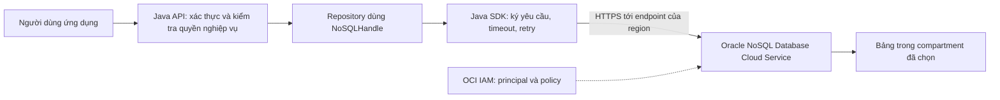
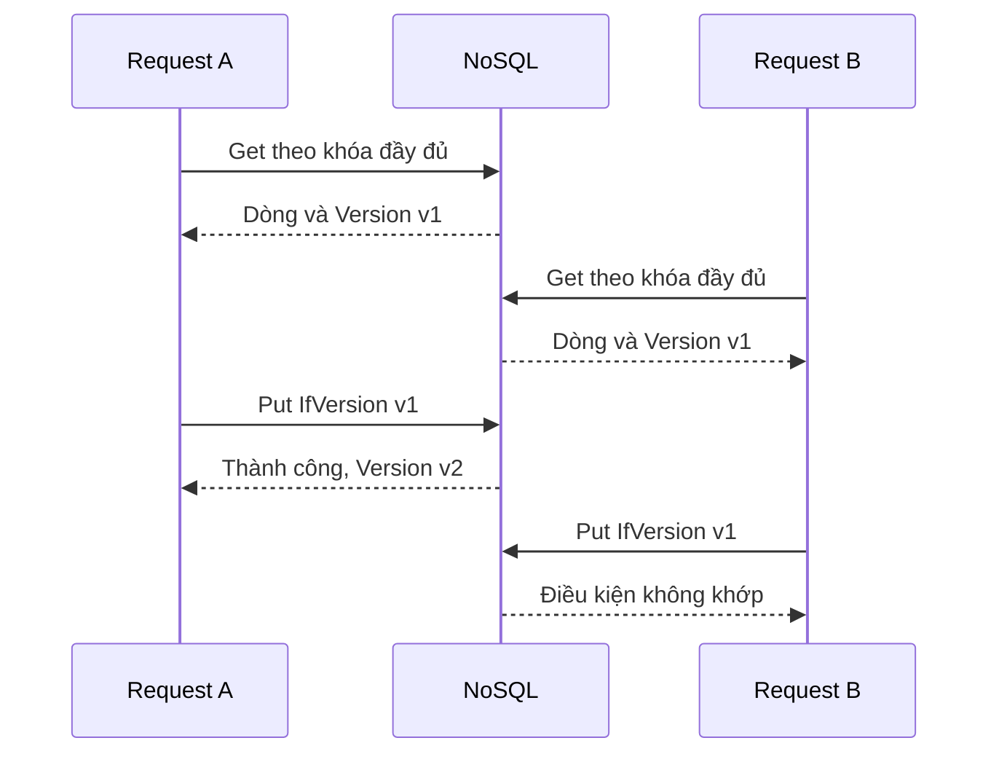

# Truy cập NoSQL từ ứng dụng Java

Trong chương **MySQL HeatWave và NoSQL** của module Oracle Cloud Infrastructure, bài này tập trung vào việc kết nối một ứng dụng Java với **Oracle NoSQL Database Cloud Service trên OCI**. Ví dụ xuyên suốt là dịch vụ lưu thiết lập người dùng: mỗi khách hàng của ứng dụng có nhiều người dùng, mỗi người dùng có một tài liệu JSON chứa ngôn ngữ và tùy chọn nhận thông báo.

Sau bài học, bạn có thể cấu hình danh tính và compartment, sử dụng Oracle NoSQL Java SDK để đọc/ghi dữ liệu, phát hiện xung đột cập nhật, thực thi truy vấn có tham số và đưa thao tác NoSQL vào vòng đời vận hành của ứng dụng. Các quyết định về IAM, mạng, timeout và lưu lượng được gắn trực tiếp với ví dụ Java.

## 1. Chọn đúng SDK và hiểu đường đi của yêu cầu

Oracle NoSQL Database Cloud Service sử dụng SDK riêng với package `oracle.nosql.driver`. Khi truy cập theo cách trình bày trong bài, ứng dụng không tạo JDBC connection hay dùng MySQL Connector/J. Việc Oracle NoSQL hỗ trợ một ngôn ngữ truy vấn dạng SQL không biến kết nối này thành kết nối JDBC.

Dependency chính là `com.oracle.nosql.sdk:nosqldriver`. SDK có thể dùng với dịch vụ cloud, Cloud Simulator và một số cấu hình Oracle NoSQL tại chỗ, nhưng phần xác thực và cấu hình triển khai khác nhau. Các đoạn mã bên dưới hướng đến OCI cloud. [Kho SDK chính thức của Oracle](https://github.com/oracle/nosql-java-sdk).



Ứng dụng phải thỏa mãn đồng thời ba điều kiện:

1. **Đúng đích:** endpoint/region, compartment và tên bảng phải khớp.
2. **Được phép:** principal gửi yêu cầu phải có quyền tương ứng với thao tác.
3. **Có đường mạng:** DNS, TLS và kết nối HTTPS tới dịch vụ phải hoạt động.

Một API key hợp lệ không khắc phục được lỗi route; một kết nối mạng thành công cũng không cấp thêm quyền IAM.

## 2. Phân biệt các định danh trước khi viết mã

Ví dụ dùng các giá trị sau:

| Giá trị | Ví dụ | Ý nghĩa |
|---|---|---|
| OCI tenancy OCID | `ocid1.tenancy.oc1..example` | Tenancy chứa danh tính OCI |
| Compartment OCID | `ocid1.compartment.oc1..example` | Nơi đặt bảng NoSQL |
| Region ID | `ap-singapore-1` | Region được chọn cho bảng và client |
| Tên bảng | `UserSettings` | Bảng dùng trong thao tác SDK và SQL |
| `tenantId` trong dữ liệu | `tenant-lab` | Mã khách hàng của ứng dụng |
| `userId` trong dữ liệu | `user-demo-001` | Người dùng thuộc khách hàng đó |

`tenantId` là trường do ứng dụng định nghĩa, không phải OCI tenancy OCID. Tương tự, `userId` trong bảng không phải OCI user OCID.

Trong hệ thống nhiều khách hàng, backend phải lấy `tenantId` từ ngữ cảnh đã xác thực và kiểm tra quyền truy cập dữ liệu. Việc đặt `tenantId` vào khóa hoặc câu `WHERE` không tự tạo ra một cơ chế phân quyền theo dòng trong ứng dụng. Nếu API tin trực tiếp `tenantId` do người gọi gửi lên, người gọi có thể yêu cầu dữ liệu của khách hàng khác dù kết nối OCI vẫn hợp lệ.

## 3. Chuẩn bị OCI và phân quyền IAM

### 3.1. Tách quyền triển khai khỏi quyền chạy ứng dụng

Bạn cần một compartment dành cho bài thực hành, ví dụ `NoSqlLab`, và hai vai trò:

- **Người triển khai:** tạo bảng, điều chỉnh cấu hình và xóa tài nguyên khi kết thúc.
- **Ứng dụng:** đọc, ghi và có thể xóa dòng trong bảng đã được tạo.

Ví dụ policy cho nhóm ứng dụng cần đầy đủ CRUD:

```text
Allow group NoSqlAppUsers to read nosql-tables in compartment NoSqlLab
Allow group NoSqlAppUsers to manage nosql-rows in compartment NoSqlLab
```

Ở đây, `manage nosql-rows` cấp quyền thao tác dòng, không phải quyền tạo hoặc xóa bảng. `read nosql-tables` phục vụ việc đọc metadata bảng, chẳng hạn khi SDK cần thông tin giới hạn để điều tiết lưu lượng.

Nếu ứng dụng chỉ đọc và ghi, có thể thay dòng thứ hai bằng:

```text
Allow group NoSqlAppUsers to use nosql-rows in compartment NoSqlLab
```

`use nosql-rows` không bao gồm quyền xóa dòng. `read nosql-rows` dành cho đọc; quyền xóa nằm ở mức `manage nosql-rows`. Người triển khai bài lab có thể được cấp `manage nosql-family` trong riêng compartment lab. Với identity domain có tên riêng, điều chỉnh định danh group theo cấu hình domain của tenancy. [Tham chiếu policy NoSQL của Oracle](https://docs.oracle.com/en/cloud/paas/nosql-cloud/odsql/index.html).

Các policy trên là mức khởi đầu theo compartment. Trước khi dùng cho môi trường thật, giới hạn tiếp phạm vi bảng và danh tính theo nhu cầu. Không cấp quyền toàn tenancy cho ứng dụng chỉ sử dụng một bảng.

### 3.2. Chọn cách xác thực phù hợp nơi chạy

| Nơi chạy Java | Cách xác thực phù hợp | Điều kiện |
|---|---|---|
| Máy phát triển | User principal qua OCI config và API signing key | OCI user thuộc group có policy |
| OCI Compute | Instance principal | Instance thuộc dynamic group có policy |
| OCI Functions | Resource principal | Function được cấu hình danh tính và policy phù hợp |

SDK cung cấp `SignatureProvider`, `createWithInstancePrincipal()` và `createWithResourcePrincipal()` cho các trường hợp tương ứng. Instance principal và resource principal cần chỉ định compartment trên request hoặc trong cấu hình mặc định. Ví dụ trong bài luôn cấu hình compartment rõ ràng. [API SignatureProvider](https://oracle.github.io/nosql-java-sdk/oracle/nosql/driver/iam/SignatureProvider.html).

Policy dành cho Compute có thể có dạng:

```text
Allow dynamic-group NoSqlAppInstances to read nosql-tables in compartment NoSqlLab
Allow dynamic-group NoSqlAppInstances to manage nosql-rows in compartment NoSqlLab
```

Bạn vẫn phải tạo dynamic group với matching rule đúng cho các instance được phép. Không chỉ đổi dòng policy rồi giả định mọi máy Compute đều có quyền.

### 3.3. Cấu hình cho máy phát triển

Tạo OCI config bằng cơ chế quản lý khóa của tổ chức. Ví dụ nội dung một profile:

```ini
[NOSQL_LAB]
user=ocid1.user.oc1..example
fingerprint=aa:bb:cc:dd:replace-with-real-fingerprint
tenancy=ocid1.tenancy.oc1..example
region=ap-singapore-1
key_file=C:/Users/your-name/.oci/oci_api_key.pem
```

Public key tương ứng phải được đăng ký cho OCI user. Private key chỉ được lưu ở nơi có quyền đọc phù hợp; không đưa vào source code, image container hay log.

Ví dụ Java sẽ đọc đường dẫn file config từ `OCI_CONFIG_FILE` và tên profile từ `OCI_PROFILE`. Đây là biến môi trường do chương trình mẫu chủ động đọc; không nên suy ra rằng mọi constructor SDK đều tự động đọc các biến này.

## 4. Kết nối mạng và ranh giới kiểm thử

Máy chạy Java cần phân giải DNS và truy cập HTTPS tới endpoint NoSQL của region được chọn. Trong bài lab dùng endpoint dịch vụ thông thường, ứng dụng trên private subnet có thể đi ra ngoài qua NAT Gateway khi route và security rule cho phép. Instance principal còn cần truy cập các thành phần phục vụ danh tính của instance; API key trên máy cá nhân không kiểm chứng được đường xác thực đó.

Giữ xác minh chứng chỉ TLS và hostname của SDK. Khi gặp lỗi TLS, kiểm tra đồng hồ hệ thống, truststore và proxy của môi trường thay vì bỏ xác minh.

Cloud Simulator hữu ích để kiểm tra cấu trúc request và luồng CRUD ở máy cá nhân. Một lần chạy thành công với simulator chưa chứng minh rằng IAM policy, dynamic group, network path, giới hạn dịch vụ hay hành vi throttling trên OCI đều đúng. Trước khi triển khai, cần chạy một lượt tích hợp trong compartment kiểm thử bằng chính loại principal dự kiến dùng ở môi trường thật.

## 5. Thiết kế bảng theo cách ứng dụng truy cập

Các thao tác chính của ví dụ:

1. Đọc thiết lập bằng cặp `tenantId + userId`.
2. Tạo thiết lập lần đầu và tránh ghi đè dữ liệu đã có.
3. Đổi ngôn ngữ nhưng phát hiện khi một tiến trình khác đã sửa dòng.
4. Liệt kê thiết lập của một khách hàng.
5. Xóa một dòng nếu nó vẫn đúng phiên bản đã đọc.

Schema:

```sql
CREATE TABLE IF NOT EXISTS UserSettings (
    tenantId STRING,
    userId STRING,
    settings JSON,
    updatedAt LONG,
    PRIMARY KEY (SHARD(tenantId), userId)
)
```

Một dòng có dạng:

```json
{
  "tenantId": "tenant-lab",
  "userId": "user-demo-001",
  "settings": {
    "locale": "vi",
    "emailOptIn": false
  },
  "updatedAt": 1795132800000
}
```

Khóa chính đầy đủ gồm cả `tenantId` và `userId`. `GetRequest` cần đủ khóa để đọc một dòng; nếu chỉ có `tenantId`, ứng dụng phải dùng truy vấn hoặc API phù hợp với thao tác nhiều dòng.

Shard key `tenantId` giúp gom các dòng cùng khách hàng vào cùng phạm vi shard key và thuận lợi cho truy vấn lọc khách hàng. Đổi lại, một khách hàng có tải quá lớn có thể tạo điểm nóng. Với tải thực tế, cần đánh giá phân bố lưu lượng; phương án thêm bucket vào shard key sẽ yêu cầu ứng dụng đọc nhiều bucket khi liệt kê. Không áp dụng cách chia bucket trước khi xác định được vấn đề cần giải quyết. [Thiết kế primary key của Oracle NoSQL](https://docs.oracle.com/en/database/other-databases/nosql-database/24.3/java-driver-table/primary-keys.html).

`updatedAt` trong bài là thời gian do ứng dụng ghi bằng epoch milliseconds. Nó hữu ích cho hiển thị và theo dõi nghiệp vụ, nhưng không thay thế `Version` của SDK trong kiểm soát cập nhật đồng thời.

## 6. Cấu hình dự án Maven

Ví dụ dùng JDK 17 và ghim SDK ở phiên bản `5.4.25`. Đây là phiên bản cụ thể để tái lập ví dụ, không phải một chỉ dẫn luôn chọn phiên bản mới nhất mà chưa kiểm tra tương thích. Khi nâng SDK, xem changelog và chạy lại kiểm thử tích hợp. [Changelog chính thức của SDK](https://github.com/oracle/nosql-java-sdk/blob/main/CHANGELOG.md).

Trong một thư mục thực hành riêng, tạo `pom.xml`:

```xml
<project xmlns="http://maven.apache.org/POM/4.0.0"
         xmlns:xsi="http://www.w3.org/2001/XMLSchema-instance"
         xsi:schemaLocation="http://maven.apache.org/POM/4.0.0
                             https://maven.apache.org/xsd/maven-4.0.0.xsd">
    <modelVersion>4.0.0</modelVersion>
    <groupId>learning.oci</groupId>
    <artifactId>nosql-java-lab</artifactId>
    <version>1.0.0</version>

    <properties>
        <maven.compiler.release>17</maven.compiler.release>
        <project.build.sourceEncoding>UTF-8</project.build.sourceEncoding>
    </properties>

    <dependencies>
        <dependency>
            <groupId>com.oracle.nosql.sdk</groupId>
            <artifactId>nosqldriver</artifactId>
            <version>5.4.25</version>
        </dependency>
    </dependencies>

    <build>
        <plugins>
            <plugin>
                <groupId>org.apache.maven.plugins</groupId>
                <artifactId>maven-compiler-plugin</artifactId>
                <version>3.13.0</version>
            </plugin>
            <plugin>
                <groupId>org.apache.maven.plugins</groupId>
                <artifactId>maven-dependency-plugin</artifactId>
                <version>3.8.1</version>
            </plugin>
        </plugins>
    </build>
</project>
```

Chương trình bên dưới đặt trong `src/main/java/SettingsDemo.java`, không khai báo package để giảm thao tác chuẩn bị cho bài lab. Trong ứng dụng thật, đặt các lớp vào package của dự án và tách cấu hình client khỏi repository.

## 7. Chương trình Java hoàn chỉnh

Chương trình có ba lệnh:

| Lệnh | Công việc | Danh tính sử dụng |
|---|---|---|
| `init` | Tạo bảng lab và chờ thao tác hoàn tất | Người triển khai có quyền DDL |
| `demo` | Tạo có điều kiện, đọc, cập nhật và truy vấn | Principal của ứng dụng |
| `cleanup-row` | Xóa đúng dòng demo bằng điều kiện phiên bản | Principal có quyền xóa dòng |

`init` dùng `TableRequest`; các thao tác tạo bảng cần chờ hoàn tất trước khi truy cập dữ liệu. Trong môi trường thật, chuyển DDL sang quy trình triển khai hạ tầng, không chạy lại ở mỗi request HTTP. [API TableRequest](https://oracle.github.io/nosql-java-sdk/oracle/nosql/driver/ops/TableRequest.html), [API TableResult](https://oracle.github.io/nosql-java-sdk/oracle/nosql/driver/ops/TableResult.html).

```java
import java.io.IOException;
import java.time.Instant;
import java.util.Locale;
import java.util.Objects;
import java.util.function.Consumer;

import oracle.nosql.driver.Consistency;
import oracle.nosql.driver.NoSQLHandle;
import oracle.nosql.driver.NoSQLHandleConfig;
import oracle.nosql.driver.NoSQLHandleFactory;
import oracle.nosql.driver.Version;
import oracle.nosql.driver.iam.SignatureProvider;
import oracle.nosql.driver.ops.DeleteRequest;
import oracle.nosql.driver.ops.DeleteResult;
import oracle.nosql.driver.ops.GetRequest;
import oracle.nosql.driver.ops.GetResult;
import oracle.nosql.driver.ops.PrepareRequest;
import oracle.nosql.driver.ops.PreparedStatement;
import oracle.nosql.driver.ops.PutRequest;
import oracle.nosql.driver.ops.PutResult;
import oracle.nosql.driver.ops.QueryRequest;
import oracle.nosql.driver.ops.QueryResult;
import oracle.nosql.driver.ops.TableLimits;
import oracle.nosql.driver.ops.TableRequest;
import oracle.nosql.driver.ops.TableResult;
import oracle.nosql.driver.values.MapValue;
import oracle.nosql.driver.values.StringValue;

public final class SettingsDemo {
    private static final String TABLE = "UserSettings";
    private static final String DEMO_TENANT = "tenant-lab";
    private static final String DEMO_USER = "user-demo-001";

    public static void main(String[] args) throws IOException {
        if (args.length != 1 ||
                !(args[0].equals("init") || args[0].equals("demo") ||
                  args[0].equals("cleanup-row"))) {
            throw new IllegalArgumentException(
                "Usage: SettingsDemo init|demo|cleanup-row");
        }

        try (NoSQLHandle handle = openHandle()) {
            if (args[0].equals("init")) {
                createLabTable(handle);
                return;
            }

            if (args[0].equals("cleanup-row")) {
                GetResult current = find(handle, DEMO_TENANT, DEMO_USER);
                if (current.getValue() == null) {
                    System.out.println("Demo row is already absent");
                    return;
                }
                DeleteResult deleted = deleteIfVersion(
                    handle, DEMO_TENANT, DEMO_USER, current.getVersion());
                System.out.println(
                    "Delete applied to expected version: " +
                    deleted.getSuccess());
                return;
            }

            PutResult created = createIfAbsent(
                handle, DEMO_TENANT, DEMO_USER);
            System.out.println(
                "Created new row: " + (created.getVersion() != null));

            GetResult current = find(handle, DEMO_TENANT, DEMO_USER);
            if (current.getValue() == null) {
                throw new IllegalStateException(
                    "Row was not found after create/read");
            }

            MapValue replacement = current.getValue();
            replacement.get("settings").asMap().put("locale", "en");
            replacement.put("updatedAt", Instant.now().toEpochMilli());

            PutResult updated = replaceIfVersion(
                handle, replacement, current.getVersion());
            System.out.println(
                "Update applied to expected version: " +
                (updated.getVersion() != null));
            System.out.printf(
                "Update consumed RU=%d, WU=%d%n",
                updated.getReadUnits(), updated.getWriteUnits());

            SettingsRepository repository = new SettingsRepository(handle);
            repository.forEachByTenant(
                DEMO_TENANT, row -> System.out.println(row.toJson()));
        }
    }

    private static NoSQLHandle openHandle() throws IOException {
        String region = requiredEnv("NOSQL_REGION");
        String compartment = requiredEnv("NOSQL_COMPARTMENT_OCID");
        String mode = envOrDefault("NOSQL_AUTH", "config")
            .toLowerCase(Locale.ROOT);

        SignatureProvider provider;
        switch (mode) {
            case "config":
                provider = new SignatureProvider(
                    requiredEnv("OCI_CONFIG_FILE"),
                    envOrDefault("OCI_PROFILE", "NOSQL_LAB"));
                break;
            case "instance":
                provider = SignatureProvider.createWithInstancePrincipal();
                break;
            case "resource":
                provider = SignatureProvider.createWithResourcePrincipal();
                break;
            default:
                throw new IllegalArgumentException(
                    "NOSQL_AUTH must be config, instance or resource");
        }

        try {
            NoSQLHandleConfig config = new NoSQLHandleConfig(region)
                .setAuthorizationProvider(provider)
                .setDefaultCompartment(compartment)
                .setRequestTimeout(5_000)
                .setTableRequestTimeout(20_000)
                .setRateLimitingEnabled(true);
            return NoSQLHandleFactory.createNoSQLHandle(config);
        } catch (RuntimeException failure) {
            provider.close();
            throw failure;
        }
    }

    private static void createLabTable(NoSQLHandle handle) {
        String ddl = """
            CREATE TABLE IF NOT EXISTS UserSettings (
                tenantId STRING,
                userId STRING,
                settings JSON,
                updatedAt LONG,
                PRIMARY KEY (SHARD(tenantId), userId)
            )
            """;
        TableRequest request = new TableRequest()
            .setStatement(ddl)
            .setTableLimits(new TableLimits(10, 10, 1));
        TableResult result = handle.tableRequest(request);
        result.waitForCompletion(handle, 120_000, 1_000);
        System.out.println("Table state: " + result.getTableState());
    }

    private static MapValue key(String tenantId, String userId) {
        return new MapValue()
            .put("tenantId", tenantId)
            .put("userId", userId);
    }

    private static PutResult createIfAbsent(
            NoSQLHandle handle, String tenantId, String userId) {
        MapValue settings = new MapValue()
            .put("locale", "vi")
            .put("emailOptIn", false);
        MapValue row = key(tenantId, userId)
            .put("settings", settings)
            .put("updatedAt", Instant.now().toEpochMilli());

        return handle.put(new PutRequest()
            .setTableName(TABLE)
            .setValue(row)
            .setOption(PutRequest.Option.IfAbsent));
    }

    private static GetResult find(
            NoSQLHandle handle, String tenantId, String userId) {
        return handle.get(new GetRequest()
            .setTableName(TABLE)
            .setKey(key(tenantId, userId))
            .setConsistency(Consistency.ABSOLUTE));
    }

    private static PutResult replaceIfVersion(
            NoSQLHandle handle, MapValue fullRow, Version expectedVersion) {
        Objects.requireNonNull(expectedVersion, "expectedVersion");
        return handle.put(new PutRequest()
            .setTableName(TABLE)
            .setValue(fullRow)
            .setOption(PutRequest.Option.IfVersion)
            .setMatchVersion(expectedVersion));
    }

    private static DeleteResult deleteIfVersion(
            NoSQLHandle handle, String tenantId, String userId,
            Version expectedVersion) {
        Objects.requireNonNull(expectedVersion, "expectedVersion");
        return handle.delete(new DeleteRequest()
            .setTableName(TABLE)
            .setKey(key(tenantId, userId))
            .setMatchVersion(expectedVersion));
    }

    private static String requiredEnv(String name) {
        String value = System.getenv(name);
        if (value == null || value.isBlank()) {
            throw new IllegalArgumentException(
                "Missing environment variable: " + name);
        }
        return value;
    }

    private static String envOrDefault(String name, String fallback) {
        String value = System.getenv(name);
        return value == null || value.isBlank() ? fallback : value;
    }

    private static final class SettingsRepository {
        private final NoSQLHandle handle;
        private final PreparedStatement byTenant;

        SettingsRepository(NoSQLHandle handle) {
            this.handle = handle;
            String sql = """
                DECLARE $tenant STRING;
                SELECT p.userId, p.settings, p.updatedAt
                FROM UserSettings p
                WHERE p.tenantId = $tenant
                """;
            this.byTenant = handle.prepare(
                new PrepareRequest().setStatement(sql))
                .getPreparedStatement();
        }

        void forEachByTenant(
                String tenantId, Consumer<MapValue> consumer) {
            PreparedStatement bound = byTenant.copyStatement()
                .setVariable("$tenant", new StringValue(tenantId));
            try (QueryRequest request = new QueryRequest()
                    .setPreparedStatement(bound)
                    .setConsistency(Consistency.ABSOLUTE)
                    .setLimit(100)
                    .setTimeout(5_000)) {
                do {
                    QueryResult page = handle.query(request);
                    for (MapValue row : page.getResults()) {
                        consumer.accept(row);
                    }
                } while (!request.isDone());
            }
        }
    }
}
```

Mã mẫu giả định schema của bảng đúng như đã khai báo, đặc biệt `settings` là JSON object có thể chuyển thành `MapValue`. Ở API công khai, hãy kiểm tra dữ liệu đầu vào, giới hạn kích thước JSON và ánh xạ lỗi nghiệp vụ trước khi gọi repository. Việc in tài liệu JSON chỉ phục vụ dữ liệu giả trong bài lab.

## 8. Chạy bài thực hành theo từng danh tính

Các lệnh dưới đây dành cho **PowerShell** trong thư mục dự án thực hành. Thay toàn bộ giá trị minh họa bằng thông tin của môi trường lab.

```powershell
$env:NOSQL_REGION = 'ap-singapore-1'
$env:NOSQL_COMPARTMENT_OCID = 'ocid1.compartment.oc1..replace-me'
$env:NOSQL_AUTH = 'config'
$env:OCI_CONFIG_FILE = 'C:/Users/your-name/.oci/config'
$env:OCI_PROFILE = 'NOSQL_DEPLOYER'

mvn package dependency:copy-dependencies
java -cp 'target/classes;target/dependency/*' SettingsDemo init
```

Profile `NOSQL_DEPLOYER` phải tồn tại trong OCI config và có quyền tạo bảng. `TableLimits(10, 10, 1)` yêu cầu chế độ provisioned với 10 read units/giây, 10 write units/giây và giới hạn lưu trữ 1 GB. Đây là cấu hình lab có thể phát sinh phí; không phải ngân sách tiền và không phải cam kết đủ tải cho production. Constructor một tham số `TableLimits(storageGB)` dành cho chế độ on demand. [API TableLimits](https://oracle.github.io/nosql-java-sdk/oracle/nosql/driver/ops/TableLimits.html).

Sau khi tạo bảng, đổi sang user có quyền chạy ứng dụng:

```powershell
$env:OCI_PROFILE = 'NOSQL_APP'
java -cp 'target/classes;target/dependency/*' SettingsDemo demo
```

Profile `NOSQL_APP` cũng phải được khai báo trong config. Không dùng lại quyền triển khai chỉ để tránh tạo profile ứng dụng.

Ở lần chạy đầu, kết quả thường thể hiện:

```text
Created new row: true
Update applied to expected version: true
Update consumed RU=<gia-tri-thuc-te>, WU=<gia-tri-thuc-te>
{"userId":"user-demo-001", ...}
```

Ở lần chạy tiếp theo, `Created new row: false` là bình thường: dòng demo đã tồn tại và `IfAbsent` đã ngăn việc tạo đè. Nếu có tiến trình khác đồng thời chỉnh sửa hoặc xóa dòng, cập nhật theo phiên bản có thể trả về `false`.

Trên Compute đã có instance principal và dynamic group phù hợp:

```powershell
$env:NOSQL_AUTH = 'instance'
java -cp 'target/classes;target/dependency/*' SettingsDemo demo
```

Lúc này chương trình chọn nhánh instance principal; đường xác thực không dựa vào profile user. Trên Linux, dùng cách khai báo biến môi trường của shell tương ứng và dấu `:` ngăn cách classpath, ví dụ `target/classes:target/dependency/*`.

Để xóa dòng demo:

```powershell
java -cp 'target/classes;target/dependency/*' SettingsDemo cleanup-row
```

Lệnh này giữ nguyên bảng. Khi kết thúc lab, dùng danh tính triển khai để xóa bảng `UserSettings` trong đúng compartment lab và thu hồi các policy/dynamic group tạo riêng cho bài. Xóa dòng không đồng nghĩa đã giải phóng tài nguyên bảng provisioned.

## 9. Hiểu đúng CRUD và dữ liệu trả về

### 9.1. Tạo mới và ghi đè là hai ý định khác nhau

Mặc định, `PutRequest` thực hiện ghi không điều kiện: tạo dòng mới hoặc thay toàn bộ dòng đã có. Khi chỉ muốn tạo lần đầu, dùng `PutRequest.Option.IfAbsent`. Khi muốn thay dòng đã tồn tại bất kể phiên bản, có `IfPresent`, nhưng lựa chọn này không phát hiện việc một người khác vừa cập nhật. [API PutRequest](https://oracle.github.io/nosql-java-sdk/oracle/nosql/driver/ops/PutRequest.html).

Đối với put có điều kiện, kiểm tra `PutResult.getVersion()`:

- Khác `null`: thao tác ghi đã thành công và đây là phiên bản mới.
- Bằng `null`: điều kiện không được thỏa mãn; không suy ra rằng hệ thống đã gặp lỗi mạng.

Kết quả điều kiện thất bại là một kết quả nghiệp vụ cần xử lý. Có thể dùng `setReturnRow(true)` khi muốn lấy thông tin dòng hiện tại theo điều kiện mà API hỗ trợ; không nên mặc định rằng mọi put đều trả lại đầy đủ dòng cũ. [API PutResult](https://oracle.github.io/nosql-java-sdk/oracle/nosql/driver/ops/PutResult.html).

### 9.2. Một put thay thế toàn bộ dòng

Giả sử dòng đang có:

```json
{
  "settings": {
    "locale": "vi",
    "emailOptIn": true,
    "theme": "dark"
  }
}
```

Nếu ứng dụng dựng một dòng mới chỉ chứa khóa và `settings.locale`, các trường không được gửi có thể bị thay bằng giá trị mặc định/null hoặc gây lỗi nếu schema bắt buộc. `PutRequest` không có nghĩa là tự động merge JSON.

Ví dụ hoàn chỉnh lấy cả dòng hiện tại, sửa một thuộc tính bên trong `settings`, giữ lại các thuộc tính còn lại và gửi toàn bộ dòng với điều kiện phiên bản. Với nhu cầu cập nhật một phần ở server, nghiên cứu câu lệnh `UPDATE` của SQL for Oracle NoSQL và vẫn thiết kế điều kiện nghiệp vụ phù hợp; không chỉ thay put bằng SQL rồi bỏ qua xung đột.

### 9.3. Đọc không thấy dòng

`GetResult.getValue() == null` có nghĩa không có dòng trả về cho khóa đã hỏi. Ứng dụng có thể ánh xạ thành `Optional.empty()`, trạng thái chưa có thiết lập hoặc HTTP 404 tùy hợp đồng API.

Không dùng `null` để che một `UnauthorizedException` hay timeout. “Không có dữ liệu” và “chưa thể đọc dữ liệu” phải được phân biệt để tránh tạo dữ liệu mặc định đè lên dữ liệu thật khi dịch vụ tạm lỗi. [API GetResult](https://oracle.github.io/nosql-java-sdk/oracle/nosql/driver/ops/GetResult.html).

### 9.4. Xóa có điều kiện

`DeleteRequest.setMatchVersion(version)` yêu cầu dòng vẫn khớp phiên bản đã biết. `DeleteResult.getSuccess()` phản ánh việc xóa có được áp dụng hay không.

Kết quả `false` có thể do dòng đã không còn hoặc phiên bản không khớp. Nếu API cần phân biệt hai tình huống, thiết kế thêm bước đọc hoặc dùng thông tin dòng trả về theo khả năng của request; một bước đọc sau đó chỉ phản ánh thời điểm đọc mới. [API DeleteRequest](https://oracle.github.io/nosql-java-sdk/oracle/nosql/driver/ops/DeleteRequest.html), [API DeleteResult](https://oracle.github.io/nosql-java-sdk/oracle/nosql/driver/ops/DeleteResult.html).

## 10. Kiểm soát cập nhật đồng thời bằng Version

Xét hai request cùng sửa thiết lập:



Nếu cả A và B dùng put mặc định, request đến sau có thể ghi đè thay đổi của request đến trước. `IfVersion` biến thao tác thành “chỉ thay nếu dòng chưa đổi kể từ lần tôi đọc”.

`Version` là token không trong suốt do dịch vụ trả về. Không cộng/trừ token, không so sánh nó với timestamp và không tự tạo token từ `updatedAt`.

Khi gặp xung đột:

1. Trả kết quả xung đột để người dùng xem dữ liệu mới, hoặc
2. Đọc lại dòng rồi áp dụng lại quy tắc nghiệp vụ nếu việc tự động thử lại là hợp lệ.

Ví dụ đổi ngôn ngữ có thể được áp dụng lại sau khi đọc mới, nếu sản phẩm cho phép quy tắc đó. Một thay đổi phụ thuộc giá trị cũ phải tính lại từ dòng mới; không gửi lại nguyên toàn bộ dòng cũ với phiên bản mới chỉ để vượt điều kiện.

Trong một HTTP API, có thể ánh xạ xung đột nghiệp vụ thành 409. Nếu hợp đồng API dùng `If-Match`, 412 có thể phù hợp với việc điều kiện không thỏa mãn. Đây là quyết định của tầng API; repository cần trả kết quả đủ rõ để tầng trên lựa chọn.

## 11. Consistency và phạm vi bảo đảm

SDK cho phép chọn `Consistency.EVENTUAL` và `Consistency.ABSOLUTE` cho các thao tác đọc được hỗ trợ. Giá trị mặc định khi không cấu hình là eventual. Ví dụ sử dụng absolute để việc đọc sau ghi trong cùng region dễ quan sát khi thực hành. Absolute có thể tăng chi phí đọc và ảnh hưởng độ trễ so với eventual. [API GetRequest](https://oracle.github.io/nosql-java-sdk/oracle/nosql/driver/ops/GetRequest.html).

| Nhu cầu | Hướng lựa chọn |
|---|---|
| Đọc lại thiết lập ngay sau khi người dùng lưu | Cân nhắc absolute cho lần đọc cần xác nhận |
| Hiển thị dữ liệu có thể chấp nhận chậm cập nhật | Cân nhắc eventual |
| Ngăn ghi đè giữa hai request | Dùng ghi có điều kiện theo Version |
| Đọc một danh sách dài trong khi dữ liệu đang đổi | Thiết kế rõ khả năng dữ liệu đổi giữa các đợt đọc |

Absolute read không khóa dòng cho lần ghi tiếp theo. Vì vậy, dù `find()` đọc absolute, `replaceIfVersion()` vẫn cần điều kiện phiên bản.

Một chuỗi nhiều lệnh get/put/query độc lập không tự trở thành transaction. Nếu cần nhiều thao tác nguyên tử, xem `WriteMultipleRequest` và các ràng buộc cùng shard key, kích thước, số lượng của dịch vụ. Không thiết kế quy tắc liên quan nhiều khách hàng dựa trên giả định rằng các ghi ở các shard key khác nhau sẽ được commit cùng nhau. [API NoSQLHandle.writeMultiple](https://oracle.github.io/nosql-java-sdk/oracle/nosql/driver/NoSQLHandle.html#writeMultiple(oracle.nosql.driver.ops.WriteMultipleRequest)).

Ví dụ này sử dụng bảng ở một region. Nếu mở rộng sang bảng có replica nhiều region, phải đánh giá riêng độ trễ sao chép và hành vi consistency được hỗ trợ; không suy ra bảo đảm đọc tức thời giữa các region từ lần chạy lab.

## 12. Truy vấn có tham số và xử lý hết kết quả

### 12.1. Bind giá trị, giữ cố định cấu trúc SQL

Repository chuẩn bị câu lệnh:

```sql
DECLARE $tenant STRING;
SELECT p.userId, p.settings, p.updatedAt
FROM UserSettings p
WHERE p.tenantId = $tenant
```

Giá trị `tenantId` được bind bằng `setVariable()`, không ghép trực tiếp vào SQL. Cấu trúc câu lệnh, tên bảng và các trường được chọn do ứng dụng kiểm soát. Nếu cho phép người dùng chọn trường sắp xếp, cần whitelist tên trường; bind parameter không dùng thay thế tùy ý cho tên bảng hay cú pháp SQL.

Mẫu `PreparedStatement` không chứa giá trị bind có thể được giữ trong repository. Mỗi lần thực thi có biến bind, tạo bản riêng bằng `copyStatement()` để tránh các luồng ghi đè tham số của nhau. [API PreparedStatement](https://oracle.github.io/nosql-java-sdk/oracle/nosql/driver/ops/PreparedStatement.html).

### 12.2. Một lần query có thể chỉ trả một phần kết quả

Điểm quyết định là:

```java
do {
    QueryResult page = handle.query(request);
    for (MapValue row : page.getResults()) {
        consumer.accept(row);
    }
} while (!request.isDone());
```

Giữ nguyên `QueryRequest` trong một lần thực thi để SDK quản lý tiến độ. Một đợt có thể trả danh sách rỗng mà truy vấn chưa kết thúc, chẳng hạn dữ liệu đã đọc chưa tạo ra dòng thỏa điều kiện. Điều kiện dừng phải dựa vào trạng thái hoàn tất, không dựa vào `getResults().isEmpty()`. `try-with-resources` giải phóng trạng thái query khi đã đọc xong hoặc khi dừng giữa chừng. [API QueryRequest](https://oracle.github.io/nosql-java-sdk/oracle/nosql/driver/ops/QueryRequest.html).

`setLimit(100)` kiểm soát số mục tối đa trong một đợt xử lý; vòng lặp có thể tiếp tục trả hơn 100 dòng tổng cộng. Nếu nghiệp vụ cần đúng “100 kết quả đầu”, cần giới hạn tổng phù hợp trong SQL hoặc trong tầng ứng dụng. Khi không có `ORDER BY`, không cam kết thứ tự kết quả cho phía gọi API.

Trong dịch vụ chạy lâu dài, cần thêm deadline cho toàn bộ truy vấn. Timeout 5 giây trong mẫu áp dụng cho từng lời gọi SDK, không tự tạo một giới hạn 5 giây cho tất cả các đợt. Trước mỗi lời gọi tiếp theo, tính thời gian còn lại của deadline và đặt timeout không vượt quá phần còn lại; nếu đã hết thời gian thì dừng và đóng request.

### 12.3. Kết quả từng đợt của SDK không phải hợp đồng phân trang HTTP

Không trả trực tiếp đối tượng `QueryRequest` hoặc trạng thái nội bộ của nó cho client HTTP. Nếu cần API phân trang, thiết kế cursor của ứng dụng gắn với tenant, bộ lọc, thứ tự ổn định và thời hạn sử dụng.

Với danh sách sắp theo `userId`, có thể xây dựng truy vấn trang sau dựa trên `userId` cuối cùng, kết hợp `tenantId` và `ORDER BY`. Khi dữ liệu thay đổi giữa hai lần gọi, hãy mô tả rõ khả năng xuất hiện dữ liệu mới hoặc thiếu dòng đã bị xóa; không hứa một snapshot xuyên suốt nhiều request nếu hệ thống chưa cung cấp cơ chế đó.

## 13. Vòng đời client và tích hợp vào ứng dụng Java

`NoSQLHandle` giữ tài nguyên mạng và bộ nhớ, có thể dùng chung giữa các luồng. Hãy tạo handle ở lúc ứng dụng khởi động, đưa nó vào repository qua dependency injection và đóng khi ứng dụng dừng.

Request và result có trạng thái riêng; không dùng cùng một `PutRequest`, `QueryRequest` hay `MapValue` đang bị sửa cho nhiều request đồng thời. [API NoSQLHandle](https://oracle.github.io/nosql-java-sdk/oracle/nosql/driver/NoSQLHandle.html).

Trong Spring Boot hoặc framework tương tự, cách tổ chức thường là:

```text
Cấu hình môi trường
        ↓
Một NoSQLHandle dùng chung
        ↓
Repository: khóa, request, mapping dữ liệu
        ↓
Service: quyền nghiệp vụ, quy tắc xung đột
        ↓
Controller: hợp đồng HTTP và phản hồi
```

Các phương thức `handle.get()`, `put()` và `query()` trong ví dụ là lời gọi đồng bộ. Nếu dùng một framework xử lý HTTP theo event loop, đưa công việc đồng bộ sang executor có giới hạn phù hợp. Chỉ bọc bằng `CompletableFuture` không làm biến mất giới hạn throughput hay nhu cầu backpressure.

DTO của tầng API nên thể hiện dữ liệu sản phẩm, chẳng hạn `UserSettingsResponse`, thay vì để toàn bộ SDK result lan ra controller. Repository có thể chuyển `MapValue` thành DTO và trả kết quả nghiệp vụ như `CREATED`, `ALREADY_EXISTS`, `UPDATED`, `NOT_FOUND` hoặc `CONFLICT`.

## 14. Timeout, retry và kết quả ghi chưa xác định

### 14.1. Hiểu các ngân sách thời gian

Trong mẫu:

- `setRequestTimeout(5_000)` đặt timeout mặc định cho lời gọi dữ liệu.
- `setTableRequestTimeout(20_000)` dành cho lời gọi thao tác bảng.
- `waitForCompletion(..., 120_000, 1_000)` chờ thao tác bảng hoàn tất trong khoảng chờ riêng, với chu kỳ poll 1 giây.

Đây là các giá trị minh họa, cần điều chỉnh theo mục tiêu độ trễ và điều kiện triển khai. Thời gian gọi API của ứng dụng còn gồm chờ executor, kiểm tra quyền, chuyển đổi dữ liệu và nhiều lời gọi SDK nếu có.

### 14.2. SDK đã có cơ chế retry

SDK có retry handler mặc định để xử lý các lỗi có thể thử lại. Không thêm một vòng retry vô hạn bao quanh mọi exception. Nếu cần retry ở tầng service, phải tính tổng số lần thử, deadline và tính lặp an toàn của thao tác.

Rate limiting chủ động giúp tránh vượt khả năng bảng; retry chỉ phản ứng sau lỗi. [API RetryHandler](https://oracle.github.io/nosql-java-sdk/oracle/nosql/driver/RetryHandler.html).

### 14.3. Timeout không xác nhận rằng ghi chưa xảy ra

Khi request ghi bị timeout, có thể ứng dụng chưa nhận được phản hồi dù dịch vụ đã áp dụng thao tác. Exception timeout biểu thị việc không hoàn tất trong khoảng chờ cấu hình, và trước đó SDK có thể đã retry. [API RequestTimeoutException](https://oracle.github.io/nosql-java-sdk/oracle/nosql/driver/RequestTimeoutException.html).

Ví dụ:

1. Ứng dụng tạo dòng bằng `IfAbsent`.
2. Dịch vụ ghi thành công nhưng phản hồi không về kịp.
3. Ứng dụng thử lại và nhận điều kiện không thỏa vì dòng đã tồn tại.

Kết quả ở bước 3 không đủ để kết luận “lần đầu cũng thất bại”. Với một thao tác nghiệp vụ cần đối soát, hãy dùng request ID ổn định và lưu cùng kết quả để nhận biết lần thử trước.

Tương tự, nếu `IfVersion(v1)` đã thành công rồi mất phản hồi, lần thử lại với `v1` có thể thất bại vì dòng đã chuyển phiên bản. Cần đọc/đối soát theo quy tắc nghiệp vụ thay vì ghi đè vô điều kiện.

Các thao tác tăng số lượng, trừ hạn mức hoặc ghi nhận sự kiện chỉ được thực hiện một lần cần thiết kế idempotency riêng. Không coi một vòng retry ở Java là bảo đảm exactly-once.

### 14.4. Phân loại lỗi để xử lý đúng

| Hiện tượng | Hướng xử lý |
|---|---|
| `IllegalArgumentException`, dữ liệu không đúng schema | Sửa request hoặc dữ liệu đầu vào; không retry cùng dữ liệu lỗi |
| `InvalidAuthorizationException` | Kiểm tra cấu hình principal, khóa/token, đồng hồ và ngữ cảnh xác thực |
| `UnauthorizedException` | Kiểm tra group/dynamic group, policy và compartment |
| `TableNotFoundException` | Kiểm tra region, compartment, tên và trạng thái bảng; đối chiếu quyền truy cập |
| `ReadThrottlingException` hoặc `WriteThrottlingException` | Giảm tải, điều tiết lưu lượng, đánh giá capacity và khóa nóng |
| `RequestTimeoutException` | Phân tích latency/mạng/tải; đối soát nếu là ghi trước khi thử lại ở tầng nghiệp vụ |
| Put có điều kiện trả version `null` | Xử lý điều kiện không thỏa; không coi là lỗi hạ tầng |

Các exception thuộc SDK giúp ứng dụng phân biệt loại lỗi, nhưng phản hồi công khai nên dùng mã lỗi ổn định của sản phẩm. Chỉ log thông tin cần thiết để chẩn đoán, không gửi cấu hình danh tính hoặc nội dung nhạy cảm cho người gọi. [Các lớp lỗi của Java SDK](https://oracle.github.io/nosql-java-sdk/oracle/nosql/driver/package-summary.html).

## 15. Hiệu năng, chi phí và quan sát

### 15.1. Bắt đầu từ cách đọc dữ liệu

Đọc theo primary key đầy đủ phù hợp với màn hình lấy thiết lập của một người dùng. Truy vấn liệt kê của mẫu luôn có điều kiện shard key `tenantId`; tránh biến nó thành truy vấn quét mọi khách hàng chỉ để lọc tiếp trong Java.

Khi cần tìm theo trường không thuộc khóa, đánh giá secondary index theo câu truy vấn thực tế. Index có chi phí lưu trữ và bảo trì khi ghi. Chỉ chọn các trường cần trả về giúp giảm dữ liệu chuyển qua mạng; cần đo thực tế để biết ảnh hưởng tới throughput tiêu thụ.

### 15.2. Theo dõi chi phí bằng dữ liệu vận hành

Các kết quả thao tác dữ liệu có thông tin read units/write units khi áp dụng. Ví dụ đã in `getReadUnits()` và `getWriteUnits()` cho lần cập nhật. Với query nhiều đợt, thu thập ở từng đợt và tổng hợp cho cùng một thao tác nghiệp vụ. [Package các request/result của SDK](https://oracle.github.io/nosql-java-sdk/oracle/nosql/driver/ops/package-summary.html).

Nên quan sát:

| Nhóm đo lường | Câu hỏi cần trả lời |
|---|---|
| Số request theo loại | Tải đọc/ghi/query thay đổi thế nào? |
| Độ trễ p50, p95, p99 | Người dùng bị ảnh hưởng ở mức nào? |
| Throttling, timeout và retry | Có vượt capacity hoặc mất ổn định không? |
| RU/WU theo thao tác | Chức năng nào tiêu thụ nhiều throughput? |
| Xung đột Version | Có nhiều request cùng sửa một dòng không? |
| Dung lượng và phân bố truy cập | Có tăng trưởng bất thường hoặc khách hàng quá nóng không? |

Log nên có loại thao tác, thời gian, kết quả, correlation ID của ứng dụng và tên bảng phù hợp. Không dùng `userId` có số lượng giá trị rất lớn làm nhãn metric; việc đó dễ tạo quá nhiều chuỗi thời gian.

SDK còn cung cấp thống kê retry và thời gian trì hoãn do rate limiting trên result. Chúng giúp phân biệt thời gian chờ điều tiết phía client với thời gian xử lý của dịch vụ. [API Result](https://oracle.github.io/nosql-java-sdk/oracle/nosql/driver/ops/Result.html).

### 15.3. Rate limiter của một client không phải ngân sách toàn hệ thống

`setRateLimitingEnabled(true)` hỗ trợ điều tiết trong SDK. Khi ứng dụng có nhiều replica, mỗi replica có handle và lưu lượng riêng; cần phân bổ tải tổng thể theo capacity của bảng. Tăng từ một lên mười replica không làm bảng tự có throughput gấp mười.

Kiểm soát chi phí bằng cấu hình capacity phù hợp, cảnh báo sử dụng, budget và quy trình thay đổi hạ tầng. Budget cảnh báo không nên được hiểu là công tắc tự dừng mọi chi tiêu.

### 15.4. TTL cho dữ liệu có thời hạn

Thiết lập người dùng thường cần được giữ lâu nên chương trình không tự đặt TTL. Với dữ liệu tạm như trạng thái xử lý hoặc bản ghi chống lặp có thời hạn, có thể cấu hình TTL trên put:

```java
PutRequest temporaryWrite = new PutRequest()
    .setTableName("TemporaryState")
    .setValue(temporaryRow)
    .setTTL(oracle.nosql.driver.TimeToLive.ofDays(7));
```

Đoạn này minh họa API và giả định `TemporaryState` cùng `temporaryRow` đã được chuẩn bị. `TimeToLive` dùng đơn vị giờ/ngày; cần hiểu quy tắc hết hạn và cập nhật TTL trước khi áp dụng. TTL phục vụ vòng đời dữ liệu, không phải một lịch chạy tác vụ nghiệp vụ chính xác đến giây. [API TimeToLive](https://oracle.github.io/nosql-java-sdk/oracle/nosql/driver/TimeToLive.html).

## 16. Quy trình xác minh cho người học

Thực hiện bằng dữ liệu giả trong compartment kiểm thử:

1. **Kết nối đúng đích:** xác nhận region và compartment, tạo bảng bằng principal triển khai, chờ hoàn tất.
2. **Tạo lần đầu:** chạy `demo`, kiểm tra có phiên bản trả về và đọc được dòng.
3. **Tạo lặp:** chạy lại, kiểm tra `IfAbsent` không ghi đè thiết lập đã có.
4. **Giữ dữ liệu không sửa:** thêm `theme` vào JSON, chạy thao tác đổi ngôn ngữ và xác nhận `theme` vẫn còn.
5. **Xung đột:** lấy hai snapshot của cùng dòng trước khi ghi; ghi snapshot A bằng version cũ, sau đó ghi B bằng chính version cũ và xác nhận B không thành công.
6. **Truy vấn nhiều đợt:** nạp nhiều dòng giả trong một tenant, đặt `setLimit(1)` để quan sát nhiều lượt đọc và kiểm tra tổng dòng xử lý.
7. **Phân quyền:** dùng principal chỉ đọc để gọi put, xác nhận lỗi được phân biệt với “không thấy dòng”; ứng dụng runtime cũng không được tạo/xóa bảng.
8. **Xác thực tại nơi chạy:** chạy trên Compute bằng instance principal nếu đó là đích triển khai; không dùng kết quả từ máy cá nhân để thay bước này.
9. **Lỗi tạm thời:** trong môi trường kiểm thử có kiểm soát, mô phỏng gián đoạn hoặc giới hạn tải, theo dõi timeout/retry và luồng đối soát ghi.
10. **Dọn tài nguyên:** xóa dòng thử, xóa bảng lab bằng principal triển khai khi không còn cần, kiểm tra tài nguyên và quyền tạm đã được thu hồi.

Không dùng thời gian ngủ cố định như bằng chứng cho tính nhất quán. Với bài kiểm tra xung đột, cần chủ động giữ cùng `Version` cho hai lần ghi để tái hiện đúng điều kiện.

Một ứng dụng Java truy cập Oracle NoSQL tốt cần rõ danh tính OCI, rõ khóa truy cập và rõ kết quả nghiệp vụ của mỗi thao tác. Khi các phần đó đã được mô hình hóa, repository có thể cung cấp CRUD ổn định cho tầng dịch vụ, còn IAM, capacity, metric và quy trình triển khai giúp duy trì hành vi đó khi ứng dụng chạy trên OCI.
