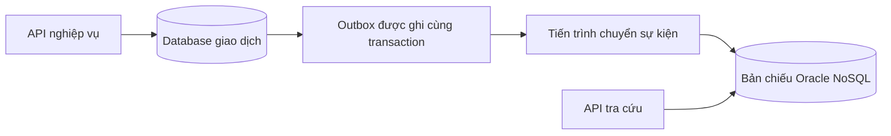

# Lựa chọn Oracle Database, MySQL và NoSQL cho workload

Trong chương **MySQL HeatWave và NoSQL**, câu hỏi lựa chọn cơ sở dữ liệu cần được đặt trong toàn bộ kiến trúc Oracle Cloud Infrastructure (OCI): dữ liệu nào phải đúng ngay sau khi ghi, ứng dụng truy vấn theo cách nào, đội ngũ vận hành được gì và hệ thống phục hồi ra sao khi xảy ra sự cố. Tên sản phẩm, định dạng JSON hoặc số lượng bản ghi riêng lẻ chưa đủ để đưa ra quyết định.

Bài học này so sánh ba hướng: Oracle Database trên OCI, MySQL dùng InnoDB trong dịch vụ MySQL HeatWave, và Oracle NoSQL Database Cloud Service. Mục tiêu là chọn được nền tảng đáp ứng yêu cầu nghiệp vụ, đồng thời có phương án phân quyền, kết nối, giám sát, tự động hóa và kiểm soát chi phí phù hợp.

## 1. Kết quả cần đạt

Sau bài học, người học có thể:

- Mô tả workload bằng giao dịch, mẫu truy vấn, phân bố tải, yêu cầu nhất quán và mục tiêu phục hồi.
- Phân biệt việc chọn database engine với việc chọn hình thức triển khai và cấu hình dịch vụ OCI.
- Giải thích khi nào nên ưu tiên Oracle Database, MySQL hoặc Oracle NoSQL, cùng điều kiện có thể làm quyết định thay đổi.
- Thiết kế một thử nghiệm đủ nhỏ để kiểm chứng hiệu năng, tính đúng đắn và chi phí trước khi chuyển dữ liệu thật.

**Workload** là tập hợp công việc mà hệ thống phải phục vụ. **OLTP** là xử lý giao dịch trực tuyến, thường đọc hoặc cập nhật một tập dữ liệu nhỏ cho mỗi yêu cầu. **OLAP** là xử lý phân tích, thường quét, kết hợp và tổng hợp nhiều dữ liệu. Một ứng dụng có thể có cả hai loại workload.

## 2. Bắt đầu bằng hợp đồng dữ liệu của ứng dụng

Trước khi mở OCI Console, hãy mô tả điều kiện mà hệ thống phải giữ đúng. Ví dụ, với nền tảng bán hàng:

- Một yêu cầu tạo đơn hàng không được sinh hai đơn chỉ vì client gửi lại sau timeout.
- Thao tác giữ hàng và cập nhật đơn phải có cách xử lý rõ ràng nếu chỉ một bước thành công.
- Thay đổi giao diện cá nhân có thể chấp nhận độ trễ đồng bộ, nhưng thu hồi quyền truy cập phải có bảo đảm phù hợp với yêu cầu bảo mật.
- Báo cáo doanh thu có thể cho phép dữ liệu trễ một khoảng đã thống nhất; quyết định thanh toán cần đọc trạng thái có thẩm quyền.

Từ đó lập hồ sơ workload:

| Câu hỏi | Nội dung cần ghi lại | Tác động tới lựa chọn |
|---|---|---|
| Một giao dịch đụng đến những dữ liệu nào? | Một bản ghi, nhiều bản ghi cùng người dùng, hay nhiều thực thể độc lập | Xác định phạm vi atomicity cần có |
| Đọc bằng khóa hay tìm kiếm linh hoạt? | Tra cứu theo ID, lọc theo nhiều trường, join, tổng hợp | Quyết định mô hình dữ liệu và chỉ mục |
| Có thể đọc dữ liệu cũ không? | Theo từng thao tác, không chỉ theo toàn ứng dụng | Quyết định chính sách đọc và luồng xử lý |
| Tải phân bố như thế nào? | Đọc/ghi, giờ cao điểm, tenant lớn, khóa nóng | Ảnh hưởng tới tài nguyên và shard key |
| Dữ liệu lớn theo chiều nào? | Số bản ghi, kích thước bản ghi, số chỉ mục, thời gian lưu | Ước lượng storage, I/O và dung lượng bộ nhớ |
| Độ trễ và thông lượng mục tiêu là gì? | p95, p99, số yêu cầu/giây và tỷ lệ lỗi cho từng API | Tạo tiêu chí thử nghiệm có thể đo |
| Hệ thống phải phục hồi thế nào? | RPO, RTO, phạm vi sự cố cần chịu được | Lựa chọn HA, backup và DR |
| Ứng dụng đang phụ thuộc công nghệ nào? | SQL dialect, PL/SQL, driver, ORM, kiểu dữ liệu | Ước lượng mức độ chuyển đổi |
| Ai vận hành và chi trả? | Năng lực đội ngũ, ngân sách, giấy phép, trực sự cố | Đánh giá tổng chi phí sở hữu |

**p95** là mức độ trễ mà 95% yêu cầu hoàn tất không chậm hơn mức đó; p99 tương tự với 99%. **RPO** biểu thị mức mất dữ liệu tối đa chấp nhận được theo thời gian. **RTO** là thời gian tối đa cho phép để khôi phục dịch vụ. Những mục tiêu này phải gắn với luồng nghiệp vụ cụ thể.

Không dùng kích thước dữ liệu làm tiêu chí duy nhất. Một cơ sở dữ liệu nhỏ nhưng có nhiều cập nhật tranh chấp trên cùng bản ghi vẫn có thể khó phục vụ hơn một tập dữ liệu lớn chủ yếu được đọc bằng khóa.

## 3. Ba lựa chọn nằm ở đâu trong OCI?

### 3.1. Oracle Database: ứng viên cho mô hình quan hệ và hệ sinh thái Oracle

Oracle Database phù hợp để xem xét khi nghiệp vụ dựa vào quan hệ giữa nhiều bảng, giao dịch nhiều bước, ràng buộc dữ liệu và SQL phong phú. Một giao dịch có thể nhóm nhiều câu lệnh DML để cùng commit hoặc rollback; ứng dụng vẫn phải chọn cách khóa, mức cô lập và xử lý lỗi phù hợp. Cơ sở dữ liệu không tự suy ra mọi quy tắc nghiệp vụ chưa được khai báo hoặc lập trình. Tham khảo [Oracle Database: Transactions](https://docs.oracle.com/en/database/oracle/oracle-database/26/cncpt/transactions.html).

Nếu ứng dụng đang dùng PL/SQL, package, kiểu dữ liệu hoặc hành vi SQL đặc thù Oracle, giữ Oracle Database là một giả thuyết ban đầu hợp lý vì có thể giảm khối lượng viết lại. Đây là nhận định về chi phí chuyển đổi, không phải bảo đảm rằng mọi phiên bản và dịch vụ đích đều tương thích.

Oracle Database cũng làm việc với JSON, bao gồm khả năng truy vấn, lập chỉ mục và giao dịch. Vì vậy, nhận yêu cầu lưu JSON chưa tạo ra lý do đủ mạnh để chuyển sang NoSQL. Cần xem JSON được đọc độc lập hay còn phải kết hợp với các dữ liệu quan hệ. Xem [JSON trong Oracle Database](https://docs.oracle.com/en/database/oracle/oracle-database/26/adjsn/json-oracle-ai-database.html).

Trên OCI, engine Oracle Database có nhiều hình thức cung cấp như Autonomous AI Database, Base Database Service và các dịch vụ Exadata. Chọn engine xong vẫn phải chọn mức tự động hóa, quyền kiểm soát và cấu hình triển khai phù hợp; không gộp tất cả thành một loại máy chủ có cùng trách nhiệm vận hành. Danh mục nằm tại [Database trên OCI](https://docs.oracle.com/en-us/iaas/Content/Database/home.htm).

### 3.2. MySQL: ứng viên cho ứng dụng quan hệ dùng hệ sinh thái MySQL

MySQL với InnoDB hỗ trợ giao dịch theo mô hình ACID. Vì vậy, ứng dụng web có đơn hàng, tài khoản, tồn kho hoặc nhiều bảng liên quan không mặc nhiên cần chuyển sang Oracle Database chỉ để có giao dịch. Việc bảo đảm dữ liệu còn phụ thuộc thiết kế schema, mức cô lập, cấu hình độ bền và cách ứng dụng dùng transaction. Xem [InnoDB and the ACID Model](https://dev.mysql.com/doc/refman/8.4/en/mysql-acid.html).

MySQL thường là ứng viên tự nhiên khi ứng dụng đã dùng MySQL, đội ngũ quen công cụ của MySQL và các yêu cầu quan hệ nằm trong khả năng của nền tảng này. Tuy nhiên, cần kiểm tra phiên bản, collation, SQL mode, stored procedure, driver và những đặc quyền mà dịch vụ được quản lý cho phép. Có cùng giao thức kết nối chưa đủ để kết luận ứng dụng sẽ chạy nguyên trạng.

**HeatWave là một quyết định bổ sung về xử lý phân tích.** Khi cluster HeatWave được bật và dữ liệu cần thiết đã được nạp, các truy vấn đáp ứng điều kiện có thể được chuyển sang cluster để tăng tốc. Client tiếp tục kết nối tới DB System; các thay đổi DML trên bảng đã nạp được truyền tự động sang HeatWave. Xem [About MySQL HeatWave](https://docs.oracle.com/cd/E17952_01/heatwave-en/mys-hw-about-analytics.html).

Với workload hỗn hợp, một truy vấn tra cứu có chỉ mục có thể chạy trên InnoDB, còn một phép tổng hợp lớn có thể chạy trên HeatWave. Cần xem kế hoạch thực thi và đo truy vấn thực tế để biết đường thực thi được chọn. Bật HeatWave không phải lời giải chung cho truy vấn thiếu chỉ mục, giao dịch giữ khóa lâu hoặc ứng dụng mở quá nhiều kết nối. Xem [tối ưu workload OLTP và OLAP với HeatWave](https://blogs.oracle.com/mysql/optimize-oltp-and-olap-workloads-with-mysql-heatwave-autopilot).

### 3.3. Oracle NoSQL: ứng viên cho truy cập theo khóa và ranh giới dữ liệu rõ

Oracle NoSQL Database Cloud Service hỗ trợ bảng với dữ liệu có kiểu và JSON, cùng API truy cập dữ liệu. Dữ liệu được phân phối theo shard key, là phần được chọn từ primary key. Dịch vụ cung cấp hai chính sách đọc `EVENTUAL` và `ABSOLUTE`; ứng dụng cần chọn chính sách theo yêu cầu từng thao tác. `ABSOLUTE` đọc giá trị đã ghi mới nhất cho khóa được đọc, nhưng tiêu thụ nhiều read units hơn so với `EVENTUAL` cho cùng lượng dữ liệu. Xem [Cloud Concepts](https://docs.oracle.com/en/cloud/paas/nosql-cloud/dtddt/cloud-concepts.html).

NoSQL cũng có giao dịch ACID; điểm cần xem xét là **phạm vi giao dịch**. Các đối tượng tham gia một giao dịch nhiều thao tác phải chia sẻ shard key và tuân theo API được hỗ trợ. Nếu nghiệp vụ liên tục phải cập nhật nguyên tử dữ liệu của nhiều shard key độc lập, thiết kế đó tạo thêm công việc phối hợp cho ứng dụng. Xem [thiết kế bảng Oracle NoSQL](https://docs.oracle.com/en/cloud/paas/nosql-cloud/dtddt/designing-a-table-in-oracle-nosql-database-cloud-service.html).

Oracle NoSQL có ngôn ngữ truy vấn dạng SQL và hỗ trợ join theo mô hình bảng cha–con. Không nên suy từ đó rằng các phép join tùy ý giữa những bảng độc lập sẽ có cùng khả năng và chi phí như cơ sở dữ liệu quan hệ. Xem [các tính năng Oracle NoSQL Database Cloud Service](https://docs.oracle.com/en/cloud/paas/nosql-cloud/dtddt/features-of-oracle-nosql-database-cloud-service.html).

Một ứng viên thường gặp là trạng thái người dùng hoặc dữ liệu thiết bị được truy cập bằng khóa đã biết, với ranh giới cập nhật nằm trong một nhóm dữ liệu rõ ràng. Tuy nhiên, phải chứng minh khóa được phân bố hợp lý và các truy vấn quan trọng không biến thành việc quét toàn bộ bảng.

## 4. Ma trận so sánh theo câu hỏi kiến trúc

Bảng sau là hướng xem xét ban đầu. Quyết định cuối cùng cần dữ liệu thử nghiệm và kiểm tra cấu hình dịch vụ đích.

| Tiêu chí | Oracle Database | MySQL/InnoDB và HeatWave | Oracle NoSQL Cloud Service |
|---|---|---|---|
| Trọng tâm mô hình | Quan hệ, kết hợp các mô hình như JSON theo tính năng hỗ trợ | Quan hệ với hệ sinh thái MySQL; HeatWave bổ sung xử lý phân tích | Dữ liệu theo khóa, có kiểu hoặc JSON; thiết kế quanh mẫu truy cập |
| Giao dịch nhiều thực thể | Ứng viên cho giao dịch quan hệ phức tạp | Ứng viên cho giao dịch nhiều bảng trong InnoDB | Kiểm tra ranh giới cùng shard key và API nhiều thao tác |
| Join và truy vấn linh hoạt | SQL quan hệ là thế mạnh | SQL quan hệ; đánh giá offload cho truy vấn phân tích | Thiết kế theo truy vấn đã biết; kiểm tra phạm vi SQL hỗ trợ |
| Điểm cần kiểm chứng về phân tích | Kế hoạch thực thi, tài nguyên và hình thức triển khai | Tách hiệu năng InnoDB khỏi hiệu năng HeatWave | Chi phí truy vấn ngoài khóa, chỉ mục và phạm vi quét |
| Rủi ro thiết kế nổi bật | Khóa, kế hoạch thực thi, phụ thuộc tính năng và giấy phép | Khóa, chỉ mục, kết nối, tương thích; sizing HeatWave nếu dùng | Shard key, khóa nóng, nhân bản dữ liệu và phối hợp cập nhật |
| Khi hệ thống hiện có dùng Oracle | Ưu tiên đánh giá tương thích và vận hành trên OCI | Cần đánh giá chuyển dialect và logic dữ liệu | Thường là thiết kế lại mô hình và luồng truy cập |
| Khi hệ thống hiện có dùng MySQL | Chỉ chuyển nếu có lợi ích đủ lớn so với chi phí đổi nền tảng | Ưu tiên thử nghiệm cùng hệ sinh thái | Chỉ chọn khi mẫu truy cập và ranh giới dữ liệu phù hợp |
| Kiến thức đội ngũ cần có | SQL Oracle và quản trị phù hợp với dịch vụ chọn | SQL MySQL, InnoDB; thêm kiến thức HeatWave khi cần | Mô hình khóa, SDK, capacity, consistency và xử lý retry |

Các nhận định về “ưu tiên” trong bảng là suy luận kiến trúc từ yêu cầu và khả năng nền tảng, không phải kết quả benchmark hoặc khuyến nghị áp dụng cho mọi ứng dụng.

## 5. Phạm vi giao dịch có thể quyết định trước hiệu năng

Giả sử một yêu cầu xác nhận đơn phải làm ba việc:

1. Chuyển đơn từ `PENDING` sang `CONFIRMED`.
2. Giảm số hàng có thể bán.
3. Ghi sự kiện để một tiến trình gửi thông báo sau đó.

Nếu các dữ liệu này nằm trong cùng một cơ sở dữ liệu quan hệ, có thể thiết kế một transaction bao gồm các cập nhật cần thiết và bản ghi outbox. Cần thêm điều kiện cập nhật để không trừ kho xuống âm, ràng buộc chống trùng và cách xử lý tranh chấp. Việc chỉ gọi `COMMIT` sau nhiều câu lệnh không tự loại bỏ được lỗi cạnh tranh.

Với NoSQL, hãy hỏi trước liệu các đối tượng có cùng shard key hay không. Nếu đơn hàng được chia theo người mua, còn tồn kho được chia theo sản phẩm, hai dữ liệu có ranh giới tự nhiên khác nhau. Ép mọi thứ vào một shard key chung có thể đổi một bài toán giao dịch thành một điểm nóng về tải. Giải pháp khác là quy trình giữ hàng, xác nhận và bù trừ, nhưng giải pháp đó có thêm trạng thái trung gian và công việc đối soát.

Cũng cần phân biệt hai nghĩa của “nhất quán”:

- **Consistency trong ACID** liên quan đến việc bảo toàn các bất biến dữ liệu được hệ thống thực thi qua giao dịch.
- **Read consistency** nói về giá trị mà một lần đọc có thể nhìn thấy trong hệ thống có nhiều bản sao.

Một lần đọc `ABSOLUTE` trong NoSQL không biến hai cập nhật thuộc hai shard key thành một giao dịch nguyên tử. Tương tự, một transaction trong Oracle Database hoặc MySQL không tự bao phủ cuộc gọi tới cổng thanh toán bên ngoài.

Khi trả lời câu hỏi lựa chọn, hãy viết rõ: “Những thay đổi nào phải thành công cùng nhau, trong phạm vi nào, và điều gì xảy ra nếu client không biết thao tác đã commit hay chưa?” Câu trả lời này thường có giá trị hơn một con số tốc độ trung bình.

## 6. Hai mẫu truy cập minh họa

### 6.1. Báo cáo từ dữ liệu đơn hàng MySQL

Giả sử bảng `orders` đã tồn tại với các cột `customer_id`, `total_amount`, `status` và `created_at`. Truy vấn MySQL sau tính doanh thu của các đơn đã thanh toán trong một tháng; mốc thời gian minh họa phải được diễn giải theo quy ước múi giờ của ứng dụng:

```sql
SELECT
    customer_id,
    COUNT(*) AS order_count,
    SUM(total_amount) AS gross_amount
FROM orders
WHERE status = 'PAID'
  AND created_at >= '2026-01-01 00:00:00'
  AND created_at <  '2026-02-01 00:00:00'
GROUP BY customer_id;
```

Đây là truy vấn quan hệ mà cả việc đọc nhiều bản ghi lẫn tổng hợp đều quan trọng. Trước khi mua thêm tài nguyên, cần kiểm tra:

- Kiểu dữ liệu tiền và ý nghĩa nghiệp vụ của `total_amount`, bao gồm hoàn tiền, chiết khấu và tiền tệ.
- Kế hoạch thực thi, độ chọn lọc của điều kiện và lượng dữ liệu thực sự phải đọc.
- Tác động khi báo cáo chạy cùng lúc với luồng tạo đơn.
- Nếu thử HeatWave, dữ liệu đã được nạp chưa, truy vấn có đủ điều kiện offload không và độ trễ cập nhật có đáp ứng mục tiêu không.

Có thể dùng `EXPLAIN` với truy vấn tương ứng để xem kế hoạch thực thi. Không kết luận rằng truy vấn chắc chắn được tăng tốc chỉ vì nó có `GROUP BY`; cần xác nhận đường thực thi và đo kết quả.

### 6.2. Trạng thái người dùng trong Oracle NoSQL

DDL dưới đây minh họa cách nhóm trạng thái của cùng người dùng bằng shard key. Đây là cú pháp Oracle NoSQL, không phải DDL dùng chung cho Oracle Database và MySQL:

```sql
CREATE TABLE user_state (
    tenant_id STRING,
    user_id STRING,
    state_key STRING,
    payload JSON,
    PRIMARY KEY (SHARD(tenant_id, user_id), state_key)
);
```

Trong thiết kế này:

- Primary key đầy đủ phân biệt từng trạng thái của một người dùng trong một tenant.
- Shard key là cặp `tenant_id`, `user_id`, giúp dữ liệu của cùng người dùng được đồng vị trí theo cơ chế phân phối của dịch vụ.
- Một yêu cầu lấy trạng thái đã biết cả ba thành phần khóa có đường truy cập rõ ràng.
- Việc cập nhật nhiều trạng thái của cùng người dùng có thể được đánh giá với API giao dịch nhiều thao tác; nhiều lời gọi ghi riêng lẻ không tự ghép thành một transaction.
- Cập nhật trạng thái của hai người dùng khác nhau không thuộc cùng ranh giới shard key của thiết kế này.

Một payload có thể có dạng:

```json
{
  "schemaVersion": 1,
  "preferredLanguage": "vi",
  "theme": "dark"
}
```

`schemaVersion` là quy ước do ứng dụng quản lý để hỗ trợ thay đổi cấu trúc payload. JSON linh hoạt vẫn cần validation, quy tắc nâng cấp dữ liệu và quy định trường bắt buộc.

Cặp khóa trên cũng chưa bảo đảm tải cân bằng. Một người dùng bị truy cập quá nhiều vẫn có thể trở thành khóa nóng. Ngoài ra, đưa `tenant_id` vào khóa không tự tạo cơ chế kiểm soát truy cập từng tenant; ứng dụng vẫn phải xác thực và giới hạn dữ liệu mà từng yêu cầu được phép đọc.

## 7. Ví dụ lựa chọn theo bối cảnh

### 7.1. Hệ thống nghiệp vụ đang phụ thuộc Oracle

Một hệ thống quản lý hợp đồng đã dùng nhiều package PL/SQL, báo cáo SQL phức tạp và các tích hợp được kiểm thử với Oracle Database. Mục tiêu chính là chuyển hạ tầng lên OCI và cải thiện phục hồi.

**Giả thuyết ban đầu:** tiếp tục dùng Oracle Database trên OCI. Sau đó so sánh các hình thức triển khai theo tính năng bắt buộc, mức tự động hóa, quyền quản trị cần giữ và yêu cầu phục hồi.

Chuyển sang MySQL hoặc NoSQL chỉ để giảm giá compute có thể không có lợi nếu phải viết lại logic, thay đổi công cụ báo cáo và kiểm chứng lại toàn bộ giao dịch. Quyết định có thể thay đổi nếu tổ chức đã có kế hoạch thay ứng dụng, loại bỏ phụ thuộc đặc thù và chấp nhận chi phí chuyển đổi đã được đo.

### 7.2. Ứng dụng thương mại điện tử đang dùng MySQL

Ứng dụng đã dùng MySQL/InnoDB, có giao dịch nhiều bảng và cần dashboard doanh thu thường xuyên. Các truy vấn báo cáo cạnh tranh tài nguyên với giao dịch tạo đơn.

**Giả thuyết ban đầu:** đánh giá dịch vụ MySQL được quản lý trên OCI. Thử HeatWave với tập truy vấn phân tích đại diện, đồng thời so sánh với phương án tối ưu MySQL hiện tại hoặc tách luồng báo cáo theo kiến trúc phù hợp.

Điều kiện thành công phải bao gồm cả độ trễ giao dịch tạo đơn và thời gian chạy dashboard. Nếu báo cáo nhanh hơn nhưng chi phí tăng vượt ngân sách hoặc dữ liệu không đáp ứng yêu cầu cập nhật, phương án chưa đạt. Nếu workload chủ yếu là tra cứu theo khóa và không có bài toán phân tích đáng kể, chưa có cơ sở để bổ sung cluster HeatWave.

### 7.3. Dịch vụ lưu trạng thái thiết bị

Phần lớn yêu cầu là ghi hoặc đọc trạng thái gần nhất bằng `device_id`; cấu trúc thuộc tính có thể khác nhau giữa các loại thiết bị. Cập nhật của một thiết bị thường độc lập với thiết bị khác.

**Giả thuyết ban đầu:** đánh giá Oracle NoSQL với mô hình khóa phù hợp. Đo cả trường hợp phân bố đều lẫn một nhóm thiết bị tạo tải cao. Chọn consistency theo từng luồng; không áp dụng đọc cũ cho thao tác điều khiển có yêu cầu an toàn hoặc kiểm soát quyền mà chưa phân tích tác động.

Nếu yêu cầu chuyển thành lưu lịch sử rất lớn để phân tích liên thiết bị, cần đánh giá thêm nơi lưu dữ liệu lịch sử và nền tảng phân tích. Không ép mọi nhu cầu báo cáo vào bảng trạng thái chỉ vì bảng đó đã có sẵn.

## 8. Khi sử dụng nhiều cơ sở dữ liệu trong cùng hệ thống

Một kiến trúc có thể dùng Oracle Database hoặc MySQL cho dữ liệu giao dịch, và Oracle NoSQL cho trạng thái phục vụ truy cập theo khóa. Chỉ nên thêm nền tảng khi lợi ích đã rõ và đội ngũ có thể vận hành luồng đồng bộ.

Ví dụ, dữ liệu đơn hàng có thể tạo ra một bản chiếu phục vụ màn hình tra cứu:



Trong sơ đồ này, outbox là dữ liệu nằm cùng database và cùng transaction với thay đổi nghiệp vụ. Mũi tên biểu diễn luồng xử lý, không hàm ý OCI tự tạo sẵn cơ chế đồng bộ giữa hai database.

Cần có hợp đồng cho ít nhất các vấn đề sau:

| Vấn đề | Quyết định cần có |
|---|---|
| Nguồn dữ liệu có thẩm quyền | Database nào quyết định trạng thái cuối cùng của đơn hàng |
| Sự kiện được gửi lại | ID sự kiện, cơ chế chống xử lý trùng và cập nhật có điều kiện |
| Sự kiện đến sai thứ tự | Số phiên bản hoặc quy tắc không ghi đè dữ liệu mới bằng dữ liệu cũ |
| Bản chiếu chậm cập nhật | Ngưỡng độ trễ chấp nhận được và cách ứng dụng phản hồi |
| Consumer lỗi kéo dài | Retry có giới hạn, lưu sự kiện lỗi, cảnh báo và đối soát |
| Cần dựng lại dữ liệu | Cách nạp lại bản chiếu và tiếp tục nhận thay đổi |

Tránh luồng “ghi database A rồi ghi database B” mà không có phương án cho trường hợp chỉ một lần ghi thành công. Có hai dịch vụ được quản lý không có nghĩa là có sẵn transaction bao trùm cả hai.

## 9. Điều kiện vận hành trên OCI cần tính ngay khi lựa chọn

### 9.1. Tenancy, compartment và phân quyền

Compartment giúp tổ chức tài nguyên và xác định phạm vi policy. Có thể tách môi trường học tập, thử nghiệm và production theo thiết kế quản trị của tenancy.

Đối với Oracle Database và MySQL, cần thiết kế cả quyền quản lý tài nguyên OCI lẫn tài khoản, role hoặc privilege bên trong database. Quyền tạo hoặc thay đổi DB System không đồng nghĩa với quyền đọc mọi bảng dữ liệu.

Với Oracle NoSQL Cloud Service, thiết kế quyền gọi dịch vụ thông qua OCI IAM và cơ chế xác thực được SDK hỗ trợ. Dùng identity của workload khi môi trường triển khai hỗ trợ, thay vì nhúng khóa truy cập dài hạn vào source code. Rà soát riêng quyền đọc dữ liệu, ghi dữ liệu và thay đổi tài nguyên.

Không suy từ việc hai ứng dụng cùng compartment rằng chúng được phép dùng chung credential hoặc đọc dữ liệu của nhau. Phân quyền quản lý tài nguyên, phân quyền dữ liệu và cô lập dữ liệu nhiều tenant là các yêu cầu cần được thiết kế cụ thể.

### 9.2. VCN, đường kết nối và bí mật

Xác định đường kết nối từ Compute hoặc nền tảng chạy ứng dụng đến từng dịch vụ. Với endpoint đặt trong mạng riêng, cần kiểm tra subnet, route, DNS và luật mạng. Với API dịch vụ, cần xác nhận cơ chế truy cập và khả năng endpoint riêng của dịch vụ tại region được chọn; không giả định mọi dịch vụ có cùng mô hình VCN.

Ứng dụng cần TLS, quản lý bí mật, rotation và giới hạn kết nối phù hợp. Benchmark phải tính cả chi phí kết nối, mạng, serialization và connection pool. Một lần đọc database nhanh không bảo đảm API nhanh nếu ứng dụng tạo kết nối mới cho mọi request hoặc phải đi qua đường mạng dài.

### 9.3. HA, backup và DR là ba yêu cầu riêng

MySQL HeatWave hỗ trợ cấu hình DB System có tính sẵn sàng cao với primary và các secondary, cùng cơ chế chuyển vai trò khi cần. Đây là cấu hình cần được lựa chọn và kiểm chứng, không phải thuộc tính suy ra từ tên dịch vụ. Xem [Overview of High Availability](https://docs.oracle.com/en-us/iaas/mysql-database/doc/overview-high-availability.html).

Phân biệt ba câu hỏi:

- **HA:** khi một thành phần hạ tầng lỗi, ứng dụng gián đoạn trong bao lâu và có tự kết nối lại được không?
- **Backup/restore:** khi người dùng xóa nhầm hoặc dữ liệu bị sửa sai, có khôi phục được trạng thái mong muốn không?
- **DR:** khi phạm vi sự cố lớn hơn, chẳng hạn mất khả năng phục vụ tại region chính, hệ thống chuyển sang đâu và mất bao nhiêu dữ liệu?

Bản sao đang phục vụ HA có thể nhận cả thay đổi dữ liệu sai, nên không thay thế backup. Cluster HeatWave phục vụ tăng tốc phân tích cũng không thay thế phương án HA của DB System.

Với từng ứng viên Oracle Database hoặc NoSQL, cần xác định rõ bảo đảm và cơ chế phục hồi của cấu hình dịch vụ thực tế. Không gán một cam kết RPO/RTO chung cho mọi hình thức triển khai. Hãy thử phục hồi và đo thời gian từ phía ứng dụng, bao gồm DNS, credential, kết nối lại và kiểm tra dữ liệu.

### 9.4. Giám sát và tự động hóa

Thu thập metric từ database và ứng dụng để nối được nguyên nhân với tác động:

| Phạm vi | Tín hiệu nên quan sát |
|---|---|
| API ứng dụng | p95/p99, thông lượng, timeout, retry, tỷ lệ lỗi theo thao tác |
| Oracle Database | Tài nguyên, session, thời gian chờ, truy vấn chậm, khóa và tình trạng phục hồi |
| MySQL/InnoDB | Kết nối, truy vấn chậm, lock wait, deadlock, I/O và storage |
| HeatWave | Trạng thái nạp dữ liệu, thực thi truy vấn phân tích, tài nguyên và tiến độ đồng bộ dữ liệu |
| Oracle NoSQL | Read/write units tiêu thụ, throttling, độ trễ, storage và phân bố tải theo khóa |
| Luồng nhiều database | Độ trễ sự kiện, backlog, sự kiện lỗi và chênh lệch dữ liệu |

Danh sách này là mục tiêu quan sát; tên metric và công cụ truy xuất cụ thể phụ thuộc dịch vụ, phiên bản và cấu hình.

Đưa cấu hình hạ tầng có thể tái lập vào công cụ IaC phù hợp, kiểm soát thay đổi schema qua migration và giữ bí mật ngoài mã nguồn. Với dự án thử nghiệm, gắn tag cho chủ sở hữu, môi trường và thời hạn sử dụng để dễ theo dõi chi phí và thu hồi tài nguyên.

## 10. So sánh tổng chi phí thay vì chỉ so giá compute

Một mô hình ước lượng thực tế là:

```text
TCO = tài nguyên xử lý + lưu trữ + bản sao/HA/DR + backup
    + truyền dữ liệu + giấy phép/hỗ trợ nếu áp dụng
    + công vận hành + chuyển đổi ứng dụng + xử lý sự cố
```

Đây là khung tính toán, không phải công thức hóa đơn OCI. Mỗi dịch vụ có đơn vị tính và quy tắc tính phí riêng.

- Với Oracle Database, xác nhận hình thức triển khai, cấu hình tài nguyên, lựa chọn giấy phép và những tính năng thực sự cần dùng.
- Với MySQL, tính DB System, storage, HA và backup; nếu có HeatWave, tính thêm cấu hình cluster phục vụ phân tích.
- Với NoSQL, phân tích read/write capacity, storage, kích thước bản ghi, consistency, chỉ mục và lượng dữ liệu phải đọc cho từng truy vấn.

Oracle NoSQL có chế độ provisioned và on-demand. Khi ước lượng capacity, kích thước bản ghi, các lần cập nhật chỉ mục và lựa chọn read consistency đều ảnh hưởng mức tiêu thụ. Truy vấn thiếu đường truy cập phù hợp có thể làm chi phí tăng dù số request từ ứng dụng không đổi. Xem [Plan your service](https://docs.oracle.com/en/cloud/paas/nosql-cloud/dtddt/plan-your-service.html).

Để so sánh công bằng, dùng cùng mục tiêu độ trễ, độ bền, HA và thời gian lưu dữ liệu. So một cấu hình đơn lẻ với một cấu hình có dự phòng sẽ không trả lời được phương án nào đạt yêu cầu với chi phí tốt hơn.

Dùng đơn giá hiện hành của region và cấu hình dự kiến, đồng thời tính cả giai đoạn chạy song song khi migration. Không đưa giá miễn phí hoặc cấu hình thử nghiệm thành giả định chi phí production. Budget và cảnh báo chi phí giúp phát hiện mức chi tiêu; chúng không thay thế cơ chế kiểm soát tài nguyên của từng dịch vụ.

## 11. Quy trình quyết định có thể kiểm chứng

### Bước 1: Loại phương án không đáp ứng điều kiện bắt buộc

Ghi các điều kiện có thể làm phương án bị loại, chẳng hạn:

- Một tính năng hoặc hành vi dữ liệu bắt buộc chưa được dịch vụ đích hỗ trợ.
- Giao dịch phải bao phủ nhiều thực thể nhưng mô hình dữ liệu dự kiến không cung cấp ranh giới phù hợp.
- Dịch vụ hoặc cấu hình phục hồi cần thiết không đáp ứng yêu cầu tại region được phép sử dụng.
- Ứng dụng không thể chuyển đổi trong thời gian và ngân sách cho phép.

Không dùng điểm hiệu năng cao để bù cho việc vi phạm điều kiện đúng đắn dữ liệu hoặc yêu cầu triển khai bắt buộc.

### Bước 2: Xếp hạng các ứng viên còn lại

Có thể dùng bảng trọng số minh họa sau, rồi điều chỉnh theo mục tiêu dự án:

| Tiêu chí | Trọng số minh họa |
|---|---:|
| Phù hợp giao dịch và mô hình dữ liệu | 25% |
| Tương thích và chi phí chuyển đổi | 20% |
| Phù hợp mẫu truy cập | 15% |
| Hiệu năng dưới tải mục tiêu | 15% |
| Vận hành và phục hồi | 15% |
| Tổng chi phí sở hữu | 10% |

Chấm điểm từng tiêu chí từ 1 đến 5 và tính tổng có trọng số. Đây là công cụ ghi lại lập luận, không phải thang điểm chuẩn của Oracle. Gắn mỗi điểm với bằng chứng; những mục chưa được kiểm chứng phải được đánh dấu là giả định thay vì cho điểm cao theo kỳ vọng.

### Bước 3: Thử nghiệm trên dữ liệu và tải đại diện

Một thử nghiệm hữu ích cần có:

1. **Dữ liệu gần với thực tế:** số bản ghi, kích thước payload, phân bố giá trị, chỉ mục và tỷ lệ tenant lớn/nhỏ.
2. **Tải theo nghiệp vụ:** pha đọc/ghi đúng tỷ lệ, mức đồng thời phù hợp, burst và các khóa được truy cập nhiều.
3. **Kiểm tra tính đúng:** cập nhật đồng thời, yêu cầu trùng, timeout sau khi ghi và đọc ngay sau ghi.
4. **Kịch bản lỗi:** mất kết nối, tiến trình khởi động lại, failover được hỗ trợ, retry và phục hồi dữ liệu.
5. **Đo chi phí:** tài nguyên nền, capacity tiêu thụ, lưu trữ, backup và chi phí vận hành cần thiết.
6. **Giới hạn rõ ràng:** khung thời gian đo, cấu hình, phiên bản, quy mô dữ liệu và những điều chưa thử được.

Đo cả trạng thái cache lạnh và trạng thái ổn định khi có liên quan. Không so một hệ thống đã tối ưu với một hệ thống dùng schema hoặc chỉ mục không phù hợp. Các mục tiêu như “p95 API tra cứu dưới 100 ms tại tải đã định” chỉ là ví dụ; dự án phải xác lập con số của mình trước khi đo.

### Bước 4: Lập kế hoạch chuyển đổi và quay lại

Chọn database mới bao gồm cả kế hoạch đưa dữ liệu và ứng dụng sang đó:

- Kiểm kê schema, kiểu dữ liệu, quy tắc NULL, múi giờ, collation và logic đang chạy trong database.
- Chọn cách nạp ban đầu và đồng bộ thay đổi được hỗ trợ; CDC không tự chuyển đổi được mọi khác biệt ngữ nghĩa giữa hai engine.
- Đối chiếu số lượng, khóa, tổng tiền và các bất biến nghiệp vụ, thay vì chỉ kiểm tra thao tác import thành công.
- Xác định thời điểm dừng ghi, hoàn tất đồng bộ, chuyển kết nối và theo dõi sau cutover.
- Thiết kế rollback trước khi phát sinh ghi mới trên hệ thống đích. Chuyển connection string về nguồn cũ có thể làm mất các thay đổi chưa được đưa ngược lại.

## 12. Mẫu ghi lại quyết định kiến trúc

Một bản quyết định ngắn có thể dùng cấu trúc sau:

```text
Workload và ranh giới dữ liệu:
Các thao tác quan trọng và phạm vi transaction:
Mẫu truy vấn, consistency và mức tải:
SLO độ trễ, RPO và RTO:
Phụ thuộc ứng dụng hiện có:

Các ứng viên đã đánh giá:
Điều kiện bắt buộc và phương án bị loại:
Phương án được chọn, kèm lý do:
Hình thức triển khai và cấu hình OCI:
IAM, kết nối, backup, HA/DR và giám sát:
Bằng chứng thử nghiệm và giả định còn mở:
Ước lượng TCO và phương án migration/rollback:
Điều kiện cần đánh giá lại quyết định:
```

Một kết luận có sức thuyết phục nên có dạng: “Chọn MySQL/InnoDB vì phù hợp ứng dụng hiện có và giao dịch nhiều bảng; chỉ bổ sung HeatWave nếu thử nghiệm xác nhận tập truy vấn báo cáo đạt SLO trong ngân sách.” Với workload khác, lập luận có thể dẫn tới Oracle Database hoặc Oracle NoSQL.

Quyết định tốt là quyết định giải thích được ranh giới giao dịch, đường truy cập dữ liệu, cách vận hành và bằng chứng kiểm chứng. Khi những yếu tố đó thay đổi, bản quyết định phải chỉ ra được điều kiện cần đánh giá lại.