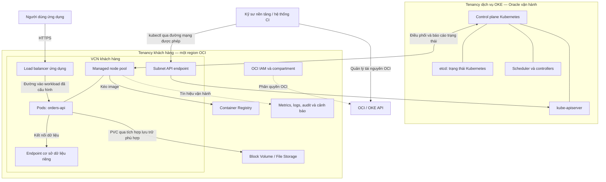

# Kiến trúc Oracle Kubernetes Engine và trách nhiệm vận hành

## 1. Mục tiêu và bối cảnh

Trong chương **Kubernetes với OKE** của lộ trình Oracle Cloud Infrastructure (OCI), Oracle Kubernetes Engine (OKE) là nơi kết nối các kiến thức về tenancy, compartment, IAM, VCN, Compute và lưu trữ để vận hành ứng dụng container. OKE cung cấp Kubernetes dưới dạng dịch vụ được quản lý, tích hợp với những dịch vụ hạ tầng OCI. Lựa chọn kiểu worker node quyết định phần công việc vận hành còn lại của đội sử dụng. [Nguồn: Tổng quan OKE](https://docs.oracle.com/en-us/iaas/Content/ContEng/Concepts/contengoverview.htm).

Sau bài này, người học có thể:

- Vẽ kiến trúc một cụm OKE và chỉ ra vị trí của control plane, API endpoint, worker nodes và tài nguyên phụ thuộc.
- Phân biệt thao tác quản lý hạ tầng OCI với thao tác quản lý đối tượng Kubernetes.
- Chọn mô hình node dựa trên mức kiểm soát cần thiết và khả năng vận hành của đội.
- Giao trách nhiệm cụ thể cho phân quyền, mạng, nâng cấp, giám sát, dữ liệu và chi phí.
- Phân loại sự cố theo lớp kiến trúc trước khi quyết định tự xử lý hay mở yêu cầu hỗ trợ Oracle.

Kiến thức nền cần có là container image, Pod, Deployment, Service, địa chỉ IP, subnet và nguyên tắc cấp quyền tối thiểu. Bài dùng một dịch vụ Java giả định tên `orders-api` để giải thích các quyết định kiến trúc; đây là ví dụ thiết kế, chưa phải quy trình tạo cụm từ đầu.

## 2. Hai mặt phẳng và hai hệ API

### 2.1. Control plane giữ trạng thái mong muốn

Control plane tiếp nhận yêu cầu Kubernetes, ghi nhận trạng thái và điều phối công việc:

| Thành phần | Vai trò trong cụm |
| --- | --- |
| `kube-apiserver` | Tiếp nhận yêu cầu Kubernetes API, xử lý các bước kiểm tra liên quan trước khi chấp nhận đối tượng |
| `etcd` | Lưu trạng thái và cấu hình của các đối tượng Kubernetes |
| `kube-scheduler` | Chọn node phù hợp cho Pod chưa được gán node |
| `kube-controller-manager` | Chạy các vòng điều khiển để đưa trạng thái thực tế về gần trạng thái mong muốn |
| `cloud-controller-manager` | Kết nối một số hoạt động Kubernetes với hạ tầng OCI, chẳng hạn xử lý Service cần load balancer |

Oracle triển khai control plane trong **tenancy dịch vụ OKE**. Với cụm VCN-native, endpoint truy cập Kubernetes API được tích hợp vào một subnet của VCN khách hàng. Endpoint ở VCN của bạn không có nghĩa các máy chủ control plane nằm trong danh sách Compute instances của bạn. [Nguồn: Khái niệm cụm và node OKE](https://docs.oracle.com/en-us/iaas/Content/ContEng/Concepts/contengclustersnodes.htm).

### 2.2. Data plane chạy ứng dụng

Data plane thực thi các Pod. Trong mô hình managed nodes, các máy OCI Compute nằm trong tenancy khách hàng; trên node có các thành phần như kubelet, container runtime và thành phần mạng. Node pool mô tả một nhóm managed nodes với những thuộc tính cấu hình chung. OKE hỗ trợ cấp phát và quản lý vòng đời của nhóm này, còn khách hàng quyết định cấu hình và tổ chức bảo trì. [Nguồn: Managed nodes](https://docs.oracle.com/en-us/iaas/Content/ContEng/Tasks/contengworkingwithmanagednodes.htm).

Ứng dụng Java chạy trong data plane. Khi một container khởi động lỗi do cấu hình JDBC, thao tác điều phối có thể vẫn hoạt động bình thường: Kubernetes tiếp tục thử khởi động container nhưng không tự sửa được chuỗi kết nối hoặc thông tin xác thực của ứng dụng.

### 2.3. OCI API và Kubernetes API giải quyết hai loại công việc

| Mặt quản lý | Đối tượng điển hình | Công cụ thường dùng | Ví dụ |
| --- | --- | --- | --- |
| OCI/OKE | Cluster, managed node pool, VCN, NSG, IAM policy | OCI Console, OCI CLI, OCI SDK, Terraform | Xem cấu hình cluster hoặc thay đổi cấu hình node pool |
| Kubernetes | Namespace, Deployment, Pod, Service, Role, PVC | `kubectl`, Kubernetes client, công cụ GitOps | Tăng số replica của `orders-api` |

Một yêu cầu OCI thành công không chứng minh Kubernetes API đang truy cập được từ máy của người dùng. Tương tự, một Pod chạy được không chứng minh tài khoản CI có quyền sửa node pool.

Ví dụ, `oci ce cluster get` đọc thông tin tài nguyên cluster từ OKE; nó không tương đương `kubectl get pods`. Tham số định danh cluster của lệnh OCI là `--cluster-id`. [Nguồn: OCI CLI — cluster get](https://docs.oracle.com/en-us/iaas/tools/oci-cli/latest/oci_cli_docs/cmdref/ce/cluster/get.html).

## 3. Sơ đồ kiến trúc tham chiếu

Sơ đồ sau mô tả một cụm VCN-native dùng managed nodes. Các mũi tên biểu diễn quan hệ hoặc luồng giao tiếp ở mức khái niệm; chúng không phải bộ quy tắc firewall đầy đủ.



Đọc sơ đồ theo ba ranh giới:

1. **Ranh giới quản lý:** Oracle vận hành control plane; đội khách hàng quản lý những cấu hình và workload thuộc phạm vi được dịch vụ cho phép.
2. **Ranh giới truy cập:** Kubernetes API endpoint dành cho quản trị cụm; endpoint của load balancer dành cho lưu lượng ứng dụng. Có thể giữ API endpoint riêng tư và vẫn công bố ứng dụng qua public load balancer.
3. **Ranh giới dữ liệu:** trạng thái Deployment trong etcd khác với bản ghi đơn hàng trong cơ sở dữ liệu và khác với nội dung của persistent volume.

Vì vậy, thiết kế kiến trúc phải thể hiện cả ba đường: quản trị, phục vụ người dùng và truy cập dữ liệu. Chỉ vẽ các Pod sẽ bỏ sót những phụ thuộc có thể làm hệ thống dừng hoạt động.

## 4. Hai quyết định độc lập: loại cluster và loại node

### 4.1. Basic cluster và enhanced cluster

Basic và enhanced là **loại cluster**, không phải cách phân biệt máy ảo với bare metal.

| Khả năng liên quan đến kiến trúc | Basic cluster | Enhanced cluster |
| --- | --- | --- |
| Chạy Kubernetes với managed node pools | Có | Có |
| Virtual nodes và self-managed nodes | Không | Có |
| OKE workload identity | Không | Có |
| Quản lý add-on chi tiết và node cycling | Ít khả năng hơn; không có các tính năng enhanced tương ứng | Có các khả năng enhanced |
| Cam kết dịch vụ | SLO | Có SLA kèm điều kiện dịch vụ |

Phạm vi SLA của enhanced cluster gắn với Kubernetes API server; tính sẵn sàng của ứng dụng còn phụ thuộc data plane và các dịch vụ đi kèm. Cụm basic VCN-native có thể nâng lên enhanced khi đáp ứng điều kiện; enhanced không hạ xuống basic. [Nguồn: So sánh basic và enhanced](https://docs.oracle.com/en-us/iaas/Content/ContEng/Tasks/contengcomparingenhancedwithbasicclusters_topic.htm), [phạm vi enhanced cluster](https://docs.oracle.com/en-us/iaas/Content/ContEng/Tasks/contengworkingwithenhancedclusters.htm).

Khi ghi quyết định kiến trúc, nên nêu rõ tính năng nào cần enhanced, ai sử dụng tính năng đó và chi phí đi kèm. Chọn loại cluster chỉ theo tên gọi sẽ không thể hiện được lợi ích vận hành cần đạt.

### 4.2. Managed nodes, virtual nodes và self-managed nodes

| Mô hình | Cách tổ chức | Hệ quả đối với đội nền tảng |
| --- | --- | --- |
| Managed nodes | OKE cấp phát Compute instances trong tenancy khách hàng, tổ chức thành managed node pools | Quản lý dung lượng, lựa chọn image, kế hoạch cập nhật và thay thế node |
| Virtual nodes | Oracle quản lý virtual nodes và hạ tầng thực thi phía dưới; người dùng cấu hình virtual node pools | Giảm công việc quản trị máy chủ, tập trung vào Pod và đặc tính workload |
| Self-managed nodes | Khách hàng tạo Compute instance rồi đưa vào enhanced cluster; không thuộc OKE node pool | Tự tổ chức cấp phát, thay thế và bảo trì nhiều hơn |

Virtual nodes nằm trong tenancy dịch vụ OKE; chúng không phải các VM khách hàng có thể SSH vào như managed nodes. [Nguồn: So sánh virtual và managed nodes](https://docs.oracle.com/en-us/iaas/Content/ContEng/Tasks/contengcomparingvirtualwithmanagednodes_topic.htm).

Self-managed nodes thường phục vụ yêu cầu cấu hình chuyên biệt. Có thể dùng Compute instance pool để tổ chức chúng, nhưng đó vẫn không phải OKE managed node pool. Khi xóa cluster, các Compute instances của self-managed nodes không tự bị chấm dứt. Control plane của cụm OKE vẫn do Oracle quản lý. [Nguồn: Self-managed nodes](https://docs.oracle.com/en-us/iaas/Content/ContEng/Tasks/contengworkingwithselfmanagednodes.htm).

### 4.3. Chọn theo đặc tính workload

Với `orders-api`, có thể đánh giá theo thứ tự:

1. Ứng dụng có phụ thuộc host, agent dạng DaemonSet, storage driver hoặc công cụ chẩn đoán đặc biệt không?
2. Đội có cần điều khiển image hệ điều hành, cấu hình máy chủ và lịch thay thế node không?
3. Workload có chạy được trong các giới hạn của virtual nodes không?
4. Đội có đủ khả năng trực vận hành để nhận phần trách nhiệm của mô hình đã chọn không?

Theo tài liệu so sánh hiện hành, virtual nodes có những khác biệt quan trọng: chỉ hỗ trợ VCN-native pod networking, không hỗ trợ DaemonSet và Kubernetes NetworkPolicy; PVC chỉ hỗ trợ persistent volume từ File Storage. Cần kiểm tra lại ma trận hỗ trợ trước khi chuyển workload. Không lấy manifest của managed nodes làm bằng chứng rằng workload tương thích virtual nodes. [Nguồn: Khả năng và giới hạn virtual nodes](https://docs.oracle.com/en-us/iaas/Content/ContEng/Tasks/contengcomparingvirtualwithmanagednodes_topic.htm).

Virtual nodes giảm công việc quản trị hạ tầng node, nhưng đội ứng dụng vẫn phải định nghĩa tài nguyên, image, cấu hình, health check và mục tiêu sẵn sàng. Oracle mô tả mô hình này là Kubernetes serverless với tài nguyên tính toán được cấp ở mức Pod. [Nguồn: Virtual nodes](https://docs.oracle.com/en-us/iaas/Content/ContEng/Tasks/contengworkingwithvirtualnodes.htm).

## 5. Thiết kế mạng từ các luồng cần thiết

### 5.1. Bốn nhóm địa chỉ cần phân biệt

Trong thiết kế managed nodes sử dụng VCN-native pod networking, cần dự trù địa chỉ cho API endpoint, worker nodes, Pods và load balancers. Ví dụ IPv4 dưới đây chỉ minh họa cách chia dải, không phải mẫu bắt buộc:

| Nhóm tài nguyên | Dải minh họa trong VCN `10.42.0.0/16` | Mục đích |
| --- | --- | --- |
| API endpoint | `10.42.0.0/28` | Truy cập Kubernetes API |
| Managed nodes | `10.42.4.0/22` | Địa chỉ của worker nodes |
| Pods | `10.42.16.0/20` | Địa chỉ Pod khi dùng VCN-native CNI |
| Load balancers | `10.42.32.0/24` | Đường vào ứng dụng |

Các dải phải được kiểm tra với mạng on-premises, VCN peering, VPN và service CIDR của Kubernetes. Việc tất cả đều là địa chỉ private không bảo đảm chúng không chồng lấn.

Với VCN-native pod networking, Pod nhận IP từ VCN và có thể được định tuyến trực tiếp khi mạng cho phép. Vì thế dung lượng subnet của Pod phải tính đến tăng trưởng, mở rộng và bảo trì. Đừng coi số node là số IP duy nhất phải dự trù. [Nguồn: VCN-native pod networking](https://docs.oracle.com/en-us/iaas/Content/ContEng/Concepts/contengpodnetworking_topic-OCI_CNI_plugin.htm).

**VCN-native cluster** nói về việc tích hợp endpoint của cluster vào VCN. **VCN-native pod networking** nói về cách cấp địa chỉ và kết nối cho Pod. Hai thuật ngữ gần nhau nhưng mô tả hai phần khác nhau của kiến trúc. [Nguồn: VCN-native clusters](https://docs.oracle.com/en-us/iaas/Content/ContEng/Tasks/contengmigratingclusters.htm).

### 5.2. Xác định đường quản trị và đường ứng dụng

| Luồng | Điều phải làm rõ trong thiết kế |
| --- | --- |
| Máy kỹ sư/CI → Kubernetes API | Endpoint public hay private; máy gọi có đường mạng, DNS và quyền phù hợp không |
| Worker → các endpoint phục vụ hoạt động cụm | Route và security rules có đáp ứng mô hình OKE đã chọn không |
| Worker/Pod → registry | Registry nào, xác thực bằng cách nào, lưu lượng đi theo đường nào |
| Người dùng → ứng dụng | Public/private load balancer, TLS, health check và backend |
| Pod → cơ sở dữ liệu | Endpoint, phân giải tên, cổng, danh tính và giới hạn kết nối |
| Workload → dịch vụ ngoài OCI | Có cần internet egress; route, NAT và quy tắc egress nào cho phép |

Private subnet cần đường ra phù hợp với các đích sử dụng: NAT gateway cho internet egress và service gateway cho những dịch vụ được hỗ trợ trong Oracle Services Network. Chỉ tạo gateway mà không gắn route và security rules sẽ chưa hình thành đường đi. Tài liệu mạng OKE quy định chi tiết theo API endpoint, worker, Pod, loại CNI và load balancer; bảng trên không thay thế các yêu cầu đó. [Nguồn: Cấu hình tài nguyên mạng OKE](https://docs.oracle.com/en-us/iaas/Content/ContEng/Concepts/contengnetworkconfig.htm).

### 5.3. Private API endpoint vẫn cần phương án truy cập

Ví dụ đội nền tảng chọn API endpoint private, managed nodes private và public load balancer cho `orders-api`. Khi đó:

- Runner CI phải ở vị trí có thể đi tới API endpoint, chẳng hạn mạng đã kết nối với VCN.
- Kỹ sư cần đường truy cập quản trị được tổ chức trước; vị trí chạy OCI CLI không tự bảo đảm đường tới Kubernetes API.
- Đường phục vụ khách hàng đi qua load balancer; không mở API endpoint chỉ để người dùng gọi ứng dụng.

Oracle khuyến nghị dùng private worker subnets và NSG để giảm mức phơi bày của hạ tầng. Chính sách truy cập cụ thể vẫn do đội sử dụng thiết kế. [Nguồn: Thực hành bảo mật OKE](https://docs.oracle.com/en-us/iaas/Content/ContEng/Tasks/contengbestpractices_topic-Security-best-practices.htm).

Ví dụ, nếu CI timeout tới API endpoint, hãy kiểm tra vị trí runner, đường định tuyến, phân giải tên và security rules trước. Tăng quyền IAM không sửa được một đường mạng chưa tồn tại.

## 6. Phân quyền theo đúng loại danh tính

### 6.1. Compartment và namespace có vai trò riêng

Compartment là phạm vi tổ chức tài nguyên và chính sách OCI. Namespace là phạm vi của nhiều đối tượng Kubernetes. Đặt cluster vào một compartment không tự tạo namespace tương ứng; tạo namespace cũng không tự tạo ranh giới IAM cho tài nguyên OCI.

Một phương án cho hệ thống đơn hàng là dùng compartment dành cho hạ tầng sản xuất và namespace `orders` dành cho workload. Đội vẫn phải quy định ai sửa cluster, ai triển khai vào namespace và ứng dụng được gọi dịch vụ OCI nào.

Có ba nhóm quyền cần xét riêng:

| Danh tính | Hoạt động cần kiểm soát |
| --- | --- |
| Kỹ sư hạ tầng | Quản lý cluster, node pool, VCN và tài nguyên OCI phụ thuộc |
| Người dùng hoặc hệ thống triển khai | Thực hiện thao tác Kubernetes trong phạm vi được giao |
| Workload đang chạy | Gọi OCI API hoặc truy cập hệ thống dữ liệu phục vụ nghiệp vụ |

### 6.2. IAM và Kubernetes RBAC có thể cùng cấp quyền

OKE tích hợp OCI IAM với Kubernetes RBAC. IAM có thể cho phép thao tác Kubernetes; RBAC cung cấp quyền chi tiết theo cluster và namespace. Không nên giả định rằng một Role hạn chế sẽ thu hồi quyền rộng đã được IAM cấp. Khi thiết kế quyền tối thiểu, cần xem cả hai nguồn cấp quyền. [Nguồn: Kiểm soát truy cập OKE](https://docs.oracle.com/en-us/iaas/Content/ContEng/Concepts/contengaboutaccesscontrol.htm).

Ví dụ một nhóm chỉ cần xem Pod của namespace `orders`. Phần RBAC có thể biểu diễn như sau; namespace phải tồn tại và OCID nhóm phải được thay bằng giá trị thật. Cấu hình IAM cho phép sử dụng cluster và đường truy cập mạng phải được thiết lập riêng.

```yaml
apiVersion: rbac.authorization.k8s.io/v1
kind: Role
metadata:
  name: orders-observer
  namespace: orders
rules:
  - apiGroups: [""]
    resources: ["pods", "events"]
    verbs: ["get", "list", "watch"]
  - apiGroups: [""]
    resources: ["pods/log"]
    verbs: ["get"]
---
apiVersion: rbac.authorization.k8s.io/v1
kind: RoleBinding
metadata:
  name: orders-observers
  namespace: orders
subjects:
  - kind: Group
    name: "<OCI_GROUP_OCID>"
    apiGroup: rbac.authorization.k8s.io
roleRef:
  kind: Role
  name: orders-observer
  apiGroup: rbac.authorization.k8s.io
```

Manifest minh họa chủ đích cho phép quan sát mà không cấp thao tác sửa workload qua Role này. Trong môi trường thật cần kiểm tra các quyền hiệu lực khác của nhóm, đặc biệt nếu cùng thành viên còn thuộc nhóm quản trị.

### 6.3. Workload identity là danh tính của ứng dụng

Trong enhanced cluster, OKE workload identity nhận diện workload bằng tổ hợp **cluster, namespace và service account** để cấp quyền gọi dịch vụ OCI. Ứng dụng cần dùng OCI SDK và identity provider phù hợp; gán tên service account chưa hoàn tất toàn bộ cấu hình truy cập OCI. [Nguồn: Cấp quyền OCI cho workload](https://docs.oracle.com/en-us/iaas/Content/ContEng/Tasks/contenggrantingworkloadaccesstoresources.htm).

Nếu `orders-api` chỉ đọc tệp cấu hình từ một bucket, đội nên thiết kế policy cho nhu cầu đó. Không dùng tài khoản quản trị của kỹ sư làm danh tính chạy ứng dụng. Quyền gọi OCI cũng không tự trở thành tài khoản cơ sở dữ liệu: kết nối JDBC vẫn cần cơ chế xác thực và quyền dữ liệu phù hợp.

## 7. Từ một lần triển khai đến một yêu cầu người dùng

Theo dõi vòng đời của `orders-api` giúp thấy rõ những công việc OKE thực hiện và những công việc đội phải chuẩn bị.

### 7.1. Đường triển khai

1. Pipeline xây image từ mã nguồn, chạy các kiểm tra đã chọn và đẩy image vào registry.
2. Pipeline gửi Deployment đến Kubernetes API bằng danh tính được cấp quyền.
3. Control plane ghi nhận trạng thái mong muốn; controller tạo các đối tượng cần thiết.
4. Scheduler chọn node dựa trên tài nguyên yêu cầu và ràng buộc lập lịch.
5. Node lấy image và chạy container.
6. Health check quyết định Pod đã sẵn sàng phục vụ hay chưa.

Ví dụ, `ImagePullBackOff` xuất hiện ở bước lấy image có thể liên quan đường mạng, địa chỉ image hoặc thông tin xác thực registry. Lúc đó thay đổi thuật toán lập lịch không giải quyết được nguyên nhân.

### 7.2. Đường phục vụ

Người dùng gửi HTTPS tới endpoint ứng dụng. Cấu hình load balancer và cơ chế ingress hoặc Service tương ứng đưa yêu cầu tới backend của workload. Pod xử lý nghiệp vụ rồi gọi cơ sở dữ liệu hoặc dịch vụ cần thiết.

Kubernetes API không phải tuyến đi qua của từng giao dịch HTTP này. Khi API tạm thời không truy cập được, một số workload đã chạy vẫn có thể tiếp tục phục vụ; khả năng triển khai, điều phối hoặc phục hồi của cụm lại có thể bị ảnh hưởng. Do đó phải quan sát cả API quản trị và endpoint nghiệp vụ.

### 7.3. Đường dữ liệu bền vững

PVC là yêu cầu lưu trữ, PV là đối tượng đại diện volume đáp ứng yêu cầu đó. OKE hỗ trợ tích hợp các dịch vụ lưu trữ OCI qua driver tương ứng. Dữ liệu trong filesystem của container có vòng đời khác dữ liệu được lưu ở persistent volume. [Nguồn: Thiết lập lưu trữ cho Kubernetes](https://docs.oracle.com/en-us/iaas/Content/ContEng/Tasks/contengcreatingpersistentvolumeclaim.htm).

Đối với `orders-api`, một lựa chọn thiết kế là giữ dữ liệu giao dịch trong dịch vụ cơ sở dữ liệu Oracle nằm ngoài cluster, còn Pod xử lý yêu cầu theo hướng stateless. Lựa chọn này chuyển phần lưu dữ liệu sang một hệ thống có vòng đời riêng, nhưng đội vẫn phải thiết kế kết nối private, pool kết nối, quản lý secret hoặc wallet khi cần, backup và kiểm tra khôi phục.

Nếu chạy database trong Kubernetes, đội phải nhận thêm trách nhiệm đối với storage topology, tính nhất quán khi sao lưu, nhân bản và phục hồi database. Khôi phục Deployment không đồng nghĩa khôi phục được các giao dịch đã mất.

## 8. Trách nhiệm vận hành phải có người nhận

### 8.1. Ranh giới với Oracle

| Hạng mục | Phần Oracle đảm nhiệm | Phần khách hàng cần tổ chức |
| --- | --- | --- |
| Control plane | Vận hành các thành phần được quản lý | Sử dụng giao diện được hỗ trợ, theo dõi tác động tới hệ thống |
| Lỗ hổng control plane | Vá các thành phần Oracle quản lý | Phối hợp khi có yêu cầu hoặc tác động tới workload |
| Managed worker image | Cung cấp image và bản vá được hỗ trợ | Đưa image mới vào sử dụng và thay thế node cũ |
| Mạng và quyền | Cung cấp dịch vụ và cơ chế cấu hình | Thiết kế, duy trì VCN, IAM, RBAC |
| Ứng dụng và dữ liệu | Cung cấp nền tảng theo phạm vi dịch vụ | Duy trì ứng dụng, giám sát, xử lý sự cố và backup dữ liệu |

Oracle có backup etcd phục vụ phục hồi control plane; khách hàng không trực tiếp truy cập các bản backup đó. Kế hoạch backup ứng dụng phải được thiết kế riêng. [Nguồn: Trách nhiệm chia sẻ OKE](https://docs.oracle.com/en-us/iaas/Content/ContEng/Concepts/contengsupportsharedresponsibilities.htm).

### 8.2. Chia trách nhiệm trong tổ chức

Bảng sau là đề xuất phân công cho ví dụ `orders-api`, cần điều chỉnh theo tổ chức:

| Đầu việc | Đội chủ trì | Đầu ra có thể kiểm tra |
| --- | --- | --- |
| Cluster, mạng, node và add-on nền tảng | Platform | Cấu hình được quản lý bằng mã, lịch bảo trì và runbook |
| IAM, RBAC và quyền workload | Platform cùng Security | Ma trận quyền và kết quả kiểm tra quyền hiệu lực |
| Image, resource requests, probes và rollout | Đội ứng dụng | Manifest có chủ sở hữu và phiên bản phát hành rõ ràng |
| Backup, restore và mục tiêu mất dữ liệu | Đội dữ liệu cùng đội ứng dụng | Bằng chứng khôi phục thử thành công |
| Cảnh báo và xử lý sự cố | Đội trực vận hành | Kênh cảnh báo có người nhận, quy tắc chuyển cấp |
| Chi phí và tài nguyên tồn đọng | Chủ dịch vụ cùng Platform | Báo cáo sử dụng, ngân sách và kế hoạch thu hồi |

Nếu một công việc chỉ được ghi là “Oracle quản lý” hoặc “DevOps phụ trách” mà không có đầu ra và người nhận cụ thể, rất dễ xuất hiện khoảng trống. Ví dụ điển hình là image đã có bản vá nhưng không có ai lên lịch thay node.

## 9. Bảo trì là một chuỗi thay đổi có kiểm soát

### 9.1. Nâng cấp cluster và nâng cấp worker là các bước riêng

Nâng phiên bản control plane không tự nâng toàn bộ managed worker nodes. Virtual nodes được nâng phiên bản cùng đợt nâng control plane theo cơ chế của dịch vụ; self-managed nodes dùng quy trình thay thế riêng. Trước khi nâng cấp cần kiểm tra tương thích ứng dụng, add-on và version skew được OKE hỗ trợ. Control plane đã nâng không thể hạ phiên bản về trước. [Nguồn: Nâng cấp Kubernetes trên OKE](https://docs.oracle.com/en-us/iaas/Content/ContEng/Concepts/contengaboutupgradingclusters.htm).

Với managed nodes, trình tự vận hành đề xuất là:

1. Ghi nhận phiên bản thực tế, phiên bản cấu hình node pool và các thành phần phụ thuộc.
2. Kiểm tra API mà ứng dụng, operator và pipeline sử dụng; thử phiên bản đích trong môi trường phù hợp.
3. Chuẩn bị dung lượng trống, khả năng drain và kế hoạch xử lý khi workload không sẵn sàng.
4. Nâng control plane bằng giao diện OKE được hỗ trợ.
5. Nâng hoặc thay managed nodes theo phương án đã chọn.
6. Kiểm tra lại hành vi nghiệp vụ, lỗi, độ trễ và trạng thái workload trước khi kết thúc bảo trì.

Đây là trình tự tổ chức công việc, không phải cam kết mọi cụm đều có thể nâng theo cùng một lần thao tác. Điều kiện nâng cấp cụ thể phải lấy từ tài liệu của phiên bản và trạng thái cluster.

### 9.2. Đổi cấu hình node pool chưa cập nhật mọi node đang chạy

Khi thay thuộc tính image của managed node pool, node hiện có vẫn giữ thuộc tính cũ cho tới khi được cập nhật bằng quy trình thay thế hoặc cycling phù hợp. Một phương án khác là tạo pool mới, chuyển workload rồi bỏ pool cũ. [Nguồn: Cập nhật thuộc tính worker nodes](https://docs.oracle.com/en-us/iaas/Content/ContEng/Tasks/contengupgradingimageworkernode.htm).

Ví dụ, sau khi chọn image mới, đội cần kiểm tra **node thực tế** đã chuyển sang image mong muốn chưa. Chỉ nhìn trường cấu hình của node pool có thể dẫn đến việc kết thúc bảo trì khi nhiều máy vẫn dùng image cũ.

Kế hoạch cũng nên tách hai loại quay lui: quay lại phiên bản ứng dụng và quay lại cấu hình hạ tầng. Giữ lại image ứng dụng cũ không tạo ra khả năng hạ phiên bản control plane.

## 10. Thiết kế tính sẵn sàng ở lớp workload

### 10.1. Replica phải đi cùng phân bố và dung lượng

Ba replica trên cùng một node vẫn có một điểm lỗi chung. Đội cần chọn vị trí worker theo availability domain (AD) và fault domain (FD) phù hợp region, đồng thời điều khiển phân bố Pod theo topology mà Kubernetes nhìn thấy. Oracle khuyến nghị regional subnets và topology spread constraints để tổ chức phân bố workload. [Nguồn: Thực hành mạng và phân bố workload](https://docs.oracle.com/en-us/iaas/Content/ContEng/Tasks/contengbestpractices_topic-Networking-best-practices.htm).

Không phải region nào cũng có nhiều AD. Phân bố theo hostname chỉ chứng minh các Pod khác node; muốn đánh giá chịu lỗi AD hoặc FD phải đối chiếu thêm vị trí hạ tầng.

Một tiêu chí năng lực hữu ích cho managed nodes là:

> Khi một node hoặc miền lỗi thuộc kịch bản thiết kế mất đi, tài nguyên còn lại có đủ để chạy tải cần duy trì và các thành phần nền tảng không?

Phải tính theo tài nguyên có thể cấp cho Pod và các ràng buộc lập lịch. Chỉ cộng tổng CPU danh nghĩa của các máy sẽ bỏ qua phần dành cho hệ thống, bộ nhớ, quota và giới hạn IP.

### 10.2. Ví dụ manifest cho managed nodes

Ví dụ sau thể hiện ba ý định: có ba replica, phân bố theo hostname và cho phép bảo trì có kiểm soát. Trước khi áp dụng cần có namespace `orders`, image thật, khả năng kéo image, ít nhất ba managed nodes đủ tài nguyên, cùng các endpoint health check tương ứng.

Địa chỉ `registry.example.com` là placeholder. Ví dụ dành cho **managed nodes**, chưa có Service/ingress và chưa phải cấu hình đầy đủ để công bố ứng dụng.

```yaml
apiVersion: apps/v1
kind: Deployment
metadata:
  name: orders-api
  namespace: orders
spec:
  replicas: 3
  selector:
    matchLabels:
      app: orders-api
  strategy:
    type: RollingUpdate
    rollingUpdate:
      maxUnavailable: 0
      maxSurge: 1
  template:
    metadata:
      labels:
        app: orders-api
    spec:
      topologySpreadConstraints:
        - maxSkew: 1
          topologyKey: kubernetes.io/hostname
          whenUnsatisfiable: DoNotSchedule
          labelSelector:
            matchLabels:
              app: orders-api
      containers:
        - name: api
          image: registry.example.com/training/orders-api:1.0.0
          ports:
            - name: http
              containerPort: 8080
          resources:
            requests:
              cpu: "250m"
              memory: "512Mi"
            limits:
              cpu: "1000m"
              memory: "1Gi"
          startupProbe:
            httpGet:
              path: /health/startup
              port: http
            periodSeconds: 5
            failureThreshold: 36
          readinessProbe:
            httpGet:
              path: /health/ready
              port: http
            periodSeconds: 5
          livenessProbe:
            httpGet:
              path: /health/live
              port: http
            periodSeconds: 10
---
apiVersion: policy/v1
kind: PodDisruptionBudget
metadata:
  name: orders-api
  namespace: orders
spec:
  minAvailable: 2
  selector:
    matchLabels:
      app: orders-api
```

Startup probe cho phép ứng dụng có thời gian khởi động; readiness biểu thị khả năng nhận lưu lượng; liveness phục vụ phát hiện trạng thái cần khởi động lại. Các endpoint và ngưỡng phải phản ánh ứng dụng thật. Chẳng hạn liveness phụ thuộc trực tiếp vào một database đang lỗi có thể gây nhiều lần restart mà không khắc phục được database.

Các tham số trên có những giới hạn rõ ràng:

- `maxSurge: 1` cần dung lượng cho Pod bổ sung khi rollout.
- Ràng buộc topology cứng có thể khiến Pod chờ nếu không có vị trí phù hợp.
- `minAvailable: 2` cho phép tối đa một Pod không sẵn sàng do eviction được kiểm soát khi cả ba Pod đang khỏe; không bảo đảm luôn có hai Pod sống qua mọi sự cố.
- PDB không ngăn sự cố bất ngờ như node mất nguồn, và không thay thế chiến lược rolling update của Deployment.

Kubernetes mô tả PDB là giới hạn đối với gián đoạn tự nguyện thông qua cơ chế eviction; gián đoạn ngoài ý muốn vẫn có thể xảy ra. [Nguồn: Kubernetes — Disruptions](https://kubernetes.io/docs/concepts/workloads/pods/disruptions/).

Với Java, cần đo heap, native memory, thời gian khởi động và số kết nối khi tăng replica. CPU/memory trong ví dụ là số minh họa; việc ứng dụng chạy được lúc nhàn rỗi chưa chứng minh giới hạn đó đủ cho tải thật.

## 11. Mở rộng và chi phí là một phần của kiến trúc

### 11.1. Mở rộng Pod khác với mở rộng node

HPA thay đổi số Pod dựa trên nguồn metrics đã cấu hình. Cluster Autoscaler thay đổi số managed nodes trong các node pools được quản lý để đáp ứng nhu cầu lập lịch; nó không tạo Pod thay cho HPA. Cluster Autoscaler không dùng cho virtual node pools. [Nguồn: HPA trên OKE](https://docs.oracle.com/en-us/iaas/Content/ContEng/Tasks/contengusinghorizontalpodautoscaler.htm), [Cluster Autoscaler trên OKE](https://docs.oracle.com/en-us/iaas/Content/ContEng/Tasks/contengusingclusterautoscaler.htm).

Ví dụ giả định:

- `orders-api` đang có ba replica, mỗi replica yêu cầu `250m` CPU và `512Mi` RAM.
- Khi tăng lên sáu replica, phần requests của riêng ứng dụng tăng từ `750m` lên `1500m` CPU và từ `1536Mi` lên `3072Mi` RAM.
- Cụm vẫn phải đủ chỗ cho add-on, workload khác và nhu cầu bảo trì.
- Nếu không đủ chỗ, một số Pod có thể Pending; tăng replica trong manifest chưa tạo thêm năng lực Compute.

Autoscaling còn phụ thuộc giới hạn đã cấu hình, quota, IP và dung lượng có thể cấp ở region. Vì thế cần đặt ngưỡng tối đa, theo dõi nhu cầu thực tế và xác định cách xử lý khi không thể cấp thêm tài nguyên.

### 11.2. Theo dõi cả tài nguyên hỗ trợ

Có thể dùng mô hình chi phí khái niệm sau để phân công người chịu trách nhiệm:

```text
Chi phí hệ thống OKE
  = phần dịch vụ cluster theo loại đã chọn
  + tài nguyên tính toán chạy workload
  + boot volumes và persistent storage
  + load balancers và mạng
  + logs, metrics, backup
  + registry, database và dịch vụ phụ thuộc
```

Đây là khung phân loại, không phải bảng giá. Khi dự toán thực tế phải tra giá và phạm vi tính phí hiện hành cho region, loại dịch vụ và hợp đồng sử dụng.

Các quyết định cần có chủ sở hữu gồm số replica tối thiểu, dung lượng dự phòng khi bảo trì, số load balancer, thời gian lưu logs và chính sách giữ volume/backup. Môi trường thử nghiệm cũng cần kế hoạch thu hồi tài nguyên. Với self-managed nodes, cần nhớ cả Compute instances có vòng đời riêng với cluster.

Ngân sách nên gắn với mục tiêu phục vụ: giảm dự phòng có thể giảm hóa đơn nhưng cũng làm tăng thời gian phục hồi sau lỗi. Đội cần ghi rõ mức rủi ro đã chấp nhận bằng một kịch bản cụ thể.

## 12. Quan sát đúng lớp để xử lý đúng việc

### 12.1. Bốn loại tín hiệu bổ sung cho nhau

| Tín hiệu | Câu hỏi cần trả lời | Ví dụ với orders-api |
| --- | --- | --- |
| Metrics hạ tầng/cụm | Có thiếu dung lượng hoặc thành phần không khỏe không? | Node không Ready, Pod không lập lịch được |
| Metrics nghiệp vụ | Người dùng có nhận kết quả đúng và đủ nhanh không? | Tỷ lệ tạo đơn thành công, độ trễ, lỗi JDBC |
| Logs ứng dụng và nền tảng | Quá trình nào ghi nhận lỗi gì? | Lỗi khởi động JVM, lỗi scheduler hoặc controller |
| Audit | Ai hoặc danh tính nào thực hiện thay đổi? | Thay Deployment, thay quyền, gọi API quản trị |

OKE cung cấp metrics trong namespace `oci_oke`, gồm các tín hiệu về API server, Pod không lập lịch được và trạng thái node. Những metrics này không tự đo đầy đủ chất lượng nghiệp vụ của ứng dụng. [Nguồn: OKE Metrics](https://docs.oracle.com/en-us/iaas/Content/ContEng/Reference/contengmetrics.htm).

OCI Audit có thể dùng để xem sự kiện từ OKE và Kubernetes API server. Logs tiến trình control plane được cung cấp qua cơ chế service logs được hỗ trợ; quyền xem và cấu hình thu thập cần được thiết lập đúng. [Nguồn: Audit logs của OKE](https://docs.oracle.com/en-us/iaas/Content/ContEng/Tasks/contengmonitoringoke.htm), [service logs của OKE](https://docs.oracle.com/en-us/iaas/Content/ContEng/Tasks/contengviewingservicelogs.htm).

Mỗi cảnh báo phải có người nhận, ngữ cảnh và hành động đầu tiên. Một cảnh báo “Pod Pending” hữu ích hơn khi kèm namespace, workload, thời điểm bắt đầu và liên kết tới events.

### 12.2. Kiểm tra kiến trúc bằng các lệnh chỉ đọc

Các lệnh sau dành cho môi trường đã có OCI CLI, `kubectl`, thông tin xác thực và kubeconfig hợp lệ. Cần thay các chuỗi placeholder và bảo đảm đang chọn đúng context. Chúng là ví dụ để người học thực hiện, không phải kết quả đã chạy của bài.

```powershell
# Đọc tài nguyên cluster qua OCI/OKE API.
oci ce cluster get --cluster-id "<CLUSTER_OCID>" --region "<OCI_REGION>"

# Xác định cluster mà kubectl đang trỏ tới.
kubectl config current-context
kubectl cluster-info

# Xem node và các nhãn topology có trên node.
kubectl get nodes -o wide
kubectl get nodes -L topology.kubernetes.io/zone,kubernetes.io/hostname

# Xem phân bố, trạng thái workload và ngân sách gián đoạn.
kubectl get deployment,pods,services,pdb -n orders -o wide
kubectl get events -n orders --sort-by=.metadata.creationTimestamp

# Kiểm tra quyền hiệu lực của chính danh tính đang dùng.
kubectl auth can-i list pods -n orders
kubectl auth can-i patch deployments.apps -n orders

# Xem chính sách storage; cần quyền đọc ở phạm vi tương ứng.
kubectl get storageclass
kubectl get pvc -n orders
```

Khi đọc kết quả, đối chiếu hai mặt của hệ thống:

- OCI cho biết tài nguyên cluster được cấu hình thế nào.
- Kubernetes cho biết node và workload đang thể hiện trạng thái nào.
- Nhãn topology cho biết cơ sở lập lịch; cần đối chiếu với vị trí Compute để đánh giá miền lỗi thật.
- Events hỗ trợ tìm nguyên nhân gần thời điểm xảy ra lỗi, nhưng không nên coi là kho lịch sử vận hành dài hạn.

### 12.3. Phân loại sự cố trước khi chuyển cấp

| Hiện tượng | Hướng kiểm tra đầu tiên | Đội chủ trì ban đầu |
| --- | --- | --- |
| `kubectl` timeout | Context, DNS, route và quy tắc tới API endpoint | Platform/Network |
| Kubernetes trả về `Forbidden` | Danh tính và quyền hiệu lực từ IAM/RBAC | Platform/Security |
| Pod `Pending` | Events, requests, quota, topology và dung lượng node/IP | Platform cùng ứng dụng |
| `ImagePullBackOff` | Image, registry, xác thực và đường lấy image | Đội pipeline cùng Platform |
| `CrashLoopBackOff` | Logs, cấu hình, startup/liveness, bộ nhớ và phụ thuộc | Đội ứng dụng |
| Ứng dụng lỗi JDBC | Endpoint DB, kết nối, credential, pool và trạng thái DB | Ứng dụng cùng đội dữ liệu |
| Bảo trì không drain được | PDB, replica sẵn sàng và vị trí thay thế | Platform cùng ứng dụng |

Bảng đưa ra thứ tự điều tra, không khẳng định nguyên nhân duy nhất. Ví dụ `Pending` không mặc định là thiếu CPU; một node selector sai cũng có thể làm Pod không có vị trí chạy.

Nếu cần mở yêu cầu hỗ trợ Oracle, nên chuẩn bị cluster OCID, region, mốc thời gian kèm múi giờ, phạm vi ảnh hưởng, thay đổi gần nhất và thông tin chẩn đoán liên quan. Gói thông tin cần tránh chứa secret. Mục tiêu là chứng minh vấn đề đang ở lớp nào và đã kiểm tra những gì.

## 13. Ghi lại quyết định kiến trúc trước khi nhận vận hành

Một bản mô tả kiến trúc ngắn cho `orders-api` nên đủ để người trực mới hiểu hệ thống mà không phải đoán. Có thể ghi theo mẫu:

| Quyết định | Nội dung phải có |
| --- | --- |
| Phạm vi triển khai | Tenancy, compartment, region và loại cluster |
| Node | Managed/virtual/self-managed, lý do chọn, chủ sở hữu vòng đời |
| Mạng | API endpoint, subnet, đường CI, đường người dùng, đường dữ liệu |
| Danh tính | Ai quản lý OCI, ai sửa Kubernetes, workload gọi dịch vụ bằng cách nào |
| Dữ liệu | Nơi lưu dữ liệu thật, người giữ backup, kết quả restore thử |
| Tính sẵn sàng | Miền lỗi cần chịu được, phân bố Pod, dung lượng dự phòng |
| Bảo trì | Lịch nâng cấp, người quyết định, tiêu chí hoàn thành |
| Quan sát | Metrics nghiệp vụ, logs, audit, cảnh báo và người nhận |
| Chi phí | Chủ ngân sách, giới hạn mở rộng, tài nguyên cần thu hồi |

Với mỗi dòng, nên có một bằng chứng cụ thể: sơ đồ mạng, policy, manifest, cấu hình bằng mã, báo cáo khôi phục hoặc runbook. Nhờ đó, trách nhiệm vận hành trở thành công việc có thể thực hiện và kiểm tra.

Người học cần giữ ba mối liên hệ xuyên suốt bài: **control plane được quản lý đi cùng data plane có trách nhiệm riêng; khả năng truy cập đi cùng đường mạng và quyền hiệu lực; tính sẵn sàng ứng dụng đi cùng dữ liệu, phân bố và dung lượng phục hồi**. Đây là cơ sở để triển khai OKE có phân quyền, giám sát và kiểm soát chi phí trong hạ tầng OCI.
