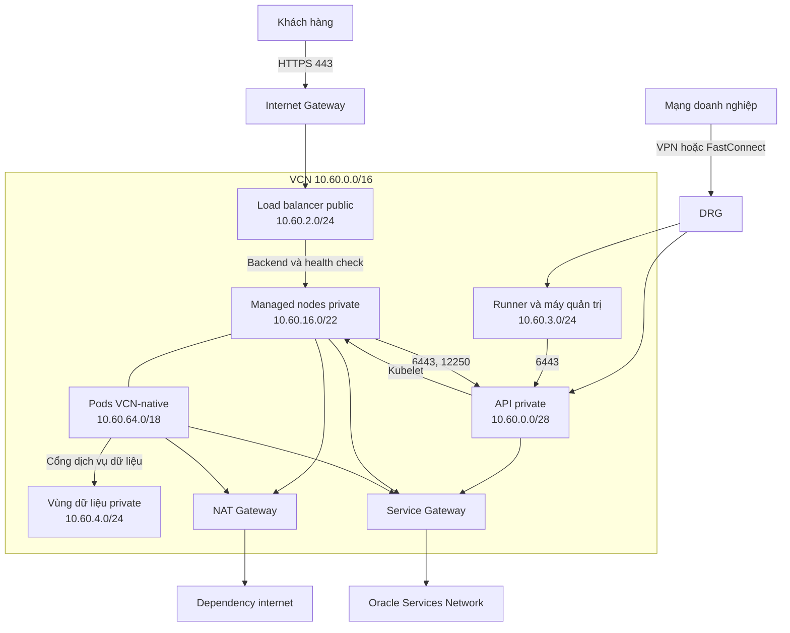

# Thiết kế VCN, API endpoint và subnet cho OKE

## 1. Mục tiêu và phạm vi

Trong module **CLOUD_PROVIDERS_ORACLE**, bài này thuộc chương **Kubernetes với OKE**, tập trung vào thiết kế mạng trước khi tạo cụm Oracle Kubernetes Engine (OKE). Một cụm tạo thành công chưa bảo đảm người vận hành truy cập được API, node tải được image, hay ứng dụng nhận được lưu lượng đúng đường.

Sau bài học, bạn có thể:

- Phân biệt endpoint quản trị Kubernetes, địa chỉ node, địa chỉ pod và điểm vào ứng dụng.
- Chọn API endpoint public hoặc private theo đường truy cập thực tế.
- Phân chia VCN, subnet và CIDR có dự phòng cho mở rộng, nâng cấp.
- Thiết kế route table, gateway và luật mạng theo từng luồng.
- Kiểm tra kết nối theo lớp, đồng thời nhận diện tác động tới phân quyền, tính sẵn sàng và chi phí.

Kiến trúc minh họa sử dụng **OCI public cloud, IPv4, managed node pools và OCI VCN-Native Pod Networking**. Các cấu hình dành cho virtual nodes, Private Cloud Appliance hay Compute Cloud@Customer cần được đánh giá riêng. Những đoạn lệnh bên dưới là ví dụ thực hành; thay OCID, region và địa chỉ bằng giá trị của môi trường trước khi dùng.

Kiến thức cần có: CIDR, TCP/IP, route table, NSG, OCI IAM, Kubernetes Service và thao tác cơ bản với `kubectl`. Bài không yêu cầu triển khai dịch vụ cơ sở dữ liệu, nhưng dành sẵn vùng mạng để ứng dụng kết nối tới cơ sở dữ liệu Oracle qua địa chỉ private.

## 2. Tách bốn loại địa chỉ trước khi vẽ subnet

| Thành phần | Công việc | Câu hỏi thiết kế |
| --- | --- | --- |
| Kubernetes API endpoint | Nhận yêu cầu quản trị như tạo Deployment, đọc trạng thái | Máy quản trị và CI/CD đi tới TCP/6443 bằng đường nào? |
| Worker node | Chạy kubelet, runtime và workload | Node liên lạc với API, dịch vụ OCI và nguồn image như thế nào? |
| Pod | Chạy tiến trình ứng dụng | IP đến từ VCN hay mạng overlay? Cần bao nhiêu IP khi mở rộng? |
| Load balancer của ứng dụng | Nhận request từ người dùng hoặc hệ thống nội bộ | Listener public hay private? Backend và health check đi vào đâu? |

Control plane do Oracle quản lý. Subnet API endpoint trong VCN của khách hàng cung cấp điểm truy cập tới control plane; không có nghĩa toàn bộ máy chủ control plane nằm trong subnet đó. Xem [khái niệm cụm và node của OKE](https://docs.oracle.com/en-us/iaas/Content/ContEng/Concepts/contengclustersnodes.htm).

Hai quyết định **API public/private** và **ứng dụng public/private** độc lập với nhau. Một website public có thể chạy trong cụm có API private; ngược lại, cụm có API public vẫn có thể chỉ phục vụ ứng dụng nội bộ. Dùng một load balancer public không tự làm API Kubernetes trở thành public.

Ví dụ: khách hàng gọi `https://shop.example.com` vào load balancer; nhóm vận hành dùng `kubectl` qua mạng doanh nghiệp. Hai nhóm người dùng không cần đi qua cùng một endpoint hoặc cùng một luật firewall.

## 3. Chọn kiểu truy cập API theo người và hệ thống sử dụng

### 3.1. Public endpoint

OKE chỉ công khai API qua internet khi cấu hình tương ứng, bao gồm public IP cho endpoint. Việc chọn public subnet tự nó chưa đủ. Endpoint subnet phải là regional subnet. Các điều kiện mạng chi tiết nằm trong [cấu hình tài nguyên mạng OKE](https://docs.oracle.com/en-us/iaas/Content/ContEng/Concepts/contengnetworkconfig.htm).

Thiết kế phù hợp cho một phòng lab có máy cá nhân hoặc một hệ thống CI được phép truy cập từ các địa chỉ nguồn xác định:

1. Xác định IP egress thực sự của máy quản trị hoặc runner.
2. Chỉ cho phép nguồn đó tới TCP/6443.
3. Thiết lập IAM và quyền Kubernetes phù hợp.
4. Ghi rõ người sở hữu danh sách nguồn, thời hạn và quy trình thay đổi.

Nếu văn phòng đi qua NAT, nguồn mà OCI nhìn thấy thường là IP egress của văn phòng. Ghi IP LAN của laptop vào luật cho endpoint public sẽ không giải quyết được kết nối.

### 3.2. Private endpoint

Với API private, máy gọi cần đường mạng tới địa chỉ private của endpoint. Các lựa chọn gồm máy quản trị hoặc runner trong VCN, kết nối từ mạng doanh nghiệp, hoặc một đường truy cập qua bastion được cấu hình phù hợp. Oracle hướng dẫn các phương án trong [thiết lập truy cập cụm OKE](https://docs.oracle.com/en-us/iaas/Content/ContEng/Tasks/contengdownloadkubeconfigfile.htm).

| Nơi chạy công cụ | Phương án trong thiết kế | Việc cần chứng minh |
| --- | --- | --- |
| Runner trong VCN | Kết nối private trực tiếp | Route, DNS và luật từ subnet runner tới API |
| Máy ở công ty | VPN hoặc FastConnect qua DRG | Route hai chiều, không trùng CIDR |
| Laptop ngoài công ty | Đường truy cập quản trị qua bastion/tunnel | Phiên hợp lệ, cổng đích, TLS và cấu hình client |
| Dịch vụ CI SaaS | Runner có kết nối private hoặc phương án mạng được hỗ trợ | Job thật sự chạy từ nguồn được cấp phép |

Tệp kubeconfig chứa thông tin endpoint và cách xác thực. Nó không tạo VPN, route hay tunnel. Tương tự, mở OCI Console hoặc có quyền xem cluster không tự tạo đường mạng cho `kubectl` chạy trên laptop.

Quyết định nên được ghi thành một câu có thể kiểm chứng: “API private; runner triển khai nằm trong subnet quản trị; kỹ sư truy cập qua VPN doanh nghiệp; chỉ hai nguồn này được phép quản trị.”

## 4. Kiến trúc tham chiếu và quy hoạch địa chỉ

Giả sử một dịch vụ bán hàng cần:

- Website có điểm vào public.
- Node và pod dùng địa chỉ private.
- API chỉ dành cho nhóm vận hành và runner triển khai.
- Pod truy cập dịch vụ OCI, một số dependency trên internet và cơ sở dữ liệu Oracle nội bộ.
- Có đủ IP cho autoscaling và số node tăng tạm thời khi nâng cấp.



Sơ đồ biểu diễn luồng chính, không liệt kê toàn bộ luật mạng hoặc mọi route của API subnet. Trong kiến trúc này, traffic từ load balancer đi qua backend là node; cơ chế dùng pod làm backend cần ma trận riêng.

### 4.1. Bảng CIDR đề xuất

| Tài nguyên | CIDR | Kiểu | Vai trò |
| --- | --- | --- | --- |
| VCN | `10.60.0.0/16` | Regional | Không gian địa chỉ của môi trường |
| API subnet | `10.60.0.0/28` | Private, regional | Endpoint Kubernetes |
| Public LB subnet | `10.60.2.0/24` | Public, regional | Điểm vào website |
| Management subnet | `10.60.3.0/24` | Private, regional | Runner và máy quản trị |
| Data subnet | `10.60.4.0/24` | Private, regional | Vùng dành trước cho dịch vụ dữ liệu |
| Worker subnet | `10.60.16.0/22` | Private, regional | Địa chỉ node |
| Pod subnet | `10.60.64.0/18` | Private, regional | IP pod với VCN-native |
| Kubernetes Service CIDR | `172.20.0.0/16` | Dải logic của Kubernetes | ClusterIP; không tạo OCI subnet |

Các CIDR trên là lựa chọn cho tình huống học tập. Đừng sao chép trước khi đối chiếu với địa chỉ công ty, VPN client, VCN kết nối và kế hoạch mở rộng. Các subnet trong bảng không chồng nhau; Service CIDR cũng tách khỏi VCN.

Với VCN-native, pod subnet nằm **trong VCN**. Với Flannel, pod CIDR overlay là dải riêng, không trùng VCN và Service CIDR. Cần phân biệt hai mô hình khi lập hồ sơ IP; xem [CIDR cho OKE](https://docs.oracle.com/en-us/iaas/Content/ContEng/Concepts/contengcidrblocks.htm).

### 4.2. Tính dung lượng theo đỉnh cấp phát

Không lấy số pod đang chạy ở ngày đầu làm dung lượng của pod subnet. Hãy ước lượng theo node tối đa, IP cấp phát cho pod trên từng node, phần cấp phát cho VNIC, số node tăng trong nâng cấp và các tài nguyên cùng sử dụng subnet.

Một công thức lập kế hoạch:

```text
N_peak = N_autoscale_max + N_upgrade_extra

IP_pod_budget =
    N_peak × IP_allocated_per_node
    + IP_overhead
    + IP_shared_consumers
    + IP_growth_reserve
```

Đây là công thức dự toán, không phải thuật toán cấp phát của OKE. `IP_allocated_per_node` phải lấy từ cấu hình CNI/node pool thực tế. OCI VCN-native có thể cấp phát trước IP; dung lượng còn phụ thuộc compute shape, VNIC và cấu hình mạng. Tham khảo [cơ chế VCN-native pod networking](https://docs.oracle.com/en-us/iaas/Content/ContEng/Concepts/contengpodnetworking_topic-OCI_CNI_plugin.htm).

Ví dụ giả định: autoscaler tối đa 30 node, nâng cấp có thể thêm 6 node; ngân sách cấp phát được đội thiết kế chọn là 64 IP/node. Phần node tiêu thụ dự toán là `36 × 64 = 2.304` IP. Nếu dự phòng tăng trưởng 25% cho phần này, cần 2.880 IP trước khi cộng các khoản overhead và tài nguyên dùng chung. **64 là giả định tính toán**, không phải giá trị mặc định hoặc giới hạn OKE.

Một subnet IPv4 `/20` có 4.096 địa chỉ tổng. OCI dành riêng ba địa chỉ trong mỗi subnet IPv4; số còn lại còn phải phục vụ những cấp phát khác. Xem [tổng quan VCN và subnet](https://docs.oracle.com/en-us/iaas/Content/Network/Tasks/Overview_of_VCNs_and_Subnets.htm). So sánh dự toán với số IP có thể sử dụng, thay vì so với 4.096 rồi kết luận đủ.

Bảng mẫu chọn pod subnet `/18` để có dư địa; một lab nhỏ có thể dùng dải nhỏ hơn sau khi tính toán. Dải worker phải được tính riêng theo node/VNIC và chiến lược nâng cấp. Khả năng có IP không đồng nghĩa còn quota compute hoặc đủ tài nguyên shape trong region.

### 4.3. Regional subnet và ranh giới triển khai

Dùng regional subnet giúp tách việc chia địa chỉ khỏi việc đặt node vào Availability Domain (AD). Có thể đặt node ở các AD phù hợp mà không phải tách một subnet cho mỗi AD. Việc chia subnet theo vai trò làm dễ quan sát, phân quyền thay đổi và phân tích tác động.

Regional subnet không tự phân tán replica của ứng dụng. Tính sẵn sàng còn phụ thuộc vị trí node, fault domain, topology spread, khả năng của region và dịch vụ dữ liệu. Các lựa chọn mạng và dung lượng được thảo luận thêm trong [thực hành mạng OKE](https://docs.oracle.com/en-us/iaas/Content/ContEng/Tasks/contengbestpractices_topic-Networking-best-practices.htm).

Một compartment có thể chứa tài nguyên của nhiều subnet; nhiều compartment cũng có thể được phân quyền để dùng mạng chung. Compartment là ranh giới tổ chức và IAM. Tách compartment chưa tạo ra ranh giới lọc gói tin; subnet cũng chưa thay thế chính sách IAM.

## 5. Thiết kế route table theo đích đến

### 5.1. Vai trò của gateway

| Thành phần | Dùng cho đường nào? | Điểm cần nhớ |
| --- | --- | --- |
| Internet Gateway (IGW) | Truy cập internet trực tiếp trong thiết kế public | Cần cấu hình địa chỉ public, route và luật phù hợp |
| NAT Gateway | Node/pod private khởi tạo kết nối tới internet | Không cung cấp cổng vào quản trị từ internet |
| Service Gateway (SGW) | Tới dịch vụ được hỗ trợ trong Oracle Services Network | Chọn service label đúng region và phạm vi |
| DRG | Kết nối mạng doanh nghiệp hoặc các mạng liên quan | Cần thiết kế route/attachment và đường về |

Tài liệu gốc: [Internet Gateway](https://docs.oracle.com/en-us/iaas/Content/Network/Tasks/managingIGs.htm), [NAT Gateway](https://docs.oracle.com/en-us/iaas/Content/Network/Tasks/NATgateway.htm), [Service Gateway](https://docs.oracle.com/en-us/iaas/Content/Network/Tasks/servicegateway.htm) và [bảo mật mạng OCI](https://docs.oracle.com/en-us/iaas/Content/Security/Reference/networking_security.htm).

### 5.2. Các bảng route của kiến trúc mẫu

| Route table | Gắn với subnet | Đích | Target |
| --- | --- | --- | --- |
| `rt-public-lb` | Public LB | `0.0.0.0/0` | IGW |
| `rt-private-api` | API private | All `<region>` Services in Oracle Services Network | SGW |
| `rt-private-api` | API private | `0.0.0.0/0` | NAT Gateway |
| `rt-private-api` | API private | `192.168.100.0/24`, giả sử là mạng công ty | DRG |
| `rt-private-workload` | Worker, pod | All `<region>` Services in Oracle Services Network | SGW |
| `rt-private-workload` | Worker, pod | `0.0.0.0/0` | NAT Gateway |
| `rt-management` | Management | All `<region>` Services in Oracle Services Network | SGW |
| `rt-management` | Management | `0.0.0.0/0` | NAT Gateway |
| `rt-management` | Management | `192.168.100.0/24` | DRG |

Các route cho API/worker private ở đây tuân theo cấu hình mạng chuẩn OKE; private endpoint không có nghĩa bỏ mọi đường egress. Oracle cũng cung cấp [các cấu hình mạng OKE minh họa](https://docs.oracle.com/en-us/iaas/Content/ContEng/Concepts/contengnetworkconfigexample.htm).

Route DRG phải đi kèm route trong DRG và mạng doanh nghiệp. Nếu công ty gọi trực tiếp pod hoặc node, các subnet liên quan cũng cần route về công ty. Không suy ra rằng chỉ thêm route ở API subnet sẽ xử lý mọi luồng hybrid.

Trong thiết kế đơn giản này, các subnet cùng VCN liên lạc bằng định tuyến nội bộ mặc định; không thêm route đi NAT để tới subnet dữ liệu. Những kiến trúc có firewall trung gian hoặc routing tùy chỉnh cần xem lại đường thực tế. Tham khảo [route table của VCN](https://docs.oracle.com/en-us/iaas/Content/Network/Tasks/managingroutetables.htm).

### 5.3. Lỗi thường gặp ở route và DNS

- **Chỉ tạo gateway:** tài nguyên tồn tại nhưng subnet chưa có route tương ứng.
- **Chọn SGW chỉ cho Object Storage:** không đáp ứng các đích OCI khác mà cụm cần.
- **Đưa mọi traffic OCI qua NAT:** bỏ qua đường SGW đã dự kiến.
- **Có route chiều đi nhưng thiếu chiều về:** kết nối VPN lên vẫn timeout.
- **Dùng private subnet nhưng gán route IGW:** route không tự cấp public IP hoặc biến tài nguyên thành public.
- **DNS tùy chỉnh không phân giải được tên cần thiết:** sửa firewall không giải quyết được lỗi phân giải tên.

Service label là một loại đích dịch vụ, không phải chuỗi CIDR tự nhập. Cần thống nhất label trên SGW với route, và đối chiếu dịch vụ/region được hỗ trợ. [Hướng dẫn Service Gateway](https://docs.oracle.com/en-us/iaas/Content/Network/Tasks/servicegateway.htm) giải thích các điều kiện này.

Với OKE, dùng cấu hình DNS được hỗ trợ, khởi đầu từ VCN resolver và DHCP options phù hợp. Nếu tích hợp DNS doanh nghiệp, mô tả rõ tên nào được chuyển tiếp, resolver nào trả lời, và kiểm tra từ nơi chạy client cũng như từ workload. Không tùy tiện thay DHCP DNS của toàn bộ cụm chỉ để sửa một tên ứng dụng.

## 6. Thiết kế luật mạng theo luồng

### 6.1. Phân công NSG và Security List

Đề xuất tạo các nhóm `nsg-oke-api`, `nsg-oke-workers`, `nsg-oke-pods`, `nsg-app-lb` và `nsg-ops`. Gắn chúng đúng vào endpoint, node pool, pod networking và load balancer tương ứng.

NSG gắn với nhóm tài nguyên/VNIC; Security List gắn với subnet. Khi dùng cả hai, luật cho phép được hợp lại. Một Security List cho phép quá rộng vẫn có thể mở lưu lượng dù NSG được cấu hình hẹp. Stateful rules theo dõi kết nối và cho phép lưu lượng phản hồi tương ứng; stateless rules cần xét cả hai chiều. Xem [cơ chế Security Rules của OCI](https://docs.oracle.com/en-us/iaas/Content/Network/Concepts/securityrules.htm).

Với mỗi luật, ghi nguồn, đích, giao thức, cổng đích, trạng thái và lý do. TCP/12250 và TCP/10250 là hai cổng khác nhau; không thay thế chúng cho nhau khi nhập cấu hình.

### 6.2. Ma trận kết nối của control plane và data plane

Các hàng dưới thể hiện **chiều khởi tạo**. Với kết nối giữa hai tài nguyên có lọc mạng, kiểm tra cả egress ở nguồn và ingress ở đích. Phản hồi của kết nối stateful được theo dõi; điều đó không cấp phép một kết nối mới theo chiều ngược lại.

| Nguồn → đích | Giao thức/cổng | Vai trò |
| --- | --- | --- |
| Quản trị, runner → API | TCP/6443 | Quản trị |
| Worker → API | TCP/6443, TCP/12250 | Giao tiếp node–API |
| Pod → API | TCP/6443, TCP/12250 | VCN-native |
| API → worker | TCP/10250 và ICMP | Kubelet, kiểm tra mạng |
| API → pod | Các giao thức theo bộ luật OKE | Control plane–pod |
| Worker ↔ worker | Các giao thức theo bộ luật OKE | Nội bộ node |
| Worker ↔ pod | Các giao thức theo bộ luật OKE | Node–pod |
| Pod ↔ pod | Các giao thức theo bộ luật OKE | Nội bộ pod |
| API → OSN | TCP/443 | Dịch vụ OKE |
| Worker, pod → OSN | TCP theo bộ luật OKE | Dịch vụ OCI |

Trong bộ luật nền cho VCN-native, một số luồng nội bộ yêu cầu `ALL/ALL` và egress TCP tới OSN không chỉ có 443. Không thay toàn bộ bộ luật bằng vài dòng 6443/10250. ICMP type 3/code 4 phục vụ Path MTU Discovery cũng cần được giữ ở các hướng Oracle quy định. Dùng [bảng luật mạng OKE đầy đủ](https://docs.oracle.com/en-us/iaas/Content/ContEng/Concepts/contengnetworkconfig.htm) làm nguồn khi triển khai; ma trận này là công cụ đọc thiết kế.

Có thể dùng CIDR hoặc tham chiếu NSG ở các vị trí được hỗ trợ. Nếu chọn tham chiếu NSG, phải kiểm tra tài nguyên thực sự là thành viên của nhóm. Không dùng NSG worker thay cho NSG pod chỉ vì pod chạy trên node đó.

### 6.3. Luồng ứng dụng và load balancer

Bổ sung riêng các luồng của tình huống mẫu:

| Luồng | Phạm vi đề xuất | Dữ liệu cần lấy từ cấu hình thật |
| --- | --- | --- |
| Internet → LB | Listener HTTPS/443 | Chứng thư, listener, nguồn được phép |
| LB → node backend | NodePort của Service và health check | Backend IP, port, health-check port |
| Pod → dịch vụ dữ liệu | Cổng listener do dịch vụ cung cấp | Endpoint private, DNS, TLS, luật phía dữ liệu |
| Pod → dependency public | Các đích/cổng đã thống kê | DNS, NAT route, egress |
| Runner → API | TCP/6443 | Nguồn runner và quyền triển khai |

Đừng mở mọi NodePort cho internet để sửa lỗi backend. Trước tiên kiểm tra backend đang là node hay pod, cổng đã cấp cho Service, cấu hình `externalTrafficPolicy` và health check. Nếu dùng NLB có giữ source IP, địa chỉ nguồn ở backend có thể khác mô hình LB proxy; không bê nguyên luật chỉ cho phép nguồn LB sang mọi trường hợp.

Một nguồn tham khảo cấu hình là [các ví dụ mạng OKE](https://docs.oracle.com/en-us/iaas/Content/ContEng/Concepts/contengnetworkconfigexample.htm). Trong thực tế, chọn rõ bên quản lý luật của load balancer: controller theo chế độ được hỗ trợ hoặc đội mạng qua IaC. Hai bên cùng sửa cùng một bộ luật sẽ gây sai lệch và khó truy nguyên.

Nếu cần một dịch vụ nội bộ riêng, manifest OCI Load Balancer có thể biểu đạt ý định như sau:

```yaml
apiVersion: v1
kind: Service
metadata:
  name: orders-internal
  namespace: demo
  annotations:
    oci.oraclecloud.com/load-balancer-type: "lb"
    service.beta.kubernetes.io/oci-load-balancer-internal: "true"
    service.beta.kubernetes.io/oci-load-balancer-subnet1: "<PRIVATE_LB_SUBNET_OCID>"
spec:
  type: LoadBalancer
  selector:
    app: orders
  ports:
    - name: http
      port: 80
      targetPort: 8080
```

Ví dụ này cần namespace, workload và private subnet phù hợp đã có sẵn; nó chỉ minh họa Service. Subnet private cho LB nội bộ phải được quy hoạch thêm nếu sử dụng. Dịch vụ này khác LB public của website trong sơ đồ.

OCI LB và OCI NLB dùng một số annotation khác nhau. Đối chiếu [cấu hình LB/NLB cho OKE](https://docs.oracle.com/en-us/iaas/Content/ContEng/Tasks/contengconfiguringloadbalancersnetworkloadbalancers-subtopic.htm) trước khi triển khai. Việc tạo Service `LoadBalancer` có thể tạo tài nguyên OCI phát sinh chi phí.

### 6.4. Phân biệt bảo vệ mạng và quyền ứng dụng

Thiết kế có ba lớp cần kiểm tra độc lập:

1. **Kết nối:** route, gateway, DNS, NSG/Security List cho phép tới đích.
2. **Xác thực và phân quyền:** OCI IAM và cơ chế quyền Kubernetes cho phép thao tác.
3. **Cô lập workload:** ứng dụng và NetworkPolicy kiểm soát giao tiếp giữa các nhóm pod khi có bộ máy thực thi phù hợp.

Có TCP/6443 không có nghĩa người dùng được tạo Deployment. Có quyền tạo Deployment không có nghĩa laptop đi được tới API private. Tương tự, quyền mạng tới listener cơ sở dữ liệu không tự cấp tài khoản, chứng thư hoặc quyền truy vấn dữ liệu.

Một đối tượng `NetworkPolicy` được tạo thành công chưa chứng minh policy đã được thực thi. Với managed nodes và VCN-native, Oracle có hướng dẫn tích hợp Calico để thực thi policy; cần chọn phiên bản tương thích. Xem [NetworkPolicy trên OKE](https://docs.oracle.com/en-us/iaas/Content/ContEng/Tasks/contengsettingupcalico.htm).

## 7. Trình tự hiện thực hóa thiết kế

Có thể triển khai bằng Console, Terraform hoặc OCI Resource Manager, nhưng giữ cùng các đầu vào và quan hệ phụ thuộc.

1. **Chốt yêu cầu truy cập:** ai gọi API, ai gọi ứng dụng, workload gọi dịch vụ nào.
2. **Duyệt IP plan:** so với mạng doanh nghiệp, mạng kết nối và mức tăng trưởng; lưu cả Service CIDR.
3. **Xác định quyền tài nguyên:** compartment chứa VCN/cụm và người có quyền tạo, dùng, sửa mạng. Với mạng dùng chung, làm rõ quyền giữa các compartment.
4. **Tạo VCN và gateway:** chọn DNS, SGW đúng phạm vi; thiết lập DRG nếu cần hybrid.
5. **Tạo route table và subnet:** khai báo regional/public/private rõ ràng; gắn đúng route table, DHCP options và Security List.
6. **Tạo NSG và bộ luật:** theo mô hình CNI, node type và các luồng ứng dụng đã chọn.
7. **Tạo cụm bằng cấu hình tùy chọn:** trỏ đúng VCN, API subnet, kiểu endpoint, CNI, Service CIDR và subnet LB.
8. **Tạo managed node pool:** chọn worker subnet, pod subnet, NSG tương ứng, vị trí node và ngân sách pod/node.
9. **Thiết lập client:** kubeconfig và đường truy cập private/public đã thiết kế.
10. **Kiểm tra rồi mới nhận workload:** node Ready, DNS, API, image pull, backend và các luồng dữ liệu.

Dùng tên và tag có ý nghĩa như môi trường, ứng dụng, chủ sở hữu và mục đích. Với IaC, đưa OCID subnet/API NSG/worker NSG/pod NSG thành biến rõ ràng; output chỉ các định danh cần dùng ở bước tiếp theo. Không hard-code cùng một OCID cho mọi môi trường.

Tránh sửa API endpoint khi chưa có phương án truy cập thay thế. Nếu thay public/private hoặc địa chỉ endpoint, kiểm tra lại route, luật nguồn, kubeconfig và các runner đang triển khai. Một thay đổi mạng quản trị có thể ảnh hưởng toàn bộ pipeline trong khi ứng dụng vẫn đang phục vụ bình thường.

## 8. Thực hành kiểm tra một API private

### 8.1. Chuẩn bị client và kubeconfig riêng

Thực hiện trên máy đã có OCI CLI, kubectl, xác thực OCI và đường private đến VCN. Ví dụ PowerShell dưới lưu cấu hình cụm vào một tệp riêng, thuận tiện phân biệt với các môi trường khác:

```powershell
$clusterId = '<CLUSTER_OCID>'
$region = '<REGION_IDENTIFIER>'
$okeConfig = Join-Path (Get-Location) 'oke-private-lab.kubeconfig'

oci ce cluster create-kubeconfig --cluster-id $clusterId --region $region --file $okeConfig --token-version 2.0.0 --kube-endpoint PRIVATE_ENDPOINT

$env:KUBECONFIG = $okeConfig
kubectl config current-context
kubectl config view --minify -o jsonpath='{.clusters[0].cluster.server}'
```

`PRIVATE_ENDPOINT` chọn địa chỉ private trong kubeconfig. Tham số này không chuyển một cluster public thành private và không thiết lập mạng. Cú pháp được mô tả trong [OCI CLI create-kubeconfig](https://docs.oracle.com/en-us/iaas/tools/oci-cli/latest/oci_cli_docs/cmdref/ce/cluster/create-kubeconfig.html).

Chạy từng lệnh và kiểm tra kết quả. Tránh đưa kubeconfig hoặc thông tin xác thực vào repository học tập.

### 8.2. Kiểm tra lần lượt TCP và thao tác Kubernetes

```powershell
$apiUrl = kubectl config view --minify -o jsonpath='{.clusters[0].cluster.server}'
$apiHost = ([System.Uri]$apiUrl).Host

Test-NetConnection -ComputerName $apiHost -Port 6443

kubectl --request-timeout=10s get nodes -o wide
kubectl --request-timeout=10s get pods -n kube-system -o wide
kubectl auth can-i get pods --namespace demo
```

Kỳ vọng với tài khoản được cấp quyền tương ứng:

- Endpoint trong kubeconfig đúng cụm và có địa chỉ private đã chọn.
- TCP/6443 kết nối được từ nguồn được cho phép.
- Các node dự kiến ở trạng thái `Ready`.
- Thành phần hệ thống không có lỗi mạng kéo dài.
- Kết quả `auth can-i` khớp với vai trò được giao.

`TcpTestSucceeded: True` chỉ xác nhận kết nối TCP tại thời điểm kiểm tra. Nó chưa chứng minh TLS, thông tin xác thực hay RBAC đúng.

Với tunnel, địa chỉ đích TCP tại máy client có thể là cổng local. Khi đó làm theo hướng dẫn truy cập qua bastion, giữ kiểm tra chứng thư và tên máy chủ TLS phù hợp. Không chữa lỗi chứng thư bằng cách tắt xác minh TLS.

### 8.3. Kiểm tra đường ứng dụng từ trong ra ngoài

Khi namespace `demo` và Service `orders-internal` đã tồn tại, đọc cấu hình bằng:

```powershell
kubectl get service orders-internal -n demo -o yaml
kubectl get endpointslices -n demo -l kubernetes.io/service-name=orders-internal
kubectl get pods -n demo -o wide
kubectl get events -n demo --sort-by=.metadata.creationTimestamp
```

Đối chiếu Service với LB trong OCI: subnet, loại địa chỉ, NSG, listener, backend và health check. EndpointSlice giúp xác định Service có backend pod hay chưa. Nếu không có backend sẵn sàng, mở thêm cổng VCN không làm ứng dụng trở nên healthy.

Dùng một pod chẩn đoán đã được đội vận hành phê duyệt để kiểm tra theo thứ tự:

1. Phân giải một Service nội bộ.
2. Gọi Service nội bộ và endpoint của ứng dụng.
3. Kết nối tới endpoint dữ liệu private, có cấu hình TLS/xác thực phù hợp.
4. Gọi dịch vụ OCI được hỗ trợ qua đường SGW dự kiến.
5. Gọi dependency internet được cho phép qua NAT.

Ghi nguồn kiểm tra, đích, thời điểm, kết quả và bằng chứng. “Laptop gọi được” và “pod gọi được” là hai phép kiểm tra khác nhau. Image pull thường phát sinh từ node/runtime; kiểm tra HTTP thành công trong pod chưa chứng minh node tải được image từ registry.

## 9. Chẩn đoán theo biểu hiện

| Biểu hiện | Giả thuyết cần kiểm tra | Bằng chứng nên lấy |
| --- | --- | --- |
| Tạo kubeconfig được nhưng kubectl timeout | Thiếu đường tới API private, sai endpoint hoặc bị chặn | Server trong kubeconfig, TCP/6443, route, luật nguồn/đích |
| TCP kết nối được, lỗi chứng thư | Sai địa chỉ/tên TLS, cấu hình CA hoặc tunnel | Endpoint thực tế, chuỗi lỗi TLS, kubeconfig |
| `Unauthorized` hoặc `Forbidden` | Xác thực/quyền; có thể đã chọn nhầm context | Context, danh tính OCI, quyền Kubernetes |
| Node không đăng ký hoặc `NotReady` | Node–API, dịch vụ OCI, DNS hoặc CNI lỗi | Node status, sự kiện, log thành phần liên quan |
| `ImagePullBackOff` | Sai image/quyền registry, DNS hoặc đường egress từ node | Pod events, hostname registry, NAT/SGW và thông tin đăng nhập |
| Pod không được cấp IP | Thiếu IP, giới hạn VNIC hoặc cấu hình CNI | IP trống, cấu hình node pool, trạng thái CNI |
| Service LB ở `Pending` | Quyền OCI, quota, subnet hoặc annotation không hợp lệ | Events của Service, request/error phía OCI |
| LB có IP nhưng backend unhealthy | Sai port/health check, luật hoặc workload chưa sẵn sàng | Backend set, NodePort, EndpointSlice, readiness |
| Chỉ một số kết nối/packet lớn lỗi | Đường không nhất quán hoặc vấn đề MTU/ICMP | Route thực tế, luật ICMP, flow logs và phép đo phù hợp |
| Truy cập được từ nguồn ngoài dự kiến | Luật cho phép ở Security List/NSG khác | Toàn bộ luật áp vào VNIC, nguồn thực mà OCI thấy |

Đọc theo lớp: **đích cấu hình → DNS → route → luật mạng → TCP/TLS → xác thực → phân quyền → ứng dụng**. Thay một nhóm nguyên nhân mỗi lần và lưu lại kết quả trước/sau. Mở toàn bộ ingress/egress sẽ làm mất bằng chứng về luồng thực sự cần thiết.

## 10. Vận hành, tính sẵn sàng và chi phí

### 10.1. Biến thiết kế thành bằng chứng vận hành

Bộ hồ sơ nên có sơ đồ VCN, bảng CIDR, luồng mạng, route table, nguồn quản trị được phép và người chịu trách nhiệm thay đổi. Lưu những giá trị có thể kiểm tra lại, chẳng hạn subnet OCID và NSG OCID; không chỉ lưu ảnh một màn hình tạo cluster.

Dùng OCI Audit để truy vết thay đổi mạng và bật VCN Flow Logs ở phạm vi cần thiết để phân tích kết nối. Đặt thời hạn lưu, mức thu thập và người đọc log theo nhu cầu vận hành. Theo dõi backend health, node Ready, lỗi CNI, IP còn lại và các lỗi egress quan trọng. Hướng dẫn [bảo mật mạng OCI](https://docs.oracle.com/en-us/iaas/Content/Security/Reference/networking_security.htm) khuyến nghị rà soát thay đổi NSG, Security List, route và gateway qua Audit.

### 10.2. Tránh điểm nghẽn khi mở rộng và nâng cấp

- Tính IP theo số node ở đỉnh, gồm cả node cũ và mới trong các giai đoạn thay thế có chồng lấn.
- Phân tán node và replica theo khả năng region; kiểm tra cả đường tới dữ liệu.
- Có phương án quản trị dự phòng để sự cố VPN hoặc runner không làm mất hoàn toàn khả năng xử lý cụm.
- Với vùng địa chỉ dùng chung nhiều node pool/cụm, cộng ngân sách tất cả bên sử dụng.
- Trước khi mở rộng pod subnet hoặc thay đổi CNI, đối chiếu khả năng hỗ trợ và known issues của phiên bản đang dùng.

Tăng CIDR không tự tăng giới hạn pod/node hay quota compute. Ngược lại, tăng node pool có thể thất bại vì IP dù CPU quota vẫn còn. Đây là hai ngân sách cần theo dõi riêng.

### 10.3. Kiểm soát chi phí bằng kiến trúc và vòng đời tài nguyên

Không quy đổi “private” thành “miễn phí”. Lập ngân sách cho node, load balancer, lưu lượng, kết nối hybrid và log theo biểu giá, loại tài nguyên và region thực tế. Bài không cố định đơn giá.

Với lab, xác định thời gian tồn tại của node pool và LB. Nhiều Service `LoadBalancer` có thể sinh nhiều LB; nếu hợp yêu cầu, cân nhắc một ingress dùng chung cho nhiều dịch vụ. Việc chọn này cần đánh giá lại TLS, cô lập, sức tải và trách nhiệm vận hành.

Khi kết thúc lab, xóa đúng tài nguyên được tạo cho lab theo thứ tự phụ thuộc, kiểm tra LB và tài nguyên liên quan đã được thu hồi. Không xóa VCN, SGW, NAT Gateway hoặc route dùng chung của môi trường khác.

## 11. Tiêu chí bàn giao thiết kế

Một thiết kế đủ rõ để người khác hiện thực hóa khi có các bằng chứng sau:

- Quyết định API public/private và nơi chạy công cụ quản trị.
- IP plan không chồng lấn, có Service CIDR và dự toán dung lượng pod/node ở đỉnh.
- Subnet theo vai trò, DNS/DHCP options và route table gắn đúng.
- Route internet, OCI services và mạng doanh nghiệp được phân biệt; có đường về cho hybrid.
- Bộ luật nền OKE đúng CNI/node type cùng luật ứng dụng, listener, backend và health check.
- Phạm vi IAM và quyền Kubernetes phù hợp với từng người/runner.
- Kết quả kiểm tra từ các nguồn được phép, cùng phép kiểm tra bị từ chối từ nguồn không được phép.
- Chủ sở hữu, phương án thay đổi/khôi phục, giám sát và ngân sách tài nguyên.

Sản phẩm thực hành của bài là **một bản thiết kế mạng kèm bằng chứng kiểm tra**, đủ để giải thích từng luồng đi qua subnet, route, gateway và luật nào. Với kiến trúc mẫu, website public, API private và node/pod private phải cùng hoạt động theo những đường đã ghi trong thiết kế.

