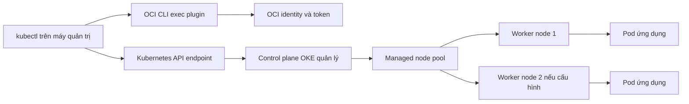

# Tạo cluster, node pools và cấu hình kubectl

Trong chương **Kubernetes với OKE**, việc tạo cluster cần được đặt trong toàn bộ kiến trúc Oracle Cloud Infrastructure (OCI): tenancy và compartment chứa tài nguyên, IAM xác định quyền, VCN cung cấp đường mạng, còn Compute cung cấp năng lực chạy ứng dụng. Cluster hoạt động đúng khi các lớp này được cấu hình nhất quán và client kết nối bằng đúng identity.

Bài học hướng dẫn tạo cluster Oracle Kubernetes Engine (OKE), thêm managed node pool, tạo kubeconfig và kiểm tra bằng `kubectl`. Các lệnh trên máy cá nhân dùng **PowerShell**. Tên tài nguyên là ví dụ; thay mọi giá trị `<...>` bằng thông tin thực tế trước khi chạy.

## 1. Kết quả cần đạt

Sau bài học, người học có thể:

- Phân biệt cluster, control plane, node pool, worker node và Pod.
- Chuẩn bị IAM, mạng, quota và công cụ trước khi cấp phát tài nguyên.
- Tạo cluster và managed node pools trong đúng compartment và region.
- Sinh kubeconfig gắn với đúng OCI CLI profile và authentication context.
- Kiểm tra kết nối, quyền truy cập, trạng thái node và một workload nhỏ.
- Chẩn đoán lỗi theo lớp và thu hồi tài nguyên sau thực hành.

## 2. Hiểu các thành phần và trách nhiệm vận hành

| Thành phần | Vai trò | Cấu hình cần quan tâm |
|---|---|---|
| Cluster | Phạm vi quản lý đối tượng Kubernetes | Phiên bản, loại cluster, endpoint, mạng |
| Control plane | Cung cấp API, lập lịch, duy trì trạng thái mong muốn | Cấu hình dịch vụ và quyền truy cập |
| Node pool | Nhóm worker nodes có cấu hình cấp phát chung | Số node, shape, image, subnet, placement, labels |
| Managed worker node | Compute instance chạy kubelet và container | Khả năng phục vụ, vòng đời và cập nhật node |
| Pod | Đơn vị chạy container được lập lịch lên node | Image, resource requests, cấu hình ứng dụng |
| Kubeconfig | Cấu hình truy cập cluster của client | Endpoint, CA, identity và context |

OKE quản lý control plane của dịch vụ. Managed nodes chạy trong tenancy của người dùng theo mô hình trách nhiệm chia sẻ; người vận hành vẫn cần quản lý capacity và vòng đời worker. Xem [Working with Managed Nodes](https://docs.oracle.com/en-us/iaas/Content/ContEng/Tasks/contengworkingwithmanagednodes.htm).

Một cluster có thể được tạo trước khi có node pool. Khi đó, API có thể truy cập được nhưng chưa có worker để chạy ứng dụng. Trạng thái `Active` trên OCI và trạng thái node `Ready` trong Kubernetes là hai bằng chứng cần kiểm tra riêng.



Sơ đồ biểu diễn các vai trò và tương tác chính. Đường mạng, xác thực và quyền thao tác cần được kiểm chứng riêng.

## 3. Chuẩn bị lab, tenancy và công cụ

### 3.1. Cấu hình minh họa

| Thuộc tính | Giá trị hoặc cách chọn |
|---|---|
| Compartment | `OkeLab`, dành riêng cho thực hành |
| Cluster | `oke-lab` |
| Kubernetes | Phiên bản ổn định đang được OKE hỗ trợ tại region |
| API endpoint | Public, giới hạn nguồn quản trị theo IP/CIDR được phép |
| Workers | Managed nodes trong private subnet |
| Pool ban đầu | Một pool với một node để kiểm chứng chức năng |
| Shape và image | Có capacity, OKE image khớp Kubernetes và kiến trúc CPU |
| Pod networking | Ghi lại loại CNI được chọn trong workflow |
| Kubeconfig | File riêng `oke-lab.yaml` |
| OCI tags | Ví dụ `environment=lab`, `owner=<nguoi-phu-trach>` |

Một node phù hợp để bắt đầu lab nhưng chưa cung cấp dự phòng khi node lỗi. Khi cần tính sẵn sàng, phải thiết kế số node, placement và phân bố replica theo yêu cầu ứng dụng.

### 3.2. Kiểm tra region, quota và capacity

Trước khi tạo:

1. Xác nhận tenancy đã đăng ký region có OKE.
2. Chọn đúng compartment cho cluster, node pool và mạng.
3. Kiểm tra giới hạn cluster, Compute, OCPU, bộ nhớ, boot volumes và địa chỉ IP cần sử dụng.
4. Kiểm tra capacity của shape tại placement dự kiến.
5. Xác định ngân sách và thời hạn giữ tài nguyên lab.

Quota và capacity là hai điều kiện khác nhau. Tenancy còn quota vẫn có thể gặp thiếu capacity cho shape ở một availability domain cụ thể. Xem [Preparing for Kubernetes Engine](https://docs.oracle.com/en-us/iaas/Content/ContEng/Concepts/contengprerequisites.htm).

### 3.3. Cài đặt và kiểm tra công cụ

Máy cá nhân cần OCI CLI, `kubectl` và OCI CLI profile đã cấu hình. Nếu dùng API signing key, public key được đăng ký cho OCI user, còn private key được bảo vệ trên máy chạy CLI. API signing key phục vụ OCI API; SSH key của node phục vụ đăng nhập hệ điều hành.

Tham khảo [cài OCI CLI](https://docs.oracle.com/en-us/iaas/Content/API/SDKDocs/cliinstall.htm) và [cài kubectl trên Windows](https://kubernetes.io/docs/tasks/tools/install-kubectl-windows/).

```powershell
Get-Command oci
Get-Command kubectl
oci --version
kubectl version --client
```

Dùng `kubectl` trong phạm vi phiên bản tương thích với API server. Kubernetes hỗ trợ client lệch tối đa một minor version so với `kube-apiserver`; đồng thời cần tuân theo giới hạn của OKE. Xem [Version Skew Policy](https://kubernetes.io/releases/version-skew-policy/).

Chọn phiên bản Kubernetes theo danh sách OKE đang cung cấp, thay vì cố định một phiên bản từ ví dụ cũ. Với cluster mới trong lab, chọn cùng phiên bản được hỗ trợ cho control plane và worker để giảm biến số.

## 4. Chuẩn bị IAM và ranh giới quyền

Phân biệt quyền quản lý tài nguyên OCI với quyền thao tác đối tượng Kubernetes. Tạo VCN, node pool hoặc Compute là thao tác OCI; tạo Deployment, đọc Pod hoặc quản lý namespace đi qua Kubernetes API.

Ví dụ nhóm `OkeLabOperators` quản trị một compartment lab có thể cần các policy sau:

```text
Allow group OkeLabOperators to manage cluster-family in compartment OkeLab
Allow group OkeLabOperators to manage instance-family in compartment OkeLab
Allow group OkeLabOperators to manage volume-family in compartment OkeLab
Allow group OkeLabOperators to manage virtual-network-family in compartment OkeLab
Allow group OkeLabOperators to inspect compartments in tenancy
```

Đây là ví dụ quyền quản trị lab, không phải bộ quyền tối thiểu cho mọi vai trò. Điều chỉnh group theo identity domain; bổ sung phạm vi thích hợp nếu dùng mạng ở compartment khác hoặc khóa mã hóa riêng. Đối chiếu [Policy Configuration for Cluster Creation and Deployment](https://docs.oracle.com/en-us/iaas/Content/ContEng/Concepts/contengpolicyconfig.htm).

OCI IAM và Kubernetes RBAC phối hợp để cấp quyền trong OKE. Một quyền rộng đã được IAM cho phép không mặc nhiên bị thu hẹp bởi RoleBinding trong namespace. Cần rà soát cả hai phía trước khi cấp quyền cho nhóm ứng dụng. Xem [About Access Control and Kubernetes Engine](https://docs.oracle.com/en-us/iaas/Content/ContEng/Concepts/contengaboutaccesscontrol.htm).

Tạo kubeconfig thành công chưa chứng minh người dùng có quyền liệt kê nodes hoặc triển khai ứng dụng. Kiểm tra từng thao tác bằng identity thực tế, với đúng resource và namespace.

## 5. Thiết kế mạng cho API, workers và Pods

### 5.1. API endpoint công khai và workers riêng

Lab sử dụng public API endpoint để máy cá nhân quản trị trực tiếp, còn worker nodes đặt trong private subnet. Giới hạn nguồn quản trị bằng IP public hoặc CIDR được phép; với laptop sau NAT, đây thường là IP egress của mạng đang dùng.

Các luồng cần có:

| Luồng | Mục đích |
|---|---|
| Máy quản trị → API endpoint | Gọi Kubernetes API, thường qua TCP/6443 |
| Workers → API và dịch vụ OCI liên quan | Đăng ký node và thực hiện công việc |
| Control plane → workers/Pods | Quản lý workload, bao gồm đường phục vụ logs/exec |
| Nodes/Pods → registry | Kéo container image |
| Thành phần trong cluster → DNS và nhau | Phân giải tên, giao tiếp theo CNI |

Đối chiếu đầy đủ route và security rules cho mô hình CNI đã chọn. Mở một cổng từ laptop chỉ giải quyết một đường truy cập. Xem [Network Resource Configuration](https://docs.oracle.com/en-us/iaas/Content/ContEng/Concepts/contengnetworkconfig.htm).

Khi có cả NSG và security list, rà soát toàn bộ rule áp dụng. Thêm rule hẹp không vô hiệu hóa một rule rộng đang tồn tại. Giữ các luồng nội bộ mà OKE yêu cầu khi thay đổi nguồn truy cập quản trị.

### 5.2. Đường ra của private workers

Workers cần đường tới registry và các dịch vụ cần dùng. NAT Gateway có thể phục vụ internet outbound; Service Gateway phục vụ các dịch vụ được hỗ trợ trong Oracle Services Network. Một Service Gateway không tạo đường tới mọi public registry.

Với workload mẫu dùng public image, xác nhận DNS, route và egress ra registry. Node có thể `Ready` nhưng Pod vẫn `ImagePullBackOff` nếu image không tải được.

### 5.3. CNI và dung lượng địa chỉ

Với OCI VCN-Native Pod Networking, Pods sử dụng địa chỉ từ pod subnet theo cơ chế CNI của OCI. Khi tính quy mô, cần xét IP cho Pods và khả năng mạng của shape. Xem [OCI VCN-Native Pod Networking](https://docs.oracle.com/en-us/iaas/Content/ContEng/Concepts/contengpodnetworking_topic-OCI_CNI_plugin.htm).

Khi dùng Custom Create, kiểm tra yêu cầu CIDR của VCN, Pod và Service để tránh xung đột với mạng hiện có hoặc mạng sẽ kết nối bằng peering/VPN. Ghi lại loại CNI và tài nguyên mạng thực tế để phục vụ vận hành.

## 6. Tạo cluster trên OCI Console

### 6.1. Chọn workflow và loại cluster

OKE có hai workflow chính:

- **Quick Create:** dùng nhiều giá trị mặc định và tạo mới tài nguyên mạng cần thiết; thuận tiện cho compartment thực hành riêng.
- **Custom Create:** chọn cấu hình rõ hơn và dùng mạng đã chuẩn bị; phù hợp khi cần kiểm soát VCN, subnet và security từ thiết kế ban đầu.

Tham khảo [Creating Kubernetes Clusters Using Console Workflows](https://docs.oracle.com/en-us/iaas/Content/ContEng/Tasks/contengcreatingclusterusingoke.htm).

Cluster có loại **basic** và **enhanced**. Managed node pools dùng được với cả hai; một số tính năng như virtual nodes cần enhanced cluster. Xem loại cluster, tính năng và chính sách phí trên trang Review trước khi tạo. Tham khảo [OKE and Kubernetes Concepts](https://docs.oracle.com/en-us/iaas/Content/ContEng/Concepts/contengclustersnodes.htm).

### 6.2. Thực hiện Quick Create

Tìm **Kubernetes Clusters (OKE)** trong OCI Console, chọn đúng region và compartment:

1. Chọn **Create cluster → Quick create**.
2. Nhập tên `oke-lab`, chọn phiên bản Kubernetes ổn định đang được hỗ trợ.
3. Chọn public API endpoint cho đường truy cập từ máy cá nhân.
4. Chọn **Managed**, private workers, shape và OKE image tương thích.
5. Đặt số node theo ngân sách, ví dụ một node để kiểm chứng chức năng.
6. Rà soát cấu hình mạng, pool, loại cluster và chi phí rồi xác nhận tạo.

Workflow có thể tự đặt tên pool đầu tiên và tài nguyên mạng. Ghi lại tên cùng OCID để theo dõi. Chi tiết tại [Quick Create workflow](https://docs.oracle.com/en-us/iaas/Content/ContEng/Tasks/contengcreatingclusterusingoke_topic-Using_the_Console_to_create_a_Quick_Cluster_with_Default_Settings.htm).

Sau khi mạng được tạo, rà soát nguồn cho phép truy cập API endpoint và giới hạn theo IP/CIDR quản trị. Nếu cần kiểm soát các rule ngay từ lúc cấp phát, dùng Custom Create với mạng đã cấu hình sẵn.

Theo dõi **Work requests** đến khi hoàn tất. Nếu lỗi, đọc thông báo và ghi lại tài nguyên liên quan trước khi thử lại; việc tạo cluster thất bại có thể để lại tài nguyên cần thu hồi.

### 6.3. Thực hiện Custom Create khi đã có mạng

Chuẩn bị VCN, subnet endpoint, subnet worker, pod subnet nếu CNI yêu cầu, route và security rules. Trong workflow, chọn đúng OCID của các tài nguyên đó, sau đó cấu hình node pool theo nhu cầu.

Có thể tạo cluster chưa có pool rồi thêm workers sau để tách việc cấp phát control plane khỏi việc cấp phát Compute. Xem [Custom Create workflow](https://docs.oracle.com/en-us/iaas/Content/ContEng/Tasks/contengcreatingclusterusingoke_topic-Using_the_Console_to_create_a_Custom_Cluster_with_Explicitly_Defined_Settings.htm).

## 7. Tạo và quản lý managed node pools

### 7.1. Tạo pool bổ sung

Mở cluster, chọn **Node pools → Add node pool**. Ví dụ thêm `pool-batch` với một node nếu ngân sách cho phép.

| Trường | Điều cần kiểm tra |
|---|---|
| Compartment | Đúng phạm vi được cấp quyền |
| Node type | Managed cho lab này |
| Kubernetes version | Khớp cấu hình dự kiến và giới hạn tương thích với control plane |
| Image | OKE image khớp phiên bản Kubernetes và kiến trúc CPU |
| Shape | Đủ CPU, RAM và khả năng mạng; có capacity |
| Node count | Số node muốn có trong pool |
| Placement | Availability domain, fault domain và worker subnet |
| Kubernetes labels | Ví dụ `workload=batch` |
| OCI tags | Chủ sở hữu, môi trường và theo dõi chi phí |
| Boot volume | Dung lượng và lựa chọn mã hóa |

Theo dõi work request và các nodes được tạo. Tham khảo [Adding Node Pools](https://docs.oracle.com/en-us/iaas/Content/ContEng/Tasks/contengaddingnodepools_topic.htm).

Image ứng dụng cũng phải tương thích với kiến trúc worker. Khi chuyển giữa x86 và Arm, kiểm tra manifest của container image; kết quả chạy trên laptop không đại diện cho mọi shape.

### 7.2. Kubernetes label và OCI tag

OCI tag phục vụ quản trị tài nguyên cloud. Kubernetes label phục vụ nhận diện, lọc và chọn đối tượng trong cluster.

Nếu nodes của `pool-batch` có label `workload=batch`, Pod template có thể chọn chúng:

```yaml
spec:
  template:
    spec:
      nodeSelector:
        workload: batch
```

Đây là đoạn trích của Deployment. Nếu không có node mang nhãn phù hợp, Pod có thể `Pending`. Việc dành riêng một pool cho workload có thể cần thêm taint/toleration; label đơn lẻ chưa tạo ranh giới bảo mật. Xem [Assigning Pods to Nodes](https://kubernetes.io/docs/concepts/scheduling-eviction/assign-pod-node/).

Khai báo label trong cấu hình pool để node tạo mới có cấu hình dự kiến. Label chỉ gán thủ công cho một node cần được tính tới khi node bị thay thế.

### 7.3. Scale và cập nhật

Tăng số node bổ sung năng lực hạ tầng; tăng replica bổ sung số Pod mong muốn. Hai thao tác cần phối hợp để workload có đủ chỗ lập lịch. Tham khảo [Scaling Kubernetes Clusters and Node Pools](https://docs.oracle.com/en-us/iaas/Content/ContEng/Tasks/contengscalingkubernetesclustersnodepools.htm).

Đổi image hoặc phiên bản trong cấu hình pool chưa đồng nghĩa các node hiện có đã được cập nhật. Cần thay thế nodes theo quy trình phù hợp, kết hợp kiểm tra gián đoạn ứng dụng. Xem [Creating Worker Nodes with Updated Properties](https://docs.oracle.com/en-us/iaas/Content/ContEng/Tasks/contengupgradingimageworkernode.htm).

Trước khi giảm node count, kiểm tra resource requests, dữ liệu cục bộ, workload đang chạy và PodDisruptionBudget. Khi cần HA, phân bố nodes và replica trên miền lỗi phù hợp.

## 8. Kiểm tra cluster và pools bằng OCI CLI

Sau khi cluster được tạo, sao chép Cluster OCID từ trang chi tiết. Chuẩn bị biến trong PowerShell:

```powershell
$ociRegion = '<region-id>'
$ociProfile = 'OKE_LAB'
$ociAuth = 'api_key'
$okeClusterId = '<cluster-ocid>'
$okeCompartmentId = '<compartment-ocid>'
$okeKubeconfig = Join-Path $HOME '.kube\oke-lab.yaml'
```

`OKE_LAB` phải trùng profile thực tế. Ví dụ dùng API key; nếu tổ chức dùng security token, chọn profile và auth tương ứng, bảo đảm phiên còn hiệu lực.

Kiểm tra cluster:

```powershell
oci ce cluster get --cluster-id $okeClusterId --region $ociRegion --profile $ociProfile --auth $ociAuth
```

Đọc region, compartment, trạng thái và endpoint. Nếu CLI báo không được phép hoặc không thấy tài nguyên, kiểm tra đồng thời OCID, region, profile và policy.

Liệt kê node pools:

```powershell
oci ce node-pool list --compartment-id $okeCompartmentId --cluster-id $okeClusterId --all --region $ociRegion --profile $ociProfile --auth $ociAuth
```

Lệnh chỉ liệt kê trong compartment chỉ định. Pool ở compartment khác cần truy vấn đúng nơi chứa nó. Xem [OCI CLI: node-pool list](https://docs.oracle.com/en-us/iaas/tools/oci-cli/latest/oci_cli_docs/cmdref/ce/node-pool/list.html).

## 9. Tạo kubeconfig và cố định authentication context

### 9.1. Sinh kubeconfig riêng cho lab

File riêng giúp nhận diện cluster rõ ràng. Nếu file đã tồn tại, kiểm tra cluster và context có sẵn trước khi dùng tiếp.

```powershell
New-Item -ItemType Directory -Path (Split-Path -Parent $okeKubeconfig) -Force | Out-Null

$okeKubeconfigArgs = @(
    'ce', 'cluster', 'create-kubeconfig',
    '--cluster-id', $okeClusterId,
    '--file', $okeKubeconfig,
    '--region', $ociRegion,
    '--profile', $ociProfile,
    '--auth', $ociAuth,
    '--token-version', '2.0.0',
    '--kube-endpoint', 'PUBLIC_ENDPOINT',
    '--with-auth-context'
)
oci @okeKubeconfigArgs
if ($LASTEXITCODE -ne 0) {
    throw 'Khong tao duoc kubeconfig; kiem tra loi OCI CLI truoc khi tiep tuc.'
}
```

`--kube-endpoint` chọn endpoint mà client sử dụng. `--with-auth-context` đưa lựa chọn profile/auth hiện tại vào exec command của kubeconfig. `--overwrite` ghi đè file và không cần dùng trong ví dụ này. Tham khảo [OCI CLI: create-kubeconfig](https://docs.oracle.com/en-us/iaas/tools/oci-cli/latest/oci_cli_docs/cmdref/ce/cluster/create-kubeconfig.html).

### 9.2. Cơ chế xác thực

Kubeconfig OKE sử dụng OCI CLI như exec plugin để tạo token ngắn hạn theo cluster và identity. Vì vậy, môi trường chạy `kubectl` cần tìm thấy `oci` và dùng được thông tin xác thực tương ứng. Sao chép kubeconfig sang máy khác chưa cấp quyền cho identity trên máy đó. Xem [Setting Up Cluster Access](https://docs.oracle.com/en-us/iaas/Content/ContEng/Tasks/contengdownloadkubeconfigfile.htm).

Token version `2.0.0` của OKE khác số phiên bản Kubernetes và khác trường `apiVersion` trong cấu hình Kubernetes.

Chọn file cho phiên PowerShell hiện tại:

```powershell
$okePreviousKubeconfig = $env:KUBECONFIG
$env:KUBECONFIG = $okeKubeconfig
kubectl config get-contexts
kubectl config current-context
kubectl config view --minify
```

Kiểm tra endpoint và mục exec, đặc biệt là profile/auth được dùng. Các lệnh `kubectl config` chủ yếu kiểm tra cấu hình phía client; kết quả thành công chưa chứng minh kết nối đến API server.

### 9.3. Quản lý context

Context liên kết cluster, user và namespace mặc định. Kiểm tra context trước thao tác tạo/xóa và chỉ rõ namespace khi cần. Xem [Organizing Cluster Access Using kubeconfig Files](https://kubernetes.io/docs/concepts/configuration/organize-cluster-access-kubeconfig/).

Có thể đổi tên context trong file lab:

```powershell
$okeOriginalContext = kubectl config current-context
kubectl config rename-context $okeOriginalContext 'oke-lab'
kubectl config use-context 'oke-lab'
```

Khi dùng nhiều cluster, có thể truyền `--kubeconfig` và `--context` cho từng lệnh. Giữ kubeconfig ngoài repository dùng chung và kiểm tra nguồn trước khi dùng một kubeconfig được cung cấp từ bên ngoài.

## 10. Truy cập private API endpoint và Cloud Shell

Với private API endpoint, tạo kubeconfig trỏ tới `PRIVATE_ENDPOINT`. Thay tham số này chỉ thay địa chỉ đích; nó không tạo đường mạng từ laptop vào VCN.

Chuẩn bị một đường quản trị được phép: máy trong VCN, mạng kết nối qua VPN/FastConnect, hoặc giải pháp OCI Bastion được cấu hình cho cluster. Kiểm tra route, DNS, firewall và NSG/security list trên toàn đường đi.

Nếu dùng tunnel, làm theo hướng dẫn truy cập cluster của OCI, bao gồm cấu hình endpoint và xác minh TLS phù hợp. Cần giải quyết đúng sự khác biệt giữa địa chỉ tunnel và địa chỉ trong chứng chỉ thay vì bỏ qua việc kiểm chứng API server.

Cloud Shell cung cấp môi trường công cụ OCI nhưng khả năng tới endpoint vẫn phụ thuộc mạng. Rule chỉ cho phép IP egress của laptop có thể không cho phép Cloud Shell. Đăng nhập Console cũng không tự tạo đường đến endpoint riêng.

Trong trang cluster, chọn **Access cluster** để lấy hướng dẫn local access hoặc Cloud Shell access. Tạo kubeconfig trong đúng môi trường chạy `kubectl`; các ví dụ PowerShell của bài cần được chuyển sang cú pháp Bash nếu thực hiện trong Cloud Shell.

## 11. Xác minh kết nối, quyền và trạng thái node

### 11.1. API và đường mạng

```powershell
kubectl cluster-info
kubectl version
```

Kết quả cần thể hiện client giao tiếp được với server đích. Nếu có nhiều context, đối chiếu lại cluster đang dùng.

Kiểm tra TCP từ Windows:

```powershell
$okeApiEndpoint = kubectl config view --minify -o jsonpath='{.clusters[0].cluster.server}'
$okeApiUri = [Uri]$okeApiEndpoint
Test-NetConnection -ComputerName $okeApiUri.Host -Port $okeApiUri.Port
```

TCP thành công chỉ xác nhận đường tới cổng. TLS, xác thực và quyền thao tác tiếp tục cần kiểm tra qua Kubernetes API.

### 11.2. Quyền và workers

```powershell
kubectl auth can-i list nodes
kubectl get nodes -o wide
kubectl get nodes -L workload,kubernetes.io/arch,topology.kubernetes.io/zone
kubectl get pods -n kube-system -o wide
```

Kỳ vọng số worker nodes tương ứng với các pool đã cấp phát và nodes ở trạng thái `Ready`. Tên, IP và phiên bản phụ thuộc môi trường. Control plane do OKE quản lý thường không xuất hiện như worker nodes để người dùng thao tác.

Người dùng chỉ có quyền trên namespace có thể gặp `Forbidden` khi đọc nodes. Quản trị viên kiểm tra tài nguyên cấp cluster bằng identity phù hợp; người triển khai kiểm tra quyền cần thiết trong namespace được giao.

Khi node có vấn đề:

```powershell
kubectl describe node <node-name>
kubectl get events -A --sort-by=.metadata.creationTimestamp
```

Đối chiếu sự kiện Kubernetes với work requests và tình trạng Compute. Compute instance đang chạy chưa chứng minh kubelet đã đăng ký thành công và node đã sẵn sàng.

## 12. Chạy workload nhỏ để kiểm chứng

Phần này kiểm tra scheduling, image pull và phản hồi HTTP. Cần quyền tạo namespace hoặc nhờ quản trị viên tạo trước `oke-lab`.

```powershell
kubectl create namespace oke-lab
kubectl auth can-i create deployments.apps -n oke-lab
kubectl auth can-i get pods -n oke-lab
kubectl auth can-i create pods/portforward -n oke-lab
```

Nếu namespace đã tồn tại, xác nhận đúng môi trường trước khi tiếp tục. Nếu thiếu quyền, xử lý theo vai trò được giao.

Lưu manifest sau thành `oke-smoke.yaml` trong thư mục thực hành của máy chạy `kubectl`:

```yaml
apiVersion: apps/v1
kind: Deployment
metadata:
  name: oke-smoke
  namespace: oke-lab
spec:
  replicas: 1
  selector:
    matchLabels:
      app: oke-smoke
  template:
    metadata:
      labels:
        app: oke-smoke
    spec:
      containers:
        - name: web
          image: nginx:stable-alpine
          ports:
            - name: http
              containerPort: 80
          resources:
            requests:
              cpu: 100m
              memory: 64Mi
            limits:
              cpu: 500m
              memory: 128Mi
          readinessProbe:
            httpGet:
              path: /
              port: http
            initialDelaySeconds: 2
            periodSeconds: 5
```

Tag `stable-alpine` là ví dụ thuận tiện và có thể thay đổi nội dung. Khi cần tái lập, chọn image đã kiểm chứng và pin digest. Xác nhận kiến trúc, đường tới registry và chính sách bảo mật namespace. Nếu có Pod Security hạn chế, dùng image cùng security context đáp ứng chính sách đó.

```powershell
kubectl apply -f .\oke-smoke.yaml
kubectl -n oke-lab rollout status deployment/oke-smoke --timeout=180s
kubectl -n oke-lab get pods -o wide
```

Deployment duy trì số replica mong muốn qua cơ chế controller; tham khảo [Kubernetes Deployments](https://kubernetes.io/docs/concepts/workloads/controllers/deployment/).

Khi Pod sẵn sàng, chạy trong terminal thứ nhất:

```powershell
kubectl -n oke-lab port-forward deployment/oke-smoke 8080:80
```

Giữ terminal đó chạy. Trong terminal PowerShell khác trên cùng máy:

```powershell
(Invoke-WebRequest -Uri 'http://127.0.0.1:8080').StatusCode
```

Kỳ vọng HTTP `200`. Port-forward kiểm chứng một đường truy cập tới Pod qua API; kết quả này chưa xác nhận ingress công khai, Service `LoadBalancer` hoặc DNS giữa các Pods. Xem [Use Port Forwarding](https://kubernetes.io/docs/tasks/access-application-cluster/port-forward-access-application-cluster/).

Nếu có `pool-batch` và node mang label `workload=batch` đã `Ready`, thêm `nodeSelector` vào `spec.template.spec` của manifest, apply lại rồi quan sát cột `NODE`. Đoạn selector minh họa ở phần node pools cho biết đúng vị trí cần đặt cấu hình.

## 13. Chẩn đoán lỗi theo lớp

| Hiện tượng | Kiểm tra trước |
|---|---|
| Không tìm thấy `oci` hoặc `kubectl` | Cài đặt, PATH và terminal đang dùng |
| OCI CLI báo không được phép/không thấy tài nguyên | Profile, auth, region, OCID, compartment, IAM |
| Có kubeconfig nhưng timeout | Endpoint, route, IP nguồn, NSG/security list và đường tới VCN |
| `exec: executable oci not found` | PATH của tiến trình thực sự chạy `kubectl` |
| `Unauthorized` | Identity, API key/phiên security token và authentication context |
| `Forbidden` | IAM/RBAC cho đúng verb, resource và namespace |
| Lỗi chứng chỉ hoặc hostname | CA, endpoint, context, proxy/tunnel và đồng hồ máy |
| Chưa có worker | Pool chưa cấp phát, quota/capacity hoặc node chưa đăng ký |
| Node `NotReady` | Conditions, kubelet, CNI, tài nguyên và mạng |
| Pod `Pending` | Requests, selector, taint, IP khả dụng và sự kiện scheduling |
| `ImagePullBackOff` | Image/tag, credential registry, DNS, egress và kiến trúc |
| Pod chạy nhưng HTTP chưa sẵn sàng | Readiness probe, ứng dụng, logs và cổng lắng nghe |

Thu thập bằng chứng ở namespace lab:

```powershell
kubectl -n oke-lab describe deployment oke-smoke
kubectl -n oke-lab describe pod <pod-name>
kubectl -n oke-lab logs deployment/oke-smoke
kubectl -n oke-lab get events --sort-by=.metadata.creationTimestamp
```

Nếu đọc nodes được nhưng `logs`, `exec` hoặc port-forward lỗi, kiểm tra cả quyền subresource và đường giao tiếp control plane–worker. Kết nối từ laptop tới API mới xác nhận một phần của hệ thống.

Với lỗi cấp phát, ghi lại work request OCID, thời điểm, thông báo và cấu hình liên quan trước khi thử lại. Thay đổi từng lớp giúp xác định nguyên nhân dễ hơn.

## 14. Chi phí, tự động hóa và thu hồi lab

### 14.1. Theo dõi tài nguyên còn tồn tại

Chi phí có thể gồm loại cluster, Compute workers, boot volumes, mạng, lưu lượng và các tài nguyên bổ sung như load balancer hoặc persistent volumes. Khi không có Pod ứng dụng, Compute và storage vẫn có thể đang được cấp phát.

Theo dõi bằng tag và compartment, dùng đơn giá hiện hành của region, xác định thời hạn giữ lab. Giảm số nodes chưa thu hồi toàn bộ tài nguyên liên quan. Budget/cảnh báo hỗ trợ quan sát chi tiêu; quy trình dọn tài nguyên vẫn cần thực hiện rõ ràng.

### 14.2. Ghi lại cấu hình để tái tạo

Lưu trong tài liệu vận hành hoặc cấu hình IaC của dự án:

- Region, compartment, cluster type và phiên bản Kubernetes.
- VCN, subnet, CNI, endpoint và nguồn quản trị được phép.
- Shape, image, kiến trúc, node count, placement, labels và tags của từng pool.
- Cách xác thực, mô hình quyền, registry và các phụ thuộc mã hóa.
- Giám sát, người chịu trách nhiệm và quy trình cập nhật.

Có thể dùng Terraform/OCI Resource Manager để tái tạo cấu hình. Workflow tạo cluster có hướng lưu thành stack ở các bước phù hợp; rà soát biến và state trước khi sử dụng lại. Identity cho tự động hóa cần có phạm vi quyền phù hợp với môi trường chạy.

### 14.3. Dọn tài nguyên sau thực hành

Dừng port-forward bằng `Ctrl+C`. Kiểm tra context rồi xóa namespace chỉ dành cho lab:

```powershell
kubectl config current-context
kubectl delete namespace oke-lab
```

Chờ đối tượng được thu hồi. Nếu đã tạo thêm Services kiểu `LoadBalancer`, PVC hoặc tài nguyên ngoài manifest mẫu, kiểm tra kết quả thu hồi theo controller và reclaim policy trước khi xóa cluster.

Trong OCI Console:

1. Xác nhận cluster cùng các pools thuộc đúng lab.
2. Xóa cluster và theo dõi công việc đến khi hoàn tất.
3. Rà soát volumes, load balancers, VCN, subnets, gateways và tài nguyên liên quan còn tồn tại.
4. Chỉ xóa tài nguyên mạng sau khi xác nhận không có hệ thống khác sử dụng.

OKE không tự xóa mọi tài nguyên liên quan khi xóa cluster. Xem [Deleting Kubernetes Clusters](https://docs.oracle.com/en-us/iaas/Content/ContEng/Tasks/contengdeletingcluster.htm).

Khôi phục `KUBECONFIG` nếu đã lưu giá trị trước đó trong cùng phiên PowerShell:

```powershell
$env:KUBECONFIG = $okePreviousKubeconfig
```

## 15. Xác nhận kết quả thực hành

| Kết quả | Bằng chứng |
|---|---|
| Cluster đúng phạm vi | Region, compartment, OCID và work request thành công |
| Pools cấp phát đúng | Node count, shape, image, subnet và placement |
| Client dùng đúng identity | Endpoint, profile, auth và context phù hợp |
| API và quyền hoạt động | Thực hiện được các thao tác cần thiết |
| Workers chạy workload | Nodes `Ready`, rollout thành công, Pod được gán node |
| Đường HTTP kiểm tra hoạt động | HTTP `200` qua port-forward |
| Tài nguyên được quản lý sau lab | Cấu hình được ghi lại, tài nguyên không dùng đã thu hồi |

Các bằng chứng này xác nhận nền tảng ban đầu để làm việc với OKE. Khi đưa ứng dụng vào production, cần tiếp tục thiết kế và kiểm chứng tính sẵn sàng, bảo vệ dữ liệu, bảo mật workload, giám sát và quy trình nâng cấp theo yêu cầu thực tế.
