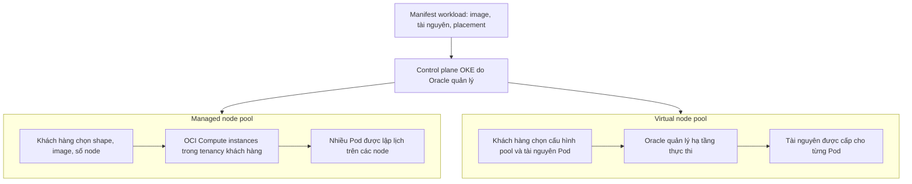
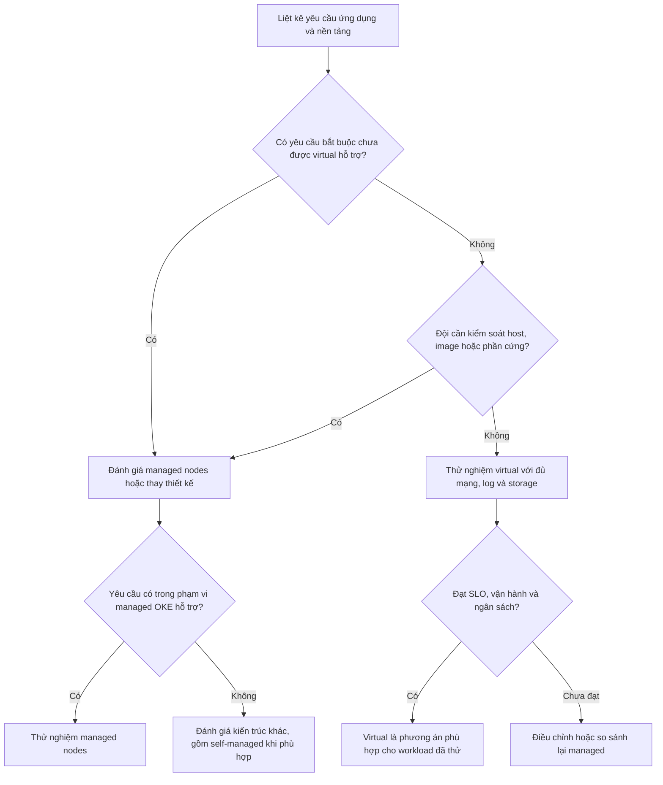

# Managed nodes, virtual nodes và lựa chọn kiểu triển khai

## 1. Mục tiêu của quyết định triển khai

Trong chương **Kubernetes với OKE** của lộ trình Oracle Cloud Infrastructure (OCI), chọn kiểu node là quyết định về tài nguyên, quyền kiểm soát và phần công việc đội vận hành phải nhận. Quyết định này liên quan trực tiếp đến Compute, VCN, IAM, lưu trữ, giám sát và chi phí.

Bài tập trung vào hai mô hình OKE:

- **Managed nodes:** chạy workload trên các OCI Compute instances được OKE cấp phát trong tenancy khách hàng.
- **Virtual nodes:** chạy workload với hạ tầng node do Oracle quản lý, cấp tài nguyên ở mức Pod.

Đội cần trả lời được: workload chạy ở đâu, ai quản lý máy chủ, tài nguyên được cấp như thế nào và những yêu cầu nào có thể khiến một mô hình không phù hợp.

Sau bài này, người học có thể phân biệt hai mô hình, kiểm tra khả năng tương thích của workload, tổ chức một cluster dùng nhiều kiểu node và lập phương án triển khai có bằng chứng về tính sẵn sàng, khả năng quan sát và chi phí.

Ví dụ xuyên suốt là một ứng dụng Java tên `orders-api`, kết nối tới dịch vụ cơ sở dữ liệu Oracle qua mạng riêng. Các số tài nguyên trong bài là giả định phục vụ giải thích, không phải cấu hình khuyến nghị cho mọi ứng dụng Java.

## 2. Hiểu đúng managed và virtual

### 2.1. Managed nodes: OKE cấp phát node, khách hàng tổ chức vận hành

Managed node là OCI Compute instance, có thể là máy ảo hoặc bare metal theo khả năng hỗ trợ. OKE tạo các node thành managed node pool. Bạn chọn những thuộc tính như shape, image, vị trí triển khai, mạng và số node. Bạn còn phải tổ chức dung lượng và nâng cấp worker nodes. [Nguồn: So sánh managed với virtual nodes](https://docs.oracle.com/en-us/iaas/Content/ContEng/Tasks/contengcomparingmanagednodeswithvirtualnodes_topic.htm).

Ví dụ, đội tạo pool cho các dịch vụ Java và pool riêng cho thành phần hạ tầng. Khi cần thêm dung lượng cho ứng dụng, đội tăng kích thước pool hoặc dùng autoscaler được cấu hình phù hợp. Khi cần cập nhật hệ điều hành, đội lên kế hoạch đưa image mới vào sử dụng.

Từ “managed” không có nghĩa khách hàng được miễn trách nhiệm với worker. OKE cung cấp cơ chế cấp phát và cập nhật phần mềm Kubernetes, còn vận hành là trách nhiệm chia sẻ. [Nguồn: Làm việc với managed nodes](https://docs.oracle.com/en-us/iaas/Content/ContEng/Tasks/contengworkingwithmanagednodes.htm).

### 2.2. Virtual nodes: tập trung vào Pod thay vì máy chủ

Virtual nodes cung cấp trải nghiệm Kubernetes serverless. Oracle quản lý virtual nodes và hạ tầng thực thi phía dưới; người dùng tạo virtual node pool và khai báo nhu cầu CPU, bộ nhớ của workload. Mô hình này giảm công việc quản lý dung lượng máy chủ, vá và nâng cấp hạ tầng node. [Nguồn: Làm việc với virtual nodes](https://docs.oracle.com/en-us/iaas/Content/ContEng/Tasks/contengworkingwithvirtualnodes.htm).

Virtual node không phải VM mà kỹ sư có thể SSH vào để cài package hoặc sửa cấu hình host. Cách chẩn đoán và triển khai công cụ phụ trợ phải phù hợp với bề mặt chức năng dịch vụ cung cấp.

### 2.3. Hai kiểu worker cùng dùng control plane được quản lý



Sơ đồ nhấn mạnh đơn vị điều khiển tài nguyên. Cả hai mô hình vẫn cần mạng, quyền, image, health check, quan sát và kế hoạch dữ liệu.

**Loại cluster** là một lựa chọn riêng: managed nodes có thể dùng trong basic hoặc enhanced cluster; virtual nodes yêu cầu enhanced cluster. Việc cần workload identity hoặc khả năng quản lý add-on cũng có thể ảnh hưởng lựa chọn loại cluster. [Nguồn: So sánh basic và enhanced cluster](https://docs.oracle.com/en-us/iaas/Content/ContEng/Tasks/contengcomparingenhancedwithbasicclusters_topic.htm).

Self-managed nodes là mô hình khác, trong đó khách hàng tự tạo Compute instance để tham gia OKE. Chúng không thuộc OKE node pool và chỉ dùng với enhanced cluster. Không nên gọi managed node mà đội có quyền SSH là “self-managed node”. [Nguồn: Self-managed nodes](https://docs.oracle.com/en-us/iaas/Content/ContEng/Tasks/contengworkingwithselfmanagednodes.htm).

## 3. Managed nodes: thiết kế từ dung lượng máy chủ

### 3.1. Những thuộc tính phải quyết định cho một pool

| Nhóm quyết định | Nội dung cần ghi lại | Tác động cần cân nhắc |
| --- | --- | --- |
| Compute | Shape, CPU, bộ nhớ, kiến trúc xử lý | Khả năng chạy image và mật độ Pod |
| Image | Image được hỗ trợ, phiên bản hệ điều hành | Bản vá, công cụ nền tảng, khả năng tái tạo node |
| Kubernetes | Phiên bản worker tương thích control plane | Điều kiện nâng cấp và vận hành add-on |
| Placement | Region, AD/FD, số node ở từng vị trí | Khả năng chịu lỗi và cấp thêm tài nguyên |
| Mạng | Subnet, CNI, NSG, đường ra | Kết nối registry, dịch vụ OCI và dữ liệu |
| Scheduling | Labels, taints, giới hạn pool | Workload nào được phép chạy trên pool |
| Vòng đời | Cách scale, bảo trì và thay node | Gián đoạn và công việc của đội trực |

Danh sách shape tồn tại trong OCI Compute không đồng nghĩa tất cả shape đều dùng được với mọi kiểu OKE worker. Cần đối chiếu danh sách image/shape OKE hỗ trợ và khả năng sẵn có tại region. [Nguồn: Image và shape được hỗ trợ](https://docs.oracle.com/en-us/iaas/Content/ContEng/Reference/contengimagesshapes.htm).

### 3.2. CPU của máy không phải toàn bộ tài nguyên dành cho ứng dụng

Một node cần tài nguyên cho hệ điều hành, kubelet, container runtime và các thành phần khác. Phần Kubernetes công bố là `allocatable` cũng còn phải chia cho các Pod nền tảng và ứng dụng. Khi chẩn đoán thiếu tài nguyên, cần so sánh `capacity`, `allocatable` và tài nguyên đã yêu cầu. [Nguồn: Các vấn đề về node và Pod trên OKE](https://docs.oracle.com/en-us/iaas/Content/ContEng/Tasks/contengtroubleshooting_topic-node_issues.htm).

Ví dụ giả định, sau khi tính phần hệ thống và workload nền tảng, mỗi node còn ngân sách cho ứng dụng là **3 CPU và 10 GiB RAM**. Có tám Pod, mỗi Pod yêu cầu **0,5 CPU và 1 GiB RAM**:

```text
Tổng requests của ứng dụng:
  CPU = 8 × 0,5 = 4 CPU
  RAM = 8 × 1 = 8 GiB

Cận dưới theo tổng tài nguyên:
  Theo CPU: ceil(4 / 3) = 2 node
  Theo RAM: ceil(8 / 10) = 1 node
  Chọn cận dưới lớn hơn: 2 node
```

Hai node là cận dưới trong giả định này. Con số chưa tính yêu cầu chịu lỗi, phân bố Pod, giới hạn IP, giới hạn số Pod hoặc nhu cầu tăng thêm khi rollout.

Nếu đặt ba node và mất một node, hai node còn lại vẫn có tổng ngân sách 6 CPU và 20 GiB RAM theo giả định. Tuy nhiên, việc các Pod có thực sự lập lịch lại được còn phụ thuộc các ràng buộc còn lại. Phép cộng tài nguyên không thay thế kiểm tra placement.

Một ví dụ về phân mảnh: ba node đều chỉ còn 1 GiB RAM nhưng Pod mới cần 2 GiB. Tổng RAM còn lại là 3 GiB, song không node nào đủ chỗ cho Pod đó.

### 3.3. Requests và limits vẫn cần trên managed nodes

Chọn một node lớn không thay thế việc khai báo tài nguyên của container:

```yaml
# Phần resources của một container trên managed nodes.
resources:
  requests:
    cpu: "500m"
    memory: "1Gi"
  limits:
    cpu: "2000m"
    memory: "2Gi"
```

Ví dụ biểu diễn nhu cầu đặt chỗ thấp hơn giới hạn sử dụng. Các giá trị phải dựa trên đo đạc thật; mức CPU có thể sử dụng thêm còn phụ thuộc phần dư và cạnh tranh trên node. Với Java, giới hạn bộ nhớ phải tính cả heap, native memory, thread stacks và những thành phần ngoài heap.

Khai báo tài nguyên giúp lập kế hoạch dung lượng và giảm nguy cơ một workload dùng quá nhiều tài nguyên chung. Oracle cũng khuyến nghị đặt requests và limits cho workload. [Nguồn: Thực hành quản lý cluster](https://docs.oracle.com/en-us/iaas/Content/ContEng/Tasks/contengbestpractices_topic-Cluster-Management-best-practices.htm).

## 4. Virtual nodes: thiết kế từ tài nguyên của Pod

### 4.1. Không dùng nguyên giả định cấp phát của managed nodes

Với virtual nodes, OKE tính tài nguyên từ cấu hình các container trong Pod, có phần phụ trợ cho runtime/kube-proxy và quy tắc làm tròn. Tài liệu hiện hành nêu việc làm tròn lên OCPU nguyên và GB bộ nhớ nguyên. Đừng lấy trực tiếp requests nhỏ trong manifest làm lượng tài nguyên tính phí cuối cùng. [Nguồn: Cấp phát tài nguyên cho Pod trên virtual nodes](https://docs.oracle.com/en-us/iaas/Content/ContEng/Tasks/contengvirtualnodepodresourceallocation.htm).

Ví dụ tài nguyên theo hướng đặt requests và limits bằng nhau:

```yaml
# Phần resources của một container trên virtual nodes.
resources:
  requests:
    cpu: "2"
    memory: "2Gi"
  limits:
    cpu: "2"
    memory: "2Gi"
```

Ma trận hỗ trợ virtual nodes hiện hành không hỗ trợ requests khác limits. Vì thế, không chỉ chuyển nguyên cấu hình `500m/2000m` ở ví dụ managed sang virtual rồi kỳ vọng giữ cùng hành vi. [Nguồn: Ma trận hỗ trợ virtual nodes](https://docs.oracle.com/en-us/iaas/Content/ContEng/Tasks/contengcomparingvirtualwithmanagednodes_topic.htm).

### 4.2. Phân biệt CPU Kubernetes, vCPU và OCPU

Không nên mặc định `cpu: "1"` trong manifest tương đương một OCPU tính phí. Cách quy đổi phụ thuộc shape và kiến trúc; chẳng hạn x86 thường có hai vCPU trên một OCPU, còn các dòng Arm cũng có quy đổi khác nhau. Khi so sánh, phải lấy quy đổi của đúng shape. [Nguồn: OCI Compute shapes — OCPU và vCPU](https://docs.oracle.com/en-us/iaas/Content/Compute/References/computeshapes.htm).

Đơn vị bộ nhớ cũng cần thống nhất: `Gi` trong manifest là GiB, còn bảng cấu hình hoặc tài liệu dịch vụ có thể biểu diễn GB. Một bảng tính đúng cần có cột đơn vị và phần tài nguyên được cấp thực tế.

### 4.3. Nhiều container trong Pod là nhiều phần nhu cầu cần tính

Giả sử Pod có container ứng dụng, container xuất telemetry và một sidecar phục vụ tích hợp nội bộ. Tài nguyên của cả ba phải được đưa vào đánh giá.

Điều này dẫn tới hai việc thực tế:

1. Khi thêm sidecar, đo lại tổng tài nguyên và thời gian khởi động của Pod.
2. Khi so sánh managed với virtual, giữ cùng chức năng quan sát và bảo mật; nếu một bên thiếu các chức năng đó, phép so sánh chưa tương đương.

Một sidecar nhỏ có thể làm thay đổi lượng tài nguyên sau làm tròn. Vì thế, tối ưu requests phải đi cùng đo đạc và xem mức cấp phát cuối cùng, không chỉ giảm vài millicore trong manifest.

### 4.4. Serverless vẫn có giới hạn

Virtual nodes không làm mất các ràng buộc như service limits, quota, IP subnet, shape được hỗ trợ hoặc khả năng cấp tài nguyên. OCI áp dụng giới hạn Compute cores và memory cho các Pod chạy trên virtual nodes. [Nguồn: Điều kiện chuẩn bị OKE](https://docs.oracle.com/en-us/iaas/Content/ContEng/Concepts/contengprerequisites.htm).

Cần phân biệt:

- **Service limit:** giới hạn dịch vụ được áp dụng cho tenancy.
- **Compartment quota:** giới hạn tổ chức áp đặt cho phạm vi compartment.
- **Khả năng cấp thực tế:** tài nguyên có thể được cấp ở nơi yêu cầu tại thời điểm đó.

Giới hạn và quota có nguồn thiết lập khác nhau; đạt đủ quota không phải bằng chứng chắc chắn một yêu cầu cấp phát sẽ thành công ngay. [Nguồn: OCI Service Limits](https://docs.oracle.com/en-us/iaas/Content/General/service-limits/overview.htm).

## 5. Kiểm tra tính tương thích trước khi so sánh lợi ích

### 5.1. Các yêu cầu có thể loại virtual nodes khỏi phương án

Bảng sau rút gọn một số giới hạn virtual nodes trong tài liệu Oracle hiện hành:

| Yêu cầu | Khả năng trên virtual nodes |
| --- | --- |
| SSH vào node, custom cloud-init | Không hỗ trợ |
| Agent dạng DaemonSet | Không hỗ trợ |
| Kubernetes NetworkPolicy | Không hỗ trợ |
| Init containers | Không hỗ trợ |
| PVC dùng Block Volume | Không hỗ trợ; PVC được hỗ trợ với File Storage |
| `kubectl exec`, `kubectl port-forward` | Không hỗ trợ theo ma trận hiện hành |

[Nguồn: Khả năng và giới hạn virtual nodes](https://docs.oracle.com/en-us/iaas/Content/ContEng/Tasks/contengcomparingvirtualwithmanagednodes_topic.htm).

Các giới hạn có thể thay đổi theo dịch vụ; khi triển khai cần kiểm tra lại tài liệu của region và cấu hình sử dụng.

Với workload hiện có, hãy lập danh sách phụ thuộc từ manifest, Helm chart, operator, agent và runbook. Một API stateless vẫn có thể phụ thuộc init container để tải cấu hình, agent bảo mật trên host hoặc thao tác `exec` khi xử lý sự cố. Chỉ nhìn mã nguồn ứng dụng sẽ bỏ sót các điều kiện này.

Nếu một yêu cầu bắt buộc chưa được hỗ trợ, có ba hướng đánh giá: giữ workload trên managed nodes, thay cách thực hiện yêu cầu, hoặc xem lại kiến trúc ứng dụng. Việc thay giải pháp bảo mật hay lưu trữ cần được đội chịu trách nhiệm xác nhận bằng kết quả thử nghiệm.

### 5.2. Mạng và load balancer phải được thiết kế theo kiểu node

Virtual nodes dùng VCN-native pod networking. Ví dụ cấu hình mạng chính thức của Oracle dùng subnet riêng tư cho virtual nodes/Pods, cùng route và security rules phù hợp; đường từ load balancer tới backend cần được cấu hình cho mô hình virtual. Không sao chép bộ quy tắc của managed nodes chỉ vì cùng dùng VCN. [Nguồn: Ví dụ mạng cho virtual nodes](https://docs.oracle.com/en-us/iaas/Content/ContEng/Concepts/contengnetworkconfig-virtualnodes.htm).

Với `orders-api`, nên ghi rõ các đường:

- CI → Kubernetes API để triển khai.
- Workload → registry để lấy image.
- Load balancer → backend và health check.
- Pod → cơ sở dữ liệu Oracle.
- Pod → dịch vụ telemetry hoặc dịch vụ bên ngoài khi cần.

Sau đó đối chiếu subnet, NSG, security list và route của từng đường. Một Pod Running nhưng load balancer báo backend không khỏe có thể là vấn đề đường health check, không phải thiếu CPU.

NSG và Kubernetes NetworkPolicy có phạm vi và cơ chế áp dụng khác nhau. Khi chuyển mô hình, cần xác định lại yêu cầu cô lập mạng thực tế và chứng minh thiết kế mới đáp ứng yêu cầu đó.

### 5.3. Storage class là một phần của quyết định placement

Nếu workload có PVC, phải xem storage class và dịch vụ thực đứng sau volume. Không thể chỉ dựa vào việc workload dùng đối tượng Kubernetes chuẩn để kết luận có thể chuyển sang mọi kiểu node.

Ví dụ, nếu một thành phần đang phụ thuộc Block Volume, chuyển riêng Deployment sang virtual nodes chưa phải kế hoạch di chuyển dữ liệu. Đội cần quyết định giữ thành phần đó trên managed nodes hay thiết kế lại nơi lưu dữ liệu, rồi kiểm tra tính nhất quán và khả năng khôi phục.

Ứng dụng Java kết nối một database ngoài cluster thường dễ tách vòng đời Pod khỏi dữ liệu hơn. Tuy vậy, số replica tăng vẫn có thể làm tăng tổng số kết nối database:

```text
Số kết nối tối đa theo cấu hình pool ứng dụng
  ≈ số replica × giới hạn kết nối mỗi replica

Ví dụ: 6 replica × 20 kết nối = 120 kết nối
```

Phép tính giả định mỗi replica có một pool tương ứng. Cần cộng thêm các pool hoặc thành phần khác nếu ứng dụng sử dụng nhiều nguồn dữ liệu.

### 5.4. Khả năng quan sát cần một thiết kế hoạt động được

Trên managed nodes, có thể thiết lập thu thập logs qua công cụ trên Compute instances khi đáp ứng các điều kiện về agent, quyền và cấu hình log. [Nguồn: Application logs trên managed nodes](https://docs.oracle.com/en-us/iaas/Content/ContEng/Tasks/contengviewingworkernodelogs.htm).

Trên virtual nodes, Oracle hướng dẫn xem stdout/stderr bằng `kubectl logs` hoặc gửi logs tới một nơi lưu bền vững; một lựa chọn là logging sidecar. Không được giả định agent chạy ở node trong thiết kế cũ tự đi theo workload sang mô hình mới. [Nguồn: Application logs trên virtual nodes](https://docs.oracle.com/en-us/iaas/Content/ContEng/Tasks/contengviewingapplicationlogs-virtualnodes.htm).

Trước khi chuyển `orders-api`, cần trả lời được: log có tới hệ thống tập trung không, có tìm theo request ID không, ai truy cập được và log có còn khi Pod đã mất không? Mô hình ít phải quản trị máy chủ vẫn cần đủ dữ liệu để xử lý sự cố ứng dụng.

## 6. Scale và nâng cấp khác nhau như thế nào?

### 6.1. Tách số replica khỏi số node

| Cơ chế | Mục tiêu thay đổi | Phạm vi cần lưu ý |
| --- | --- | --- |
| Horizontal Pod Autoscaler (HPA) | Số replica của workload | Cần nguồn metrics phù hợp |
| Cluster Autoscaler | Kích thước managed node pools | Không dùng cho virtual node pools |
| Vertical Pod Autoscaler (VPA) | Nhu cầu tài nguyên của container | Tài liệu OKE hiện giới hạn VPA cho managed node pools |
| Hạ tầng thực thi virtual | Tài nguyên phục vụ Pod | Oracle quản lý; vẫn cần cấu hình workload và giới hạn dịch vụ |

HPA có thể dùng với managed và virtual node pools, nhưng cách triển khai nguồn metrics cần phù hợp. Không nên suy từ mô tả “autoscaling” chung rằng tất cả autoscaler dùng giống nhau trên hai kiểu node. [Nguồn: Autoscaling node pools và Pods trên OKE](https://docs.oracle.com/en-us/iaas/Content/ContEng/Tasks/contengautoscalingclusters.htm).

Ví dụ, HPA tăng `orders-api` từ ba lên sáu replica. Với managed nodes, cần có node đủ chỗ hoặc cơ chế thêm node. Với virtual nodes, đội tập trung vào việc cấp tài nguyên cho các Pod mới và những giới hạn liên quan. Trong cả hai trường hợp vẫn phải kiểm tra thời gian từ lúc nhu cầu tăng tới lúc Pod mới thực sự Ready.

Tốc độ mở rộng còn chịu ảnh hưởng của image pull, khởi động JVM, warm-up và kết nối database. Đổi kiểu node không tự làm những bước đó biến mất.

### 6.2. Managed nodes cần kế hoạch thay đổi worker rõ ràng

Với managed node pool, sửa thuộc tính image chỉ áp dụng cho node mới; node cũ giữ thuộc tính trước đó cho tới khi được cập nhật qua cơ chế thay thế hoặc cycling tương ứng. Có thể tổ chức cập nhật trong pool hoặc tạo pool mới rồi chuyển workload. [Nguồn: Cập nhật thuộc tính worker nodes](https://docs.oracle.com/en-us/iaas/Content/ContEng/Tasks/contengupgradingimageworkernode.htm).

Một quy trình vận hành nên có:

1. Xác định phiên bản và image đích được hỗ trợ.
2. Kiểm tra ứng dụng cùng add-on trong môi trường phù hợp.
3. Chuẩn bị dung lượng cho workload chuyển vị trí và Pod bổ sung.
4. Thực hiện theo từng phạm vi đã chọn.
5. Kiểm tra node thực tế, trạng thái workload và hành vi nghiệp vụ.
6. Kết thúc khi các tiêu chí đã đạt, thay vì chỉ khi yêu cầu cập nhật được tiếp nhận.

Ví dụ, pool đã chỉ tới image mới nhưng một số node vẫn chạy image cũ là tình huống cần được phát hiện trước khi đóng công việc bảo trì.

### 6.3. Virtual nodes giảm thao tác hạ tầng nhưng vẫn có chuyển động Pod

Khi nâng phiên bản Kubernetes của cluster, OKE nâng virtual nodes cùng control plane theo cơ chế phối hợp. Trong quá trình này, Pod được evict và lập lịch lại để dùng thành phần tương ứng. Oracle khuyến nghị nhiều replica phân bố theo AD/FD và cấu hình PDB để hỗ trợ tính sẵn sàng. [Nguồn: Nâng cấp virtual nodes](https://docs.oracle.com/en-us/iaas/Content/ContEng/Tasks/contengupgradingvirtualnodes.htm).

Đội ứng dụng vì thế vẫn cần chuẩn bị cho việc Pod bị thay thế: dữ liệu tạm có thể mất, kết nối phải thiết lập lại và công việc đang xử lý cần cơ chế hoàn tất hoặc thử lại phù hợp.

Ví dụ, một consumer xử lý đơn hàng nên có khả năng xử lý lại thông điệp mà không tạo trùng giao dịch. Đây là đặc tính ứng dụng phải thiết kế, dù node được quản lý theo mô hình nào.

## 7. Chọn mô hình bằng yêu cầu bắt buộc và bằng chứng

### 7.1. Thứ tự quyết định



Sơ đồ là cách suy luận thiết kế. Nó không thay thế ma trận hỗ trợ và không đưa ra một kiểu node tốt nhất cho mọi hệ thống.

### 7.2. Những tình huống thường gặp

| Đặc điểm workload hoặc tổ chức | Hướng đánh giá hợp lý | Bằng chứng cần có |
| --- | --- | --- |
| API stateless, không phụ thuộc host | Thử virtual, đồng thời đo chi phí và thời gian scale | Log, metrics, kết nối dữ liệu, rollout đều hoạt động |
| Dịch vụ ổn định, nhiều Pod nhỏ | So sánh packing trên managed với cấp phát thực của virtual | Mức sử dụng, phần dự phòng và tác động làm tròn |
| Agent bắt buộc chạy trên mọi host | Ưu tiên kiểm tra managed nodes | Agent được hỗ trợ và chịu được vòng đời node |
| Workload có storage hoặc phần cứng đặc biệt | Kiểm tra driver, shape và kiểu node trước | Kết quả đối chiếu hỗ trợ và thử chức năng |
| Job ngắn có tải theo đợt | Thử khả năng cấp nhanh, tài nguyên và cleanup | Thời gian hoàn thành, chi phí toàn bộ vòng đời Job |
| Đội ít khả năng bảo trì hệ điều hành | Cân nhắc virtual nếu workload tương thích | Runbook không phụ thuộc quyền truy cập host |
| Nhiều workload có nhu cầu khác nhau | Đánh giá các pool khác nhau hoặc cluster riêng | Placement, quyền và phạm vi ảnh hưởng được kiểm soát |

“Ưu tiên kiểm tra” hoặc “cân nhắc” là định hướng đánh giá, không phải kết luận tự động. Ví dụ, tải biến động có thể hưởng lợi từ một mô hình ít phải giữ máy chủ dự phòng, nhưng quy tắc cấp phát và tài nguyên sidecar cũng có thể thay đổi kết quả chi phí.

### 7.3. Ba kết quả khác nhau khi thử nghiệm

Nên tách ba câu hỏi:

1. **Chạy được:** container khởi động và thực hiện chức năng.
2. **Vận hành được:** có dữ liệu quan sát, chẩn đoán, phát hành và xử lý lỗi.
3. **Đáp ứng mục tiêu:** đạt yêu cầu về độ trễ, khôi phục, bảo mật và ngân sách.

Một bản demo chỉ chứng minh câu đầu tiên chưa đủ để nhận vận hành sản xuất. Bảng quyết định nên ghi kết quả của cả ba thay vì chỉ đánh dấu “Pod Running”.

## 8. Phối hợp managed và virtual trong cùng cluster

### 8.1. Cluster hỗn hợp là một khả năng được hỗ trợ

Oracle đã bổ sung hỗ trợ một cluster có cả managed node pools và virtual node pools; cùng cluster cũng có thể chứa self-managed nodes. Vì vậy, lựa chọn không nhất thiết là chuyển toàn bộ cluster sang một kiểu worker. [Nguồn: Thông báo hỗ trợ cluster nhiều kiểu node](https://docs.oracle.com/en-us/iaas/releasenotes/conteng/conteng-Mixed-node-clusters-support-Release-Note.htm).

Ví dụ thiết kế có thể giữ các thành phần cần host trên managed pool và đưa những workload đã chứng minh tương thích sang virtual pool. Tuy nhiên, nhiều kiểu pool cũng tạo thêm việc quản lý placement, add-on, quyền và runbook.

Cluster hỗn hợp dùng chung control plane. Nếu yêu cầu là tách quyền quản trị cluster hoặc giảm phạm vi ảnh hưởng giữa các hệ thống độc lập, cần đánh giá thêm phương án cluster riêng. Pool riêng không tự tạo ra toàn bộ ranh giới bảo mật đó.

### 8.2. Dùng labels để chọn vị trí, taints để ngăn workload không phù hợp

Giả sử đội cấu hình labels do mình quản lý:

| Pool | Label minh họa |
| --- | --- |
| Managed pool | `learning.example.com/execution=managed` |
| Virtual pool | `learning.example.com/execution=virtual` |

Virtual pool có thêm taint minh họa `learning.example.com/execution=virtual:NoSchedule`. Đây là quy ước của ví dụ, không phải tên label/taint mặc định của Oracle. OKE cho cấu hình Kubernetes labels và taints trên virtual node pool. [Nguồn: Cập nhật thuộc tính virtual node pool](https://docs.oracle.com/en-us/iaas/Content/ContEng/Tasks/contengmodifyingvirtualnodepool.htm).

Pod muốn hướng tới virtual pool cần có selector phù hợp và toleration cho taint đó:

```yaml
# Đặt trong spec.template.spec của Deployment.
nodeSelector:
  learning.example.com/execution: virtual
tolerations:
  - key: learning.example.com/execution
    operator: Equal
    value: virtual
    effect: NoSchedule
```

Toleration cho phép vượt qua taint tương ứng; nó không ép Pod chạy trên một pool. Selector hoặc node affinity mới thể hiện yêu cầu chọn node. Những điều kiện khác như tài nguyên và các taint còn lại vẫn được xét. [Nguồn: Kubernetes — Taints and Tolerations](https://kubernetes.io/docs/concepts/scheduling-eviction/taint-and-toleration/).

Trong vận hành, cần duy trì label/taint qua cấu hình pool để node mới cũng có cấu hình đúng. Trước khi áp dụng selector, kiểm tra các nhãn và taint thực tế; thiếu một label có thể khiến toàn bộ Pod mới chờ lập lịch.

## 9. Ví dụ Deployment hướng tới virtual pool

### 9.1. Điều kiện của ví dụ

Ví dụ dưới đây giả định:

- Cluster là enhanced cluster và đã có virtual node pool.
- Pool mang label và taint do đội cấu hình như mục trước; các taint thực tế khác cũng đã được xem xét.
- Namespace `orders` tồn tại, mạng và quyền triển khai đã sẵn sàng.
- Image thật tương thích kiến trúc xử lý của pod shape và lấy được từ registry.
- Ứng dụng có các endpoint health check tương ứng.
- Quota và giới hạn cho phép chạy số Pod, tài nguyên và phần tăng thêm khi rollout.

`registry.example.com` là địa chỉ placeholder. Đây là manifest minh họa placement và tài nguyên, chưa bao gồm Service, ingress, cấu hình database, danh tính gọi OCI hoặc toàn bộ yêu cầu sản xuất.

### 9.2. Manifest minh họa

```yaml
apiVersion: apps/v1
kind: Deployment
metadata:
  name: orders-api-virtual
  namespace: orders
spec:
  replicas: 3
  selector:
    matchLabels:
      app: orders-api
      track: virtual
  strategy:
    type: RollingUpdate
    rollingUpdate:
      maxUnavailable: 0
      maxSurge: 1
  template:
    metadata:
      labels:
        app: orders-api
        track: virtual
    spec:
      nodeSelector:
        learning.example.com/execution: virtual
      tolerations:
        - key: learning.example.com/execution
          operator: Equal
          value: virtual
          effect: NoSchedule
      containers:
        - name: api
          image: registry.example.com/training/orders-api:1.0.0
          ports:
            - name: http
              containerPort: 8080
          resources:
            requests:
              cpu: "2"
              memory: "2Gi"
            limits:
              cpu: "2"
              memory: "2Gi"
          startupProbe:
            httpGet:
              path: /health/startup
              port: http
            periodSeconds: 5
            failureThreshold: 36
          readinessProbe:
            httpGet:
              path: /health/ready
              port: http
            periodSeconds: 5
          livenessProbe:
            httpGet:
              path: /health/live
              port: http
            periodSeconds: 10
```

Manifest biểu diễn bốn chủ đích:

1. Chạy trên nhóm node có label `virtual`.
2. Cho phép Pod chịu taint minh họa của nhóm đó.
3. Đặt requests bằng limits theo mô hình virtual.
4. Dùng health check và rolling update để tổ chức vòng đời ứng dụng.

Ba replica không tự bảo đảm phân bố ở các miền lỗi khác nhau. Cần cấu hình và kiểm tra placement theo AD/FD phù hợp region, cùng topology của workload. Nếu cần PDB, phải chọn mức phù hợp với số replica và khả năng drain; PDB không thay thế năng lực dự phòng.

`maxSurge: 1` có thể tạo một Pod bổ sung. Nếu chỉ dự trù đủ quota cho đúng ba Pod, rollout có thể không tiến triển như dự kiến. Cần đưa trạng thái bảo trì vào tính dung lượng thay vì chỉ tính trạng thái ổn định.

### 9.3. Khi chuyển sang managed pool

Trong một cấu hình dành cho managed nodes, đội có thể dùng selector `learning.example.com/execution: managed`, bỏ toleration virtual minh họa và chọn lại requests/limits sau đo đạc. Cần kiểm tra image, CNI, storage, logs và các phụ thuộc tương ứng.

Không nên đổi duy nhất selector rồi tuyên bố quá trình chuyển đổi hoàn tất. Nếu Pod có requests rất lớn được chọn cho virtual, giữ nguyên có thể làm managed pool thiếu chỗ; nếu dùng requests quá nhỏ, lại có thể không đáp ứng ứng dụng.

Node selector cũng không tạo cơ chế “virtual hết chỗ thì tự chạy managed”. Một ràng buộc chọn `virtual` có nghĩa Pod chờ khi không có node phù hợp. Nếu cần phương án dự phòng, phải thiết kế placement, tài nguyên và đường chuyển lưu lượng rõ ràng.

## 10. So sánh chi phí bằng cùng một mục tiêu phục vụ

### 10.1. Hai mô hình phân bổ chi phí

Với managed nodes, chi phí Compute gắn với các instances phục vụ workload. Khi node còn phần trống, chi phí đó vẫn thuộc ngân sách vận hành node. Với virtual nodes, trọng tâm chuyển sang tài nguyên cấp cho các Pod và các khoản dịch vụ liên quan. [Nguồn: Mô hình managed nodes](https://docs.oracle.com/en-us/iaas/Content/ContEng/Tasks/contengcomparingmanagednodeswithvirtualnodes_topic.htm), [mô hình virtual nodes](https://docs.oracle.com/en-us/iaas/Content/ContEng/Tasks/contengworkingwithvirtualnodes.htm).

Một khung so sánh khái niệm:

```text
Managed:
  Chi phí cluster
  + tổng chi phí các node trong thời gian sử dụng
  + boot volumes, storage và tài nguyên phụ thuộc
  + công việc bảo trì, quan sát và dự phòng

Virtual:
  Chi phí cluster/virtual nodes theo biểu phí áp dụng
  + tổng tài nguyên Pod được cấp trong thời gian được tính phí
  + storage và tài nguyên phụ thuộc
  + công việc tích hợp, quan sát và vận hành ứng dụng
```

Khung trên không phải bảng giá hay công thức hóa đơn đầy đủ. Khi dự toán cần dùng biểu phí hiện hành đúng region, shape, hợp đồng và đơn vị đo; chi phí nhân sự cũng cần tách khỏi chi phí dịch vụ để đánh giá minh bạch.

### 10.2. Những dữ liệu cần giữ tương đương

| Dữ liệu | Vì sao cần |
| --- | --- |
| Cùng tập yêu cầu và tải nghiệp vụ | Tránh so một bên nhàn rỗi với một bên chịu tải |
| Cùng mục tiêu độ trễ và tỷ lệ lỗi | Tài nguyên rẻ hơn nhưng không đạt mục tiêu chưa phải phương án phù hợp |
| Tài nguyên cấp thực và mức sử dụng | Thấy phần dự phòng, làm tròn và tài nguyên chưa dùng |
| Cùng yêu cầu logs, metrics, bảo mật | Tránh bỏ sót chi phí của sidecar hoặc agent |
| Lưu lượng tới database và dịch vụ khác | Thấy tác động lên tài nguyên ngoài cluster |
| Hành vi khi scale, rollout và lỗi | Thấy nhu cầu tạm thời ngoài trạng thái ổn định |

Ví dụ, workload gồm nhiều Pod nhỏ có thể tận dụng phần trống trên managed nodes. Với virtual, cần đánh giá lượng cấp phát sau quy tắc của dịch vụ. Ngược lại, giữ nhiều node chỉ để chờ một khoảng tải ngắn cũng có thể tạo chi phí dự phòng đáng kể. Kết quả phải lấy từ mô hình và số liệu của workload cụ thể.

CPU utilization thấp không tự có nghĩa chi phí Compute thấp. Đội cần biết mình đang trả cho tài nguyên nào được cấp, giữ trong bao lâu và vì sao phải giữ.

### 10.3. Job hoàn thành chưa chắc kết thúc vòng đời tính phí

Oracle lưu ý Job chạy trên virtual nodes vẫn bị tính phí cho tài nguyên sử dụng trong thời gian Job còn tồn tại, kể cả đã Complete hoặc Failed. Kế hoạch Job cần có bước dọn sau khi hoàn thành. [Nguồn: Resource billing của virtual nodes](https://docs.oracle.com/en-us/iaas/Content/ContEng/Tasks/contengvirtualnodepodresourceallocation.htm).

Một cơ chế Kubernetes có thể dùng là TTL cho Job đã kết thúc:

```yaml
# Phần cấu hình trong spec của Job, không phải manifest hoàn chỉnh.
spec:
  ttlSecondsAfterFinished: 600
```

Sau khi Job hoàn tất và TTL hết hạn, Job đủ điều kiện được controller dọn cùng các đối tượng phụ thuộc theo cơ chế Kubernetes. Đây là dọn bất đồng bộ, không phải cam kết xóa đúng ngay giây thứ 600. Logs và kết quả cần được đưa ra nơi lưu phù hợp trước khi dọn. [Nguồn: Kubernetes — TTL sau khi Job hoàn tất](https://kubernetes.io/docs/concepts/workloads/controllers/ttlafterfinished/).

Với tác vụ xuất báo cáo, nên tách ba việc: hoàn thành xử lý, lưu báo cáo/log và thu hồi tài nguyên. Một lần chạy thành công chỉ giải quyết được việc đầu tiên.

## 11. Quy trình đánh giá và chuyển workload

### 11.1. Chuẩn bị hồ sơ workload

Trước thử nghiệm, nên ghi:

| Hạng mục | Ví dụ thông tin cần có |
| --- | --- |
| Chức năng | API Java, consumer hoặc batch Job |
| Tài nguyên | Requests/limits, số container, startup, mức dùng dưới tải |
| Phụ thuộc host | DaemonSet, init container, thiết bị, filesystem hoặc công cụ đặc biệt |
| Dữ liệu | Database ngoài cluster, PVC, dữ liệu tạm, quy trình backup |
| Kết nối | Registry, database, API ngoài, hệ thống log |
| Danh tính | Người triển khai, service account, danh tính truy cập OCI nếu có |
| Tính sẵn sàng | Replica, placement, khởi động lại, retry, mục tiêu phục hồi |
| Chi phí | Tải nền, tải đỉnh, thời gian chạy, chính sách cleanup |

Đặc biệt với Java, nên đo cả giai đoạn khởi động và giai đoạn ổn định. Nếu chỉ lấy số liệu sau warm-up, đội có thể đánh giá thiếu nhu cầu CPU ban đầu hoặc thời gian cần để mở rộng.

### 11.2. Thử từng lớp

Một đợt thử nghiệm có thể đi theo thứ tự:

1. **Tương thích:** image chạy được, các thành phần phụ trợ được hỗ trợ.
2. **Kết nối:** lấy image, gọi database, gửi logs và nhận lưu lượng.
3. **Tài nguyên:** đo CPU, bộ nhớ, restart và thời gian Ready.
4. **Mở rộng:** quan sát replica mới cùng tác động lên database.
5. **Bảo trì:** thử rollout và thay thế Pod theo quy trình được chọn.
6. **Quan sát:** người trực có thể tìm nguyên nhân lỗi mà không cần thao tác không được hỗ trợ.
7. **Thu hồi:** xác minh workload, Job và các tài nguyên có vòng đời riêng được xử lý đúng.

Cần có tiêu chí đạt trước khi thử. Ví dụ: trong tải thử đã xác định, tỷ lệ thành công và độ trễ đạt mục tiêu của hệ thống; logs có đầy đủ correlation ID; không có Pod bị đưa nhầm pool; không vượt ngưỡng tài nguyên dự kiến.

Các tiêu chí trên phải có giá trị cụ thể của từng tổ chức. Bài không tự gán một mức SLO hoặc ngân sách phổ quát.

### 11.3. Di chuyển có phạm vi nhỏ và phương án quay lại

Một phương án là tạo Deployment mới cho pool đích, thử đủ chức năng rồi chuyển một phần lưu lượng bằng cơ chế ingress/load balancer được hệ thống sử dụng. Chỉ tăng phạm vi sau khi các chỉ số đạt tiêu chí.

Cần xác định:

- Cấu hình và phiên bản ứng dụng nào là mốc quay lại.
- Cách chuyển lưu lượng về workload cũ.
- Hai phiên bản có cùng tương thích với schema dữ liệu không.
- Bao giờ mới thu hồi pool hoặc workload cũ.
- Ai có quyền quyết định dừng hoặc tiếp tục.

Chuyển lưu lượng ứng dụng không tự hoàn tác một thay đổi schema database. Nếu đợt triển khai có thay đổi dữ liệu, cần kế hoạch tương thích và khôi phục riêng.

## 12. Quan sát lựa chọn node bằng các lệnh chỉ đọc

Các lệnh dưới đây là ví dụ cho người học trên môi trường đã có OCI CLI, kubeconfig, quyền và đường mạng hợp lệ. Chưa có lệnh nào trong bài được thực thi thay cho người học. Cần thay placeholder bằng giá trị thật.

### 12.1. Xem cấu hình pool trong OCI

```powershell
# Managed node pool.
oci ce node-pool get --node-pool-id "<MANAGED_NODE_POOL_OCID>" --region "<OCI_REGION>"

# Virtual node pool.
oci ce virtual-node-pool get --virtual-node-pool-id "<VIRTUAL_NODE_POOL_OCID>" --region "<OCI_REGION>"
```

Hai lệnh dùng hai loại định danh và tài nguyên tương ứng. Khi đọc kết quả, kiểm tra cluster liên quan, cấu hình pool, placement, mạng, labels/taints và trạng thái vòng đời. [Nguồn: OCI CLI — node-pool get](https://docs.oracle.com/en-us/iaas/tools/oci-cli/latest/oci_cli_docs/cmdref/ce/node-pool/get.html), [virtual-node-pool get](https://docs.oracle.com/en-us/iaas/tools/oci-cli/latest/oci_cli_docs/cmdref/ce/virtual-node-pool/get.html).

### 12.2. Xem vị trí và trạng thái thực trong Kubernetes

```powershell
# Chắc chắn kubectl đang trỏ đúng cluster.
kubectl config current-context

# Xem node và label theo quy ước minh họa.
kubectl get nodes -o wide
kubectl get nodes -L learning.example.com/execution,kubernetes.io/arch

# Đối chiếu labels, taints, capacity và allocatable.
kubectl describe node "<NODE_NAME>"

# Kiểm tra Deployment và các Pod nhắm tới virtual pool.
kubectl get deployment orders-api-virtual -n orders
kubectl get pods -n orders -l 'app=orders-api,track=virtual' -o wide
kubectl describe pod "<POD_NAME>" -n orders

# Xem sự kiện và logs của container, không dùng tương tác vào container.
kubectl get events -n orders --sort-by=.metadata.creationTimestamp
kubectl logs "<POD_NAME>" -n orders -c api

# Kiểm tra tài nguyên có vòng đời riêng.
kubectl get pvc -n orders
kubectl get jobs -n orders
```

Các câu hỏi cần trả lời từ kết quả:

- Pod có vào đúng nhóm node không?
- Nhãn, taint và kiến trúc có đúng với cấu hình pool không?
- Nếu Pod Pending, events chỉ ra thiếu tài nguyên hay ràng buộc khác?
- Ứng dụng đã Ready hay chỉ có container đang Running?
- Logs có đủ để hiểu lỗi không?
- Job hoàn tất có đang chờ dọn ngoài dự kiến không?

Không dùng một con số capacity của virtual node như ngân sách của một VM vật lý thuộc tenancy khách hàng. Với virtual, cần đối chiếu cả cấu hình Pod, quy tắc cấp phát và giới hạn dịch vụ.

### 12.3. Khi thao tác OCI vẫn đang xử lý

Tạo hoặc cập nhật pool là hoạt động bất đồng bộ. Work request cung cấp trạng thái, logs và errors của thao tác; cần kiểm tra trước khi kết luận pool đã sẵn sàng. [Nguồn: OKE Work Requests](https://docs.oracle.com/en-us/iaas/Content/ContEng/Tasks/contengviewingworkrequests.htm).

Một yêu cầu được tiếp nhận và một workload đang phục vụ là hai mốc khác nhau. Đội nên có bằng chứng cho cả trạng thái tài nguyên OCI lẫn trạng thái Kubernetes.

## 13. Chẩn đoán theo khác biệt mô hình

| Hiện tượng | Điều cần kiểm tra | Cách suy luận |
| --- | --- | --- |
| Pod không vào pool đích | Labels, selector, taints và tolerations | Toleration không thay selector |
| Pod Pending sau khi thêm sidecar | Tổng requests, quota, giới hạn và placement | Container phụ cũng dùng tài nguyên |
| Managed pool đổi image nhưng node chưa đổi | Image của node thực tế, quá trình cycling/thay node | Cấu hình mong muốn khác trạng thái node đang chạy |
| Workload chạy trên managed nhưng lỗi ở virtual | Các phụ thuộc và ma trận hỗ trợ | Manifest Kubernetes chuẩn vẫn có thể dùng tính năng ngoài phạm vi virtual |
| Logs không vào kho tập trung sau chuyển đổi | Đường gửi log, sidecar/công cụ thu thập, quyền | Không mặc định cơ chế trên host đi theo workload |
| Pod khỏe nhưng endpoint lỗi | Backend, health check, route và security rules | Tài nguyên tính toán chưa chứng minh đường lưu lượng đúng |
| Java restart dưới tải | Giới hạn bộ nhớ, lỗi ứng dụng, probes và logs | Tách nhu cầu ứng dụng khỏi lựa chọn node |
| Job xong nhưng chi phí còn phát sinh | Vòng đời Job, cleanup và tài nguyên phụ thuộc | Hoàn thành xử lý chưa đồng nghĩa đã thu hồi |

Bảng là thứ tự kiểm tra ban đầu. Không nên kết luận virtual “không ổn định” hoặc managed “thiếu máy” chỉ từ một trạng thái lỗi.

## 14. Ghi quyết định triển khai để có thể vận hành

Một bản ghi ngắn cho `orders-api` nên bao gồm:

| Trường | Nội dung cần ghi |
| --- | --- |
| Kiểu triển khai | Managed, virtual hoặc phối hợp; loại cluster tương ứng |
| Lý do | Yêu cầu bắt buộc và kết quả thử nghiệm dẫn đến lựa chọn |
| Tài nguyên | Shape/pod shape, requests/limits, số replica, phần dự phòng |
| Placement | Pool, labels/taints, AD/FD và điều kiện lập lịch |
| Mạng và quyền | Đường ứng dụng, đường dữ liệu, danh tính và phạm vi truy cập |
| Quan sát | Logs, metrics, người nhận cảnh báo và cách chẩn đoán |
| Bảo trì | Cách nâng cấp/thay Pod hoặc node, người chịu trách nhiệm |
| Chi phí | Đơn vị đo, tài nguyên được cấp, tải tham chiếu, cleanup |
| Quay lại | Cách chuyển workload/lưu lượng, điều kiện kích hoạt |
| Chủ sở hữu | Đội ứng dụng, Platform, Security và dữ liệu liên quan |

Tiêu chí hoàn thành của quyết định là đội có thể giải thích được vì sao workload phù hợp mô hình đã chọn và chứng minh cách vận hành nó. Managed nodes đòi hỏi quản lý dung lượng cùng vòng đời máy chủ; virtual nodes chuyển trọng tâm sang tính tương thích, tài nguyên Pod và tích hợp vận hành. Với từng workload, bằng chứng về chức năng, tính sẵn sàng và chi phí cần dẫn dắt lựa chọn.
