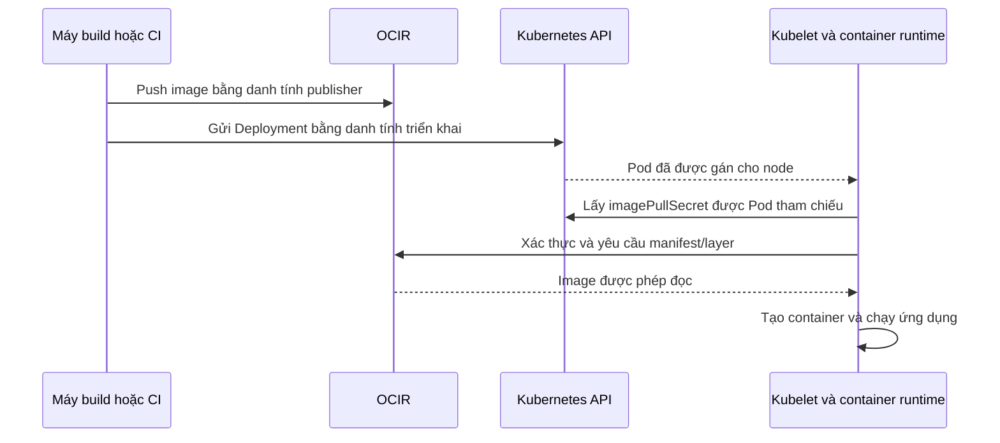

# Tích hợp OCIR và phân quyền kéo container image

Một Deployment trên Oracle Kubernetes Engine (OKE) chỉ chạy được khi môi trường thực thi tải được container image. Với image riêng tư trong Oracle Cloud Infrastructure Registry (OCIR), đường mạng, danh tính OCI và cấu hình Kubernetes đều phải đúng. Việc người triển khai chạy được `kubectl apply` chưa chứng minh rằng worker node có thể kéo image.

Bài học thuộc chương **Kubernetes với OKE** trong module Oracle Cloud Infrastructure, tập trung vào chuỗi triển khai từ OCIR đến Pod: tạo repository private, tách quyền push/pull, cấp thông tin xác thực qua `imagePullSecrets`, kiểm chứng lần kéo image và luân chuyển credential. Ví dụ dùng OKE với managed worker nodes; các câu lệnh thực hành chạy trong Bash trên Linux hoặc WSL có Docker và kubectl hoạt động.

## 1. Các thành phần tham gia khi một Pod cần image



Ba danh tính thường xuất hiện trong quy trình:

| Danh tính | Chức năng | Quyền cần xem xét |
|---|---|---|
| Publisher của pipeline | Đưa image vào repository | OCI IAM cho push |
| Người hoặc pipeline triển khai | Tạo Secret, ServiceAccount, Deployment | Quyền truy cập OKE và Kubernetes RBAC |
| OCI user dùng để kéo image | Xác thực với OCIR bằng auth token | OCI IAM cho pull |

Kubernetes ServiceAccount gắn với Pod có thể tham chiếu Secret kéo image. Trong phương án của bài, ServiceAccount không tự biến thành OCI user; thông tin xác thực registry nằm trong Secret. OCI IAM quyết định user đó được đọc repository nào, còn Kubernetes quyết định Pod nào được cấu hình sử dụng Secret.

Oracle hướng dẫn tích hợp OKE với OCIR bằng Docker registry Secret và trường `imagePullSecrets` trong Pod template. [Hướng dẫn kéo image OCIR khi triển khai trên OKE](https://docs.oracle.com/en-us/iaas/Content/ContEng/Tasks/contengpullingimagesfromocir.htm).

## 2. Chuẩn bị môi trường và bộ định danh nhất quán

### 2.1. Điều kiện thực hành

Cần có:

- Một OKE cluster có managed worker nodes sẵn sàng và kubeconfig đang trỏ đúng cluster.
- Docker với chế độ Linux containers và Buildx hoạt động trên máy build.
- kubectl, Bash, `base64`, `tr`, `mktemp` và `curl` trên máy thực hành.
- Một compartment lưu artifact, ví dụ `AppArtifacts`.
- Người quản trị có thể tạo repository, user/group và IAM policy cần thiết.
- Một danh tính triển khai được phép tạo namespace, Secret, ServiceAccount và Deployment cho bài lab.

Kiểm tra context và loại node trước khi triển khai:

```bash
kubectl config current-context
kubectl get nodes -L kubernetes.io/os,kubernetes.io/arch
kubectl auth can-i create namespaces
```

Nếu namespace do đội nền tảng quản lý, yêu cầu họ chuẩn bị namespace rồi dùng quyền được giao trong namespace đó. Quyền tạo namespace chỉ cần cho bước chuẩn bị; ứng dụng không cần quyền này.

### 2.2. Bộ giá trị của ví dụ

| Thành phần | Giá trị minh họa |
|---|---|
| Region | Singapore, `ap-singapore-1` |
| Registry host | `sin.ocir.io` |
| Tenancy namespace của OCIR | `acmeexample` |
| Compartment chứa repository | `AppArtifacts` |
| Repository | `oke-pull-demo` |
| Image tag | `1.0.0` |
| Kubernetes namespace | `ocir-lab` |
| Kubernetes ServiceAccount | `ocir-reader` |
| Secret ban đầu | `ocir-pull-v1` |

`acmeexample` chỉ là placeholder. Thay bằng Object Storage namespace của tenancy sở hữu repository, lấy từ thông tin tenancy trong OCI Console hoặc nguồn cấu hình đã được đội nền tảng xác nhận.

Ba khái niệm cần giữ riêng:

- **OCI compartment:** phạm vi đặt tài nguyên và áp dụng IAM policy.
- **Tenancy namespace trong URI OCIR:** phần định danh tenancy sau registry host.
- **Kubernetes namespace:** phạm vi đặt Pod, ServiceAccount và Secret.

Image URI trong bài có dạng:

```text
sin.ocir.io/acmeexample/oke-pull-demo:1.0.0
└── host ──┘ └ namespace ┘ └ repository ┘ └ tag ┘
```

URI không chứa tên compartment hay Kubernetes namespace. Registry của các region có endpoint tương ứng; `sin.ocir.io` là một endpoint được tài liệu liệt kê cho Singapore trong realm OC1. Chọn endpoint đúng realm/region và dùng nhất quán trong image URI cùng Docker config. [Các endpoint OCIR theo region](https://docs.oracle.com/en-us/iaas/Content/Registry/Concepts/registryprerequisites.htm).

## 3. Chuẩn bị repository private trong đúng compartment

Trong OCI Console, chuyển tới đúng region, mở Container Registry và tạo một **standard repository**:

1. Chọn compartment `AppArtifacts`.
2. Đặt tên `oke-pull-demo`.
3. Chọn quyền truy cập **Private**.
4. Ghi nhận region, compartment và đường dẫn repository để dùng trong các bước tiếp theo.

Standard repository nhận image do client push. Pull-through cache repository có mục đích khác và không hỗ trợ client push như ví dụ này. Tên repository một đoạn được dùng để tránh phụ thuộc vào cách tenancy cấu hình top-level repository capability. [Tạo repository OCIR](https://docs.oracle.com/en-us/iaas/Content/Registry/Tasks/registrycreatingarepository.htm).

Chủ động tạo repository trước khi push giúp kiểm soát vị trí tài nguyên. Không dựa vào lần push đầu tiên để chọn compartment: khi tự tạo repository qua push trong trường hợp được hỗ trợ, repository mới có thể được tạo ở root compartment và đòi hỏi quyền tương ứng.

Một repository public cho phép người có đường dẫn phù hợp kéo image mà không cần credential riêng tư. Vì bài kiểm chứng phân quyền pull, hãy giữ repository ở chế độ private trong toàn bộ bài thực hành. [Khái niệm repository của OCIR](https://docs.oracle.com/en-us/iaas/Content/Registry/Concepts/registryconcepts.htm).

## 4. Thiết kế IAM policy cho pull và push

### 4.1. OCI user kéo image chỉ thuộc nhóm có quyền cần thiết

Tạo OCI user phục vụ việc kéo image, ví dụ `oke-image-puller`, rồi đưa vào group `OcirPullers`. Đây là user được quản lý cho mục đích vận hành; không dùng credential quản trị viên trong cluster.

Policy cơ bản:

```text
Allow group OcirPullers to read repos in compartment AppArtifacts
```

Nếu chỉ được phép đọc đúng repository của bài:

```text
Allow group OcirPullers to read repos in compartment AppArtifacts where target.repo.name = 'oke-pull-demo'
```

Ví dụ dùng tên group ngắn để dễ đọc. Với group thuộc identity domain cần định danh domain, dùng tên group theo cú pháp IAM phù hợp của tenancy, chẳng hạn `DomainName/OcirPullers`.

Phạm vi `target.repo.name` áp dụng theo tên repository thực tế của OCIR. Không đưa registry host hoặc tenancy namespace vào điều kiện này.

### 4.2. Hiểu đúng các verb của resource type repos

| Verb | Ý nghĩa liên quan tới bài |
|---|---|
| `inspect repos` | Xem thông tin liệt kê phù hợp; không đủ để kéo manifest/layer |
| `read repos` | Bao gồm quyền đọc repository/image cần cho pull |
| `use repos` | Theo bảng quyền OCIR, không bổ sung quyền so với read |
| `manage repos` | Có thêm các quyền tạo, cập nhật, quản lý hoặc xóa tùy điều kiện policy |

Không suy luận rằng `use repos` cấp quyền push. Quyền của từng resource type do dịch vụ định nghĩa, cần đọc bảng quyền OCIR. [Chi tiết IAM cho Container Registry](https://docs.oracle.com/en-us/iaas/Content/Identity/policyreference/registrypolicyreference.htm).

### 4.3. Publisher của pipeline có credential riêng

Đối với repository đã được tạo, một policy minh họa cho group publisher trong compartment là:

```text
Allow group OcirPublishers to manage repos in compartment AppArtifacts where any {request.permission = 'REPOSITORY_READ', request.permission = 'REPOSITORY_UPDATE'}
```

Oracle yêu cầu `REPOSITORY_READ` và `REPOSITORY_UPDATE` cho push. Policy trên không cấp `REPOSITORY_CREATE`; pipeline chỉ push vào repository được chuẩn bị sẵn. Có thể tiếp tục giới hạn theo repository nếu cần.

`REPOSITORY_UPDATE` có phạm vi rộng hơn một thao tác upload, bao gồm một số API sửa hoặc xóa image. Vì vậy, không gọi policy này là một bảo đảm “chỉ được upload và không thể tác động image cũ”. Kiểm tra cả bảng permission và các policy khác mà user được hưởng. [Các policy mẫu kiểm soát repository](https://docs.oracle.com/en-us/iaas/Content/Registry/Concepts/registrypolicyrepoaccess.htm).

Quyền của OCI user là tổng các quyền được cấp qua các group/policy liên quan. Một policy read bị giới hạn không thu hẹp một policy manage rộng đã được cấp ở nơi khác. Auth token của user cũng không tự có phạm vi riêng chỉ vì bạn đặt tên Secret là `pull-only`.

## 5. Tạo auth token và xác định Docker username

Đối với cách đăng nhập Docker trong bài:

- Username chứa tenancy namespace và định danh user.
- Password là **OCI auth token** của user đó.
- Mật khẩu đăng nhập OCI Console và private key dùng ký OCI API không phải giá trị password của luồng này.

Ví dụ user theo cấu hình thông thường:

```text
acmeexample/oke-image-puller
```

Với user thuộc identity domain hoặc cấu hình federation cần thành phần domain, username có dạng:

```text
acmeexample/DomainName/oke-image-puller
```

Tên domain cần lấy từ định danh thực của user; không chèn `oracleidentitycloudservice` một cách máy móc nếu tenancy đang dùng domain khác. [Cách đăng nhập và kéo image bằng Docker CLI](https://docs.oracle.com/en-us/iaas/Content/Registry/Tasks/registrypullingimagesusingthedockercli.htm).

Tạo auth token cho user kéo image ở phần thông tin credential của user trong OCI Console. Sao chép giá trị ngay khi tạo và lưu vào nơi quản lý bí mật của tổ chức; Console không hiển thị lại nguyên giá trị sau đó. Publisher dùng token của user publisher riêng.

Thiết lập lịch luân chuyển chủ động. Đừng giả định auth token này tự hết hạn nhanh như một access token ngắn hạn. Tài liệu IAM mô tả auth token không tự hết hạn và mỗi user có tối đa hai auth token cùng lúc, giúp triển khai giai đoạn chuyển tiếp giữa token cũ và mới. [Quản lý OCI auth token](https://docs.oracle.com/en-us/iaas/Content/Identity/access/working-with-auth-tokens.htm).

## 6. Tạo image lab và push bằng danh tính publisher

### 6.1. Khai báo biến không chứa bí mật

Các lệnh còn lại dùng cùng một shell Bash:

```bash
REGISTRY_HOST='sin.ocir.io'
TENANCY_NAMESPACE='replace-with-your-tenancy-namespace'
REPOSITORY='oke-pull-demo'
TAG='1.0.0'
K8S_NS='ocir-lab'
IMAGE_REPO="$REGISTRY_HOST/$TENANCY_NAMESPACE/$REPOSITORY"
IMAGE_TAGGED="$IMAGE_REPO:$TAG"
PUSH_USER="$TENANCY_NAMESPACE/replace-with-publisher-user"
PULL_USER="$TENANCY_NAMESPACE/replace-with-puller-user"
```

Thay các placeholder trước khi chạy. Nếu user cần thành phần domain, thêm domain vào `PUSH_USER` hoặc `PULL_USER` đúng như mục trước.

### 6.2. Image HTTP nhỏ để quan sát việc pull

Trong một thư mục build riêng, tạo `Dockerfile`:

```dockerfile
FROM busybox:1.37.0
WORKDIR /www
RUN printf 'OKE pulled this image from private OCIR\n' > index.html
USER 10001:10001
EXPOSE 8080
CMD ["httpd", "-f", "-p", "8080", "-h", "/www"]
```

Đây là image minh họa phục vụ nội dung tĩnh bằng BusyBox, không phải image chuẩn hóa cho production. Với ứng dụng Java thực tế, thay bằng image đã build và kiểm tra từ pipeline của ứng dụng; chuỗi IAM, Secret và OKE vẫn tương tự. Phiên bản BusyBox được nêu cụ thể để thực hành; khi vận hành, chọn base image theo quy trình cập nhật và kiểm tra của tổ chức. [BusyBox Docker Official Image](https://hub.docker.com/_/busybox/).

Ví dụ build cho node AMD64:

```bash
docker buildx build \
  --platform linux/amd64 \
  --load \
  --tag "oke-pull-demo:$TAG" \
  .
```

Manifest Kubernetes bên dưới cũng chọn node AMD64. Nếu cluster chỉ có Arm64, đổi cả platform build thành `linux/arm64` và node selector thành `arm64`. Chỉ sửa node selector mà không có image phù hợp kiến trúc sẽ không giải quyết được vấn đề.

### 6.3. Đăng nhập và push

```bash
docker login "$REGISTRY_HOST" --username "$PUSH_USER"
docker tag "oke-pull-demo:$TAG" "$IMAGE_TAGGED"
docker push "$IMAGE_TAGGED"
```

Khi Docker hỏi password, nhập auth token của publisher. Không đặt giá trị token thật vào câu lệnh được lưu trong tài liệu hoặc shell history.

Với CI, lấy token từ secret store và truyền qua `--password-stdin`, đồng thời tắt chế độ log command chứa thông tin bí mật. Docker có thể lưu credential qua credential helper hoặc Docker config; đăng nhập trên máy build không tự tạo credential cho Kubernetes. [Docker login và cơ chế lưu credential](https://docs.docker.com/reference/cli/docker/login/).

Sau push, ghi lại **manifest digest** do registry báo, dạng `sha256:` theo sau bởi 64 ký tự hex. Dùng digest từ repository vừa push, không lấy Docker image ID cục bộ thay thế.

```bash
IMAGE_DIGEST='sha256:replace-with-the-full-digest-from-push'
IMAGE_REF="$IMAGE_REPO@$IMAGE_DIGEST"
```

Biến này còn placeholder cho tới khi bạn điền digest thật. Có thể dùng trang thông tin image trong OCIR để đối chiếu lại tag và digest.

Digest giúp cố định nội dung triển khai khi tag thay đổi. Digest không tự chứng minh ai đã phát hành image; kiểm tra nguồn build, chữ ký và quy trình phê duyệt là các kiểm soát bổ sung.

## 7. Tạo imagePullSecret mà không đưa token vào tham số dòng lệnh

### 7.1. Secret phải nằm trong namespace của Pod

```bash
kubectl create namespace "$K8S_NS"
```

Nếu namespace đã được chuẩn bị trước thì bỏ qua lệnh tạo. `imagePullSecrets` tham chiếu Secret trong cùng namespace với Pod. Secret cùng tên trong `default` không thể dùng trực tiếp cho Pod ở `ocir-lab`.

Kubernetes sử dụng Secret type `kubernetes.io/dockerconfigjson`, với dữ liệu ở key `.dockerconfigjson`, để cung cấp thông tin registry. Base64 trong Secret là biểu diễn dữ liệu, không phải cơ chế bảo mật thay cho quyền truy cập. [Kubernetes: kéo image từ private registry](https://kubernetes.io/docs/tasks/configure-pod-container/pull-image-private-registry/).

### 7.2. Tạo Docker config tối thiểu bằng credential puller

Hàm Bash dưới đây nhận tên Secret, hỏi token không hiển thị trên màn hình, tạo file tạm chỉ chứa thông tin cho một registry, rồi gửi file cho Kubernetes:

```bash
create_ocir_pull_secret() (
  set -euo pipefail
  set +x
  umask 077

  secret_name="$1"
  : "$REGISTRY_HOST" "$PULL_USER" "$K8S_NS"
  creds_dir=$(mktemp -d)
  trap 'rm -f -- "$creds_dir/config.json"; rmdir -- "$creds_dir"' EXIT

  IFS= read -r -s -p 'OCI auth token cua puller: ' pull_token
  printf '\n'
  if [ -z "$pull_token" ]; then
    printf 'Token khong duoc rong\n' >&2
    exit 1
  fi

  encoded_auth=$(
    printf '%s:%s' "$PULL_USER" "$pull_token" |
      base64 | tr -d '\n'
  )
  unset pull_token

  printf '{"auths":{"%s":{"auth":"%s"}}}\n' \
    "$REGISTRY_HOST" "$encoded_auth" > "$creds_dir/config.json"
  unset encoded_auth

  kubectl --namespace "$K8S_NS" create secret generic "$secret_name" \
    --from-file=.dockerconfigjson="$creds_dir/config.json" \
    --type=kubernetes.io/dockerconfigjson
)

create_ocir_pull_secret ocir-pull-v1
```

Nhập auth token của `PULL_USER`, không nhập token publisher. Hàm dùng subshell nên các biến tạm không tồn tại trong shell cha sau khi kết thúc. Secret cùng tên đã tồn tại sẽ làm lệnh create thất bại; chọn tên phiên bản mới khi luân chuyển thay vì vô tình ghi đè.

Không bật shell tracing hoặc in nội dung file tạm. Máy thực hiện và quyền tạo Secret vẫn phải được quản lý; cách truyền bằng file không loại bỏ yêu cầu bảo vệ máy vận hành.

### 7.3. Kiểm tra metadata, không in credential

```bash
kubectl --namespace "$K8S_NS" get secret ocir-pull-v1 \
  -o custom-columns=NAME:.metadata.name,TYPE:.type

kubectl --namespace "$K8S_NS" describe secret ocir-pull-v1
```

Kết quả cần có type `kubernetes.io/dockerconfigjson` và key `.dockerconfigjson`. Tránh dùng lệnh xuất toàn bộ Secret YAML hoặc giải mã credential vào log pipeline chỉ để xác nhận Secret tồn tại.

Nếu lấy Docker config từ máy cá nhân, hãy kiểm tra cách Docker lưu credential. Một file chỉ chứa `credsStore` hoặc `credHelpers` tham chiếu chương trình trên laptop không cung cấp ngay credential sử dụng được cho kubelet. Cấu hình tối thiểu ở trên chủ động tạo mục `auths` chứa thông tin cần thiết.

## 8. Gắn Secret với ServiceAccount dành riêng cho ứng dụng

Tạo file `serviceaccount.yaml`:

```yaml
apiVersion: v1
kind: ServiceAccount
metadata:
  name: ocir-reader
  namespace: ocir-lab
automountServiceAccountToken: false
imagePullSecrets:
  - name: ocir-pull-v1
```

```bash
kubectl apply -f serviceaccount.yaml
```

Khi tạo Pod dùng ServiceAccount này và không khai báo danh sách pull secret riêng, Kubernetes điền danh sách tham chiếu vào Pod. Thay đổi ServiceAccount ảnh hưởng tới các Pod được tạo sau đó; Pod đang tồn tại không tự đổi trường `spec.imagePullSecrets`. [Cấu hình imagePullSecrets cho ServiceAccount](https://kubernetes.io/docs/tasks/configure-pod-container/configure-service-account/).

`automountServiceAccountToken: false` phục vụ việc không tự mount token Kubernetes API vào container không cần nó. Thiết lập này không tắt cơ chế kéo image bằng registry Secret.

Có thể đặt trực tiếp trong Pod template nếu cần:

```yaml
spec:
  template:
    spec:
      serviceAccountName: ocir-reader
      imagePullSecrets:
        - name: ocir-pull-v1
```

Đây là một đoạn trích vị trí cấu hình trong Deployment, không phải manifest đầy đủ. Trong luồng thực hành chính, chỉ đặt danh sách ở ServiceAccount để quản lý tập trung. Nếu Pod template đã khai báo danh sách riêng, đừng kỳ vọng ServiceAccount tự hợp nhất các Secret khác vào danh sách đó.

Tránh gắn credential của ứng dụng vào ServiceAccount `default` cho cả namespace khi không cần. Một ServiceAccount dành riêng giúp theo dõi rõ workload nào được cấu hình dùng credential nào.

## 9. Triển khai image theo digest và xác minh Pod thực tế

### 9.1. Manifest Deployment đầy đủ

Tạo file `deployment.yaml`, thay image placeholder bằng giá trị thật của `IMAGE_REF`:

```yaml
apiVersion: apps/v1
kind: Deployment
metadata:
  name: ocir-web
  namespace: ocir-lab
spec:
  replicas: 2
  revisionHistoryLimit: 3
  strategy:
    type: RollingUpdate
    rollingUpdate:
      maxUnavailable: 0
      maxSurge: 1
  selector:
    matchLabels:
      app: ocir-web
  template:
    metadata:
      labels:
        app: ocir-web
    spec:
      serviceAccountName: ocir-reader
      automountServiceAccountToken: false
      nodeSelector:
        kubernetes.io/os: linux
        kubernetes.io/arch: amd64
      securityContext:
        runAsNonRoot: true
        runAsUser: 10001
        runAsGroup: 10001
        seccompProfile:
          type: RuntimeDefault
      containers:
        - name: web
          image: sin.ocir.io/REPLACE_NAMESPACE/oke-pull-demo@sha256:REPLACE_DIGEST
          imagePullPolicy: Always
          ports:
            - name: http
              containerPort: 8080
          resources:
            requests:
              cpu: 50m
              memory: 32Mi
            limits:
              cpu: 200m
              memory: 64Mi
          securityContext:
            allowPrivilegeEscalation: false
            readOnlyRootFilesystem: true
            capabilities:
              drop:
                - ALL
          readinessProbe:
            httpGet:
              path: /
              port: http
            initialDelaySeconds: 1
            periodSeconds: 3
```

Manifest minh họa không tự thay biến môi trường trong file YAML. Cần điền hostname, tenancy namespace và digest thật trước khi apply. Nếu dùng công cụ render của pipeline, kiểm tra manifest đã render để bảo đảm không còn placeholder.

### 9.2. Apply và quan sát

```bash
kubectl apply -f deployment.yaml
kubectl --namespace "$K8S_NS" rollout status deployment/ocir-web --timeout=180s
kubectl --namespace "$K8S_NS" get pods -l app=ocir-web -o wide
```

Lấy tên một Pod:

```bash
POD_NAME=$(
  kubectl --namespace "$K8S_NS" get pods -l app=ocir-web \
    -o jsonpath='{.items[0].metadata.name}'
)

kubectl --namespace "$K8S_NS" get pod "$POD_NAME" \
  -o jsonpath='{.spec.serviceAccountName}{"\n"}{.spec.imagePullSecrets[*].name}{"\n"}'

kubectl --namespace "$K8S_NS" describe pod "$POD_NAME"
```

Xác nhận Pod thực tế dùng `ocir-reader` và có `ocir-pull-v1` trong danh sách. Đừng chỉ kiểm tra file ServiceAccount trên máy rồi giả định Pod đã nhận cấu hình.

Đọc image reference và image ID được runtime báo:

```bash
kubectl --namespace "$K8S_NS" get pods -l app=ocir-web \
  -o custom-columns=NAME:.metadata.name,IMAGE:.spec.containers[0].image,IMAGE_ID:.status.containerStatuses[0].imageID
```

Đối với multi-platform image, digest của image index và digest manifest cụ thể cho kiến trúc có thể khác nhau. Khi đối chiếu image ID, hiểu cấu trúc artifact đã publish thay vì yêu cầu mọi chuỗi digest đều giống nhau.

### 9.3. Kiểm tra HTTP mà không tạo Load Balancer

```bash
kubectl --namespace "$K8S_NS" port-forward deployment/ocir-web 18080:8080
```

Trong một terminal khác:

```bash
curl http://127.0.0.1:18080/
```

Kết quả mong đợi:

```text
OKE pulled this image from private OCIR
```

`port-forward` cần được giữ chạy trong lúc gọi HTTP. Cách kiểm tra này đủ cho bài lab; không cần tạo thêm public Load Balancer chỉ để xác minh việc kéo image.

## 10. Kết nối mạng từ worker node đến OCIR

Kéo image là hoạt động của kubelet/container runtime trong môi trường node. Laptop có thể truy cập registry trong khi node ở private subnet không có đường ra phù hợp.

OCIR hỗ trợ truy cập riêng qua Service Gateway từ các tài nguyên trong VCN cùng region. Với OKE private workers, cần xem xét:

1. Service Gateway đã bật dịch vụ mạng phù hợp của region.
2. Route table gắn với worker subnet có route tới service CIDR label thích hợp qua Service Gateway.
3. NSG/security list và các thiết bị trung gian cho phép HTTPS cần thiết, gồm đường hồi đáp theo cấu hình stateful/stateless.
4. DNS phân giải được endpoint registry đang dùng.

Service Gateway là đường mạng, không cấp quyền pull. Credential hợp lệ và IAM policy vẫn cần thiết cho repository private. [OCIR và truy cập qua Service Gateway](https://docs.oracle.com/en-us/iaas/Content/Registry/Concepts/registryoverview.htm).

Nếu thiết kế dùng NAT Gateway để worker private truy cập endpoint công khai, kiểm tra route và egress tương ứng. Khi image ở registry ngoài OCI hoặc ở region khác, không mặc định rằng Service Gateway cùng region đã bao phủ toàn bộ đường đi.

Một Kubernetes NetworkPolicy của Pod không thay thế việc kiểm tra route/NSG ở worker subnet. Với lỗi timeout khi pull, cần điều tra từ môi trường thực hiện pull, không chỉ thử `curl` trong một Pod đã chạy trên node khác.

Đối với cluster autoscaling, hãy kiểm tra cả node mới. Một node cũ có layer cache hoặc cấu hình mạng khác có thể che giấu thiếu sót trong node pool/subnet mà lần mở rộng tiếp theo mới bộc lộ.

## 11. Kubernetes RBAC và phạm vi sử dụng Secret

### 11.1. Quyền đọc registry và quyền đọc Secret là hai phạm vi riêng

`read repos` cho phép OCI user đọc image trong OCIR. Kubernetes RBAC kiểm soát việc người dùng và ServiceAccount thao tác tài nguyên Kubernetes, trong đó có Secret.

Container không cần được cấp Role đọc Secret qua Kubernetes API chỉ để kubelet dùng `imagePullSecrets`. Kubelet và control plane xử lý cơ chế kéo image. Hãy cấp quyền cho công cụ provision Secret theo nhiệm vụ thực tế; không thêm quyền `get/list/watch secrets` vào ServiceAccount ứng dụng để “sửa lỗi pull” khi chưa xác định nguyên nhân.

### 11.2. Người được tạo Pod có thể tiếp cận Secret gián tiếp

Một người được tạo hoặc sửa Pod trong namespace có thể cấu hình workload dùng hay mount Secret trong namespace đó, tùy các kiểm soát admission và RBAC khác. Vì vậy, việc không cho họ `get Secret` không phải bảo đảm tuyệt đối rằng họ không thể sử dụng credential.

Phân tách namespace và quyền triển khai theo mức tin cậy; hạn chế quyền tạo workload trong namespace chứa credential nhạy cảm. Tách namespace giúp quản trị phạm vi, nhưng vẫn cần chính sách và cấu hình cluster phù hợp. [Thực hành Kubernetes RBAC](https://kubernetes.io/docs/concepts/security/rbac-good-practices/).

### 11.3. Quản lý vòng đời Secret

Secret chỉ cần chứa credential puller có quyền hạn tối thiểu. Bảo vệ quyền truy cập Kubernetes API, bản sao lưu và cơ chế mã hóa dữ liệu của cluster theo cấu hình OKE được áp dụng.

Không đưa Secret chứa token thật vào Git dưới dạng YAML base64. Nếu dùng GitOps, quản lý việc đồng bộ Secret bằng cơ chế secret management được tổ chức phê duyệt, cùng quyền đọc nguồn bí mật và quyền ghi đúng namespace.

Đặt token trong OCI Vault chưa tự làm Secret trong Kubernetes được cập nhật. Cần một quá trình provision/đồng bộ có danh tính, policy, phạm vi namespace và lịch luân chuyển rõ ràng. [Kubernetes Secret và cách sử dụng](https://kubernetes.io/docs/concepts/configuration/secret/).

## 12. Luân chuyển auth token có bước kiểm chứng

### 12.1. Vì sao Pod đang chạy chưa chứng minh token mới hoạt động?

Container đã chạy không kéo lại image liên tục. Token cũ bị thu hồi có thể chưa ảnh hưởng Pod hiện tại, nhưng sẽ gây lỗi khi tạo Pod mới, reschedule hoặc mở rộng node pool.

Một kiểm tra chỉ xem các Pod hiện hữu vẫn `Running` không chứng minh credential mới dùng được.

### 12.2. Tạo token mới và Secret mới

Quy trình bình thường:

1. Tạo auth token mới cho user puller, giữ token cũ còn hiệu lực trong giai đoạn chuyển tiếp.
2. Cập nhật nguồn bí mật được quản lý.
3. Dùng hàm đã khai báo để tạo Secret phiên bản mới:

```bash
create_ocir_pull_secret ocir-pull-v2
```

Nhập token mới khi được hỏi. Không tạo lại `ocir-pull-v1` bằng dữ liệu khác rồi mất khả năng xác định workload nào đã được chuyển.

### 12.3. Canary chỉ tham chiếu Secret mới

Tạo file `pull-canary.yaml`, thay image bằng đúng digest thật đang kiểm chứng:

```yaml
apiVersion: v1
kind: Pod
metadata:
  name: ocir-pull-canary
  namespace: ocir-lab
spec:
  restartPolicy: Never
  serviceAccountName: ocir-reader
  automountServiceAccountToken: false
  imagePullSecrets:
    - name: ocir-pull-v2
  nodeSelector:
    kubernetes.io/os: linux
    kubernetes.io/arch: amd64
  securityContext:
    runAsNonRoot: true
    runAsUser: 10001
    runAsGroup: 10001
    seccompProfile:
      type: RuntimeDefault
  containers:
    - name: web
      image: sin.ocir.io/REPLACE_NAMESPACE/oke-pull-demo@sha256:REPLACE_DIGEST
      imagePullPolicy: Always
      securityContext:
        allowPrivilegeEscalation: false
        readOnlyRootFilesystem: true
        capabilities:
          drop:
            - ALL
      resources:
        requests:
          cpu: 25m
          memory: 16Mi
        limits:
          cpu: 100m
          memory: 32Mi
      readinessProbe:
        httpGet:
          path: /
          port: 8080
        periodSeconds: 3
```

```bash
kubectl apply -f pull-canary.yaml
kubectl --namespace "$K8S_NS" wait \
  --for=condition=Ready pod/ocir-pull-canary --timeout=180s
kubectl --namespace "$K8S_NS" describe pod ocir-pull-canary
```

Canary chỉ khai báo `ocir-pull-v2`; nếu khai báo cả v1 và v2, credential cũ có thể làm kiểm tra thành công dù v2 sai. Đối chiếu cấu hình Pod thực tế và bảo đảm không có cơ chế credential cấp node đang vô tình cung cấp quyền rộng hơn.

`imagePullPolicy: Always` yêu cầu runtime thực hiện quy trình pull/resolve khi khởi tạo container; layer đã cache có thể được dùng lại. Muốn kiểm tra cả đường tải layer, ưu tiên node kiểm thử chưa có image và không sửa trực tiếp cache của node đang phục vụ workload thật. [Image pull policy và cache trong Kubernetes](https://kubernetes.io/docs/concepts/containers/images/).

### 12.4. Chuyển workload và thu hồi token cũ

Đổi `serviceaccount.yaml` sang:

```yaml
apiVersion: v1
kind: ServiceAccount
metadata:
  name: ocir-reader
  namespace: ocir-lab
automountServiceAccountToken: false
imagePullSecrets:
  - name: ocir-pull-v2
```

Sau đó:

```bash
kubectl apply -f serviceaccount.yaml
kubectl --namespace "$K8S_NS" rollout restart deployment/ocir-web
kubectl --namespace "$K8S_NS" rollout status deployment/ocir-web --timeout=180s
kubectl --namespace "$K8S_NS" get pods -l app=ocir-web -o wide
```

Kiểm tra các Pod mới thực sự tham chiếu `ocir-pull-v2`. Khi các workload cần chuyển, Job/CronJob và namespace liên quan đã được rà soát, thu hồi auth token cũ ở OCI IAM rồi xóa Secret cũ:

```bash
kubectl --namespace "$K8S_NS" delete secret ocir-pull-v1
kubectl --namespace "$K8S_NS" delete pod ocir-pull-canary
```

Xóa Kubernetes Secret không tự thu hồi OCI token; thu hồi token cũng không tự xóa các bản sao Secret. Quản lý cả hai nơi. Nếu hệ thống dùng GitOps, cập nhật nguồn khai báo chính thức để tránh controller khôi phục cấu hình cũ.

Khi có bằng chứng token bị lộ, quy trình xử lý sự cố có thể cần thu hồi ngay và chấp nhận một khoảng gián đoạn cho các lần pull mới. Giai đoạn chồng lấn ở trên dành cho luân chuyển định kỳ trong điều kiện bình thường.

## 13. Chẩn đoán ErrImagePull và ImagePullBackOff

`ImagePullBackOff` cho biết Kubernetes chưa kéo được image và đang giãn khoảng thử lại. Đọc sự kiện nguyên nhân trước khi restart Deployment hoặc đổi IAM policy.

```bash
kubectl --namespace "$K8S_NS" get pods -l app=ocir-web -o wide
kubectl --namespace "$K8S_NS" describe pod "$POD_NAME"
kubectl --namespace "$K8S_NS" get events \
  --field-selector "involvedObject.name=$POD_NAME" \
  --sort-by=.metadata.creationTimestamp
```

Nếu Pod cũ đã bị thay, lấy lại `POD_NAME` từ danh sách hiện tại. Sự kiện có thời gian lưu hữu hạn; thu thập sớm thay vì chỉ xem trạng thái tổng hợp. [Hướng dẫn debug Pod](https://kubernetes.io/docs/tasks/debug/debug-application/debug-pods/).

| Dấu hiệu hoặc thông báo | Điều cần kiểm tra trước |
|---|---|
| `FailedToRetrieveImagePullSecret` | Secret có tồn tại cùng namespace, tên có đúng, Pod có nhận đúng danh sách không |
| `unauthorized`, yêu cầu xác thực | Username có đúng namespace/domain, token có đúng user và còn hiệu lực, host trong config có khớp không |
| `denied`, không đủ quyền | Group của user, policy `read repos`, compartment thực của repository và điều kiện tên repo |
| `manifest unknown`, `not found` | Tag/digest, tên image, region và tenancy namespace; một số phản hồi cũng có thể liên quan quyền truy cập |
| Timeout, lỗi DNS hoặc TLS | Đường mạng từ node, DNS, Service Gateway/NAT, egress và đồng hồ/chứng chỉ |
| `no matching manifest` | Image có hỗ trợ kiến trúc/OS của node được chọn không |
| Pod `Pending` vì node selector hoặc thiếu tài nguyên | Khả năng scheduling; image có thể chưa được yêu cầu pull |
| Container chạy rồi `CrashLoopBackOff` | Entry point, tham số, filesystem và lỗi ứng dụng sau khi image đã được kéo |

Không kết luận mọi lỗi pull đều do thiếu IAM quyền. Ví dụ hostname trong Secret là `sin.ocir.io` nhưng image dùng một alias endpoint khác có thể khiến runtime không chọn được credential phù hợp, dù cả hai endpoint đều thuộc cùng dịch vụ.

Docker pull thành công trên máy cá nhân là dữ kiện hữu ích, nhưng chỉ chứng minh tổ hợp danh tính/mạng trên máy đó. Nếu người dùng Docker là publisher có quyền rộng, kết quả này chưa kiểm chứng token puller đang nằm trong cluster.

Trong phương án của bài, cấp thêm policy cho danh tính node không tự sửa credential sai trong `imagePullSecrets`. Nếu tổ chức chọn một cơ chế kubelet credential provider hoặc danh tính tích hợp khác, phải cấu hình và kiểm chứng cơ chế đó theo hỗ trợ cụ thể của OKE; không giả định chỉ thêm một OCI policy là kubelet có thông tin đăng nhập.

## 14. Tag, digest, kiến trúc và khả năng triển khai lại

### 14.1. Đừng để một tag thay đổi âm thầm làm lệch phiên bản

Tag là tên tham chiếu thuận tiện cho con người. Nếu tag được cập nhật trỏ sang image khác, các lần tạo Pod sau có thể dùng nội dung mới trong khi Pod cũ còn chạy nội dung cũ.

Trong production, lưu lại digest cùng release, cấu hình triển khai và thông tin build. Khi rollback, dùng digest của release đã biết và bảo đảm artifact đó vẫn còn trong OCIR.

Mẫu trong bài đặt `Always` rõ ràng để dễ kiểm chứng registry credential. Một thiết kế dùng digest và `IfNotPresent` có thể ưu tiên cache, nhưng cần đánh giá yêu cầu kiểm tra credential, admission policy và hành vi node pool. Không dùng việc Pod đã chạy với cache làm bằng chứng duy nhất về quyền pull hiện tại.

### 14.2. Image phải phù hợp với node pool

OKE có thể dùng node pool khác kiến trúc. Khi cần hỗ trợ cả AMD64 và Arm64, pipeline có thể publish một multi-platform image:

```bash
docker buildx build \
  --platform linux/amd64,linux/arm64 \
  --tag "$IMAGE_TAGGED" \
  --push \
  .
```

Đây là phương án thay cho bước build đơn kiến trúc, cần builder và base image hỗ trợ các platform được chọn. Khi triển khai, digest có thể là digest của image index; registry/runtime chọn manifest phù hợp với node. [Docker: build image đa nền tảng](https://docs.docker.com/build/building/multi-platform/).

### 14.3. Retention và nguồn gốc artifact

Giữ lại image của release đang chạy, release dự kiến rollback và các release còn trong thời gian hỗ trợ. Xóa image khỏi registry có thể chưa làm container đang chạy dừng, nhưng sẽ ảnh hưởng lần kéo mới trên node chưa có cache.

Kiểm tra lỗ hổng của image và gắn kết kết quả với digest đã triển khai. Quyền pull chỉ trả lời “danh tính này có được đọc artifact không”; nó không thay cho kiểm tra lỗ hổng hoặc xác minh nguồn phát hành. OCI Vulnerability Scanning có khả năng quét image trong Container Registry khi đã cấu hình các tài nguyên quét phù hợp. [Tổng quan OCI Vulnerability Scanning](https://docs.oracle.com/en-us/iaas/Content/scanning/using/overview.htm).

## 15. Tự động hóa và quan sát trong quy trình triển khai

Pipeline có thể tổ chức thành các bước độc lập:

```text
Build và kiểm tra image
        ↓
Push OCIR bằng publisher credential
        ↓
Ghi nhận digest và kiểm tra artifact
        ↓
Provision hoặc đối chiếu pull secret cho namespace đích
        ↓
Render Deployment bằng digest
        ↓
Apply, chờ rollout và kiểm tra Pod events
```

Danh tính publisher không cần quyền sửa Secret trong cluster chỉ để upload image. Danh tính triển khai không cần quyền push nếu chỉ triển khai digest được phê duyệt. Danh tính puller trong cluster chỉ cần quyền đọc đúng repository.

Thông tin cần giữ trong hồ sơ triển khai:

| Thông tin | Mục đích |
|---|---|
| Image URI và digest | Xác định artifact thực sự được triển khai |
| Commit/build ID | Liên hệ artifact với mã nguồn và pipeline |
| Cluster, namespace, Deployment | Xác định môi trường đích |
| Tên/phiên bản pull Secret | Theo dõi lần luân chuyển credential |
| Thời gian rollout, số Pod Ready, lỗi pull | Phát hiện sự cố triển khai |
| Node pool và kiến trúc | Khoanh vùng lỗi platform hoặc đường mạng |

Không ghi giá trị token, Docker `auth` hoặc dữ liệu Secret vào hồ sơ này.

Theo dõi các đợt `ErrImagePull`, `ImagePullBackOff`, rollout không tiến triển và lỗi ở node vừa tạo. Sự kiện Kubernetes cần được thu thập theo cơ chế quan sát của hệ thống nếu muốn lưu lâu dài. Một đợt tăng replica không thành công sau khi đổi token thường hữu ích hơn nhiều so với số Pod cũ vẫn `Running`.

Kiểm soát chi phí bằng kích thước image hợp lý, dọn artifact hết vòng đời và lựa chọn region phù hợp. Trong bài lab, worker node, lưu trữ registry và các tài nguyên mạng liên quan vẫn có thể phát sinh chi phí theo cấu hình của môi trường. Không xóa image còn phục vụ rollback chỉ để giảm dung lượng ngay lập tức.

## 16. Thực hành xác minh và dọn tài nguyên

Trước khi coi việc tích hợp đã hoàn tất, người học nên thực hiện bằng tài nguyên lab riêng:

1. Xác nhận repository private nằm đúng compartment/region.
2. Push thành công bằng publisher; ghi nhận tag và manifest digest.
3. Dùng puller có policy read, tạo Secret cùng namespace với workload.
4. Kiểm tra Pod thực tế nhận đúng ServiceAccount và pull Secret.
5. Chờ rollout thành công và gọi được HTTP qua port-forward.
6. Tạo một workload kiểm thử tham chiếu Secret sai tên để quan sát `FailedToRetrieveImagePullSecret`, rồi sửa lại; không thay cấu hình workload production.
7. Dùng danh tính read để kiểm tra rằng nó không có quyền push vào repository đã chọn.
8. Kiểm tra pull trên node mới hoặc môi trường ít phụ thuộc cache để xác nhận cấu hình mạng của node pool.
9. Luân chuyển sang Secret v2, kiểm chứng riêng credential mới rồi chuyển các workload liên quan.
10. Thu hồi token cũ và xóa Secret cũ sau khi đã hoàn tất chuyển đổi.

Không đổi repository thành public để làm bước kiểm thử quyền vượt qua. Một lần chạy thành công trong điều kiện public không kiểm chứng đường xác thực private.

Khi kết thúc lab, dừng port-forward và xóa những workload được tạo riêng:

```bash
kubectl --namespace "$K8S_NS" delete deployment ocir-web
kubectl --namespace "$K8S_NS" delete serviceaccount ocir-reader
kubectl --namespace "$K8S_NS" delete secret ocir-pull-v2
```

Điều chỉnh tên Secret theo phiên bản thực tế còn tồn tại. Nếu canary hoặc Secret v1 chưa được xóa, dọn chúng sau khi xác nhận không còn sử dụng. Chỉ xóa namespace nếu đó là namespace dành riêng cho bài và không có tài nguyên cần giữ.

Thu hồi token chỉ tạo cho lab, dọn image/repository lab bằng danh tính có quyền quản trị artifact và loại bỏ các quyền tạm không còn cần. Không xóa OKE cluster hoặc compartment dùng chung chỉ vì bài thực hành kết thúc.

Kết quả cần đạt là một chuỗi có thể kiểm chứng: artifact xác định bằng digest, OCI user chỉ đọc đúng repository, Secret được quản lý trong đúng namespace, Pod nhận đúng cấu hình và worker có đường mạng đến registry. Chuỗi này cũng là cơ sở để triển khai lại, mở rộng node pool và đổi credential mà vẫn kiểm soát được quyền truy cập image.
