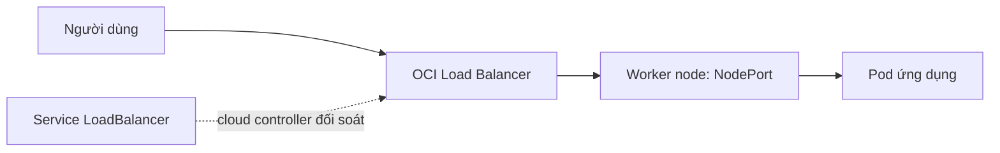
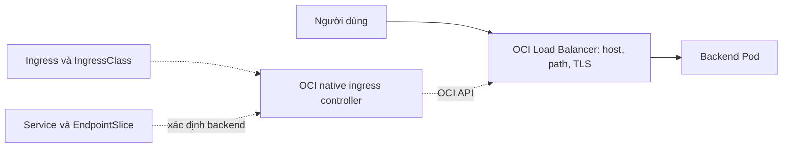

# Ingress, service LoadBalancer và công khai ứng dụng

## 1. Mục tiêu và bối cảnh trên Oracle Cloud Infrastructure

Một Deployment chạy thành công trên Oracle Kubernetes Engine (OKE) mới chứng minh ứng dụng đã khởi động trong cluster. Để người dùng truy cập bằng tên miền và HTTPS, cần nối đúng nhiều thành phần: Service, cơ chế tiếp nhận lưu lượng, OCI Load Balancer, mạng VCN, DNS và chứng chỉ.

Trong chương **Kubernetes với OKE** của module Oracle Cloud Infrastructure, bài này tập trung vào việc đưa ứng dụng ra ngoài cluster một cách có kiểm soát. Compartment xác định nơi chứa tài nguyên; IAM quyết định controller được thao tác tài nguyên nào; VCN và các quy tắc mạng quyết định gói tin có tới được ứng dụng hay không. Các lựa chọn này cũng ảnh hưởng đến khả năng giám sát, tự động hóa, chi phí và tính sẵn sàng.

Sau bài học, người học có thể:

- Chọn giữa Service `LoadBalancer` và Ingress theo giao thức, số ứng dụng và yêu cầu vận hành.
- Giải thích ai tạo OCI Load Balancer và ai thực thi quy tắc định tuyến.
- Triển khai một ví dụ HTTP, kiểm tra đường đi lưu lượng rồi bổ sung DNS và TLS.
- Phân biệt lỗi cấp phát hạ tầng, lỗi mạng, lỗi định tuyến và lỗi backend.
- Thu hồi tài nguyên đúng thứ tự, tránh để lại load balancer hoặc chứng chỉ không còn sử dụng.

Các manifest bên dưới là tài liệu thực hành; cần thay placeholder bằng tài nguyên OCI của môi trường học. Chúng không có nghĩa là một cluster hay load balancer đã được cấp phát sẵn.

## 2. Phân biệt Service, Ingress và controller

### 2.1. Các cách đưa lưu lượng tới ứng dụng

| Thành phần | Vai trò | Cách sử dụng phù hợp |
| --- | --- | --- |
| Service `ClusterIP` | Cung cấp địa chỉ và cổng dịch vụ trong cluster | Backend nội bộ hoặc backend cho một ingress controller phù hợp |
| Service `NodePort` | Mở một cổng dịch vụ trên các node theo cơ chế mạng Kubernetes | Làm backend cho một số mô hình load balancer; phải kiểm soát nguồn truy cập |
| Service `LoadBalancer` | Yêu cầu tích hợp cloud cấp phát hoặc cấu hình load balancer ngoài cluster | Công bố một dịch vụ qua các cổng xác định |
| Ingress | Khai báo quy tắc HTTP/HTTPS theo host và path | Gom nhiều ứng dụng web sau một điểm vào |
| Ingress controller | Theo dõi Ingress và cấu hình hệ thống thực thi quy tắc | Thành phần bắt buộc để Ingress có tác dụng |

Service dùng selector để chọn Pod; các endpoint tương ứng được thể hiện qua EndpointSlice. Những trường `port`, `targetPort` và `nodePort` có vai trò khác nhau: cổng Service, cổng ứng dụng và cổng trên node. Khai báo `containerPort` riêng lẻ không công khai ứng dụng. Xem [khái niệm Service của Kubernetes](https://kubernetes.io/docs/concepts/services-networking/service/).

Một Ingress không tự tạo DNS, không tự cấp chứng chỉ và không tự cài controller. Trường `ingressClassName` chỉ ra IngressClass mà tài nguyên muốn sử dụng; IngressClass gắn cấu hình đó với một implementation cụ thể.

Ingress API đã được đóng băng về phát triển tính năng, nhưng vẫn được Kubernetes duy trì. Với thiết kế mới, có thể đánh giá Gateway API cùng khả năng hỗ trợ của controller đang chọn. Bài này dùng Ingress để giải quyết trực tiếp nhu cầu công bố ứng dụng OKE. Xem [Ingress](https://kubernetes.io/docs/concepts/services-networking/ingress/) và [Ingress Controllers](https://kubernetes.io/docs/concepts/services-networking/ingress-controllers/).

### 2.2. Service LoadBalancer trên OKE

Khi tạo Service `type: LoadBalancer`, cloud controller manager của OCI đối soát cấu hình Kubernetes với tài nguyên cloud. Annotation `oci.oraclecloud.com/load-balancer-type: "lb"` yêu cầu OCI Load Balancer; giá trị `"nlb"` chọn OCI Network Load Balancer.

OCI Load Balancer có khả năng proxy TCP và xử lý HTTP/HTTPS. OCI Network Load Balancer phù hợp với nhu cầu cân bằng lưu lượng mạng như TCP/UDP, theo tập tính năng được hỗ trợ. Tên `LoadBalancer` của Kubernetes không đồng nghĩa mọi load balancer đều có quy tắc host/path. Danh sách annotation cho hai loại tài nguyên cũng khác nhau; xem [bảng annotation OKE](https://docs.oracle.com/en-us/iaas/Content/ContEng/Tasks/contengcreatingloadbalancer_topic-Summaryofannotations.htm).

Mô hình node backend thường gặp trên managed nodes:



Cần kiểm tra backend thực tế trong OCI. Đường đi có thể khác khi sử dụng tính năng Pod làm backend hoặc một cấu hình mạng khác.

### 2.3. Hai kiến trúc ingress controller

**OCI native ingress controller** cấu hình OCI Load Balancer để thực hiện định tuyến. Controller tham gia điều khiển cấu hình; request của người dùng không phải đi qua Pod controller.



Với VCN-native pod networking, native controller có thể đăng ký Pod làm backend. Với Flannel, nó dùng worker node và yêu cầu backend Service kiểu `NodePort`. Bài thực hành chọn **managed nodes và VCN-native pod networking** để dùng backend Service `ClusterIP`. Native controller tạo load balancer theo IngressClass; số load balancer không nhất thiết bằng số Ingress. Xem [cách OCI native ingress controller hoạt động](https://docs.oracle.com/en-us/iaas/Content/ContEng/Tasks/contengsettingupnativeingresscontroller.htm).

**Controller có proxy chạy trong Pod** thường nhận lưu lượng theo chuỗi: OCI load balancer → Pod proxy → Service/Pod ứng dụng. Khi dùng kiến trúc này, cần tính cả tài nguyên, số replica và vòng đời nâng cấp của lớp proxy. Không áp dụng annotation của một controller cho controller khác chỉ vì chúng đều đọc Ingress. Xem [các lựa chọn ingress controller trên OKE](https://docs.oracle.com/en-us/iaas/Content/ContEng/Tasks/contengmanagingresscontrollers.htm).

## 3. Quyết định công bố ứng dụng

| Nhu cầu | Điểm bắt đầu hợp lý | Điều cần cân nhắc |
| --- | --- | --- |
| Một endpoint với cổng riêng | Service `LoadBalancer` | Đơn giản, nhưng có thêm tài nguyên cloud cho dịch vụ được công bố |
| Nhiều website hoặc API theo host/path | Ingress với controller đã chọn | Chia sẻ điểm vào, cần quản trị quy tắc và cấu hình dùng chung |
| Dịch vụ TCP/UDP không phải web | Service `LoadBalancer` với loại LB phù hợp | Ingress HTTP tiêu chuẩn không mô tả mọi giao thức |
| Ứng dụng chỉ phục vụ mạng nội bộ | Private load balancer hoặc private ingress | Cần đường kết nối và DNS nội bộ |
| Backend truy cập Oracle Database | Giữ kết nối backend và database trong mạng riêng | Chỉ công bố endpoint ứng dụng mà người dùng cần |

Ví dụ một hệ thống bán hàng có giao diện `/` và API `/api`. Nếu mỗi thành phần có một Service LoadBalancer riêng, người vận hành phải quản lý nhiều địa chỉ, listener và tài nguyên cloud. Một Ingress có thể gom các quy tắc vào cùng điểm vào.

Việc chia sẻ cũng tạo quan hệ phụ thuộc: thay đổi listener, chứng chỉ hay quy tắc chung có thể ảnh hưởng nhiều ứng dụng. Nên tách IngressClass hoặc load balancer theo ranh giới quyền quản trị, mức độ tin cậy và yêu cầu sẵn sàng khi cần.

## 4. Chuẩn bị cluster, quyền và mạng

### 4.1. Điều kiện thực hành

Chuẩn bị trước:

1. OKE cluster có managed nodes và VCN-native pod networking, đủ tài nguyên chạy bốn Pod nhỏ.
2. `kubectl` đã kết nối đúng cluster; tài khoản có quyền tạo tài nguyên trong namespace thực hành.
3. Public subnet phù hợp cho load balancer, địa chỉ còn trống và quota OCI còn đủ.
4. NSG dành cho load balancer; quy tắc tới worker hoặc Pod được chuẩn bị theo backend thực tế.
5. OCI native ingress controller đã được cài đúng phiên bản hỗ trợ nếu thực hiện phần Ingress.
6. Tên miền do mình quản lý và chứng chỉ hợp lệ nếu thực hiện phần HTTPS công khai.

Kiểm tra context trước khi áp dụng manifest:

```powershell
kubectl config current-context
kubectl get nodes -o wide
kubectl auth can-i create deployments -n oke-public-lab
kubectl auth can-i create services -n oke-public-lab
kubectl auth can-i create ingresses.networking.k8s.io -n oke-public-lab
kubectl auth can-i create ingressclasses.networking.k8s.io
```

IngressClass là tài nguyên ở phạm vi cluster; quyền tạo Ingress trong namespace không mặc nhiên bao gồm quyền tạo IngressClass.

### 4.2. Hai lớp quyền độc lập

Kubernetes RBAC cho phép người dùng tạo Service hoặc Ingress. OCI IAM cho phép cloud controller hoặc native ingress controller tạo, cập nhật load balancer, sử dụng mạng và xử lý chứng chỉ theo tính năng được bật.

Do đó, `kubectl apply` thành công vẫn có thể đi kèm lỗi cấp phát cloud. Cần phân quyền đúng principal và compartment chứa tài nguyên. Nếu mạng và load balancer nằm ở các compartment khác nhau, phải xét cả hai phạm vi.

Native controller hỗ trợ các phương án xác thực khác nhau. Workload identity dùng được với enhanced cluster; instance principal gắn với Compute instance và không phù hợp với virtual nodes. Chọn một phương án, cấp các quyền tài nguyên cần thiết và giới hạn phạm vi theo tài liệu triển khai. Xem [điều kiện quyền và xác thực cho native ingress add-on](https://docs.oracle.com/en-us/iaas/Content/ContEng/Tasks/contengsettingupnativeingresscontroller-addon-prereqs.htm).

### 4.3. Đường đi public và private

Một public load balancer cần public subnet có route thích hợp ra Internet Gateway. Worker và Pod có thể nằm ở private subnet. NAT Gateway phục vụ kết nối chủ động đi ra từ mạng riêng; nó không thay thế public load balancer để nhận kết nối mới từ Internet.

Các quy tắc bổ sung cho lab có thể tổ chức như sau:

| Chặng | Nguồn được phép | Đích và cổng |
| --- | --- | --- |
| Máy thực hành → frontend HTTP | Public IP của máy thực hành, dạng CIDR `/32` | NSG load balancer, TCP 80 |
| Người dùng → frontend HTTPS | Dải người dùng hoặc Internet nếu là website công khai | NSG load balancer, TCP 443 |
| LB → node backend của Service trực tiếp | NSG hoặc subnet LB theo thiết kế | Worker node, NodePort đã cấp |
| LB → Pod backend của native ingress | NSG hoặc subnet LB theo thiết kế | Pod, TCP 8080 trong ví dụ |
| Health check → backend | Nguồn LB thích hợp | Cổng và giao thức health check thực tế |

Bảng này bổ sung cho mạng OKE đã hoạt động; nó không thay thế toàn bộ quy tắc control plane, node và CNI. Phải xét cả egress từ LB, ingress tới backend và các cổng health check liên quan.

NSG và security list cùng góp phần tạo tập quy tắc cho phép. Một security list quá rộng vẫn có thể cho phép lưu lượng dù NSG đã được thu hẹp. Xem [cấu hình mạng OKE](https://docs.oracle.com/en-us/iaas/Content/ContEng/Concepts/contengnetworkconfig.htm).

## 5. Tạo hai ứng dụng để quan sát định tuyến

Ví dụ dùng hai web server nhỏ:

- `portal` trả về `portal oke`.
- `catalog` trả về `catalog oke`.
- Cả hai nghe cổng 8080 và có `/healthz` trả về HTTP 200.

Nội dung trả về giúp phân biệt backend mà request đã tới. Đây là ứng dụng minh họa; health check của một ứng dụng thật cần phản ánh khả năng phục vụ thực tế.

Lưu nội dung sau thành `apps.yaml` trong thư mục thực hành của người học:

```yaml
apiVersion: v1
kind: Namespace
metadata:
  name: oke-public-lab
---
apiVersion: v1
kind: ConfigMap
metadata:
  name: demo-nginx-config
  namespace: oke-public-lab
data:
  portal.conf: |
    server {
      listen 8080;
      location = /healthz {
        default_type text/plain;
        return 200 "ok\n";
      }
      location / {
        default_type text/plain;
        return 200 "portal oke\n";
      }
    }
  catalog.conf: |
    server {
      listen 8080;
      location = /healthz {
        default_type text/plain;
        return 200 "ok\n";
      }
      location / {
        default_type text/plain;
        return 200 "catalog oke\n";
      }
    }
---
apiVersion: apps/v1
kind: Deployment
metadata:
  name: portal
  namespace: oke-public-lab
spec:
  replicas: 2
  selector:
    matchLabels:
      app: portal
  template:
    metadata:
      labels:
        app: portal
    spec:
      containers:
        - name: web
          image: nginx:stable-alpine
          ports:
            - name: http
              containerPort: 8080
          readinessProbe:
            httpGet:
              path: /healthz
              port: http
            initialDelaySeconds: 2
            periodSeconds: 5
          resources:
            requests:
              cpu: 50m
              memory: 32Mi
            limits:
              cpu: 250m
              memory: 96Mi
          volumeMounts:
            - name: configuration
              mountPath: /etc/nginx/conf.d/default.conf
              subPath: portal.conf
      volumes:
        - name: configuration
          configMap:
            name: demo-nginx-config
---
apiVersion: apps/v1
kind: Deployment
metadata:
  name: catalog
  namespace: oke-public-lab
spec:
  replicas: 2
  selector:
    matchLabels:
      app: catalog
  template:
    metadata:
      labels:
        app: catalog
    spec:
      containers:
        - name: web
          image: nginx:stable-alpine
          ports:
            - name: http
              containerPort: 8080
          readinessProbe:
            httpGet:
              path: /healthz
              port: http
            initialDelaySeconds: 2
            periodSeconds: 5
          resources:
            requests:
              cpu: 50m
              memory: 32Mi
            limits:
              cpu: 250m
              memory: 96Mi
          volumeMounts:
            - name: configuration
              mountPath: /etc/nginx/conf.d/default.conf
              subPath: catalog.conf
      volumes:
        - name: configuration
          configMap:
            name: demo-nginx-config
---
apiVersion: v1
kind: Service
metadata:
  name: portal
  namespace: oke-public-lab
spec:
  type: ClusterIP
  selector:
    app: portal
  ports:
    - name: http
      port: 80
      targetPort: http
---
apiVersion: v1
kind: Service
metadata:
  name: catalog
  namespace: oke-public-lab
spec:
  type: ClusterIP
  selector:
    app: catalog
  ports:
    - name: http
      port: 80
      targetPort: http
```

Tag image trong ví dụ thuận tiện cho lab. Với môi trường triển khai lặp lại, chọn phiên bản đã kiểm tra, kiến trúc CPU phù hợp và khóa image bằng digest trong quy trình build.

Áp dụng rồi xác nhận Pod sẵn sàng:

```powershell
kubectl apply -f apps.yaml
kubectl rollout status deployment/portal -n oke-public-lab --timeout=180s
kubectl rollout status deployment/catalog -n oke-public-lab --timeout=180s
kubectl get pods -n oke-public-lab -o wide
kubectl get endpointslices -n oke-public-lab -l kubernetes.io/service-name=portal
kubectl get endpointslices -n oke-public-lab -l kubernetes.io/service-name=catalog
```

Để kiểm tra phản hồi ứng dụng trước khi tạo LB, chạy port-forward:

```powershell
kubectl port-forward -n oke-public-lab service/portal 18080:80
```

Từ terminal khác:

```powershell
curl.exe --fail-with-body http://127.0.0.1:18080/
```

Kết quả mong đợi là `portal oke`. Port-forward giúp kiểm tra phản hồi và cổng ứng dụng, nhưng không chứng minh đường mạng qua ClusterIP, OCI LB hoặc Internet đã hoạt động.

## 6. Công bố trực tiếp bằng Service LoadBalancer

### 6.1. Manifest có băng thông và quyền quản lý mạng rõ ràng

Ví dụ này dùng public LB, node backend trên managed nodes và NSG do người vận hành quản lý. Trước khi áp dụng:

- Thay `<LB_NSG_OCID>` bằng NSG của load balancer trong VCN phù hợp.
- Xác nhận subnet LB mặc định của cluster phù hợp với public LB.
- Cho phép frontend TCP 80 từ máy thực hành.
- Cho phép LB tới node trên TCP 30080 và các cổng health check cần thiết.
- Kiểm tra NodePort 30080 chưa bị Service khác sử dụng trong cluster.

Lưu thành `portal-lb.yaml`:

```yaml
apiVersion: v1
kind: Service
metadata:
  name: portal-public
  namespace: oke-public-lab
  annotations:
    oci.oraclecloud.com/load-balancer-type: "lb"
    service.beta.kubernetes.io/oci-load-balancer-internal: "false"
    service.beta.kubernetes.io/oci-load-balancer-shape: "flexible"
    service.beta.kubernetes.io/oci-load-balancer-shape-flex-min: "10"
    service.beta.kubernetes.io/oci-load-balancer-shape-flex-max: "20"
    oci.oraclecloud.com/security-rule-management-mode: "None"
    oci.oraclecloud.com/oci-network-security-groups: "<LB_NSG_OCID>"
spec:
  type: LoadBalancer
  externalTrafficPolicy: Cluster
  selector:
    app: portal
  ports:
    - name: http
      port: 80
      targetPort: http
      nodePort: 30080
```

Các annotation shape đặt băng thông min/max theo Mbps, dùng chuỗi số không có hậu tố đơn vị. Cấu hình tường minh giúp tránh phụ thuộc vào mặc định của phiên bản cluster. Đây là giới hạn băng thông của LB, không phải giới hạn số request hoặc tổng hóa đơn. Xem [cấp phát OCI Load Balancer cho Service](https://docs.oracle.com/en-us/iaas/Content/ContEng/Tasks/contengcreatingloadbalancers-subtopic.htm).

`security-rule-management-mode: "None"` có nghĩa controller không tự quản lý quy tắc bảo mật mạng. Gắn NSG không tự tạo các rule còn thiếu. Đây là lựa chọn để thể hiện rõ trách nhiệm của người vận hành trong lab.

Nếu muốn cloud controller quản lý rule bằng NSG, cần dùng chế độ được hỗ trợ, chẳng hạn `"NSG"`, cùng IAM và backend NSG cần thiết. Các NSG bổ sung do người dùng chỉ định có trách nhiệm quản lý riêng. Không trộn annotation cũ và mới với các giá trị mâu thuẫn. Xem [các chế độ quản lý quy tắc mạng của OKE](https://docs.oracle.com/en-us/iaas/Content/ContEng/Tasks/contengconfiguringloadbalancersnetworkloadbalancers-subtopic.htm).

### 6.2. Quan sát từ Kubernetes sang OCI

```powershell
kubectl apply -f portal-lb.yaml
kubectl get service portal-public -n oke-public-lab -w
```

Sau khi có địa chỉ, dừng theo dõi và kiểm tra:

```powershell
kubectl describe service portal-public -n oke-public-lab
kubectl get events -n oke-public-lab --sort-by=.metadata.creationTimestamp
```

Trong OCI Console, đối chiếu load balancer vừa được tạo: compartment, subnet, frontend IP, listener, backend set và trạng thái backend. Có IP chỉ chứng minh một phần quá trình cấp phát; backend vẫn có thể chưa khỏe.

Nếu status trả về IPv4, có thể lấy và thử bằng PowerShell:

```powershell
$directIp = kubectl get service portal-public -n oke-public-lab -o jsonpath='{.status.loadBalancer.ingress[0].ip}'
curl.exe --fail-with-body --connect-timeout 10 "http://$directIp/"
```

Kết quả mong đợi là `portal oke`. Nếu status dùng hostname, lấy trường `hostname` để kiểm tra tương ứng. Địa chỉ hiển thị trong cột `EXTERNAL-IP` cũng có thể là địa chỉ riêng ở mô hình internal LB; tên cột không bảo đảm endpoint public.

### 6.3. Chọn Cluster hay Local

Với node backend, `externalTrafficPolicy: Cluster` cho phép node chuyển request tới endpoint sẵn sàng trên node khác. `Local` giới hạn chuyển tiếp tới endpoint cục bộ, nên cần bố trí Pod và health check thích hợp.

`Local` tránh một số bước chuyển tiếp và SNAT của Kubernetes, nhưng có thể làm phân phối tải không đều. Nó không tự khôi phục địa chỉ người dùng đã bị một proxy phía trước thay thế. Với LB proxy, cần xem thêm các cơ chế như `X-Forwarded-For` và ranh giới tin cậy của ứng dụng. Xem [hành vi source IP của Kubernetes](https://kubernetes.io/docs/tutorials/services/source-ip/) và [lưu ý external load balancer](https://kubernetes.io/docs/tasks/access-application-cluster/create-external-load-balancer/).

## 7. Công bố nhiều đường dẫn bằng OCI native ingress

### 7.1. Xác nhận controller đã hoạt động

Nếu cluster chưa có native controller, cần hoàn thành prerequisite, chọn cách cài standalone hoặc add-on, cấu hình principal và triển khai controller trước. Không cài đồng thời cả hai cách cho cùng một controller.

Với add-on, có thể dùng OCI Console hoặc OCI CLI để cài `NativeIngressController`, cấu hình compartment, subnet LB và phương án xác thực. Phần này giả định controller đã hoạt động; không thay thế quy trình cấp quyền và cài controller. Xem [hướng dẫn cài native ingress add-on](https://docs.oracle.com/en-us/iaas/Content/ContEng/Tasks/contengsettingupnativeingresscontroller-addon-installing-creating-resources.htm).

Kiểm tra các tài nguyên được cung cấp:

```powershell
kubectl get crd ingressclassparameters.ingress.oraclecloud.com
kubectl get pods -A -l app.kubernetes.io/name=oci-native-ingress-controller
kubectl get ingressclass
```

Nếu không tìm thấy Pod bằng label, xem namespace và label của cách cài thực tế. CRD tồn tại riêng lẻ chưa đủ chứng minh controller khỏe.

### 7.2. Tạo lớp cấu hình riêng cho lab

Lưu thành `native-class.yaml` và thay ba placeholder OCI:

```yaml
apiVersion: ingress.oraclecloud.com/v1beta1
kind: IngressClassParameters
metadata:
  name: oke-lab-public-params
  namespace: oke-public-lab
spec:
  compartmentId: "<LB_COMPARTMENT_OCID>"
  subnetId: "<PUBLIC_LB_SUBNET_OCID>"
  loadBalancerName: "oke-lab-ingress"
  isPrivate: false
  minBandwidthMbps: 10
  maxBandwidthMbps: 20
---
apiVersion: networking.k8s.io/v1
kind: IngressClass
metadata:
  name: oke-lab-public
  annotations:
    oci-native-ingress.oraclecloud.com/network-security-group-ids: "<LB_NSG_OCID>"
spec:
  controller: oci.oraclecloud.com/native-ingress-controller
  parameters:
    scope: Namespace
    namespace: oke-public-lab
    apiGroup: ingress.oraclecloud.com
    kind: ingressclassparameters
    name: oke-lab-public-params
```

IngressClass tham chiếu tham số trong namespace thực hành, nhưng bản thân IngressClass vẫn ở phạm vi cluster. Các Ingress bên dưới chỉ rõ class này, nên không cần thay default class của cluster. Xem [các tài nguyên cấu hình native ingress](https://docs.oracle.com/en-us/iaas/Content/ContEng/Tasks/contengsettingupnativeingresscontroller-createresources.htm).

Dùng NSG với annotation dành riêng cho native controller; annotation của Service LoadBalancer ở phần trước không tự áp dụng cho IngressClass. Xem [hướng dẫn dự án OCI native ingress controller](https://github.com/oracle/oci-native-ingress-controller/blob/main/GettingStarted.md).

### 7.3. Tạo quy tắc HTTP

Tên `shop.example.com` trong ví dụ là placeholder; chưa cần đổi DNS để thử. Lưu thành `shop-ingress.yaml`:

```yaml
apiVersion: networking.k8s.io/v1
kind: Ingress
metadata:
  name: shop
  namespace: oke-public-lab
  annotations:
    oci-native-ingress.oraclecloud.com/http-listener-port: "80"
spec:
  ingressClassName: oke-lab-public
  rules:
    - host: shop.example.com
      http:
        paths:
          - path: /api
            pathType: Prefix
            backend:
              service:
                name: catalog
                port:
                  number: 80
          - path: /
            pathType: Prefix
            backend:
              service:
                name: portal
                port:
                  number: 80
```

```powershell
kubectl apply -f native-class.yaml
kubectl apply -f shop-ingress.yaml
kubectl get ingress shop -n oke-public-lab -w
```

Các backend Service cùng namespace với Ingress. Cổng 80 trong backend là cổng Service; container vẫn nghe 8080.

Quy tắc `Prefix` so khớp theo thành phần đường dẫn. Trong ví dụ, `/api` và `/api/items` tới catalog; `/apix` không khớp prefix `/api` và sẽ khớp `/`. Prefix dài hơn được ưu tiên; không dựa vào vị trí dòng YAML để tạo độ ưu tiên.

Ingress không tự bỏ đoạn `/api` khỏi request. Catalog minh họa trả nội dung cho mọi path nên vẫn hoạt động. Với ứng dụng thật, cần cho backend hiểu đường dẫn đó hoặc cấu hình cơ chế rewrite mà controller hỗ trợ.

### 7.4. Thử Host trước khi thay DNS

Lấy địa chỉ từ status Ingress hoặc đối chiếu frontend của LB trong OCI:

```powershell
$ingressIp = kubectl get ingress shop -n oke-public-lab -o jsonpath='{.status.loadBalancer.ingress[0].ip}'
curl.exe --fail-with-body -H "Host: shop.example.com" "http://$ingressIp/"
curl.exe --fail-with-body -H "Host: shop.example.com" "http://$ingressIp/api/items"
```

Hai response mong đợi lần lượt là `portal oke` và `catalog oke`. Nếu địa chỉ chưa được công bố trong status, xem event và controller trước khi dùng một IP phỏng đoán.

Thử bằng IP mà không gửi đúng Host có thể không khớp quy tắc. Trường hợp này khác với backend chết: request có thể đã tới listener, nhưng chưa được định tuyến tới Service mong muốn.

## 8. Gắn DNS và HTTPS

### 8.1. DNS phải trỏ đúng điểm vào

Khi thử HTTP thành công, tạo bản ghi A cho tên miền thật trỏ tới IPv4 frontend của **ingress LB**. Không dùng nhầm IP của `portal-public`: hai ví dụ đang tạo hai điểm vào khác nhau.

Nếu endpoint được cung cấp bằng hostname, có thể dùng CNAME khi cấu trúc tên miền cho phép. Chỉ thêm AAAA khi đường đi IPv6 đã được cấu hình và kiểm tra. DNS trỏ đúng IP không mở cổng mạng và không tạo listener.

Trong lúc chuyển đổi, đặt TTL phù hợp, thử từ mạng người dùng và dự kiến thời gian cache. Nếu cần địa chỉ cố định qua việc tái tạo hạ tầng, đánh giá reserved public IP cùng cơ chế gắn địa chỉ được controller hỗ trợ.

### 8.2. Tách frontend TLS và backend TLS

TLS có hai chặng cần quyết định riêng:

1. Client → load balancer: tên miền, chứng chỉ, chuỗi CA và chính sách TLS.
2. Load balancer → backend: HTTP nội bộ hoặc HTTPS với cơ chế kiểm tra chứng chỉ backend.

Ví dụ ứng dụng chỉ nghe HTTP 8080. Khi dùng native ingress để nhận HTTPS rồi chuyển HTTP vào Pod, cần tắt backend TLS một cách tường minh. Không bật HTTPS frontend rồi giả định controller luôn dùng HTTP phía sau.

OCI native controller hỗ trợ lấy chứng chỉ từ Kubernetes Secret hoặc tham chiếu OCI Certificates. Với cách dùng Secret, controller cần các quyền OCI liên quan để xử lý chứng chỉ; RBAC đọc Secret đơn thuần không đủ. Xem [cấu hình TLS, listener và health check của native controller](https://docs.oracle.com/en-us/iaas/Content/ContEng/Tasks/contengsettingupnativeingresscontroller-configuring.htm).

### 8.3. Ví dụ HTTPS cho backend HTTP

Lấy chứng chỉ do CA phù hợp cấp cho tên miền thật; `fullchain.pem` chứa chứng chỉ máy chủ và chuỗi trung gian, `privkey.pem` là private key tương ứng. Tạo Secret trong cùng namespace:

```powershell
kubectl create secret tls shop-tls -n oke-public-lab --cert=fullchain.pem --key=privkey.pem
```

Thay `shop.example.com` bằng tên miền thật ở cả `tls.hosts` và `rules.host`. Thay toàn bộ nội dung `shop-ingress.yaml` bằng cấu hình HTTPS sau:

```yaml
apiVersion: networking.k8s.io/v1
kind: Ingress
metadata:
  name: shop
  namespace: oke-public-lab
  annotations:
    oci-native-ingress.oraclecloud.com/https-listener-port: "443"
    oci-native-ingress.oraclecloud.com/backend-tls-enabled: "false"
spec:
  ingressClassName: oke-lab-public
  tls:
    - hosts:
        - shop.example.com
      secretName: shop-tls
  rules:
    - host: shop.example.com
      http:
        paths:
          - path: /api
            pathType: Prefix
            backend:
              service:
                name: catalog
                port:
                  number: 80
          - path: /
            pathType: Prefix
            backend:
              service:
                name: portal
                port:
                  number: 80
```

```powershell
kubectl apply -f shop-ingress.yaml
```

Mở frontend TCP 443 theo chính sách truy cập và giữ đường LB → Pod TCP 8080. Sau khi controller hoàn thành đối soát, kiểm tra listener và backend set trong OCI. Cổng 443 ở listener không yêu cầu container đổi sang 443 khi LB chuyển tiếp HTTP đến backend.

Có thể thử TLS trước khi DNS cập nhật bằng `--resolve`. Ví dụ dưới đây dùng tên miền minh họa; thay bằng tên miền trong chứng chỉ:

```powershell
curl.exe --fail-with-body --resolve "shop.example.com:443:$ingressIp" https://shop.example.com/
curl.exe --fail-with-body --resolve "shop.example.com:443:$ingressIp" https://shop.example.com/api/items
```

Lệnh này giữ đúng Host và TLS SNI. Gọi `https://<IP>` rồi chỉ sửa HTTP Host có thể vẫn sai SNI hoặc sai tên trong chứng chỉ. Kiểm tra cuối phải xác thực chứng chỉ thành công; bỏ qua kiểm tra chứng chỉ sẽ che lỗi mà người dùng thật gặp phải.

Khai báo TLS không bảo đảm tự có chuyển hướng HTTP → HTTPS. Nếu cần redirect, cấu hình bằng tính năng được controller hỗ trợ và kiểm tra mã phản hồi. Nếu chỉ phục vụ HTTPS, xác nhận không còn listener hoặc đường vào HTTP ngoài ý muốn.

### 8.4. Vòng đời chứng chỉ

Người vận hành cần xác định ai cấp, ai gia hạn và ai theo dõi chứng chỉ. Theo dõi hạn sử dụng, quyền đọc private key, trạng thái đối soát và chứng chỉ thực tế mà listener phục vụ sau khi xoay vòng.

cert-manager có thể tham gia cấp chứng chỉ ứng dụng nếu được cấu hình issuer và challenge tương ứng. Việc cài cert-manager phục vụ webhook của controller không tự cấu hình chứng chỉ công khai cho `shop`. Với Secret, dữ liệu base64 không thay thế cơ chế kiểm soát truy cập và bảo vệ bí mật.

Nếu dùng HTTPS tới backend, ứng dụng phải thật sự phục vụ TLS trên target port. Đồng thời cấu hình trust và health check tương ứng; bật backend TLS không biến một HTTP server thành HTTPS server.

## 9. Giám sát, tính sẵn sàng và chi phí

### 9.1. Quan sát cả ba lớp

| Lớp | Tín hiệu nên theo dõi | Câu trả lời cần có |
| --- | --- | --- |
| Kubernetes | Pod readiness, restart, EndpointSlice, Service/Ingress event | Có endpoint sẵn sàng và controller có đối soát được không? |
| OCI Load Balancer | Backend health, kết nối, lưu lượng, lỗi và độ trễ theo metric được hỗ trợ | LB có chuyển request tới backend khỏe không? |
| Ứng dụng | HTTP status, thời gian đáp ứng, lỗi phụ thuộc, request ID | Người dùng có hoàn thành thao tác thực tế không? |

Bật access/error log của LB theo nhu cầu, đặt thời gian lưu và kiểm soát quyền đọc log. Log ứng dụng nên giúp nối một request qua các thành phần. Phân biệt sự kiện thay đổi hạ tầng trong OCI Audit với log phục vụ HTTP.

Ví dụ một readiness probe trả 200 nhưng endpoint đặt hàng trả 500 do lỗi kết nối Oracle Database. Hạ tầng tiếp nhận lưu lượng vẫn có thể khỏe. Giám sát giao dịch cần kiểm tra chức năng phù hợp, thay vì chỉ quan sát số Pod Running.

### 9.2. Duy trì phục vụ khi thay đổi

Hai replica trong manifest không bảo đảm nằm trên hai worker khác nhau. Với ứng dụng cần sẵn sàng cao, bổ sung phân bố Pod theo node và fault domain/availability domain phù hợp với region.

Trong rollout, cần phối hợp readiness probe, thời gian đăng ký backend, connection draining và graceful shutdown. PodDisruptionBudget hỗ trợ giới hạn gián đoạn tự nguyện; nó không tạo thêm dung lượng khi worker đã thiếu tài nguyên.

Ở native ingress, OCI LB thực thi định tuyến còn controller cập nhật cấu hình. Controller gặp lỗi có thể làm chậm việc cập nhật endpoint hoặc rule dù cấu hình LB hiện hữu còn phục vụ. Cần giám sát controller và cả backend health, đồng thời thử rollout và thay node trong điều kiện có tải.

### 9.3. Chi phí theo kiến trúc

Các khoản cần đưa vào ước tính gồm số LB, băng thông, dữ liệu truyền, worker chạy proxy nếu có và lưu trữ log. Dùng bảng giá, quota và chính sách tenancy thực tế tại thời điểm triển khai; ví dụ min/max trong bài không phải báo giá.

Có thể lập mô hình quyết định đơn giản:

```text
Phương án nhiều Service LoadBalancer:
  chi phí các LB riêng + lưu lượng + vận hành từng điểm vào

Phương án dùng chung ingress:
  chi phí LB dùng chung + lưu lượng + controller/proxy liên quan
  + công sức quản trị cấu hình chia sẻ
```

Gom ingress có thể giảm số LB nhưng tăng phạm vi ảnh hưởng khi cấu hình sai. Scale Deployment xuống 0 không đồng nghĩa load balancer bị xóa hoặc ngừng phát sinh chi phí. Budget và cảnh báo giúp phát hiện chi tiêu; việc dừng tài nguyên cần quy trình riêng.

Khi tự động hóa, nên giao Terraform quản lý VCN, NSG, IAM và tài nguyên nền; giao manifest/controller quản lý phần LB thuộc vòng đời Kubernetes. Tránh để hai bộ điều khiển cùng sửa listener hoặc backend set. Ghi nhận owner, môi trường và compartment để truy vết tài nguyên khi dọn dẹp.

## 10. Chẩn đoán theo từng chặng

### 10.1. Service LoadBalancer bị pending

Bắt đầu từ:

```powershell
kubectl describe service portal-public -n oke-public-lab
kubectl get events -n oke-public-lab --sort-by=.metadata.creationTimestamp
```

Tìm lỗi IAM, quota, subnet hết địa chỉ, OCID sai hoặc annotation không hợp lệ. Đối chiếu cả region và compartment. Chưa có LB do cấp phát thất bại thì sửa code ứng dụng không giải quyết được nguyên nhân.

### 10.2. Có IP nhưng kết nối timeout

Kiểm tra theo thứ tự:

1. IP và public/private của LB có đúng điểm vào mong muốn không?
2. Listener có tồn tại đúng cổng và giao thức không?
3. Route tới Internet Gateway và quy tắc frontend có cho phép máy đang thử không?
4. Egress LB và ingress backend có cho phép cổng dữ liệu, health check không?
5. Backend set có backend khỏe không?

Kiểm tra từ bên ngoài VCN để xác nhận public access. Thành công từ một máy trong VCN chưa chứng minh người dùng Internet truy cập được.

### 10.3. Backend không khỏe hoặc trả lỗi

```powershell
kubectl get pods -n oke-public-lab -o wide
kubectl get service portal catalog -n oke-public-lab -o yaml
kubectl get endpointslices -n oke-public-lab
kubectl logs deployment/portal -n oke-public-lab --tail=100
kubectl logs deployment/catalog -n oke-public-lab --tail=100
```

Đối chiếu selector, endpoint readiness, cổng Service và cổng ứng dụng. Port-forward từng backend để xác nhận ứng dụng đáp ứng. Sau đó kiểm tra health check trong OCI: giao thức, cổng, đường dẫn và mã phản hồi.

HTTP 200 từ readiness probe không chứng minh health check OCI dùng đúng cấu hình. Một health check gửi HTTPS vào cổng HTTP hoặc gọi path cần đăng nhập đều có thể làm backend bị đánh dấu lỗi.

### 10.4. Ingress sai host hoặc path

```powershell
kubectl describe ingress shop -n oke-public-lab
kubectl get ingressclass oke-lab-public -o yaml
kubectl get ingressclassparameters oke-lab-public-params -n oke-public-lab -o yaml
```

Xác nhận class, namespace của parameters, Host, path, Service và cổng backend. Với lỗi native controller, lấy log ở namespace/deployment thực tế và tìm tên `shop` hoặc LB liên quan.

Một lỗi 404 có thể do không khớp rule hoặc do ứng dụng không có path đó. Lỗi 502/503 có thể xuất hiện ở lớp proxy khi backend không dùng được. Mã lỗi phụ thuộc implementation; dùng access log và phản hồi trực tiếp của backend để xác định lớp phát sinh.

### 10.5. HTTPS lỗi dù HTTP thành công

Kiểm tra DNS/IP đích, listener 443, SNI, tên miền trong SAN, chuỗi CA và hạn chứng chỉ. Đối chiếu Secret hoặc certificate OCID mà Ingress tham chiếu.

Nếu bắt tay TLS frontend thành công nhưng request lỗi phía sau, kiểm tra backend TLS và health check. Đặc biệt, ứng dụng của lab nghe HTTP 8080, nên phải giữ cấu hình backend phù hợp.

## 11. Thu hồi tài nguyên sau thực hành

Lab đã tạo một LB từ `portal-public` và một LB từ IngressClass `oke-lab-public`. Xóa riêng Ingress `shop` có thể vẫn giữ lại LB thuộc IngressClass.

Chỉ thực hiện các lệnh sau với đúng tài nguyên lab do mình tạo:

```powershell
kubectl delete ingress shop -n oke-public-lab
kubectl delete service portal-public -n oke-public-lab
kubectl delete ingressclass oke-lab-public
```

Chờ controller hoàn tất xóa tài nguyên cloud và kiểm tra LB trong OCI đã biến mất. Giữ controller hoạt động trong giai đoạn này để nó xử lý vòng đời tài nguyên. Nếu tài nguyên kẹt ở Terminating, kiểm tra quyền, event và log thay vì gỡ finalizer ngay.

Khi các tài nguyên LB đã được thu hồi, tiếp tục:

```powershell
kubectl delete ingressclassparameters oke-lab-public-params -n oke-public-lab
kubectl delete namespace oke-public-lab
```

Xác nhận không còn chứng chỉ OCI được tạo từ Secret, reserved IP, log hoặc tài nguyên phụ chỉ phục vụ lab mà vẫn cần dọn riêng. Kiểm tra annotation bảo vệ xóa nếu LB được chủ động giữ lại. Không xóa NSG, subnet, IAM policy hay controller đang được hệ thống khác sử dụng.

## 12. Dấu hiệu hoàn thành bài thực hành

Một lần triển khai có thể xem là đạt mục tiêu khi có đủ bằng chứng sau:

- Hai ứng dụng có endpoint sẵn sàng; request trực tiếp tới Service LB trả đúng `portal oke`.
- Request đúng Host tới `/` và `/api/items` qua ingress trả về hai backend khác nhau.
- DNS trỏ đúng điểm vào; HTTPS xác thực được tên miền và chuỗi chứng chỉ.
- Public frontend và backend chỉ có các đường mạng cần thiết; worker không phải mở NodePort cho toàn Internet.
- Người vận hành tìm được event, log và backend health để giải thích một lỗi cụ thể.
- Các LB và tài nguyên phụ của lab đã được đối chiếu sau khi xóa.

Các bằng chứng này nối cấu hình Kubernetes với tài nguyên OCI và trải nghiệm truy cập thực tế, giúp việc công bố ứng dụng có thể lặp lại, quan sát và kiểm soát chi phí.
