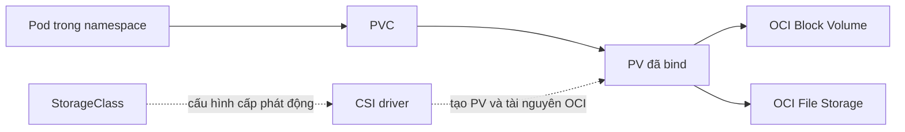

# Persistent volumes với Block Volume và File Storage

Trong chương **Kubernetes với OKE** của module Oracle Cloud Infrastructure (`CLOUD_PROVIDERS_ORACLE`), lưu trữ bền vững nối tài nguyên Kubernetes với các dịch vụ dữ liệu của OCI. Một Pod có thể được tạo lại trên worker node khác; dữ liệu nghiệp vụ cần có vòng đời và cơ chế khôi phục riêng. Quyết định này liên quan trực tiếp đến compartment, IAM, VCN, Compute, giám sát và chi phí vận hành.

Bài học xây dựng hai đường lưu trữ: Block Volume cho dữ liệu gắn với một thành phần có trạng thái và File Storage cho thư mục dùng chung. Các ví dụ dùng OKE với **managed worker nodes chạy Linux**; lệnh thao tác được viết cho **Bash trong OCI Cloud Shell hoặc máy quản trị Linux đã cấu hình kubeconfig**. Đây là hướng dẫn để người học thực hành trên môi trường của mình; các manifest không tự triển khai lên OCI khi đọc bài.

## 1. Xác định dữ liệu nào cần tồn tại ngoài Pod

Giả sử một ứng dụng tiếp nhận hồ sơ gồm ba thành phần:

- API xử lý yêu cầu, có thể tạo nhiều bản sao.
- Bộ xử lý lưu checkpoint để tiếp tục công việc sau khi khởi động lại.
- Các tiến trình cùng đọc tài liệu và tạo kết quả trong một thư mục chung.

Nếu ghi checkpoint vào filesystem của container, việc thay container có thể làm mất trạng thái. Nếu ghi tài liệu lên đĩa cục bộ của một node, bản sao API trên node khác không tự nhìn thấy chúng.

Thiết kế ban đầu hợp lý cho ví dụ này là một volume riêng cho checkpoint và một filesystem dùng chung cho tài liệu. Sau đó cần trả lời tiếp: ai được tạo tài nguyên, dữ liệu nằm ở availability domain nào, khi xóa PVC thì dữ liệu ra sao, và phải mất bao lâu để phục hồi.

Sau bài học, người học cần thực hiện được các việc sau:

1. Phân biệt StorageClass, PersistentVolume và PersistentVolumeClaim.
2. Chọn giữa Block Volume và File Storage theo cách ứng dụng đọc, ghi dữ liệu.
3. Tạo lưu trữ bằng CSI, kiểm chứng dữ liệu tồn tại sau khi tạo lại Pod.
4. Nhận biết lỗi provisioning, scheduling, attach và mount.
5. Lập phương án bảo vệ dữ liệu, theo dõi dung lượng và dọn tài nguyên có kiểm soát.

## 2. PV, PVC, StorageClass và CSI phối hợp ra sao?

| Thành phần | Phạm vi | Trách nhiệm |
| --- | --- | --- |
| StorageClass | Toàn cluster | Mô tả cách cấp phát lưu trữ, driver và các chính sách liên quan |
| PersistentVolume, viết tắt PV | Toàn cluster | Đại diện phần lưu trữ được Kubernetes quản lý |
| PersistentVolumeClaim, viết tắt PVC | Trong namespace | Yêu cầu lưu trữ của ứng dụng |
| Pod | Trong namespace | Tham chiếu PVC và gắn volume vào container |
| CSI driver | Tích hợp Kubernetes với hệ thống lưu trữ | Thực hiện các thao tác lưu trữ mà driver hỗ trợ |

Pod dùng PVC trong cùng namespace. Một PV gắn với một PVC tại một thời điểm; nhiều Pod có thể dùng cùng PVC nếu backend và access mode cho phép. Filesystem của container, `emptyDir` và `hostPath` không mang lại cùng hợp đồng vòng đời như một PV được cấp phát từ dịch vụ OCI. Xem [Persistent Volumes của Kubernetes](https://kubernetes.io/docs/concepts/storage/persistent-volumes/).

Có hai cách đưa tài nguyên vào chuỗi này:

- **Dynamic provisioning:** tạo PVC tham chiếu StorageClass; provisioner tạo lưu trữ tương ứng.
- **Static provisioning:** quản trị viên chuẩn bị lưu trữ và PV trước; PVC được ràng buộc với PV phù hợp.

Dynamic provisioning giúp nhóm ứng dụng tự yêu cầu lưu trữ theo một cấu hình đã được nhóm nền tảng chuẩn hóa. Static provisioning phù hợp khi dữ liệu đã có sẵn hoặc vòng đời tài nguyên do một nhóm khác quản lý. Cơ chế được mô tả tại [Dynamic Volume Provisioning](https://kubernetes.io/docs/concepts/storage/dynamic-provisioning/).



Sơ đồ biểu diễn hai lựa chọn backend. Một PV cụ thể chỉ đại diện backend được khai báo cho chính PV đó.

### Access mode và volume mode là hai quyết định khác nhau

`ReadWriteOnce` (RWO) cho phép mount đọc, ghi từ một node; nhiều Pod trên node đó vẫn có thể cùng truy cập. `ReadWriteMany` (RWX) cho phép nhiều node cùng mount đọc, ghi. `ReadWriteOncePod` (RWOP) có ý nghĩa giới hạn ở một Pod và cần được driver cùng phiên bản Kubernetes hỗ trợ; không tự đổi từ RWO sang RWOP trong manifest OCI.

`volumeMode: Filesystem` cung cấp filesystem để mount vào một thư mục. `volumeMode: Block` cung cấp thiết bị block thô cho ứng dụng biết cách sử dụng. Block Volume vẫn có thể được dùng qua `volumeMode: Filesystem`, như trong bài này. Các access mode không thay thế quyền truy cập file bên trong hệ điều hành. Tham khảo [access modes và volume modes](https://kubernetes.io/docs/concepts/storage/persistent-volumes/).

## 3. Chọn Block Volume hay File Storage

| Câu hỏi thiết kế | Block Volume | File Storage |
| --- | --- | --- |
| Mô hình truy cập | Thiết bị block gắn với Compute instance | Filesystem truy cập qua mạng |
| Kiểu dùng trong bài | RWO, một volume riêng cho một thành phần | RWX, thư mục chung cho nhiều Pod |
| Ví dụ phù hợp | Checkpoint riêng, dữ liệu cần filesystem trên block device | Tài liệu chung, đầu vào xử lý theo lô, nội dung dùng chung |
| Điểm cần đánh giá | Topology, attach/detach, IOPS và throughput | Kết nối NFS, metadata, quyền file và ghi đồng thời |
| Cách kiểm chứng | Tạo lại Pod và đọc dữ liệu trên cùng PVC | Các Pod trên nhiều node thấy cùng dữ liệu |

Oracle hướng dẫn lựa chọn dịch vụ theo workload và dùng StorageClass để thể hiện nhu cầu lưu trữ. Xem [Storage Best Practices cho OKE](https://docs.oracle.com/en-us/iaas/Content/ContEng/Tasks/contengbestpractices_topic-Storage-best-practices.htm).

Một chương trình ghi file tuần tự và một cơ sở dữ liệu ghi log giao dịch có thể đòi hỏi đặc tính rất khác nhau. Vì vậy, bảng trên là điểm bắt đầu để thiết kế thử nghiệm. Với cơ sở dữ liệu Oracle, cần kiểm tra cấu hình lưu trữ được sản phẩm hỗ trợ, cơ chế sao lưu, replication và mô hình vận hành; ví dụ ghi checkpoint trong bài không phải cấu hình triển khai Oracle Database.

File Storage hỗ trợ NFSv3 cùng cơ chế khóa NLM. Việc có RWX cho phép chia sẻ filesystem nhưng ứng dụng vẫn cần quy tắc khi cùng cập nhật một đối tượng dữ liệu. Ví dụ, hai worker có thể ghi ra hai file khác nhau rồi công bố kết quả; nếu cùng sửa một file, phải thiết kế khóa hoặc điều phối phù hợp. Tham khảo [OCI File Storage](https://docs.oracle.com/en-us/iaas/Content/File/home.htm).

## 4. Chuẩn bị OKE, quyền và mạng

### 4.1. Kiểm tra môi trường thực hành

Chuẩn bị một cluster OKE đang hoạt động, managed worker nodes Linux, quyền truy cập Kubernetes và quyền quản trị lưu trữ tương ứng trong OCI. Phần File Storage dùng hai worker nodes có thể nhận Pod để minh họa truy cập từ nhiều node.

Thực hiện trên máy quản trị:

```bash
kubectl config current-context
kubectl get nodes -o wide
kubectl get storageclass
kubectl get csidrivers
kubectl get nodes -L topology.kubernetes.io/zone
```

Các tên driver cần đối chiếu là `blockvolume.csi.oraclecloud.com` và `fss.csi.oraclecloud.com`. Nếu cluster chưa có driver phù hợp hoặc driver không khỏe, cần hoàn tất cấu hình nền tảng trước khi chạy bài thực hành.

Tên StorageClass là cấu hình của cluster thực tế. Bài dùng các class riêng, không dựa vào việc một class đang là mặc định. Đối với Block Volume, Oracle hướng dẫn dùng CSI và class `oci-bv`; cluster cũ sau nâng cấp có thể vẫn giữ mặc định `oci` của FlexVolume. Xem [cấp phát PVC trên Block Volume](https://docs.oracle.com/en-us/iaas/Content/ContEng/Tasks/contengcreatingpersistentvolumeclaim_topic-Provisioning_PVCs_on_BV.htm).

### 4.2. Tách quyền gọi Kubernetes khỏi quyền tạo tài nguyên OCI

Tài khoản có quyền tạo PVC trong namespace chưa chắc có quyền tạo StorageClass hoặc PV. Đồng thời, CSI provisioner cần được OCI cho phép thao tác trên compartment chứa tài nguyên.

Lập bảng phân công trước khi thực hành:

| Chủ thể | Việc cần được phép làm |
| --- | --- |
| Người quản trị nền tảng | Chuẩn bị StorageClass, PV tĩnh, driver và cấu hình cluster |
| Người triển khai ứng dụng | Tạo workload và PVC trong namespace được giao |
| Principal mà tích hợp OKE sử dụng | Thao tác lưu trữ và mạng theo cơ chế tích hợp |
| Người quản trị dữ liệu | Chuẩn bị quyền thư mục, sao lưu và khôi phục |

IAM quản lý quyền thao tác tài nguyên OCI; quyền dữ liệu trên File Storage còn đi qua mạng, export và quyền filesystem. Đây là các lớp riêng, được trình bày tại [About File Storage Security](https://docs.oracle.com/en-us/iaas/Content/File/Concepts/securitylayers.htm).

Với File Storage cấp phát động, hãy kiểm tra chính sách cho `file-family`, quyền mạng liên quan và compartment đích theo [hướng dẫn OKE File Storage](https://docs.oracle.com/en-us/iaas/Content/ContEng/Tasks/contengcreatingpersistentvolumeclaim_Provisioning_PVCs_on_FSS.htm). Nếu dùng khóa do khách hàng quản lý trong Vault, phải bổ sung quyền sử dụng khóa. Không suy principal của CSI từ service account của ứng dụng.

### 4.3. Chuẩn bị đường mạng tới File Storage

Pod có PVC ở trạng thái `Bound` vẫn có thể chưa mount được filesystem. Worker node phải đến được IP riêng của mount target, và export phải cho phép nguồn truy cập phù hợp.

Trong mô hình managed nodes của bài:

1. Chuẩn bị mount target trong subnet riêng có đường mạng từ worker nodes.
2. Kiểm tra route và security rules ở cả phía node lẫn mount target.
3. Cho phép đúng nguồn client và các giao thức cần dùng.
4. Kiểm tra export options cho nguồn truy cập thực tế.

Với truy cập NFS thông thường, tài liệu Oracle liệt kê TCP 111, 2048, 2049, 2050 và UDP 111, 2048 cho các luồng tương ứng. Cấu hình cụ thể phụ thuộc việc node và mount target ở cùng hay khác subnet; làm theo [Configuring VCN Security Rules for File Storage](https://docs.oracle.com/en-us/iaas/Content/File/Tasks/securitylistsfilestorage.htm).

## 5. Thực hành Block Volume: dữ liệu riêng cho StatefulSet

### 5.1. Ý nghĩa cấu hình

Ta dùng một StatefulSet có một replica, ghi dấu lần khởi động vào `/data/history.log`. Mỗi lần Pod được tạo lại, nó tiếp tục dùng PVC gắn với định danh của replica.

StorageClass đặt `volumeBindingMode: WaitForFirstConsumer`, cho phép scheduler và provisioner phối hợp chọn vị trí trước khi cấp phát. Với kiểu binding này, PVC chưa có Pod sử dụng có thể ở trạng thái `Pending` bình thường; tránh gán trực tiếp `nodeName` để bỏ qua scheduler. Xem [Volume binding mode](https://kubernetes.io/docs/concepts/storage/storage-classes/).

OCI Block Volume gắn với availability domain: instance chỉ truy cập trực tiếp volume ở cùng AD. Vì vậy, volume đã tồn tại ảnh hưởng đến nơi Pod có thể chạy. Tham khảo [Overview of Block Volume](https://docs.oracle.com/en-us/iaas/Content/Block/Concepts/overview.htm).

### 5.2. Manifest hoàn chỉnh

Lưu ví dụ thành `lab-bv.yaml` trên máy thực hành:

```yaml
apiVersion: v1
kind: Namespace
metadata:
  name: oke-storage-lab
---
apiVersion: storage.k8s.io/v1
kind: StorageClass
metadata:
  name: oke-lab-bv-retain
provisioner: blockvolume.csi.oraclecloud.com
parameters:
  attachment-type: "paravirtualized"
reclaimPolicy: Retain
allowVolumeExpansion: true
volumeBindingMode: WaitForFirstConsumer
---
apiVersion: v1
kind: Service
metadata:
  name: checkpoint
  namespace: oke-storage-lab
spec:
  clusterIP: None
  selector:
    app: checkpoint
  ports:
    - name: placeholder
      port: 8080
---
apiVersion: apps/v1
kind: StatefulSet
metadata:
  name: checkpoint
  namespace: oke-storage-lab
spec:
  serviceName: checkpoint
  replicas: 1
  selector:
    matchLabels:
      app: checkpoint
  template:
    metadata:
      labels:
        app: checkpoint
    spec:
      terminationGracePeriodSeconds: 15
      securityContext:
        runAsUser: 1000
        runAsGroup: 1000
        fsGroup: 1000
      containers:
        - name: writer
          image: busybox:1.37.0
          command: ["/bin/sh", "-c"]
          args:
            - |
              set -eu
              printf 'pod=%s time=%s\n' "$HOSTNAME" "$(date -u)" >> /data/history.log
              sync
              while true; do sleep 3600; done
          resources:
            requests:
              cpu: 20m
              memory: 16Mi
            limits:
              cpu: 100m
              memory: 64Mi
          volumeMounts:
            - name: data
              mountPath: /data
  volumeClaimTemplates:
    - metadata:
        name: data
      spec:
        storageClassName: oke-lab-bv-retain
        accessModes:
          - ReadWriteOnce
        volumeMode: Filesystem
        resources:
          requests:
            storage: 50Gi
```

Class trên dùng CSI Block Volume và kiểu attachment được Oracle minh họa. OKE làm tròn yêu cầu nhỏ hơn mức tối thiểu 50 GB lên mức tối thiểu; ví dụ chọn `50Gi` ngay từ đầu. Tham khảo [Provisioning PVCs on the Block Volume Service](https://docs.oracle.com/en-us/iaas/Content/ContEng/Tasks/contengcreatingpersistentvolumeclaim_topic-Provisioning_PVCs_on_BV.htm).

Service headless cung cấp phần cấu hình định danh mạng cho StatefulSet; tiến trình ví dụ không mở cổng 8080. Container chỉ ghi dấu khởi động rồi chờ. Đối với ứng dụng thực tế, thay image và lệnh bằng chương trình nghiệp vụ, đồng thời cố định image theo digest trong quy trình phát hành.

Áp dụng và quan sát:

```bash
kubectl apply -f lab-bv.yaml
kubectl -n oke-storage-lab get pvc
kubectl -n oke-storage-lab rollout status statefulset/checkpoint --timeout=300s
kubectl -n oke-storage-lab get pod checkpoint-0 -o wide
kubectl -n oke-storage-lab get pvc data-checkpoint-0
kubectl -n oke-storage-lab exec checkpoint-0 -- cat /data/history.log
```

Kết quả mong đợi là PVC `data-checkpoint-0` chuyển sang `Bound` và Pod chạy được. Thời gian cấp phát, attach và tải image phụ thuộc môi trường; hết timeout là lúc kiểm tra events, chưa đủ để kết luận dữ liệu đã lỗi.

### 5.3. Kiểm chứng dữ liệu sau khi tạo lại Pod

Ghi nhận tên PV và mã định danh backend:

```bash
BV_PV=$(kubectl -n oke-storage-lab get pvc data-checkpoint-0 -o jsonpath='{.spec.volumeName}')
kubectl get pv "$BV_PV"
kubectl get pv "$BV_PV" -o jsonpath='{.spec.csi.volumeHandle}'
printf '\n'

kubectl -n oke-storage-lab delete pod checkpoint-0
kubectl -n oke-storage-lab wait --for=condition=Ready pod/checkpoint-0 --timeout=300s
kubectl -n oke-storage-lab exec checkpoint-0 -- cat /data/history.log
```

Sau khi Pod mới sẵn sàng, file cần còn dòng cũ và có thêm dấu khởi động. Kiểm tra PVC vẫn bind vào cùng PV. Phép thử này chứng minh dữ liệu tồn tại qua việc tạo lại Pod; nó chưa kiểm chứng phục hồi khi mất AD hoặc khi bị xóa nhầm.

StatefulSet tạo PVC riêng cho từng phần tử của `volumeClaimTemplates`. Nếu tăng lên ba replica, ta có ba PVC riêng cho ba định danh; ứng dụng phải tự tổ chức replication nếu muốn các bản sao chứa cùng dữ liệu. Xem [StatefulSets và stable storage](https://kubernetes.io/docs/concepts/workloads/controllers/statefulset/).

### 5.4. Quan sát node affinity

```bash
kubectl get pv "$BV_PV" -o yaml
kubectl get nodes -L topology.kubernetes.io/zone
kubectl -n oke-storage-lab describe pod checkpoint-0
```

Đọc phần `nodeAffinity` của PV và so với topology của node. Khi dung lượng Compute ở AD phù hợp không còn, Pod có thể chờ scheduling dù cluster vẫn có node ở AD khác.

Từ đó có một yêu cầu vận hành cụ thể: khi thu hẹp node pool hoặc thay node, phải bảo đảm còn node đủ điều kiện phục vụ dữ liệu đã cấp phát. Tăng tổng số node mà không xét vị trí có thể chưa giải quyết được vấn đề.

## 6. Mở rộng Block Volume đúng lớp

Class của bài đã bật `allowVolumeExpansion`. Để tăng PVC từ `50Gi` lên `100Gi`:

```bash
kubectl -n oke-storage-lab patch pvc data-checkpoint-0 --type=merge \
  -p '{"spec":{"resources":{"requests":{"storage":"100Gi"}}}}'

kubectl -n oke-storage-lab get pvc data-checkpoint-0
kubectl -n oke-storage-lab describe pvc data-checkpoint-0
kubectl -n oke-storage-lab exec checkpoint-0 -- df -h /data
```

Yêu cầu thay đổi đi qua PVC; không sửa trực tiếp dung lượng PV để giả lập việc resize. Theo dõi cả capacity của PVC lẫn filesystem bên trong container. Hướng dẫn CSI của Oracle mô tả mở rộng online và cho biết yêu cầu thu nhỏ không được hỗ trợ. Xem [Expand a Block Volume using CSI](https://github.com/oracle/oci-cloud-controller-manager/blob/master/docs/expand-block-volume-using-csi.md).

Với workload thật, lưu kích thước mong muốn của các PVC đang tồn tại trong quy trình vận hành hoặc nguồn cấu hình phù hợp. `volumeClaimTemplates` không phải cơ chế tự resize các PVC cũ; đừng coi việc sửa template thành thao tác mở rộng hàng loạt.

Quyết định tăng dung lượng cần đi cùng dự báo tăng trưởng. Ví dụ, checkpoint thực tế chỉ dùng 8 GiB nhưng tăng 3 GiB mỗi ngày thì cần xử lý cả cơ chế giữ lịch sử. Mở rộng giúp có thêm thời gian vận hành; quy tắc lưu giữ dữ liệu quyết định nhu cầu lâu dài.

## 7. Thực hành File Storage: nhiều node dùng chung filesystem

### 7.1. Chuẩn bị tài nguyên và quyền thư mục

Đường static provisioning dưới đây giả định quản trị viên đã chuẩn bị:

- Một OCI File Storage filesystem dành cho lab.
- Mount target có IP riêng, ví dụ minh họa `10.0.20.10`.
- Export path minh họa `/oke-shared`.
- Các security rules và export options cho phép client hợp lệ.
- OCID filesystem, IP mount target và export path thực tế.

Dùng máy quản trị Linux đã được cho phép mount export đó. Sau khi mount thành công tại `/mnt/oke-fss`, tạo thư mục riêng cho lab:

```bash
sudo mkdir -p /mnt/oke-fss/lab-data
sudo chown 1000:1000 /mnt/oke-fss/lab-data
sudo chmod 2770 /mnt/oke-fss/lab-data
ls -ldn /mnt/oke-fss/lab-data
```

Đường dẫn này phải nằm trên filesystem đã mount, tránh tạo nhầm thư mục trên đĩa cục bộ. Nếu `chown` không được phép, quản trị viên cần xử lý quyền và export policy theo thiết kế của môi trường.

Export options có thể giới hạn nguồn client, quyền đọc/ghi và ánh xạ UID/GID, bao gồm root squash. Quyền root trong container không tự vượt qua các ràng buộc này. Xem [Working with NFS Exports and Export Options](https://docs.oracle.com/en-us/iaas/Content/File/Tasks/exportoptions.htm).

Việc chuẩn bị thư mục có chủ sở hữu xác định giúp ví dụ dùng UID/GID 1000 mà không phụ thuộc giả định driver tự đổi ownership cho mọi RWX volume. Khi dùng `securityContext`, cần đối chiếu khả năng của driver; xem [Configure a Security Context](https://kubernetes.io/docs/tasks/configure-pod-container/security-context/).

### 7.2. Khai báo PV tĩnh và PVC

Lưu thành `lab-fss-static.yaml`, thay toàn bộ placeholder bằng thông tin thật:

```yaml
apiVersion: v1
kind: PersistentVolume
metadata:
  name: oke-lab-fss-static
spec:
  capacity:
    storage: 50Gi
  volumeMode: Filesystem
  accessModes:
    - ReadWriteMany
  persistentVolumeReclaimPolicy: Retain
  storageClassName: ""
  csi:
    driver: fss.csi.oraclecloud.com
    volumeHandle: "<FILESYSTEM_OCID>:<MOUNT_TARGET_PRIVATE_IP>:/oke-shared"
---
apiVersion: v1
kind: PersistentVolumeClaim
metadata:
  name: shared-files
  namespace: oke-storage-lab
spec:
  storageClassName: ""
  volumeName: oke-lab-fss-static
  accessModes:
    - ReadWriteMany
  volumeMode: Filesystem
  resources:
    requests:
      storage: 50Gi
```

`volumeHandle` định danh filesystem, địa chỉ mount target và export path. `volumeName` chọn PV cụ thể; `storageClassName: ""` thể hiện PVC không yêu cầu class mặc định. Xem ví dụ CSI chính thức tại [Statically Provisioned FSS using CSI](https://github.com/oracle/oci-cloud-controller-manager/blob/master/docs/statically-provisioned-fss-using-csi.md).

Áp dụng sau khi namespace từ phần Block Volume đã tồn tại:

```bash
kubectl apply -f lab-fss-static.yaml
kubectl -n oke-storage-lab get pvc shared-files
kubectl get pv oke-lab-fss-static
```

Trong ví dụ FSS, `50Gi` là giá trị khai báo cho cơ chế PV/PVC. Đừng suy rằng filesystem đã được tạo với quota cứng tương ứng; cách theo dõi dung lượng được trình bày ở phần chi phí.

### 7.3. Hai Pod cùng ghi vào thư mục chung

Lưu thành `lab-fss-writer.yaml`:

```yaml
apiVersion: apps/v1
kind: Deployment
metadata:
  name: shared-writer
  namespace: oke-storage-lab
spec:
  replicas: 2
  strategy:
    type: RollingUpdate
    rollingUpdate:
      maxSurge: 0
      maxUnavailable: 1
  selector:
    matchLabels:
      app: shared-writer
  template:
    metadata:
      labels:
        app: shared-writer
    spec:
      securityContext:
        runAsUser: 1000
        runAsGroup: 1000
      affinity:
        podAntiAffinity:
          requiredDuringSchedulingIgnoredDuringExecution:
            - labelSelector:
                matchLabels:
                  app: shared-writer
              topologyKey: kubernetes.io/hostname
      containers:
        - name: writer
          image: busybox:1.37.0
          command: ["/bin/sh", "-c"]
          args:
            - |
              set -eu
              printf 'pod=%s time=%s\n' "$HOSTNAME" "$(date -u)" > "/shared/$HOSTNAME.txt"
              sync
              while true; do sleep 3600; done
          resources:
            requests:
              cpu: 20m
              memory: 16Mi
            limits:
              cpu: 100m
              memory: 64Mi
          volumeMounts:
            - name: shared
              mountPath: /shared
              subPath: lab-data
      volumes:
        - name: shared
          persistentVolumeClaim:
            claimName: shared-files
```

`subPath` chọn thư mục `lab-data` đã chuẩn bị trong export. Anti-affinity bắt hai Pod chạy trên hai node khác nhau. Nếu chỉ có một node đủ điều kiện, một Pod sẽ `Pending`; muốn chứng minh truy cập từ hai node, cần bổ sung node phù hợp.

```bash
kubectl apply -f lab-fss-writer.yaml
kubectl -n oke-storage-lab rollout status deployment/shared-writer --timeout=300s
kubectl -n oke-storage-lab get pods -l app=shared-writer -o wide

for pod in $(kubectl -n oke-storage-lab get pods -l app=shared-writer -o jsonpath='{.items[*].metadata.name}'); do
  printf '\nPod: %s\n' "$pod"
  kubectl -n oke-storage-lab exec "$pod" -- sh -c 'ls -l /shared; cat /shared/*.txt'
done
```

Kết quả cần có hai bằng chứng: hai Pod ở hai node và mỗi Pod đọc được file do cả hai tạo ra. Mỗi tiến trình ghi file riêng theo tên Pod để tránh việc một tiến trình ghi đè kết quả của tiến trình kia.

Có thể tạo lại Pod bằng `kubectl -n oke-storage-lab rollout restart deployment/shared-writer`. Cấu hình `maxSurge: 0` và `maxUnavailable: 1` cho phép thu hồi một Pod cũ để có chỗ cho Pod mới khi hai node đang phục vụ hai replica. Dữ liệu của các Pod cũ vẫn nằm trong thư mục chung sau khi rollout hoàn tất.

## 8. File Storage cấp phát động: một lựa chọn thay thế

Static provisioning tách việc tạo filesystem khỏi việc triển khai ứng dụng. Khi nhóm nền tảng muốn cho phép tạo filesystem theo PVC, có thể chuẩn bị một StorageClass dùng FSS CSI.

Ví dụ dùng một mount target hiện hữu:

```yaml
apiVersion: storage.k8s.io/v1
kind: StorageClass
metadata:
  name: oke-lab-fss-dynamic-retain
provisioner: fss.csi.oraclecloud.com
reclaimPolicy: Retain
volumeBindingMode: Immediate
parameters:
  availabilityDomain: "<TENANCY_AD_NAME>"
  compartmentOcid: "<STORAGE_COMPARTMENT_OCID>"
  mountTargetOcid: "<EXISTING_MOUNT_TARGET_OCID>"
---
apiVersion: v1
kind: PersistentVolumeClaim
metadata:
  name: shared-files-dynamic
  namespace: oke-storage-lab
spec:
  storageClassName: oke-lab-fss-dynamic-retain
  accessModes:
    - ReadWriteMany
  resources:
    requests:
      storage: 50Gi
```

AD phải khớp vị trí của mount target được chọn. Nếu muốn driver tạo mount target, dùng `mountTargetSubnetOcid` thay cho `mountTargetOcid`. CSI tạo filesystem mới cho PVC; yêu cầu `storage` trong PVC không định kích thước filesystem OCI. Các tham số và chính sách cần có được mô tả tại [Provisioning PVCs on File Storage](https://docs.oracle.com/en-us/iaas/Content/ContEng/Tasks/contengcreatingpersistentvolumeclaim_Provisioning_PVCs_on_FSS.htm).

Nếu thực hành lựa chọn này, lưu thành manifest riêng trên máy lab và áp dụng sau khi thay placeholder. Sau khi PVC `Bound`, lấy handle của PV để xác định filesystem và export mới:

```bash
FSS_DYNAMIC_PV=$(kubectl -n oke-storage-lab get pvc shared-files-dynamic -o jsonpath='{.spec.volumeName}')
kubectl get pv "$FSS_DYNAMIC_PV" -o jsonpath='{.spec.csi.volumeHandle}'
printf '\n'
```

Trước khi dùng lại Deployment của phần 7, chuẩn bị `lab-data` với quyền tương ứng trên **filesystem mới**, rồi thay `claimName` thành `shared-files-dynamic`. Thư mục trên filesystem tĩnh không tự xuất hiện trên filesystem động.

Không cố định cùng một export path cho nhiều PVC tạo filesystem khác nhau trên một mount target. Khi quản lý bằng CSI, giữ cấu hình cấp phát và vòng đời trong quy trình Kubernetes tương ứng; thay tham số StorageClass không có nghĩa tài nguyên đã cấp phát được cấu hình lại.

## 9. Vòng đời dữ liệu: tạo lại Pod, xóa PVC và reclaim policy

Cần phân biệt ba sự kiện:

| Sự kiện | Điều cần kiểm tra |
| --- | --- |
| Pod bị tạo lại | PVC có còn tồn tại và trỏ tới PV cũ không? |
| PVC bị xóa | PV đang có reclaim policy gì? |
| Tài nguyên OCI bị xóa | Có bản sao hoặc điểm phục hồi dùng được không? |

`Delete` cho phép hệ thống thu hồi PV cùng lưu trữ backend theo driver. `Retain` giữ dữ liệu để quản trị viên xử lý; sau khi PVC bị xóa, PV thường chuyển sang `Released` và không tự trở thành volume trống cho ứng dụng khác. Tham khảo [Change the Reclaim Policy of a PersistentVolume](https://kubernetes.io/docs/tasks/administer-cluster/change-pv-reclaim-policy/).

Các ví dụ chọn `Retain` để việc xóa claim không đồng thời trở thành thao tác xóa dữ liệu lab. Đổi lại, người vận hành có trách nhiệm kiểm kê tài nguyên còn lại và chi phí của chúng.

Trước khi gỡ một workload có dữ liệu, kiểm tra:

```bash
kubectl -n oke-storage-lab get pvc
kubectl get pv
kubectl get pv "$BV_PV" -o jsonpath='{.spec.persistentVolumeReclaimPolicy}'
printf '\n'
```

Khi cần thay policy của một PV đã tồn tại, thay trên chính PV đó. Ví dụ sau đổi PV Block Volume của lab sang `Retain` trước khi xóa claim:

```bash
kubectl patch pv "$BV_PV" --type=merge \
  -p '{"spec":{"persistentVolumeReclaimPolicy":"Retain"}}'
```

Thay policy trong StorageClass phục vụ các volume được cấp phát theo class; không dùng thay đổi đó như bằng chứng rằng các PV cũ đã có policy mới.

Nếu cần sử dụng lại dữ liệu đã được giữ, hãy xác minh backend, tình trạng attachment, quyền truy cập và claim trước đó. Quản trị viên có thể lập phương án bind lại phù hợp hoặc phục hồi sang tài nguyên mới. Xóa `claimRef` một cách tùy tiện có thể làm dữ liệu cũ bị cấp nhầm cho workload khác.

## 10. Mã hóa và quyền truy cập dữ liệu

Có ba nội dung cần ghi vào thiết kế:

1. Khóa nào bảo vệ dữ liệu khi lưu trữ?
2. Đường truyền dữ liệu có yêu cầu mã hóa hay không?
3. Tiến trình nào được đọc và sửa dữ liệu sau khi mount?

Với Block Volume dùng CSI, `kms-key-id` có thể chọn khóa do khách hàng quản lý. Thiết lập mã hóa boot volume của worker node và thiết lập khóa cho volume dữ liệu cấp phát động là hai cấu hình cần xem riêng. Tham khảo [Customer-managed encryption trong OKE](https://blogs.oracle.com/cloud-infrastructure/oke-customer-managed-encryption).

Với File Storage, khả năng mã hóa khi truyền có yêu cầu phần mềm, hệ điều hành và cổng mạng riêng. Hướng dẫn TLS của Oracle sử dụng cổng 2051 cho truy cập mã hóa; không áp nguyên xi security rules của NFS không mã hóa rồi coi cấu hình đã hoàn tất. Xem [Using In-transit TLS Encryption](https://docs.cloud.oracle.com/en-us/Content/File/Tasks/intransitencryption.htm).

Các manifest thực hành ở trên chưa bật cấu hình mã hóa khi truyền. Khi yêu cầu triển khai có tiêu chí này, bổ sung theo driver và node image đang sử dụng, đồng thời kiểm chứng đường dữ liệu thực tế.

Ở lớp filesystem, dùng UID/GID phù hợp với ứng dụng và phân quyền thư mục có chủ đích. Với FSS, đừng mặc định thêm `fsGroup` là giải quyết được mọi lỗi RWX; cần xem driver xử lý ownership ra sao và export có áp dụng squash hay không. Tránh thay quyền toàn bộ filesystem chỉ để sửa lỗi của một thư mục con.

## 11. Sao lưu, khôi phục và tính sẵn sàng

### 11.1. Xác định mục tiêu phục hồi

Một volume còn nguyên sau khi tạo lại Pod là tính bền vững qua vòng đời Pod. Để thiết kế phục hồi nghiệp vụ, cần thêm:

- **RPO:** có thể chấp nhận mất dữ liệu mới nhất trong bao lâu.
- **RTO:** có thể chấp nhận dịch vụ gián đoạn trong bao lâu.
- Phạm vi sự cố: lỗi ứng dụng, xóa nhầm, hỏng dữ liệu, mất AD hoặc mất region.
- Quy trình xác định bản phục hồi nào đáng tin cậy.

Ví dụ, nếu checkpoint được tạo lại từ nguồn đầu vào thì có thể chấp nhận RPO lớn hơn. Nếu thư mục chứa hồ sơ gốc duy nhất, quy tắc sao lưu và kiểm chứng phục hồi phải phản ánh giá trị đó.

### 11.2. Block Volume và snapshot CSI

Kubernetes dùng các đối tượng snapshot riêng ngoài API lõi. Trước khi tạo snapshot, kiểm tra CRD và snapshot controller tương thích đã sẵn sàng; xem [Volume Snapshots](https://kubernetes.io/docs/concepts/storage/volume-snapshots/).

```bash
kubectl api-resources --api-group=snapshot.storage.k8s.io
```

OCI CSI có thể tạo snapshot gắn với Block Volume backup. Khôi phục bằng CSI tạo volume mới từ snapshot, không ghi đè dữ liệu của một volume đang tồn tại. Tham khảo [Block Volume Snapshot and Restore using CSI](https://github.com/oracle/oci-cloud-controller-manager/blob/master/docs/volume-snapshot-and-restore-using-csi.md).

Một quy trình diễn tập cho workload thật có thể gồm:

1. Đưa ứng dụng về trạng thái thích hợp để lấy bản sao nhất quán.
2. Tạo điểm phục hồi và chờ hoàn tất.
3. Tạo PVC mới từ bản sao.
4. Chạy ứng dụng kiểm tra trong namespace phục hồi riêng.
5. Đối chiếu dữ liệu và đo thời gian hoàn thành.
6. Chỉ chuyển lưu lượng sau khi kiểm tra nghiệp vụ đạt yêu cầu.

Backup có thể hỗ trợ phục hồi volume sang AD khác trong cùng region; việc di chuyển trực tiếp một volume đang tồn tại không tương đương thao tác đó. Xem [Block Volumes FAQ](https://www.oracle.com/cloud/storage/block-volumes/faq/).

### 11.3. File Storage: snapshot và replication

File Storage có snapshot ở phạm vi toàn filesystem và hỗ trợ lịch snapshot theo chính sách. Khi lập lịch, cần xác định chu kỳ, thời gian giữ và cách theo dõi việc tạo snapshot. Xem [Managing Snapshots](https://docs.oracle.com/en-us/iaas/Content/File/Tasks/managingsnapshots.htm) và [Policy-Based Snapshots and Scheduling](https://docs.oracle.com/en-us/iaas/Content/File/Tasks/snapshot-policies-and-schedules.htm).

Để bảo vệ trước sự cố địa điểm, File Storage có cơ chế replication trong cùng region hoặc sang region khác. Thiết kế đích phục hồi còn phải chuẩn bị export, mạng và việc kết nối workload tới dữ liệu ở đích. Xem [File System Replication](https://docs.oracle.com/en-us/iaas/Content/File/Tasks/FSreplication.htm).

### 11.4. Nhiều replica chưa tự tạo ra HA dữ liệu

Một StatefulSet ba replica với ba PVC chưa bảo đảm ba bản dữ liệu nhất quán. Một Deployment ba replica cùng mount FSS cũng chưa giải quyết mọi sự cố của đường mạng hoặc địa điểm chứa dữ liệu.

Muốn đánh giá tính sẵn sàng, hãy mô phỏng đúng sự cố thiết kế yêu cầu: một Pod bị tạo lại, một node không sẵn sàng, không còn node ở AD chứa Block Volume, hoặc ứng dụng phải đọc từ dữ liệu phục hồi. Mỗi phép thử trả lời một câu hỏi khác nhau và cần ghi rõ kết quả của chính câu hỏi đó.

## 12. Giám sát hiệu năng, dung lượng và chi phí

### 12.1. Đọc các tín hiệu cùng nhau

Trong quá trình vận hành, ghép tín hiệu của ứng dụng với tình trạng lưu trữ:

| Tín hiệu | Câu hỏi cần trả lời |
| --- | --- |
| PVC `Pending` kéo dài | Đang chờ consumer hay không cấp phát được? |
| Pod chưa Ready sau khi đã schedule | Attach, mount, permission hay image đang có lỗi? |
| Độ trễ ghi tăng | Tăng tải ứng dụng, giới hạn lưu trữ hay nghẽn mạng? |
| Dung lượng dùng tăng nhanh | Dữ liệu nghiệp vụ, file tạm hay lịch sử chưa được dọn? |
| Nhiều PV `Released` | Tài nguyên được giữ có còn người chịu trách nhiệm không? |
| Điểm phục hồi cũ | Lịch chạy có thất bại hay khoảng cách sao lưu không đạt RPO? |

Các lệnh quan sát ban đầu:

```bash
kubectl -n oke-storage-lab get pods,pvc
kubectl get pv
kubectl -n oke-storage-lab get events --sort-by=.metadata.creationTimestamp
kubectl -n oke-storage-lab exec checkpoint-0 -- df -h /data
kubectl -n oke-storage-lab exec checkpoint-0 -- df -i /data
```

Theo dõi dung lượng và inode ở những filesystem có giới hạn tương ứng. Với File Storage, kết hợp góc nhìn ứng dụng với chỉ số dịch vụ; kết quả `df` bên trong container không phải hóa đơn.

### 12.2. Tách nhu cầu cấp phát khỏi dữ liệu đang dùng

Với Block Volume, kiểm kê dung lượng đã cấp phát, mức hiệu năng được chọn và backup liên quan. Một PVC nhỏ dùng rất ít dữ liệu vẫn có thể cấp phát backend lớn hơn do giới hạn tối thiểu.

Với FSS, theo dõi `meteredBytes` của dịch vụ. Oracle mô tả đây là lượng sử dụng làm cơ sở tính chi phí, cập nhật bất đồng bộ; dữ liệu khác biệt của snapshot cũng được tính vào lượng sử dụng filesystem. Xem [File System Usage and Metering](https://docs.cloud.oracle.com/en-us/Content/File/Concepts/FSutilization.htm).

Ví dụ quản trị chi phí cho môi trường thực hành:

- Gắn tài nguyên với chủ sở hữu, môi trường và mục đích sử dụng.
- Ghi lại ánh xạ namespace → PVC → PV → OCID.
- Định kỳ rà soát volume được giữ sau khi bài lab kết thúc.
- Đặt thời gian giữ backup và snapshot theo nhu cầu.
- So sánh xu hướng tăng trưởng với ngân sách của compartment.

Một Kubernetes ResourceQuota có thể giới hạn số PVC hoặc tổng yêu cầu khai báo theo thiết kế cluster. Với FSS, cần kiểm soát lượng dữ liệu thật ở lớp dịch vụ và ứng dụng, vì con số `requests.storage` trong PVC không thay thế việc theo dõi sử dụng thực tế.

## 13. Chẩn đoán sự cố theo đúng giai đoạn

Bắt đầu từ đối tượng gần hiện tượng nhất:

```bash
kubectl -n oke-storage-lab describe pvc data-checkpoint-0
kubectl -n oke-storage-lab describe pod checkpoint-0
kubectl get volumeattachments
kubectl -n oke-storage-lab get events --sort-by=.metadata.creationTimestamp
```

Đổi tên PVC và Pod tương ứng khi kiểm tra phần FSS.

| Hiện tượng | Giả thuyết cần kiểm tra | Bằng chứng nên lấy |
| --- | --- | --- |
| PVC Block Volume `Pending`, chưa có consumer | `WaitForFirstConsumer` đang hoạt động đúng | StorageClass và events của PVC |
| PVC có `ProvisioningFailed` | IAM, quota, driver hoặc tham số OCI chưa phù hợp | Event đầy đủ, compartment và tài nguyên đích |
| Pod báo volume node affinity conflict | Node ứng viên không khớp topology của PV | `nodeAffinity` của PV và labels của node |
| Pod báo lỗi attach hoặc multi-attach | Volume còn gắn với node trước hoặc cách dùng RWO chưa phù hợp | VolumeAttachment, trạng thái node và attachment trong OCI |
| FSS PVC `Bound` nhưng mount timeout | Chưa đến được mount target hoặc thiếu luồng mạng | IP đích, route và security rules |
| FSS báo access denied khi mount | Export chưa cho phép nguồn client | Export path và export options |
| Mount được nhưng ghi file bị permission denied | UID/GID, mode hoặc squash không phù hợp | `id`, `ls -ldn`, quyền thư mục và export policy |
| Một FSS Pod `Pending` | Thiếu node thỏa anti-affinity trong lab | Scheduling events và các node đủ điều kiện |
| Resize chưa hiện dung lượng mới | Các bước mở rộng chưa hoàn tất | PVC conditions, events và dung lượng filesystem |

Bảng thể hiện các hướng chẩn đoán, không ánh xạ một thông báo thành duy nhất một nguyên nhân. Đọc nguyên văn lỗi, request ID OCI nếu có và bối cảnh thay đổi gần nhất trước khi sửa.

Khi node mất kết nối, việc cưỡng chế detach volume cần đi cùng xác minh tiến trình cũ đã ngừng truy cập dữ liệu. Xóa `VolumeAttachment` hoặc finalizer để làm lỗi biến mất có thể che tình trạng tài nguyên chưa được xử lý.

Khi tìm log driver, dùng `kubectl -n kube-system get pods -o wide` để xác định tên Pod và container thực tế, rồi đọc log đúng thành phần. Không hard-code tên Pod của CSI từ một cluster khác.

## 14. Dọn môi trường thực hành

Trước tiên ghi nhận tên PV, OCID backend, export và mount target nào thuộc riêng lab. Xác định dữ liệu nào được giữ và dữ liệu nào có thể xóa. Các ví dụ dùng `Retain`, vì vậy gỡ workload không tự hoàn tất việc dọn chi phí OCI.

Dừng các workload:

```bash
kubectl -n oke-storage-lab delete deployment shared-writer
kubectl -n oke-storage-lab delete statefulset checkpoint
kubectl -n oke-storage-lab delete service checkpoint
kubectl -n oke-storage-lab get pods
kubectl -n oke-storage-lab get pvc
```

Chờ Pod được thu hồi. Kiểm tra các PVC còn lại và reclaim policy của từng PV trước khi xóa claim dành cho lab:

```bash
kubectl -n oke-storage-lab delete pvc data-checkpoint-0 shared-files
```

Nếu đã làm thêm phần cấp phát động, kiểm tra riêng `shared-files-dynamic` rồi xóa claim đó khi dữ liệu không còn cần thiết.

Sau đó:

1. Kiểm tra PV được giữ và tài nguyên OCI tương ứng.
2. Hoàn tất lưu giữ hoặc xóa dữ liệu theo quyết định đã ghi nhận.
3. Với Block Volume riêng của lab, xác minh đã detach trước khi xóa backend.
4. Với filesystem riêng của lab, xử lý export, filesystem và các điểm phục hồi theo vòng đời của chúng.
5. Giữ mount target được dùng chung; chỉ dọn mount target thuộc riêng lab khi không còn phụ thuộc.
6. Gỡ PV được giữ sau khi đã xử lý dữ liệu và tài nguyên backend.
7. Gỡ các StorageClass riêng của lab và namespace khi không còn sử dụng.

Đối với File Storage cấp phát động, cần đối chiếu tài nguyên nào CSI tạo và mount target nào có sẵn; chính sách thu hồi cùng driver quyết định việc dọn tự động. Việc tái sử dụng mount target không biến nó thành tài nguyên riêng của một PVC.

Kết quả hoàn thành bài thực hành cần gồm bằng chứng dữ liệu Block Volume tồn tại qua việc tạo lại Pod, bằng chứng hai node truy cập chung File Storage, ánh xạ các tài nguyên dữ liệu và kết quả dọn hoặc giữ từng tài nguyên.
