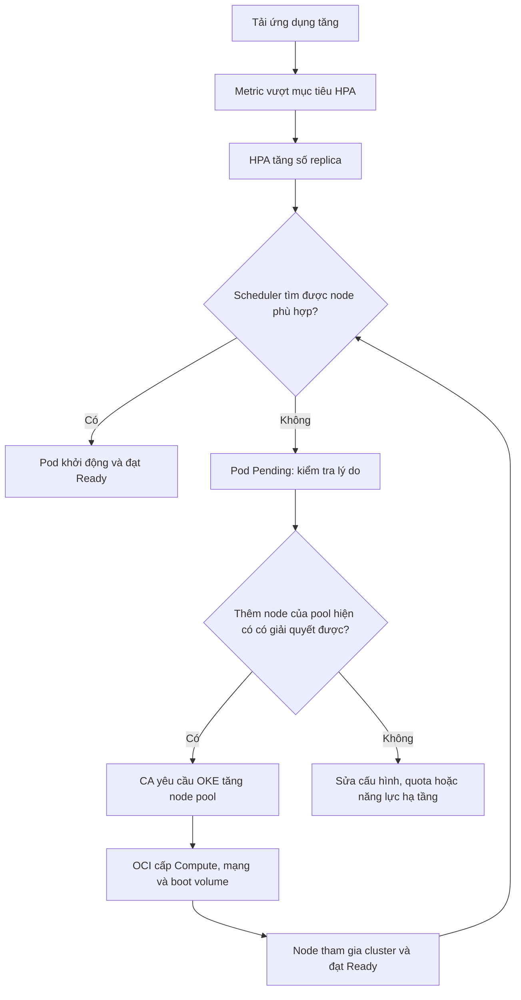

# Autoscaling ứng dụng, node pools và quản lý tài nguyên

## 1. Mục tiêu và phạm vi

Trong chương **Kubernetes với OKE** của module **CLOUD_PROVIDERS_ORACLE**, autoscaling nối nhu cầu của ứng dụng với năng lực của Oracle Cloud Infrastructure (OCI). Một API cần thêm replica chưa chắc có chỗ chạy; một node mới được tạo cũng chưa chắc giúp ích nếu Pod chọn sai node pool hoặc không còn địa chỉ IP.

Bài học này giúp bạn thiết kế chuỗi mở rộng từ ứng dụng đến hạ tầng, đặt ngân sách tài nguyên và quan sát nguyên nhân khi chuỗi đó bị chặn. Kiến thức liên quan trực tiếp đến tenancy, compartment, IAM, VCN, Compute và giám sát OCI. Với ứng dụng dùng Oracle Database, giới hạn kết nối và năng lực cơ sở dữ liệu cũng phải nằm trong quyết định mở rộng.

Sau khi học, bạn có thể:

- Phân biệt mở rộng số Pod, số worker node và tài nguyên mỗi container.
- Dùng requests/limits làm đầu vào cho lập lịch và autoscaling.
- Cấu hình HPA và giới hạn tăng giảm managed node pool trên OKE.
- Đặt LimitRange, ResourceQuota và ngân sách OCI phù hợp.
- Theo dõi một lần tăng tải, giảm tải và tìm điểm nghẽn bằng bằng chứng.

Các ví dụ thực hành dùng **managed node pools**. Ma trận hỗ trợ của Oracle phân biệt rõ: HPA dùng được với managed và virtual node pools; Cluster Autoscaler và VPA trong hướng dẫn này áp dụng cho managed node pools. Với virtual nodes, cần dùng đúng cơ chế cấp tài nguyên của loại node đó. [Oracle: autoscaling node pools và Pods](https://docs.oracle.com/en-us/iaas/Content/ContEng/Tasks/contengautoscalingclusters.htm).

## 2. Ba quyết định mở rộng khác nhau

| Cơ chế | Đối tượng được thay đổi | Đầu vào chính | Ví dụ |
| --- | --- | --- | --- |
| Horizontal Pod Autoscaler — HPA | Số replica của workload | CPU, bộ nhớ hoặc metric được cung cấp qua API phù hợp | API tăng từ 2 lên 6 Pod |
| Cluster Autoscaler — CA | Số managed node trong các node pool được quản lý | Pod không thể lập lịch; requests và các ràng buộc đặt Pod | Pool ứng dụng tăng từ 1 lên 2 node |
| Vertical Pod Autoscaler — VPA | Khuyến nghị hoặc điều chỉnh requests của container; limits tùy cấu hình | Lịch sử sử dụng tài nguyên | Container được khuyến nghị tăng memory request |

HPA và CA thường tạo thành một chuỗi:



Điểm cần phân biệt là **CPU node cao không tự nó ra lệnh cho CA thêm node**. CA xử lý bài toán khả năng đặt Pod và thu gọn các node có thể loại bỏ. Nó không tự tạo Deployment, node pool mới hoặc cluster mới. [Oracle: Kubernetes Cluster Autoscaler](https://docs.oracle.com/en-us/iaas/Content/ContEng/Tasks/contengusingclusterautoscaler.htm).

Ví dụ suy luận: một pool có CPU sử dụng thực tế 85%, nhưng mọi Pod đã được lập lịch và không có nhu cầu replica mới. Tình huống đó chưa đủ để kết luận CA phải tăng node. Ngược lại, CPU sử dụng chỉ 20% nhưng một Pod mới yêu cầu 4 CPU trong khi mỗi node chỉ còn 2 CPU khả dụng thì vẫn có thể xuất hiện nhu cầu mở rộng.

## 3. Requests và limits là nền tảng

### 3.1. Hiểu đúng từng giá trị

```yaml
resources:
  requests:
    cpu: "500m"
    memory: "1Gi"
  limits:
    cpu: "1"
    memory: "2Gi"
```

Trong ví dụ trên:

- `500m` là 0,5 đơn vị CPU Kubernetes; `1Gi` là 1 gibibyte.
- Scheduler dùng requests để quyết định node còn đủ chỗ cho Pod.
- CPU limit có thể dẫn tới throttling khi container cần nhiều CPU hơn mức cho phép.
- Vượt memory limit có thể dẫn tới OOM kill; tăng node không tự sửa memory limit của container.

Đây là cơ chế quản lý tài nguyên container của Kubernetes. Request không đồng nghĩa với lượng CPU ứng dụng luôn tiêu thụ, và memory request không phải lượng RAM được cấp phát trước cho ứng dụng. [Kubernetes: quản lý tài nguyên Pod và container](https://kubernetes.io/docs/concepts/configuration/manage-resources-containers/).

Với managed nodes, hãy dùng `status.allocatable` mà Kubernetes công bố khi tính sức chứa. Khi dự toán Compute OCI, kiểm tra quy đổi OCPU/vCPU của shape đang chọn; không lấy một con số OCPU trong Console thay trực tiếp cho CPU allocatable của node.

### 3.2. Requests ảnh hưởng cả hiệu năng lẫn chi phí

Giả sử API thực sự cần khoảng `400m` CPU khi chịu tải bình thường:

| CPU request khai báo | Hệ quả cần đánh giá |
| --- | --- |
| `100m` | Tỷ lệ CPU so với request rất cao; HPA có thể sớm yêu cầu thêm replica |
| `500m` | Phù hợp hơn để bắt đầu đo tải và chọn mục tiêu HPA |
| `2000m` | Mỗi Pod chiếm nhiều chỗ trong bài toán lập lịch; có thể tăng số node cần thiết |

Các giá trị trong bảng là tình huống minh họa, không phải ngưỡng mặc định cho mọi API. Chọn request sau khi đo tải đại diện, thời gian khởi động, phân vị sử dụng và độ trễ mục tiêu.

Với ứng dụng Java, memory limit cần bao gồm heap, metaspace, bộ nhớ trực tiếp, thread stacks và phần native. Đặt heap bằng toàn bộ memory limit của container dễ làm Pod hết bộ nhớ dù biểu đồ heap chưa chạm giới hạn.

### 3.3. Tính sức chứa theo từng node

Ví dụ hoạch định cho một workload, độc lập với cấu hình lab ở phần sau:

| Đại lượng | Giá trị giả định |
| --- | --- |
| Allocatable mỗi node | `3500m` CPU, `14Gi` RAM |
| Requests của DaemonSet và agent trên mỗi node | `500m` CPU, `1Gi` RAM |
| Phần còn lại cho ứng dụng | `3000m` CPU, `13Gi` RAM |
| Request mỗi Pod ứng dụng | `500m` CPU, `1Gi` RAM |

Sức chứa ước tính:

```text
Giới hạn theo CPU  = floor(3000m / 500m) = 6 Pod/node
Giới hạn theo RAM  = floor(13Gi / 1Gi)   = 13 Pod/node
Sức chứa tính toán = min(6, 13)         = 6 Pod/node
```

Với 12 Pod, tối thiểu cần 2 node theo mô hình này. Nếu muốn vẫn đủ chỗ cho 12 Pod sau khi mất 1 node, cần ít nhất 3 node tương đương, đồng thời phải bảo đảm Pod thực sự phân bố và có thể được đặt lại.

Đây là phép tính sơ bộ do bài học xây dựng. Khi áp dụng cần cộng thêm requests của sidecar, workload khác, Pod tạm trong rollout, giới hạn số Pod/node và các ràng buộc vị trí. Tổng CPU trống trên cả cluster cũng không giúp được một Pod nếu không có node riêng lẻ nào đủ sức chứa Pod đó.

## 4. Chọn metric và chính sách HPA

### 4.1. Mục tiêu phần trăm được so với request

Với CPU resource metric, HPA tính mức sử dụng so với CPU request, không so với CPU limit. Công thức giản lược là:

```text
replica_đề_xuất = ceil(replica_hiện_tại × metric_hiện_tại / metric_mục_tiêu)
```

Giả sử 4 Pod có mức sử dụng trung bình 90% và mục tiêu 60%:

```text
ceil(4 × 90 / 60) = 6 replica
```

Nếu request là `500m`, mức sử dụng 90% tương ứng khoảng `450m` CPU. Đây là mô hình giải thích; quyết định thực còn chịu ảnh hưởng bởi dữ liệu thiếu, Pod chưa Ready, tolerance và chính sách ổn định. [Kubernetes: thuật toán HPA](https://kubernetes.io/docs/concepts/workloads/autoscaling/horizontal-pod-autoscale/).

### 4.2. Metric phải phản ánh điểm nghẽn

| Workload | Metric có thể bắt đầu xem xét | Điều cần kiểm chứng qua đo tải |
| --- | --- | --- |
| API xử lý tính toán | CPU | Thêm replica có thực sự giảm độ trễ không |
| Consumer của hàng đợi | Độ dài hàng đợi, tuổi thông điệp | Có bao nhiêu partition hoặc tác vụ xử lý song song |
| API chờ truy vấn Oracle Database | Số request đang xử lý, độ trễ, mức bão hòa DB | Thêm Pod có làm DB quá tải thêm không |
| Ứng dụng giữ cache trong RAM | Bộ nhớ kết hợp metric nghiệp vụ | RAM có giảm khi nhu cầu giảm không |

Metrics Server cung cấp resource metrics CPU/RAM; metric tùy chỉnh hoặc bên ngoài cần đường cung cấp metric tương ứng. Chỉ bật OCI Monitoring không có nghĩa HPA tự đọc được mọi metric của OCI. [Oracle: HPA trên OKE](https://docs.oracle.com/en-us/iaas/Content/ContEng/Tasks/contengusinghorizontalpodautoscaler.htm).

Ví dụ thiết kế: nếu mỗi Pod mở tối đa 20 kết nối DB, 10 replica có thể tạo tới 200 kết nối, chưa tính rollout và workload khác. Hãy dùng ngân sách kết nối thực tế để giới hạn `maxReplicas`, đồng thời kiểm tra connection pool, timeout và backpressure.

### 4.3. Tăng và giảm cần nhịp khác nhau

Một cấu hình khởi điểm có thể cho phép tăng tối đa 2 Pod mỗi phút, nhưng chỉ giảm một nửa số replica trong một phút sau cửa sổ ổn định 5 phút. Mục đích là phản ứng với tải tăng và tránh thu gọn quá sớm khi tải dao động.

Đây là lựa chọn minh họa cho lab, cần hiệu chỉnh theo thử tải. Nếu ứng dụng khởi động chậm, tăng replica nhanh vẫn chưa tạo ra năng lực phục vụ ngay. Hãy đo thời gian từ lúc phát sinh nhu cầu đến khi Pod mới thực sự nhận được request.

## 5. Chuẩn bị node pools, IAM và mạng OCI

### 5.1. Tách sức chứa hệ thống khỏi sức chứa ứng dụng

Một bố trí dễ vận hành:

| Pool | Vai trò | Chính sách trong ví dụ |
| --- | --- | --- |
| Pool hệ thống | CA, DNS và các thành phần hạ tầng thiết yếu | Không giao kích thước cho CA; có sức chứa ổn định |
| Pool ứng dụng | Pod của bài lab | CA quản lý trong khoảng 1–3 node |

Oracle khuyến nghị giữ một pool ngoài phạm vi quản lý của CA và dùng nhiều replica cho CA. Có thể dùng các pool theo Availability Domain khác nhau khi thiết kế khả năng mở rộng và tính sẵn sàng. [Oracle: thực hành autoscaler](https://docs.oracle.com/en-us/iaas/Content/ContEng/Tasks/contengbestpractices_topic-Autoscaler-best-practices.htm).

Trong lab, cấu hình nhãn ở **node pool** để node mới cũng nhận được:

- Pool hệ thống: `node-purpose=system`.
- Pool ứng dụng: `workload=autoscaling-lab`.

Dùng nhãn thủ công trên một node hiện có rồi quên cấu hình nhãn cho node mới sẽ làm kết quả mở rộng sai kỳ vọng. Nếu pool hệ thống có taint, các add-on đặt ở đó cần toleration phù hợp.

Hai replica CA cùng nằm trên một node vẫn chia sẻ rủi ro khi node đó hỏng. Với môi trường cần tính sẵn sàng, bố trí đủ node hệ thống và quy tắc phân bố tương ứng.

### 5.2. Phân biệt IAM OCI với quyền Kubernetes

Người triển khai cần quyền thao tác cluster và tài nguyên Kubernetes. Bản thân CA còn cần danh tính được cấp quyền gọi API OCI để quản lý node pool, Compute và tài nguyên mạng liên quan.

Hướng dẫn add-on của Oracle hỗ trợ instance principal và workload identity; workload identity yêu cầu enhanced cluster cùng phiên bản tương thích. Với instance principal, thiết lập dynamic group cho các instance chạy CA và áp dụng đầy đủ bộ policy trong hướng dẫn. Nếu network nằm ở compartment khác, phải cấp quyền tại phạm vi tương ứng. [Oracle: danh tính và triển khai CA add-on](https://docs.oracle.com/en-us/iaas/Content/ContEng/Tasks/contengusingclusterautoscaler_topic-Working_with_Cluster_Autoscaler_as_Cluster_Add-on.htm).

Ví dụ cấu hình ở phần sau chọn `authType=instance`. Kubernetes RoleBinding không thay thế bộ quyền OCI này. Khi log có lỗi xác thực hoặc `NotAuthorizedOrNotFound`, hãy kiểm tra principal thực tế, dynamic group, OCID và compartment trước khi thay đổi request của Pod.

### 5.3. Có quota chưa chắc có khả năng cấp node

Khi xác định mức tối đa của pool, lập bảng sức chứa cho:

- Service limits và compartment quotas liên quan đến Compute/OKE.
- Shape và năng lực cấp instance tại Availability Domain dự kiến.
- Boot volume, worker subnet và tài nguyên mạng liên quan.
- Địa chỉ IP cho Pod nếu dùng OCI VCN-Native Pod Networking.
- Khả năng truy cập registry, OCI API và Kubernetes API từ các thành phần cần truy cập.

Với VCN-native networking, quy hoạch IP cho worker và Pod phải phù hợp với mức mở rộng. Đọc hướng dẫn CIDR của loại networking đang dùng thay vì suy số IP chỉ từ số node. [Oracle: CIDR và OKE](https://docs.oracle.com/en-us/iaas/Content/ContEng/Concepts/contengcidrblocks.htm).

Một node `Ready` nhưng Pod kẹt ở bước tạo mạng là nhánh chẩn đoán khác với Pod `Pending` vì `Insufficient cpu`. Tách hai tình huống sẽ tránh tăng node khi nguyên nhân thực nằm ở CNI hoặc IP.

## 6. Cấu hình giới hạn Cluster Autoscaler trên OKE

### 6.1. Chọn phương thức triển khai

OKE hỗ trợ CA dưới dạng add-on và dạng triển khai độc lập. Bài lab dùng add-on trên cluster có hỗ trợ tính năng đó. Chọn phiên bản CA tương thích với phiên bản Kubernetes của cluster và kiểm tra lại khi nâng cấp; không cài đồng thời hai bộ CA cùng điều khiển một pool.

Các tham số của add-on dùng tên khóa do OKE công bố, khác cách viết cờ dòng lệnh của một số bản triển khai độc lập. Đặc biệt, `nodes` khai báo phạm vi pool theo dạng `min:max:node-pool-ocid`. [Oracle: tham số CA add-on](https://docs.oracle.com/en-us/iaas/Content/ContEng/Tasks/configuration-arguments-cluster-autoscaler.htm).

Ví dụ nội dung file thực hành `cluster-autoscaler-lab.json`:

```json
{
  "configurations": [
    {
      "key": "nodes",
      "value": "1:3:<APP_NODE_POOL_OCID>"
    },
    {
      "key": "authType",
      "value": "instance"
    },
    {
      "key": "numOfReplicas",
      "value": "2"
    },
    {
      "key": "nodeSelectors",
      "value": "{\"node-purpose\":\"system\"}"
    },
    {
      "key": "maxNodeProvisionTime",
      "value": "25m"
    },
    {
      "key": "scaleDownDelayAfterAdd",
      "value": "10m"
    },
    {
      "key": "scaleDownUnneededTime",
      "value": "10m"
    }
  ]
}
```

Thay `<APP_NODE_POOL_OCID>` bằng OCID thật. Pool hệ thống không xuất hiện trong `nodes`. Hai giá trị 10 phút trong ví dụ tạo thời gian chờ trước khi thu gọn; chúng không cam kết node sẽ bị xóa sau đúng 10 phút.

### 6.2. Cài đặt và xác nhận

Các lệnh bên dưới chạy trong PowerShell đã cấu hình OCI CLI và kubeconfig cho cluster lab:

```powershell
$clusterId = "<CLUSTER_OCID>"
oci ce cluster list-addons --cluster-id $clusterId
```

Nếu CA đã được triển khai, xác định cách nó đang được quản lý và cập nhật cấu hình bằng quy trình tương ứng. Nếu chưa có, và IAM cùng phiên bản tương thích đã được chuẩn bị, cài add-on:

```powershell
oci ce cluster install-addon --addon-name ClusterAutoscaler --cluster-id $clusterId --from-json file://./cluster-autoscaler-lab.json
kubectl -n kube-system get deployment cluster-autoscaler
kubectl -n kube-system get pods -o wide
```

Lệnh cài add-on tạo work request; cần xác nhận work request thành công và CA thực sự theo dõi đúng pool. Quy trình chi tiết nằm trong [hướng dẫn CA add-on của Oracle](https://docs.oracle.com/en-us/iaas/Content/ContEng/Tasks/contengusingclusterautoscaler_topic-Working_with_Cluster_Autoscaler_as_Cluster_Add-on.htm).

Nếu các replica CA không chạy được trên pool hệ thống, kiểm tra nhãn, taint/toleration và phần tài nguyên còn trống ở pool đó. Chưa nên thử tăng tải khi thành phần quyết định cấp node vẫn đang Pending.

## 7. Đặt ngân sách tài nguyên cho namespace lab

### 7.1. Điều kiện thực hành

Chuẩn bị môi trường dành cho lab với các điều kiện:

- Managed node pool ứng dụng dùng Linux và kiến trúc `amd64`, có nhãn `workload=autoscaling-lab`.
- Pool ứng dụng có mức tối thiểu 1, tối đa 3 node trong cấu hình CA; đủ quota và năng lực OCI cho mức tối đa.
- Pool hệ thống có nhãn `node-purpose=system`, đủ sức chứa cho CA và các add-on.
- Metrics Server đã được triển khai theo phương thức OKE hỗ trợ.
- Các node kéo được image từ registry và Pod liên lạc được qua mạng nội bộ.
- Người thực hành có quyền tạo namespace và các resource được dùng trong bài.

Các image minh họa phục vụ thử tải. Khi chuyển sang môi trường của tổ chức, dùng bản image được chấp thuận và cố định digest sau khi kiểm chứng kiến trúc, tính tương thích.

Kiểm tra đầu vào:

```powershell
kubectl config current-context
kubectl get nodes -L node-purpose,workload
kubectl get apiservice v1beta1.metrics.k8s.io
kubectl top nodes
```

Nếu `kubectl top` chưa lấy được số liệu, giải quyết Metrics Server trước khi đánh giá HPA. Có thể triển khai Metrics Server theo hướng dẫn [Oracle: Metrics Server trên OKE](https://docs.oracle.com/en-us/iaas/Content/ContEng/Tasks/contengdeployingmetricsserver.htm).

### 7.2. LimitRange và ResourceQuota giải quyết hai việc khác nhau

**LimitRange** đặt mặc định và giới hạn tài nguyên theo container hoặc Pod trong namespace. Mặc định giúp tránh bỏ quên request; nó không thay thế việc định cỡ ứng dụng. [Kubernetes: LimitRange](https://kubernetes.io/docs/concepts/policy/limit-range/).

**ResourceQuota** đặt trần tổng tài nguyên của namespace. Nếu vượt quota, API admission có thể từ chối tạo Pod. Khi đó chưa có Pod mới để scheduler đặt lên node, vì vậy tăng node không giải quyết nguyên nhân. [Kubernetes: ResourceQuota](https://kubernetes.io/docs/concepts/policy/resource-quotas/).

Lưu manifest sau dưới tên `namespace-budget-lab.yaml` trong thư mục làm việc của người thực hành:

```yaml
apiVersion: v1
kind: Namespace
metadata:
  name: autoscaling-lab
---
apiVersion: v1
kind: LimitRange
metadata:
  name: container-budget
  namespace: autoscaling-lab
spec:
  limits:
    - type: Container
      min:
        cpu: "50m"
        memory: "32Mi"
      max:
        cpu: "2"
        memory: "2Gi"
      defaultRequest:
        cpu: "250m"
        memory: "128Mi"
      default:
        cpu: "500m"
        memory: "512Mi"
---
apiVersion: v1
kind: ResourceQuota
metadata:
  name: namespace-budget
  namespace: autoscaling-lab
spec:
  hard:
    requests.cpu: "8"
    requests.memory: "8Gi"
    limits.cpu: "16"
    limits.memory: "16Gi"
    pods: "20"
```

Áp dụng và đọc lại:

```powershell
kubectl apply -f .\namespace-budget-lab.yaml
kubectl -n autoscaling-lab describe limitrange container-budget
kubectl -n autoscaling-lab describe resourcequota namespace-budget
```

Quota này là lựa chọn cho các bài thử bên dưới. Nó không dành sẵn 8 CPU vật lý, không bảo đảm OCI còn đủ Compute và không phải trần hóa đơn.

Khi lập ngân sách cho ứng dụng thật, dùng mức replica đỉnh, cộng phần tăng thêm trong rollout và các Pod phụ trợ. Với request `500m` CPU mỗi Pod, 10 replica dùng tổng request 5 CPU; thêm 1 Pod khi rollout đưa con số lên 5,5 CPU, trước khi tính workload khác.

## 8. Thực hành HPA với một ứng dụng tạo tải CPU

### 8.1. Deployment, Service, HPA và PDB

Manifest dưới đây là cấu hình lab do bài học xây dựng, dùng image ứng dụng minh họa từ [Kubernetes HPA walkthrough](https://kubernetes.io/docs/tasks/run-application/horizontal-pod-autoscale-walkthrough/). Lưu dưới tên `hpa-demo-lab.yaml`:

```yaml
apiVersion: apps/v1
kind: Deployment
metadata:
  name: hpa-demo
  namespace: autoscaling-lab
spec:
  replicas: 2
  revisionHistoryLimit: 2
  selector:
    matchLabels:
      app: hpa-demo
  strategy:
    type: RollingUpdate
    rollingUpdate:
      maxSurge: 1
      maxUnavailable: 0
  template:
    metadata:
      labels:
        app: hpa-demo
    spec:
      terminationGracePeriodSeconds: 30
      nodeSelector:
        workload: autoscaling-lab
      topologySpreadConstraints:
        - maxSkew: 1
          topologyKey: kubernetes.io/hostname
          whenUnsatisfiable: ScheduleAnyway
          labelSelector:
            matchLabels:
              app: hpa-demo
      containers:
        - name: web
          image: registry.k8s.io/hpa-example
          ports:
            - name: http
              containerPort: 80
          resources:
            requests:
              cpu: "500m"
              memory: "256Mi"
            limits:
              cpu: "1"
              memory: "512Mi"
          startupProbe:
            tcpSocket:
              port: http
            periodSeconds: 5
            failureThreshold: 30
          readinessProbe:
            tcpSocket:
              port: http
            periodSeconds: 5
---
apiVersion: v1
kind: Service
metadata:
  name: hpa-demo
  namespace: autoscaling-lab
spec:
  type: ClusterIP
  selector:
    app: hpa-demo
  ports:
    - name: http
      port: 80
      targetPort: http
---
apiVersion: autoscaling/v2
kind: HorizontalPodAutoscaler
metadata:
  name: hpa-demo
  namespace: autoscaling-lab
spec:
  scaleTargetRef:
    apiVersion: apps/v1
    kind: Deployment
    name: hpa-demo
  minReplicas: 2
  maxReplicas: 10
  metrics:
    - type: Resource
      resource:
        name: cpu
        target:
          type: Utilization
          averageUtilization: 60
  behavior:
    scaleUp:
      stabilizationWindowSeconds: 0
      policies:
        - type: Pods
          value: 2
          periodSeconds: 60
    scaleDown:
      stabilizationWindowSeconds: 300
      policies:
        - type: Percent
          value: 50
          periodSeconds: 60
---
apiVersion: policy/v1
kind: PodDisruptionBudget
metadata:
  name: hpa-demo
  namespace: autoscaling-lab
spec:
  minAvailable: 1
  selector:
    matchLabels:
      app: hpa-demo
```

Các lựa chọn trong manifest:

- CPU request `500m` và mục tiêu 60% tương ứng khoảng `300m` CPU/Pod ở mục tiêu, trong mô hình đơn giản.
- Giới hạn 10 replica đặt trần nhu cầu ứng dụng của bài thử.
- Service kiểu ClusterIP cho phép sinh tải từ bên trong cluster.
- Probe TCP kiểm tra cổng đã mở; ứng dụng thật nên có kiểm tra readiness phản ánh khả năng phục vụ.
- `ScheduleAnyway` là ưu tiên phân bố, không phải cam kết mỗi node hoặc mỗi Availability Domain đều có một replica.

Topology spread có thể là ràng buộc mềm hoặc cứng; ràng buộc cứng cần khớp với những miền và node mà cluster thực sự cung cấp. [Kubernetes: topology spread constraints](https://kubernetes.io/docs/concepts/scheduling-eviction/topology-spread-constraints/).

Trường `replicas: 2` ở đây phục vụ khởi tạo. Khi HPA đã quản lý workload, quy trình GitOps hoặc thao tác apply không nên liên tục áp lại số replica cố định. Tách quyền điều khiển trường này để tránh replica bị kéo về giá trị cũ giữa những lần HPA điều chỉnh.

### 8.2. Triển khai và lấy trạng thái nền

```powershell
kubectl apply -f .\hpa-demo-lab.yaml
kubectl -n autoscaling-lab rollout status deployment/hpa-demo --timeout=180s
kubectl -n autoscaling-lab get hpa
kubectl -n autoscaling-lab top pods
kubectl -n autoscaling-lab get pods -o wide
```

Dành thời gian cho chu kỳ thu thập metric. Giá trị `<unknown>` lúc mới tạo chưa đủ để kết luận có lỗi; nếu kéo dài, đọc phần conditions và events của HPA.

Trước khi tạo tải, ghi nhận số node ứng dụng, số Pod Ready, CPU request và CPU usage. Các số này là mốc để phân biệt mở rộng Pod với mở rộng node.

### 8.3. Tạo tải có thời hạn

Lưu manifest sau dưới tên `load-generator-lab.yaml`. Job chạy tối đa 10 phút và có thể dừng sớm:

```yaml
apiVersion: batch/v1
kind: Job
metadata:
  name: load-generator
  namespace: autoscaling-lab
spec:
  activeDeadlineSeconds: 600
  backoffLimit: 0
  template:
    metadata:
      labels:
        app: load-generator
    spec:
      restartPolicy: Never
      nodeSelector:
        workload: autoscaling-lab
      containers:
        - name: client
          image: busybox:1.36.1
          command:
            - /bin/sh
            - -c
            - |
              for worker in 1 2 3 4; do
                (
                  while true; do
                    wget -q -O /dev/null -T 2 http://hpa-demo.autoscaling-lab.svc.cluster.local/
                    sleep 0.05
                  done
                ) &
              done
              wait
          resources:
            requests:
              cpu: "100m"
              memory: "64Mi"
            limits:
              cpu: "250m"
              memory: "128Mi"
```

Tạo Job:

```powershell
kubectl apply -f .\load-generator-lab.yaml
kubectl -n autoscaling-lab get hpa hpa-demo --watch
```

Mở terminal khác để quan sát; dùng Ctrl+C để kết thúc lệnh watch:

```powershell
kubectl -n autoscaling-lab get pods -o wide --watch
kubectl get nodes -l workload=autoscaling-lab --watch
```

Kỳ vọng quan sát được chuỗi thay đổi, không phải một số replica cố định:

1. CPU usage của ứng dụng tăng.
2. HPA tăng desired replicas nếu metric vượt mục tiêu.
3. Pod mới được tạo và đạt Ready nếu có sức chứa.
4. Nếu không đủ sức chứa phù hợp, Pod mới Pending và CA có thể yêu cầu thêm node.
5. Khi node mới Ready, scheduler có thể đặt các Pod đang chờ.

Nếu pool ban đầu đã đủ chỗ cho 10 Pod, chỉ HPA tăng replica là kết quả hợp lý. Muốn kiểm chứng CA cần có nhu cầu vượt phần sức chứa còn trống, trong phạm vi pool tối đa đã định.

Bốn vòng gửi request là điểm khởi đầu cho lab. Nếu CPU không tăng đủ, kiểm tra DNS, Service, lỗi request và khả năng sinh tải của client trước khi kết luận HPA không hoạt động.

### 8.4. Dừng tải và quan sát thu gọn

```powershell
kubectl -n autoscaling-lab delete job load-generator --ignore-not-found
kubectl -n autoscaling-lab get hpa hpa-demo --watch
```

Sau khi tải giảm, HPA cần thời gian theo cửa sổ ổn định để giảm replica về mức phù hợp, thấp nhất là 2 trong ví dụ. CA có nhịp đánh giá và điều kiện thu gọn riêng. Pod giảm trước không đồng nghĩa node phải biến mất ngay sau đó.

Ghi nhận riêng hai khoảng thời gian: từ khi dừng tải đến khi giảm replica, và từ khi giảm nhu cầu requests đến khi node được thu gọn. Nếu node vẫn còn, tiếp tục xem lý do không thể loại bỏ thay vì chỉ nhìn CPU sử dụng thấp.

## 9. Thử riêng khả năng mở rộng node pool

HPA có thể chưa tạo đủ Pod để làm cạn sức chứa hiện có. Có thể tách bài thử CA khỏi bài thử metric bằng một workload khai báo nhu cầu cố định.

Thực hiện sau khi đã xóa Job tạo tải, HPA ổn định ở 2 replica và pool ứng dụng trở về mức nền. Không đặt HPA cho workload thử CA này.

Ví dụ giả định pool đang có 1 node với khoảng 3 CPU còn lại cho workload trước khi tính ứng dụng lab. Hai Pod `hpa-demo` yêu cầu tổng 1 CPU. Thêm 3 Pod, mỗi Pod yêu cầu 1,5 CPU, làm tổng nhu cầu tăng lên 5,5 CPU. Một node như vậy không đủ; CA phải đánh giá khả năng thêm node.

Nếu số liệu thực khác giả định, tính lại trước khi thử. Mỗi Pod 1,5 CPU phải đủ nhỏ để đặt được trên một node mới của pool; tăng số node không sửa được việc từng Pod lớn hơn sức chứa của từng node.

Lưu manifest dưới tên `capacity-probe-lab.yaml`:

```yaml
apiVersion: apps/v1
kind: Deployment
metadata:
  name: capacity-probe
  namespace: autoscaling-lab
spec:
  replicas: 3
  selector:
    matchLabels:
      app: capacity-probe
  template:
    metadata:
      labels:
        app: capacity-probe
    spec:
      nodeSelector:
        workload: autoscaling-lab
      containers:
        - name: sleeper
          image: busybox:1.36.1
          command:
            - /bin/sh
            - -c
            - "while true; do sleep 3600; done"
          resources:
            requests:
              cpu: "1500m"
              memory: "512Mi"
            limits:
              cpu: "1500m"
              memory: "512Mi"
```

Đây là Pod giữ chỗ theo requests, không chủ động đốt CPU. Nó giúp quan sát CA trong khi `kubectl top` có thể vẫn hiển thị usage thấp.

```powershell
kubectl apply -f .\capacity-probe-lab.yaml
kubectl -n autoscaling-lab get pods -l app=capacity-probe -o wide
kubectl -n autoscaling-lab get events --sort-by=.metadata.creationTimestamp
kubectl get nodes -l workload=autoscaling-lab -o wide
```

Khi có Pod Pending, đọc `kubectl describe pod <TEN_POD> -n autoscaling-lab`. Tìm bằng chứng thiếu tài nguyên và sự kiện liên quan đến quyết định scale-up. Theo dõi thêm work request của node pool trên OCI để phân biệt CA chưa quyết định với OCI đã nhận yêu cầu nhưng chưa cấp xong node.

Sau khi ghi nhận kết quả:

```powershell
kubectl -n autoscaling-lab delete deployment capacity-probe
```

Nếu pool đã có nhiều node đủ chỗ, toàn bộ Pod có thể chạy ngay và không có lần tăng node nào. Kết quả đó phản ánh trạng thái sức chứa tại thời điểm thử; cần so sánh với mốc nền thay vì ép một kết quả có sẵn.

## 10. Vì sao node chưa giảm dù tải đã thấp?

Để thu gọn, CA phải tìm được phương án đưa các Pod cần giữ sang node còn lại và tuân thủ những điều kiện bảo vệ liên quan. Các nhóm nguyên nhân thường gặp gồm:

| Nhóm nguyên nhân | Bằng chứng cần tìm | Hướng xử lý |
| --- | --- | --- |
| Pool đang ở mức tối thiểu | Kích thước hiện tại bằng min | Giữ mức nền đã thiết kế hoặc xem xét lại min |
| PDB không còn cho phép gián đoạn | `disruptionsAllowed` bằng 0 | Xem sức khỏe replica và yêu cầu khả dụng |
| Pod bị cố định vị trí | Node affinity, selector hoặc topology không còn nơi phù hợp | Sửa quy tắc đặt Pod theo mục tiêu vận hành |
| Pod dùng dữ liệu cục bộ | Volume và cờ bảo vệ thu gọn của CA | Thiết kế lại lưu trữ hoặc quy trình di chuyển |
| Pod hệ thống hoặc Pod khó di chuyển | Log CA, owner của Pod | Bố trí lại workload hệ thống và controller |
| Chưa hết thời gian chờ | Thời điểm thêm node và cấu hình scale-down | Chờ và theo dõi đúng cửa sổ cấu hình |

Các điều kiện khiến CA không thể di chuyển Pod được mô tả trong [FAQ của Kubernetes Cluster Autoscaler](https://github.com/kubernetes/autoscaler/blob/master/cluster-autoscaler/FAQ.md). Không nên vô hiệu hóa hàng loạt cơ chế bảo vệ chỉ để làm biểu đồ node giảm nhanh hơn.

PDB `minAvailable: 1` trong lab cho phép gián đoạn có kiểm soát khi còn đủ Pod khỏe. Nó không bảo đảm sống sót khi mất node chứa mọi replica. Cơ chế PDB gắn với voluntary eviction cũng không phải khóa ngăn HPA giảm replica hoặc Deployment thay thế Pod. Phải thiết kế `minReplicas`, chiến lược rollout và phân bố độc lập. [Kubernetes: disruptions và PDB](https://kubernetes.io/docs/concepts/workloads/pods/disruptions/).

Trong ứng dụng thật, graceful shutdown cần ngừng nhận việc mới, hoàn tất hoặc trả lại công việc đang xử lý và đóng kết nối đúng hạn. Một consumer giữ tác vụ trong RAM mà không có cơ chế giao lại có thể mất công việc khi Pod bị di chuyển, dù CA đã tuân thủ PDB.

## 11. Dùng VPA để hỗ trợ định cỡ

VPA phù hợp khi cần nhìn lại mức request theo lịch sử sử dụng. Cách bắt đầu dễ kiểm soát là **chỉ nhận khuyến nghị**, chưa tự thay đổi tài nguyên.

Ví dụ sau yêu cầu VPA CRD và các controller đã được cài với phiên bản tương thích. Đây là phần tùy chọn, không phải điều kiện chạy lab HPA/CA:

```yaml
apiVersion: autoscaling.k8s.io/v1
kind: VerticalPodAutoscaler
metadata:
  name: hpa-demo-recommendation
  namespace: autoscaling-lab
spec:
  targetRef:
    apiVersion: apps/v1
    kind: Deployment
    name: hpa-demo
  updatePolicy:
    updateMode: "Off"
  resourcePolicy:
    containerPolicies:
      - containerName: web
        controlledValues: RequestsOnly
        minAllowed:
          cpu: "100m"
          memory: "128Mi"
        maxAllowed:
          cpu: "1500m"
          memory: "1Gi"
```

Nếu đã triển khai VPA và áp dụng manifest tùy chọn, đọc khuyến nghị:

```powershell
kubectl -n autoscaling-lab describe vpa hpa-demo-recommendation
```

`updateMode: "Off"` giữ VPA ở chế độ khuyến nghị. Khi bật chế độ tự áp dụng, phải đánh giá ảnh hưởng đến Pod đang chạy theo khả năng của phiên bản VPA/OKE đang dùng.

Tránh để HPA dựa trên CPU/RAM utilization đồng thời bị VPA tự thay đổi request làm mẫu số. Oracle hướng dẫn không phối hợp hai cơ chế theo cách gây xung đột; có thể cân nhắc HPA theo custom/external metric với thiết kế được kiểm chứng. [Oracle: VPA và các lưu ý phối hợp HPA](https://docs.oracle.com/en-us/iaas/Content/ContEng/Tasks/contengusingverticalpodautoscaler.htm).

Một khuyến nghị VPA cao hơn sức chứa của mọi node trong pool cần thay đổi thiết kế sức chứa hoặc workload; chỉ tăng số node cùng kích thước sẽ không giải quyết được.

## 12. Quan sát và chẩn đoán theo từng lớp

### 12.1. Thu thập đúng tín hiệu

| Lớp | Tín hiệu nên theo dõi | Ý nghĩa |
| --- | --- | --- |
| Trải nghiệm ứng dụng | Độ trễ p95/p99, lỗi, thông lượng, tuổi công việc | Mở rộng có cải thiện mục tiêu phục vụ không |
| HPA | Current/desired replicas, metric, conditions | Có muốn mở rộng và có metric hợp lệ không |
| Pod | Ready, restart, OOMKilled, throttling | Replica được tạo có thật sự phục vụ được không |
| Scheduler | PodScheduled và lý do Pending | Node mới có khả năng giải quyết nhu cầu không |
| CA | Quyết định scale-up/scale-down, lỗi OCI | Điểm chặn nằm ở controller hay ở hạ tầng |
| OKE/OCI | Node pool, work request, quota, IP, Compute capacity | Tài nguyên có được cấp và tham gia cluster không |
| Chi phí | Node-hours, storage, network và phân bổ theo compartment/tag | Chi phí tăng có gắn với nhu cầu phục vụ không |

Resource metrics dùng cho HPA và dữ liệu giám sát lịch sử phục vụ vận hành có mục đích khác nhau. Lưu lại cả mốc thời gian tạo nhu cầu, node Ready và ứng dụng Ready để đo độ trễ cấp năng lực.

### 12.2. Một nhóm lệnh điều tra

```powershell
kubectl -n autoscaling-lab describe hpa hpa-demo
kubectl -n autoscaling-lab get deployment,replicaset,pods
kubectl -n autoscaling-lab describe resourcequota namespace-budget
kubectl -n autoscaling-lab get pdb
kubectl -n autoscaling-lab get events --sort-by=.metadata.creationTimestamp
kubectl top nodes
kubectl -n autoscaling-lab top pods --containers
kubectl get nodes -o 'custom-columns=NAME:.metadata.name,CPU:.status.allocatable.cpu,MEMORY:.status.allocatable.memory,PODS:.status.allocatable.pods'
kubectl -n kube-system get pods -o wide
kubectl -n kube-system logs deployment/cluster-autoscaler --since=10m
```

Lệnh log Deployment có thể chọn một replica CA. Nếu chưa thấy quyết định, xác định Pod giữ vai trò leader và đọc log của Pod đó. Đối với Pod lỗi, dùng tên cụ thể từ kết quả `get pods` để đọc `describe` và log container.

### 12.3. Các tình huống điển hình

| Hiện tượng | Kiểm tra trước | Nhận định và hành động |
| --- | --- | --- |
| HPA kéo dài ở `<unknown>` | Metrics API, requests của container, HPA events | Sửa đường metric hoặc cấu hình resource |
| Desired replicas tăng nhưng Pod mới không xuất hiện | ReplicaSet events có `FailedCreate`, quota/admission | Nới ngân sách có cơ sở hoặc giảm nhu cầu; thêm node chưa giúp được |
| Pod Pending vì `Insufficient cpu/memory` | Pool phù hợp, max node, CA log | Xác nhận CA có thể tạo loại node đáp ứng request |
| Pod Pending do taint/selector | Nhãn và toleration trên node hiện có lẫn cấu hình pool | Sửa quy tắc đặt Pod |
| CA muốn tăng nhưng OCI trả lỗi | Work request, IAM, quota, shape capacity | Xử lý đúng giới hạn hoặc quyền bị thiếu |
| Node mới lâu đạt Ready | Bootstrapping, API connectivity, image và network | Điều tra giai đoạn cấp node, không chỉ HPA |
| Node Ready nhưng Pod kẹt ContainerCreating | CNI, IP, volume attach, image pull | Xử lý tài nguyên phụ thuộc của Pod |
| Pod OOMKilled nhưng HPA CPU không tăng | Memory limit và profile bộ nhớ | Sửa định cỡ hoặc ứng dụng, đánh giá metric phù hợp |
| HPA đạt max nhưng độ trễ vẫn tăng | Workload saturation và DB/downstream | Kiểm tra điểm nghẽn trước khi tăng max |
| Node không giảm | PDB, local storage, affinity, min và thời gian chờ | Xử lý điều kiện di chuyển theo yêu cầu khả dụng |

Mỗi hàng là một giả thuyết điều tra. Kết luận cần dựa trên event, condition, log hoặc work request tương ứng, thay vì chỉ dựa trên trạng thái tổng quát của Dashboard.

## 13. Tự động hóa và kiểm soát chi phí

### 13.1. Mỗi trường thay đổi cần một bộ điều khiển rõ ràng

Nếu Terraform hoặc một pipeline liên tục ghi kích thước node pool về số cố định, nó có thể tranh quyền với CA. Có thể cấu hình Terraform bỏ qua thay đổi runtime của đúng trường kích thước đã giao cho CA.

Ví dụ đoạn bổ sung bên trong resource `oci_containerengine_node_pool` đang quản lý pool ứng dụng, với schema tương ứng của provider:

```hcl
lifecycle {
  ignore_changes = [
    node_config_details[0].size
  ]
}
```

Kiểm tra schema của phiên bản OCI provider đang khóa và xem plan trước khi áp dụng. Chỉ bỏ qua trường cần chia sẻ quyền điều khiển; vẫn quản lý shape, nhãn và cấu hình mạng theo thiết kế. Cơ chế `ignore_changes` được mô tả trong [Terraform lifecycle reference](https://developer.hashicorp.com/terraform/language/meta-arguments/lifecycle); cấu trúc resource nằm trong [OCI provider: node pool](https://registry.terraform.io/providers/oracle/oci/latest/docs/resources/containerengine_node_pool).

Với workload, áp dụng cùng nguyên tắc cho trường replicas khi HPA điều khiển. Lưu trong mã nguồn requests/limits, HPA, ngân sách namespace và cấu hình autoscaler để có thể xem xét thay đổi và khôi phục.

### 13.2. Các hàng rào chi phí bổ sung cho nhau

| Hàng rào | Phạm vi kiểm soát |
| --- | --- |
| HPA `maxReplicas` | Số replica của từng workload |
| CA max theo pool | Số node của pool được quản lý |
| ResourceQuota | Tổng request/limit và số lượng tài nguyên trong namespace |
| OCI service limits, compartment quotas | Khả năng tạo một số tài nguyên OCI theo phạm vi áp dụng |
| Budget và cảnh báo | Theo dõi chi tiêu, dự báo và ngưỡng thông báo |

OCI Budgets dùng giới hạn mềm và cảnh báo chi tiêu; không nên coi việc đặt budget là cơ chế tự dừng tạo node. [Oracle: Budgets](https://docs.oracle.com/en-us/iaas/Content/Billing/Concepts/budgetsoverview.htm).

Mô hình dự toán đơn giản cho managed nodes:

```text
Chi phí biến động của node
  ≈ tổng theo từng pool (số node trung bình × số giờ × đơn giá node theo cấu hình)

Tổng chi phí môi trường
  ≈ Compute + boot/block volumes + network + load balancing
    + phí dịch vụ liên quan + các thành phần dùng chung
```

Đơn giá phải lấy theo region, shape, cấu hình và phương án giá thực tế. Xóa Pod không có nghĩa mọi chi phí của môi trường biến mất. Trong đánh giá hiệu quả, so sánh chi phí trên request thành công hoặc công việc hoàn tất cùng với độ trễ và mức lỗi.

### 13.3. Chuẩn bị cho tải đột biến

Sự kiện marketing bắt đầu lúc cố định là tình huống nên dự trữ sức chứa trước giờ tăng tải. Đo tổng thời gian từ yêu cầu mở rộng đến năng lực phục vụ, rồi chọn minReplicas và mức nền node đáp ứng mục tiêu.

Nếu quy trình cần tăng trước mức nền, thay đổi cấu hình của bộ điều khiển chịu trách nhiệm theo một kế hoạch thống nhất. Ghi rõ thời điểm đưa cấu hình về trạng thái bình thường và kiểm tra cơ sở dữ liệu vẫn đủ ngân sách kết nối ở mức đỉnh.

## 14. Dọn lab và ghi nhận kết quả

Trong terminal đang trỏ vào **cluster lab**, dừng các workload đã tạo:

```powershell
kubectl -n autoscaling-lab delete job load-generator --ignore-not-found
kubectl -n autoscaling-lab delete deployment capacity-probe --ignore-not-found
kubectl delete namespace autoscaling-lab
```

Lệnh xóa namespace loại bỏ tài nguyên Kubernetes của bài thử, gồm VPA tùy chọn nếu đã tạo ở namespace này. Nó không xóa cluster, node pool hay add-on dùng chung. Theo dõi CA thu gọn pool ứng dụng tới mức tối thiểu đã cấu hình; mức tối thiểu 1 vẫn để lại node chạy.

Nếu toàn bộ hạ tầng được dựng riêng cho lab, thu hồi nó bằng quy trình quản lý hạ tầng đã dùng để tạo. Nếu CA là thành phần dùng chung, giữ cấu hình và quyền điều khiển theo quy trình của cluster.

Một bản ghi kết quả thực hành nên có các dữ kiện sau:

- CPU request/limit mỗi container, HPA target và khoảng replica.
- Số node nền, khoảng min/max của pool và sức chứa allocatable đã đo.
- Thời điểm bắt đầu tải, tăng replica, xuất hiện Pod chờ, node mới Ready và Pod mới Ready.
- Metric ứng dụng trước và sau mở rộng.
- Thời điểm dừng tải, giảm replica và thu gọn node, kèm lý do nếu còn node.
- Quota đã dùng, lỗi OCI nếu có và thay đổi chi phí quan sát được.

Các dữ kiện này cho phép đánh giá toàn bộ đường từ nhu cầu ứng dụng đến tài nguyên OCI, đồng thời chỉ rõ phần nào cần điều chỉnh để đạt mục tiêu hiệu năng, tính sẵn sàng và chi phí.
