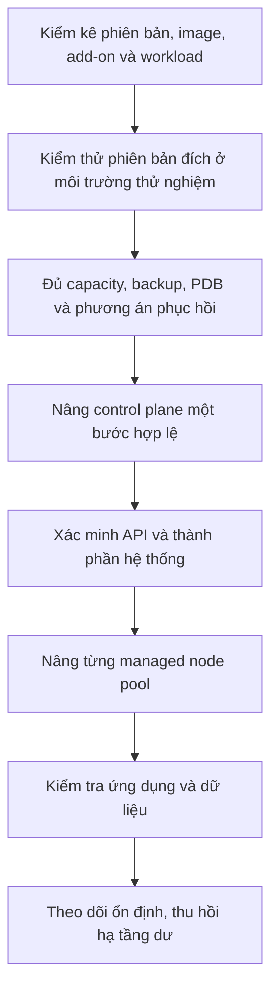

# Nâng cấp cluster, bảo trì node và kiểm soát gián đoạn

## 1. Mục tiêu và phạm vi

Trong chương **Kubernetes với OKE** của module **CLOUD_PROVIDERS_ORACLE**, bài này hướng dẫn duy trì khả năng phục vụ khi nâng cấp Oracle Kubernetes Engine (OKE), thay worker node hoặc bảo trì máy Compute bên dưới node.

Một đợt nâng cấp thành công phải thỏa mãn đồng thời ba điều kiện: hạ tầng đạt trạng thái mong muốn, ứng dụng vẫn đáp ứng yêu cầu nghiệp vụ và dữ liệu được bảo toàn. Trạng thái `ACTIVE` của cluster hay `Ready` của node mới chỉ phản ánh một phần kết quả.

Sau bài học, người học có thể:

- Lập thứ tự nâng cấp control plane, node pool và thành phần mở rộng theo ràng buộc tương thích.
- Chọn thay node trong pool hiện tại hoặc chuyển workload sang pool mới.
- Phối hợp PodDisruptionBudget (PDB), phân bố Pod, dung lượng dự phòng và graceful shutdown.
- Thực hiện cordon, drain, xác minh rồi đưa node trở lại phục vụ.
- Đặt điều kiện dừng, theo dõi gián đoạn và chuẩn bị phương án phục hồi phù hợp với OCI.

Các thao tác OKE trong bài tập trung vào **managed node pool**. Với self-managed node hoặc virtual node, cần sử dụng quy trình riêng của loại node đó; không áp dụng máy móc cơ chế thay managed node.

## 2. Xác định đúng lớp đang thay đổi

| Lớp | Ví dụ thay đổi | Điều cần xác minh |
|---|---|---|
| Control plane | Nâng phiên bản Kubernetes của cluster | API, admission webhook và controller vẫn hoạt động |
| Cấu hình managed node pool | Đổi phiên bản Kubernetes hoặc image dùng cho node mới | Cấu hình mong muốn khớp kế hoạch |
| Worker node thực tế | Thay instance hoặc boot volume để áp dụng cấu hình | Phiên bản kubelet, image, trạng thái node và Pod |
| Add-on, controller | DNS, CNI, CSI, ingress, metrics | Tương thích với phiên bản đích, đường đi mạng và lưu trữ |
| Ứng dụng | Rollout image hoặc thay cấu hình | Readiness, shutdown, kết nối và hành vi nghiệp vụ |
| Dữ liệu | Sao lưu, phục hồi, thay vị trí chạy Pod | Tính nhất quán, thời gian khôi phục và topology của volume |

**Đổi phiên bản trong cấu hình node pool không tự đổi phiên bản Kubernetes trên các managed node đang tồn tại.** Cần tiếp tục thay hoặc cycle node theo phương thức được hỗ trợ. Vì vậy, phải đối chiếu cấu hình pool với phiên bản thực tế của từng node. [Nguồn: cập nhật managed node pool](https://docs.oracle.com/en-us/iaas/Content/ContEng/Tasks/update-node-pool.htm).

Oracle quản lý control plane nhưng người vận hành vẫn chịu trách nhiệm kiểm thử ứng dụng và chuẩn bị thay worker node. Với virtual node, nâng control plane còn có tác động nâng phiên bản virtual node theo cơ chế OKE; đây là lý do phải kiểm kê loại node trước khi lên lịch. [Nguồn: nâng cấp các loại worker node](https://docs.oracle.com/en-us/iaas/Content/ContEng/Tasks/contengupgradingworkernodes.htm).

## 3. Lập đường nâng cấp và kiểm tra tương thích

Không cố định một phiên bản “mới nhất” trong runbook dùng lâu dài. Tại thời điểm thực hiện, chọn phiên bản OKE hỗ trợ trong region, xác định đường nâng cấp hợp lệ và kiểm tra release note của các thành phần liên quan. Tránh dùng preview cho môi trường production.

Với bước nâng minor thông thường, trình tự là:



Kubernetes quy định kubelet không được mới hơn kube-apiserver; `kubectl` thường nằm trong khoảng chênh một minor so với API server. Giới hạn skew còn phụ thuộc phiên bản thành phần và công cụ triển khai. Không suy ra quyền bỏ qua minor chỉ từ việc hai phiên bản có thể cùng tồn tại. [Nguồn: version skew policy](https://kubernetes.io/releases/version-skew-policy/).

Cần lập ma trận thực tế:

| Thành phần | Hiện tại | Đích | Bằng chứng cần có |
|---|---|---|---|
| Control plane | Giá trị lấy từ cluster | Phiên bản OKE cho phép | Đường nâng cấp hợp lệ |
| Từng node pool | Cấu hình pool và kubelet trên node | Phiên bản/image tương thích | Kế hoạch thay node |
| CNI, CSI, DNS | Phiên bản đang chạy | Bản hỗ trợ cluster đích | Hướng dẫn của thành phần |
| Webhook, operator, CRD | Bản cài đặt hiện tại | Bản tương thích | Kiểm thử admission và reconcile |
| Manifest, Helm chart | API đang sử dụng | API còn phục vụ ở bản đích | Render và kiểm thử trên cluster thử nghiệm |
| Công cụ vận hành | OCI CLI, kubectl, IaC provider | Bản phù hợp | Lệnh và schema được hỗ trợ |

Một ngoại lệ quan trọng là **image hệ điều hành**: cluster dùng Oracle Linux 7 có thể cần chuyển sang node pool với image được hỗ trợ trước một số mốc nâng Kubernetes. Ví dụ, Oracle có hướng dẫn riêng cho managed node OL7 khi chuyển tới Kubernetes 1.35 trở lên. Hãy giải quyết ràng buộc image trước khi áp dụng thứ tự nâng cấp thông thường. [Nguồn: yêu cầu khi nâng managed node tới 1.35 trở lên](https://docs.oracle.com/en-us/iaas/Content/ContEng/Tasks/contengupgradingk8sworkernode_topic-Upgrading_managed_nodes_to_k8s_135.htm).

## 4. Từ yêu cầu khả dụng đến ngân sách gián đoạn

Giả sử dịch vụ cần tối thiểu hai replica khỏe để đáp ứng tải đã đo. Với ba replica khỏe, việc di chuyển một replica có thể nằm trong ngân sách. Nếu một replica đã lỗi trước bảo trì, hai replica còn lại không còn dư địa cho cùng thao tác.

Mô hình lập kế hoạch đơn giản:

```text
R = số replica mong muốn
H = số replica khỏe hiện tại
M = số replica khỏe tối thiểu theo yêu cầu vận hành

Dư địa di chuyển sơ bộ = max(0, H - M)
```

Đây là cách suy nghĩ cho kế hoạch, không phải công thức thay thế trạng thái `disruptionsAllowed` do PDB controller tính toán. Pod đã có yêu cầu eviction hoặc quá trình reconcile chưa hoàn tất có thể làm số liệu tức thời khác mô hình.

Ngoài replica, cần đủ tài nguyên **trên các node đủ điều kiện nhận Pod**:

```text
Dung lượng có thể nhận workload
  >= requests của workload cần di chuyển
   + phần dự phòng cho tải và thành phần hệ thống
```

Phép cộng CPU và RAM toàn cluster chỉ là kiểm tra đầu tiên. Pod còn bị giới hạn bởi taint, affinity, kiến trúc CPU, số Pod tối đa, subnet IP, volume topology và hạn mức tài nguyên.

Ví dụ tự xây dựng: ba node, mỗi node có 4 vCPU và 12 GiB allocatable cho workload ứng dụng. Tổng requests là 9 vCPU và 24 GiB. Khi mất một node, hai node còn lại chỉ có 8 vCPU và 24 GiB. Hệ thống thiếu CPU theo requests dù biểu đồ CPU sử dụng thực tế trước bảo trì rất thấp. Phương án phù hợp có thể là thêm một node dự phòng hoặc chuyển sang pool mới trước khi drain.

Tính khả dụng cũng cần đo bằng yêu cầu thực: tỷ lệ thành công, độ trễ, thời gian mất kết nối và tính đúng của giao dịch. Ba Pod `Ready` không chứng minh luồng thanh toán hoạt động nếu cả ba đều mất kết nối tới Oracle Database.

## 5. Hiểu đúng PodDisruptionBudget

PDB giới hạn eviction tự nguyện qua Eviction API. Nó không ngăn sự cố máy, mất mạng hoặc việc xóa Pod trực tiếp. Các Pod mất khả dụng do sự cố vẫn ảnh hưởng ngân sách còn lại. Controller ứng dụng khi rolling update không bị PDB điều tiết giống thao tác drain. [Nguồn: disruptions trong Kubernetes](https://kubernetes.io/docs/concepts/workloads/pods/disruptions/).

Ví dụ một PDB cho ứng dụng có ba replica:

```yaml
apiVersion: policy/v1
kind: PodDisruptionBudget
metadata:
  name: maintenance-web
  namespace: oke-maintenance-lab
spec:
  minAvailable: 2
  selector:
    matchLabels:
      app: maintenance-web
```

Trong ví dụ này:

| Tình trạng trước eviction | Diễn giải dự kiến |
|---|---|
| Ba replica khỏe | Có dư địa cho một replica bị eviction |
| Hai replica khỏe, một replica lỗi | Eviction replica khỏe tiếp theo thường bị chặn |
| Một replica duy nhất, minAvailable bằng một | Không có dư địa cho eviction replica khỏe đó |
| Ba replica nhưng cùng trên một node | Drain phải chờ Pod thay thế khỏe; sự cố node vẫn có thể mất cả ba |

Chỉ khai báo một trong `minAvailable` hoặc `maxUnavailable`. Selector phải đúng workload và namespace. Với `policy/v1`, selector rỗng `{}` khớp toàn bộ Pod trong namespace. Giá trị phần trăm có làm tròn lên; chẳng hạn `maxUnavailable: "30%"` với một replica có thể cho phép gián đoạn replica duy nhất. [Nguồn: cấu hình PDB và quy tắc làm tròn](https://kubernetes.io/docs/tasks/run-application/configure-pdb/).

Quan sát ngân sách:

```bash
kubectl get pdb -A
kubectl describe pdb maintenance-web -n oke-maintenance-lab
kubectl get pdb maintenance-web -n oke-maintenance-lab -o yaml
```

Đọc `currentHealthy`, `desiredHealthy`, `expectedPods` và `disruptionsAllowed`. Nếu không còn ngân sách, hãy tìm nguyên nhân: Pod chưa Ready, replica thiếu, eviction đang diễn ra hoặc cấu hình PDB không phù hợp. Việc hạ PDB cần đi cùng đánh giá khả năng phục vụ.

## 6. Phân biệt ba cơ chế giới hạn thay đổi

| Cơ chế | Đơn vị | Điều khiển |
|---|---|---|
| OKE maximum surge / maximum unavailable | Node trong managed node pool | Tài nguyên bổ sung và số node có thể mất khả dụng khi cycling |
| Deployment maxSurge / maxUnavailable | Pod của một Deployment | Cách controller thay ReplicaSet khi rollout ứng dụng |
| PodDisruptionBudget | Pod được selector chọn | Eviction tự nguyện còn được phép |

Cấu hình Deployment `maxUnavailable: 0` không tạo capacity cho node pool. PDB `minAvailable: 2` cũng không buộc OKE luôn có thêm node đủ tài nguyên. Ba cơ chế phải được phối hợp với scheduler và ứng dụng.

Với Deployment, `minReadySeconds` có thể buộc Pod mới duy trì readiness một khoảng thời gian trước khi được coi là available cho rollout. Đây là một lớp kiểm soát riêng với PDB. [Nguồn: chiến lược cập nhật Deployment](https://kubernetes.io/docs/concepts/workloads/controllers/deployment/).

## 7. Chuẩn bị workload mẫu cho bảo trì

Ví dụ dưới đây dùng ba replica HTTP để quan sát drain. Chạy trong một cluster thử nghiệm có ít nhất ba node phù hợp. Khối lệnh là Bash, chẳng hạn trong OCI Cloud Shell; đây là hướng dẫn thực hành, không phải yêu cầu tạo thêm file trong repository.

```bash
kubectl apply -f - <<'YAML'
apiVersion: v1
kind: Namespace
metadata:
  name: oke-maintenance-lab
---
apiVersion: apps/v1
kind: Deployment
metadata:
  name: maintenance-web
  namespace: oke-maintenance-lab
spec:
  replicas: 3
  minReadySeconds: 10
  strategy:
    type: RollingUpdate
    rollingUpdate:
      maxSurge: 1
      maxUnavailable: 0
  selector:
    matchLabels:
      app: maintenance-web
  template:
    metadata:
      labels:
        app: maintenance-web
    spec:
      terminationGracePeriodSeconds: 45
      topologySpreadConstraints:
        - maxSkew: 1
          topologyKey: kubernetes.io/hostname
          whenUnsatisfiable: DoNotSchedule
          labelSelector:
            matchLabels:
              app: maintenance-web
      containers:
        - name: web
          image: nginx:stable
          ports:
            - name: http
              containerPort: 80
          resources:
            requests:
              cpu: 100m
              memory: 64Mi
            limits:
              cpu: 500m
              memory: 128Mi
          readinessProbe:
            httpGet:
              path: /
              port: http
            periodSeconds: 3
            failureThreshold: 2
          lifecycle:
            preStop:
              exec:
                command: ["sh", "-c", "sleep 5"]
---
apiVersion: v1
kind: Service
metadata:
  name: maintenance-web
  namespace: oke-maintenance-lab
spec:
  selector:
    app: maintenance-web
  ports:
    - port: 80
      targetPort: http
---
apiVersion: policy/v1
kind: PodDisruptionBudget
metadata:
  name: maintenance-web
  namespace: oke-maintenance-lab
spec:
  minAvailable: 2
  selector:
    matchLabels:
      app: maintenance-web
YAML
```

`nginx:stable` phục vụ minh họa. Trong quy trình thật, sử dụng image đã kiểm thử và ghi nhận digest để việc tái tạo không phụ thuộc tag thay đổi.

Kiểm tra:

```bash
kubectl rollout status deployment/maintenance-web -n oke-maintenance-lab --timeout=180s
kubectl get pods -n oke-maintenance-lab -o wide
kubectl get pdb -n oke-maintenance-lab
kubectl get endpointslice -n oke-maintenance-lab -l kubernetes.io/service-name=maintenance-web
```

Ràng buộc spread theo hostname giúp điều khiển phân bố Pod; `DoNotSchedule` có thể khiến Pod Pending khi không còn vị trí hợp lệ. Khi cần chịu lỗi theo availability domain, đánh giá thêm topology theo zone và nhãn thực tế của node. Spread không tự tạo thêm node. [Nguồn: topology spread constraints](https://kubernetes.io/docs/concepts/scheduling-eviction/topology-spread-constraints/).

Khoảng `preStop` năm giây chỉ minh họa thời gian chờ cho đường định tuyến hội tụ. Nó không thay thế xử lý shutdown của ứng dụng. Thời gian thực thi hook nằm trong ngân sách `terminationGracePeriodSeconds`, cần chừa đủ thời gian cho ứng dụng kết thúc sau hook. [Nguồn: container lifecycle hooks](https://kubernetes.io/docs/concepts/containers/container-lifecycle-hooks/).

Ứng dụng thực phải xử lý SIGTERM, ngừng nhận công việc mới, hoàn tất yêu cầu đang chạy, đóng connection pool và ghi nhận tiến độ công việc. Đặt thời gian chờ dựa trên tải thử nghiệm, giới hạn giao dịch và hành vi ingress/load balancer. Khi hết grace period, container có thể bị kết thúc cưỡng bức; readiness không bảo đảm mọi kết nối đang mở đã hoàn thành. [Nguồn: vòng đời và kết thúc Pod](https://kubernetes.io/docs/concepts/workloads/pods/pod-lifecycle/).

## 8. Chọn chiến lược nâng managed node

### 8.1. Thay node trong pool hiện tại

Giữ nguyên node pool, đổi cấu hình đích rồi thay node theo đợt. Cách này phù hợp khi muốn giới hạn hạ tầng trùng lặp và các điều kiện triển khai của pool vẫn đáp ứng yêu cầu.

OKE có hai cách cycling cần phân biệt:

- **Replace nodes / INSTANCE_REPLACE:** tạo instance thay thế; instance mới có OCID và địa chỉ mạng mới.
- **Replace boot volume / BOOT_VOLUME_REPLACE:** thay boot volume, giữ instance; chỉ áp dụng được các thuộc tính được cơ chế này hỗ trợ.

Cycling managed node yêu cầu enhanced cluster. Với basic cluster, xem phương án thay managed node thủ công hoặc dùng pool mới. Không nâng cấp cluster type chỉ để thử một nút chức năng mà chưa tính chi phí. [Nguồn: thay managed node](https://docs.oracle.com/en-us/iaas/Content/ContEng/Tasks/replace-worker-node-top.htm), [cập nhật bằng cycling](https://docs.oracle.com/en-us/iaas/Content/ContEng/Tasks/contengupgradingimageworkernode_topic-Performing_an_InPlace_Worker_Node_Update_By_Cycling_an_Existing_Node_Pool.htm).

### 8.2. Chuyển sang node pool mới

Tạo pool đích, kiểm thử node mới rồi di chuyển workload khỏi pool cũ. Cách này thuận tiện khi đổi image, shape, kiến trúc hoặc muốn giữ đường lui ở lớp worker.

Hai pool vẫn dùng chung control plane. Vì vậy, giữ pool cũ không tạo khả năng quay lại control plane trước nâng cấp. Oracle mô tả đây là nâng managed node theo kiểu out-of-place. [Nguồn: các phương thức nâng managed node](https://docs.oracle.com/en-us/iaas/Content/ContEng/Tasks/contengupgradingk8sworkernode.htm).

| Tiêu chí | Thay trong pool hiện tại | Pool mới |
|---|---|---|
| Tài nguyên trùng lặp | Tùy surge và chế độ cycling | Tùy kích thước pool mới được dựng trước |
| Thử cấu hình worker mới | Trong phạm vi cơ chế thay node | Có thể chạy canary trên pool đích |
| Giữ worker cũ để quay lại | Hạn chế khi đã thay xong | Có thể giữ pool cũ trong thời gian quan sát |
| Điều cần chú ý | Drain, batch size, image và trạng thái node | Label, taint, IAM, mạng và volume placement |
| Phạm vi bảo vệ | Lớp worker | Lớp worker |

Nếu cần kiểm thử toàn bộ control plane mới và giữ nguyên cluster nguồn, phương án là cluster riêng. Khi đó phải thiết kế thêm chuyển traffic, đồng bộ dữ liệu, chứng chỉ, secrets và cách quay lại.

## 9. Preflight trên OCI và Kubernetes

### 9.1. Xác nhận đích và quyền thao tác

Ghi rõ tenancy, region, compartment, cluster OCID, node pool OCID và context Kubernetes. Tên hiển thị giống nhau không đủ để xác định môi trường.

Kiểm tra cả hai lớp quyền:

- OCI IAM cho phép cập nhật đúng cluster/node pool và sử dụng tài nguyên liên quan.
- Kubernetes RBAC cho phép kiểm tra node, cordon và tạo eviction theo phạm vi cần thiết.

```bash
kubectl config current-context
kubectl cluster-info
kubectl version
kubectl auth can-i patch nodes
kubectl auth can-i create pods/eviction -n oke-maintenance-lab
```

Lệnh kiểm tra namespace mẫu không chứng minh quyền trên mọi namespace. Khi bảo trì node chạy nhiều workload, phải đánh giá toàn bộ phạm vi Pod trên node đó.

### 9.2. Ghi nhận trạng thái ban đầu

```bash
kubectl get nodes -o wide
kubectl get nodes -L topology.kubernetes.io/zone
kubectl get pods -A -o wide
kubectl get deployments,statefulsets,daemonsets -A
kubectl get pdb -A
kubectl get pvc -A
kubectl get pv
kubectl get events -A --sort-by=.metadata.creationTimestamp
```

Dùng OCI CLI để đọc cấu hình hạ tầng:

```bash
read -r -p "Cluster OCID: " CLUSTER_OCID
read -r -p "Node pool OCID: " NODE_POOL_OCID
oci ce cluster get --cluster-id "$CLUSTER_OCID"
oci ce node-pool get --node-pool-id "$NODE_POOL_OCID"
```

Đối chiếu node trong pool OCI với `spec.providerID` của Kubernetes Node, tránh drain nhầm một pool khác:

```bash
kubectl get nodes -o custom-columns='NAME:.metadata.name,PROVIDER_ID:.spec.providerID,KUBELET:.status.nodeInfo.kubeletVersion'
```

### 9.3. Kiểm tra khả năng tạo node thay thế

Xác minh:

- Hạn mức và quota Compute, boot volume, VNIC/IP cần dùng.
- Capacity cho shape trong availability domain dự kiến.
- IP còn trống ở subnet node và subnet Pod, tùy chế độ mạng.
- Route, NSG/security list, DNS và đường tới API server, registry, dịch vụ OCI.
- Image tương thích phiên bản Kubernetes, kiến trúc CPU và bootstrap.
- Workload Identity hoặc instance principal, dynamic group và policy vẫn phù hợp với node mới.
- Nhãn, taint và cấu hình placement trên pool đích phù hợp scheduler.

Không suy ra “có quota” đồng nghĩa “có capacity”. Một kế hoạch surge tốt trên giấy vẫn có thể dừng ở bước tạo instance.

### 9.4. Backup và điều kiện dừng

Lưu cấu hình khai báo, phiên bản chart, image digest và thông số hạ tầng trong hệ thống quản lý thay đổi của môi trường vận hành. Sao lưu dữ liệu bằng cơ chế phù hợp ứng dụng và xác minh khả năng restore.

Với dịch vụ Oracle Database nằm ngoài OKE, không coi thay node Kubernetes là nâng cấp database. Cần kiểm thử reconnect, wallet/chứng chỉ, pool kết nối và hành vi giao dịch khi Pod bị thay.

Chưa bắt đầu khi backup chưa có bằng chứng phục hồi, workload quan trọng đang lỗi, thiếu capacity hoặc chưa có đường truy cập vận hành dự phòng.

## 10. Nâng control plane có điểm kiểm soát

Trước khi nâng, OKE yêu cầu worker node ở trạng thái READY và kiểm tra tương thích cả phiên bản cấu hình managed node pool lẫn phiên bản thực tế trên node. Control plane sau nâng cấp không thể downgrade về phiên bản trước. [Nguồn: điều kiện nâng control plane](https://docs.oracle.com/en-us/iaas/Content/ContEng/Tasks/contengupgradingk8smasternode.htm).

Quy trình:

1. Hoàn tất kiểm thử và giải quyết ràng buộc image/add-on.
2. Chọn bước nâng hợp lệ do OKE cung cấp.
3. Thực hiện cập nhật qua Console hoặc CLI.
4. Theo dõi Work Request tới trạng thái kết thúc.
5. Kiểm tra API, webhook, operator và workload trước khi nâng worker.

Ví dụ Bash, điền phiên bản được xác nhận từ OKE:

```bash
read -r -p "Phiên bản control plane đích hợp lệ: " TARGET_VERSION
oci ce cluster update --cluster-id "$CLUSTER_OCID" --kubernetes-version "$TARGET_VERSION"
```

Ghi nhận Work Request OCID từ phản hồi hoặc Console rồi kiểm tra:

```bash
read -r -p "Work Request OCID: " WORK_REQUEST_OCID
oci ce work-request get --work-request-id "$WORK_REQUEST_OCID"
kubectl version
kubectl get --raw='/readyz'
kubectl get pods -n kube-system -o wide
kubectl get nodes
```

`/readyz` có thể yêu cầu quyền riêng. Nếu bị từ chối truy cập, phân biệt lỗi phân quyền với lỗi sức khỏe API.

OKE thiết kế control plane có tính sẵn sàng cao trong quá trình nâng cấp. Tuy nhiên, kế hoạch bảo trì vẫn cần đo đường đi ứng dụng và khả năng hoạt động của client/controller; đặc tính control plane không thay thế SLO của hệ thống. [Nguồn: tổng quan nâng cấp OKE](https://docs.oracle.com/en-us/iaas/Content/ContEng/Concepts/contengaboutupgradingclusters.htm).

## 11. Nâng worker bằng node cycling

### 11.1. Chọn giới hạn theo đúng chế độ

Khi **thay instance**, có thể chọn tạo node bổ sung trước khi bỏ node cũ, chẳng hạn `maximumSurge=1`, `maximumUnavailable=0`.

Khi **thay boot volume**, node hiện tại phải tạm ngừng phục vụ; không áp dụng tư duy surge giống thay instance. OKE yêu cầu `maximumUnavailable` lớn hơn không cho chế độ này. Với thay instance, không được đồng thời đặt cả surge và unavailable bằng không. [Nguồn: cân bằng khả dụng và chi phí khi cycling](https://docs.oracle.com/en-us/iaas/Content/ContEng/Tasks/balance-service-availability-cost.htm).

Các giá trị trên là ngân sách node, không phải cam kết ứng dụng không gián đoạn. Chọn batch nhỏ khi chưa có số liệu về drain, khởi động và gắn volume.

### 11.2. Cập nhật pool rồi cycle toàn pool

Với enhanced cluster và managed pool, quy trình CLI minh họa dưới đây cập nhật phiên bản, image tương ứng và yêu cầu thay instance. Xác minh các giá trị đầu vào trước khi chạy:

```bash
read -r -p "Phiên bản Kubernetes đích cho worker: " WORKER_TARGET_VERSION
read -r -p "Image OCID tương thích: " WORKER_IMAGE_OCID

NODE_SOURCE_JSON=$(printf '{"sourceType":"IMAGE","imageId":"%s"}' "$WORKER_IMAGE_OCID")
CYCLING_JSON='{"isNodeCyclingEnabled":true,"cycleModes":["INSTANCE_REPLACE"],"maximumSurge":1,"maximumUnavailable":0}'

oci ce node-pool update --node-pool-id "$NODE_POOL_OCID" --kubernetes-version "$WORKER_TARGET_VERSION" --node-source-details "$NODE_SOURCE_JSON" --node-pool-cycling-details "$CYCLING_JSON"
```

OCI CLI mặc định có thể yêu cầu xác nhận cập nhật thuộc tính phức hợp; đọc nội dung trước khi xác nhận. Không thêm cờ bỏ xác nhận vào lệnh dùng chung.

OKE phân biệt cycling **toàn node pool để nâng phiên bản** với cycling một managed node riêng lẻ; thao tác riêng lẻ không đổi phiên bản Kubernetes trên node theo cơ chế này. Không dùng một lần cycle riêng lẻ làm bằng chứng pool đã được nâng cấp. [Nguồn: nâng managed node bằng thay instance](https://docs.oracle.com/en-us/iaas/Content/ContEng/Tasks/contengupgradingimageworkernode_topic-InPlace_Worker_Node_Upgrade_By_Cycling_and_Replacing_Nodes.htm).

Trong lúc OKE đang quản lý cycling của pool, tránh chạy thêm drain hoặc xóa instance trên cùng pool. Nếu cần điểm dừng có kiểm soát giữa các nhóm workload, hãy thiết kế pool riêng hoặc dùng quy trình di chuyển thủ công phù hợp.

### 11.3. Theo dõi tiến độ

```bash
oci ce node-pool get --node-pool-id "$NODE_POOL_OCID"
kubectl get nodes -o wide
kubectl get pods -A -o wide
kubectl get pdb -A
```

Kiểm tra Work Request trong Console hoặc bằng CLI như bước nâng control plane. Quan sát cả ứng dụng trong suốt thao tác; không đợi Work Request kết thúc mới xem lỗi.

### 11.4. Hiểu eviction grace period của OKE

OKE có khoảng chờ cordon/drain ở lớp node và tùy chọn tiếp tục shutdown/terminate khi hết thời gian dù drain chưa xong. Khoảng chờ này khác `terminationGracePeriodSeconds` của từng Pod.

Giữ lựa chọn force phù hợp với yêu cầu bảo toàn workload; không bật force chỉ để thao tác hoàn thành. Nếu không evict được Pod trong thời hạn, pool có thể chuyển `Needs attention` và Work Request thất bại. Hãy đọc log, xử lý nguyên nhân rồi thực hiện lại theo trạng thái thực tế. [Nguồn: cordon/drain và xử lý Needs attention](https://docs.oracle.com/en-us/iaas/Content/ContEng/Tasks/contengdeletingworkernodes_topic-Notes_on_cordon_and_drain.htm).

## 12. Di chuyển bằng pool mới

Một quy trình thực tế:

1. Tạo pool đích với phiên bản/image đã kiểm thử và placement đủ nhận workload.
2. Giữ các label nghiệp vụ cần thiết, cấu hình taint/toleration đúng chủ đích.
3. Chạy canary để kiểm tra pull image, DNS, mạng, mount volume và quyền truy cập OCI.
4. Xác nhận node đích `Ready` và các DaemonSet cần thiết đã hoạt động.
5. Cordon các node nguồn theo kế hoạch rồi drain từng node.
6. Đợi workload phục hồi đủ khả năng phục vụ trước bước tiếp theo.
7. Giữ pool nguồn trong khoảng quan sát nếu cần đường lui.
8. Xóa pool nguồn sau khi hoàn tất kiểm chứng và ghi nhận chi phí còn lại.

Cordon toàn bộ pool nguồn có thể giúp Pod chuyển sang pool đích, nhưng chỉ thực hiện sau khi pool đích đủ dung lượng và đạt điều kiện scheduling. Cordon không tự di chuyển Pod đang chạy.

Một lỗi phổ biến là workload có `nodeSelector` trỏ tới nhãn riêng của pool cũ. Node mới có nhiều tài nguyên vẫn không nhận được Pod. Nên dùng nhãn biểu thị nhu cầu workload, ví dụ `workload-tier=application`, rồi quản lý giá trị đó có chủ đích trên các pool phù hợp.

Tương tự, nếu policy hoặc công cụ giám sát gắn cứng vào OCID instance cũ, thay instance có thể làm node mới thiếu quyền hoặc mất quan sát. Cần kiểm thử danh tính và telemetry trước khi chuyển toàn bộ traffic.

Phối hợp Cluster Autoscaler và IaC/GitOps: tránh để một công cụ thu nhỏ pool dự phòng trong khi công cụ khác đang di chuyển workload. Ghi rõ ai quản lý kích thước pool trong cửa sổ bảo trì và khôi phục trạng thái mong muốn sau đó.

## 13. Bảo trì một node bằng cordon và drain

Quy trình này dùng khi người vận hành chủ động quản lý một node, không chạy chồng lên cycling đang diễn ra.

### 13.1. Kiểm tra trước khi drain

```bash
read -r -p "Tên Kubernetes node cần bảo trì: " NODE_NAME
kubectl get node "$NODE_NAME" -o wide
kubectl get pods -A --field-selector "spec.nodeName=$NODE_NAME" -o wide
kubectl describe node "$NODE_NAME"
kubectl get pdb -A
```

Xác định workload không có controller, Pod dùng local storage, tác vụ dài và ràng buộc volume trước khi tiếp tục.

### 13.2. Cordon rồi drain

```bash
kubectl cordon "$NODE_NAME"
kubectl drain "$NODE_NAME" --ignore-daemonsets --timeout=20m
```

`cordon` ngăn scheduler thông thường đặt Pod mới nhưng giữ Pod hiện hữu. `drain` sử dụng eviction và đợi kết thúc các Pod thuộc phạm vi xử lý. DaemonSet và một số Pod đặc biệt không bị di chuyển như Pod ứng dụng thông thường. Khi lệnh hoàn tất, vẫn phải xác minh replica thay thế và khả năng phục vụ; drain thành công không chứng minh workload đã Ready ở nơi khác. [Nguồn: drain node an toàn](https://kubernetes.io/docs/tasks/administer-cluster/safely-drain-node/).

Nếu lệnh timeout, node vẫn có thể đang cordon và một phần Pod đã được di chuyển. Kiểm kê lại trạng thái trước thao tác tiếp theo.

### 13.3. Hiểu các cờ trước khi dùng

| Cờ | Tác dụng cần nhớ |
|---|---|
| `--ignore-daemonsets` | Cho phép drain tiếp tục khi có DaemonSet; không xóa các Pod DaemonSet đó |
| `--delete-emptydir-data` | Chấp nhận mất dữ liệu local trong emptyDir của Pod bị di chuyển |
| `--force` | Cho phép xử lý Pod không có controller phù hợp; không có nghĩa bỏ qua PDB |
| `--disable-eviction` | Dùng DELETE thay eviction, bỏ qua kiểm tra PDB |
| `--grace-period` | Thay thời gian kết thúc của Pod cho thao tác này |
| `--timeout` | Giới hạn thời gian chờ của lệnh |

Không thêm các cờ xóa dữ liệu hoặc bỏ qua eviction như cách sửa lỗi mặc định. [Nguồn: tham chiếu kubectl drain](https://kubernetes.io/docs/reference/kubectl/generated/kubectl_drain/).

### 13.4. Bảo trì và đưa node trở lại

Chỉ reboot hoặc thực hiện bảo trì sau khi đã xác minh drain và tình trạng dịch vụ. Với managed node, dùng thao tác quản lý OKE phù hợp; `kubectl delete node` chỉ xử lý đối tượng Kubernetes, không phải quy trình thay Compute instance và quản lý pool.

Nếu giữ nguyên node để tiếp tục sử dụng:

```bash
kubectl wait --for=condition=Ready "node/$NODE_NAME" --timeout=10m
kubectl describe node "$NODE_NAME"
kubectl get pods -n kube-system -o wide
```

Sau khi xác nhận CNI, CSI, tài nguyên và workload đủ điều kiện:

```bash
kubectl uncordon "$NODE_NAME"
```

Uncordon không tự cân bằng lại các Pod đã chuyển đi. Nếu đã thay instance, tên node có thể thay đổi; xác định node mới bằng quan hệ với OCI instance thay vì dùng lại tên cũ.

## 14. Workload có trạng thái và dịch vụ cơ sở dữ liệu

StatefulSet cung cấp danh tính ổn định và liên kết lưu trữ cho replica, nhưng khả năng chịu gián đoạn phụ thuộc cơ chế replication, quorum và phục hồi của ứng dụng. Tăng số Pod của database không tự tạo cấu hình database HA đúng. [Nguồn: StatefulSet](https://kubernetes.io/docs/concepts/workloads/controllers/statefulset/).

Trước khi di chuyển Pod có trạng thái, cần trả lời:

- Replica nào là leader và việc đổi leader diễn ra thế nào?
- Mất một replica có giữ được quorum và khả năng ghi không?
- Volume có gắn được vào node đích không?
- Thời gian detach/attach, mount và phục hồi log là bao lâu?
- Backup có nhất quán với dữ liệu ứng dụng và đã thử restore chưa?
- Nếu client timeout, retry có gây ghi lặp hoặc giao dịch không xác định không?

OCI Block Volume thông thường gắn với availability domain; node nhận Pod phải phù hợp topology của volume. Thêm node ở AD khác không tự làm volume hiện hữu gắn sang đó. Cần xem PV node affinity, StorageClass và placement thực tế. [Nguồn: phạm vi availability domain của Block Volume](https://docs.oracle.com/en-us/iaas/Content/Block/Concepts/overview.htm).

```bash
kubectl get pvc -A
kubectl get pv
kubectl get storageclass
kubectl describe pod <ten-pod> -n <namespace>
kubectl describe pv <ten-pv>
```

Các giá trị trong dấu `<...>` là chỗ thay bằng tên thực tế, không chạy nguyên văn.

Lỗi `Multi-Attach` hoặc `volume node affinity conflict` cần được xử lý theo trạng thái attachment/topology. Không xóa PVC hay cưỡng bức detach chỉ để làm Pod hết Pending khi chưa xác minh tiến trình ghi trên node cũ.

Với ứng dụng dùng Autonomous Database hoặc Oracle Database bên ngoài cluster, drain vẫn có thể cắt kết nối TCP của Pod. Kiểm tra reconnect, timeout, connection validation và idempotency của giao dịch. Bảo trì worker và bảo trì database là hai kế hoạch phối hợp, mỗi kế hoạch có điều kiện thành công riêng.

## 15. Giám sát và quyết định dừng

Theo dõi ba lớp tín hiệu trong suốt cửa sổ thay đổi:

| Lớp | Tín hiệu | Ý nghĩa vận hành |
|---|---|---|
| OCI | Work Request, trạng thái node pool, lỗi tạo instance | Biết thao tác đang tiến triển hay cần can thiệp |
| Kubernetes | Ready, Pending, eviction, PDB, sự kiện mount | Phân biệt lỗi capacity, scheduling và storage |
| Ứng dụng | Lỗi, latency, giao dịch, queue lag, reconnect | Xác nhận mức ảnh hưởng tới người dùng |

Ví dụ tiêu chí **do đội vận hành tự đặt sau thử tải**, không phải mặc định của OKE:

| Tiêu chí | Ngưỡng minh họa | Hành động |
|---|---|---|
| Tỷ lệ lỗi HTTP | Trên 1% trong 5 phút | Dừng chuyển workload tiếp |
| p95 latency | Trên hai lần baseline trong 5 phút | Kiểm tra capacity và downstream |
| Replica khỏe dịch vụ mẫu | Dưới hai | Khôi phục capacity trước |
| Pod thay thế Pending | Quá 5 phút | Đọc Events, không drain thêm |
| Dịch vụ dữ liệu | Mất quorum hoặc không xác nhận được ghi | Chuyển sang xử lý sự cố dữ liệu |
| Work Request | Failed hoặc Needs attention | Đọc lỗi, kiểm kê trạng thái thực |

“Dừng” nghĩa là không khởi phát đợt tiếp theo và xử lý trạng thái hiện tại. Không giả định đóng terminal sẽ hủy Work Request OCI, hoặc một thao tác đã chạy luôn có thể cancel an toàn. Cần xem khả năng điều khiển của thao tác cụ thể.

Các lệnh chẩn đoán cơ bản:

```bash
kubectl get pods -A --field-selector=status.phase=Pending
kubectl get events -A --sort-by=.metadata.creationTimestamp
kubectl describe pod <ten-pod> -n <namespace>
kubectl describe pdb <ten-pdb> -n <namespace>
oci ce node-pool get --node-pool-id "$NODE_POOL_OCID"
oci ce work-request get --work-request-id "$WORK_REQUEST_OCID"
```

Với đường đi qua OCI Load Balancer hoặc ingress, gửi yêu cầu thử từ phía người dùng hoặc hệ thống kiểm thử bên ngoài đường đi đó. `kubectl port-forward` hữu ích cho chẩn đoán riêng một Pod nhưng không kiểm chứng toàn bộ đường traffic.

## 16. Phục hồi theo đúng lớp bị ảnh hưởng

| Tình huống | Hướng phục hồi |
|---|---|
| Node mới không tạo được | Khôi phục capacity khả dụng, xử lý quota/IP/shape/image trước khi tiếp tục |
| Drain bị PDB chặn | Phục hồi replica lỗi, thêm vị trí chạy hoặc điều chỉnh kế hoạch gián đoạn |
| Ứng dụng lỗi trên pool mới | Chuyển về pool nguồn còn tương thích và đủ dung lượng |
| Cấu hình node mới lỗi | Dùng image/cấu hình đã biết tốt và phương thức thay node được hỗ trợ |
| Control plane đã nâng | Sửa tương thích tiến tới hoặc chuyển sang cluster phục hồi đã chuẩn bị |
| Dữ liệu không nhất quán | Kích hoạt quy trình phục hồi dữ liệu riêng, xác nhận RPO/RTO |

Không có lệnh downgrade control plane OKE để đảo ngược việc nâng cấp. Khôi phục ứng dụng trên cluster khác cần cả dữ liệu, secrets, quyền IAM, mạng và đường chuyển traffic.

Giữ pool cũ hữu ích khi node cũ vẫn tương thích với control plane hiện tại. Trước khi đưa workload trở lại, phải kiểm tra node còn khỏe, nhãn/taint phù hợp và không có Pod đang ghi dữ liệu xung đột.

Sao lưu manifest không phải sao lưu dữ liệu. Snapshot volume cũng cần được đánh giá về tính nhất quán của ứng dụng. Đường lui đáng tin cậy là đường đã được thử, có người phụ trách và có điều kiện kích hoạt rõ ràng.

## 17. Tình huống thực hành: ba node, một lần di chuyển

### 17.1. Giả định

Một cluster thử nghiệm có ba managed node. Workload `maintenance-web` có ba replica và PDB yêu cầu hai replica khỏe. Các Pod được phân bố trên node phù hợp. Người học có quyền bảo trì và đã đặt ngưỡng dừng.

Mở hai phiên terminal:

- Phiên thứ nhất theo dõi Pod, PDB và Events.
- Phiên thứ hai thực hiện cordon/drain một node đã chọn.

```bash
kubectl get pods -n oke-maintenance-lab -o wide --watch
```

Trong một cửa sổ quan sát khác khi cần:

```bash
kubectl get pdb maintenance-web -n oke-maintenance-lab --watch
```

Dùng hệ thống thử tải có sẵn để gọi Service liên tục từ workload kiểm thử, hoặc gọi endpoint qua ingress/load balancer nếu cần đánh giá đường truy cập bên ngoài.

### 17.2. Quan sát lần di chuyển đầu tiên

1. Xác nhận ba replica khỏe và có ngân sách eviction.
2. Cordon node chứa một replica.
3. Drain node với tùy chọn cơ bản đã nêu.
4. Quan sát Pod cũ kết thúc, Pod thay thế được tạo và chuyển Ready.
5. Kiểm tra tỷ lệ lỗi, latency và số endpoint khỏe.
6. Chỉ bảo trì node khi đã xác nhận workload phục hồi.

Nếu Pod mới Pending, đọc lý do từ scheduler. Với ba node và ràng buộc spread cứng, khả năng đặt Pod sau cordon phụ thuộc tập node đủ điều kiện và cách tính topology của phiên bản đang dùng. Không đoán rằng số replica luôn tự phục hồi trên hai node còn lại.

### 17.3. Kiểm chứng tình huống thiếu ngân sách

Trên môi trường thử nghiệm, tạm thay PDB của workload mẫu thành `minAvailable: 3` khi cả ba replica đang khỏe, rồi thử drain node chứa một replica. Quan sát eviction bị chặn và Events liên quan. Sau đó trả cấu hình về `minAvailable: 2` và xác minh lại trạng thái trước khi tiếp tục.

Bài thực hành này cho thấy PDB không tạo thêm replica và việc drain dừng chờ có thể là kết quả đúng của yêu cầu khả dụng.

Không dùng cờ bỏ qua eviction để làm bài thực hành “chạy xong”. Mục tiêu là giải thích được trạng thái, tác động của chính sách và cách bổ sung capacity hoặc điều chỉnh kế hoạch.

### 17.4. Khép lại môi trường thử nghiệm

Nếu node được giữ lại, kiểm tra rồi uncordon. Đưa các cấu hình đã thay trong thực hành về trạng thái mong muốn. Khi không còn cần lab, chỉ xóa namespace mẫu sau khi xác nhận nó không chứa tài nguyên dùng chung:

```bash
kubectl delete namespace oke-maintenance-lab
```

Thu hồi node/pool bổ sung qua OKE theo kế hoạch riêng, kiểm tra volume và tài nguyên còn tính phí.

## 18. Các lỗi thường gặp và cách đọc dấu hiệu

| Dấu hiệu | Khả năng cần kiểm tra | Bước tiếp theo |
|---|---|---|
| Pool có phiên bản mới nhưng kubelet vẫn cũ | Mới đổi cấu hình, chưa thay node | Hoàn tất phương thức nâng worker phù hợp |
| Eviction bị từ chối | PDB hết ngân sách hoặc selector sai | Đọc PDB và sức khỏe Pod |
| Pod mới Pending | Thiếu requests capacity, IP hoặc vị trí phù hợp | Đọc Events, label, taint và topology |
| Node Ready nhưng ứng dụng lỗi | Image, dependency, quyền hoặc kết nối khác trước | Kiểm thử luồng nghiệp vụ trên node mới |
| Lỗi pull image | DNS, route, registry hoặc thông tin xác thực | Kiểm tra đường mạng và quyền của workload |
| Pod chờ volume | Attachment chưa giải phóng hoặc sai AD | Kiểm tra CSI, PV và trạng thái Compute |
| Pool Needs attention | Drain không hoàn thành hoặc thao tác node lỗi | Đọc Work Request và node error |
| Sau uncordon, Pod chưa quay về | Scheduler không tự di chuyển mọi Pod đang chạy | Đánh giá nhu cầu phân bố lại riêng |
| Chi phí tăng sau bảo trì | Pool nguồn, boot volume hoặc surge chưa thu hồi | Đối soát tài nguyên theo thay đổi |

Khi kết thúc, ghi nhận phiên bản thực tế của control plane và từng node, số replica khỏe, kết quả giao dịch thử, Work Request cuối cùng và tài nguyên còn giữ để phục hồi. Chỉ khép lại cửa sổ bảo trì khi cả hạ tầng, ứng dụng và dữ liệu đều đạt tiêu chí đã định.

